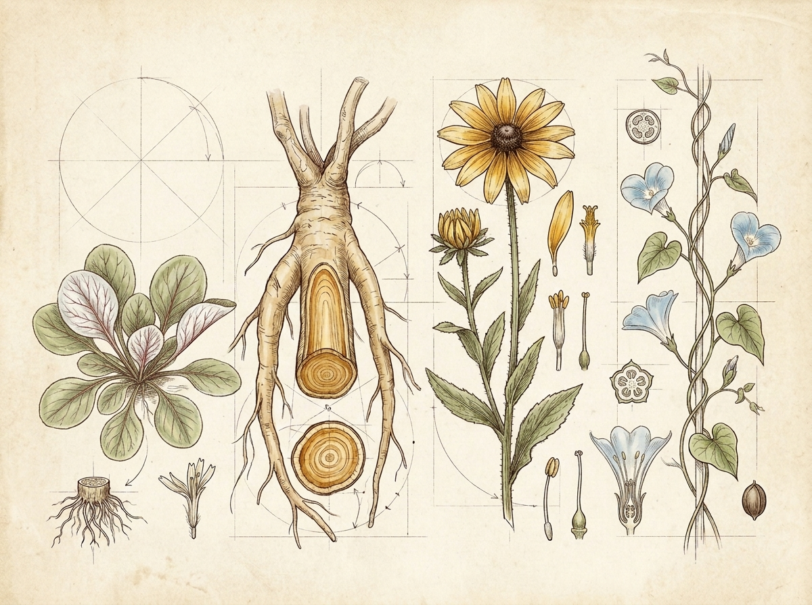
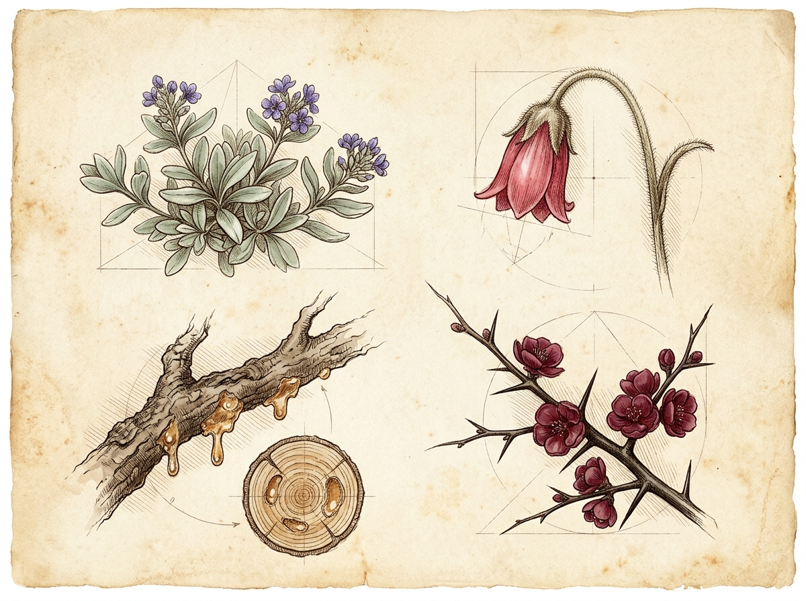
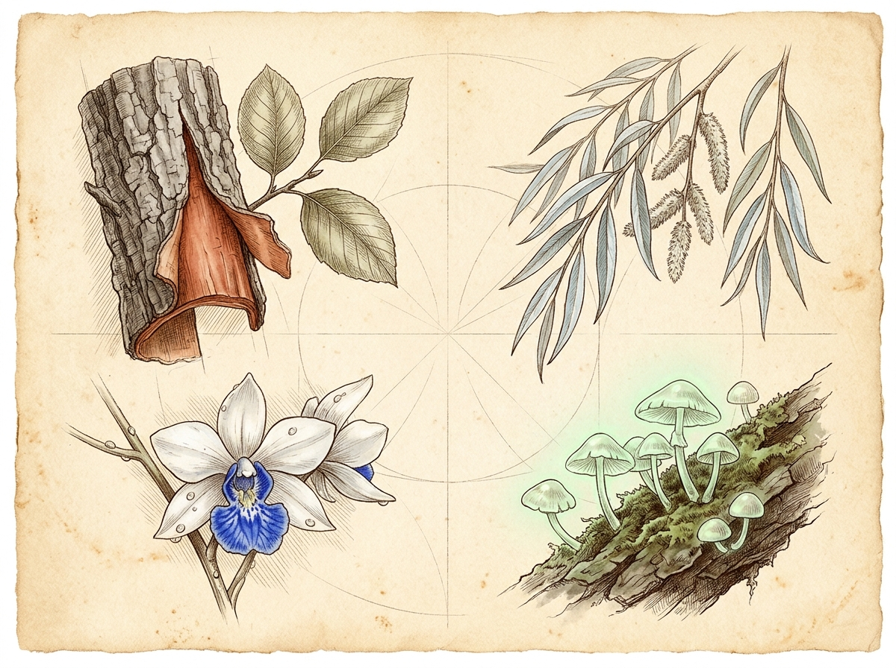
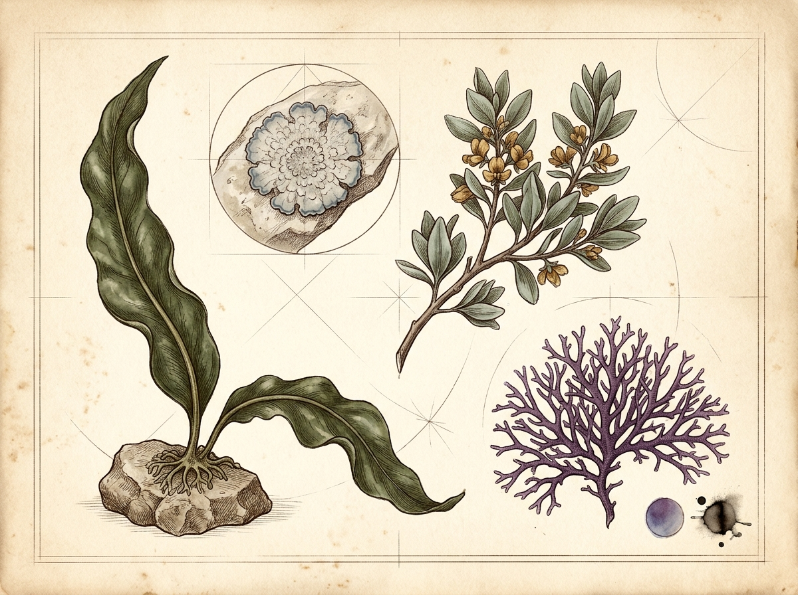
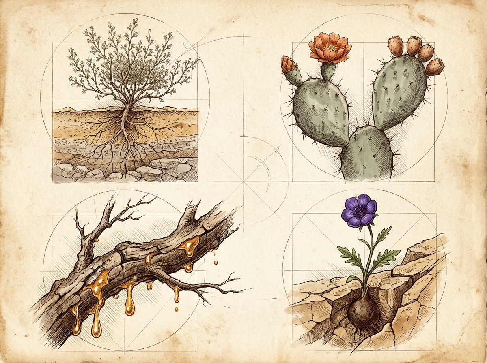
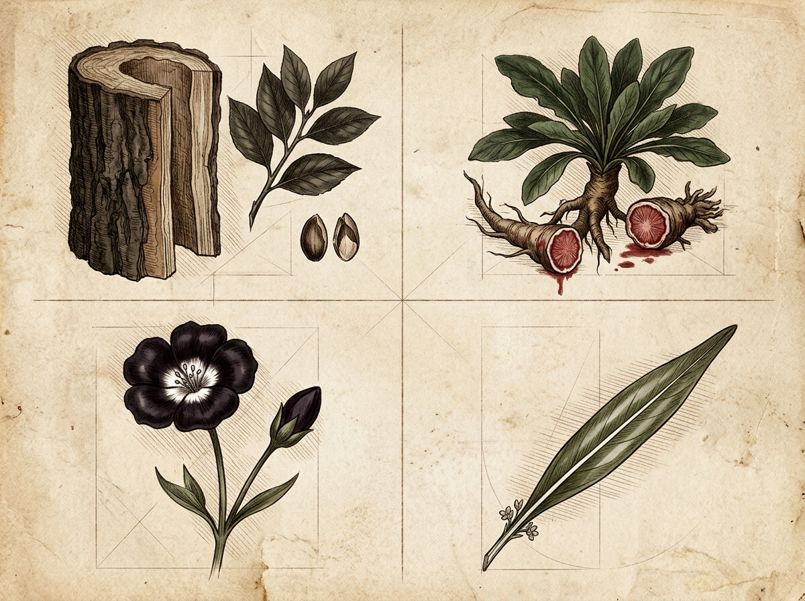
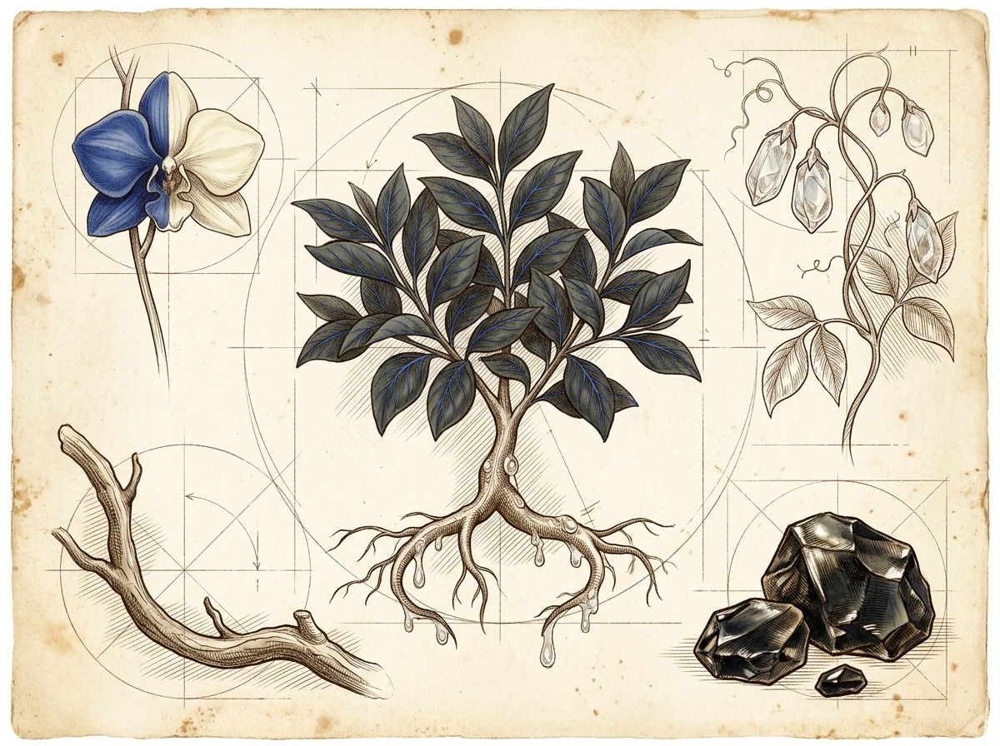
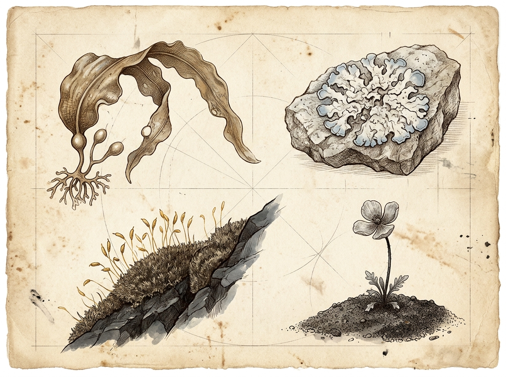

# Das Raízes e dos Remédios

## Herbário de Seleni

*Compêndio das folhas, raízes, flores, ervas, cascas, seivas, sementes, frutos, fungos e algas de Alenia; de seus lugares de nascimento, virtudes, perigos e modos de conservação.*

**Por Loreo Seleni, naturalista e boticário de Baldbella, mestre correspondente da Academia de Sellene.**

**Edição de trabalho para o cenário — Ano 418 da Era da Forja.**

> “Minha mãe conhecia ervas que não tinham nome nos livros. Em Sellene encontrei livros cujos autores jamais haviam tocado as ervas que descreviam. Comecei este trabalho para que uns pudessem corrigir os outros.”
>
> — Loreo Seleni, prefácio à edição dos portos.

Este suplemento apresenta **64 espécies fictícias**, distribuídas por oito conjuntos geográficos, com usos medicinais, alimentares, artesanais, comerciais e narrativos. Fungos, líquens e algas figuram no herbário por tradição dos boticários; não são todos plantas em sentido estrito. As descrições e os tratamentos pertencem exclusivamente à ficção de Alenia.

**Nota de integração:** geografia, doenças, moedas e limites gerais seguem integralmente os tomos oficiais de Alenia. As 64 espécies, sua nomenclatura, os detalhes biográficos de Loreo e as regras opcionais de coleta compõem este volume. Loreo Seleni é um personagem distinto do fundador histórico **Lorenzo de Sellene** e do corallino chamado apenas **Loreo** na aventura inicial; nenhum parentesco ou identidade entre eles é pressuposto.

## O autor e a circulação do livro

Loreo nasceu entre os canais de **Baldbella**, filho de uma vendedora de ervas dos cais e de um encadernador. Aprendeu a separar mercadoria boa de carga mofada antes de saber ler. Sua entrada em Sellene ocorreu quando apresentou um registro de plantas que sobreviviam às viagens marítimas: o trabalho interessou tanto aos cirurgiões quanto aos armadores, que perdiam pequenas fortunas em remédios estragados.

Na proposta deste suplemento, Loreo está vivo em 418, com cerca de sessenta anos. Tem dedos manchados de tinta e resina, fala pouco diante de autoridades e faz perguntas intermináveis a quem trabalha com as mãos. Não é cirurgião extraordinário, mago ou descobridor de todas as plantas. Seu mérito foi comparar nomes regionais, preservar testemunhos e separar observação de promessa comercial.

Suas viagens passaram pelos campos de Dahrma, pelas oficinas de Stoneforge, pelos mercados de Naasar e pelas margens da Floresta Negra. Nem todas as regiões foram visitadas pessoalmente: o norte depende de amostras de navegantes; algumas plantas silvanas foram descritas sem divulgar as clareiras de origem. Ele registra o nome do coletor sempre que este autoriza e aceita deixar um mapa incompleto para proteger uma comunidade.

**Três versões circulam:**

| Versão | Conteúdo e aparência | Quem a procura |
| :--- | :--- | :--- |
| Caderno dos caminhos | Cópia abreviada, resistente, com desenhos de folhas e perigos comuns; não contém o apêndice secreto. | Guias, parteiras, boticários de vila e caravaneiros. |
| Edição dos portos | Texto completo de circulação pública, com conservação marítima, preços e pranchas coloridas. | Hospitais, casas mercantis, navegadores e bibliotecas nobres. |
| Exemplar de trabalho | Folhas soltas, cartas, amostras prensadas e hipóteses não publicadas. | O próprio Loreo e colaboradores de confiança; não corresponde automaticamente ao Acervo Oculto. |

Loreo deseja cópias acessíveis aos hospitais. Editores da Academia alegam que pranchas ruins matam pacientes e defendem edições caras. Ambos têm parte da razão: cópias baratas podem ser excelentes, e livros luxuosos também podem estar errados. Esse conflito permite patronos, contrabandistas de livros, falsificadores e médicos honestos em qualquer lado.

## Como usar o compêndio

### Linguagem das fichas

Cada espécie recebe um código estável de **H01 a H64**. Os nomes populares variam; o código serve à mesa, não precisa existir no mundo. **Identificação** descreve características observáveis, sem exigir que personagens provem substâncias desconhecidas. **Onde cresce** distingue ocorrência silvestre, cultivo e mera venda. **Coleta** informa parte útil, estação e manejo. **Conservação** refere-se ao material obtido e devidamente acondicionado. **Uso e efeito** separa função narrativa de benefício mecânico. **Perigo e história** oferece limites, confusões e consequências sociais.

### Quatro graus de evidência

| Marca | Significado na edição pública |
| :--- | :--- |
| Confirmado | Efeito reproduzido por vários profissionais; ainda depende de preparo, indicação e qualidade. |
| Observado | Resultado repetido por Loreo ou colaborador confiável, mas com poucos casos ou condições restritas. |
| Relatado | Tradição ou testemunho registrado sem confirmação suficiente. Não concede benefício garantido. |
| Contestado | Autores discordam; o texto identifica o que funciona e o que continua sendo alegação. |

Essas marcas representam o conhecimento dos estudiosos, não uma leitura sobrenatural da verdade. Nas fichas mistas, a evidência aplica-se ao uso indicado; uma superstição adjacente não ganha validade por proximidade.

### Efeitos de mesa e limites

As seguintes convenções são propostas para este suplemento. **As regras específicas já publicadas de kits, talentos, equipamentos e doenças prevalecem.**

| Código | Efeito associado | Limite |
| :--- | :--- | :--- |
| **CUIDADO** | Com preparo de Herbalismo & Natureza CD 13, concede o `+2` herbal já previsto no teste de CON da doença ou crise indicada. | Um paciente, um ciclo de acompanhamento; não acrescenta outro `+2` ao mesmo cuidado herbal. |
| **AMARGO** | Concede o `+3` herbal específico do Tremor das Brumas quando preparado para essa indicação. | Substitui CUIDADO; não se soma a ele. Mantém o ritmo de testes da doença. |
| **CURATIVO** | Componente de cataplasma, curativo ou bálsamo existente; usa o efeito do produto ou habilidade que o preparou. | Cataplasma comercial: `+1d4 PV` em um descanso, máximo um por descanso; não acumular versões botânicas. |
| **PROTEÇÃO** | Em aplicação apropriada, `+2` em um teste específico contra a exposição descrita. | Dura uma cena ou uma noite de acampamento, conforme a ficha; não é imunidade nem soma com outra proteção herbal equivalente. |
| **OFÍCIO** | Material apropriado que permite o trabalho descrito. | Não concede bônus automático, não substitui ferramentas e não transforma qualquer personagem em especialista. |
| **SUPORTE** | Oferece alimentação, conforto ou uma condição material necessária ao cuidado. | Não acrescenta números nem remove sozinho penalidades, estágios ou Exaustão. |
| **RESERVADO** | Uso cujo efeito depende do caderno do mestre. | A ficha pública não revela automaticamente o segredo. |

**Empilhamento:** benefícios externos continuam sujeitos ao teto `+6`. Trocar plantas ou beber outra dose não reinicia um ciclo de resistência. Duas plantas com a mesma finalidade não duplicam o benefício. Um extrato de raridade maior não concede, por isso, bônus maior. Reduções específicas de CD já existentes em cirurgias extremas ou protocolos especializados de campanha não devem ser convertidas em novos bônus cumulativos.

**Tempo e ações:** este livro não acrescenta ações de combate, ataques extras, recuperação imediata gratuita, imunidade geral ou poções de ressurreição. Aplicar um item em combate segue a regra do item; onde ela não existir, a preparação de campo exige pelo menos dez minutos fora de combate. Um material CURATIVO nunca produz sozinho uma cura instantânea.

**Custos e kits:** coletar matéria-prima não cria um produto acabado. A Farmácia Viva do Herbalista conserva seus limites de tempo, quantidade e efeito; o Alquimista conserva custos, reagentes e limite de preparações. Sem essas habilidades, o personagem pode produzir itens mundanos por ofício e obter os materiais complementares. A prensa de ervas mantém a possibilidade de preparar unguentos sem gastar moedas em reagentes, prevista no catálogo; este suplemento não cobra novamente pelo benefício da ferramenta. Receitas abaixo descrevem ingredientes fictícios e funções, não dosagens reais.

**Sonífero existente:** as referências a sedação neste suplemento descrevem uma dose comum. O Tomo IX também prevê sono profundo com dose tripla do produto acabado; essa regra continua pertencendo ao item original. Uma folha crua, um perfume ou a mera proximidade da planta não reproduzem esse efeito.

## Coleta, preparo e comércio

### Unidade, raridade e preço

Uma **unidade botânica útil** é matéria-prima selecionada suficiente para uma preparação individual comum, depois de eliminar partes inadequadas. Pesa em média `0,1 kg` seca ou `0,3 kg` fresca. Raízes volumosas, madeira, alimentos e cargas de fibra têm pesos comerciais próprios. Uma unidade de ingrediente não substitui automaticamente todos os reagentes de um produto.

| Raridade local | Busca por uma pessoa em habitat apropriado | CD sugerida de Herbalismo & Natureza | Rendimento no sucesso | Preço da unidade na origem |
| :--- | :--- | :--- | :--- | :--- |
| Comum | 1 hora | 10 | 2 unidades | 1–3 PC |
| Incomum | 2 horas | 13 | 2 unidades | 4–8 PC |
| Rara | 4 horas | 16 | 1 unidade | 1–3 PP |
| Excepcional | Expedição a local conhecido; ao menos 4 horas no local | 19 | 1 unidade | 5–15 PP, se houver vendedor |

Essas CDs pressupõem estação, ferramenta e acesso corretos. Não substituem as CDs próprias de habilidades de kit. Uma planta comum em Dahrma pode ser inexistente em uma duna: aumentar a dificuldade não a faz nascer ali. As espécies excepcionais do norte não aparecem por uma simples rolagem em qualquer mata.

**Uma tentativa corresponde a uma área e janela de coleta.** Falha custa tempo ou produz material insuficiente. Nova tentativa exige deslocamento relevante, nova informação ou outra estação; trocar o personagem que rola não regenera o mesmo canteiro. Uma identificação equivocada perigosa deve ser anunciada por pistas concretas e incerteza, não aplicada retroativamente a uma coleta declarada segura.

Em locais próximos e abastecidos, material importado custa aproximadamente o dobro; em rotas difíceis, três a cinco vezes o preço de origem. Cerco, safra perdida e contrabando exigem negociação. Preços são referências de varejo, não renda garantida: atravessadores pagam menos, rejeitam cargas ruins e compram apenas o que conseguem vender. Uma raiz excepcional não é uma alternativa econômica para um cataplasma comum.

### Equipamento e cuidado com o lugar

Prensa de ervas e pilão ajudam a selecionar e processar; faca pequena, espátula, frascos, pano limpo, etiquetas e cestos separados evitam perdas. Ferramentas ausentes seguem a regra de ofício do catálogo. Nunca misturar material de alimento com amostras irritantes ou desconhecidas.

- **Folhas:** colher parte da ramagem, preservando brotos e folhas suficientes para a planta sobreviver.
- **Flores:** deixar exemplares para polinizadores e formação de sementes; colher toda a floração elimina a safra seguinte.
- **Raízes e rizomas:** o ato costuma matar ou enfraquecer a planta. Preferir ramificações laterais quando a ficha permitir e replantar propágulos.
- **Cascas:** não retirar um anel completo ao redor do tronco; preferir galhos manejados e árvores cultivadas.
- **Seivas e resinas:** usar exsudações naturais ou incisões de manejo limitadas; feridas profundas atraem pragas.
- **Fungos, musgos e líquens:** deixar parte da colônia e o substrato. Raspar uma parede inteira pode destruir décadas de crescimento.
- **Algas:** recolher parte das frondes sem arrancar a fixação; respeitar reprodução, maré e áreas de pesca.

Coletar em propriedade, mata comunitária, terreno sagrado ou território livre pode exigir acordo. O direito de entrar não implica direito de arrancar raízes. Guias e famílias locais podem aceitar trabalho, troca de sementes ou atendimento médico em vez de moeda.

### Validade e transporte

Os prazos das fichas pressupõem recipientes adequados, material identificado e ausência de umidade ou calor excessivos. **Não são prazo universal para qualquer preparo.** Infusões comuns duram até o fim do dia; pastas úmidas, até dois dias; produtos prontos usam o prazo de seu catálogo ou fabricante. Material vencido perde eficácia, salvo perigo específico declarado. Mofo, vazamento, troca de rótulo e carga mergulhada em água de porão invalidam o lote.

Em viagem normal, registrar a validade basta. Em naufrágio, incêndio ou tempestade, um único teste apropriado de logística ou ofício resolve a proteção da carga; não rolar por frasco. A conservação estende o uso de matéria-prima, mas pode eliminar justamente a propriedade que exige material fresco.

## I — Aurora: campos, rios e jardins

Campos cultivados, sebes de estrada, jardins murados e margens de rios oferecem o acesso mais regular. A maior ameaça à coleta costuma ser humana: imposto, cerca, desvio de água ou distribuição desigual.

### H01 — Folha-de-lareira

- **Forma e identificação:** erva baixa de folhas arredondadas, verso prateado e nervuras avermelhadas; flores creme em pequenos cachos. As folhas novas têm textura macia, enquanto as velhas endurecem nas bordas.
- **Onde cresce:** hortas de **Dahrma**, quintais de **Altavanne** e terrenos revolvidos próximos ao **Rio Aurélio**. Cultivada em casas de acolhimento; rara em solo encharcado.
- **Coleta:** folhas maduras na primavera e no verão; cortar a haste acima do broto inferior. **Comum.**
- **Uso e efeito:** folhas preparadas em cataplasmas são **CURATIVO — Confirmado**; entram em cuidados de pequenas escoriações e pele ressecada, sem fechar feridas profundas instantaneamente.
- **Conservação:** fresca por três dias; prensada e seca, quatro meses. Transporte em pano ventilado.
- **Perigo e história:** folhas cobertas de cinza de forno não são mais potentes. A folha aparece bordada nos aventais de cuidadores ligados à Lareira do Pão; uma cobrança sobre sua venda pode atingir diretamente os pobres.

### H02 — Raiz-de-berço

- **Forma e identificação:** planta de hastes curtas e folhas em leque; raiz ramificada, pálida por fora, com anéis cor de mel no corte. Flores minúsculas ficam escondidas sob a folhagem.
- **Onde cresce:** solos fofos das várzeas altas de **Dahrma** e canteiros irrigados de **Pontáuria**, fora das faixas que recebem enchentes frequentes.
- **Coleta:** raízes laterais no outono; deixar a coroa para rebrota. **Comum.**
- **Uso e efeito:** componente de preparos para cólicas e desconforto digestivo: **CUIDADO — Confirmado**, quando a indicação corresponde ao quadro. Na Febre das Cisternas, complementa hidratação e higiene.
- **Conservação:** dez dias fresca; oito meses em lâminas secas.
- **Perigo e história:** não torna água contaminada segura nem substitui alimento. Seu nome vem de jardins domésticos, não de segurança universal para crianças. Vendedores fraudulentos pintam raízes de descarte para simular os anéis.

### H03 — Flor-do-Vigia

- **Forma e identificação:** flor dourada de centro quase negro, sustentada por haste rígida; pétalas se abrem com a luz. As folhas têm três pontas desiguais e superfície áspera.
- **Onde cresce:** taludes ensolarados de **Altavanne**, campos próximos a **Pontáuria** e jardins de templos da **Chama Solar**.
- **Coleta:** pétalas e sementes no verão, preservando parte das flores para reprodução. **Comum.**
- **Uso e efeito:** pétalas fornecem amarelo durável para tecidos; sementes dão óleo de lamparina após trabalho de ofício: **OFÍCIO — Confirmado**. O aroma pode compor um ritual sem conceder bônus por si.
- **Conservação:** pétalas secas por seis meses; sementes em recipiente seco por um ano.
- **Perigo e história:** a alegação de que impede dormir é **Contestada** e não remove Exaustão. Buquês oferecidos a guardas podem significar gratidão ou acusação irônica de vigilância negligente.

### H04 — Véu-da-Guardiã

- **Forma e identificação:** trepadeira fina, folhas em coração e flores azul-pálidas que se abrem ao anoitecer. O perfume é suave à distância e enjoativo em aposentos fechados.
- **Onde cresce:** muros sombreados de **Altavanne**, pátios de hospícios e jardins bem regados de **Merlinport**; não tolera geada forte.
- **Coleta:** flores recém-abertas, do fim da primavera ao começo do outono. **Incomum.**
- **Uso e efeito:** perfume e sachês de conforto para repouso: **SUPORTE — Observado**. Pode integrar o sedativo herbal comercial, cuja resistência e efeito continuam os do catálogo; a flor bruta não seda automaticamente.
- **Conservação:** flores por um dia; material seco conserva aroma por dois meses.
- **Perigo e história:** concentração imprópria provoca mal-estar. Não induz obediência nem apaga lembranças. Nas casas nobres, oferecer um ramo branco entre as flores azuis significa pedir uma conversa privada após o jantar.

### H05 — Junco-de-Pontáuria

- **Forma e identificação:** junco de nós castanhos, folhas estreitas e plumas baixas; fibras internas claras, longas e resistentes quando secas. Forma faixas densas em água rasa corrente.
- **Onde cresce:** margens do **Rio Aurélio**, especialmente abaixo de **Pontáuria**, e canais rurais mantidos em Dahrma.
- **Coleta:** colmos maduros no fim do verão, sem arrancar o rizoma. **Comum.**
- **Uso e efeito:** **OFÍCIO — Confirmado** para esteiras, cestos, cobertura leve e suportes de secagem de ervas. Esteiras bem construídas isolam materiais do chão úmido; não tornam um acampamento impermeável.
- **Conservação:** feixes secos por dois anos; expostos à umidade, começam a apodrecer.
- **Perigo e história:** leitos perto de despejos não fornecem material aceitável para utensílios de alimento. Uma mudança no curso do rio pode destruir a renda dos tecelões e revelar contrabando escondido dentro dos feixes.

### H06 — Semente-de-celeiro

- **Forma e identificação:** erva alta de espigas curtas com sementes achatadas, cor de cobre e sulco branco. As folhas cortam a pele quando passadas contra a borda.
- **Onde cresce:** bordas de lavouras de **Dahrma**, hortas rurais de **Vila de Silvaria** e campos abandonados sem sombra.
- **Coleta:** sementes no fim do verão; a população espontânea acompanha antigas áreas de cultivo. **Comum.**
- **Uso e efeito:** **SUPORTE — Confirmado** alimentar. Moída por ofício, estende farinha e engrossa sopas, mas uma unidade botânica não equivale a uma ração diária. Comprar alimento usa peso e preços de provisões.
- **Conservação:** sementes bem secas por um ano; farinha por dois meses.
- **Perigo e história:** espigas escuras ou mofadas inutilizam o lote. Em tempos de fome, a mistura cresce nos pães de Altavanne; comerciantes discutem se isso representa fraude, adaptação ou necessidade pública.

### H07 — Baga-do-barqueiro

- **Forma e identificação:** arbusto ribeirinho com folhas alongadas, pequenas flores brancas e bagas azul-escuras marcadas por um ponto prateado. Frutos maduros soltam cor na água.
- **Onde cresce:** barrancos firmes do **Rio Aurélio** e caminhos de travessia entre **Pontáuria** e **Merlinport**; não nasce submerso.
- **Coleta:** frutos no outono, deixando os verdes na planta. **Incomum.**
- **Uso e efeito:** tintas de marcação e conservas alimentares produzidas por ofício: **OFÍCIO/SUPORTE — Confirmado**. A tinta ajuda a marcar nível de carga e identificar lotes; não é indelével.
- **Conservação:** fruto fresco por quatro dias; seco por quatro meses; tinta preparada por seis meses.
- **Perigo e história:** bagas verdes causam indisposição ficcional. Levar um ramo a um funeral homenageia o Barqueiro; marcas de tinta iguais em caixotes supostamente distintos podem ligar um armador a uma remessa clandestina.

### H08 — Rosa-de-cera de Altavanne

- **Forma e identificação:** arbusto de flores marfim, pétalas espessas e folhas lustrosas. A face inferior das pétalas apresenta linhas rosadas; a flor ornamental falsa tem superfície uniforme.
- **Onde cresce:** jardins irrigados de **Altavanne** e estufas simples de boticários; populações ferais nos arredores de antigas propriedades.
- **Coleta:** pétalas caídas recentemente e película cerosa das flores, na primavera. **Incomum.**
- **Uso e efeito:** ingrediente de pomadas protetoras e cosméticos: **SUPORTE — Confirmado** para ressecamento e cuidados da **Cinza da Pele**, junto de inspeção e curativos. Não recupera sensibilidade perdida.
- **Conservação:** pétalas por dois dias; matéria cerosa limpa por oito meses.
- **Perigo e história:** perfumes e pigmentos misturados podem irritar fissuras. A procura por uma versão sem fragrância denuncia a necessidade de tratamento, mas nunca prova sozinha qual nobre está doente.

## II — Ferraur, Rubecina e terras pedregosas

A altitude encurta a estação de coleta. Nas montanhas, localização e acesso pesam mais que abundância: uma planta comum pode crescer do outro lado de um desfiladeiro intransponível.

### H09 — Folha-de-fole

- **Forma e identificação:** arbusto baixo de folhas estreitas, rugosas e prateadas, com flores violeta. Folhas novas formam pares como pequenas asas abertas.
- **Onde cresce:** encostas ventiladas dos **Montes Ferraur**, acima das galerias de **Aeraneas**; também cultivada em pátios mineiros com ar limpo.
- **Coleta:** folhas no verão, antes das geadas; evitar exemplares cobertos de poeira de britagem. **Incomum.**
- **Uso e efeito:** preparos de cuidado respiratório: **CUIDADO — Confirmado** para crises da **Tosse de Ferraur**, nas condições previstas pelo guia. Não remove poeira dos pulmões nem reverte sequelas.
- **Conservação:** folhas frescas por quatro dias; secas por seis meses.
- **Perigo e história:** queimá-la em aposento fechado piora o problema que se pretendia aliviar. Administradores podem distribuir sachês como propaganda enquanto recusam ventilação; mineiros exigem ambos, assistência e mudança no trabalho.

### H10 — Musgo-de-curativo

- **Forma e identificação:** almofadas verdes com pontas quase brancas; a base limpa é fibrosa, sem placas negras. Absorve líquido e recupera parte do volume quando seco.
- **Onde cresce:** rochas de nascentes frias nos **Montes Ferraur** e nos **Picos de Rubecina**, fora de drenagens de minas.
- **Coleta:** pequenas placas no degelo e no verão, preservando a maior parte do tapete. **Incomum.**
- **Uso e efeito:** material absorvente para curativos processados: **CURATIVO — Confirmado**. Musgo arrancado da pedra não é um curativo limpo pronto para uso.
- **Conservação:** seco e acondicionado, três meses; úmido, apenas dois dias.
- **Perigo e história:** material de valas de minério pode carregar resíduos nocivos. Exportadores fraudam lotes juntando musgo escuro de túneis. Um selo de procedência de nascente vale mais que a aparência esbranquiçada.

### H11 — Raiz-de-escarpa

- **Forma e identificação:** planta quase sem caule, folhas triangulares e raiz grossa que penetra fendas. A casca externa tem cor de pedra, enquanto a polpa é amarela.
- **Onde cresce:** terraços abrigados próximos a **Vaarsa** e passagens inferiores de **Rubecina**; não cresce em paredões completamente nus.
- **Coleta:** no começo do outono, após a maturação das sementes; retirar apenas plantas adultas de colônias numerosas. **Incomum.**
- **Uso e efeito:** alimento de reserva dos guias, depois de processamento culinário próprio: **SUPORTE — Confirmado**. Cargas são medidas como provisões, não em doses de cura.
- **Conservação:** raiz inteira por três semanas; farinha seca por seis meses.
- **Perigo e história:** parte verde e raiz imatura são impróprias. A ideia de que permite atravessar montanhas sem dormir é **Contestada**. Guias podem esconder os melhores terraços para impedir a coleta predatória por caravanas reais.

### H12 — Campânula-de-Rubecina

- **Forma e identificação:** flores pendentes vermelho-escuro, caule peludo e folhas pequenas em roseta. As flores se fecham antes de chuva fria, mas também ao simples anoitecer.
- **Onde cresce:** prados de altitude dos **Picos de Rubecina**, sobretudo áreas protegidas do vento perto do passo.
- **Coleta:** flores no curto verão; deixar pelo menos metade dos indivíduos floridos. **Rara.**
- **Uso e efeito:** pigmento carmim de tecidos e iluminuras: **OFÍCIO — Confirmado**. Usá-la como indicador de tempo fornece pista ambiental, sem prever tempestades com certeza ou dar bônus permanente de Sobrevivência.
- **Conservação:** flores secas por quatro meses; corante trabalhado por um ano.
- **Perigo e história:** caminhantes frequentemente confundem altitude e raridade com potência medicinal. Nenhuma cura de ferida foi confirmada. Uma encomenda para o manto de um casamento pode financiar uma expedição antes do fechamento do passo.

### H13 — Lágrima-do-Artífice

- **Forma e identificação:** resina âmbar de uma árvore retorcida, casca em placas e folhas duras em leque. Gotas antigas ficam opacas; resina nova conserva centro translúcido.
- **Onde cresce:** sopés secos de **Ferraur** e bolsões protegidos dos **Montes Pedramar**; cultivada lentamente perto de oficinas.
- **Coleta:** exsudações naturais no verão, sem aprofundar feridas. **Incomum.**
- **Uso e efeito:** **OFÍCIO — Confirmado** como componente de vernizes, proteção de cabos e adesivos de reparo delicado. Precisa de artesão e outros materiais; não conserta uma espada partida.
- **Conservação:** fragmentos secos por dois anos, separados de alimentos.
- **Perigo e história:** fumaça irritante quando mal trabalhada. Oficinas do Malho Sagrado usam gotas polidas como símbolos de aprendizagem; resina diluída demais pode explicar falhas em instrumentos enviados para uma cirurgia importante.

### H14 — Líquen-de-ferrugem

- **Forma e identificação:** manchas alaranjadas aderidas a pedras, com margem cinza e pequenas escamas. A cor persiste em rochas sem minério aproveitável.
- **Onde cresce:** paredões expostos de **Aeraneas**, ruínas pedregosas e encostas de **Lavroga** onde a água escorre sazonalmente.
- **Coleta:** fragmentos de pedras já desprendidas no verão ou outono; crescimento muito lento. **Comum no habitat, coleta limitada.**
- **Uso e efeito:** **OFÍCIO — Confirmado** para tintas ocres e marcações de pedreira. Não funciona como detector infalível de ferro, ouro ou adamante.
- **Conservação:** seco, um ano; perde qualidade em umidade persistente.
- **Perigo e história:** pó de rocha misturado à carga prejudica o produto. Falsos prospectores usam sua cor para vender concessões vazias. Um mapa marcado com esse pigmento pode pertencer a trabalhadores locais, sem constituir prova conclusiva de autoria.

### H15 — Espinho-de-Sombra

- **Forma e identificação:** moita de espinhos negros, folhas estreitas e pequenas flores cor de vinho. Galhos mortos permanecem em pé e parecem queimados.
- **Onde cresce:** terrenos secos perto da **Torre de Specula** e áreas antigas de incêndio em Aurora; também ocorre em queimadas sem ligação com dragões.
- **Coleta:** galhos de poda no inverno; flores para pigmento no verão. **Incomum.**
- **Uso e efeito:** cercas vivas, ganchos vegetais de uso leve e tinta escura: **OFÍCIO — Confirmado**. A história de que nasceu do sangue da **Sombra** é **Relatada**.
- **Conservação:** galhos secos por anos; flores secas por três meses.
- **Perigo e história:** espinhos deixam feridas difíceis de limpar, sem veneno sobrenatural obrigatório. Nobres disputam ramos “do lugar exato da morte do dragão”; certificados falsos podem alimentar uma intriga sobre relíquias de Severor I.

### H16 — Flor-de-pedra de Lavroga

- **Forma e identificação:** pequena suculenta de folhas cinzentas sobrepostas e flor branca central. Vista de longe, parece cascalho; de perto, a flor apresenta cinco nervuras verdes.
- **Onde cresce:** fendas sombreadas nas pedreiras antigas de **Lavroga** e muros abandonados de pedra clara.
- **Coleta:** folhas externas no fim da primavera, preservando a roseta central. **Incomum.**
- **Uso e efeito:** base de pasta refrescante para pele irritada pelo sol e atrito: **SUPORTE — Observado**. Pode integrar um CURATIVO preparado por profissional, sem criar proteção contra fogo.
- **Conservação:** folhas por cinco dias; pasta pronta por dois dias. Secagem elimina a textura útil.
- **Perigo e história:** exemplares das áreas ativas recebem pó de corte. Pedreiros deixam plantas nas paredes mais antigas como sinal de estabilidade; retirar uma pode ser entendido como mau presságio ou marca de sabotagem.

## III — Matas silvanas e pântanos de Aurora

“Silvano” designa aqui pessoas e tradições das matas de Alenia. Seu conhecimento não depende de uma espécie fantástica. Os melhores locais são preservados por manejo e memória comunitária, não por abundância infinita.

### H17 — Casca-amarga de Voernock

- **Forma e identificação:** árvore de tronco estreito, casca cinza fissurada e interior cobre; folhas com nervura central muito clara. A identificação usa casca e folha juntas.
- **Onde cresce:** ilhas de terra firme nas bordas do **Pântano de Voernock** e matas úmidas próximas a **Altrax**, nunca no centro permanentemente submerso.
- **Coleta:** casca de ramos manejados no fim da primavera; não anelar o tronco. **Incomum.**
- **Uso e efeito:** principal ingrediente **AMARGO — Confirmado** contra as crises do **Tremor das Brumas**. Representa uma identificação local da casca amarga já citada no cenário.
- **Conservação:** tiras secas por um ano; pó por quatro meses.
- **Perigo e história:** gosto amargo de outra árvore não comprova equivalência. Famílias ribeirinhas protegem árvores antigas; uma concessão de corte concedida em Altavanne pode ameaçar o abastecimento de vários povoados.

### H18 — Salgueiro-das-brumas

- **Forma e identificação:** árvore de ramos pendentes, folhas longas de verso azul-acinzentado e flores em pequenos filamentos. Folhas doentes apresentam manchas que não fazem parte da identificação.
- **Onde cresce:** margens abertas dos **Pântanos Nebulosos**, canais próximos a **Altrax** e cursos lentos do **Rio Aurélio**.
- **Coleta:** folhas sadias no verão e pequenos ramos de manejo no inverno. **Comum.**
- **Uso e efeito:** **CUIDADO — Confirmado** contra febres e dores; em protocolo próprio do Tremor das Brumas, integra **AMARGO**, sem somar os dois. É a variedade ficcional do salgueiro mencionado no guia.
- **Conservação:** folhas secas por seis meses; casca selecionada por nove meses.
- **Perigo e história:** água barrenta de margem não é veículo seguro para tratamento. A melhora entre crises pode ser confundida com cura; Loreo registra recaídas de viajantes que partiram cedo demais.

### H19 — Erva-de-rede

- **Forma e identificação:** touceira de folhas finas, bordas ásperas e flores verde-amareladas quase invisíveis. Exala odor resinoso quando manipulada, distinto de aroma floral doce.
- **Onde cresce:** terrenos ventilados acima de **Voernock**, bordas secas dos **Pântanos Nebulosos** e clareiras de **Vergod**.
- **Coleta:** folhas adultas durante a estação quente. **Comum.**
- **Uso e efeito:** componente de repelentes: **PROTEÇÃO — Confirmado**, `+2` no teste de exposição aos insetos do Tremor das Brumas durante uma noite, quando aplicado ao equipamento apropriado. Complementa redes e escolha de acampamento.
- **Conservação:** seca por dois meses; depois perde o cheiro útil.
- **Perigo e história:** não trata uma infecção existente e não protege contra toda criatura do pântano. Fumaça em barraca fechada causa problemas. Um lote ainda verde, mas sem aroma, denuncia armazenamento ruim ou substituição.

### H20 — Samambaia-das-copas

- **Forma e identificação:** samambaia de frondes largas e nervuras escuras, fixada sobre galhos sem estrangular a árvore. Brotos desenrolam-se em espiral; não produz flores.
- **Onde cresce:** árvores maduras próximas à **Cidade Suspensa** e matas contínuas acessadas por **Vergod**. Raramente sobrevive em quintal exposto.
- **Coleta:** frondes adultas na estação úmida, com autorização e técnica de subida segura. **Incomum.**
- **Uso e efeito:** embalagem de transporte curto, cobertura de cestos e suporte de secagem: **OFÍCIO — Confirmado**. Mantém umidade de certas mudas, mas não acrescenta dias à validade automaticamente.
- **Conservação:** frondes úteis por quatro dias; prensadas, seis meses para encadernação e estudo.
- **Perigo e história:** arrancar o ponto de fixação mata a planta. Comer seus brotos por imitação de outras samambaias é perigoso. A coleta clandestina pode romper um acordo de comércio entre Vergod e uma comunidade silvana.

### H21 — Orquídea-de-orvalho

- **Forma e identificação:** flor branca de lábio azul, duas folhas espessas e raízes aéreas. Ao amanhecer, gotículas se acumulam na concavidade das pétalas.
- **Onde cresce:** ravinas sombreadas próximas ao **Santuário de Derwlyn** e árvores antigas de matas silvanas bem preservadas.
- **Coleta:** flores naturalmente caídas no período úmido; transplante tem grande mortalidade. **Rara.**
- **Uso e efeito:** perfume delicado e fixador de fragrância: **OFÍCIO — Observado**. A crença de que faz confessar amor verdadeiro é **Relatada**, sem compulsão ou teste obrigatório.
- **Conservação:** flor por um dia; pétalas secas por um mês com perda de parte do aroma.
- **Perigo e história:** sua raridade aumenta fraude, não eficácia médica. Um presente dessa flor pode revelar acesso a uma região protegida. O escândalo pode estar no furto da planta, não no romance que o presente sugere.

### H22 — Fungo-de-lanterna

- **Forma e identificação:** cogumelos pequenos, chapéu translúcido e filamentos que emitem brilho esverdeado fraco em madeira muito úmida. Não possui folhas nem raízes; o micélio permanece no substrato.
- **Onde cresce:** troncos em decomposição perto de **Vetarx**, cavernas úmidas de borda de mata e áreas protegidas de **Voernock**.
- **Coleta:** pequenos fragmentos de madeira colonizada durante períodos chuvosos. **Incomum.**
- **Uso e efeito:** **OFÍCIO — Confirmado** para marcar objetos a curta distância no escuro. O brilho permite localizar uma marca próxima, não iluminar combate, ler um mapa inteiro ou revelar invisíveis.
- **Conservação:** até sete dias com substrato adequado; seco perde a luminosidade.
- **Perigo e história:** impróprio para alimento. A luz pode denunciar posição a observadores próximos. Guias usam padrões combinados para indicar rotas; um padrão alterado pode conduzir viajantes a um esconderijo.

### H23 — Cipó-de-atadura

- **Forma e identificação:** trepadeira de folhas com cinco nervuras paralelas, flores verdes e fibras internas claras que se separam em tiras longas. O caule velho fica rígido e quebra.
- **Onde cresce:** bordas de clareiras entre **Vergod** e a **Cidade Suspensa**, aproveitando árvores jovens e áreas de manejo.
- **Coleta:** ramos laterais maduros no verão, preservando o caule principal. **Comum.**
- **Uso e efeito:** **OFÍCIO — Confirmado** para amarrações leves, talas e tecido grosseiro; fibras processadas integram CURATIVOS como suporte. Não equivalem a fio cirúrgico nem a corda de escalada certificada.
- **Conservação:** fibra seca por um ano; feixe cru por uma semana.
- **Perigo e história:** seiva crua irrita pele sensível. Um lote comprado como “atadura silvana” pode ser somente cipó desfiado, sem limpeza ou trabalho; a diferença importa numa enfermaria sobrecarregada.

### H24 — Flor-da-lama mansa

- **Forma e identificação:** planta aquática de folhas circulares e flores creme acima da água; rizoma grosso preso ao lodo. A face inferior da folha apresenta pontos castanhos regulares.
- **Onde cresce:** remansos de **Voernock** com renovação lenta de água e lagoas laterais dos **Pântanos Nebulosos**.
- **Coleta:** sementes maduras no verão e parte dos rizomas no outono. **Comum.**
- **Uso e efeito:** **SUPORTE — Confirmado** como alimento processado de comunidades ribeirinhas. Folhas também servem como embalagem temporária de artesanato.
- **Conservação:** rizoma por quatro dias; sementes secas por seis meses.
- **Perigo e história:** crescer em água turva não significa purificá-la. Exemplares próximos a despejos devem ser rejeitados. A drenagem de um pântano pode reduzir insetos em um ponto e destruir a principal reserva alimentar de uma vila em outro.

## IV — Corallis e o Mar dos Corais

Maré, salinidade e conservação dominam a botânica corallina. Uma alga trazida por naufrágio pode estar presente no cais sem ser nativa da baía; a origem da carga é parte da identificação.

### H25 — Alga-de-sutura

- **Forma e identificação:** alga verde-escura de lâminas compridas e nervura central espessa; a borda é lisa, sem bolsas de ar. Presa à rocha por um disco firme.
- **Onde cresce:** águas rasas e limpas próximas a **Baldbella**, **Vila de Pelagosa** e **Atol das Pérolas**, fora dos canais de esgoto.
- **Coleta:** parte das lâminas em maré baixa, na primavera; preservar a fixação. **Incomum.**
- **Uso e efeito:** base gelatinosa para curativos e material de laboratório: **CURATIVO/OFÍCIO — Confirmado**. O nome comercial não significa que a alga costure carne ou substitua suturas.
- **Conservação:** fresca por um dia; lâminas processadas e secas por seis meses.
- **Perigo e história:** colônias contaminadas podem parecer saudáveis. Cirurgiões de Baldbella exigem procedência; mercadores tentam vender alga do próprio porto como se viesse de águas abertas.

### H26 — Folha-de-quilha

- **Forma e identificação:** arbusto costeiro de folhas dobradas ao meio, lembrando um casco, flores pequenas amarelas e ramos flexíveis resistentes à maresia.
- **Onde cresce:** falésias baixas entre **Alineus** e **Biemont**, trilhas do **Farol de Claramar** e hortas de pilotos marítimos.
- **Coleta:** folhas maduras na primavera e no verão. **Comum.**
- **Uso e efeito:** preparos contra náusea de travessia: **PROTEÇÃO — Observado**, `+2` em um teste de CON contra enjoo durante uma cena de navegação. Se a mesa não testa enjoo, oferece apenas conforto narrativo.
- **Conservação:** fresca por cinco dias; seca por três meses.
- **Perigo e história:** não melhora equilíbrio, Natação ou Navegação, nem permite ignorar tempestades. Pilotos deixam ramos pendurados nas cabines de passageiros; um capitão pode vender esse costume como garantia absurda de travessia segura.

### H27 — Flor-de-sal de Portocala

- **Forma e identificação:** planta rasteira de folhas carnudas, pequenas flores rosadas e crosta salina superficial. Cresce em faixas acima da linha de maré comum.
- **Onde cresce:** baixios salgados de **Portocala** e enseadas abrigadas voltadas ao **Mar de Zahar**.
- **Coleta:** brotos e folhas no fim da estação fresca, antes de endurecerem. **Comum.**
- **Uso e efeito:** condimento, conserva e acompanhamento de viagem: **SUPORTE — Confirmado**. É alimento salgado; não substitui água potável nem sais médicos preparados.
- **Conservação:** fresca por três dias; conserva culinária bem feita por quatro meses.
- **Perigo e história:** não torna água do mar bebível. Crescimento vigoroso em um antigo campo doce pode indicar avanço da salinidade. Disputas por canais de irrigação ficam visíveis primeiro nas plantas, antes de aparecerem nos livros de impostos.

### H28 — Semente-de-vela

- **Forma e identificação:** erva costeira de caule grosso e cápsulas claras que estalam ao secar; sementes negras, lisas e oleosas. Folhas lembram pequenas pás.
- **Onde cresce:** áreas abertas de **Alineus**, terras cultivadas perto de **Biemont** e encostas suaves próximas ao **Cais de Litore**.
- **Coleta:** cápsulas maduras no fim do verão, antes que se abram. **Comum.**
- **Uso e efeito:** óleo de iluminação, sabões e proteção de peças de madeira: **OFÍCIO — Confirmado**. Não produz automaticamente o óleo inflamável de combate do Alquimista.
- **Conservação:** sementes por um ano; óleo de qualidade por seis meses.
- **Perigo e história:** armazenamento junto a umidade estraga o lote. Adulterações deixam cheiro rançoso e resíduos nas lamparinas; um farol apagado pode resultar de corrupção no abastecimento, sem necessidade de conspiração sobrenatural.

### H29 — Líquen-de-lente

- **Forma e identificação:** colônia cinza-clara com bordas azuladas, sobre pedra porosa, formando rosetas finíssimas. Não brilha nem reage de modo especial ao luar.
- **Onde cresce:** faces protegidas dos **Montes Pedramar**, perto do **Observatório Helmer**, longe da fuligem de **Stoneforge**.
- **Coleta:** fragmentos de substrato naturalmente desprendido, sobretudo no verão. **Rara**, pelo crescimento lento.
- **Uso e efeito:** componente de pastas finas de acabamento para lentes e instrumentos: **OFÍCIO — Confirmado**. O resultado depende do lapidador; não concede visão sobrenatural ou bônus automático a telescópios.
- **Conservação:** seco e limpo por um ano.
- **Perigo e história:** grãos de areia misturados arranham superfícies. Um lote sabotado pode comprometer meses de trabalho do observatório; a evidência está nos resíduos e nos registros de entrega, não apenas na acusação do mestre de oficina.

### H30 — Casca-de-maré

- **Forma e identificação:** árvore de raízes arqueadas em solo salobro, folhas grossas e casca castanha com interior avermelhado. Frutos alongados flutuam até encontrar margem.
- **Onde cresce:** lagunas abrigadas de **Baldbella** e braços costeiros próximos a **Vila de Pelagosa**, onde há mistura de água doce e salgada.
- **Coleta:** casca de ramos podados no começo da estação seca; não cortar as raízes de sustentação. **Incomum.**
- **Uso e efeito:** curtimento, tingimento de redes e proteção de certos tecidos: **OFÍCIO — Confirmado**. Não desinfeta qualquer objeto por contato.
- **Conservação:** casca seca por um ano.
- **Perigo e história:** derrubar a vegetação inteira expõe margens e prejudica criadouros de pesca. Um armador pode contratar coleta barata e deixar aos pescadores o custo da erosão, criando conflito entre duas atividades essenciais da mesma cidade.

### H31 — Erva-de-porão

- **Forma e identificação:** erva de folhas estreitas verde-azuladas, flores pálidas em espiga e odor penetrante. Mantém parte do cheiro depois de seca.
- **Onde cresce:** terrenos secos perto de **Biemont**, jardins de boticários em **Baldbella** e canteiros ventilados dos estaleiros de **Alineus**.
- **Coleta:** folhas e pontas floridas no verão. **Comum.**
- **Uso e efeito:** ingrediente de produtos de manejo de parasitas em tecidos e alojamentos: **OFÍCIO — Confirmado**. Apoia o controle do **Mal do Porão**, com troca de roupas, limpeza e tratamento profissional; sozinha não reduz a CD da doença.
- **Conservação:** feixes secos por seis meses.
- **Perigo e história:** perfumar um porão não elimina infestação. Inspetores podem encontrar sachês novos sobre palha antiga, prova de aparência de limpeza. Não aplicar diretamente a preparação de tecidos sobre feridas ou alimento.

### H32 — Coralina-de-tinta

- **Forma e identificação:** alga ramificada cor de vinho, flexível, sem esqueleto calcário; parece coral quando seca, mas não é animal. Produz mancha violeta intensa.
- **Onde cresce:** canais claros do **Atol das Pérolas**, recifes próximos à **Vila de Pelagosa** e enseadas protegidas de Corallis.
- **Coleta:** fragmentos laterais depois das marés vivas de primavera. **Incomum.**
- **Uso e efeito:** tinta de documentos e marcações de propriedade: **OFÍCIO — Confirmado**. Lotes apresentam tonalidades diferentes, úteis à investigação documental, mas não autenticam assinatura por si.
- **Conservação:** seca por oito meses; tinta acondicionada por um ano.
- **Perigo e história:** misturá-la a sedimento reduz durabilidade. Um contrato supostamente antigo escrito com lote recém-chegado é uma pista verificável; exige comparação ou testemunho de quem produziu a tinta.

## V — Gaddra: dunas, oásis e escarpas

A maioria das espécies úteis depende de água subterrânea, chuva breve ou cuidado humano. Dizer que uma planta cresce “no deserto” não significa que exista a cada dia de marcha. Inverno e primavera favorecem as caravanas e a coleta; o verão torna a busca perigosa.

### H33 — Raiz-de-poço

- **Forma e identificação:** arbusto de folhas pequenas e brilhantes, flores amarelo-pálidas e raízes profundas. Sua presença indica umidade acessível à própria planta, não a profundidade exata de um poço.
- **Onde cresce:** bordas do **Oásis de Al-May**, jardins irrigados de **Naasar** e trechos antigos da rota do **Poço de Sul**.
- **Coleta:** raízes laterais de exemplares cultivados no inverno. **Incomum.**
- **Uso e efeito:** ingrediente de apoio digestivo em preparos de hidratação: **CUIDADO — Observado** para cólicas da **Febre das Cisternas**, sempre com água segura e sais adequados.
- **Conservação:** fresca por uma semana; seca por oito meses.
- **Perigo e história:** não fornece água suficiente para uma caravana e não localiza fontes por magia. Arrancar raízes perto de um poço comunitário pode destruir plantas que estabilizam seu entorno e ser tratado como dano grave.

### H34 — Palma-de-odre

- **Forma e identificação:** suculenta baixa de segmentos achatados, pele verde-acinzentada e espinhos curtos junto às junções. Flores alaranjadas antecedem frutos de polpa firme.
- **Onde cresce:** pomares de **Dar-Shams**, bordas cultivadas de **Qal-Zahar** e quintais dos postos de caravana; raramente isolada em areia móvel.
- **Coleta:** frutos maduros na primavera e segmentos de poda durante a estação fresca. **Comum em cultivo.**
- **Uso e efeito:** **SUPORTE — Confirmado** alimentar; fibras e casca entram em recipientes simples de ofício. A carga é provisão perecível, não uma fonte infinita de água.
- **Conservação:** fruto por cinco dias; polpa preservada por dois meses conforme o preparo.
- **Perigo e história:** espinhos menores se soltam na colheita. Mercadores vendem seu nome como promessa de travessias sem odres; guias experientes desconfiam imediatamente dessa propaganda.

### H35 — Flor-de-Bayd

- **Forma e identificação:** planta de folhas curtas, flores brancas e caule avermelhado; forma ilhas de cor junto a crostas salinas. Tolera sal, mas não cresce dentro da água mais concentrada do lago.
- **Onde cresce:** margens adequadas do **Lago de Bayd**, perto de **Naasar**, onde pequenas entradas de água permitem vegetação.
- **Coleta:** flores no inverno tardio e sementes na primavera. **Incomum.**
- **Uso e efeito:** pigmentos claros, perfumaria mineral e condimento processado: **OFÍCIO/SUPORTE — Observado**. Não substitui o sal medicinal nem purifica água salobra.
- **Conservação:** flores secas por quatro meses; sementes por um ano.
- **Perigo e história:** crostas colhidas junto da planta podem conter resíduos inadequados. Famílias marcam safras por manchas de floração; um recuo dessas manchas pode antecipar conflito por mudança de nível do lago ou desvio de água.

### H36 — Erva-de-sela

- **Forma e identificação:** touceira de folhas grossas, estreitas e flexíveis, com bordas claras; flores discretas nascem junto ao solo após chuva.
- **Onde cresce:** planaltos de **OX**, áreas manejadas de criação de montarias e terrenos firmes perto de **Kafar-Hajar**.
- **Coleta:** folhas externas no inverno e primavera, sem expor o centro da touceira. **Comum.**
- **Uso e efeito:** fibras para enchimento de arreios e componente de pastas para atrito: **OFÍCIO/SUPORTE — Confirmado**. Arreio reparado previne a repetição de uma lesão; não cura lesões profundas nem aumenta deslocamento.
- **Conservação:** fibras por um ano; folhas frescas por quatro dias.
- **Perigo e história:** material mal seco fere a pele sob a sela. Um tratador pode identificar uma caravana pela mistura de fibras usada nos arreios; isso fornece procedência provável, nunca rastreamento infalível de uma pessoa.

### H37 — Resina-de-Zahar

- **Forma e identificação:** resina dourada de arbusto retorcido com folhas pequenas, casca clara e flores creme. As gotas secam como contas irregulares com linhas internas.
- **Onde cresce:** colinas pedregosas próximas a **Qal-Zahar** e vertentes abrigadas voltadas ao **Mar de Zahar**.
- **Coleta:** exsudações naturais no fim da estação fresca. **Incomum.**
- **Uso e efeito:** perfumes, lacres aromáticos e impermeabilizantes de objetos pequenos: **OFÍCIO — Confirmado**. Pode integrar incenso ritual como componente apropriado, sem conceder um bônus adicional fora das regras de ritual.
- **Conservação:** resina sólida por dois anos.
- **Perigo e história:** fumaça concentrada irrita e denuncia presença. Um lacre perfumado reconhecível pode revelar a oficina, não necessariamente o remetente. Casas mercantis guardam suas misturas em segredo e processam imitadores por fraude.

### H38 — Semente-do-vento

- **Forma e identificação:** erva anual delicada, flores quase transparentes e sementes com asas em cruz. A planta seca inteira se solta e rola após dispersar parte da carga.
- **Onde cresce:** bordas das **Estepes Amaldiçoadas**, arredores de **Burj-Qar** e faixas que recebem chuvas breves.
- **Coleta:** sementes no início da primavera, antes da dispersão. **Incomum**, abundante apenas em anos favoráveis.
- **Uso e efeito:** farinha de emergência e mistura para alimentação de animais: **SUPORTE — Observado**. Não altera velocidade de viagem nem reduz necessidade de repouso.
- **Conservação:** sementes secas por oito meses.
- **Perigo e história:** lotes de plantas de anos diferentes variam muito de qualidade. O rumor de que sua direção revela onde alguém morreu é **Relatado**. Caravaneiros usam o movimento das plantas como uma pista simples do vento de superfície.

### H39 — Casca-do-Punho

- **Forma e identificação:** arbusto agarrado à rocha, folhas pequenas dentadas e casca espessa com saliências semelhantes a nós de dedos. Flores vermelhas aparecem depois das chuvas.
- **Onde cresce:** fendas do **Punho de Pedra** e escarpas próximas a **Vargheim**, em pontos acessíveis apenas por trilhas locais.
- **Coleta:** casca de galhos podados durante a estação fresca. **Rara.**
- **Uso e efeito:** taninos para couro de arreios, correias e bainhas: **OFÍCIO — Confirmado**. Alguns curandeiros relatam uso medicinal, mas o herbário não concede benefício clínico para essa alegação.
- **Conservação:** tiras secas por dezoito meses.
- **Perigo e história:** arrancar a casca do tronco mata arbustos de crescimento lento. Clãs podem exigir troca por ferramentas em vez de prata. A recusa em vender não é prova de hostilidade à Coroa; pode ser proteção da próxima safra.

### H40 — Flor-da-última-chuva

- **Forma e identificação:** flor violeta rente ao chão, folhas quase invisíveis e bulbo envolto em película escura. A floração dura poucos dias depois de chuva suficiente.
- **Onde cresce:** depressões pedregosas próximas às **Ruínas de Qadim-Shahr** e caminhos antigos que convergem para **Suq-Ramad**.
- **Coleta:** flores no inverno ou primavera chuvosos; não retirar bulbos sem projeto de cultivo. **Rara e sazonal.**
- **Uso e efeito:** perfume e pigmento violeta: **OFÍCIO — Observado**. A reputação de “trazer de volta quem partiu” é poesia de retorno das caravanas, sem efeito de ressurreição.
- **Conservação:** flor por um dia; pétalas secas por seis semanas.
- **Perigo e história:** uma seca pode eliminar o comércio por anos. Um noivado prometido para sua próxima floração pode ficar suspenso; falsificar flores torna-se um problema político quando famílias condicionam um acordo ao sinal da chuva.

## VI — Kalis e a Floresta Negra

As matas profundas não são reservas abertas aos agentes de Kalgard. Comunidades, lenhadores, comerciantes e regência disputam caminhos, resinas e documentos de origem. A sombra favorece espécies específicas, não todas as ervas do continente.

### H41 — Casca-de-tinta negra

- **Forma e identificação:** árvore de casca quase preta, folhas pequenas e lustrosas, interior castanho e sementes em pares. O pigmento escurece depois do processamento.
- **Onde cresce:** áreas manejadas da **Floresta Negra**, rotas de **Jarnham** e viveiros ligados a oficinas de **Kalgard**.
- **Coleta:** casca de podas no outono; árvores antigas são reservadas à madeira. **Incomum.**
- **Uso e efeito:** tinta escura de arquivo: **OFÍCIO — Confirmado**. Suporta conservação adequada, mas não resiste automaticamente a fogo, água ou raspagem deliberada.
- **Conservação:** casca seca por dois anos; tinta pronta conforme a oficina, normalmente um ano.
- **Perigo e história:** casca de árvores doentes produz manchas que aparecem depois. Um arquivo inteiro pode sofrer deterioração por fraude de fornecedor; a oportunidade de apagar dívidas transforma um defeito material em crise política.

### H42 — Agulha-de-vigília

- **Forma e identificação:** conífera baixa de agulhas azul-escuras em grupos de três, pequenos cones castanhos e resina de odor fresco.
- **Onde cresce:** encostas de **Skans-Kold**, trilhas de **Drakenhall** e jardins expostos ao frio perto de **Kragstad**.
- **Coleta:** ramos caídos recentemente e agulhas adultas no verão. **Comum.**
- **Uso e efeito:** aromatização, limpeza de recipientes por ofício e conforto durante vigílias: **OFÍCIO/SUPORTE — Confirmado**. O nome não permite passar noites sem dormir, recuperar Exaustão ou melhorar iniciativa.
- **Conservação:** agulhas secas por quatro meses; resina por um ano.
- **Perigo e história:** excesso de fumaça prejudica ambientes fechados. Guardas escondem o cansaço atrás do cheiro forte do preparo; um comandante que compra mais agulhas em vez de contratar reforços pode estar encobrindo jornadas insustentáveis.

### H43 — Raiz-de-brasa fria

- **Forma e identificação:** erva de folhas escuras em roseta e raiz avermelhada, que mancha pano úmido. A flor é pequena, branca, com centro vermelho.
- **Onde cresce:** bordas de clareiras na **Floresta Negra**, especialmente nos arredores de **Myrkholm** e caminhos de solo bem drenado.
- **Coleta:** raízes laterais no começo do outono. **Incomum.**
- **Uso e efeito:** componente de preparos para dores musculares e cólicas: **CUIDADO — Observado**, quando associados a um quadro com teste de CON apropriado. Pode apoiar o Mal do Porão, sem tratar sua origem.
- **Conservação:** fresca por seis dias; seca por seis meses.
- **Perigo e história:** sensação de calor não protege contra hipotermia nem aumenta tolerância ao fogo. Comerciantes a vendem a recrutas como “inverno engarrafado”; as famílias dos soldados podem procurar quem aprovou essa promessa.

### H44 — Fungo-de-pergaminho

- **Forma e identificação:** fungo em prateleiras finas, bege por cima e branco por baixo, que cresce sobre madeira morta. A superfície apresenta anéis delicados, sem brilho.
- **Onde cresce:** troncos caídos em áreas úmidas da **Floresta Negra**, depósitos antigos de madeira e arredores de **Ruínas de Eldgard**.
- **Coleta:** corpos maduros no outono, preservando o tronco e parte da colônia. **Comum.**
- **Uso e efeito:** material de acondicionamento de amostras e pequenas placas para desenho depois de trabalhado: **OFÍCIO — Confirmado**. Não conserva qualquer documento sozinho e não equivale a pergaminho de alta qualidade.
- **Conservação:** seco por um ano; úmido deteriora rapidamente.
- **Perigo e história:** material vivo não deve entrar em acervos; pode favorecer deterioração de madeira e papel. Copistas clandestinos o usam para mensagens descartáveis, mas sua fragilidade também pode destruir a prova que desejavam preservar.

### H45 — Flor-de-geada negra

- **Forma e identificação:** pétalas violeta tão escuras que parecem negras, centro branco e folhas coriáceas. Não nasce no gelo puro: floresce em solo descongelado e protegido.
- **Onde cresce:** encostas abrigadas próximas a **Kragstad** e jardins murados de **Kalgard**, depois do degelo.
- **Coleta:** pétalas na primavera curta; cultivo exige paciência. **Rara.**
- **Uso e efeito:** pigmento e perfume discreto: **OFÍCIO — Observado**. Sua associação com fidelidade não permite detectar mentira, testar amor ou impor lealdade.
- **Conservação:** flor fresca por dois dias; pétalas secas por três meses.
- **Perigo e história:** flores comuns tingidas podem denunciar fraude comercial quando examinadas por alguém que conheça a espécie. Um ramo entregue durante luto pode ser homenagem sincera, lembrança de romance ou tentativa de provocar uma família rival.

### H46 — Seiva-de-casco

- **Forma e identificação:** seiva espessa de árvore de folhas largas, casca cinza e pequenos frutos lenhosos. Ao ar, forma película escura e flexível.
- **Onde cresce:** florestas manejadas nas rotas de **Dobalbek** e **Fugong**, em solos úmidos sem encharcamento permanente.
- **Coleta:** exsudações e manejo limitado no verão; produtores alternam árvores por safra. **Incomum.**
- **Uso e efeito:** componente de calafetagem, impermeabilização e proteção de costuras de couro: **OFÍCIO — Confirmado**. Reparar casco exige carpinteiro, tempo e acesso ao dano.
- **Conservação:** em recipiente adequado, nove meses.
- **Perigo e história:** seiva diluída demais parece aceitável até enfrentar a primeira travessia. Um naufrágio pode levar a disputa entre carpinteiros, fornecedores e capitães que ordenaram partir antes do reparo terminar.

### H47 — Baga-de-Myrkholm

- **Forma e identificação:** arbusto rasteiro de folhas redondas, flores rosas e bagas cor de cobre com leve penugem. Frutos maduros cedem ao toque, sem se desfazer.
- **Onde cresce:** clareiras de **Myrkholm**, bordas da **Floresta Negra** e pequenos pomares comunitários.
- **Coleta:** frutos no fim do verão e começo do outono. **Comum no habitat.**
- **Uso e efeito:** alimento, conserva e fonte de cor em bebidas: **SUPORTE — Confirmado**. Ajuda a compor provisões variadas; não concede PV por fruto nem cura doença por ser “fortificante”.
- **Conservação:** fresca por três dias; seca por seis meses.
- **Perigo e história:** imitações de cor parecida sem penugem exigem nova identificação. A primeira colheita pode ser reservada a idosos e famílias de caçadores mortos; comprar toda a safra contraria obrigações comunitárias invisíveis ao mercador estrangeiro.

### H48 — Folha-sem-voz

- **Forma e identificação:** erva de folhas estreitas com linha branca central e flores esverdeadas escondidas na base. Quando seca, a nervura fica mais clara que o restante da folha.
- **Onde cresce:** vales sombreados próximos a **Kalima** e canteiros especializados de boticários em **Fugong**.
- **Coleta:** folhas no começo do verão; identificação exige exemplar completo. **Rara.**
- **Uso e efeito:** matéria-prima controlada para o **sedativo herbal** já descrito no catálogo: **Observado**. Produto pronto: CON CD 14 ou `-2` em Percepção e iniciativa por duas horas, conforme a regra existente; a folha crua não tem esse efeito garantido.
- **Conservação:** folhas secas por dois meses, em lote rotulado e separado.
- **Perigo e história:** não silencia fala, não extrai verdade e não causa inconsciência automática. Compras suspeitas podem indicar abuso, mas também necessidade legítima de uma enfermaria; a investigação deve procurar contexto e vítimas.

## VII — Ilha das Safiras e Arquipélago Ravena

Safiras e Ravena são áreas distintas, reunidas aqui pela coleta insular e pelo comércio marítimo. A Ilha das Safiras fica ao sul de Kalis; o arquipélago possui suas próprias rotas, enseadas e relações políticas. Uma espécie de uma ilha não deve ser presumida na outra.

### H49 — Raiz-de-âncora de Safiras

- **Forma e identificação:** arbusto de folhas espessas com nervuras azuladas, flores creme e raízes laterais que se bifurcam como pequenas âncoras. A raiz cortada exsuda resina clara que turva ao envelhecer.
- **Onde cresce:** encostas úmidas e sombreadas do interior da **Ilha das Safiras**, perto de riachos limpos; negociada discretamente em **Porto Esmeralda**.
- **Coleta:** pequena porção lateral na estação úmida, preservando a planta. **Excepcional** no mercado, mesmo onde há populações conhecidas.
- **Uso e efeito:** resina para estudo de aderência e preparos especializados: **OFÍCIO — Observado**. Uma aplicação médica permanece **RESERVADA**; ver o caderno do mestre.
- **Conservação:** propriedade especial por 48 horas após a retirada; planta viva transportada corretamente mantém raízes disponíveis. Raiz seca conserva interesse botânico, não o efeito reservado.
- **Perigo e história:** procedência, frescor e preservação das plantas são essenciais. “Raiz azul de Safiras” é nome comercial insuficiente; lotes tingidos podem custar vidas.

### H50 — Folha-de-esmeralda

- **Forma e identificação:** folhas largas e lustrosas, verde intenso, pequenas flores brancas e nervuras que convergem perto da ponta. A face inferior é mais pálida, sem pelos.
- **Onde cresce:** clareiras úmidas da **Ilha das Safiras** e canteiros domésticos de **Porto Esmeralda**.
- **Coleta:** folhas maduras ao longo da estação úmida, alternando plantas. **Comum na ilha.**
- **Uso e efeito:** base de bálsamos protetores e cataplasmas: **CURATIVO — Confirmado**. É uma opção local para tratamentos comuns, não um remédio superior por ser insular.
- **Conservação:** fresca por três dias; seca por três meses; a textura fresca é preferida para bálsamos.
- **Perigo e história:** folhas arrancadas de plantas de sombra queimadas pelo sol perdem qualidade. Contrabandistas usam a abundância da espécie para esconder raízes raras em cargas legais; um carregamento misto não implica que todos os coletores conheçam o segredo.

### H51 — Orquídea-das-duas-marés

- **Forma e identificação:** flores com uma pétala azul e outra quase branca, raízes aéreas e folhas estreitas. A cor varia durante a abertura, sem acompanhar cada maré literalmente.
- **Onde cresce:** árvores sobre enseadas protegidas da **Ilha das Safiras**, onde névoa salina e água doce se encontram sem inundar as raízes.
- **Coleta:** flores caídas recentemente na primavera local; transplante fora da ilha é difícil. **Rara.**
- **Uso e efeito:** perfume e insumo de iluminuras muito delicadas: **OFÍCIO — Observado**. A tradição de que permite sonhar com o amado distante é **Relatada**.
- **Conservação:** flor por um dia; pétalas prensadas preservam desenho, mas perdem aroma em semanas.
- **Perigo e história:** não estabelece comunicação mental. Um nobre pode gastar fortunas tentando manter um jardim que exige conhecimentos de jardineiros insulares, criando dependência política muito concreta.

### H52 — Musgo-de-berçário

- **Forma e identificação:** tapete verde-claro de filamentos curtos, base castanha e pequenas estruturas elevadas após chuva. Retém umidade sem formar lama quando bem manejado.
- **Onde cresce:** margens altas de riachos e pedras sombreadas da **Ilha das Safiras**; cultivado em viveiros de **Porto Esmeralda**.
- **Coleta:** placas pequenas durante a estação úmida, preferindo cultivo. **Incomum.**
- **Uso e efeito:** **OFÍCIO — Confirmado** para transportar mudas com umidade estável. É material apropriado, não garantia de sobrevivência nem extensão automática da validade de raízes já cortadas.
- **Conservação:** vivo por semanas sob manejo diário; seco por seis meses apenas como embalagem.
- **Perigo e história:** musgo encharcado apodrece raízes. O nome vem dos berçários de plantas. Um viveirista pode salvar uma expedição mais que um baú de prata, pois conhece a planta viva necessária ao transplante.

### H53 — Semente-de-vidro

- **Forma e identificação:** trepadeira de cápsulas translúcidas, sementes claras de casca dura e folhas recortadas. As sementes parecem contas polidas, mas não são minerais.
- **Onde cresce:** bordas de clareiras e encostas iluminadas da **Ilha das Safiras**, sobretudo áreas de regeneração após queda de árvores.
- **Coleta:** cápsulas maduras no fim da estação seca. **Incomum.**
- **Uso e efeito:** contas, marcadores de lote e pequenos objetos de adorno: **OFÍCIO — Confirmado**. Cada safra tem variação de cor útil a quem conhece o material; não funciona como selo impossível de falsificar.
- **Conservação:** sementes secas por vários anos.
- **Perigo e história:** impróprias para ingestão. Mercadores vendem sementes como gemas menores a estrangeiros. Um colar pode ser barato em Porto Esmeralda e elegante em Altavanne sem que isso represente fraude, desde que sua natureza seja conhecida.

### H54 — Resina-de-corvo

- **Forma e identificação:** resina castanho-escura de árvore baixa, folhas grossas e tronco inclinado pelo vento. Fragmentos secos têm brilho negro superficial e interior âmbar.
- **Onde cresce:** ilhas abrigadas do **Arquipélago Ravena**, acima das enseadas e longe da linha de ressaca.
- **Coleta:** exsudações naturais no verão e material de poda. **Incomum.**
- **Uso e efeito:** vedação de recipientes, remendos de capas e escurecimento de cordame: **OFÍCIO — Confirmado**. Não torna uma embarcação invisível nem oculta seu cheiro de animais treinados automaticamente.
- **Conservação:** sólida por dois anos.
- **Perigo e história:** o odor da mistura aquecida é reconhecido por trabalhadores dos cais. Pode relacionar um esconderijo a uma oficina de Ravena, mas também circula legalmente. Condenar alguém apenas por possuir resina favorece abusos de autoridade.

### H55 — Erva-de-enseada

- **Forma e identificação:** planta rasteira de folhas estreitas e carnosas, flores amarelas e raízes que firmam areia consolidada. Cresce em faixas acima da praia.
- **Onde cresce:** enseadas do **Arquipélago Ravena**, inclusive trechos abrigados próximos à **Enseada do Corvo**.
- **Coleta:** folhas no fim da primavera; preservar a cobertura da duna. **Comum.**
- **Uso e efeito:** condimento e ingrediente local de preparo para enjoo: **SUPORTE**, ou **PROTEÇÃO — Observado** nas mesmas condições de H26. As duas plantas não acumulam bônus.
- **Conservação:** fresca por quatro dias; seca por dois meses.
- **Perigo e história:** não trata envenenamento nem anula embriaguez. Arrancar grandes faixas acelera erosão da praia que protege ancoradouros; capitães rivais podem ser forçados a cooperar para preservar o lugar onde ambos escondem suas embarcações.

### H56 — Fungo-de-corda

- **Forma e identificação:** fungo claro que forma fios longos sobre fibras vegetais úmidas; no estágio maduro, aparecem pequenos discos cor de palha. Não é um tipo de cipó.
- **Onde cresce:** depósitos abandonados e madeira morta no **Arquipélago Ravena**; também pode viajar em carga mal seca até outros portos.
- **Coleta:** amostras isoladas durante períodos úmidos. **Comum onde há substrato adequado.**
- **Uso e efeito:** **OFÍCIO — Observado** no processamento controlado de fibras para papel grosseiro. Seu uso mais importante em viagem é diagnóstico: a presença denuncia carga úmida e cordame possivelmente comprometido.
- **Conservação:** amostras secas por seis meses; vivas exigem recipiente separado.
- **Perigo e história:** enfraquece fibras; não remenda cordas. Encontrá-lo perto de um cabo rompido não prova sabotagem, mas pode demonstrar manutenção negligente ou falsificação de inspeção naval.

## VIII — Ilhas frias, Incognito e Mar das Cinzas

Syleth e Lystra têm circulação marítima e podem fornecer observações repetidas. Incognito e Thanatos exigem expedições, amostras bem documentadas e grande cautela interpretativa. O herbário não presume povoados estáveis onde o cenário não os estabelece.

### H57 — Alga-de-Syleth

- **Forma e identificação:** alga castanha de lâminas largas com pequenas bolsas de ar e nervura clara. Frondes novas são flexíveis; as antigas ficam rasgadas pela ressaca.
- **Onde cresce:** costas protegidas das **Ilhas de Syleth e Lystra**, em água fria, com colheita organizada a partir de pontos de desembarque conhecidos.
- **Coleta:** frondes no verão, preservando fixação e parte da população. **Comum no habitat.**
- **Uso e efeito:** alimento processado, adubo e material para embalagem: **SUPORTE/OFÍCIO — Confirmado**. Uma dieta apenas dessa alga não substitui provisões variadas.
- **Conservação:** fresca por dois dias; seca por oito meses.
- **Perigo e história:** maré e água gelada são riscos maiores que a dificuldade botânica. A interdição de uma enseada por razões militares pode privar coletores de sua principal renda e levar a desembarques clandestinos.

### H58 — Flor-de-faroleiro

- **Forma e identificação:** flor amarela baixa, folhas cobertas de pelos claros e hastes que se curvam sem quebrar ao vento. Cresce em pequenas manchas protegidas por pedras.
- **Onde cresce:** encostas próximas à **Vigia de Syleth** e terrenos abrigados de **Lystra**, depois do degelo.
- **Coleta:** pétalas no curto verão; sementes no fim da estação. **Incomum.**
- **Uso e efeito:** pigmento amarelo de sinalização e pequenos emblemas: **OFÍCIO — Confirmado**. Tinta clara facilita reconhecer marcas sob boa iluminação; não brilha sozinha nem aumenta alcance de um farol.
- **Conservação:** pétalas secas por seis meses; sementes por um ano.
- **Perigo e história:** a tradição de entregar um ramo a quem aguarda um desaparecido dá à planta significado ambíguo: esperança ou despedida. Um ramo fresco fora de estação pode indicar cultivo protegido, não necessariamente milagre.

### H59 — Líquen-do-silêncio

- **Forma e identificação:** líquen quase branco, com bordas azuladas e superfície quebradiça, aderido a rochas protegidas da abrasão. Não emite som ou odor reconhecível à distância.
- **Onde cresce:** rochas expostas nas margens da **Geleira do Silêncio**, em **Incognito**, onde há degelo sazonal e luz suficiente.
- **Coleta:** fragmentos naturais no verão; exemplares crescem muito lentamente. **Excepcional.**
- **Uso e efeito:** pigmento claro de estudo e referência para pesquisadores: **OFÍCIO — Observado**. A alegação de abafar passos é **Relatada**, sem bônus de Furtividade.
- **Conservação:** seco e protegido de atrito por dois anos.
- **Perigo e história:** uma rocha inteira arrancada pode eliminar crescimento antigo. Expedições usam marcas da colônia para comparar mapas e níveis de gelo; falsificar uma amostra pode inventar uma viagem ao norte que nunca ocorreu.

### H60 — Musgo-de-fenda quente

- **Forma e identificação:** musgo escuro de pontas douradas, crescendo em faixas estreitas entre rocha morna e ar frio. Não sobrevive sobre lava nem em vapor escaldante.
- **Onde cresce:** bordas habitáveis da **Fenda Vulcânica**, em **Incognito**, em microambientes de umidade e temperatura moderadas.
- **Coleta:** pequenas placas durante a estação de acesso marítimo. **Excepcional.**
- **Uso e efeito:** amostra de estudo e material para experimentos de cultivo: **OFÍCIO — Observado**. Sua distribuição ajuda a perceber gradientes locais de calor, mas não detecta erupções com antecedência garantida.
- **Conservação:** vivo por até uma semana com manejo especializado; prensado por anos para comparação.
- **Perigo e história:** gases, crostas frágeis e água quente ameaçam o coletor. A crença de que a planta aquece o corpo é **Contestada**. Uma encomenda científica pode valer menos que o custo de resgatar quem a aceitou.

### H61 — Junco-de-cinza

- **Forma e identificação:** planta de colmos curtos cinzentos, folhas rígidas e espigas escuras; raízes se prendem a bolsões de sedimento entre pedras.
- **Onde cresce:** depressões de degelo no **Cabo dos Náufragos** e áreas abrigadas do litoral de **Incognito**, nunca sobre gelo permanente.
- **Coleta:** colmos no fim do verão, somente em manchas extensas. **Rara.**
- **Uso e efeito:** **OFÍCIO — Observado** para esteiras de emergência e isolamento de carga contra contato direto com solo úmido. Não substitui abrigo e roupas adequados ao frio.
- **Conservação:** seco por um ano.
- **Perigo e história:** colmos molhados congelam e quebram. Um feixe encontrado em embarcação distante pode sugerir uma escala no norte; correntes e comércio secundário impedem transformá-lo em prova absoluta de presença em Incognito.

### H62 — Fungo-de-piche

- **Forma e identificação:** pequenas crostas castanhas sobre madeira soterrada nas bordas de terreno betuminoso; margens creme quando novas. Não cresce no centro de piche líquido.
- **Onde cresce:** zonas periféricas dos **Poços de Piche**, em **Incognito**, onde há substrato orgânico e temperatura tolerável.
- **Coleta:** fragmentos de substrato durante expedições de verão. **Excepcional.**
- **Uso e efeito:** interesse de estudo sobre decomposição e preservação: **OFÍCIO — Observado**. Não há remédio ou combustível extraordinário confirmado; o preço paga a raridade da amostra documentada.
- **Conservação:** exemplar seco por um ano; amostra viva perde estabilidade rapidamente fora do ambiente.
- **Perigo e história:** impróprio para ingestão e fácil de confundir com simples crosta mineral. Um financiador exige “cura negra” que Loreo nunca prometeu, pressionando pesquisadores a transformar uma hipótese em fraude médica.

### H63 — Flor-da-praia negra

- **Forma e identificação:** flor pálida de quatro pétalas, folhas baixas cor de cinza e raiz curta em solo com matéria orgânica. O contraste com areia escura a torna visível de longe.
- **Onde cresce:** raros bolsões abrigados acima das praias da **Ilha de Thanatos**, próximos a áreas de degelo; presença registrada por navegantes, não por cultivo regular.
- **Coleta:** no curto verão, sem entrada em cavernas ser necessária à botânica. **Excepcional.**
- **Uso e efeito:** valor de estudo e pigmento pálido ainda **Relatado**. A ficha não concede nenhum benefício médico ou sobrenatural.
- **Conservação:** flor fresca por um dia; exemplar prensado conserva forma por anos.
- **Perigo e história:** não ressuscita mortos, detecta Despertos ou comprova infecção. Amostras são valiosas pela origem, mas uma procedência falsificada é inteiramente possível. O risco da ilha deve ser tratado pelo cenário, não como propriedade automática da flor.

### H64 — Véu-de-sal negro

- **Forma e identificação:** película escura sobre rochas úmidas, com borda verde quando vista sob boa luz. Loreo suspeita de uma associação de organismos; sua classificação permanece aberta.
- **Onde cresce:** rochas lavadas pela maré em **Thanatos** e pontos isolados do **Mar das Cinzas**; relatos de colônias em câmaras subterrâneas não foram publicados como fato.
- **Coleta:** raspagens mínimas em recipiente separado, apenas para estudo. **Excepcional.**
- **Uso e efeito:** nenhum efeito terapêutico confirmado. **RESERVADO — Contestado**: determinadas amostras podem ser relevantes à investigação do mestre, mas a película não constitui, por definição, uma colônia anômala ativa *(ver caderno reservado)*.
- **Conservação:** amostra seca por seis meses; propriedades de material vivo não têm validade estabelecida.
- **Perigo e história:** não provar, espalhar ou usar como corante de alimento na ficção. Sua presença pode ser natural, contaminação de carga ou pista; o contexto da cena determina qual hipótese merece investigação.

## Preparações e substituições

As fórmulas abaixo são **composições narrativas de materiais fictícios**. Uma dose é uma unidade de jogo. Água limpa, recipiente, tecido, veículo e instrumentos apropriados continuam necessários. Cada linha descreve uma preparação; não somar os efeitos de todos os ingredientes individualmente.

| Preparação | Ingredientes botânicos possíveis | Trabalho e resultado | Limite e substituição |
| :--- | :--- | :--- | :--- |
| Cataplasma dos caminhos | H01 ou H50; suporte de H23 ou H25 | Produz o cataplasma por regra de kit/ofício ou item comercial. | Efeito do método escolhido; máximo um benefício botânico de cataplasma por descanso. |
| Curativo de nascente | H10 processado e suporte de H23 | Absorção e cobertura como componente do estojo médico. | Não esteriliza ferida por presença nem aumenta os usos do estojo sem reposição adequada. |
| Cuidado amargo das brumas | H17 e/ou H18, conforme o protocolo local | Herbalismo CD 13; usa AMARGO `+3` na indicação existente. | Não exige a soma das duas espécies para fabricar um bônus maior; não previne picadas. |
| Sachê de acampamento | H19 | Preparo adequado de repelente; PROTEÇÃO por uma noite. | Não trata doença estabelecida e não soma com outro repelente herbal equivalente. |
| Apoio das cisternas | H02 ou H33, água segura e sais adequados | CUIDADO `+2` para o quadro indicado, integrado à hidratação. | Não transforma água contaminada em remédio seguro. |
| Cuidado do fole | H09 e veículo profissional apropriado | CUIDADO `+2` às crises da Tosse de Ferraur. | Afastamento da poeira continua indispensável; não reverte sequelas. |
| Bálsamo de luvas | H08 ou H50, veículo de unguento | SUPORTE à rotina da Cinza da Pele. | Não recupera tato, não mascara a necessidade de inspeção diária. |
| Preparo de travessia | H26 ou H55 | PROTEÇÃO `+2` em um teste de enjoo de uma cena. | Sem teste de enjoo na mesa, benefício apenas narrativo; não beneficia Navegação. |
| Produto para alojamentos | H31 e reagentes do ofício | Apoia limpeza e controle de parasitas materiais. | Higiene e renovação de roupas determinam o controle do Mal do Porão. |
| Sedativo de boticário | H04 ou H48 como parte de formulação especializada | Uma dose do produto acabado usa CON CD 14, `-2` Percepção e iniciativa por duas horas. | Custo, aplicação e demais quantidades seguem o catálogo; não produz confissão nem controle da vontade. |
| Óleo de lamparina | H28 ou sementes de H03 | OFÍCIO; iluminação normal conforme recipiente e combustível. | Não corresponde automaticamente a arma incendiária ou reagente alquímico acabado. |
| Lacre de procedência | H13, H37 ou H54, conforme oficina | OFÍCIO; fecha recipientes e permite registrar a mistura usada. | Um lacre pode ser falsificado; descobrir adulteração exige evidência e perícia. |
| Tinta de arquivo | H32 ou H41 | OFÍCIO; escrita de qualidade quando corretamente preparada. | O material não torna o conteúdo verdadeiro nem a assinatura autêntica. |
| Embalagem de muda | H52, suporte de H20 e recipiente adequado | OFÍCIO; permite tentar transportar uma planta viva. | Requer manejo, espaço e água; não preserva indefinidamente uma raiz cortada. |
| Extrato de raiz-de-âncora | H49 fresca, reagentes e instrumentos especializados | Apenas no caderno reservado: trabalho conjunto de Herbalista, Alquimista e Cirurgião. | Não é receita doméstica nem cura portátil e universal. |

### O que pode substituir o quê

Substituir exige **mesma função**, não cor ou nome parecido. H01 e H50 podem atender a um cataplasma comum; H17 e H18 atendem protocolos amargos conhecidos; H26 e H55 servem a preparos de enjoo. H08 favorece uma pomada protetora, mas não substitui automaticamente uma planta indicada contra febre. Resinas de ofício podem ter acabamento e resistência diferentes; substituir exige avaliar o produto final.

Nenhuma espécie deste catálogo substitui automaticamente **H49** em seu uso reservado. Uma tradição pode possuir conhecimento ainda não descrito, mas descobri-lo é pesquisa com evidências e consequências, não uma rolagem para declarar qualquer raiz equivalente.

### Antitoxinas e venenos

O catálogo de equipamentos já oferece antitoxina: `+4` em CON contra venenos naturais por uma hora **ou** repetição de um teste falho, conforme sua regra. Nenhuma folha listada concede esse produto simplesmente por ser mastigada. Composição, produção e indicação pertencem ao ofício adequado e à identificação da toxina.

O compêndio também não trata irritação, náusea, cheiro forte e sedação como sinônimos de veneno letal. Quando uma trama exigir um tóxico, usar as regras de Alquimia & Venenos e um item definido pelo mestre, com resistência e duração claras. Não improvisar morte instantânea a partir de uma flor ornamental já apresentada como inofensiva.

## Aplicação às doenças do cenário

| Doença | Espécies e contribuição | O que precisa acontecer além da erva | O que o tratamento não faz |
| :--- | :--- | :--- | :--- |
| Febre das Cisternas | H02 ou H33: apoio herbal `+2` para cólicas e cuidado do quadro. | Água segura, sais adequados, repouso, acompanhamento e limpeza da fonte contaminada. | Não cura o reservatório, não elimina automaticamente estágios e não restaura o descanso curto bloqueado enquanto o quadro ainda o impedir. |
| Tosse de Ferraur | H09: cuidado das crises `+2`; materiais de ofício podem apoiar equipamento. | Afastamento da poeira, ventilação, proteção apropriada e mudança das condições de trabalho. | Não reverte dano pulmonar avançado nem legitima continuar a exposição. |
| Tremor das Brumas | H17/H18: cuidado específico `+3`; H19: proteção contra exposição aos insetos. | Redes, terreno apropriado, manejo de águas paradas, controle de febre e hidratação. | Não transforma neblina em causa da doença, não soma tratamento e prevenção no mesmo teste de finalidade diferente. |
| Mal do Porão | H18 ou H43: cuidado dos sintomas `+2`; H31: apoio material ao controle de parasitas. | Isolamento limpo, troca e tratamento de roupas, água, comida e assistência. | Não torna um porão seguro apenas pelo cheiro nem substitui a mudança de condições que reduz a exposição. |
| Cinza da Pele | H08, H50 e curativos adequados: proteção e conforto. | Inspeção diária de feridas, cuidado de infecções secundárias, orientação e combate ao estigma. | Não restaura sensibilidade perdida, não exige quarentena e não prova pecado. |
| “Febre do Coro” | A edição pública registra incerteza; detalhes de H49 ficam reservados. | Investigação da causa e consulta ao dossiê correspondente. | Não se trata como febre comum, não se diagnostica por gosto, odor de pele ou sonho isolado. |

**Ritmo:** manter um teste diário nas doenças agudas e semanal nas crônicas, salvo especificação da própria ficha. O tratamento modifica o teste ou fornece condições; não acrescenta uma bateria de rolagens por xícara. Medicina, Herbalismo e Alquimia colaboram dentro do teto externo `+6` e das regras de ajuda.

**Diagnóstico:** sintomas podem se parecer. Uma pessoa com tosse em Ferraur pode ter outra doença; uma pessoa de Thanatos não está automaticamente infectada. Identificar uma planta corretamente não identifica por si a enfermidade. Falha investigativa não deve apagar a pista necessária para prosseguir: pode custar tempo, exigir comparação ou deixar a conclusão parcial.

## Índices de consulta

### Por região de coleta

| Região e pontos de referência | Espécies |
| :--- | :--- |
| Dahrma, Altavanne, Pontáuria e Rio Aurélio | H01–H08; H18 nas margens adequadas. |
| Ferraur, Aeraneas, Rubecina, Vaarsa e Lavroga | H09–H16. |
| Vergod, Cidade Suspensa, Derwlyn, Vetarx e pântanos | H17–H24. |
| Baldbella, Alineus, Biemont, Portocala e costa corallina | H25–H28, H30–H32. |
| Montes Pedramar e Observatório Helmer | H29; ocorrência secundária de H13. |
| Naasar, Bayd, Al-May, Dar-Shams e Qal-Zahar | H33–H35, H37. |
| OX, Kafar-Hajar, Burj-Qar, Vargheim, Qadim-Shahr | H36, H38–H40. |
| Kalgard, Kragstad, Drakenhall, Floresta Negra e portos de Kalis | H41–H48. |
| Ilha das Safiras e Porto Esmeralda | H49–H53. |
| Arquipélago Ravena e Enseada do Corvo | H54–H56. |
| Syleth e Lystra | H57–H58. |
| Incognito | H59–H62. |
| Thanatos e pontos do Mar das Cinzas | H63–H64. |

### Por parte aproveitada

As categorias podem se sobrepor: uma espécie pode fornecer folhas e sementes. O índice não autoriza aproveitar partes que a ficha não descreve como úteis.

| Parte ou grupo | Referências principais |
| :--- | :--- |
| Folhas, agulhas e frondes | H01, H09, H16, H18–H20, H26–H27, H31, H36, H42, H48, H50, H55. |
| Raízes, rizomas e bulbos | H02, H11, H24, H33, H43, H49; H40 apenas para cultivo autorizado, não como ingrediente comprovado. |
| Flores e pétalas | H03–H04, H08, H12, H15, H21, H35, H40, H45, H51, H58, H63. |
| Cascas | H17–H18, H30, H39, H41. |
| Seivas, ceras e resinas | H08, H13, H37, H42, H46, H49, H54. |
| Sementes, frutos e cápsulas | H03, H06–H07, H24, H28, H34–H35, H38, H47, H53, H58. |
| Colmos, caules e fibras | H05, H15, H23, H34, H36, H61. |
| Musgos | H10, H52, H60. |
| Líquens | H14, H29, H59. |
| Fungos | H22, H44, H56, H62. |
| Algas e películas de classificação incerta | H25, H32, H57, H64. |

### Por efeito e atividade

| Necessidade | Consultar | Observação |
| :--- | :--- | :--- |
| Cataplasmas e materiais de curativo | H01, H10, H16, H23, H25, H50 | Preparo determina efeito; matéria-prima não é produto pronto. |
| Febres e dores | H17–H18, H43 | H17 tem indicação forte no Tremor das Brumas; não é cura universal. |
| Cólicas e cuidado digestivo | H02, H33, H43 | Depende da doença, hidratação e acompanhamento. |
| Crises respiratórias de Ferraur | H09 | Não reverte sequelas. |
| Pele ressecada e Cinza da Pele | H08, H16, H50 | Proteção e conforto, sem recuperação automática de tato. |
| Prevenção de picadas e manejo de alojamentos | H19, H31 | Finalidades distintas: insetos do pântano versus tecidos e parasitas do porão. |
| Enjoo de travessia | H26, H55 | Não melhora capacidade de navegação. |
| Sedativo comercial e conforto de repouso | H04, H48 | Produto regulado pelas regras existentes; aroma comum não seda. |
| Alimentos e condimentos | H06–H07, H11, H24, H27, H34–H35, H38, H47, H55, H57 | Coleta alimentar usa peso e provisões. |
| Tinturaria, escrita e iluminura | H03, H07, H12, H14–H15, H30, H32, H35, H40–H41, H45, H51, H58–H59 | Diferenças de pigmento oferecem pistas, não respostas infalíveis. |
| Perfumes, presentes e costumes | H04, H08, H21, H35, H37, H40, H45, H51 | Nenhuma fragrância impõe amor, confiança ou verdade. |
| Fibras, embalagens e papel | H05, H20, H23, H34, H36, H44, H52, H56–H57, H61 | Fungo-de-corda exige processamento controlado. |
| Lamparinas, lacres e reparos | H03, H13, H28, H37, H46, H54 | Trabalho e ferramentas continuam necessários. |
| Pesquisa óptica e botânica | H29, H49, H53, H59–H64 | Raridade científica não equivale a força medicinal. |
| Marcação discreta no escuro | H22 | Brilho fraco e alcance curto. |

## Cultivo, comércio e conflitos

### Um jardim de boticário que funciona em jogo

Um canteiro bem estabelecido fornece regularidade, não produção instantânea. H01, H02, H03, H08, H19 e H31 são boas candidatas nas regiões adequadas; H50 e H52 são opções locais em Safiras. H17 exige árvores e anos; H29 depende de crescimento lento; H49 precisa de pesquisa e ambiente adequado. Mudar uma planta para outra região pode demandar abrigo, solo, irrigação e conhecimento de cultivo.

**Regra opcional:** um canteiro de aproximadamente dez metros quadrados, dedicado a uma erva comum já adaptada, rende quatro unidades botânicas úteis por semana durante sua estação produtiva. O rendimento pressupõe trabalho e irrigação; não se aplica a árvores, líquens, espécies raras ou alimentos medidos em sacas. Implantação exige mudas e pelo menos uma estação de estabelecimento. Definir produtividade local antes de calcular renda evita que uma horta pequena sustente um hospital inteiro.

Falhas de cultivo podem vir de excesso de água, sombra, pragas, solo inadequado ou colheita antecipada. O personagem deve poder investigar a causa. Uma simples rolagem ruim não precisa destruir todo o jardim; reduzir a safra ou perder uma espécie costuma gerar decisões melhores.

### Cadeias de abastecimento

| Produto | Quem conhece a origem | Quem processa | Dependência e conflito possível |
| :--- | :--- | :--- | :--- |
| Casca-amarga | Famílias de ribeirinhos e guias silvanos | Boticários de Altrax e Vergod | O corte de árvores ameaça a próxima estação de febres. |
| Curativo de alga | Coletores costeiros | Oficinas e hospitais de Baldbella | Poluição, bloqueio de enseada ou fraude de procedência. |
| Folha-de-fole | Coletores e hortas de Aeraneas | Enfermarias e famílias mineiras | Patrões podem usá-la para adiar ventilação e indenizações. |
| Raiz-de-poço | Jardineiros de oásis | Boticários de Naasar | Monopólio de água determina quem consegue cultivar. |
| Tinta de Kalis | Comunidades florestais e manejadores | Oficinas de escribas | Compra estatal, falsificação e destruição de matas. |
| Muda de raiz-de-âncora | Viveiristas de Safiras | Especialistas em cooperação | Tempo de viagem, sigilo e preservação do local de coleta. |
| Amostras do norte | Tripulações e expedicionários | Pesquisadores | Procedência duvidosa e pressão de patronos por resultados impossíveis. |

Um livro comprado em Altavanne pode indicar a região sem divulgar a nascente exata. Esse limite permite que conhecimento escrito e conhecimento local tenham valor simultaneamente. Respeitar guias, negociar acesso e aprender manejo são soluções tão legítimas quanto encontrar uma planta rara.

### Doze situações para usar o herbário

1. **A safra confiscada:** um cobrador apreende H17 como pagamento de tributo na véspera da estação de febres. O carregamento é legalmente penhorado, mas a vila precisa dele. Há espaço para negociação, exposição pública, compra coletiva ou furto.
2. **Luvas perfumadas:** uma herdeira usa H08 para fissuras nas mãos. Uma rival espalha que a fragrância vem de encontros secretos; a criada conhece o tratamento e teme quebrar a confiança da senhora.
3. **O jardim sem flores:** H04 deixou de florescer no pátio de um hospício. A causa pode ser uma nova cobertura, desvio de água ou troca de mudas, não uma maldição. A falta do produto acaba revelando desvios de orçamento.
4. **O carregamento exemplar:** um armador mostra H31 recém-comprada aos inspetores. Sob os sachês, a palha do porão não foi trocada há meses. Os marinheiros querem cuidado e salário durante a interdição.
5. **O manto impossível:** uma casa nobre exige H12 fora de estação para um casamento. O fornecedor oferece um pigmento substituto honesto; o intendente prefere mandar coletores a um passo prestes a fechar.
6. **A greve perfumada:** administradores distribuem H09 gratuita enquanto exigem o retorno às galerias. Médicos precisam provar que o remédio alivia crises, mas não torna o ambiente seguro.
7. **A flor roubada:** H21 aparece num salão de Altavanne. O anfitrião acredita ter comprado um presente legítimo; a comunidade de origem acusa um intermediário de violar o acordo de coleta.
8. **O documento violeta:** H32 liga uma tinta recente a um contrato apresentado como antigo. O escriba pode ter apenas restaurado letras apagadas; é preciso descobrir se também alterou o conteúdo.
9. **O poço e as raízes:** um Senhor da Água proíbe colher H33 alegando preservação. A proteção é necessária, mas ele também monopoliza o único viveiro e aumenta o preço durante um surto.
10. **A muda que precisa chegar viva:** um hospital contrata transporte de uma planta de Safiras. O trajeto mais rápido passa por fiscalização hostil; o mais seguro ultrapassa a validade de raízes já cortadas, tornando o manejo da muda decisivo.
11. **A corda que ninguém inspecionou:** H56 aparece nos cabos de um navio onde morreu um herdeiro. Assassinato é possível, mas negligência documentada já pode arruinar a casa responsável.
12. **A cura que não existe:** um patrono quer vender H62 como remédio milagroso. Loreo recusa assinar o laudo. Desaparecem as páginas de observação que demonstravam a falta de evidência.

### Costumes sem poderes obrigatórios

Flores permitem linguagem social sem virar magia mental. H03 pode acompanhar juramentos de vigília; H04, pedidos de conversa noturna; H07, despedidas; H15, celebrações da vitória sobre a Sombra; H40, espera pelo retorno de uma caravana; H45, fidelidade ou luto; H58, esperança por desaparecidos. Os significados variam por região e família. Um personagem pode interpretar errado sem que exista uma tabela universal conhecida por toda Alenia.

Plantas usadas em ritos da Chama Solar não são prova de ortodoxia ou heresia. Ter sete flores num jardim não demonstra culto secreto. Um tribunal, pregador ou rival pode alegar isso, mas a narrativa deve distinguir acusação, tradição e evidência.

## Caderno reservado ao mestre

> **A partir daqui há informações sobre a Comunhão, o simbionte e pesquisas que não pertencem à edição pública do herbário. Ao entregar o livro aos jogadores como objeto do mundo, omitir este caderno.**

### A raiz resinosa da Ilha das Safiras

**H49 — raiz-de-âncora** dá nome e identidade botânica à raiz resinosa já mencionada no **Dossiê IV do Acervo Oculto**. A proposta acrescenta aparência, habitat, coleta e logística; não substitui a descoberta da **Doutora Lorenza dei Coralli** nem transfere seu mérito a Loreo.

Loreo pode ter descrito a planta antes de conhecer sua aplicação. Lorenza identificou a reação do organismo em pesquisa cirúrgica. Um viveirista de Porto Esmeralda conhece o manejo que permite manter a planta viva. Nenhum deles, isoladamente, domina todas as etapas de uma separação segura.

**Efeito verdadeiro:** extrato especializado da raiz fresca pode provocar retração do simbionte, criando uma oportunidade de intervenção. Não mata automaticamente toda a rede, não expulsa a larva por ingestão e não restaura de imediato memórias, autonomia ou tecidos comprometidos.

**Integração com a regra existente:**

- Nos **Estágios I e II**, manter a cirurgia de remoção em **Medicina CD 20**, reduzida para **CD 17** com o recurso adequado previsto nas regras. O extrato é a justificativa botânica dessa redução, não um benefício adicional para reduzir novamente a CD.
- O preparo reúne **Herbalista**, para obter e conservar a raiz; **Alquimista**, para refiná-la sem toxicidade letal; e **Médico/Cirurgião**, para realizar a intervenção. Uma pessoa com os ofícios adequados pode ocupar mais de um papel; a exigência é conhecimento e estrutura, não um número obrigatório de personagens.
- Preservar o custo corporal já estabelecido: **2d6 de dano e uma semana de repouso**, conforme a regra de remoção. A planta não anula esse custo.
- No **Estágio III**, manter a dificuldade e as condições específicas do livro, incluindo **CD 25** e separação da influência de adamante. A presença da raiz não transporta automaticamente a redução dos estágios iniciais para esse estágio.
- No **Estágio IV e em Despertos**, não declarar cura com uma única dose. A separação segura continua sendo pesquisa de campanha, articulando cirurgia de Baldbella, engenharia de Stoneforge, saberes de Aurora, ervas de Safiras e tradições de Fé Verdadeira.
- Alternativas de Fé e demais condições existentes continuam válidas segundo o livro; este suplemento não as remove nem cria uma lista fechada de soluções possíveis.

**Proposta de logística, nova neste suplemento:** a propriedade útil exige raiz retirada há menos de **48 horas**. Depois disso, um preparado pode continuar parecendo normal, mas não conservar o efeito. Transportar uma muda viva permite colher perto do tratamento; exige espaço, ambiente apropriado e manejo. H52 ajuda como material, sem tornar o sucesso automático. O prazo pode motivar cultivo e cooperação em vez de obrigar toda cirurgia a ocorrer na ilha.

### Pesquisa em quatro avanços concretos

1. **Identificação:** comparar amostra de Lorenza com planta viva; distinguir H49 de substitutos comerciais. A pista principal deve sobreviver a uma falha, ainda que custe tempo ou exija um especialista.
2. **Conservação:** verificar que a retração se perde em raízes envelhecidas e testar transporte de mudas. A conclusão abre opções logísticas.
3. **Refino e observação:** Alquimia e Medicina comparam comportamento do organismo e tolerância do hospedeiro. Testes não precisam obrigar experiências em pessoas sem consentimento; amostras, registros anteriores e voluntários informados podem sustentar a pesquisa.
4. **Separação avançada:** combinar descobertas com estrutura cirúrgica e conhecimento da ligação com a rede. Aqui entram as contribuições de outras regiões e os dilemas sobre Despertos.

Cada avanço deve produzir informação utilizável, contato ou equipamento. Evitar uma sequência de rolagens cujo único resultado é “ainda não descobriram nada”. Falhas podem revelar limites, desperdiçar material, atrasar viagem ou forçar outro método.

### Thanatos: pistas, não diagnóstico automático

H63 é uma planta local sem poder de ressurreição estabelecido. H64 é uma aparência de colônia superficial cuja classificação permanece incerta. Nenhuma das duas torna todo barco vindo do norte infectado.

O simbionte mantém as formas de exposição definidas no cenário: contato relevante com **colônia ativa em condições apropriadas**, implantação deliberada ou práticas de falsa cura. **Tocar uma flor, cheirar uma folha ou passar perto de uma amostra não cria contágio arbitrário.** Se um lote de H64 estiver realmente associado a material ativo, mostrar circunstâncias observáveis que sustentem o risco: água compartilhada, manejo deliberado, recipientes trocados ou procedimentos concretos.

Uma raiz apodrecida pode causar mal-estar sem envolver a Comunhão. Sonhos parecidos podem ser rumor, influência cultural ou pista real. Evidências convergentes — exposição, sinais, registros e exame — são mais interessantes que uma erva que muda de cor e resolve todo o mistério.

### O exemplar anotado de Loreo

O mestre pode colocar em circulação uma cópia com três anotações, sem revelar tudo:

> **Ao lado de H49:** “A conservação que satisfaz o mercador não satisfaz a cirurgiã. Levar a planta, não apenas sua raiz.”

> **Ao lado de H52:** “O nome do jardineiro vale tanto quanto o porto de embarque. Perguntar quem cuidou da carga em cada escala.”

> **Ao lado de H64:** “Não chamar de planta aquilo que ainda não compreendemos; menos ainda chamar de remédio aquilo que parece compreender-nos.”

Essas notas apontam a logística, pessoas e investigação. Não demonstram que Loreo conhece a identidade do Regente das Cinzas ou todos os segredos de Sellene. O mestre decide quando e por quem as notas foram adicionadas.

### Limites que preservam o cenário

- Ervas comuns podem salvar vidas sem tornar doença irrelevante; água, abrigo, higiene e acesso continuam decisivos.
- Espécies raras podem servir apenas à tinta, perfume ou pesquisa. Raridade não precisa medir poder.
- A coleta pode envolver acordos e direitos de uso sem transformar todas as comunidades em obstáculos hostis.
- Bons cuidados não exigem sempre ingrediente de continente distante; H49 é uma exceção ligada à campanha, não um modelo para toda enfermidade.
- Nenhum ingrediente concede ataques adicionais, elimina permanentemente Exaustão, impõe amor, revela toda mentira ou devolve mortos à vida.
- Sintomas físicos não provam culpa moral; superstição pode mover uma trama sem ser confirmada pelas regras.
- Novas descobertas devem ampliar escolhas e cooperação, não apagar retroativamente a utilidade dos ofícios, talentos e tratamentos existentes.

## Referências e precedência

Este volume integra a coleção oficial de **Alenia RPG** como **Tomo X — Herbário de Seleni**, articulando-se diretamente aos demais tomos:

| Documento | Partes usadas na integração |
| :--- | :--- |
| [Tomo I — Livro de Regras](01_Livro_de_Regras.md) | Descansos, Exaustão, ajuda, teto externo (`+6`), doenças, ofícios e protocolos cirúrgicos. |
| [Tomo II — Guia de Cenário](02_Guia_de_Cenario_Alenia.md) | Geografia, estações, culturas, Chama Solar, doenças e regiões de Alenia. |
| [Tomo III — Catálogo de Kits](03_Catalogo_de_Kits.md) | Farmácia Viva, preparações do Alquimista e atuação de profissionais. |
| [Tomo V — Onomástica e Toponímia](05_Onomastica_e_Toponimia_Alenia.md) | Nome corallino do autor e coerência dos topônimos. |
| [Tomo VIII — Acervo Oculto](08_Acervo_Oculto_de_Sellene.md) | Dossiês sigilosos reservados exclusivamente ao Mestre *(criptografados)*. |
| [Tomo IX — Equipamentos e Ofícios](09_Catalogo_de_Equipamentos_e_Oficios.md) | Moedas, ferramentas, cataplasma, antitoxina e sedativo herbal. |

**Precedência:** uma ficha específica de doença ou habilidade prevalece sobre uma convenção geral deste suplemento. Os valores de coleta, cultivo, validade e preços de matéria-prima são propostas novas e podem ser ajustados à economia da campanha antes de entrarem em jogo. Alterar um desses valores não exige mudar a identidade botânica ou a geografia da espécie.

> “Uma boa erva no frasco errado não cura. Uma boa receita nas mãos de quem não escuta também não. E nenhum jardim, por vasto que seja, substitui uma cidade disposta a cuidar dos seus.”
>
> — Loreo Seleni, nota final.
