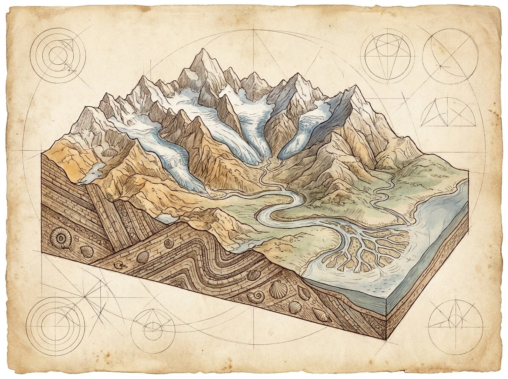
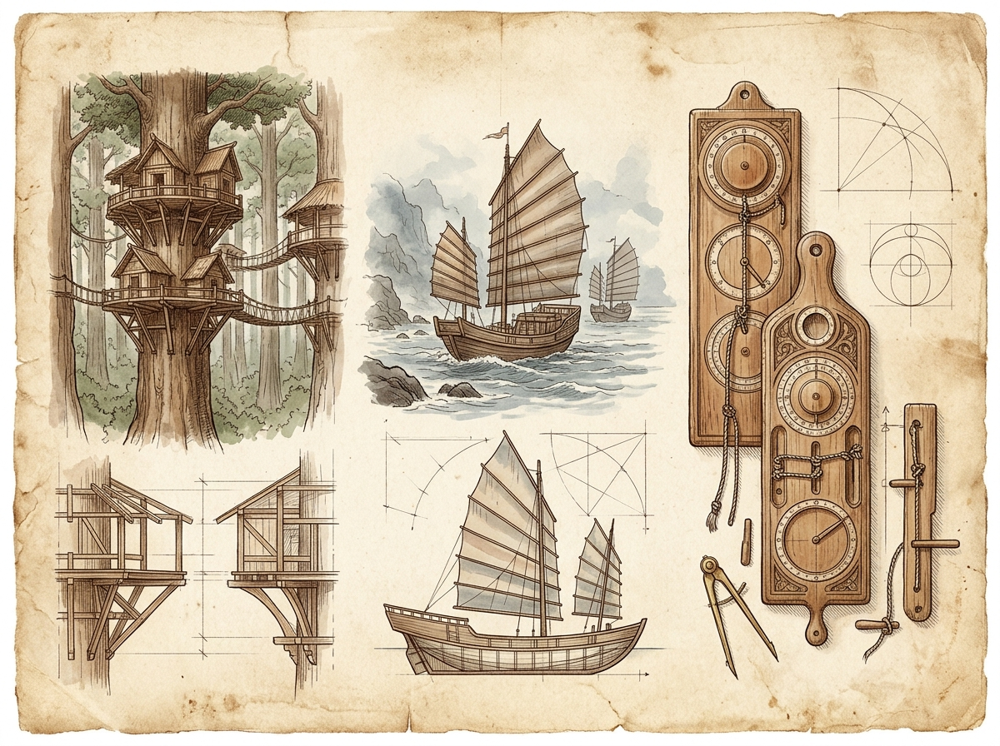
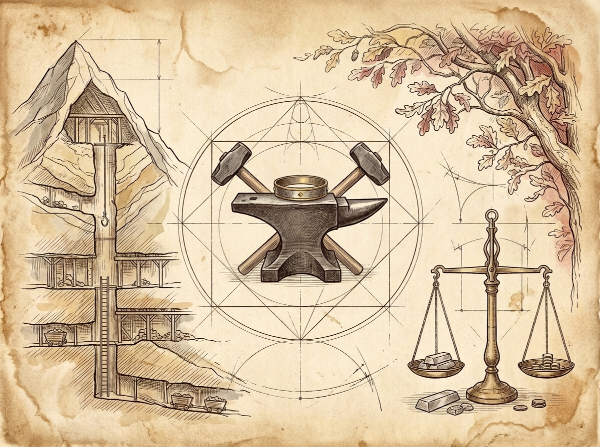
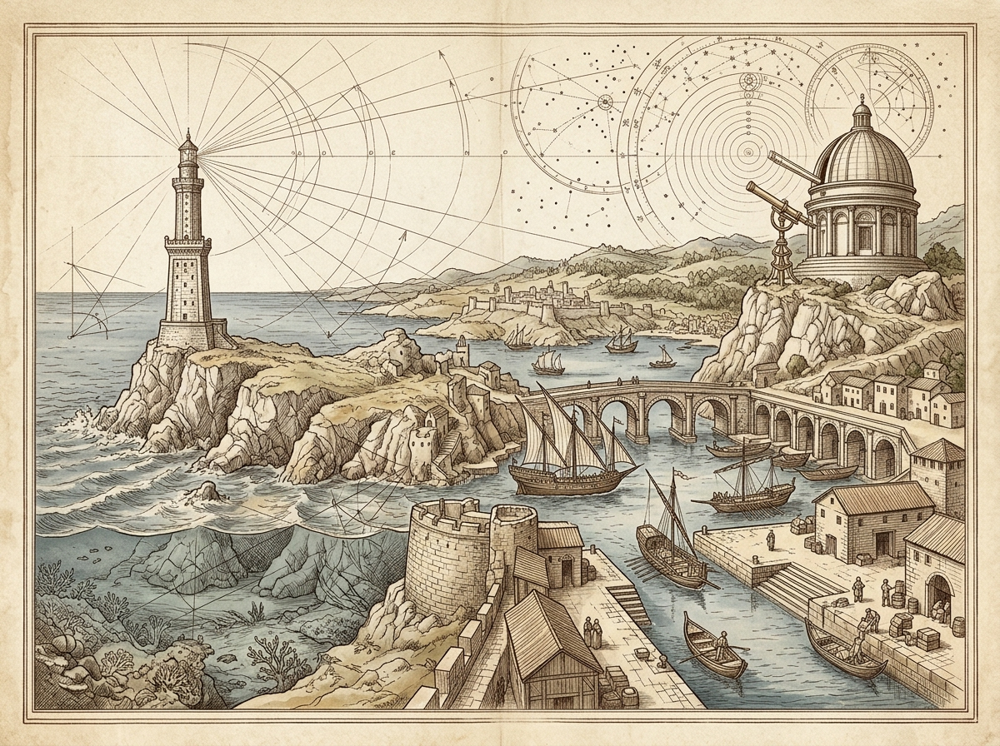
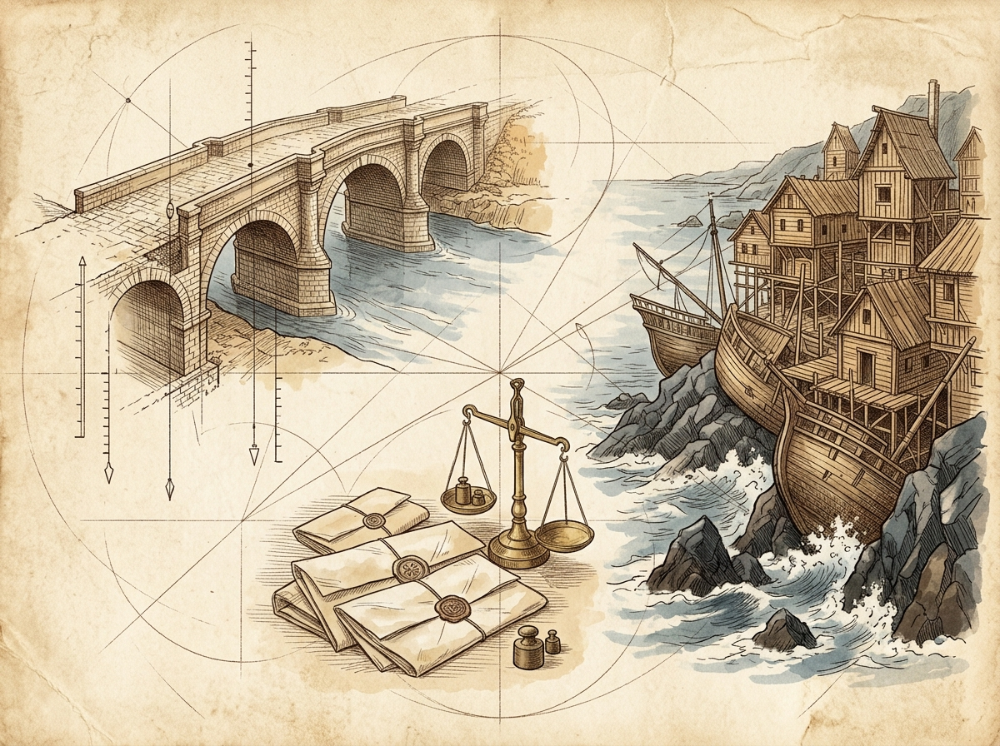
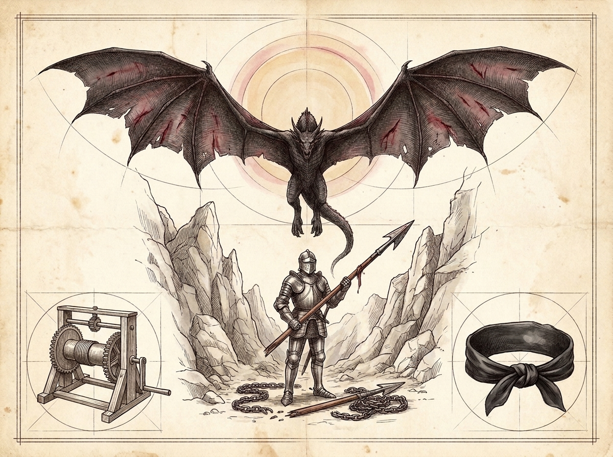
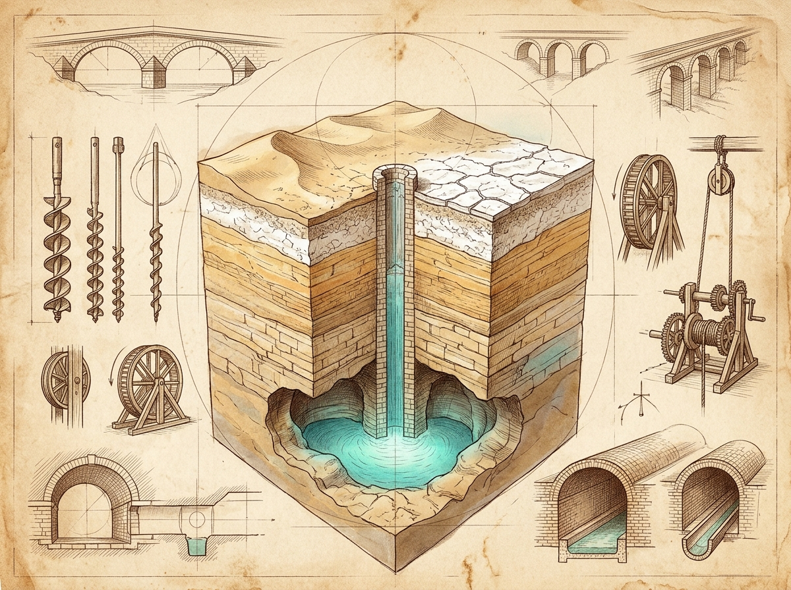
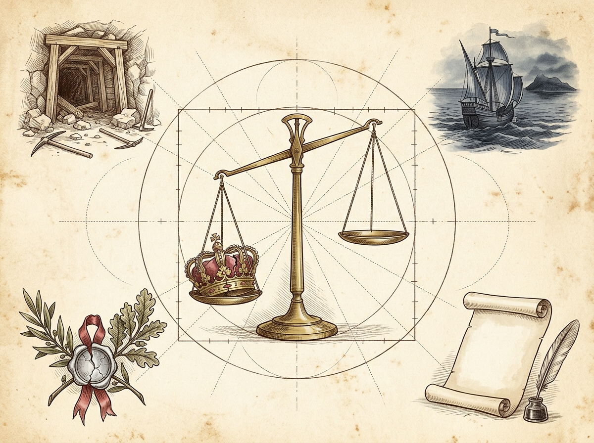

# Crônica das Terras e das Marés

*Uma história de Alenia: das montanhas anteriores à memória aos conflitos do Ano 418 da Era da Forja.*

> “O rei mandou escrever que fundara a cidade. Debaixo da praça onde ergueram sua estátua encontramos três ruas, dois cemitérios e a soleira de uma casa. Nenhum deles sabia o nome do rei.”
>
> — Nota atribuída à cartógrafa Benetta de Litore.

**Tomo XI — Cronologia ampliada, atlas histórico e memória dos povos.**

Este volume reúne **100 acontecimentos e processos históricos**, seguidos de um atlas de fundações, um registro de nomes de águas, relações entre passado e presente e um caderno reservado ao mestre. A história abrange natureza, povoamento, navegação, trabalho, religião, instituições, guerras, comércio, doenças e conhecimento.

**Estatuto editorial:** as datas identificadas como **Marco estabelecido** vêm dos livros existentes. As demais datas, personagens históricos, nomes de afluentes e episódios são **propostas novas deste volume**. Uma entrada pode reunir um marco estabelecido e detalhes novos; nesse caso, o texto distingue ambos. Os documentos anteriores não foram alterados por esta expansão.

## Como ler esta história

### Calendário, fontes e incerteza

- **EF:** Era da Forja. O Ano 1 marca o Pacto das Bigornas, a descoberta das grandes veias de adamante e a fundação formal de Altavanne. Não representa o começo da humanidade ou da metalurgia.
- **AF:** antes da Forja. Não existe ano zero nesta convenção; o ano 1 AF precede o ano 1 EF.
- **Cerca de:** aproximação adotada pelos compiladores. Eventos anteriores ao calendário comum são convertidos retrospectivamente; os povos da época não usavam essas datas.
- **Períodos naturais:** estimativas de bastidor, não datas que um camponês ou mesmo um erudito de Sellene conseguiria medir com precisão. Os estudiosos conhecem estratos, conchas e marcas de gelo; suas explicações continuam incompletas.
- **História pública:** pode ser conhecida por livros, tradições, inscrições ou pessoas especializadas. Não significa conhecimento universal de todo personagem.
- **Tradição disputada:** existem versões incompatíveis. O texto registra a divergência sem transformá-la automaticamente em fraude ou verdade sobrenatural.
- **Caderno reservado:** contém informação reservada ao Mestre, protegida por senha (AES-256-GCM) na edição HTML oficial e separada da cronologia pública entregue aos jogadores.

**Fundar pode significar quatro coisas diferentes:** ocupar um lugar; estabelecer um povoado permanente; conceder uma carta de vila ou cidade; reconstruir e reorganizar uma comunidade antiga. Este volume identifica qual delas está em jogo. Uma carta real não apaga quem já vivia ali.

### As grandes épocas

| Época | Período aproximado | Transformação principal |
| :--- | :--- | :--- |
| As terras antes dos nomes | Tempos geológicos até cerca de 1800 AF | Montanhas, bacias, costas, geleiras e solos moldam possibilidades de vida. |
| Os caminhos anteriores à Coroa | Cerca de 900–1 AF | Comunidades, migrações, embarcações e mercados antecedem o calendário real. |
| A Forja e as primeiras fronteiras | 1–112 EF | Altavanne organiza poder, trabalho, rotas e campanhas contra as matas. |
| A idade dos pactos e dos portos | 113–219 EF | Autonomias negociadas, navegação e instituições de saber. |
| A idade dos livros fechados | 220–347 EF | Crédito, epidemias, guerras kalitas, arquivos e expedições perdidas. |
| Os Anos do Eclipse | 348–356 EF | A Sombra devasta Aurora e destrói a legitimidade do ramo reinante. |
| A Coroa da Faixa Negra | 357–404 EF | Reconstrução, promessas, água e novas dependências econômicas. |
| As heranças em conflito | 405–418 EF | O passado converge em crises que os personagens ainda podem mudar. |

## I — As terras antes dos nomes

### T001 — Antes da memória: a lenta elevação das terras altas

**Natureza · Ferraur, Rubecina e Pedramar · Reconstrução geográfica proposta.**

Muito antes dos reinos, forças profundas elevam e deformam conjuntos de rochas em épocas diferentes. Ferraur, Rubecina e Pedramar não precisam ter nascido num único cataclismo. Suas diferenças ajudam a explicar a concentração de determinados minérios, a existência de passos e as rotas que séculos depois parecem decisões de reis.

**Herança em 418:** pedreiras expõem camadas inclinadas e conchas petrificadas longe do mar. Forjadores interpretam essas marcas como vestígios da primeira oficina do Artífice; outros estudiosos defendem antigos fundos marinhos. Nenhuma das interpretações revela por si a origem do adamante ou das galerias artificiais.

### T002 — Antes da memória: a formação dos canais orientais

**Natureza · Costas de Aurora e Kalis · Reconstrução geográfica proposta.**

Mudanças lentas de relevo, erosão e nível do mar estabelecem os canais e baixios da região que receberá o nome de Mar Intransponível. Ventos sazonais, correntes e passagens estreitas tornam certas travessias difíceis. O mar não surge por uma maldição comprovada nem por uma única batalha.

**Herança em 418:** ruínas costeiras podem estar hoje submersas, e antigas enseadas podem ter desaparecido. Um mapa de séculos atrás é testemunho histórico, mas não substitui uma carta náutica atual. Esta entrada não define a idade exata da separação das massas continentais, ainda desconhecida.

### T003 — Cerca de 12000–8000 AF: o recuo dos grandes gelos

**Natureza · Norte e vales montanhosos · Estimativa de bastidor proposta.**

Geleiras recuam em parte das terras hoje habitáveis. Torrentes transportam pedras, escavam vales e deixam depressões onde a água se acumula. O extremo norte permanece severo; o degelo não torna Incognito uma extensão hospitaleira de Aurora.

**Herança em 418:** rochas riscadas, blocos isolados e lagos de montanha sustentam teorias rivais em Sellene. Guias conhecem as encostas instáveis sem precisar compartilhar essas teorias. Passagens que parecem estradas naturais devem sua forma ao gelo, mas sua segurança depende de manutenção humana.

### T004 — Cerca de 8000–5000 AF: o rio procura o estuário

**Natureza · Bacia do futuro Rio Aurélio · Processo proposto.**

Ao longo de muitas gerações, canais se unem, abandonam meandros e depositam sedimentos até formar a grande artéria fluvial entre o interior de Aurora e o estuário ocidental. Não existe um dia em que o Aurélio “nasce” completo: sua bacia amadurece antes que alguém lhe dê esse nome.

**Herança em 418:** terras férteis, braços mortos e antigos leitos explicam tanto a riqueza de Dahrma quanto disputas de propriedade. Um limite traçado “pela margem do rio” pode ter mudado de lugar sem que qualquer família tenha movido suas cercas.

### T005 — Cerca de 7000–4000 AF: as chuvas recuam de Gaddra

**Natureza · Gaddra · Processo proposto.**

Uma transformação climática prolongada reduz a regularidade das chuvas em amplas áreas. Pastagens se fragmentam e cursos sazonais deixam de correr em muitos anos. O território passa por fases, com avanços e recuos da aridez; não se converte inteiro em deserto numa só estação.

**Herança em 418:** vales secos, madeira enterrada e ruínas junto a antigos cursos d'água alimentam histórias de uma Gaddra verde. Algumas são memórias distorcidas; outras exageram a extensão da vegetação. Conhecer um leito antigo pode ajudar a procurar água, mas não garante encontrar um aquífero acessível.

### T006 — Cerca de 5000–2500 AF: a bacia branca de Bayd

**Natureza · Lago Bayd · Processo proposto.**

A água de uma bacia sem saída regular para o mar concentra sais ao longo de ciclos de cheia e evaporação. As margens mudam repetidamente. Bayd já é salino muito antes dos poços artesianos de Naasar; sua água superficial e as reservas profundas de água doce pertencem a condições distintas.

**Herança em 418:** antigos terraços marcam níveis anteriores do lago. Salinas competem por faixas que ora ficam submersas, ora expostas. O aquífero explorado em 380 não resulta da transformação mágica do lago em água potável, e sua descoberta não torna ilimitada a disponibilidade de água.

### T007 — Cerca de 4000–2000 AF: lagoas, recifes e costas móveis

**Natureza · Corallis e ilhas meridionais · Processo proposto.**

Recifes, barras de areia e sedimentos formam enseadas protegidas, lagoas e canais que mudam com tempestades e marés. Em Corallis, lugares favoráveis à pesca nem sempre permitem a entrada de grandes embarcações. Na região de Safiras, substratos e umidade favorecem uma mata de diversidade própria.

**Herança em 418:** Baldbella depende de conhecimento local de canais; práticos podem valer mais que capitães com mapas caros. A vegetação da Ilha das Safiras resulta de uma história ambiental longa, não da fundação recente de Porto Esmeralda.

### T008 — Antes de cerca de 1800 AF: construções sem cronologia segura

**Vestígios humanos · Kelgore, norte e outros sítios antigos · Datação disputada.**

Monumentos, alicerces e estruturas anteriores aos calendários conhecidos sobrevivem sob ocupações posteriores. Não há motivo para atribuir todas as ruínas de Alenia a um único povo ou a um único desastre. Semelhança de material pode indicar comércio, imitação ou coincidência técnica.

**Herança em 418:** cada escavação oferece peças incompletas. A cronologia pública registra apenas a antiguidade incerta dos vestígios; a relação entre algumas estruturas, o adamante e o norte fica no caderno do mestre. As civilizações vivas do cenário continuam exclusivamente humanas.

## II — Os caminhos anteriores à Coroa

### T009 — Cerca de 900 AF: as margens habitadas

**Povoamento · Vale do futuro Aurélio · Proposta.**

Comunidades de pescadores, agricultores e criadores ocupam terraços acima das cheias mais frequentes. Caminhos ligam ancoradouros, campos e locais de reunião. As terras que serão chamadas Dahrma já sustentam famílias; elas não aguardam uma carta de Altavanne para começar a produzir.

**Herança em 418:** túmulos sob celeiros, pedras de moagem e limites de campos antigos. Algumas famílias reivindicam precedência sobre a nobreza justamente por esses vestígios. Sua antiguidade não estabelece automaticamente propriedade legal, mas pode mobilizar aldeias inteiras contra novos impostos.

### T010 — Cerca de 740 AF: os caminhos da madeira negra

**Trabalho e migração · Kalis · Proposta.**

Comunidades costeiras trocam peixe seco por madeira do interior. Trilhas tornam-se corredores de transporte, e pontos de arraste de troncos atraem ferreiros e construtores de barcos. Os antecessores dos povoados de Jarnham e Dobalbek aparecem nessa rede, ainda sem as instituições posteriores.

**Herança em 418:** direitos de passagem reivindicados por famílias de trabalhadores e comunidades florestais. Cartas da regência podem ser séculos mais recentes que as trilhas que pretendem controlar. A economia kalita começa no trabalho de madeira e transporte, não na espionagem.

### T011 — Cerca de 620 AF: o pacto das três noites

**Sociedade · Oásis de Gaddra · Tradição proposta.**

Após vinganças interromperem o acesso a uma sequência de poços, anfitriões de diferentes grupos reconhecem um período de proteção a quem recebe água e abrigo. A tradição conta três noites sem sangue sob a tenda. Não existe um exemplar original indiscutível do acordo.

**Herança em 418:** o costume é um antecedente da Lei da Hospitalidade, não uma invenção de Qasir Zaharid ou dos Senhores da Água. Tribos livres e habitantes sujeitos à regência compartilham essa obrigação, embora discordem sobre quem pode julgá-la.

### T012 — Cerca de 510 AF: as vigas acima da cheia

**Povoamento e técnica · Matas do nordeste de Aurora · Proposta.**

Comunidades elevam depósitos, passarelas e abrigos para proteger alimentos de cheias e animais. Aos poucos, algumas estruturas passam das estacas às grandes árvores. A Cidade Suspensa nasce dessa evolução, com assentamentos distribuídos e técnicas transmitidas entre gerações.

**Herança em 418:** árvores-mestras guardam histórias de reconstruções; nenhuma plataforma precisa ter permanecido intacta por novecentos anos. A continuidade pertence ao povo e ao lugar, não a cada corda. Essa distinção explica como uma cidade antiga sobrevive ao apodrecimento da madeira e a incêndios locais.

### T013 — Cerca de 420 AF: os primeiros cadernos de maré

**Navegação · Costa de Corallis · Proposta.**

Marinheiros registram em tábuas e cordões combinações de vento, fases lunares e altura da água. Não inventam a observação do mar: organizam conhecimentos acumulados por pescadores e mergulhadores. Cópias permitem que certas rotas sejam repetidas por tripulações diferentes.

**Herança em 418:** corporações de práticos reivindicam antigas linhagens de conhecimento. Algumas guardam registros familiares; outras fabricam genealogias profissionais. A disputa entre Alineus e Baldbella terá raízes nessa pergunta: quem mantém uma passagem tem o direito de cobrar por ela?

### T014 — Cerca de 330 AF: OX, o encontro dos currais

**Povoamento e comércio · Planaltos de Gaddra · Proposta.**

Feiras de montarias tornam-se recorrentes em terreno firme próximo a fontes sazonais. Currais, alojamentos e oficinas sobrevivem entre as reuniões, formando o núcleo de OX. Competições de manejo antecedem as arenas; força e habilidade de animais são inicialmente demonstradas para compradores.

**Herança em 418:** famílias de criadores consideram seus pactos anteriores à regência. A grafia curta **OX** já aparece em marcas comerciais antigas, mas sua origem linguística permanece discutida. Evita-se transformá-la arbitrariamente na sigla de uma instituição moderna.

### T015 — Cerca de 250 AF: os cais de conchas

**Povoamento · Baldbella e Pelagosa · Proposta.**

Coletores de moluscos, pescadores e mergulhadores fixam moradias em pontos protegidos das lagoas. Baldbella cresce como encontro de ancoradouros; Pelagosa permanece uma comunidade menor, ligada às águas abertas. Curar cortes, fraturas e acidentes de mergulho torna-se parte cotidiana do trabalho.

**Herança em 418:** a futura reputação cirúrgica de Baldbella terá raízes práticas anteriores à Academia. Famílias de pescadores podem questionar mestres que desprezam seus métodos enquanto utilizam conhecimentos herdados deles.

### T016 — Cerca de 180 AF: as pedras de Qadim-Shahr

**Ambiente e abandono · Interior de Gaddra · Proposta.**

Um centro antigo de entreposto, hoje chamado Qadim-Shahr, perde gradualmente sua viabilidade após mudanças nas fontes e nas rotas. Parte da população migra com ferramentas, animais e materiais de construção. Incêndios e saques posteriores confundem as camadas de abandono.

**Herança em 418:** a versão de uma cidade destruída numa única noite é atraente, mas não explica todos os vestígios. Casas vazias podem ter servido de abrigo por séculos. Mapas escondidos em uma ruína não precisam pertencer aos seus primeiros habitantes.

### T017 — Cerca de 150 AF: os navegadores de Yõketsu

**Migração e povoamento · Costa leste de Aurora · Data proposta para origem estabelecida.**

Um conjunto de embarcações orientais alcança a costa e negocia permanência com comunidades locais. Os recém-chegados trazem técnicas, vocabulário, cerimônias e tradições marciais; também dependem de alimento, materiais e conhecimento regional para sobreviver. O enclave de Yõketsu nasce de adaptação e alianças.

**Herança em 418:** a origem marítima ancestral é conhecida, mas os detalhes da terra de partida são fragmentários ou protegidos. Situar a chegada aproximadamente 567 anos antes do presente respeita a referência do Acervo a mais de cinco séculos. O motivo oculto da migração não entra na história pública.

### T018 — Cerca de 130 AF: a cheia que abriu dois caminhos

**Natureza e povoamento · Baixo Aurélio · Proposta.**

Uma cheia excepcional amplia um canal do estuário e reduz a utilidade de outro. Famílias transferem depósitos e oficinas para um ancoradouro que oferece melhor acesso. Esse núcleo será incorporado a Merlinport; a margem abandonada conserva pequenas comunidades de pescadores.

**Herança em 418:** “o cais velho” pode estar longe da água navegável. Contrabandistas utilizam canais ignorados por cobradores de taxas. O episódio não cria o estuário inteiro, apenas muda a relação humana com uma parte dele.

### T019 — Cerca de 110 AF: o caminho das pedreiras

**Trabalho e circulação · Lavroga e Pedramar · Proposta.**

Oficinas locais ampliam a extração de pedra para muros, cais e moinhos. Em Lavroga, a pedreira favorece um povoado de trabalhadores e condutores; em Pedramar, oficinas perto de afloramentos aproveitam água e desníveis. Redes distintas trocam técnicas sem constituir ainda um Estado unificado.

**Herança em 418:** sinais de pedreiro atravessam fronteiras políticas e podem aparecer em edifícios de épocas diferentes. As marcas servem à investigação de equipes e oficinas, mas não identificam com certeza um único indivíduo.

### T020 — Cerca de 60 AF: o nome dourado do rio

**Toponímia e comércio · Rio Aurélio · Proposta.**

Escribas de entrepostos passam a empregar uma forma ancestral de **Aurélio** para unificar registros de frete. Associam o nome à luz dourada sobre a água e aos campos que o rio alimenta. A raiz **Aur-** permanece compatível com a tradição onomástica existente; não se inventa um conquistador chamado Aurélio para substituir essa origem.

**Herança em 418:** comunidades continuam usando nomes locais para trechos e braços. “Descer o Aurélio” significa participar de uma rota reconhecível, embora o rio não tenha passado a existir quando os mercadores concordaram sobre sua grafia.

## III — A Forja e as primeiras fronteiras

### T021 — Ano 1: o Pacto das Bigornas

**Política, mineração e calendário · Aurora · Marco estabelecido.**

A descoberta das grandes veias de adamante nos Montes Ferraur permite um pacto entre poder, extração, forja e abastecimento. Altavanne é formalmente fundada como capital, e o ramo antigo dos Valerion ascende. A soberania que depois será reivindicada sobre os demais domínios começa aqui; sua aplicação continental ainda levará séculos.

**Detalhe proposto:** o pacto usa testemunhos de oficinas e depósitos, não apenas juramentos de guerreiros. **Herança em 418:** divergências entre cópias sustentam disputas sobre cotas e privilégios. A história pública da descoberta não explica todas as estruturas encontradas nas minas; ver o caderno reservado.

### T022 — Ano 4: os acampamentos se tornam Aeraneas

**Povoamento e trabalho · Ferraur · Proposta.**

Abrigos de prospecção, fornos e depósitos recebem administração permanente, áreas de mercado e abastecimento regular. Esta é a organização urbana de Aeraneas, não a primeira vez que pessoas extraem minério da montanha. Famílias de trabalhadores trazem crianças, ferramentas e costumes de regiões diferentes.

**Herança em 418:** bairros antigos conservam nomes de ofícios e origens. A cidade não pode ser tratada apenas como mina ou fortaleza: depende de padeiros, carregadores, lavadeiras, cuidadores e animais de carga, cuja paralisação também compromete o adamante.

### T023 — Ano 9: os marcos do grão em Dahrma

**Administração e sociedade · Dahrma · Proposta.**

A Coroa manda registrar campos e capacidade de armazenagem para garantir alimento à capital e às minas. A contagem facilita algumas obras de irrigação, mas converte obrigações locais negociadas em tributos escritos. Povoados sem representantes reconhecidos aparecem como terras “sem senhor”.

**Herança em 418:** comunidades guardam cópias incompatíveis dos primeiros limites. Um documento pode provar que certa obrigação nasceu como contribuição temporária, embora famílias nobres a cobrem há gerações como direito permanente.

### T024 — Ano 14: o fechamento das galerias fundas

**Mineração e governo · Aeraneas · Data estabelecida; versão pública proposta.**

Registros de trabalho assinalam o fechamento de um conjunto de escavações e a redistribuição de equipes. A explicação pública fala em rocha insegura e custo de ventilação. O episódio importa pouco às crônicas de reis, mas muda turnos, contratos e alojamentos.

**Herança em 418:** mapas técnicos têm trechos apagados, paredes mais antigas que sua alvenaria aparente e ferramentas abandonadas. O Acervo fixa o confisco de um relatório neste ano; as razões efetivas do fechamento pertencem ao caderno do mestre, não à versão disponível a qualquer aprendiz.

### T025 — Ano 19: a ponte recebe nome e guarda

**Infraestrutura e topônimos · Pontáuria · Proposta.**

Uma travessia de barcos e estruturas de madeira é reorganizada como passagem permanente com manutenção, vigias e cobrança regular. O nome **Pontáuria**, formado pelas raízes já registradas no atlas, se consolida. A ponte de pedra atual resulta de fases posteriores, não de uma obra intacta desde 19.

**Herança em 418:** quem deve pagar a travessia, quem tem isenção e quem financia reparos tornam-se disputas recorrentes. A tradição jurídica local cresce da necessidade de arbitrar passagem, carga danificada, cheias e responsabilidade por acidentes.

### T026 — Ano 26: o foral dos cais de Merlinport

**Comércio e política · Estuário do Aurélio · Proposta.**

A Coroa reconhece mercados e magistrados do porto em troca de receitas e transporte. O assentamento é muito anterior ao documento; a novidade é sua posição legal. Oficinas navais se aproximam dos depósitos, enquanto pescadores são empurrados para margens menos rentáveis.

**Herança em 418:** o porto possui privilégios anteriores aos concedidos aos Scutauria na caçada de 356. Isso permite distinguir direitos antigos da cidade das recompensas posteriores de uma casa, evitando atribuir toda autonomia urbana a um único herói.

### T027 — Ano 34: Dobalbek mede a madeira

**Comércio e técnica · Costa de Kalis · Proposta.**

Mercadores e construtores concordam sobre medidas de toras, marcas de procedência e responsabilidades por madeira podre. Pequenos portos usam essas medidas para negociar entre si, sem obedecer ainda ao Despotado consolidado séculos depois.

**Herança em 418:** as marcas mais antigas podem sustentar direitos de guilda contra decretos de Kalgard. O acordo explica uma base econômica da autonomia mercantil: confiar em medidas comuns permite negociar antes de existir um governo central forte.

### T028 — Ano 43: o desvio do Várzea-Clara

**Natureza e água · Dahrma · Afluente novo proposto.**

Chuvas prolongadas provocam a mudança parcial de curso do **Várzea-Clara**, afluente meridional do Aurélio. Moinhos perdem corrente; campos antes secos passam a inundar. Uma tentativa de devolver toda a água ao canal antigo fracassa, e aldeias negociam novos caminhos.

**Herança em 418:** pontes sobre terreno seco e capelas próximas a antigos ancoradouros. O episódio não modifica os mapas atuais sem revisão cartográfica: o afluente é uma proposta de escala local, descrita no registro hidrográfico ao final.

### T029 — Ano 51: as escarpas de Vargheim

**Povoamento e pactos · Sudeste de Gaddra · Proposta.**

Comunidades de pastores, refugiados e vigias de passagem consolidam fortalezas de clã em torno de um ponto de reunião nas escarpas. A tradição reúne a história sob o nome Vargheim, embora não exista uma fundação única aceita por todas as famílias.

**Herança em 418:** alianças locais dependem de garantias recíprocas, não apenas de título concedido por Altavanne. Quando um regente apresenta um tratado assinado por um chefe antigo, outros clãs podem responder com razão que aquele signatário nunca falou por todos.

### T030 — Ano 59: a pedra e a fortaleza de Vaarsa

**Defesa e circulação · Passo de Rubecina · Proposta.**

Uma posição de vigia recebe muralhas, alojamentos e depósito de alimentos. Vaarsa cresce para controlar uma travessia que também sustenta feiras e caravanas. O financiamento vem de obrigações de passagem e apoio da Coroa, com trabalho local frequentemente compulsório.

**Herança em 418:** a fortaleza protege mercadores e pode estrangulá-los. Seu poder depende tanto de celeiros e água quanto de soldados. Famílias das aldeias próximas preservam memórias diferentes das crônicas militares sobre quem realmente pagou pela construção.

### T031 — Ano 66: os cais irmãos de Alineus e Biemont

**Urbanização e comércio · Corallis · Proposta.**

Autoridades portuárias organizam registros permanentes de oficinas em Alineus e de armazenagem em Biemont. As duas cidades têm ocupação anterior; os documentos consolidam funções que depois as levarão à Liga. Trabalhadores passam a viajar entre estaleiros, e casamentos unem famílias de portos diferentes.

**Herança em 418:** a identidade corallina cresce de circulação e cooperação, embora rivalidades locais permaneçam fortes. A fundação formal da Liga em 204 não será a criação das cidades a partir do nada.

### T032 — Ano 74: as primeiras cartas de mata

**Expansão e conflito · Nordeste de Aurora · Proposta.**

Altavanne concede direitos de corte e prospecção em territórios apresentados como pouco ocupados. Os moradores das matas não reconhecem a autoridade dessas cartas. Expedições encontram caminhos mantidos, locais de culto e áreas de coleta que contradizem a imagem de floresta vazia.

**Herança em 418:** começa uma sequência de conflitos, não uma guerra contínua de décadas em toda a fronteira. Algumas comunidades negociam, outras resistem e outras se deslocam. Os documentos serão importantes quando o Tratado de Vergod limitar antigas concessões.

### T033 — Ano 82: o inverno das pontes quebradas

**Clima e sociedade · Aurora e Rubecina · Proposta.**

Neve persistente fecha passagens e o degelo danifica pontes. Casas ricas compram estoques, enquanto aldeias afastadas trocam ferramentas por alimento. Redes de hospitalidade religiosa ganham prestígio ao distribuir grão e acolher viajantes.

**Herança em 418:** comunidades atribuem a esse inverno a expansão de celeiros e abrigos que mais tarde se vinculam à Lareira e ao Pão. Isso não fixa a fundação inteira da ordem numa data única, mas dá origem social a algumas de suas instituições.

### T034 — Ano 91: a fortificação de Altrax

**Defesa e povoamento · Noroeste de Aurora · Proposta.**

Um posto de fronteira torna-se fortaleza e centro de suprimentos. **Altrax**, conforme a formação do nome já prevista na onomástica, domina caminhos entre pântanos e terras altas. A cidade atrai caçadores, guias, soldados e comerciantes de peles.

**Herança em 418:** os d'Altrax herdam uma posição estratégica, mas não controle irrestrito de tudo que conseguem avistar. A distinção entre vigiar uma estrada e possuir as matas explica parte de suas reivindicações futuras.

### T035 — Ano 99: a fome das folhas novas

**Guerra e abastecimento · Matas silvanas · Proposta.**

Uma campanha de corte destrói pontos de armazenagem e interrompe trocas de sal e ferramentas. Combatentes de ambos os lados procuram viver do terreno; famílias precisam consumir reservas antes da estação adequada. O conflito passa a custar mais que o ganho prometido pelas concessões.

**Herança em 418:** algumas clareiras são locais de sepultamento, não bons terrenos “disponíveis”. A memória da fome sustenta a preferência silvana por depósitos distribuídos e rotas alternativas. O episódio também cria defensores humanos da paz dentro dos domínios da Coroa.

### T036 — Ano 106: as duas margens de Vergod

**Diplomacia e comércio · Borda da mata · Proposta.**

Intermediários estabelecem dias de troca em terreno aceito pelos lados em conflito. A prata é pesada; armas permanecem afastadas das bancas. O lugar já possui nome de origem silvestre, associado à forma ancestral **Aber-coed**, que os registros aurorianos adaptarão para Vergod.

**Herança em 418:** o entreposto antecede a paz formal. Intérpretes, carregadores e famílias de fronteira tornam o tratado possível, mesmo quando as crônicas atribuem tudo a reis e guardiões.

### T037 — Ano 112: o Tratado de Vergod

**Diplomacia e autonomia · Aurora e Cidade Suspensa · Marco estabelecido.**

O tratado encerra as guerras florestais e reconhece a autonomia da Cidade Suspensa. A Coroa aceita limites à sua autoridade; o comércio fornece uma alternativa à ocupação. As tradições do Círculo das Raízes passam a ter proteção reconhecida dentro desse acordo.

**Detalhe proposto:** uma cópia textual e uma memória de limites mantida pelas comunidades coexistem, criando discussões sobre traduções. **Herança em 418:** defender o tratado é defender uma restrição antiga ao poder real. Promessas posteriores de terras florestais não o anulam automaticamente.

## IV — A idade dos pactos e dos portos

### T038 — Ano 118: a água acima das raízes

**Técnica e sociedade · Cidade Suspensa · Proposta.**

Após incêndios localizados, comunidades reorganizam reservatórios, calhas, roldanas e pontes destacáveis. A manutenção torna-se uma obrigação compartilhada. Jovens aprendem a remover passagens para conter fogo sem isolar pessoas que precisam escapar.

**Herança em 418:** a logística da cidade possui história e trabalho especializado. O sistema continua vulnerável a seca, sabotagem e negligência, mas não depende de uma floresta magicamente incapaz de arder. Ofícios de manutenção têm autoridade própria diante do Conselho das Copas.

### T039 — Ano 127: o mar chamado Intransponível

**Navegação e topônimos · Travessias orientais · Proposta.**

Depois de uma série de perdas, uma carta comercial populariza a expressão **Mar Intransponível**. Pilotos de Yõketsu e navegantes locais contestam o exagero: conhecem janelas de travessia, mas não podem garantir passagem em qualquer estação. O nome persiste porque serve à prudência, ao prestígio dos pilotos e à retórica dos governantes.

**Herança em 418:** “intransponível” nunca significa que ninguém o atravessou. O termo descreve uma reputação, não uma barreira absoluta. O conhecimento de rotas exteriores mais distantes permanece questão separada.

### T040 — Ano 138: a pedra de Stoneforge

**Indústria e urbanização · Montes Pedramar · Proposta.**

Oficinas de pedra, metal e mecanismos se unem numa administração urbana capaz de manter canais de força, depósitos e contratos. Stoneforge consolida seu nome de cidade de ofício; o assentamento e a extração local são mais antigos.

**Herança em 418:** mestres defendem que conhecimento prático merece financiamento semelhante ao dos eruditos. A tensão com Sellene terá uma história anterior à Academia: medir, construir e reparar já eram formas de investigação antes de receberem reconhecimento institucional.

### T041 — Ano 147: o farol de Claramar

**Navegação e serviço público · Corallis · Proposta.**

Uma torre de sinalização recebe manutenção regular, combustível reservado e turnos de vigia. O nome **Claramar** se fixa pela função da luz que orienta a entrada. A construção reaproveita uma posição já utilizada por fogueiras de pescadores.

**Herança em 418:** o direito de cobrar pela passagem depende da obrigação de manter o sinal. Um farol apagado pode gerar processos e revoltas, além de naufrágios. O farol de Claramar não deve ser confundido com o antigo Farol Apagado de Thanatos.

### T042 — Ano 156: a febre dos canais baixos

**Saúde e urbanização · Baldbella · Proposta.**

Uma sequência de doenças febris atinge bairros que usam canais contaminados. Cuidadores comparam famílias, fontes e hábitos, sem dispor de uma teoria completa das causas. Algumas autoridades investem em água e remoção de resíduos; outras atribuem os casos a estrangeiros.

**Herança em 418:** registros de abastecimento ganham valor médico. O episódio não “inventa” a Febre das Cisternas nem comprova que todo caso era a mesma doença, mas inaugura uma tradição de comparar lugares e exposições em Baldbella.

### T043 — Ano 163: Portocala e o abrigo das duas cargas

**Comércio e povoamento · Sudoeste de Corallis · Proposta.**

Pescadores e transportadores de mercadorias do sul estabelecem depósitos permanentes num porto abrigado. **Portocala** consolida o nome formado de porto e enseada, conforme a onomástica. Sua posição favorece trocas com Qal-Zahar, sem torná-la automaticamente membro fundador da futura Liga das quatro grandes cidades.

**Herança em 418:** pescadores e armadores disputam espaço de cais. O pequeno barco que traz alimento cotidiano pode ser obrigado a esperar enquanto um grande comerciante descarrega bens de luxo.

### T044 — Ano 171: o primeiro acordo das dunas com a Coroa

**Diplomacia · OX, cidades-oásis e Aurora · Proposta de ligação histórica.**

Representantes de núcleos urbanos aceitam um intermediário confirmado por Altavanne para negociar circulação, sal e fornecimento de metal. Esse acordo é um antecedente da Regência das Dunas. Tribos que não participaram não se consideram sujeitas a ele.

**Herança em 418:** a proposta explica como já podia haver um regente de Gaddra na coroação de 356, antes da consolidação econômica de 380. Os poços de Naasar ampliarão e reorganizarão um poder anterior; não criarão retrospectivamente toda relação política com Aurora.

### T045 — Ano 180: o Conselho das Medidas de Pedra

**Técnica e trabalho · Stoneforge e portos corallinos · Proposta.**

Oficinas negociam medidas para encaixes, rodas, blocos e peças de reposição usadas em equipamentos de porto. A padronização é parcial: mestres ainda preservam métodos e tolerâncias próprios. Algumas guildas resistem por medo de perder trabalho de ajuste.

**Herança em 418:** peças compatíveis podem circular entre cidades, sustentando instrumentos mais complexos. Um sabotador pode explorar pequenas diferenças sem precisar dominar magia. Aprendizes reclamam que mestres cobram pela mesma medida que ajudaram coletivamente a criar.

### T046 — Ano 188: as marcas de duas nascentes

**Água e topônimos · Ferraur e Rubecina · Proposta.**

Mapas de abastecimento registram o **Fio-de-Ferro**, curso que desce dos setores mineradores de Ferraur para a bacia do Aurélio, e a **Água-Rubra**, curso sazonal de encosta em Rubecina. Os nomes descrevem aparência e uso; não indicam adamante dissolvido ou sangue sobrenatural.

**Herança em 418:** comparar sedimento, vazão e nomes antigos ajuda a reconstruir a expansão das minas. Os dois cursos são novos detalhes de escala regional deste volume; sua posição precisa deve ser definida ao atualizar os mapas.

### T047 — Ano 196: o banco de areia de Petravella

**Natureza e declínio urbano · Costa de Corallis · Proposta.**

Tempestades e assoreamento pioram o acesso a um ancoradouro antigo. Obras mantêm passagem por alguns anos, mas parte do comércio migra. Petravella perde oficinas e moradores gradualmente; outros permanecem, reaproveitando estruturas.

**Herança em 418:** as Ruínas de Petravella guardam fases diferentes de ocupação e abandono. O lugar oferece um contraponto às cidades destruídas por guerra: uma comunidade pode morrer de perda de acesso e investimento, deixando sobreviventes que nunca tiveram uma batalha para lamentar.

### T048 — Ano 204: a Liga e a Academia

**Instituições · Corallis · Marco estabelecido.**

A Liga Talassocrática de Corallis e a Academia de Sellene são formalmente fundadas. A cooperação liga grandes cidades, saberes de navegação, ofícios, arquivos e interesses mercantis. O comércio com Merlinport se expande. A instituição acadêmica recebe conhecimentos que já circulavam havia séculos.

**Detalhe proposto:** o ato de fundação resulta de patronos e corpos de ofício, sem atribuir neste volume um fundador individual não confirmado pelos outros livros. **Herança em 418:** disputas sobre financiamento nascem do pacto original entre utilidade comercial, prestígio e investigação.

### T049 — Ano 207: o observatório no alto

**Ciência e navegação · Observatório Helmer · Proposta.**

Uma posição de observação anterior recebe instrumentos, alojamento e registros sistemáticos apoiados por oficinas e estudiosos. A comparação de observações favorece calendários de viagem e mapas celestes. Nuvens, erros de instrumentos e competição entre autores permanecem problemas reais.

**Herança em 418:** o Observatório Helmer depende de trabalho de precisão de Pedramar e de materiais importados. Observar o céu não elimina a necessidade de práticos nos recifes. Uma previsão correta de estação não garante uma travessia específica.

### T050 — Ano 212: a luz sobre Safiras

**Navegação e topônimos · Ilha das Safiras · Proposta.**

Cartas corallinas difundem o nome já usado por tripulações que observam a bruma azul-esverdeada sobre a mata ao amanhecer. Seixos de coríndon encontrados em riachos reforçam a designação. O registro escrito não constitui descoberta de uma ilha vazia nem posse sobre seus habitantes e usuários.

**Herança em 418:** o nome promete pedras preciosas a estrangeiros, mas o valor mais constante está em rotas, plantas e conhecimento de cultivo. A explicação respeita a origem do topônimo já estabelecida no cenário.

### T051 — Ano 219: o concílio e o livro ausente

**Religião e censura · Aurora e Sellene · Marco estabelecido com versão pública proposta.**

Um concílio condena um texto atribuído a Frei Lucian de Silvaria. A versão pública enfatiza desvio doutrinário e reforça a unidade das Seis Personas; cópias são recolhidas. A existência de uma condenação pode ser conhecida sem que os leitores tenham acesso ao conteúdo proibido.

**Herança em 418:** índices de biblioteca têm lacunas, e sermões respondem a argumentos que não reproduzem. O depósito inquisitorial de 219 é estabelecido pelo Acervo; a natureza do Cântico e das inscrições de Kelgore permanece no caderno reservado.

## V — A idade dos livros fechados

### T052 — Ano 225: o inverno da água alta

**Natureza e saúde · Voernock · Proposta.**

Chuvas e obstrução de canais elevam água em áreas já pantanosas. Novas poças persistem após o recuo da cheia. Famílias transferem casas e começam a relacionar certos locais de pernoite a crises de febre, embora muitas ainda culpem a névoa.

**Herança em 418:** o Pântano de Voernock é anterior ao episódio, mas sua configuração humana muda. Guias preservam listas de terrenos adequados a acampamento. A memória de uma inundação útil ao campo pode coexistir com a de uma tragédia sanitária.

### T053 — Ano 232: o vão de pedra de Pontáuria

**Infraestrutura e justiça · Rio Aurélio · Proposta.**

A travessia recebe uma grande fase de reconstrução em pedra. Contratos distribuem manutenção, pedágios e obrigações de socorro. Construtores precisam conciliar navegação, vazão e circulação sobre a ponte.

**Herança em 418:** blocos reaproveitados e pilares de épocas diferentes explicam reparos desiguais. Famílias de juristas ganham influência administrando conflitos de obra, passagem e pagamento. A Casa de Pontáuria pode reivindicar serviço duradouro sem precisar afirmar que ergueu sozinha cada estrutura.

### T054 — Ano 241: o porto de Esmeralda

**Povoamento e neutralidade · Ilha das Safiras · Proposta.**

Ancoradouros sazonais se consolidam em Porto Esmeralda. Boticários, pescadores, pilotos e comerciantes dependem de coexistência prática; nenhuma potência consegue impor autoridade estável sobre todo o interior. A neutralidade surge de acordos e equilíbrio local, não de proteção sobrenatural.

**Herança em 418:** taxas de cais e direitos de coleta são negociados por pessoas diferentes. Pagar para desembarcar não compra licença para arrancar qualquer raiz. A separação entre porto e interior sustenta conflitos com pesquisadores e contrabandistas.

### T055 — Ano 249: as correntes de Ravena

**Navegação e sociedade · Arquipélago Ravena · Proposta.**

Tripulações organizam sinais de abrigo e redes de informação entre enseadas. Algumas vivem de pesca e pilotagem; outras de contrabando, resgate ou pilhagem. A **Enseada do Corvo** se torna ponto de encontro recorrente, cujo nome marinheiro antecede qualquer tentativa de governo unificado.

**Herança em 418:** os habitantes não formam uma única facção pirata. Um guia pode proteger mercadores em uma viagem e recusar serviço militar na seguinte. Governos chamam de pirataria atividades que também incluem comércio independente e salvamento legítimo.

### T056 — Ano 257: o reconhecimento das águas do norte

**Navegação e topônimos · Syleth, Lystra e Mar das Cinzas · Proposta.**

Viagens repetidas ampliam as cartas ao norte. Cinza vulcânica, areia escura e relatos de nevoeiro ajudam a consolidar **Mar das Cinzas** como nome de uma região marítima. Syleth e Lystra recebem registros de ancoragem mais confiáveis; não são descobertas pela primeira vez pelos cartógrafos.

**Herança em 418:** mapas distinguem águas visitadas com regularidade de costas apenas vistas ao longe. O nome **Incognito** será usado como indicação de desconhecimento, e não como tradução comprovada do nome dado pelos antigos habitantes.

### T057 — Ano 266: as cartas que viajam sem prata

**Economia e confiança · Corallis · Proposta.**

Casas mercantis ampliam acordos que permitem receber valores em outra cidade mediante documento reconhecido. Selos, testemunhas e correspondência entre agentes importam tanto quanto cofres. Fraudes e falências acompanham a inovação.

**Herança em 418:** antecedentes das letras de crédito reduzem transporte de moeda e fortalecem quem controla redes de confiança. O poder financeiro de Corallis se desenvolve sem exigir bancos modernos, transferências instantâneas ou autoridade política uniforme em cada porto.

### T058 — Ano 274: a extinção de uma antiga Casa nobre

**Política e memória · Aurora · Marco estabelecido; versão pública proposta.**

Uma casa nobre desaparece abruptamente dos registros de investidura. Propriedades são redistribuídas, certos servidores deixam de aparecer nos livros e uma ala inteira de seu solar é selada. A versão pública fala em crimes graves e confisco, sem descrever integralmente a investigação.

**Herança em 418:** terras e documentos ainda podem render disputas. A identidade e a razão oculta da extinção de 274 pertencem ao Acervo e ao caderno reservado ao mestre.

### T059 — Ano 281: as disputas dos portos kalitas

**Guerra e comércio · Kalis · Proposta.**

Casas e cidades disputam taxas, escoltas e controle de depósitos de madeira. Embargos locais se transformam em ataques a comboios e fortalezas. Comunidades do interior negociam com diferentes lados para manter acesso a sal e metal.

**Herança em 418:** ninguém controla toda Kalis de modo contínuo. O conflito fornece antecedentes às guerras internas encerradas pela consolidação de 295. Casas atuais preservam memórias seletivas de proteção ao povo e omitem requisições, reféns e fome.

### T060 — Ano 288: o cerco dos celeiros vazios

**Guerra e sociedade · Entorno de Kalgard · Proposta.**

Uma campanha prolongada fracassa em alimentar seus próprios apoiadores. Negociantes, oficinas e chefes locais começam a preferir uma autoridade capaz de proteger circulação a vitórias que destroem estoques. Refugiados formam novos bairros junto às defesas.

**Herança em 418:** a futura legitimidade do governo kalita depende da promessa de ordem material. Isso ajuda a explicar por que parte da população tolera repressão: compara o presente a uma memória de insegurança que as famílias ainda narram.

### T061 — Ano 295: a consolidação do Despotado Velado

**Política e informação · Kalis · Marco estabelecido.**

Após as guerras internas, o Despotado se consolida e Kalgard organiza rotas cifradas. A soberania nominal da Coroa de Aurora convive com forte autonomia local. Consolidação não significa eliminar todos os clãs, contrabandistas e povos da floresta.

**Detalhe proposto:** cartas de confirmação preservam concessões a aliados e deixam obrigações diferentes entre cidades. **Herança em 418:** Ulscold, von Kragstad e Hrafngard dependem de um equilíbrio institucional que não desaparece por vontade isolada do déspota.

### T062 — Ano 300: o Posto Frio e a Vigia de Syleth

**Defesa e navegação · Skans-Kold e Syleth · Proposta.**

Em regiões distintas, postos costeiros recebem manutenção regular para avisar sobre embarcações e condições de passagem. **Skans-Kold** mantém a formação setentrional de seu nome; a **Vigia de Syleth** descreve uma função de observação numa rota insular. Não há um império comum administrando ambos.

**Herança em 418:** torres semelhantes podem ter lealdades opostas. Uma vigia deserta é um problema de abastecimento e informação, além de defesa. Livros de turno podem provar que uma embarcação passou onde seu capitão nega ter estado.

### T063 — Ano 306: a convenção dos nomes de costa

**Cartografia · Sellene e portos · Proposta.**

Copistas comparam cartas e estabelecem grafias de referência para Claramar, Litore, Pelagosa e costas do norte. Registram **Thanatos** e **Incognito** como nomes usados por navegadores e estudiosos, sem pretender recuperar as línguas antigas. Versões locais continuam em circulação.

**Herança em 418:** nome oficial, nome popular e nome antigo podem coexistir. A convenção permite comparar relatos, mas também privilegia quem possui acesso aos arquivos. A torre conhecida como Farol Apagado já está registrada antes da expedição de 312; sua construção permanece sem data segura.

### T064 — Ano 312: os três navios desaparecidos

**Exploração · Corallis e norte · Marco estabelecido; história pública incompleta.**

Uma expedição financiada discretamente parte para além das rotas habituais. Três navios deixam de retornar ao comércio; famílias recebem notícias vagas de naufrágio. O capitão da expedição ocupa um lugar incerto nos registros públicos, entre desaparecimento e relatos contraditórios.

**Herança em 418:** pensões recusadas, cargas sem destino e descendentes que não aceitam a versão oficial. Os detalhes do diário da expedição e o que foi testemunhado ao norte ficam selados no caderno reservado ao mestre.

### T065 — Ano 318: as semanas de roupa fervida

**Saúde e trabalho · Corallis · Proposta.**

Doenças em alojamentos e navios levam cuidadores a insistir em troca de roupa, limpeza e isolamento com sustento. Armadores contestam o custo de manter tripulações paradas. Alguns abandonam enfermos em enseadas para evitar inspeções.

**Herança em 418:** o controle do Mal do Porão tem precedentes e interesses econômicos contrários. Quarentena sem alimentação e pagamento favorece fuga e ocultação. O episódio fornece origem a ordenanças locais, sem declarar que todos os portos as adotaram ou obedeceram.

### T066 — Ano 324: os cascos que viraram moradia

**Tempestade e sociedade · O Ferro Velho · Proposta.**

Uma estação de naufrágios amplia um conjunto de cascos já encalhados. Salvadores, mergulhadores e comerciantes montam plataformas e depósitos duradouros. Famílias passam a viver do que retiram dos destroços, e acordos próprios regulam passagem e posse de achados.

**Herança em 418:** O Ferro Velho não surge de um único naufrágio nem reconhece automaticamente a jurisdição de todos os armadores. Disputas de salvamento carregam duas perguntas: quem perdeu o navio e quem arriscou a vida para recuperar sua carga?

### T067 — Ano 330: as histórias de Eldgard e da Água-Velada

**Abandono e topônimos · Floresta Negra · Proposta.**

Uma carta reúne testemunhos sobre as Ruínas de Eldgard e registra **Água-Velada** como tradução de comércio para um curso florestal ligado às rotas de madeira. A data é do registro, não da construção ou destruição de Eldgard. Comunidades locais preservam outros nomes.

**Herança em 418:** antiquários que confundem primeira menção com fundação produzem genealogias falsas. A Água-Velada serve como detalhe regional proposto, sem definir ainda em qual ponto exato deve ser desenhada no atlas de Kalis.

### T068 — Ano 337: as placas sob a máscara

**Saúde e sociedade · Aurora e Corallis · Proposta.**

Casas de acolhimento registram que pessoas com placas claras na pele convivem durante anos com cuidadores sem lhes transmitir o mesmo mal. A observação não explica a causa da Cinza da Pele, mas enfraquece justificativas para expulsão automática.

**Herança em 418:** a Brasa Velada pode apoiar sua defesa dos doentes em história de cuidado, enquanto pregadores radicais selecionam outros testemunhos. A resistência ao estigma não é consenso moderno transplantado: nasce de experiência, dever religioso e conflito dentro das instituições do mundo.

### T069 — Ano 343: o imposto que antecedeu as cinzas

**Economia e política · Aurora · Proposta.**

Despesas militares, obras e ostentação pressionam arrecadação. Agentes do ramo antigo dos Valerion ampliam cobranças e compram apoio por isenções. O ressentimento rural antecede a chegada do dragão, embora a catástrofe futura o transforme em rejeição aberta.

**Herança em 418:** Aemilius IV não perde legitimidade apenas porque uma criatura aparece. Sua reação à calamidade se soma a relações já desgastadas. Isso dá profundidade à mudança de 356 e impede que toda a história política dependa de uma única fera.

## VI — Os Anos do Eclipse

### T070 — Ano 348: a primeira sombra sobre as aldeias

**Catástrofe e memória · Aurora · Marco estabelecido.**

O grande dragão passa a devastar campos, rebanhos e fortalezas. As vilas o chamam **A Sombra**, pelo tamanho das asas que cobrem a luz durante o sobrevoo. Relatos divergem sobre o primeiro lugar atingido; o início da devastação em 348 é o marco comum.

**Herança em 418:** sobreviventes identificam a história pelo telhado onde estavam ou pela família que perderam, não pela data de um decreto. Algumas aldeias jamais são reconstruídas; seus nomes sobrevivem em sobrenomes, festas de luto e disputas de terras.

### T071 — Ano 349: os campos sem semeadores

**Migração e fome · Dahrma e vale do Aurélio · Desdobramento proposto.**

Famílias abandonam terras expostas. A perda de animais de trabalho, sementes e pessoas reduz a próxima colheita, mesmo onde o fogo não chega. Cidades recebem refugiados e tentam limitar sua entrada; oficinas encontram mão de obra desesperada.

**Herança em 418:** a memória da Sombra inclui fome e deslocamento, não apenas ataques. Comunidades descendentes de refugiados podem ocupar terrenos sem título completo, tornando-se alvo de despejo quando a terra volta a valorizar.

### T072 — Ano 350: o Imposto das Cinzas

**Política e religião · Altavanne e domínios de Aurora · Data proposta para medida estabelecida.**

Aemilius IV exige recursos sob justificativa de enfrentar a catástrofe, enquanto se protege em Altavanne. A cobrança recebe o nome de Imposto das Cinzas. Parte do clero legitima a necessidade de defesa; outra parte denuncia o abandono de quem já perdeu suas casas.

**Herança em 418:** cobrar tributo depois de um desastre evoca essa memória. O guia estabelece a existência do imposto durante 348–356; situar sua formalização em 350 é uma proposta, não uma data anteriormente fixada.

### T073 — Ano 352: as correntes fracassadas

**Guerra e técnica · Aurora · Proposta.**

Expedições contra a criatura falham, deixando soldados mortos, armas partidas e relatos úteis aos sobreviventes. Técnicas de caça, cerco e navegação são testadas com resultados desiguais. Os preparativos posteriores da Faixa Negra dependem dessa experiência acumulada.

**Herança em 418:** a vitória de Severor não acontece porque todos os anteriores eram incompetentes. Viúvas e veteranos reivindicam reconhecimento pelo conhecimento obtido a custo de vidas. Um equipamento guardado num solar pode pertencer a uma tentativa anterior, não à caçada final.

### T074 — Ano 354: as casas começam a agir sem o rei

**Política e abastecimento · Aurora · Proposta.**

Senhores, oficiais e comunidades organizam proteção e transporte sem aguardar autorização central. Alguns querem salvar pessoas; outros aproveitam o vazio para ampliar poder. Os vínculos que permitirão a campanha de Severor se formam entre desobedientes de origens diferentes.

**Herança em 418:** a mesma ação pode ser lembrada como traição ou serviço ao reino, conforme o resultado. As casas aprenderão que a obediência ao trono pode ser contestada em nome de uma obrigação maior — argumento que voltará na crise sucessória.

### T075 — Ano 355: o inverno dos mapas de Darian

**Exploração e preparação · Aurora e Rubecina · Datação proposta.**

Darian d'Altrax e seus guias comparam pousos, caminhos e intervalos de alimentação da Sombra. O guia já estabelece nove meses de rastreamento; situar o começo no ano anterior permite que a preparação atravesse o inverno e a primavera antes da vitória de 356.

**Herança em 418:** mapas não mostram apenas a fera, mas água, abrigo, aldeias e rotas de suprimento. Anotações marginais podem documentar serviços de pessoas que não aparecem na lista de heróis nobres. A causa das feridas antigas continua reservada e incerta.

### T076 — Ano 356, antes do solstício: a Caçada da Faixa Negra

**Guerra e cooperação · Desfiladeiro de Rubecina · Marco estabelecido.**

Severor reúne sobreviventes e dissidentes. Darian contribui com rastreamento; Vespera Scutauria, com correntes, arpões e abastecimento; Orlan Ferraris forja Fende-Bruma; Octavian Leonastis leva sessenta infantes e morre protegendo a retirada; Corvus Montavalle fornece grãos e cavalos. A campanha exige meses de preparação.

**Herança em 418:** Severor desfere de fato o golpe mortal. A cooperação não diminui sua coragem, e sua coragem não apaga os demais. A cronologia posiciona o combate antes da coroação no solstício, preservando a sequência já estabelecida.

### T077 — Ano 356, Solstício do Dia Claro: a coroa da haste partida

**Sucessão e legitimidade · Altavanne · Marco estabelecido.**

Aemilius IV abdica diante da perda de apoio; Severor I é coroado sem massacre nas ruas da capital. Regentes de Corallis, Gaddra e Kalis renovam juramentos. A haste partida de Fende-Bruma e o crânio da Sombra tornam-se símbolos materiais da nova legitimidade.

**Herança em 418:** o ramo antigo da Casa Valerion é substituído por outro ramo da mesma casa, não por uma família inteiramente nova. A faixa negra conserva memória dos mortos. O destino monástico de Aemilius IV não exige inventar aqui uma data de morte que os livros ainda não fixam.

## VII — A Coroa da Faixa Negra

### T078 — Ano 357: a partilha das recompensas

**Política e direitos · Aurora · Data proposta para consequências estabelecidas.**

Recompensas da caçada são registradas e disputadas. Ferraris recebe o título hereditário ligado ao adamante; os privilégios de Merlinport e a posição dos Scutauria são reforçados. Promessas que invadem direitos protegidos por Vergod não podem ser cumpridas sem provocar outra crise.

**Herança em 418:** gratidão, propriedade e ressentimento se misturam. A concessão a uma casa não resolve o que cada veterano ou trabalhador considera devido. O conteúdo das cartas secretas da caçada continua separado da versão pública.

### T079 — Ano 361: a aldeia que voltou ao campo

**Reconstrução e sociedade · Dahrma e Silvaria · Proposta.**

Grupos de refugiados retornam a terras abandonadas, enquanto outros permanecem nos lugares onde reconstruíram a vida. Silvaria recebe famílias e amplia oficinas e depósitos; seu povoamento é anterior a esse episódio, compatível com a origem do Frei Lucian citado no Acervo.

**Herança em 418:** títulos antigos e trabalho recente entram em conflito. Famílias que limparam campos e reergueram casas contestam a restituição integral de propriedades a senhores ausentes. Nem toda reconstrução representa retorno à ordem anterior.

### T080 — Ano 366: a pedra branca das cotas de água

**Água e sociedade · Al-May, Dar-Shams e Naasar · Proposta.**

Secas pressionam acordos entre fontes, caravanas e povoações. Naasar ainda depende de recursos limitados, armazenamento e fornecimento externo; não explora o aquífero profundo que será alcançado em 380. Árbitros registram compensações para evitar vinganças por acesso negado.

**Herança em 418:** os Senhores da Água podem alegar que salvaram a cidade; famílias lembram a vida anterior aos poços e os direitos que perderam depois. A cidade não precisa ter sido fundada apenas em 380, mas sua escala prévia era menor.

### T081 — Ano 371: a torre reerguida de Specula

**Infraestrutura e memória · Estrada da Bruma · Proposta.**

Uma fase de reparos torna a Torre de Specula mais útil como posto de abrigo, água e observação. Pedras de construções danificadas são reaproveitadas. A torre não nasce necessariamente nesse ano; a cronologia fixa uma reconstrução após o período da Sombra.

**Herança em 418:** marcas de incêndio e peças deslocadas confundem investigadores. Um símbolo antigo na parede pode ter vindo de outro edifício. O espinho-de-Sombra cresce em áreas queimadas, mas sua presença não prova que o dragão tocou aquele ponto exato.

### T082 — Ano 376: o projeto das brocas e dos poços

**Técnica e diplomacia · Gaddra, Corallis e Aurora · Proposta.**

Financiadores e especialistas organizam uma tentativa de alcançar água profunda em Naasar. Conhecimento local do terreno combina-se com ferramentas, transporte, trabalho e crédito de outras regiões. Há poços fracassados e custos que não serão apagados pelo êxito posterior.

**Herança em 418:** cada participante reivindica ter sido indispensável. Instrumentos de adamante fazem parte de uma cadeia técnica; não localizam água sozinhos. A obra ajuda a explicar por que ciência, minas e política das dunas dependem umas das outras.

### T083 — Ano 380: a água sob o sal

**Técnica, urbanização e política · Naasar · Marco estabelecido.**

A grande obra alcança o aquífero artesiano profundo. O controle das cisternas e da exportação de sal consolida a Confederação Tribal de Gaddra e a Rota do Sal. Naasar cresce e passa a sustentar uma centralidade que antes era muito mais frágil.

**Herança em 418:** os Senhores da Água convertem manutenção de uma infraestrutura essencial em poder. Os poços não submetem todas as tribos nem apagam leis anteriores. Saber quem paga reparos, quem recebe água primeiro e quem responde por contaminação torna-se questão política central.

### T084 — Ano 384: a morte de Severor I

**Sucessão e memória · Aurora · Marco estabelecido.**

Termina o reinado do Matador da Sombra e começa o de seu filho, Severor II. A geração que participou da caçada envelhece; testemunhos pessoais passam a competir com monumentos, canções e versões patrocinadas por casas nobres.

**Detalhe proposto:** copistas recolhem relatos de veteranos, mas selecionam quais entram nas crônicas oficiais. **Herança em 418:** documentos modestos podem contradizer obras prestigiosas. O reinado de Severor I dura de 356 a 384, sem deslocar sua vitória para uma geração anterior.

### T085 — Ano 389: o reinado das pontes

**Administração e infraestrutura · Aurora · Desdobramento proposto.**

Severor II prioriza reconstrução de estradas, pontes e depósitos, coerente com sua caracterização de administrador pacífico. Pontáuria recebe manutenção, caminhos de Dahrma são recuperados e o transporte volta a sustentar mercados mais regulares.

**Herança em 418:** quem chama o rei de fraco percorre obras feitas durante seu governo. A prosperidade resultante é desigual: novas rotas favorecem algumas vilas e deixam antigas estalagens sem movimento. A ausência de grandes campanhas não significa ausência de escolhas difíceis.

### T086 — Ano 394: as terras que o rio levou

**Natureza e justiça · Rio Aurélio e Dahrma · Proposta.**

Uma cheia altera ilhas, margens e braços de irrigação. A Coroa precisa decidir como tratar propriedades cujos limites desapareceram. Comissões de medição recolhem depoimentos, mas encontram documentos incompatíveis e testemunhas interessadas.

**Herança em 418:** nasce uma geração recente de litígios que pode envolver personagens vivos. A **Volta das Viúvas**, nome popular de um braço do rio, registra uma petição coletiva por terras perdidas; não indica um rio separado ou um lugar necessariamente assombrado.

### T087 — Ano 399: os cadernos de Loreo

**Conhecimento e circulação · Corallis e rotas de Alenia · Proposta.**

Loreo Seleni, então um pesquisador maduro mas ainda distante dos sessenta anos que terá aproximadamente em 418, organiza cadernos comparativos de nomes, plantas e conservação. Suas viagens e correspondência permitem confrontar vendedores, cuidadores e estudiosos.

**Herança em 418:** a história do Herbário começa antes de sua edição atual. A data é proposta e não o transforma em descobridor exclusivo das espécies. Seus registros dependem de comunidades que podem recusar divulgar locais de coleta ou exigir reconhecimento por seu conhecimento.

## VIII — As heranças em conflito

### T088 — Ano 405: Severor III recebe a coroa

**Sucessão · Aurora · Marco estabelecido.**

Com o fim do reinado de Severor II, seu filho assume. Severor III herda obras, compromissos, rivalidades e o peso de ser neto do Matador da Sombra. Busca demonstrar mérito próprio por presença nas fronteiras e decisões arriscadas.

**Herança em 418:** a comparação com o avô é uma força política real. Isso não exige atribuir ao rei todas as crises posteriores: autoridades locais, casas, regentes e circunstâncias naturais mantêm capacidade de ação.

### T089 — Ano 407: os laudos de pano branco

**Trabalho e saúde · Aeraneas · Proposta.**

Cuidadores e famílias organizam registros de tosse, afastamento e morte entre trabalhadores das minas. Tiras de pano manchadas de escarro acompanham pedidos de auxílio. Administradores discutem se reconhecer o problema criará obrigações de compensação.

**Herança em 418:** a greve tem antecedentes materiais e humanos. O conhecimento da Tosse de Ferraur não nasce do recente desabamento. Ervas e assistência podem aliviar sofrimento, mas não substituem ventilação nem eliminam a responsabilidade pelas condições de trabalho.

### T090 — Ano 409: o acordo precário dos recifes

**Comércio e jurisdição · Alineus e Baldbella · Data proposta.**

Um acordo temporário organiza parte das taxas de pilotagem e salvamento. Cada cidade guarda sua própria interpretação sobre áreas, embarcações e destroços abrangidos. O Ferro Velho e tripulações independentes não aceitam todas as cláusulas.

**Herança em 418:** esta proposta dá uma data recente à trégua cuja quebra o cenário já estabelece. O conflito atual não exige ódio ancestral inevitável: interesses antes conciliados tornam-se incompatíveis diante de perdas, novas receitas e acusações de fraude.

### T091 — Ano 411: o censo dos depósitos kalitas

**Administração e oposição · Kalis · Proposta pública.**

Agentes registram estoques de madeira, vidro, tinta e embarcações. Comerciantes de Fugong e Dobalbek resistem à fiscalização e ao custo de serviços compulsórios. Algumas informações são omitidas; outras seguem por canais cifrados.

**Herança em 418:** a oposição mercantil tem causas próprias, sem precisar ser explicada por conspirações ocultas. Registros sigilosos desse mesmo ano permanecem no caderno reservado ao mestre.

### T092 — Ano 413: a sangria represada de Altrax

**Obra pública e saúde · Pântanos Nebulosos · Data proposta para antecedente do cenário.**

Uma intervenção destinada a drenar ou organizar caminhos deixa água parada em um afluente. O braço recebe entre moradores o nome **Sangria de Altrax**. Surtos sazonais de tremores aumentam nas áreas afetadas, enquanto autoridades defendem o investimento.

**Herança em 418:** o guia já relaciona obras reais e águas represadas a uma crise local. Esta data e o nome do braço são novos. O problema pode ser resolvido por revisão técnica e cuidado sanitário, não por incendiar a mata para expulsar a névoa.

### T093 — Ano 415: a volta dos marcos de prospecção

**Terra e fronteira · Matas protegidas · Proposta.**

Intermediários reúnem cartas antigas para justificar novas pesquisas de adamante. Algumas concessões antecedem Vergod; outras reproduzem promessas cuja validade é discutida. Guias encontram marcas de corte e acampamentos recentes fora das áreas permitidas.

**Herança em 418:** o desaparecimento do emissário silvano terá antecedentes verificáveis. A investigação pode seguir contratos, pagamentos, ferramentas e testemunhos, em vez de depender de uma confissão conveniente do responsável.

### T094 — Ano 416: as caixas de raízes vivas

**Botânica e comércio · Safiras, Kalis e Corallis · Proposta.**

Viveiristas e boticários aperfeiçoam o transporte de mudas, usando recipientes, manejo de água e substratos apropriados. A técnica serve a diversas plantas comerciais e medicinais. Parte das cargas morre, e o comércio permanece caro.

**Herança em 418:** existe uma base logística para levar uma planta viva de Safiras a outro lugar. Isso não garante o sucesso de qualquer missão nem torna público o uso secreto da raiz-de-âncora. Jardineiros passam a ter valor estratégico além do preço das sementes.

### T095 — Ano 417: as cartas dos hospícios

**Saúde e investigação · Corallis e vilas costeiras · Extensão proposta de pesquisa estabelecida.**

Correspondência entre cuidadores registra sono alterado, lembranças incomuns e casos que não se encaixam facilmente em febres conhecidas. Os autores discordam sobre o significado. Estudos cirúrgicos reservados desse período não circulam publicamente.

**Herança em 418:** a expressão “Febre do Coro” pode consolidar-se depois das primeiras observações. O povo não precisa conhecer o nome antes de reconhecer que algo está estranho. O diário de 312 impede tratar estes como os primeiros retornos de toda a história; são sinais da investigação recente.

### T096 — Ano 418, antes do colapso público do rei: a galeria e os quarenta mortos

**Trabalho e crise política · Aeraneas · Marco estabelecido.**

Um desabamento mata quarenta mineradores. Sobreviventes paralisam a extração, exigindo segurança e mudanças nas cotas. O choque atinge armas, instrumentos, crédito e abastecimento. A ordem exata entre etapas da paralisação e notícias da corte pode variar, mas o acidente precede o envio de suas amostras ao rei.

**Herança em 418:** famílias têm motivos legítimos para agir. O fato de agentes ocultos explorarem a crise não elimina negligência, sofrimento ou direitos. Detalhes do rompimento da câmara antiga e das amostras ficam no caderno reservado.

### T097 — Ano 418: o rei adoece e a corte se divide

**Sucessão e governo · Altavanne · Marco estabelecido.**

Severor III entra em crise grave sem herdeiro indiscutível. Valora Valerion e Lucian Leonastis disputam caminhos para a regência e o futuro da Coroa. Casas menores negociam apoio; comerciantes temem impostos de guerra e interrupção das rotas.

**Herança em 418:** a doença manifesta a fragilidade de uma ordem sustentada por acordos antigos. Sua causa definitiva permanece escolha do mestre. A cronologia não transforma uma hipótese de conspiração em verdade obrigatória nem decide antecipadamente quem governará.

### T098 — Ano 418: a trégua dos recifes se desfaz

**Comércio e conflito · Corallis · Marco estabelecido.**

Alineus e Baldbella contestam cobrança por pilotagem e salvamento. Armadores independentes, sucateiros e corsários encontram oportunidades, enquanto pequenos comerciantes enfrentam custos crescentes. Bloqueio amplo é um risco futuro, não um acontecimento consumado por esta cronologia.

**Herança em 418:** documentos e acordos anteriores oferecem meios de negociação. Uma campanha pode deter a escalada, revelar fraude ou reorganizar direitos. O passado cria pressão sem transformar a guerra em destino inevitável.

### T099 — Ano 418: Cadwyn não retorna

**Diplomacia e investigação · Vergod, Altrax e pântanos · Marco estabelecido.**

Cadwyn ap Merion, emissário da Cidade Suspensa, abandona a rota habitual para reunir provas de prospecção ilegal e desaparece nos Pântanos Nebulosos. O Conselho das Copas precisa decidir quanto esperar e em quem confiar.

**Herança em 418:** um indivíduo liga documentos antigos, fronteiras, água e interesses atuais. O fechamento de Vergod e ataques a caravanas continuam consequências possíveis da inação, não resultados já escritos. O destino de Cadwyn deve permanecer disponível à campanha.

### T100 — Ano 418, presente de campanha: sal, mortos e livros abertos

**Convergência · Toda Alenia · Marcos estabelecidos com integração proposta.**

O assassinato de um Árbitro do Sangue em Naasar ameaça a Rota do Sal. Um navio de vigia reconhece em Thanatos três marinheiros dados como mortos num naufrágio de dois meses antes. Circulam cartas de hospícios e a edição atual do Herbário de Seleni; o mundo acumula informações sem possuir uma explicação única para elas.

**Herança jogável:** as seis crises coexistem, mas não precisam ter o mesmo autor. Não há ano 419 predeterminado neste volume. A história chega ao ponto em que decisões dos personagens podem impedir uma guerra, preservar uma vila ou mudar quem contará os próximos acontecimentos.

## IX — Atlas histórico das cidades, vilas e lugares

### Aurora e as matas

| Lugar | Camadas de formação | O que se pode encontrar em 418 |
| :--- | :--- | :--- |
| Altavanne | Ocupação do vale anterior à Forja; fundação formal como capital no Ano 1. | Fundações sob edifícios reais, documentos do pacto, monumentos de governos rivais. |
| Aeraneas | Extração anterior; organização urbana proposta em 4; galerias fechadas em 14. | Bairros de ofício, mapas técnicos contraditórios, paredes de fases diferentes. |
| Dahrma | Agricultura antiga; registro fiscal proposto em 9; perdas de 348–356 e reconstrução. | Leitos abandonados, marcos de campo, direitos de famílias deslocadas. |
| Merlinport | Ancoradouros pré-Forja; mudança de canal em cerca de 130 AF; foral proposto em 26. | Cais secos, privilégios antigos e concessões posteriores aos Scutauria. |
| Pontáuria | Travessia anterior; administração em 19; grande fase de pedra em 232. | Pilares antigos, arquivos de pedágio e marcas de cheia. |
| Vaarsa | Vigia de passagem; fortificação proposta em 59; expansão posterior. | Celeiros, trilhas de abastecimento e dívidas de serviço militar. |
| Altrax | Postos anteriores; fortificação proposta em 91. | Cartas de fronteira, rotas de caçadores e concessões contestadas. |
| Lavroga | Extração pré-Forja; crescimento de povoado e posto ao longo dos séculos. | Pedreiras antigas, marcas de trabalhadores, pedras reutilizadas. |
| Vergod | Lugar de troca de origem silvestre; feira protegida em 106; tratado em 112. | Limites em duas tradições, casas de intérpretes e registros de prata pesada. |
| Cidade Suspensa | Desenvolvimento gradual desde cerca de 510 AF; autonomia reconhecida em 112. | Árvores-mestras, plataformas reconstruídas, memórias comunitárias de incêndios. |
| Yõketsu | Chegada proposta cerca de 150 AF; origem navegadora ancestral estabelecida. | Arquivos familiares, termos marítimos, pactos de convivência e fragmentos de cartas. |
| Silvaria | Ocupação anterior a 219, sem data de fundação fixada; ampliação proposta em 361. | Tradições do frei condenado, casas de refugiados e registros de reconstrução. |
| Torre de Specula | Construção original ainda sem data; reconstrução proposta em 371. | Abrigo, cisterna e blocos reaproveitados que não datam toda a torre. |
| Vetarx | Ruínas de cronologia aberta; não identificadas como obra de um único povo. | Camadas de reutilização, caminhos de coleta e materiais deslocados. |
| Derwlyn | Lugar sagrado anterior ao reconhecimento escrito de Vergod. | Memórias de peregrinação, acordos de proteção e nomes locais preservados. |

### Corallis e os mares ocidentais

| Lugar | Camadas de formação | O que se pode encontrar em 418 |
| :--- | :--- | :--- |
| Baldbella | Ancoradouros propostos cerca de 250 AF; crescimento de ofícios; Liga em 204. | Canais antigos, registros de cuidadores e disputas de acesso à água limpa. |
| Alineus | Porto anterior; administração de oficinas proposta em 66; Liga em 204. | Marcas de estaleiro e direitos de pilotagem de diferentes épocas. |
| Biemont | Entrepostos anteriores; organização de depósitos proposta em 66. | Armazéns convertidos, alojamentos e ordenanças sanitárias locais. |
| Stoneforge | Oficinas antigas; organização urbana proposta em 138. | Canais de força, padrões de peças e contratos de obras públicas. |
| Portocala | Porto pesqueiro anterior; consolidação proposta em 163. | Cais compartilhados e vínculos com as rotas do sul. |
| Academia de Sellene | Fundação formal estabelecida em 204. | Documentos de patronos, coleções anteriores à instituição e arquivos restritos. |
| Observatório Helmer | Uso observacional anterior; instalação apoiada proposta em 207. | Séries de medidas, instrumentos substituídos e divergências de mapas. |
| Claramar | Sinais costeiros anteriores; farol mantido regularmente em 147. | Livros de combustível, turnos e obrigações de manutenção. |
| Pelagosa | Comunidade pesqueira antiga, associada ao movimento de cerca de 250 AF. | Conhecimento de correntes e genealogias de mergulhadores. |
| Cais de Litore | Lugar de carga de formação gradual; nome padronizado em 306. | Reaproveitamento de estruturas e documentos de frete. |
| Petravella | Porto antigo; declínio proposto a partir de 196. | Assoreamento, casas abandonadas em fases e ocupações posteriores. |
| O Ferro Velho | Acúmulo de naufrágios; ampliação de moradia permanente proposta em 324. | Direitos próprios, destroços de datas distintas e cargas sem dono consensual. |
| Kelgore | Construções anteriores aos calendários seguros; investigação e censura em 219. | Inscrições de tradução incompleta; conteúdo sensível no caderno reservado. |
| Syleth e Lystra | Uso local anterior às cartas; melhor registro proposto em 257. | Ancoragens sazonais, coleta de algas e documentação de viagens. |

### Gaddra

| Lugar | Camadas de formação | O que se pode encontrar em 418 |
| :--- | :--- | :--- |
| OX | Feiras de montarias propostas cerca de 330 AF; permanência de oficinas e currais. | Marcas antigas, acordos de criadores e memória anterior às arenas. |
| Naasar | Núcleo menor ligado ao sal e à água limitada; aquífero profundo alcançado em 380. | Cisternas de fases diferentes, concessões recentes e antigas obrigações de acesso. |
| Vargheim | Comunidades de escarpa; consolidação proposta em 51. | Fortalezas de clã e tratados assinados por representantes de alcance limitado. |
| Qal-Zahar | Povoamento costeiro e oásis anteriores; fortificação desenvolvida por etapas. | Direitos de abrigo, depósitos e relações marítimas com Portocala. |
| Suq-Ramad | Feira sazonal de formação gradual; não precisa ser cidade permanente. | Marcas de tendas, depósitos temporários e pactos renovados por estação. |
| Al-May | Água e ocupação anteriores aos documentos da Coroa. | Regras de hospitalidade e árvores com manejo de gerações. |
| Dar-Shams | Acampamentos que mantêm jardins e abrigo de caravana. | Canteiros, estruturas sazonais e direitos de famílias anfitriãs. |
| Kafar-Hajar | Vila de pedra formada junto à circulação de animais e mercadorias. | Reparos de arreios, reservatórios e hospedagem coletiva. |
| Poço de Sul | Ponto de água e referência de itinerário, com fases sucessivas de manutenção. | Inscrições de viajantes e disputas sobre quem tem obrigação de conservar. |
| Burj-Qar | Torre de vigia e apoio de passagem, sem data única de fundação fixada. | Sinais de estrada e registros de caravanas interrompidos por períodos de abandono. |
| Qadim-Shahr | Centro antigo; declínio proposto cerca de 180 AF. | Casas reutilizadas e antigas rotas de água, sem destruição única obrigatória. |
| Punho de Pedra | Formação natural nomeada pela aparência e usada como marco de orientação. | Caminhos locais, áreas de coleta e histórias de clãs. |

### Kalis, ilhas e norte

| Lugar | Camadas de formação | O que se pode encontrar em 418 |
| :--- | :--- | :--- |
| Kalgard | Centro anterior às guerras; sede consolidada do Despotado em 295. | Arquivos de alianças, bairros de refugiados e correspondência cifrada. |
| Dobalbek | Circuitos de madeira antigos; convenção de medidas proposta em 34. | Marcas de origem e privilégios mercantis anteriores à centralização. |
| Kragstad | Fortaleza e ocupação de falésia desenvolvidas em etapas. | Camadas de muralha e memória própria das guerras kalitas. |
| Drakenhall | Fortaleza de papel regional anterior ao Despotado consolidado. | Registros de patrulha, estradas protegidas e obrigações militares. |
| Fugong | Porto de crescimento gradual, com rotas abertas e clandestinas. | Contabilidade paralela, pilotos e oposição mercantil. |
| Kalima | Núcleo costeiro e oficinas, com conexões de interior e baía. | Jardins especializados e comércio regional de materiais. |
| Myrkholm | Comunidades florestais anteriores à pretensão de domínio de Kalgard. | Caminhos próprios, pomares e memória de terras comuns. |
| Jarnham | Trabalho de metal e madeira ligado a redes antigas. | Marcas de oficina e contratos de transporte. |
| Skans-Kold | Posto anterior; manutenção regular proposta em 300. | Livros de vigia e fases de reparo. |
| Eldgard | Ruínas de data de abandono ainda aberta; registro comparativo em 330. | Camadas difíceis de atribuir e histórias contraditórias. |
| Porto Esmeralda | Consolidação proposta em 241 sobre ancoradouros anteriores. | Acordos de cais distintos de direitos de coleta no interior. |
| Ravena | Uso antigo de enseadas; rede proposta em 249. | Sinais de abrigo, alianças entre tripulações e ausência de governo único. |
| Thanatos | Estruturas antigas sem fundação conhecida; nome em cartas anteriores a 312. | Farol Apagado, praias negras e sítios reservados ao mestre. |
| Incognito | Continente com vestígios antigos, sem sociedade humana viva estabelecida no presente. | Ruínas, gelo, vulcanismo e nomes modernos que não recuperam necessariamente os antigos. |

## X — Como as águas receberam seus nomes

### Rede hidrográfica proposta

O **Rio Aurélio** permanece a grande artéria já estabelecida. Os cursos abaixo acrescentam escala local, sem transformar cada um numa nova fronteira continental. A rede exata deve ser posicionada no atlas antes de fixar distâncias de viagem.

| Água | Estatuto | Relação geográfica proposta | Origem ou consolidação do nome | Vestígio histórico |
| :--- | :--- | :--- | :--- | :--- |
| Rio Aurélio | Existente | Curso principal entre o interior de Aurora e o estuário de Merlinport. | Forma comercial consolidada cerca de 60 AF, ligada à raiz Aur- e à paisagem dourada. | Nomes locais de trechos anteriores ao padrão escrito. |
| Várzea-Clara | Novo afluente | Afluente meridional do Aurélio que drena parte de Dahrma. | Referência a campos e água sobre sedimento claro; registrado no desvio de 43. | Pontes sobre leitos secos e processos de terras. |
| Fio-de-Ferro | Novo afluente | Desce de setores de Ferraur para a bacia do Aurélio. | Nome de trabalhadores, registrado em 188; associa curso estreito e sedimentos de áreas mineradoras. | Mudanças de cor e depósitos ligados à expansão de oficinas. |
| Água-Rubra | Novo curso sazonal | Corre em vertentes de Rubecina; não cruza automaticamente toda a cordilheira. | Sedimento avermelhado depois de chuva, registrado em 188. | Marcos de cheia e trilhas de passagem abandonadas. |
| Sangria de Altrax | Novo braço local | Braço e canais de drenagem na região dos Pântanos Nebulosos. | Nome difundido após intervenção proposta em 413. | Comportas, poças persistentes e reclamações de moradores. |
| Água-Velada | Novo nome de comércio | Curso do interior da Floresta Negra ligado ao transporte regional de madeira. | Tradução externa registrada em 330; nomes locais preservados. | Contratos que usam nomes diferentes para a mesma passagem. |
| Volta das Viúvas | Novo nome de trecho | Meandro ou braço do próprio Aurélio, sem status de rio separado. | Petição coletiva após a cheia proposta de 394. | Depoimentos de mulheres que reclamaram terras e sustento. |
| Lago Bayd | Existente | Bacia salina de Gaddra, distinta do aquífero profundo de Naasar. | Nome regional antigo; não atribuído a um explorador auroriano. | Terraços de margens anteriores e concessões de salinas. |

### Mares, costas e nomes que afirmam poder

| Nome | Como passa à história | O que o nome não prova |
| :--- | :--- | :--- |
| Mar dos Corais | Conhecimento de pescadores e pilotos; cartas associadas a recifes e rotas. | Que toda a costa tenha a mesma profundidade, segurança ou temperatura. |
| Mar Intransponível | Reputação de travessia perigosa popularizada em registros propostos de 127. | Que ninguém atravesse ou que não existam técnicas e janelas de navegação. |
| Mar de Zahar | Nome meridional ligado à tradição linguística solar e às rotas de Gaddra. | Que tenha sido descoberto por uma única casa que hoje usa nome semelhante. |
| Mar das Cinzas | Consolidação cartográfica proposta em 257, ligada a paisagens e relatos do norte. | Que toda água escura contenha perigo sobrenatural ou contágio. |
| Ilha das Safiras | Nome de navegadores difundido em 212, por bruma e seixos de coríndon. | Que seja uma mina inesgotável de pedras preciosas. |
| Incognito | Designação de desconhecimento usada por cartógrafos externos. | Que fosse o nome empregado pelos povos antigos. |
| Thanatos | Nome de crônicas marítimas, padronizado em cartas antes da viagem de 312. | Que os marinheiros conhecessem a função real das estruturas da ilha. |

**Princípio para novas descobertas:** um capitão pode ser o primeiro a registrar uma costa em Sellene sem ser a primeira pessoa a chegar ali. Sempre perguntar quem já conhecia o lugar, quem recebe crédito e quem perde direitos quando um nome entra no mapa.

## XI — A história que ainda trabalha no presente

### Dez cadeias de causa e consequência

| Processo antigo | Transformação intermediária | Conflito vivo em 418 |
| :--- | :--- | :--- |
| Formação de vales e fertilidade do Aurélio | Agricultura, tributação e crescimento de Altavanne | Quem controla Dahrma pode alimentar ou pressionar a capital. |
| Adamante e pacto do Ano 1 | Minas, instrumentos, contratos e títulos | Greve de Ferraur afeta guerra, cirurgia, navegação e crédito. |
| Comunidades florestais anteriores à Coroa | Guerras, negociações e Tratado de Vergod | Prospecção ilegal reabre concessões que o tratado limitou. |
| Conhecimento de marés dos pescadores | Práticos, forais e Liga de Corallis | Disputa por taxas de pilotagem e salvamento. |
| Aridez e hospitalidade de Gaddra | Árbitros, rotas e controle das cisternas | Assassinato de um árbitro ameaça cooperação entre grupos autônomos. |
| Redes de madeira de Kalis | Guerras e centralização em 295 | Regência forte depende de comerciantes que a contestam. |
| Migração e comércio de Yõketsu | Preservação de língua, arquivos e técnicas | Conhecimento de rotas pode desafiar o monopólio dos mapas oficiais. |
| Devastação da Sombra | Coalizão e nova linha reinante | Casas disputam o significado das dívidas da caçada. |
| Água profunda de Naasar | Crescimento urbano e Senhores da Água | Saúde pública, preço da água e legitimidade política tornam-se inseparáveis. |
| Tradições locais de cuidado | Hospícios, cirurgia e Herbário de Seleni | Conhecimento pode salvar vidas ou ser monopolizado por editores e autoridades. |

### A memória não pertence apenas aos nobres

| Quem lembra | Suporte de memória | O que pode preservar que a crônica oficial perdeu |
| :--- | :--- | :--- |
| Parteiras e cuidadores | Cadernos, nomes de famílias, receitas e registros de crises | Movimentos de população, epidemias e tratamentos que antecedem a Academia. |
| Mineiros | Marcas de turno, ferramentas, tiras de pano e mapas de trabalho | Galerias fechadas, acidentes omitidos e mudanças de cotas. |
| Pescadores e pilotos | Nomes de pedras, cantigas de rumo, tábuas e cartas | Canais desaparecidos, naufrágios e identidade de embarcações. |
| Mulheres responsáveis por terras e casas | Contratos, enxovais, petições e testemunhos | Deslocamentos, alianças e perdas que não aparecem em genealogias masculinas. |
| Povos das matas | Caminhos, nomes de árvores, assembleias e narrativas | Limites de uso, incêndios e acordos anteriores às cartas reais. |
| Caravaneiros | Marcas de poço, dívidas, cordões e testemunhas | Quem manteve uma rota aberta e quem negou água em momentos críticos. |
| Pedreiros e carpinteiros | Marcas de oficina e técnicas de encaixe | Reparos, reconstruções e materiais reaproveitados. |
| Refugiados | Nomes herdados, festas e histórias domésticas | Aldeias abandonadas e direitos que governantes preferem considerar extintos. |

### Doze vestígios prontos para aventuras

1. **A ponte sobre o campo:** uma estrutura de 43 revela o leito antigo do Várzea-Clara. Dois senhores apresentam títulos válidos para margens que já não existem.
2. **O peso de Vergod:** uma medida de prata anterior ao tratado demonstra que a família acusada de comércio ilegal mantinha direito reconhecido de troca.
3. **O livro dos trabalhadores:** uma lista de Aeraneas contém nomes de pessoas pagas depois da data em que oficialmente teriam morrido no fechamento de uma galeria.
4. **As cartas de hospitalidade:** registros anteriores a 171 mostram que o direito de beber em certo poço não nasceu de concessão do regente.
5. **O cais enterrado:** escavar um armazém de Merlinport revela uma embarcação sob a fundação; sua carga pertence à época do canal abandonado.
6. **A pedra que viajou:** um bloco em Specula conserva inscrição de outro edifício. A mensagem é antiga, mas sua localização atual leva investigadores ao lugar errado.
7. **O nome apagado do mapa:** uma rota de Yõketsu coincide com correntes anotadas por um piloto contemporâneo. O valor está na comparação, não numa carta infalível.
8. **A dívida da ponte:** documentos de 232 mostram que uma cobrança tinha prazo e finalidade definidos. A arrecadação continuou após a obra ser paga.
9. **As viúvas do rio:** descendentes de peticionárias de 394 procuram a ata que comprova uma compensação prometida e nunca entregue.
10. **O sobrevivente omitido:** uma família de Corallis apresenta um registro que contradiz o desaparecimento oficial de todos os integrantes de uma expedição de 312.
11. **A árvore e o contrato:** uma área de coleta mencionada no Herbário aparece como terra vazia num título recente. Mapas e testemunhos demonstram uso comunitário antigo.
12. **O calendário do rei:** datas de cartas, remessas e sintomas não combinam com a versão pública da doença. A inconsistência aponta para investigação, sem determinar sozinha o culpado.

## Caderno reservado ao mestre

> Esta seção contém segredos do Acervo Oculto e da ameaça central, selada por criptografia AES-256-GCM na edição HTML oficial. Não entregar a versão aberta aos jogadores como livro público.

### A história profunda não é uma única resposta

O cenário estabelece uma civilização perdida do norte, o organismo simbionte, estruturas de adamante e um soberano cuja vontade se torna dominante na Comunhão. Não estabelece uma data absoluta para cada fase. Conservar essa diferença evita que a cronologia aparente saber mais que as evidências permitem.

| Camada | O que já está estabelecido | O que este volume mantém aberto |
| :--- | :--- | :--- |
| Antes da civilização do norte | O organismo compartilhava instintos simples antes de incorporar consciências humanas complexas. | Origem biológica, idade e distribuição inicial. |
| Uso do adamante | Certas formações e ligas amplificam e estabilizam a rede. | Quem descobriu a técnica e quantos centros a utilizaram. |
| Catástrofe esquecida | Um soberano ordenou a ligação da população para vencer a morte; corpos pereceram e consciências permaneceram. | Natureza, data e extensão da catástrofe; se coincide com ruínas de outras regiões. |
| Galerias de Ferraur | O relatório de 14 descreve estruturas então seladas havia mais de mil anos. | Data exata de construção e selamento; identidade de todos os construtores. |
| Domínio do Regente | Sua vontade se impõe ao longo de séculos, mas há dissidentes na rede. | História completa das resistências e identidade de cada voz preservada. |

**Cuidado de continuidade:** o selamento das estruturas antigas ocorreu muito antes do Ano 1. O emparedamento ordenado em 14 é uma nova barreira humana diante de espaços já antigos. Não confundir as duas operações nem afirmar que as galerias foram construídas pelos fundadores da Aurora atual.

### Cronologia oculta de referência

| Data | Acontecimento estabelecido ou proposta identificada | Consequência para campanha |
| :--- | :--- | :--- |
| Mais de cinco séculos antes de 418 | Antepassados de Yõketsu vieram de um império oriental em colapso, associado à noite de sete invernos. A chegada cerca de 150 AF é proposta deste volume. | Arquivos locais podem revelar um mundo maior sem fornecer imediatamente uma rota segura. |
| Ano 14 | Relatório de Marcus Ferraris é confiscado; estruturas artificiais em Ferraur são emparedadas por ordem real. | O mapa de uma parede pode ser mais importante que o mapa de um veio de minério. |
| Ano 219 | Original do Cântico da Sétima Brasa é preservado em segredo após condenação. | A ausência de cópias públicas não significa destruição total. |
| Ano 274 | Investigação da Casa Bellaroc revela a influência de um ancestral vampírico. | Algumas dívidas e propriedades podem derivar de pessoas ainda atuantes nas sombras. |
| Ano 312 | Sandro Corvella testemunha um retornado em Thanatos e fenômenos de Incognito; entrega diário e morre semanas depois. | Há evidência de retornos anterior ao acidente recente de Ferraur. |
| Antes de 348 | A Sombra já sofre feridas antigas. O relatório de 356 atribui pelo menos uma década à cicatrização de parte delas. | O agente que a feriu permanece desconhecido; a cronologia não escolhe uma das hipóteses. |
| Verão de 356 | Orlan Ferraris e Arquimestre Lorenzo Seleni examinam o cadáver. | A causa das cicatrizes não reduz a realidade do golpe mortal de Severor. |
| Antes da coroação de 356 | Severor promete terras e registra circunstâncias da campanha em cartas privadas. | Promessa não equivale a transferência legal de terras protegidas desde 112. |
| Ano 411 | Nota interceptada registra temor vampírico diante da Comunhão. | Esse grupo conhece sinais antes da crise pública recente; o alcance do conhecimento permanece limitado. |
| Anos 417–418 | Lorenza dei Coralli investiga a larva e registra reação a extrato fresco de raiz de Safiras. | A pesquisa não equivale a uma cura completa e disseminada. |
| Ano 418 | Perfuração rompe câmara antiga de Ferraur; quarenta trabalhadores morrem. | A expansão recente da ameaça possui uma oportunidade concreta, sem explicar todos os problemas sociais. |
| Ano 418 | Amostras da galeria chegam ao rei; sintomas começam dez dias depois, segundo o dossiê. | Proximidade temporal é pista, não prova definitiva da causa escolhida pelo mestre. |
| Ano 418 | Matteo envia cópia cifrada; duas semanas depois o rei adoece; a carta não chega às mãos do soberano. | Interceptação e trajeto da remessa são investigáveis. |

### Duas decisões de continuidade já necessárias

**A autoria do dossiê Bellaroc.** O Acervo associa o episódio de 274 a Cassian de Pontáuria, avô do preboste atual. São 144 anos até 418. A solução editorial recomendada é distinguir o investigador original de um compilador posterior: Cassian pode ser autor de uma revisão baseada em documentos de 274. Esta é uma proposta de conciliação, não uma alteração silenciosa do Tomo VIII. Outra solução seria rever o parentesco; escolher uma antes de fixar idades.

**Loreo, Lorenzo e a fundação de Sellene.** O Acervo identifica **Lorenzo Seleni** na autópsia de 356; a abertura atual do Herbário menciona um fundador histórico **Lorenzo de Sellene**. Este volume não os funde e não atribui a fundação de 204 a nenhum deles. Loreo Seleni continua o boticário de cerca de sessenta anos em 418. A identidade do eventual fundador precisa de decisão editorial própria.

### Como conciliar o passado remoto com a expansão atual

O retorno observado em 312 e o temor vampírico registrado em 411 impedem afirmar que o organismo começou a agir apenas depois da greve de 418. A leitura coerente é que **existiam atividade localizada, retornos e conhecimentos fragmentários**, enquanto a ruptura recente de Ferraur favorece nova expansão ou intensificação da rede.

Isso preserva o presente como crise excepcional sem apagar registros antigos. Não é necessário tornar todos os acidentes anteriores ações do Regente. A doença dos mineiros, a disputa de água, o isolamento de portos e a exploração de refugiados possuem causas humanas próprias, mesmo quando a Comunhão se aproveita delas.

### Calendário relativo da enfermidade real

O Acervo fornece intervalos que podem coexistir sem fixar um mês absoluto. Para uma campanha que comece quatro meses após o envio da carta de Matteo, usar a sequência relativa abaixo:

| Ordem | Relação temporal | Estatuto |
| :--- | :--- | :--- |
| 1 | O acidente de Aeraneas ocorre antes da coleta e do envio das amostras. | Necessidade de continuidade. |
| 2 | Matteo envia sua cópia cifrada para o rei. | Estabelecido; quatro meses antes de sua nota. |
| 3 | O cofre de amostras chega quatro dias após esse envio. | Proposta de conciliação dos intervalos; não fixa duração da viagem da carta. |
| 4 | Os sintomas começam dez dias após o recebimento do cofre e duas semanas após o envio da cópia. | Intervalos estabelecidos; a combinação acima os torna compatíveis. |
| 5 | A cópia destinada ao rei é interceptada; ele não a recebe. | Estabelecido quanto à não chegada; autoria e ponto da interceptação permanecem abertos. |
| 6 | O colapso público, a atuação da regência e o agravamento da disputa ocorrem no presente de campanha. | A data exata pode ser ajustada, preservando os intervalos anteriores. |

Essa ordem não resolve se houve veneno, exposição em condições adequadas à Comunhão ou sabotagem de tratamento. Também não transforma simples proximidade do cofre em transmissão automática: qualquer hipótese de infecção deve respeitar as condições de exposição do cenário.

### O que não deve ser fechado nesta cronologia

- A causa das feridas anteriores da Sombra.
- A explicação definitiva de todas as ruínas por uma única civilização.
- A origem última do simbionte.
- A verdade final da doença de Severor III.
- O destino de Cadwyn ap Merion.
- O governante que sucederá Severor III.
- O destino de Despertos inocentes diante de uma possível destruição da rede.
- A existência de rotas exteriores seguras conhecidas por qualquer personagem ao começar a campanha.

Esses espaços são perguntas de campanha. A história deve fornecer testemunhos, interesses e vestígios suficientes para investigá-los, sem substituir as decisões dos personagens por um futuro já escrito.

## XII — Marcos que a expansão preserva

| Marco | Data mantida | Fonte principal |
| :--- | :--- | :--- |
| Pacto das Bigornas, descoberta das grandes veias e fundação formal de Altavanne | 1 | Tomo II, cronologia e Coroa. |
| Fechamento de galerias antigas em Ferraur | 14 | Tomo II e Acervo *(Mestre)*. |
| Tratado de Vergod | 112 | Tomo II, cronologia. |
| Fundação formal da Liga e da Academia | 204 | Tomo II, cronologia. |
| Concílio e texto condenado de Silvaria | 219 | Tomo II e Acervo *(Mestre)*. |
| Extinção de antiga Casa nobre em Aurora | 274 | Acervo *(Mestre)*. |
| Consolidação do Despotado | 295 | Tomo II, cronologia. |
| Expedição desaparecida ao norte | 312 | Acervo *(Mestre)*. |
| Devastação da Sombra | 348–356 | Tomo II, crônica Valerion. |
| Caçada e coroação de Severor I | 356 | Tomo II, crônica Valerion. |
| Aquífero de Naasar | 380 | Tomo II, Gaddra e cronologia. |
| Reinado de Severor I | 356–384 | Tomo II, linhagem. |
| Reinado de Severor II | 384–405 | Tomo II, linhagem. |
| Reinado de Severor III | 405–presente | Tomo II, linhagem. |
| Presente de campanha e seis crises ativas | 418 | Tomo II, abertura. |

## Fontes e uso editorial

- [Tomo II — Guia de Cenário](02_Guia_de_Cenario_Alenia.md): geografia, cronologia, instituições, casas, religião e crises.
- [Tomo V — Onomástica e Toponímia](05_Onomastica_e_Toponimia_Alenia.md): formação dos nomes e tradições regionais.
- [Tomo VIII — Acervo Oculto](08_Acervo_Oculto_de_Sellene.md): documentos datados sigilosos reservados ao Mestre *(criptografados)*.
- [Tomo X — Herbário de Seleni](10_Herbario_de_Seleni.md): conhecimentos locais, plantas, conservação e pesquisa contemporânea.

Este volume integra oficialmente a coleção de **Alenia RPG** como **Tomo XI — Crônica das Terras e das Marés**, com seu **Caderno Reservado ao Mestre** protegido por criptografia AES-256-GCM na edição online.

> “A cidade guarda o nome do rei. A ponte guarda a marca do pedreiro. O rio passa pelos dois.”
>
> — Provérbio proposto dos barqueiros de Pontáuria.
