# Cozinhas de Alenia

## Pratos, ingredientes e animais das terras e dos mares

Uma mesa de Alenia revela quem controla a água, quais barcos chegaram ao porto, que caminhos a neve fechou e quem conseguiu guardar grão para o inverno. Este guia reúne 44 pratos em oito tradições regionais e três cadernos temáticos, 26 animais de pesca, criação, apicultura ou caça e uma despensa ligada ao Herbário de Seleni. Inclui comida de trabalhadores, refeições de hospitalidade, doces, pratos cerimoniais e provisões de expedição.

Aurora, Corallis, Gaddra e Kalis recebem cozinhas próprias. As matas silvanas, Yõketsu e as ilhas aparecem como tradições distintas dentro da geografia atual. Syleth e Lystra têm alimentação insular; Incognito e Thanatos recebem somente uma seção de provisões de visitantes. Não há uma população atual de Incognito à qual atribuir uma cozinha nacional.

Esta é uma expansão ficcional para o cenário. Animais novos, variedades agrícolas e costumes culinários são propostas deste volume; os códigos H remetem às espécies já descritas no herbário. Os procedimentos destinam-se à ambientação e ao jogo, não à identificação de animais e plantas reais ou à preparação doméstica de espécies desconhecidas.

## A tradição de Valerius Malakor

O antigo caderno A CULINÁRIA DE ALENIA, Tomo I, Preparo de Peixes, assinado por Valerius Malakor, inspira dez receitas desta edição. Preservam-se nomes de peixes, contrastes de sabor e imagens de mesa; suas localidades antigas não passam automaticamente a fazer parte do mundo atual. Também não se fixa uma biografia ou data de nascimento para Malakor: sua assinatura é preservada como referência literária, sem obrigar uma cronologia que o documento não fornece.

As cozinhas atuais usam fogo, água, sal, trabalho e conhecimento. O brilho de uma escama pode ter inspirado uma história sem continuar brilhando numa sopa. Uma raiz alimentar pode engrossar um caldo sem curar uma doença. Gemas trituradas, óleos de iluminação e neutralização improvisada de venenos não compõem as receitas desta edição.

## Como ler as fichas

Cada receita rende quatro porções em termos de jogo. Os ingredientes são indicados em unidades culinárias narrativas: uma panela familiar, uma travessa, um peixe de porte adequado. A obtenção de rações continua usando as regras de pesca, caça, equipamento e abastecimento existentes; um peixe pequeno não alimenta quatro pessoas apenas por aparecer numa receita.

O preço é por porção pronta no local de origem, sem bebida nem hospedagem. São referências novas: uma refeição simples pode custar 2 PC, enquanto banquetes usam ingredientes raros, serviço e margem de prestígio. Valores podem subir com estação, cerco e transporte. O tempo indicado inclui o trabalho de cozinha, mas não caça, cultivo, pesca ou deslocamento.

As ilustrações são organizadas em onze pranchas de quatro pratos. A edição HTML mostra o detalhe de cada prato; o Markdown preserva as pranchas completas com a ordem das imagens. Aparência e apresentação variam entre casas e cozinheiros, mantendo os ingredientes centrais descritos.

## Aurora e o vale do Aurélio

Grão, aves, leite e peixes de rio sustentam uma cozinha de panelas grandes, pães e aproveitamento de sobras. Dahrma abastece cidades e minas; Merlinport combina pesca fluvial e carga marítima; Altavanne concentra serviço de luxo. Nas casas comuns, o caldo acompanha pão. Na corte, o mesmo peixe recebe creme, fruta e uma travessa própria.

O inverno favorece grãos guardados e carne preservada; primavera e outono ampliam a variedade. A mesa da Anfitriã associa a primeira porção ao hóspede. Em anos ruins, o contraste entre banquete e fome pode ser tratado como Gula ou Avareza pelos pregadores. Ingredientes delicados chegam a Altavanne graças à rede de transporte, não por conservação mágica.

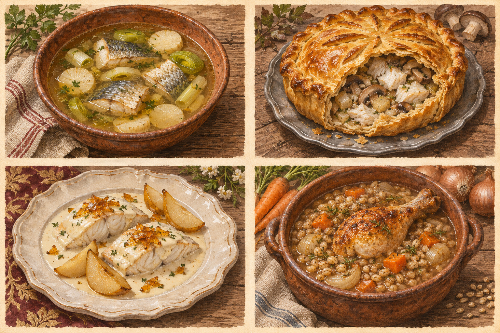

Ordem da prancha: superior esquerda, superior direita, inferior esquerda, inferior direita.

### C01 — Consomê de luz de Merlinport

**Mesa:** Cais e mesa urbana. **Rendimento:** quatro porções. **Preço por porção:** 3 PC. **Tempo:** 45 minutos.

**Fauna:** A01. **Herbário:** H24. **Imagem:** prancha 1, superior esquerda.

**Ingredientes:** Lumeças limpas em quantidade para quatro tigelas; rizoma alimentar de flor-da-lama mansa; alho-poró; cebola; água segura; sal e pão à parte.

**Preparo no mundo:** O cozinheiro prepara um caldo suave com aparas apropriadas e vegetais, coa e junta rodelas do rizoma processado. Cozinha as porções de lumeça nesse caldo e serve quando o peixe e a raiz estão prontos. A transparência do líquido é o sinal de capricho; escamas, sedimento e pós minerais ficam fora da tigela.

**Sabor e textura:** Caldo dourado claro, aroma de alho-poró e carne delicada. A raiz traz textura macia e dá sustância sem tornar a sopa pesada.

**À mesa:** Nos cais, serve de refeição matinal com pão. Casas abastadas apresentam tigelas menores antes do prato principal, usando o mesmo nome para um serviço mais caro.

**Variação:** A versão cotidiana usa outro peixe pequeno identificado pelo vendedor. Em ambas, a luz do título vem do brilho do pescado e da superfície do caldo, sem efeito mágico.

**Situação de jogo:** Um estalajadeiro anuncia água de um rio inexistente para justificar o preço; o verdadeiro problema está na procedência da água que utiliza.

### C02 — Folhado de escama-terrestre de Altavanne

**Mesa:** Festa urbana. **Rendimento:** quatro porções. **Preço por porção:** 7 PC. **Tempo:** 1 hora e meia.

**Fauna:** A03. **Herbário:** H11. **Imagem:** prancha 1, superior direita.

**Ingredientes:** Carne limpa de escama-terrestre; massa de trigo; cogumelo-de-palha cultivado B01; raiz-de-escarpa preparada para alimento; cebola; caldo e gordura culinária.

**Preparo no mundo:** A raiz é preparada separadamente. Peixe, cogumelos e cebola recebem cocção apropriada antes de formar um recheio pouco úmido. A massa envolve o conjunto e vai ao forno até ganhar crosta firme. Uma abertura deixa o vapor sair; o corte mostra o recheio sem transformar a base em sopa.

**Sabor e textura:** Exterior quebradiço, interior macio e perfume de cogumelo. O sabor terroso vem de alimento cultivado, não de escamas sujas ou lodo.

**À mesa:** Aparece em festas urbanas e encomendas para reuniões de guilda. O formato fechado facilita dividir porções, mas não torna o recheio perecível numa ração de longa viagem.

**Variação:** Cozinhas modestas usam uma tampa de massa sobre panela de barro. Assim se preserva o espírito do prato antigo e se faz justiça ao nome folhado.

**Situação de jogo:** Uma encomenda de banquete chega com cogumelos que não correspondem ao cultivo contratado; o cozinheiro exige rastrear o lote.

### C03 — Nadadeira-de-jade ao creme de pera

**Mesa:** Banquete nobre. **Rendimento:** quatro porções. **Preço por porção:** 1 PP. **Tempo:** 1 hora.

**Fauna:** A09, A16. **Herbário:** Nenhum. **Imagem:** prancha 1, inferior esquerda.

**Ingredientes:** Filés de nadadeira-de-jade; manteiga e creme próprios para cozinha; pera-de-Biemont B03; um pouco de vinho ou licor culinário de pera; pequena quantidade de açúcar, quando disponível.

**Preparo no mundo:** As peras são cozidas até manter forma macia. O peixe recebe cocção completa e delicada. O creme reduz com o líquido de pera e envolve os filés apenas ao servir. A versão de salão termina com pequenos fragmentos de açúcar caramelizado; não leva cristais minerais nem nadadeiras como adorno comestível.

**Sabor e textura:** Doçura moderada, molho untuoso e carne delicada. A fruta deve acompanhar o peixe, não encobrir seu sabor.

**À mesa:** Prato de banquete de Altavanne, associado a serviço atento e transporte de ingredientes frescos. O luxo está no conjunto, não numa obrigação supersticiosa de usar talher de prata.

**Variação:** Uma mesa menos rica dispensa açúcar e licor, aproveitando somente a doçura da fruta e um molho mais leve.

**Situação de jogo:** Uma casa exige peras fora da estação para rivalizar com outra; fornecedores oferecem fruta preservada e escondem a substituição.

### C04 — Panela de Dahrma com galinha e grãos

**Mesa:** Mesa de trabalhadores. **Rendimento:** quatro porções. **Preço por porção:** 3 PC. **Tempo:** 1 hora e meia.

**Fauna:** A13. **Herbário:** H06. **Imagem:** prancha 1, inferior direita.

**Ingredientes:** Uma galinha-dourada de porte familiar; cevada; pequena parte de farinha de semente-de-celeiro; cebola; cenoura; água e sal.

**Preparo no mundo:** A galinha é dividida em porções e cozida com cebola e água. A cevada entra para formar uma panela espessa; cenoura e farinha alimentar completam o corpo do caldo. A apresentação de festa doura uma porção de ave separadamente e a acomoda sobre os grãos.

**Sabor e textura:** Sabor de caldo de ave, cereal macio e doçura de legumes. A farinha de H06 engrossa a refeição; não funciona como fortificante mágico.

**À mesa:** É comida de trabalho partilhada em tigelas fundas. O tamanho das porções de carne mostra se a família está confortável ou estendendo uma ave entre muitos convidados.

**Variação:** Em dias modestos, usa ovos ou uma quantidade menor de carne e aumenta leguminosas. A receita permanece uma refeição, sem gerar bônus de combate.

**Situação de jogo:** Um cobrador requisita as aves de postura da vila; o prejuízo verdadeiro aparece semanas depois na falta de ovos.

## Matas silvanas e águas de Vergod

As comunidades das matas combinam cultivo, coleta manejada, pesca e pequena criação. Raízes aquáticas, grãos obtidos por troca, castanhas e frutos sazonais aparecem em pratos que podem circular entre plataformas e cozinhas de chão protegido. O fogo permanece em locais preparados e vigiados; a Cidade Suspensa não espalha braseiros sem cuidado pelas copas.

Partilhar alimento pode reconhecer um acordo de coleta ou uma dívida de acolhimento. Não existe um único cardápio para todas as comunidades. Sal, ferro e parte dos cereais chegam por Vergod; interromper esse comércio altera o que se come mesmo numa floresta abundante. Caça e coleta têm áreas e estações de manejo.

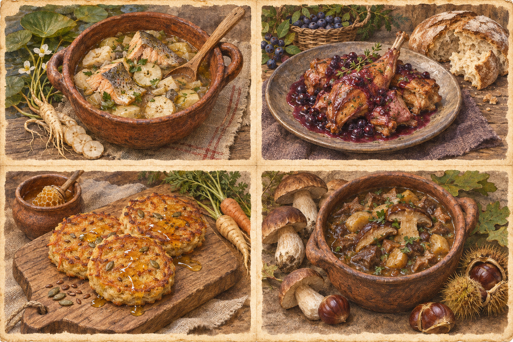

Ordem da prancha: superior esquerda, superior direita, inferior esquerda, inferior direita.

### C05 — Truta de Vergod com raízes da água

**Mesa:** Hospitalidade de fronteira. **Rendimento:** quatro porções. **Preço por porção:** 3 PC. **Tempo:** 50 minutos.

**Fauna:** A12. **Herbário:** H24. **Imagem:** prancha 2, superior esquerda.

**Ingredientes:** Truta-de-pedra limpa; rizoma alimentar de flor-da-lama mansa; cebola obtida por troca; água segura; sal e folhas cultivadas comuns da horta.

**Preparo no mundo:** O rizoma recebe seu processamento alimentar tradicional antes de entrar na panela. Cebola e raiz formam uma base de caldo; o peixe é acrescentado em porções para não se desfazer. O prato é servido em recipiente comum, com atenção à divisão das partes mais carnudas.

**Sabor e textura:** Caldo suave, raiz macia e peixe de sabor limpo. É uma comida de colher, adequada a uma cozinha com poucos recipientes.

**À mesa:** Aparece em encontros entre coletores e mercadores. Um anfitrião pode indicar de qual curso veio o peixe para reconhecer o trabalho dos pescadores e o direito de uso daquela água.

**Variação:** Quando a pesca é pequena, acrescentam-se grãos recebidos em Vergod. A população de trutas de um curso não é tratada como estoque inesgotável.

**Situação de jogo:** Um afluente deixa de fornecer peixe depois de uma obra; a conversa à mesa aponta para o primeiro local a investigar.

### C06 — Coelho de sebes com molho do barqueiro

**Mesa:** Mesa de visita. **Rendimento:** quatro porções. **Preço por porção:** 5 PC. **Tempo:** 1 hora e meia.

**Fauna:** A14. **Herbário:** H07. **Imagem:** prancha 2, superior direita.

**Ingredientes:** Coelho-de-sebe em porções; bagas maduras do barqueiro de lote alimentar; cebola; caldo; gordura culinária e pão.

**Preparo no mundo:** A carne cozinha lentamente até ficar macia. As bagas maduras formam um molho separado, passado para retirar partes inadequadas, e são juntadas ao final. O pão recebe parte do caldo. Não se usa tinta de baga produzida para ofício, mesmo que a matéria vegetal tenha o mesmo nome.

**Sabor e textura:** Carne suave com molho ácido e frutado, de cor azul-arroxeada. O pão equilibra a acidez e aproveita o caldo.

**À mesa:** Servido em visitas importantes e refeições após trabalho coletivo. A baga tem associação funerária em algumas regiões, mas isso não transforma todo serviço do prato em rito de luto.

**Variação:** A versão de primavera usa uma conserva alimentar da safra anterior, anunciada como tal. Coelho de criação evita pressionar a caça local.

**Situação de jogo:** Um convidado interpreta as bagas como anúncio de morte; o anfitrião as ofereceu por serem a melhor conserva da casa.

### C07 — Bolos das sementes e do mel

**Mesa:** Lanche e partilha. **Rendimento:** quatro porções. **Preço por porção:** 2 PC. **Tempo:** 40 minutos.

**Fauna:** A20. **Herbário:** H24, H06. **Imagem:** prancha 2, inferior esquerda.

**Ingredientes:** Sementes alimentares de flor-da-lama mansa; farinha de semente-de-celeiro misturada a cereal comum; água; sal e mel de pomar.

**Preparo no mundo:** As sementes alimentares são preparadas e moídas segundo o ofício local. A massa espessa recebe água suficiente para formar pequenos discos, assados em superfície apropriada. O mel é colocado depois, em fios discretos. O bolo deve poder ser repartido sem exigir faca ou prato individual.

**Sabor e textura:** Crosta dourada, miolo compacto e leve doçura. O cereal comum ajuda a dar estrutura; H06 não precisa substituir toda a farinha.

**À mesa:** Crianças levam pequenos bolos a quem trabalha nos depósitos. Em reuniões, o primeiro disco pode ser repartido para marcar um acordo, sem criar um juramento sobrenatural.

**Variação:** Sem mel, torna-se acompanhamento salgado. A versão para levar usa pouco recheio úmido e continua sujeita às condições normais de conservação.

**Situação de jogo:** A coleta excessiva de sementes ameaça a safra seguinte e coloca fornecedores contra as famílias que manejam a lagoa.

### C08 — Caldeirada de cogumelos e castanhas

**Mesa:** Outono e mesa comum. **Rendimento:** quatro porções. **Preço por porção:** 3 PC. **Tempo:** 1 hora.

**Fauna:** Nenhum. **Herbário:** Nenhum. **Imagem:** prancha 2, inferior direita.

**Ingredientes:** Cogumelo-de-palha B01 cultivado; castanha-de-mata B05 identificada e preparada para alimento; cebola; cereal cozido; água e gordura vegetal culinária.

**Preparo no mundo:** A castanha recebe processamento alimentar antes de ser partida. Cogumelos e cebola cozinham com caldo de cereal até formar uma mistura espessa. Uma parte das castanhas permanece em pedaços, permitindo que a colher encontre texturas diferentes. Não se acrescentam fungos luminosos do herbário.

**Sabor e textura:** Sabor profundo de cogumelo, castanha macia e caldo encorpado. É um prato sem carne que sustenta uma refeição acompanhada de pão.

**À mesa:** Aparece em mesas de outono e em dias nos quais a pesca foi pequena. Cultivo de cogumelos em locais preparados oferece regularidade; coleta aleatória de fungos não faz parte do preparo.

**Variação:** Uma versão de viagem leva castanhas e cogumelos adequadamente secos por ofício, reconstituídos no abrigo.

**Situação de jogo:** Um proprietário cerca um castanhal usado há gerações e cobra por uma colheita que antes alimentava várias casas.

## Corallis e o Mar dos Corais

A culinária corallina acompanha mercados de desembarque, oficinas, hospitais e tripulações. Peixes de passagem convivem com mariscos costeiros, pães de viagem, frutas de encosta e vinho. A mesma cidade oferece comida rápida de cais e pratos delicados que exigem serviço imediato. A riqueza está na circulação e no trabalho de conservação.

Baldbella valoriza caldos e porções fáceis de servir; Alineus prefere refeições compatíveis com turnos de estaleiro; Biemont combina fruta e peixe; Stoneforge recebe pescado de nascentes próximas ou de comércio. A fama de um prato depende tanto da procedência quanto da receita. Hospitais podem oferecer conforto alimentar sem prometer cura.

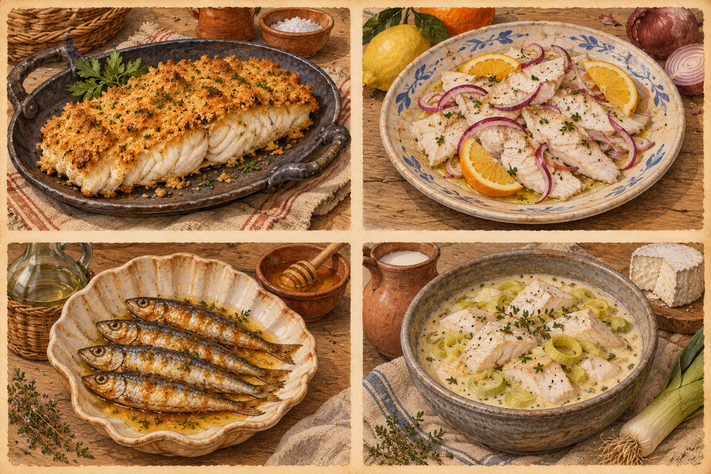

Ordem da prancha: superior esquerda, superior direita, inferior esquerda, inferior direita.

### C09 — Maremestre em crosta do navegante

**Mesa:** Taverna de porto. **Rendimento:** quatro porções. **Preço por porção:** 6 PC. **Tempo:** 45 minutos.

**Fauna:** A04. **Herbário:** H27. **Imagem:** prancha 3, superior esquerda.

**Ingredientes:** Postas de maremestre; pão de viagem esmigalhado; gordura culinária; pimenta de uso alimentar; brotos comestíveis de flor-de-sal de Portocala e água para acompanhamento.

**Preparo no mundo:** O pão forma uma crosta fina sobre postas preparadas para assar. O peixe vai ao calor até ficar completamente cozido, mantendo umidade por controle do fogo e do tamanho das porções. A flor-de-sal alimentar entra como acompanhamento salgado. Não é usado óleo de lamparina nem gordura presumida de leviatã.

**Sabor e textura:** Crosta tostada, peixe firme e guarnição salina. O prato é robusto e pede bebida ou água à parte, sem prometer saciedade por um dia inteiro.

**À mesa:** Comida de capitães, oficinas e tavernas em dias de bom desembarque. A posta pode ser dividida sobre pão para alimentar mais pessoas.

**Variação:** Uma versão de bordo usa pescado preservado por ofício e preparo adequado, deixando explícito que não é o mesmo produto fresco.

**Situação de jogo:** Uma taverna anuncia gordura de leviatã para cobrar mais; o anúncio atrai um colecionador e uma fiscalização indesejada.

### C10 — Fatias de vento ao cítrico de Biemont

**Mesa:** Mercado e cais. **Rendimento:** quatro porções. **Preço por porção:** 4 PC. **Tempo:** 35 minutos.

**Fauna:** A06. **Herbário:** Nenhum. **Imagem:** prancha 3, superior direita.

**Ingredientes:** Vento-ágil limpo; cítrico-de-encosta B02; cebola roxa; pimenta alimentar B04; sal e pão fino.

**Preparo no mundo:** O pescado é cozido por método apropriado e depois dividido em fatias delicadas. O molho cítrico, a cebola e a pimenta são acrescentados perto do serviço. A proposta recupera o contraste fresco do caderno antigo sem apresentar acidez como substituto universal de cocção ou controle sanitário.

**Sabor e textura:** Acidez viva, cebola crocante e peixe macio. O molho é leve e o prato chega à mesa sem longa espera.

**À mesa:** Vendido em pequenos pratos durante o movimento do cais. Comer de pé junto ao balcão é comum; grandes travessas aparecem em almoços de comerciantes.

**Variação:** Em dias frios, serve-se morno. Nas casas sem cítrico disponível, a preparação muda de nome e usa um molho local, sem fingir a mesma origem.

**Situação de jogo:** Um lote de cítricos foi desviado de uma embarcação retida; a casca marcada por um pomar ajuda a rastrear a carga.

### C11 — Meteoritos ao vinho e mel

**Mesa:** Festa e entrada. **Rendimento:** quatro porções. **Preço por porção:** 8 PC. **Tempo:** 40 minutos.

**Fauna:** A05, A20. **Herbário:** Nenhum. **Imagem:** prancha 3, inferior esquerda.

**Ingredientes:** Pequenos peixes-meteorito em quantidade para quatro entradas; vinho branco de Biemont; mel de pomar; cebola suave; sal e um pouco de gordura culinária.

**Preparo no mundo:** O vinho e o mel formam um molho moderadamente doce. Peixes limpos recebem cocção completa e delicada; o molho é ajustado antes do serviço em cerâmica com forma de concha. Não entram flores medicinais, gemas ou conchas gigantes supostamente mágicas.

**Sabor e textura:** Peixe delicado, brilho superficial do molho e aroma de vinho. A doçura não deve encobrir o sabor do pescado.

**À mesa:** Prato de celebração em Corallis. Convidados fazem votos de boa viagem sob as estrelas, sem regra que transforme a refeição em pedido atendido por uma divindade antiga fora do cenário.

**Variação:** Pode ser preparado com vinho de outra safra; o cozinheiro honesto cobra pela receita, não por uma data inventada no rótulo.

**Situação de jogo:** Um banquete de casamento depende de um cardume que não entrou na baía; o fornecedor precisa negociar outra espécie sem humilhar os anfitriões.

### C12 — Cavernário branco de Stoneforge

**Mesa:** Oficinas e casas de cuidado. **Rendimento:** quatro porções. **Preço por porção:** 6 PC. **Tempo:** 50 minutos.

**Fauna:** A07, A16. **Herbário:** Nenhum. **Imagem:** prancha 3, inferior direita.

**Ingredientes:** Cavernário de criação ou procedência reconhecida; leite de cabra; alho-poró; raiz alimentar comum; água e sal.

**Preparo no mundo:** O caldo de leite e vegetais é preparado em panela apropriada. As porções de peixe entram para cozinhar sem se desfazer. O serviço privilegia tigelas quentes e pequenas porções. A versão atual não inclui líquen luminoso nem atribui a panela a anões, ausentes das civilizações atuais de Alenia.

**Sabor e textura:** Creme leve, aroma de alho-poró e carne macia. A cor pálida vem do peixe e do leite, sem brilho próprio.

**À mesa:** Cozinhas de oficina e casas de cuidado servem versões mais simples. O prato pode ser confortável para alguém em recuperação, mas não trata ferimentos nem devolve PV por conta própria.

**Variação:** Outro peixe branco de cultivo substitui o cavernário com menor custo; o cardápio passa a dizer caldo branco da oficina.

**Situação de jogo:** Um fornecedor esvazia uma pequena população de caverna para cumprir contrato de hospital, contrariando o manejo dos viveiristas.

## Gaddra e as mesas de hospitalidade

O acesso à água organiza a cozinha. Grãos, leguminosas, leite, carne de pequenos rebanhos e frutos de cultivo resistem melhor à logística das caravanas que uma despensa de folhas frescas. Oásis e cidades têm jardins; o deserto não fornece qualquer ingrediente a cada dia de marcha. O sal de Bayd é um recurso comercial, enquanto a água do lago permanece imprópria para beber.

A refeição recebida sob hospitalidade cria deveres entre pessoas, sem impor efeitos mágicos. Pratos de carne marcam chegada de hóspedes e acordos; a alimentação cotidiana pode ser cereal, leite e leguminosas. A feira de Suq-Ramad amplia a variedade na estação favorável às caravanas. Água usada na cozinha vem de fonte segura e contabilizada.

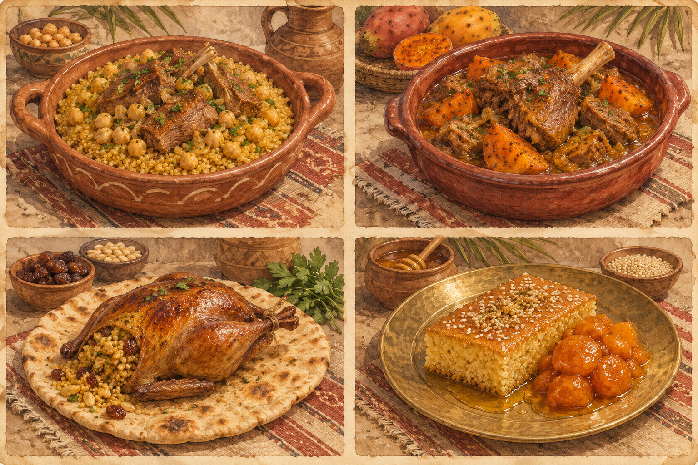

Ordem da prancha: superior esquerda, superior direita, inferior esquerda, inferior direita.

### C13 — Grãos de OX com cabra de escarpa

**Mesa:** Feira e hospitalidade. **Rendimento:** quatro porções. **Preço por porção:** 4 PC. **Tempo:** 2 horas.

**Fauna:** A16. **Herbário:** H38. **Imagem:** prancha 4, superior esquerda.

**Ingredientes:** Carne de cabra; grão de cereal comum misturado a uma pequena parte de farinha alimentar de semente-do-vento; grão-de-bico; cebola; água e sal.

**Preparo no mundo:** A carne cozinha lentamente com leguminosas e cebola. Os grãos são preparados em recipiente separado e recebem caldo na hora de montar a travessa. H38 entra como parte da mistura alimentar, conforme o processamento local; não aparece como estimulante ou substituto de água.

**Sabor e textura:** Carne de sabor marcado, caldo espesso e grãos que absorvem o molho. O prato usa ingredientes de armazenamento com uma porção valiosa de carne.

**À mesa:** Servido em encontros de criadores e após a chegada de caravanas. Partilhar uma travessa permite ao anfitrião distribuir porções e demonstrar atenção ao visitante.

**Variação:** A versão cotidiana omite carne e aumenta leguminosas. A de festa leva cortes mais tenros, sem alterar a função básica do cereal.

**Situação de jogo:** Uma disputa pelo poço reduz a água disponível aos cozinheiros da feira e torna visível o conflito antes de qualquer combate.

### C14 — Cordeiro com fruto de palma de Dar-Shams

**Mesa:** Hospitalidade e festa. **Rendimento:** quatro porções. **Preço por porção:** 7 PC. **Tempo:** 2 horas.

**Fauna:** A17. **Herbário:** H34. **Imagem:** prancha 4, superior direita.

**Ingredientes:** Cordeiro; frutos maduros alimentares de palma-de-odre; cebola; especiarias culinárias disponíveis; água, gordura e sal.

**Preparo no mundo:** A carne cozinha em recipiente tampado com cebola e água suficiente. Frutos preparados e sem partes inadequadas entram no final para conservar alguma forma. A tampa retém umidade, mas o prato continua precisando de combustível e água reais. Nada é servido com espinhos como decoração.

**Sabor e textura:** Molho quente, fruta macia de tom alaranjado e carne de sabor delicado. O contraste doce e salgado distingue a mesa do oásis.

**À mesa:** Prato de acolhimento quando há recursos, servido com pão. A quantidade de fruta revela a estação ou a existência de conservas de uma safra anterior.

**Variação:** Pode usar carne de cabra; nesse caso muda o sabor e o tempo de preparo. O fruto não transforma o prato em fonte suficiente de hidratação para viagem.

**Situação de jogo:** Um pomar requisitado por soldados deixa famílias sem fruta para uma festa de reconciliação.

### C15 — Pombo dos três dias

**Mesa:** Refeição de acolhimento. **Rendimento:** quatro porções. **Preço por porção:** 6 PC. **Tempo:** 1 hora e meia.

**Fauna:** A18. **Herbário:** H35. **Imagem:** prancha 4, inferior esquerda.

**Ingredientes:** Pombos de criação suficientes para quatro porções; cereal cozido; cebola; condimento alimentar processado de flor-de-Bayd; gordura e pão achatado.

**Preparo no mundo:** As aves preparadas recebem recheio de grãos e cebola e são assadas por completo. O condimento de H35 entra em pequena quantidade como ingrediente de lote alimentar, não como crosta mineral colhida da margem do lago. O pão recebe os sucos do assado.

**Sabor e textura:** Ave tostada, recheio macio e tempero salino discreto. As porções pequenas favorecem serviço individual dentro de uma mesa compartilhada.

**À mesa:** O nome lembra os três dias de proteção da hospitalidade. Servir o prato não cria sozinho um pacto; são o acolhimento e as palavras das pessoas que estabelecem a obrigação.

**Variação:** Famílias modestas oferecem apenas os grãos com ovo ou leguminosas. O dever de hospitalidade não exige luxo que arruíne o anfitrião.

**Situação de jogo:** Um visitante exige pombo como prova de respeito e revela ignorância sobre o costume, abrindo uma negociação delicada.

### C16 — Doce da última tenda

**Mesa:** Feira e despedida. **Rendimento:** quatro porções. **Preço por porção:** 3 PC. **Tempo:** 1 hora.

**Fauna:** A20. **Herbário:** H38, H34. **Imagem:** prancha 4, inferior direita.

**Ingredientes:** Farinha de cereal com parte de semente-do-vento processada; fruto de palma-de-odre; mel de pomar; água e gordura culinária.

**Preparo no mundo:** Uma massa firme de cereal é assada em forma baixa. A fruta preparada vira acompanhamento espesso, servido com mel sobre cortes em losango. A farinha de H38 é alimento de origem conhecida; outras sementes que o vento trouxer não são equivalentes.

**Sabor e textura:** Massa dourada, bordas levemente tostadas e cobertura alaranjada. É um doce de sustância, oferecido em porções pequenas.

**À mesa:** Servido no encerramento de uma feira ou na última noite antes da partida. O nome descreve o momento de despedida, não uma localidade perdida do mapa antigo.

**Variação:** Sem mel, a fruta madura fornece parte da doçura. A receita de estrada leva a cobertura separada para reduzir a umidade da massa.

**Situação de jogo:** A última tenda aberta guarda a pessoa que uma caravana procurava; o cheiro do doce orienta os visitantes ao lugar.

## Kalis e a Floresta Negra

Grãos de armazenamento, criação de aves e ovinos, caça regulamentada, frutas de mata e preparos longos alimentam portos, fortalezas e comunidades florestais. A cor escura de certos pratos vem de cereais, frutos e cocção. Madeira negra naval, cascas de tinta e resinas de casco pertencem aos ofícios, não à panela.

O acesso ao bosque distingue a mesa de um caçador, de uma casa nobre e de um trabalhador urbano. Frutos secos levam parte do verão ao inverno. Há comércio por mar suficiente para trazer temperos, mas produtos importados não precisam estar presentes em toda refeição. Alimentar convidados também pode demonstrar estoque, crédito e capacidade de atravessar o frio.

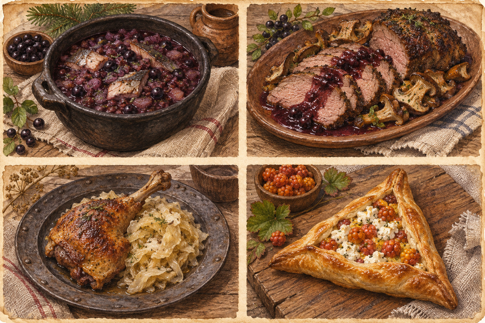

Ordem da prancha: superior esquerda, superior direita, inferior esquerda, inferior direita.

### C17 — Caldo negro de peixe-corvo

**Mesa:** Taverna e inverno. **Rendimento:** quatro porções. **Preço por porção:** 4 PC. **Tempo:** 1 hora.

**Fauna:** A08. **Herbário:** H47. **Imagem:** prancha 5, superior esquerda.

**Ingredientes:** Peixe-corvo; cevada escura; baga-de-Myrkholm alimentar; cebola; caldo e gordura culinária.

**Preparo no mundo:** Cevada e cebola cozinham até formar uma base espessa. As bagas acrescentam cor e acidez; o peixe limpo entra em porções perto do fim. O caldo escuro desta edição dispensa sangue cru e não exige raízes medicinais amargas ou gordura de animal mineral.

**Sabor e textura:** Cor profunda, cereal macio e acidez discreta. Apesar do nome, a carne do peixe pode permanecer clara dentro do molho.

**À mesa:** Prato de portos e alojamentos em tempo frio. Narradores de taverna ainda o chamam de sangue negro, permitindo preservar o nome dramático como alcunha culinária.

**Variação:** Na falta de baga, há uma versão de cevada mais clara que perde o sobrenome negro. Não concede resistência sobrenatural ao frio.

**Situação de jogo:** Um visitante confunde a cor do prato com ritual proibido e ameaça denunciar uma cozinha perfeitamente comum.

### C18 — Javali de Myrkholm com cogumelos

**Mesa:** Caça e banquete regional. **Rendimento:** quatro porções. **Preço por porção:** 9 PC. **Tempo:** 3 horas.

**Fauna:** A15. **Herbário:** H47. **Imagem:** prancha 5, superior direita.

**Ingredientes:** Carne de javali-de-lombo negro de origem autorizada; cogumelo-de-palha B01; bagas alimentares de Myrkholm; cebola e caldo.

**Preparo no mundo:** A carne recebe preparo demorado adequado ao corte. Cogumelos cultivados e cebola acompanham a cocção; um molho de bagas equilibra o conjunto. A apresentação de festa corta fatias e deixa o molho à parte, enquanto a mesa comum usa porções de panela.

**Sabor e textura:** Carne intensa, cogumelos macios e molho ácido. A textura depende do corte e do trabalho do cozinheiro, não de uma propriedade de obsidiana.

**À mesa:** Servido após caçadas autorizadas e em casas com acesso a carne. Direito de caça e preço do corte determinam quem pode oferecê-lo.

**Variação:** Carne de criação pode substituir a caça e deve ser identificada. O prato fica mais acessível sem precisar fingir origem florestal.

**Situação de jogo:** Um caçador vende a mesma autorização a duas tavernas; a disputa de procedência ameaça interromper uma festa.

### C19 — Pato de canal com folhas de inverno

**Mesa:** Mesa familiar de ocasião. **Rendimento:** quatro porções. **Preço por porção:** 7 PC. **Tempo:** 2 horas.

**Fauna:** A19. **Herbário:** Nenhum. **Imagem:** prancha 5, inferior esquerda.

**Ingredientes:** Pato de criação; couve cultivada; cebola; cereal ou pão; gordura culinária e sal.

**Preparo no mundo:** A ave é preparada e assada até ficar pronta. As folhas cultivadas cozinham em recipiente separado com cebola e parte do caldo apropriado. O serviço reúne uma porção tostada de pato e uma base macia de folhas, deixando espaço para pão.

**Sabor e textura:** Pele tostada, carne rica e guarnição vegetal de sabor firme. Não se usam agulhas aromáticas de H42 como se fossem condimento aprovado.

**À mesa:** É uma refeição de inverno de quem tem acesso a criação, diferente da caça silvestre reservada a certos senhores. Pode marcar uma visita de parentes ou um acordo de oficina.

**Variação:** Versões menores usam ovos de pato com as folhas e pão. A economia doméstica escolhe entre abater a ave ou preservar sua produção.

**Situação de jogo:** Uma interdição de canais atinge criadores honestos e obriga a investigar quem lançou resíduos na água.

### C20 — Torta de queijo e bagas de Myrkholm

**Mesa:** Mesa de visita e sobremesa. **Rendimento:** quatro porções. **Preço por porção:** 4 PC. **Tempo:** 1 hora e meia.

**Fauna:** A16. **Herbário:** H47. **Imagem:** prancha 5, inferior direita.

**Ingredientes:** Queijo de cabra próprio para alimento; bagas maduras de Myrkholm; massa de cereal; ovo e pequena quantidade de mel ou açúcar quando disponível.

**Preparo no mundo:** A massa recebe recheio de queijo e ovo; as bagas entram inteiras ou em conserva alimentar apropriada. O forno firma o centro e doura a borda. Servida em fatias, a torta mostra uma camada clara pontuada pelos frutos acobreados.

**Sabor e textura:** Contraste entre queijo suave, fruta levemente ácida e crosta de cereal. A doçura é moderada, adequada também a uma mesa de tarde.

**À mesa:** O fruto permite reconhecer a estação ou o valor de um bom estoque. A receita pode ser levada a uma família enlutada como comida pronta, sem vínculo obrigatório com uma cerimônia.

**Variação:** A versão de inverno usa bagas secas ou conserva. O recheio continua perecível e não vira ração de longa duração por ser assado.

**Situação de jogo:** Uma encomenda exige a primeira safra, mas a comunidade reserva esses frutos a idosos e famílias em dificuldade.

## Ravena e a Ilha das Safiras

Ravena e Safiras são lugares distintos. O arquipélago combina pesca, passagem de navios e comida de bordo; Porto Esmeralda recebe pescado, frutos e cargas de boticários. As receitas desta seção circulam entre tripulações e cozinheiros insulares, sem pressupor uma cultura única ou um governo compartilhado.

O mar traz abundância irregular: um porto rico em peixe pode precisar importar grão e combustível adequado. Cozinhas aproveitam peixes menores e sobras comestíveis antes que se percam. Plantas raras transportadas por boticários continuam fora do cardápio. Madeira de casco tratada, resina e material de destroço não entram como combustível culinário desta edição.

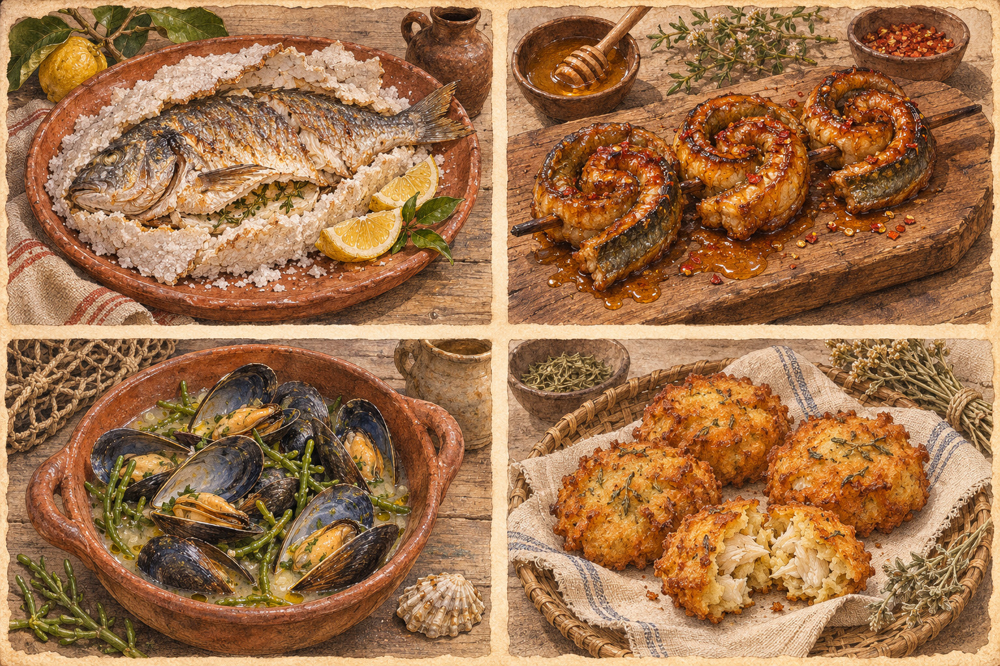

Ordem da prancha: superior esquerda, superior direita, inferior esquerda, inferior direita.

### C21 — Assado do Bucaneiro em crosta de sal

**Mesa:** Festa de cais. **Rendimento:** quatro porções. **Preço por porção:** 7 PC. **Tempo:** 1 hora.

**Fauna:** A11. **Herbário:** H27. **Imagem:** prancha 6, superior esquerda.

**Ingredientes:** Dente-claro de recife identificado; sal culinário; cítrico-de-encosta B02; acompanhamento alimentar de flor-de-sal de Portocala e pão.

**Preparo no mundo:** O peixe adequado é preparado para assar em crosta de sal, que se rompe no serviço. O cítrico acompanha a carne já cozida. Esta receita usa dente-claro desde o início; não descreve extração de veneno nem propõe que sal ou limão transformem uma espécie perigosa em alimento.

**Sabor e textura:** Carne úmida sob a crosta, perfume cítrico e guarnição salina. O gesto de quebrar a cobertura oferece o espetáculo que a receita antiga buscava no perigo.

**À mesa:** Tavernas de Ravena preservam o nome bucaneiro. As mais confiáveis exibem a espécie utilizada e contam a bravata do antigo dente-venenoso como história, não como desafio ao hóspede.

**Variação:** Peixe comum apropriado pode receber a mesma técnica. A origem muda no cardápio, e a conta reflete a disponibilidade.

**Situação de jogo:** Um cozinheiro rival troca a placa do peixe para acusar a taverna de servir espécie proibida.

### C22 — Serpentoso em espiral de Ravena

**Mesa:** Festa insular. **Rendimento:** quatro porções. **Preço por porção:** 5 PC. **Tempo:** 50 minutos.

**Fauna:** A10, A20. **Herbário:** Nenhum. **Imagem:** prancha 6, superior direita.

**Ingredientes:** Serpentoso preparado em porções; cítrico B02; mel de pomar; pimenta alimentar B04; alho e gordura culinária.

**Preparo no mundo:** Porções manejáveis são dispostas em espiral nos espetos adequados. O molho de mel, cítrico e pimenta é aplicado sem deixar a superfície queimar antes que o peixe esteja cozido. O fogo usa combustível apropriado para cozinha, não madeira de casco tratada ou resinas de ofício.

**Sabor e textura:** Exterior brilhante, doçura moderada e picância ajustável. A espiral é uma habilidade de apresentação, não uma característica vulcânica do animal.

**À mesa:** Servido em festas e barracas próximas ao cais. O cozinheiro pode oferecer espetos menores para que tripulações com pouco dinheiro participem da ocasião.

**Variação:** Sem pimenta, o molho cítrico e mel mantém a identidade do prato. O antigo nome de Zalmar não é incorporado ao mapa atual.

**Situação de jogo:** Um lote de mel desaparece antes de uma festa; pescadores suspeitam de um capitão que acaba de partir com carga não declarada.

### C23 — Mexilhões da enseada com folhas salgadas

**Mesa:** Mesa de pescadores. **Rendimento:** quatro porções. **Preço por porção:** 4 PC. **Tempo:** 35 minutos.

**Fauna:** A21. **Herbário:** H27. **Imagem:** prancha 6, inferior esquerda.

**Ingredientes:** Mexilhões de procedência apropriada; brotos alimentares de flor-de-sal de Portocala; cebola; água ou caldo; pão.

**Preparo no mundo:** O lote vem de área de coleta adequada e passa por seleção do ofício. Os moluscos são cozidos em caldo e servidos com folhas alimentares preparadas à parte. O serviço não pretende tornar segura uma captura de água contaminada apenas pelo calor.

**Sabor e textura:** Caldo marinho, carne de molusco e folhas de textura carnuda. O pão absorve o líquido e torna a travessa uma refeição simples.

**À mesa:** Prato de enseadas com criação regular, vendido por famílias que conhecem o local de origem. Pode ser barato perto da produção e caro depois de longa viagem.

**Variação:** Quando a área de coleta é interditada, a receita sai do cardápio. Uma taverna confiável oferece outro prato em vez de buscar marisco num naufrágio.

**Situação de jogo:** O fechamento de uma enseada revela conflito entre criadores e uma oficina que despeja resíduos.

### C24 — Bolinhos de bordo à erva-de-enseada

**Mesa:** Bordo e taverna. **Rendimento:** quatro porções. **Preço por porção:** 3 PC. **Tempo:** 50 minutos.

**Fauna:** A04. **Herbário:** H55, H06. **Imagem:** prancha 6, inferior direita.

**Ingredientes:** Pescado de maremestre preservado e preparado por ofício; farinha de cereal com parte de H06; erva-de-enseada alimentar; cebola e gordura culinária.

**Preparo no mundo:** O pescado apropriado é preparado para voltar à cozinha e desfiado. Mistura-se à massa e ao condimento alimentar; pequenas porções são cozidas em gordura ou assadas conforme equipamento. A superfície fica dourada e o interior deve estar pronto. A versão usa peixe conhecido, não sobras deterioradas.

**Sabor e textura:** Crosta firme, recheio de peixe e aroma costeiro. O cereal estende uma quantidade pequena de pescado sem ocultar sua natureza.

**À mesa:** Comida de reaproveitamento responsável de provisões. Cada navio possui proporções próprias, e cozinheiros discutem quantos bolinhos uma boa posta deveria render.

**Variação:** Em terra, peixe fresco substitui o preservado. As regras de conservação continuam pertencendo ao equipamento e ao ofício, não à receita.

**Situação de jogo:** Um cozinheiro descobre que a carga recebida não corresponde ao pescado comprado e precisa decidir como avisar uma tripulação faminta.

## Yõketsu e a costa oriental de Aurora

O enclave preserva práticas próprias de serviço, vapor e porções, adaptadas aos ingredientes locais e ao comércio de Aurora. Um arroz de várzea cultivado em áreas irrigadas próximas é introduzido aqui como variedade agrícola proposta, sem substituir o papel dos cereais de Dahrma no abastecimento do reino.

Preparar pequenas porções de peixe permite servir uma mesa em etapas. O caldo pode encerrar uma refeição ou acompanhar trabalhadores do cais. Algas de Syleth chegam por comércio e aparecem em ocasiões especiais; não são tratadas como produto nativo de toda costa. A tradição oriental do enclave não determina uma língua, império ou geografia exterior nova.

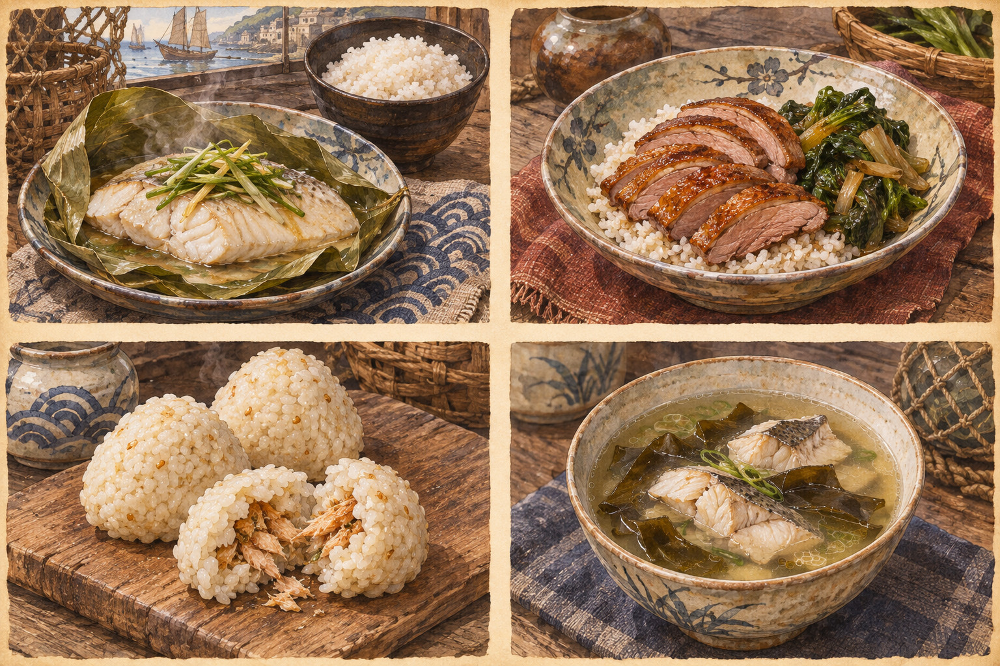

Ordem da prancha: superior esquerda, superior direita, inferior esquerda, inferior direita.

### C25 — Jade ao vapor com arroz de várzea

**Mesa:** Mesa de visita. **Rendimento:** quatro porções. **Preço por porção:** 7 PC. **Tempo:** 50 minutos.

**Fauna:** A09. **Herbário:** Nenhum. **Imagem:** prancha 7, superior esquerda.

**Ingredientes:** Nadadeira-de-jade em filés; arroz de várzea B06; cebolinha cultivada; sal e água segura.

**Preparo no mundo:** O arroz é preparado em recipiente próprio. O peixe cozinha no vapor em suporte adequado, separado da água de baixo, e recebe cebolinha no serviço. O prato usa cocção delicada e porções regulares, sem exigir equipamento industrial ou ingrediente de continente desconhecido.

**Sabor e textura:** Peixe macio, cereal discreto e aroma de cebolinha. A apresentação simples torna diferenças de qualidade mais perceptíveis.

**À mesa:** Servido em casas com acesso ao pescado de criação. O anfitrião cuida de oferecer porções semelhantes para evitar que a divisão pareça uma declaração involuntária de hierarquia.

**Variação:** Outro peixe branco reduz o custo e recebe nome próprio. A nadadeira verde do animal não precisa permanecer no prato como decoração.

**Situação de jogo:** Uma criação perdeu água para um desvio de canal e não consegue cumprir o fornecimento de um encontro diplomático.

### C26 — Pato sobre arroz do cais oriental

**Mesa:** Cais e refeição familiar. **Rendimento:** quatro porções. **Preço por porção:** 5 PC. **Tempo:** 1 hora e meia.

**Fauna:** A19. **Herbário:** Nenhum. **Imagem:** prancha 7, superior direita.

**Ingredientes:** Pato de criação; arroz B06; folhas cultivadas de horta; cebola e sal.

**Preparo no mundo:** A ave é assada e dividida em fatias ou porções. Arroz e verduras são preparados separadamente para conservar texturas. O caldo apropriado da ave umedece o cereal pouco antes do serviço. A receita não acrescenta molhos ou ingredientes exteriores sem defini-los na despensa.

**Sabor e textura:** Carne tostada, arroz que absorve caldo e folhas macias. O tamanho da porção de pato varia entre balcão de cais e mesa de festa.

**À mesa:** Uma tigela pode reunir trabalho de criador, irrigador, hortelão e cozinheiro. O prato mostra a adaptação do enclave a redes agrícolas locais.

**Variação:** Ovos substituem a carne em versões cotidianas, preservando arroz e folhas como base. A troca deve aparecer no nome e no preço.

**Situação de jogo:** Uma taxa sobre arroz provoca protesto dos cozinheiros do porto, que dependem de margens pequenas.

### C27 — Bolinhos de arroz com vento-ágil

**Mesa:** Lanche de trabalho. **Rendimento:** quatro porções. **Preço por porção:** 3 PC. **Tempo:** 45 minutos.

**Fauna:** A06. **Herbário:** Nenhum. **Imagem:** prancha 7, inferior esquerda.

**Ingredientes:** Arroz B06 de variedade que permita formar porções; vento-ágil cozido e desfiado; cebolinha; sal e água.

**Preparo no mundo:** O peixe é cozido e o arroz preparado para modelagem. Porções pequenas recebem recheio e são formadas para serviço próximo, com superfícies e recipientes adequados. Não se declara longa conservação do arroz ou do recheio; levar a comida implica considerar o tempo e as condições do trajeto.

**Sabor e textura:** Cereal macio e recheio levemente salgado. O bolinho pode ser aberto ao meio para mostrar o pescado sem precisar de talher de metal.

**À mesa:** Vendido a trabalhadores entre turnos e servido em partidas curtas. O formato facilita repartir comida, mas não transforma a porção em ração de expedição polar.

**Variação:** Pode receber ovo cozido ou vegetais preparados, criando uma opção sem peixe que os vendedores identificam claramente.

**Situação de jogo:** Um pacote de comida entregue ao cais contém uma mensagem escondida no embrulho, sem contaminar a refeição.

### C28 — Caldo das duas costas

**Mesa:** Encontro mercantil. **Rendimento:** quatro porções. **Preço por porção:** 8 PC. **Tempo:** 45 minutos.

**Fauna:** A12. **Herbário:** H57. **Imagem:** prancha 7, inferior direita.

**Ingredientes:** Truta-de-pedra de comércio local; alga-de-Syleth alimentar de lote seco; cebola suave; água segura e arroz à parte.

**Preparo no mundo:** A alga de procedência alimentar é preparada conforme o ofício culinário. O caldo recebe cebola e porções de peixe, com cocção completa. Alga-de-sutura H25 e coralina-de-tinta H32 não substituem H57 apenas por serem algas; suas fichas não as apresentam como alimento.

**Sabor e textura:** Caldo leve com sabor marinho de alga e carne delicada de peixe de água corrente. O contraste dá o nome ao prato.

**À mesa:** É refeição de visita ou encontro mercantil, pois a alga vem de uma rota longa. Não deve aparecer como alimento barato universal de Yõketsu.

**Variação:** Uma versão só de peixe e horta é mais comum e perde o nome duas costas. O cozinheiro explica a diferença de procedência ao hóspede.

**Situação de jogo:** A carga de algas chega com lacres trocados, levando a investigar em qual escala o lote foi substituído.

## Syleth, Lystra e as provisões do norte

Nas ilhas frias, pescado, pequenos rebanhos resistentes, grãos importados e algas alimentares sustentam refeições de abrigo. Expedições levam alimentos dessas redes para Thanatos e Incognito. A procedência humana da comida é o porto de partida, a tripulação ou o acampamento, nunca uma civilização atual inventada no continente desabitado.

O acesso sazonal reduz variedade e exige planejamento. Uma panela quente pressupõe água, combustível e abrigo. O conforto de uma refeição não elimina Exaustão nem substitui roupas, descanso ou tratamento. As receitas de expedição usam carga conhecida; fungos de piche, líquens raros e películas de Thanatos permanecem fora da alimentação.

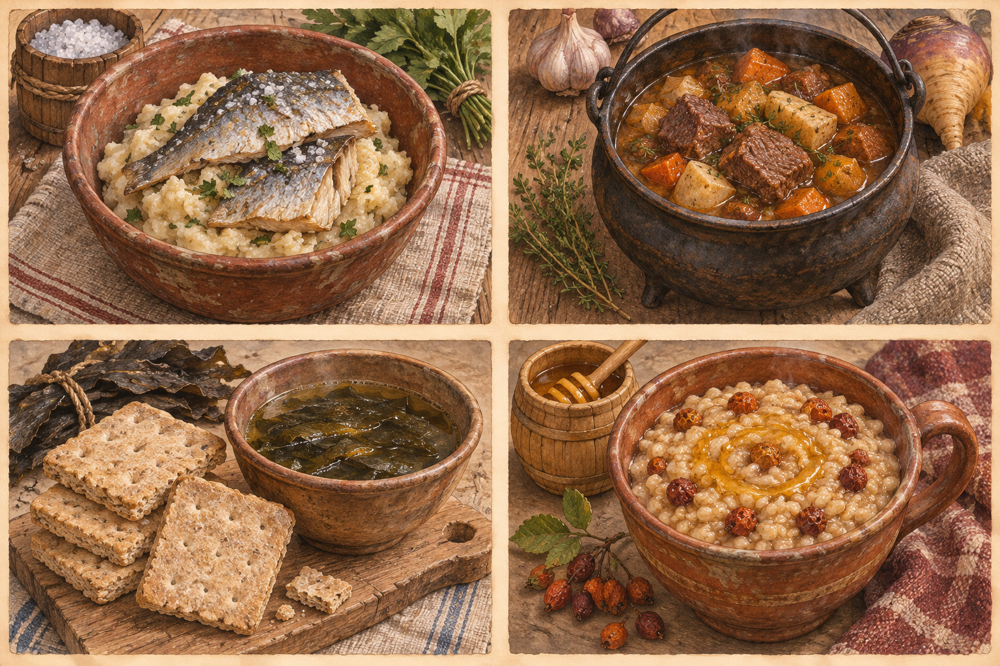

Ordem da prancha: superior esquerda, superior direita, inferior esquerda, inferior direita.

### C29 — Prateiro de Syleth com purê de escarpa

**Mesa:** Abrigo e expedição. **Rendimento:** quatro porções. **Preço por porção:** 4 PC na origem. **Tempo:** 1 hora.

**Fauna:** A22. **Herbário:** H11. **Imagem:** prancha 8, superior esquerda.

**Ingredientes:** Prateiro preservado por ofício e preparado para cozinha; raiz-de-escarpa alimentar levada como provisão; leite ou gordura culinária quando disponíveis; água segura.

**Preparo no mundo:** O pescado adequado é preparado conforme seu estado de conservação e depois cozido. A raiz processada forma um purê espesso. A montagem reúne porções pequenas de peixe com bastante acompanhamento, refletindo o equilíbrio de uma carga de abrigo.

**Sabor e textura:** Pescado firme, purê macio e sabor salino ajustado pelo cozinheiro. O conforto vem da temperatura e da refeição completa.

**À mesa:** Servido em abrigos insulares e acampamentos que receberam suprimentos. A raiz chega de regiões de montanha; não se presume um campo abundante sob o gelo de Incognito.

**Variação:** Quando falta raiz, usa cereal de bordo. A substituição revela a logística da expedição e não exige descobrir uma planta desconhecida para continuar a viagem.

**Situação de jogo:** Uma carga inteira de raízes foi trocada por material sem valor alimentar; a descoberta acontece longe do porto de partida.

### C30 — Panela de Lystra com carneiro e raízes

**Mesa:** Mesa insular e abrigo. **Rendimento:** quatro porções. **Preço por porção:** 5 PC na origem. **Tempo:** 2 horas.

**Fauna:** A17. **Herbário:** H11. **Imagem:** prancha 8, superior direita.

**Ingredientes:** Carne de ovino criado em Lystra; raiz-de-escarpa alimentar ou cereal importado; cebola guardada; água, sal e gordura culinária.

**Preparo no mundo:** A carne cozinha lentamente em panela tampada. A raiz previamente processada entra para engrossar o caldo. O preparo exige abrigo e combustível suficientes; uma tempestade pode impedir cozinhar mesmo com todos os ingredientes no inventário.

**Sabor e textura:** Caldo espesso, carne macia e raízes que absorvem sabor. A porção é comida de sustento, sem resistência mágica ao frio.

**À mesa:** Em Lystra, o prato pode marcar o abate planejado de um animal. Em expedição, representa uma provisão trazida de uma comunidade viva, não uma tradição nativa de ruínas do norte.

**Variação:** Usar carne preservada altera o preparo e o sabor. A escolha depende da carga real do grupo e das regras de conservação.

**Situação de jogo:** O dono do rebanho vendeu carne antes de reservar o necessário ao inverno; a aldeia precisa renegociar a partida de uma expedição.

### C31 — Pão de vigia com caldo de alga

**Mesa:** Provisão de vigia. **Rendimento:** quatro porções. **Preço por porção:** 2 PC na origem. **Tempo:** 25 minutos no abrigo.

**Fauna:** Nenhum. **Herbário:** H06, H57. **Imagem:** prancha 8, inferior esquerda.

**Ingredientes:** Biscoitos de cereal com parte de semente-de-celeiro; alga-de-Syleth alimentar; cebola seca de ofício; água segura e sal.

**Preparo no mundo:** Os biscoitos são preparados antes da viagem por um padeiro e acondicionados como provisão. No abrigo, a alga alimentar e a cebola compõem um caldo no qual parte do pão amolece. O guia não apresenta uma fórmula doméstica de conservação de meses; a duração segue a carga e seu preparo em jogo.

**Sabor e textura:** Caldo simples, gosto de cereal tostado e textura que muda conforme o pão absorve água. A monotonia pode pesar numa viagem longa.

**À mesa:** Comida de vigia e de tripulação que precisa poupar recursos. Partilhar a última cebola seca pode ter mais valor social que um discurso.

**Variação:** Uma porção de peixe conhecido enriquece o caldo quando há captura adequada. Plantas desconhecidas de Thanatos não são usadas para preencher a panela.

**Situação de jogo:** O livro de provisões promete mais biscoitos do que os barris contêm, apontando furto ou erro de abastecimento.

### C32 — Mingau da última brasa

**Mesa:** Fim de vigília. **Rendimento:** quatro porções. **Preço por porção:** 3 PC na origem. **Tempo:** 40 minutos.

**Fauna:** A20. **Herbário:** H47. **Imagem:** prancha 8, inferior direita.

**Ingredientes:** Cevada ou outro cereal trazido na carga; bagas de Myrkholm secas de lote alimentar; mel quando disponível; água segura e leite somente se a logística permitir.

**Preparo no mundo:** O cereal cozinha até amolecer e recebe os frutos preparados. O mel entra no final, em pequena quantidade. Uma panela mais espessa economiza recipientes, mas não dispensa água nem tempo. O serviço é feito em canecas ou tigelas para que cada pessoa conserve sua porção próxima do abrigo.

**Sabor e textura:** Cereal macio, fruta ácida e doçura discreta. A ilustração mostra a versão com mel, que pode ser uma pequena reserva de luxo.

**À mesa:** Tripulações usam o nome para a última refeição antes do descanso. Não é rito de ressurreição ou receita de um povo perdido; é um costume proposto de expedicionários.

**Variação:** Sem mel, a fruta fornece contraste suficiente. A ausência de um ingrediente pode virar ocasião para contar de que porto ele veio.

**Situação de jogo:** Um integrante guarda mel escondido enquanto os demais racionam; o conflito revela medo, egoísmo ou uma promessa particular.

## Iguarias incomuns dos portos e das matas

O que um visitante chama de exótico pode ser a comida habitual de um bairro. Nas feiras de Corallis, insetos de criação disputam espaço com pescado; em Yõketsu, uma porção diminuta pode custar mais que uma panela de quartel. Estes pratos pertencem às regiões indicadas em suas fichas e não criam novos territórios. Suas espécies e costumes ampliam as propostas deste volume.

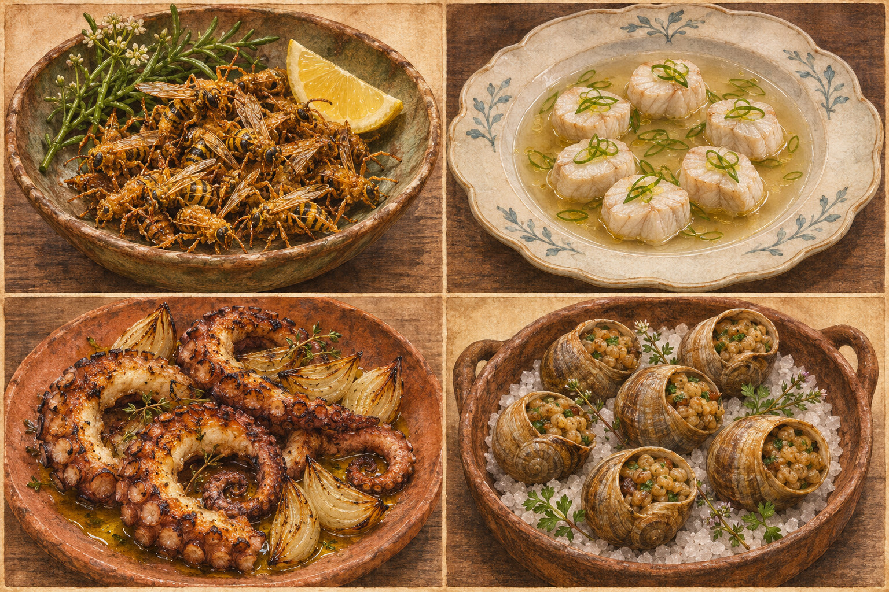

Ordem da prancha: superior esquerda, superior direita, inferior esquerda, inferior direita.

### C33 — Vespas fritas de Portocala

**Mesa:** Feira de Corallis. **Rendimento:** quatro porções pequenas. **Preço por porção:** 3 PC. **Tempo:** 25 minutos, com lote alimentar já preparado.

**Fauna:** A23. **Herbário:** H27. **Imagem:** prancha 9, superior esquerda.

**Ingredientes:** Vespas-de-barro de criação culinária, fornecidas prontas pelo criador; farinha de cereal; gordura de cozinha; flor-de-sal de Portocala em uso alimentar; cítrico-da-costa B02.

**Preparo no mundo:** O vendedor recebe o lote separado para cozinha, envolve os insetos numa cobertura fina e os frita até ficarem dourados. Folhas alimentares picadas e cítrico acompanham a travessa. A ficha começa no fornecimento preparado; retirar ninhos silvestres não faz parte da receita.

**Sabor e textura:** Crocância leve, centro pequeno e sabor de semente tostada. A farinha deve deixar a forma segmentada visível. Por ser petisco, quatro porções não equivalem a quatro rações completas.

**À mesa:** Estivadores compram cones de folha com uma medida do vendedor. Comer a primeira vespa sem hesitação virou brincadeira de recepção entre tripulações; recusar não constitui ofensa religiosa. Em casas ricas, o mesmo alimento aparece escondido sob massa espessa para hóspedes que desejam provar sem olhar.

**Variação:** Uma feira silvana usa farinha de cereal comum e dispensa o condimento costeiro importado. O preço cai perto dos criadouros e sobe durante a estação fria.

**Situação de jogo:** Um fornecedor vende ninhos retirados de um pomar sob proteção comunitária como se fossem de criação. O litígio envolve colheitas futuras e o sustento dos criadores, além do lote apreendido.

### C34 — Bojo-de-porcelana da mesa selada

**Mesa:** Serviço reservado de Yõketsu. **Rendimento:** quatro porções de degustação. **Preço por porção:** 3 PP. **Tempo:** serviço de uma noite, mediante encomenda.

**Fauna:** A24. **Herbário:** Nenhum. **Imagem:** prancha 9, superior direita.

**Ingredientes:** Porções de bojo-de-porcelana entregues por uma casa especializada; caldo claro de vegetais; alho-poró e arroz servido à parte.

**Preparo no mundo:** A cozinha comum recebe somente porções destinadas ao serviço. Sua apresentação é em pequenos medalhões cozidos, com caldo raso. O tratamento do peixe perigoso pertence a um ofício restrito do cenário e não é descrito aqui. Fogo, sal e ervas não funcionam como garantia de segurança. Sem procedência verificável, a casa cancela o prato.

**Sabor e textura:** Carne firme, muito delicada, servida em pequena quantidade para que o caldo não a domine. Dormência, dor ou mal-estar não são características apreciadas do prato nem provas de autenticidade.

**À mesa:** A casa registra vendedor, cozinheiro e compradores num livro de serviço. Um selo responde pela procedência declarada; não detecta veneno nem impede fraude. Mercadores pagam pela reputação do responsável, enquanto certos nobres transformam a encomenda em exibição de coragem. Muitos habitantes de Yõketsu jamais o comem.

**Variação:** A mesa prudente recebe nadadeira-de-jade A09 com a mesma apresentação, anunciada como substituição. O dente-venenoso A02 permanece fora da despensa: são espécies diferentes.

**Situação de jogo:** O selo de um cozinheiro morto aparece numa encomenda recente. Os personagens precisam rastrear o peixe e impedir o serviço; a intriga pode ser falsificação comercial, tentativa de assassinato ou vingança contra a casa.

### C35 — Polvo das cordas de Ravena

**Mesa:** Refeição de pescadores de Ravena. **Rendimento:** quatro porções. **Preço por porção:** 5 PC. **Tempo:** 2 horas.

**Fauna:** A25. **Herbário:** H55. **Imagem:** prancha 9, inferior esquerda.

**Ingredientes:** Polvo-de-corda em quantidade para quatro pessoas; cebola; gordura culinária; erva-de-enseada alimentar e pão.

**Preparo no mundo:** O polvo fornecido limpo recebe cocção até a textura desejada. A cozinha termina as porções sobre a chapa e serve com cebolas assadas e o condimento da enseada. Os braços se curvam e guardam marcas tostadas, formando a figura que dá fama à travessa.

**Sabor e textura:** Superfície tostada e interior firme e macio. O prato mal executado fica borrachudo; isso não aumenta sua duração como provisão.

**À mesa:** Tripulações dividem a travessa depois de recolher as armadilhas. Um braço maior não dá ao capitão uma porção automática: quem cozinha reparte a carne antes de servi-la. Nas tavernas, vendedores exageram o tamanho do animal contando braços separados como capturas inteiras.

**Variação:** Em dias de pouco combustível, a etapa de chapa desaparece e o polvo chega numa panela com cebolas. Pão absorve o caldo.

**Situação de jogo:** Armadilhas voltam vazias, mas os pesos trazem marcas recentes de faca. A suspeita de uma fera esconde pescadores expulsos de sua enseada por cobrança ilegal.

### C36 — Caracóis recheados de Vergod

**Mesa:** Cozinha comunitária das matas silvanas. **Rendimento:** quatro porções. **Preço por porção:** 3 PC. **Tempo:** 1 hora, com fornecimento preparado.

**Fauna:** A26. **Herbário:** Nenhum. **Imagem:** prancha 9, inferior direita.

**Ingredientes:** Carne preparada de caracol-de-horta; cevada cozida; cebola; folhas de tempero alimentar; gordura culinária e conchas próprias para apresentação.

**Preparo no mundo:** O criador entrega a carne destinada à cozinha. Ela entra num recheio de cevada e cebola, finalizado ao forno em conchas preparadas ou pequenas cavidades de barro. O guia não transforma caracóis silvestres encontrados pelo caminho em ingredientes equivalentes.

**Sabor e textura:** Recheio úmido, superfície tostada e pequenos pedaços firmes. A concha sustenta a porção, mas não é mastigada.

**À mesa:** As conchas maiores passam de uma estação de festas para a seguinte, guardadas com a louça comunitária. O visitante recebe uma pequena haste de madeira para retirar o recheio. Famílias de criadores se orgulham mais do tamanho regular das porções que de exemplares gigantes.

**Variação:** A versão cotidiana vai numa única travessa; a aristocracia de Altavanne importa conchas para apresentar um prato que considera raro, embora seja modesto na origem.

**Situação de jogo:** Um comerciante compra toda a produção para um banquete distante. A aldeia exige que a parcela prometida à festa local seja respeitada antes do embarque.

## Quartéis e panelas de aproveitamento

Sobras reservadas na cozinha antes do serviço são uma provisão; restos recolhidos dos pratos, comida deteriorada e resíduos de oficina não são. Cada panela consome alimentos já existentes, sem multiplicar rações. Cascas aqui são partes alimentares de vegetais conhecidos: não significam casca de árvore, resina ou qualquer raiz do herbário. Nas fichas abaixo, a escassez aparece nas proporções e nos acompanhamentos, não numa imunidade à doença.

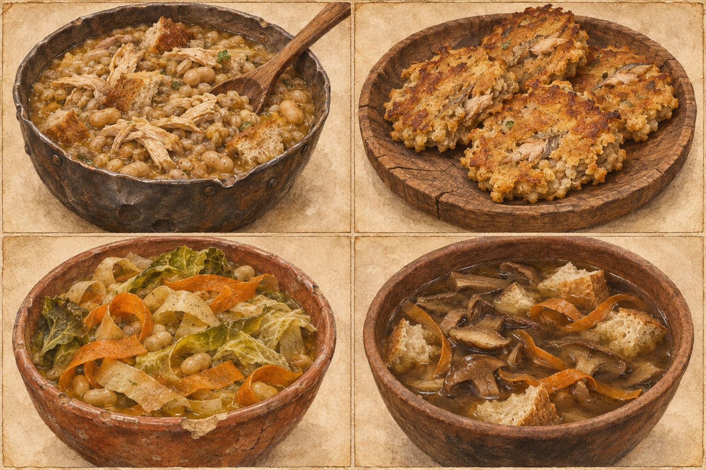

Ordem da prancha: superior esquerda, superior direita, inferior esquerda, inferior direita.

### C37 — Rancho da segunda chamada

**Mesa:** Quartéis de Aurora. **Rendimento:** quatro porções. **Preço por porção:** 2 PC. **Tempo:** 45 minutos, com ingredientes reservados.

**Fauna:** A13, quando há galinha. **Herbário:** Nenhum. **Imagem:** prancha 10, superior esquerda.

**Ingredientes:** Cevada e feijão já cozidos, reservados adequadamente; carne de galinha desfiada quando disponível; pão firme próprio para consumo; cebola e caldo do rancho.

**Preparo no mundo:** O cozinheiro reúne as reservas aproveitáveis numa panela espessa e distribui o pão no serviço. A composição muda com o abastecimento. O nome vem dos guardas que comem depois da troca de turno; não significa guardar indefinidamente a mesma panela.

**Sabor e textura:** Espesso, salgado e irregular: algumas colheradas trazem feijão inteiro, outras pão desmanchado. A carne tempera o conjunto em vez de ocupar o centro da tigela.

**À mesa:** A concha do cozinheiro se torna instrumento de política. Favorecer veteranos, oficiais ou companheiros de província pode causar uma briga antes que o inimigo chegue. Cada porção sai da conta de mantimentos já recebidos.

**Variação:** Sem carne, aumenta-se a presença de leguminosas disponíveis; diluir com água produz mais volume, não mais alimento. Em acampamentos pequenos, todos reconhecem a comida do serviço anterior.

**Situação de jogo:** O livro do intendente registra galinhas que ninguém viu. Um soldado guarda uma tigela como prova da fraude, enquanto o cozinheiro teme ser responsabilizado pelo desvio.

### C38 — Discos da retaguarda

**Mesa:** Tropas costeiras de Corallis. **Rendimento:** quatro porções. **Preço por porção:** 2 PC. **Tempo:** 40 minutos.

**Fauna:** A04. **Herbário:** H06. **Imagem:** prancha 10, superior direita.

**Ingredientes:** Grãos cozidos reservados; pescado preparado de maremestre; farinha alimentar de semente-de-celeiro; cebola e gordura culinária.

**Preparo no mundo:** Grãos, peixe e farinha formam discos achatados que recebem cocção na chapa. O cozinheiro divide o pescado entre as unidades antes de fechá-las. A crosta permite comer com a mão, mas o recheio conserva as limitações de uma refeição perecível.

**Sabor e textura:** Borda irregular crocante, centro denso e lascas de peixe. São mais pesados e menos delicados que os bolinhos de bordo C24.

**À mesa:** Surgiram como comida de serviço curto para carregadores e sentinelas próximos ao acampamento. Um disco cabe na mão que não segura a corda; não deve ser confundido com biscoito seco para uma semana de marcha.

**Variação:** Cevada substitui outros grãos conforme o armazém. Quando o peixe falta, o nome precisa mudar no quadro de distribuição para não esconder o corte de provisões.

**Situação de jogo:** Discos destinados a uma patrulha desaparecem e surgem na feira. O roubo pode envolver um oficial, uma família faminta ou um acordo que mantém desertores escondidos.

### C39 — Ensopado das sete cascas

**Mesa:** Cozinhas populares de Dahrma. **Rendimento:** quatro porções. **Preço por porção:** 1 PC. **Tempo:** 1 hora.

**Fauna:** Nenhum. **Herbário:** Nenhum. **Imagem:** prancha 10, inferior esquerda.

**Ingredientes:** Aparas alimentares de cenoura e nabo conhecidos; folhas externas próprias de couve; feijão; cebola; pequena porção de gordura culinária e água.

**Preparo no mundo:** A cozinha separa as partes alimentares durante o preparo dos vegetais, antes que entrem no descarte. Elas cozinham com o feijão e a cebola até formar uma panela macia. Partes endurecidas ou impróprias ficam fora. Sete é um nome de abundância desejada, não uma exigência de sete espécies.

**Sabor e textura:** Levemente adocicado, terroso e espesso pelo feijão. Tiras de casca permanecem reconhecíveis, misturadas às folhas.

**À mesa:** Uma cozinha de auxílio depende dos feirantes e dos sacos de leguminosas que recebe. Cascas sozinhas não sustentam sua distribuição. Em certos bairros, chamar a sopa de esmola é insulto: quem hoje entrega uma cesta pode precisar de uma tigela no inverno seguinte.

**Variação:** Pão pode acompanhar quando sobra farinha na padaria. H11 não substitui automaticamente as aparas, pois a ficha de raiz-de-escarpa não autoriza tratar sua casca como equivalente à de cenoura.

**Situação de jogo:** Um novo pedágio sobre carroças impede que as doações cheguem. O conflito envolve vereadores, feirantes e um cobrador que cumpre uma ordem formalmente válida.

### C40 — Caldo do fundo de saco

**Mesa:** Casas de trabalhadores de Kalis. **Rendimento:** quatro porções leves. **Preço por porção:** 1 PC. **Tempo:** 50 minutos.

**Fauna:** Nenhum. **Herbário:** Nenhum. **Imagem:** prancha 10, inferior direita.

**Ingredientes:** Aparas alimentares de cebola e cenoura; talos próprios de cogumelo-de-palha cultivado B01; pão firme; sal e água. Películas externas usadas apenas para dar cor ao caldo são retiradas antes do serviço.

**Preparo no mundo:** Faz-se um caldo com as aparas selecionadas e coa-se o que não deve ir à mesa. Cogumelos, tiras alimentares de cenoura e pão completam as tigelas. O nome se refere às últimas provisões da despensa, não à sujeira acumulada no fundo de um saco.

**Sabor e textura:** Líquido castanho, cheiro de cogumelo e pão muito macio. É uma refeição leve que precisa de complemento para substituir uma ração de trabalho pesado.

**À mesa:** Nos invernos difíceis, o tamanho do pão revela a situação da casa. Cozinheiros orgulhosos mantêm o caldo límpido mesmo com poucos recursos. Comer junto permite perceber quem está ficando sem provisões sem exigir uma declaração pública de miséria.

**Variação:** Uma casa com reservas acrescenta cevada; uma estalagem de luxo vende o mesmo princípio como caldo rústico e cobra pelo serviço.

**Situação de jogo:** Um comerciante anuncia cogumelos baratos cuja procedência não corresponde aos viveiros locais. Os cozinheiros suspendem a compra e pedem aos personagens que encontrem o fornecedor desaparecido.

## Doces de casca, pão e festa

Doces circulam por rotas diferentes das refeições salgadas. Fruta madura pode baratear uma sobremesa por poucos dias; açúcar, forno disponível e mão de obra tornam outra exclusiva dos salões. Mel aparece onde existe abastecimento de apicultura. Aproveitar casca ou pão não torna gratuito o restante do prato.

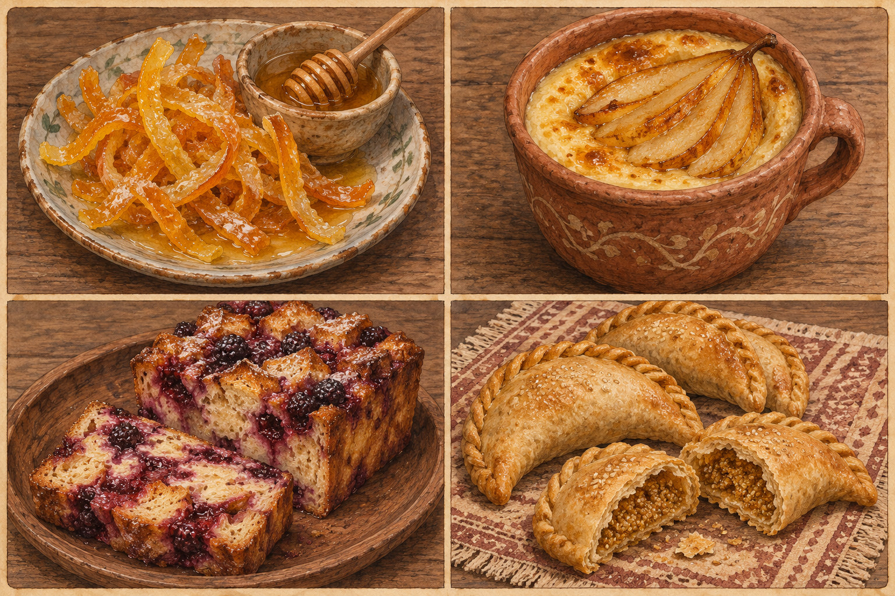

Ordem da prancha: superior esquerda, superior direita, inferior esquerda, inferior direita.

### C41 — Fitas de casca e mel

**Mesa:** Docerias dos portos de Corallis. **Rendimento:** quatro porções pequenas. **Preço por porção:** 3 PC. **Tempo:** 2 horas.

**Fauna:** A20. **Herbário:** Nenhum. **Imagem:** prancha 11, superior esquerda.

**Ingredientes:** Cascas alimentares de cítrico-da-costa B02, separadas da fruta destinada à cozinha; mel de pomar; água e pequena quantidade de açúcar nas versões ricas.

**Preparo no mundo:** O doceiro prepara as tiras de cítrico para moderar o amargor e as envolve numa calda de mel até a textura desejada. As fitas chegam à mesa brilhantes e flexíveis, com pouca calda. A receita não estabelece prazo de conservação automática.

**Sabor e textura:** Doçura pegajosa seguida de amargor cítrico; tiras macias que ainda oferecem resistência ao dente.

**À mesa:** Servem de presente pequeno entre famílias que não podem comprar uma torta. A qualidade se mede pela regularidade das fitas e pelo perfume da fruta. O mel costuma custar mais que as cascas, desfazendo a ideia de que todo doce de aproveitamento é comida de pobre.

**Variação:** Tavernas servem a casca com mais calda sobre pão. A versão de salão usa açúcar e cortes muito finos.

**Situação de jogo:** Um carregamento chega anunciado como mel de um pomar prestigiado, mas as marcas dos potes foram raspadas. O doceiro quer descobrir a origem antes da festa de uma casa influente.

### C42 — Creme de pera de Biemont

**Mesa:** Sobremesa de Aurora. **Rendimento:** quatro porções. **Preço por porção:** 6 PC. **Tempo:** 1 hora e meia.

**Fauna:** A13, A16. **Herbário:** Nenhum. **Imagem:** prancha 11, superior direita.

**Ingredientes:** Pera-de-Biemont B03; leite de cabra; ovos de galinha; açúcar e pequena quantidade de farinha culinária.

**Preparo no mundo:** A fruta preparada entra num creme de leite e ovos que recebe cocção em pequenas tigelas. Lâminas de pera assada e pontos de açúcar caramelizado completam a superfície. O serviço depende de cozinha e armazenamento adequados, não sendo provisão de estrada.

**Sabor e textura:** Creme delicado e pouco firme, fruta macia e uma camada fina de caramelo. O leite de cabra deixa um fundo mais marcado que a aparência sugere.

**À mesa:** Uma tigela individual permite demonstrar cuidado com cada convidado. Nas casas nobres, oferecer a sobremesa fora da estação implica fruta preservada e transporte; cozinheiros honestos explicam a diferença.

**Variação:** Famílias sem açúcar usam mel disponível e dispensam o caramelo, alterando o sabor e o custo. A versão de festa coloca as tigelas numa travessa comum para que nenhum hóspede receba a sua antes dos outros.

**Situação de jogo:** Um fornecedor promete peras frescas impossíveis de encontrar naquela estação. O engano é comercial, mas a anfitriã teme que uma rival o transforme em humilhação pública.

### C43 — Pudim do pão e das bagas

**Mesa:** Fornos comunitários de Kalis. **Rendimento:** quatro porções. **Preço por porção:** 3 PC. **Tempo:** 1 hora e meia.

**Fauna:** A13, A16. **Herbário:** H47. **Imagem:** prancha 11, inferior esquerda.

**Ingredientes:** Pão firme próprio para consumo; leite; ovos; bagas-de-Myrkholm de lote alimentar e açúcar na quantidade disponível.

**Preparo no mundo:** Pão, leite e ovos formam a base. As bagas entram em camadas e o conjunto recebe cocção até adquirir estrutura para ser servido em fatias. Usar pão firme é aproveitamento planejado; alimento deteriorado não ganha novo destino pelo forno.

**Sabor e textura:** Miolo úmido, manchas roxas de fruta e borda tostada. A acidez das bagas impede que a doçura domine.

**À mesa:** O pudim aproveita o calor restante do forno depois dos pães, quando a organização do serviço permite. As famílias marcam suas formas com sinais próprios. Disputas sobre o melhor lugar no forno podem revelar rivalidades antigas.

**Variação:** Na estação de poucas bagas, o recheio aparece numa camada fina. O leite e os ovos continuam sendo custos reais mesmo quando o pão veio de uma reserva doméstica.

**Situação de jogo:** Uma marca de família banida reaparece numa forma entregue ao forno. A pessoa que a trouxe pode ser herdeira, receptadora ou alguém tentando provocar uma denúncia.

### C44 — Meias-luas da última caravana

**Mesa:** Festas de partida em Gaddra. **Rendimento:** quatro porções. **Preço por porção:** 4 PC. **Tempo:** 1 hora e meia.

**Fauna:** A20. **Herbário:** H38. **Imagem:** prancha 11, inferior direita.

**Ingredientes:** Massa de cereal; farinha alimentar de semente-do-vento misturada a farinha comum; mel; gordura culinária e água.

**Preparo no mundo:** Pequenas porções de massa recebem um recheio espesso de sementes alimentares e mel, são fechadas em meia-lua e assadas. A borda marcada permite distinguir encomendas. O recheio úmido não recebe a durabilidade presumida de um biscoito seco.

**Sabor e textura:** Casca quebradiça, interior denso, aroma de cereal tostado e mel. Cada doce oferece poucas mordidas e costuma acompanhar uma bebida.

**À mesa:** Uma família entrega uma pequena cesta antes da partida da caravana. O presente é para os primeiros serviços de refeição e para despedidas compartilhadas, não para sustentar toda a travessia. Algumas casas deixam uma meia-lua sem recheio como brincadeira conhecida entre parentes; fazê-lo com um hóspede estranho pode parecer avareza.

**Variação:** O formato muda conforme a família; uma borda trançada exige mais trabalho e encarece a encomenda. H38 sempre chega como farinha alimentar de procedência conhecida.

**Situação de jogo:** As marcas da borda identificam a cozinha que forneceu uma caravana dada como desaparecida. Uma cesta recém-assada contradiz a data oficial de sua última passagem.

## Animais das cozinhas de Alenia

As fichas descrevem ecologia, abastecimento e uso. A02 é perigoso e não integra as receitas; os demais têm empregos alimentares definidos. Não são fichas de combate nem autorização para caçar em qualquer território. Variedades domésticas podem ser criadas em mais de uma região quando há manejo e condições adequadas.

### A01 — Lumeça do Aurélio

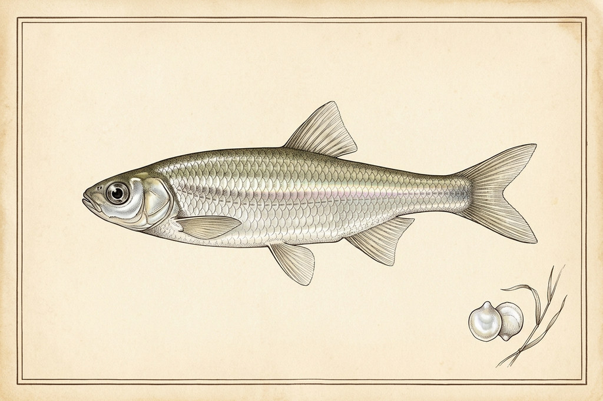

**Classificação:** Peixe fluvial, releitura da Lumeça Mágica.

**Onde vive:** Braços de corrente lenta do Aurélio, entre áreas rurais e o estuário de Merlinport; não nos canais de despejo.

**Aspecto:** Peixe pequeno a médio, flancos prateados e uma faixa perolada que reflete luz de lamparina. A carne é clara e delicada.

**Ciclo e obtenção:** Forma cardumes; alimenta-se de pequenos invertebrados. A pesca se intensifica no fim da primavera e no outono, preservando áreas de reprodução.

**Aproveitamento:** Caldo leve, peixe cozido e preparos de serviço imediato. Um lote de pequenos exemplares fornece a porção familiar.

**Limites:** O brilho é reflexo das escamas, não uma propriedade medicinal. A identificação não prova qualidade da água.

**Vida social:** Peixeiros explicam que a antiga sopa recebeu seu nome da luz sobre o pescado exposto ao amanhecer.

### A02 — Dente-venenoso

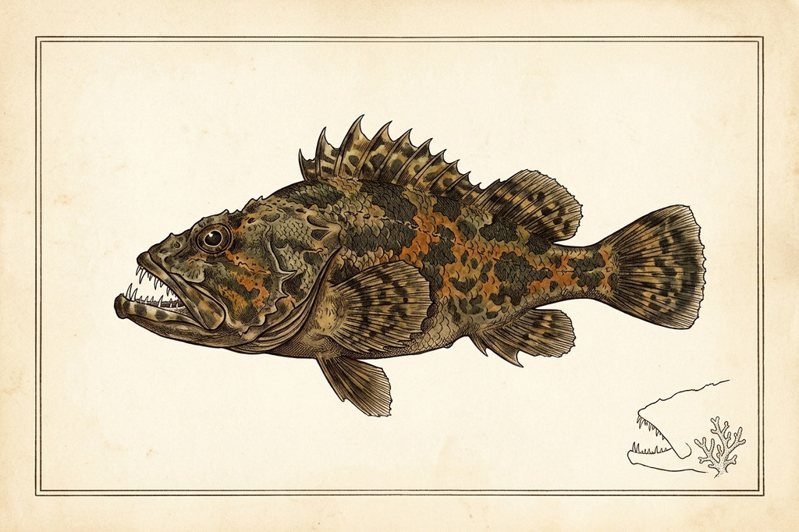

**Classificação:** Peixe perigoso do caderno antigo, fora da despensa.

**Onde vive:** Recifes isolados do Mar dos Corais e bancos conhecidos por pilotos; ocorrência esparsa.

**Aspecto:** Mandíbula marcada, dentes expostos e manchas irregulares. Sua aparência varia e não basta para distingui-lo de espécies semelhantes.

**Ciclo e obtenção:** Predador de emboscada, baixa densidade; pode aparecer acidentalmente em redes. Não possui temporada comercial de alimento autorizada neste guia.

**Aproveitamento:** Referência de folclore culinário e de investigação; não é ingrediente de nenhuma das 44 receitas.

**Limites:** O guia não fornece método de desintoxicação. Cor da carne, suco cítrico ou ervas não demonstram que um exemplar perigoso pode ser consumido.

**Vida social:** O nome continua em histórias de bravata. Tavernas honestas usam dente-claro e anunciam a substituição; fraude de peixe é um gancho de cais.

### A03 — Escama-terrestre

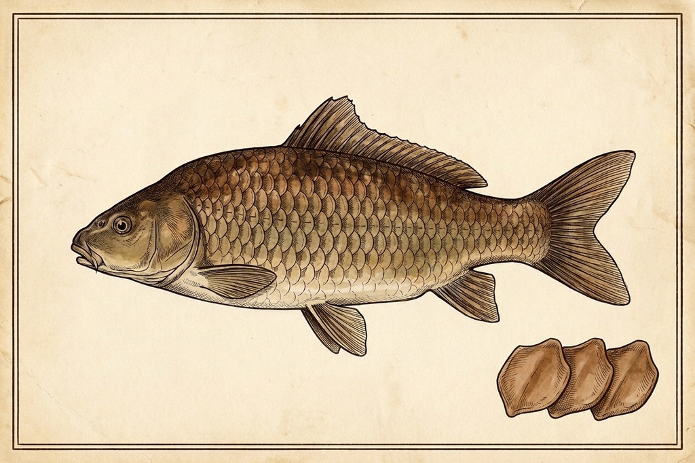

**Classificação:** Peixe de várzea, adaptado do original.

**Onde vive:** Margens alagadas do Aurélio e canais periféricos de Voernock com água renovada.

**Aspecto:** Corpo robusto, dorso castanho e escamas que lembram pequenas placas de terra. Não caminha em solo seco.

**Ciclo e obtenção:** Procura pequenos animais e matéria orgânica no fundo. Capturado em águas adequadas, preferencialmente fora dos locais de reprodução.

**Aproveitamento:** Carne firme para tortas e ensopados. Limpeza e retirada das partes inadequadas precedem a cozinha.

**Limites:** O tempero terroso vem de cogumelos e raízes, não de lodo ou de conservar sujeira nas escamas.

**Vida social:** Lavradores usam o nome para separar o peixe escuro de fundo dos cardumes prateados de superfície.

### A04 — Maremestre

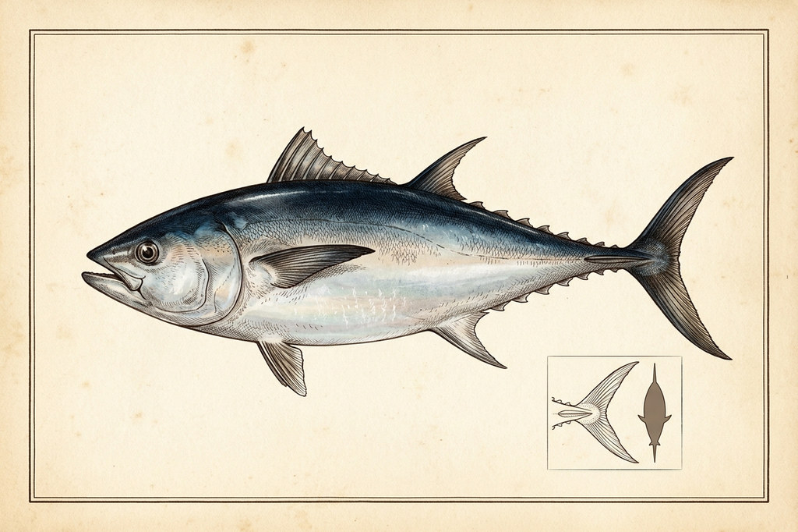

**Classificação:** Grande peixe pelágico do caderno antigo.

**Onde vive:** Águas abertas do Mar dos Corais; desembarca em Alineus, Biemont e portos de passagem de Ravena.

**Aspecto:** Corpo alongado e musculoso, dorso azul-escuro, ventre claro e cauda forte. Exemplares adultos rendem várias postas.

**Ciclo e obtenção:** Segue cardumes menores e varia sua presença conforme correntes. A captura demanda tripulação e equipamento, não uma linha lançada em qualquer cais.

**Aproveitamento:** Postas assadas, crosta de pão e pescado preservado por ofício. A carne robusta tolera preparos de bordo.

**Limites:** Não é leviatã e não exige gordura de criatura lendária. Uma posta não substitui todas as necessidades alimentares de um remador.

**Vida social:** Partilhar um bom desembarque pode pagar salários atrasados ou tornar pública a generosidade de um capitão.

### A05 — Peixe-meteorito

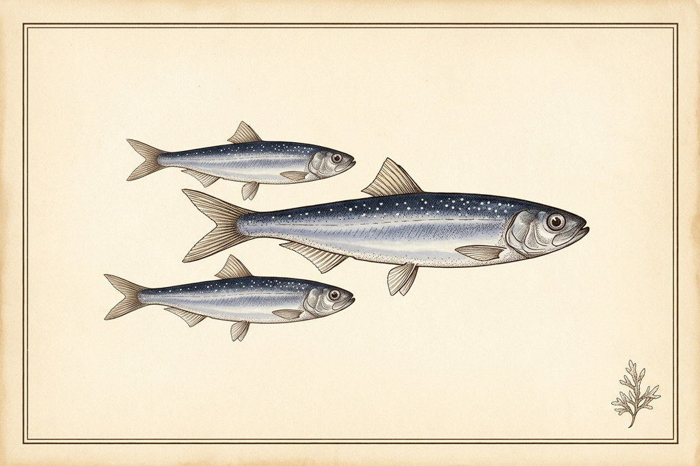

**Classificação:** Pequeno peixe marinho do original.

**Onde vive:** Baías claras e canais costeiros próximos a Biemont e Pelagosa.

**Aspecto:** Pequeno, estreito, com pontos claros refletivos ao longo do dorso, como um céu salpicado.

**Ciclo e obtenção:** Forma cardumes e come plâncton e pequenos organismos. Redes de malha apropriada evitam retirar toda a nova geração.

**Aproveitamento:** Pequenos peixes preparados em conjunto; pratos delicados de vinho e mel.

**Limites:** Os pontos não são cristais comestíveis nem material caído do céu. O nome não concede presságios.

**Vida social:** Em casamentos de marinheiros, uma travessa pode simbolizar o desejo de regressar sob as mesmas estrelas.

### A06 — Vento-ágil

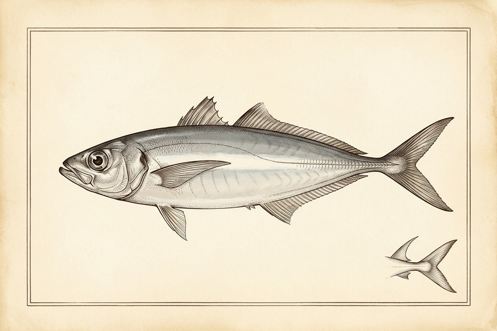

**Classificação:** Peixe costeiro veloz do original.

**Onde vive:** Costas de Biemont, Alineus e passagens orientais; comerciado em Yõketsu.

**Aspecto:** Corpo fusiforme, dorso cinzento, cauda bifurcada e faixa lateral clara.

**Ciclo e obtenção:** Persegue pequenos cardumes. Disponibilidade cresce quando as presas entram nas baías; abundância varia entre temporadas.

**Aproveitamento:** Fatias de peixe cozido servidas com cítrico e cebola, ou recheio de arroz.

**Limites:** Velocidade não implica automaticamente carne dura. A antiga marinada ácida é reinterpretada como molho de peixe já cozido.

**Vida social:** Cozinheiros de Biemont discutem a espessura ideal das fatias como outros discutem a qualidade de um vinho.

### A07 — Cavernário de Pedramar

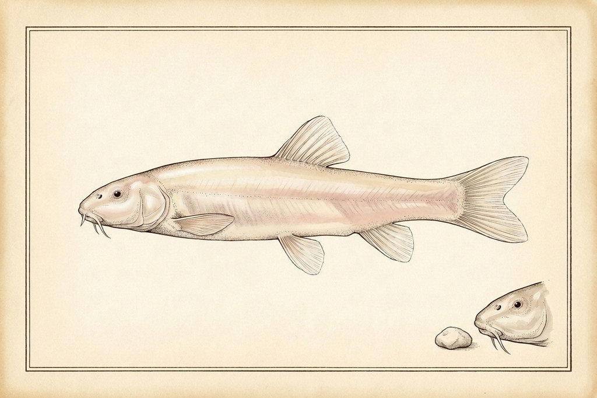

**Classificação:** Peixe de nascente e caverna do original.

**Onde vive:** Trechos acessíveis de nascentes calcárias dos Montes Pedramar; pequenas criações alimentadas por água adequada perto de Stoneforge.

**Aspecto:** Pele muito pálida, olhos pequenos e barbilhões curtos. Populações de caverna profunda não sustentam pesca abundante.

**Ciclo e obtenção:** Crescimento lento em ambientes pobres; criação de superfície abrigada é a origem regular do pescado comercial.

**Aproveitamento:** Carne delicada para caldos com leite de cabra e alho-poró.

**Limites:** Retirar exemplares de pequenas colônias subterrâneas pode destruir a população. A versão barata usa outro peixe branco, declarado no cardápio.

**Vida social:** Viveiristas e pesquisadores disputam crédito por manter a espécie disponível sem esvaziar as cavernas.

### A08 — Peixe-corvo

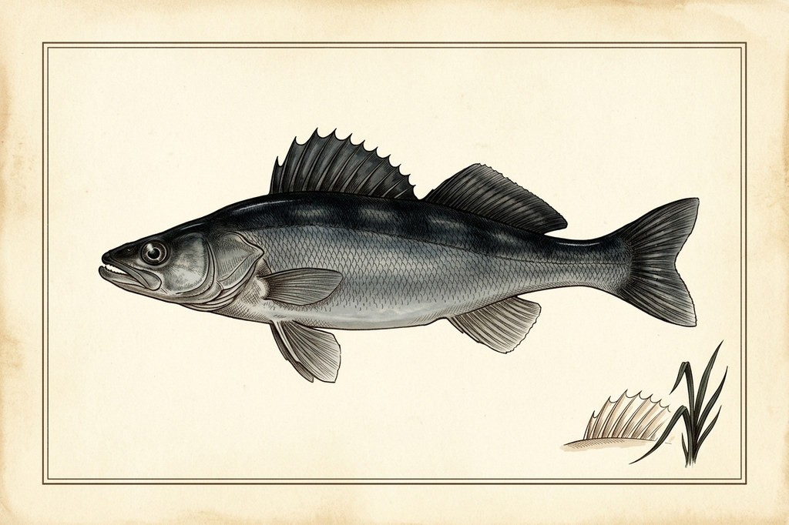

**Classificação:** Peixe de lago e rio do original.

**Onde vive:** Lagos e cursos lentos da região de Kalis, com comércio em Kalima e Dobalbek.

**Aspecto:** Dorso quase negro, barbatanas angulares e carne clara a levemente cinzenta; o corpo não tem sangue negro mágico.

**Ciclo e obtenção:** Predador de pequenos peixes; ocupa margens com abrigo e profundidade. Pesca regulada por comunidades locais.

**Aproveitamento:** Guisados com cevada e frutos escuros; o molho obtém cor dos ingredientes vegetais.

**Limites:** Não é peixe nativo de dunas secas. A antiga associação às Estepes Amaldiçoadas é retirada.

**Vida social:** Seu nome torna o prato atraente a soldados e viajantes que gostam de histórias sombrias, mesmo quando a receita é comum.

### A09 — Nadadeira-de-jade

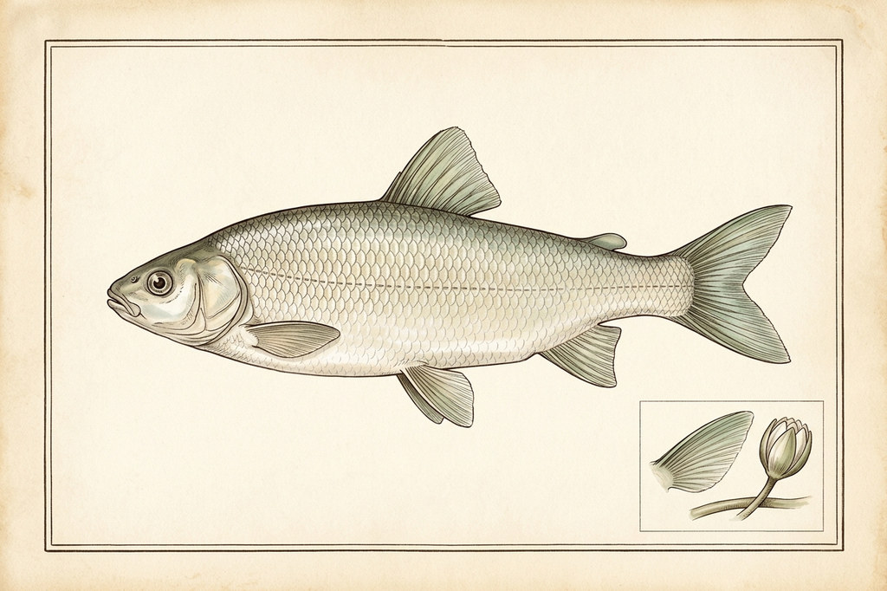

**Classificação:** Peixe de lago e criação, antigo Jade-Fin.

**Onde vive:** Lagos e tanques de água doce bem mantidos em Aurora; produção limitada próxima a Altavanne e Yõketsu.

**Aspecto:** Escamas claras e nadadeiras verde-acinzentadas. O nome descreve cor; não há pedra incrustada.

**Ciclo e obtenção:** Come pequenos organismos aquáticos e alimento de criação. Requer água e manejo, tornando exemplares grandes caros.

**Aproveitamento:** Filés delicados para vapor, creme e refeições de prestígio.

**Limites:** Nadadeiras não são usadas como joias no prato. Água ornamental inadequada não torna um tanque próprio para alimento.

**Vida social:** Um tanque de criação demonstra riqueza porque ocupa terreno, água e trabalho durante todo o ano.

### A10 — Serpentoso de enseada

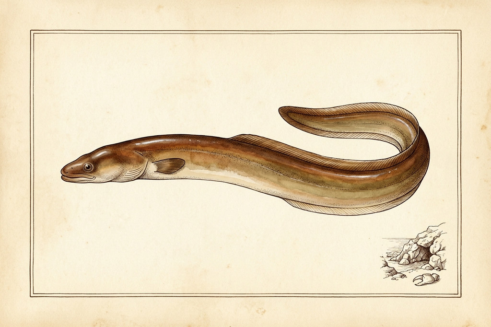

**Classificação:** Peixe alongado do original.

**Onde vive:** Fundos abrigados de Ravena e enseadas da Ilha das Safiras.

**Aspecto:** Corpo comprido, pele lisa e tons castanhos; aparência semelhante a uma enguia, sem poderes ígneos.

**Ciclo e obtenção:** Procura crustáceos e pequenos peixes entre rochas. Captura por covos em áreas conhecidas, respeitando tamanhos e reprodução.

**Aproveitamento:** Pedaços enrolados em espetos e cozidos, com molho de cítrico, mel e pimenta.

**Limites:** Não depende de carvão de lugar extinto nem de mel vulcânico. A imagem em espiral é apresentação culinária.

**Vida social:** A habilidade de montar espetos uniformes é exibida em festas de cais e disputas entre cozinheiros.

### A11 — Dente-claro de recife

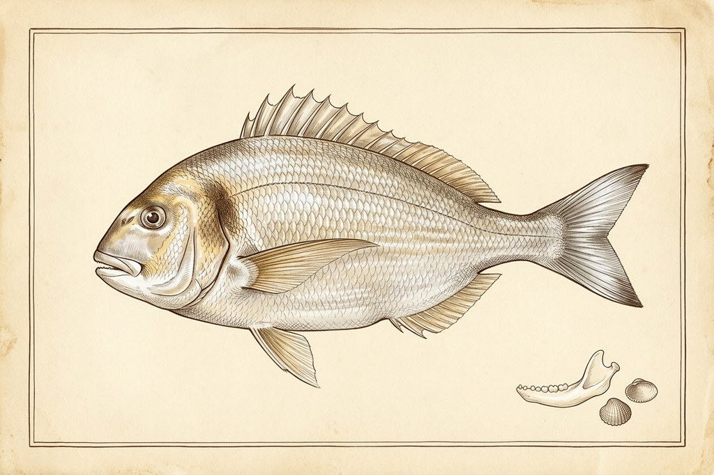

**Classificação:** Novo peixe alimentar, substituto do perigoso.

**Onde vive:** Baixios e recifes com pesca regular próximos a Corallis e Ravena.

**Aspecto:** Peixe de porte médio, corpo alto, mandíbula clara e escamas prateadas. Diferente do dente-venenoso, apesar do nome comercial parecido.

**Ciclo e obtenção:** Alimenta-se de pequenos moluscos e crustáceos. Pescadores experientes identificam espécie e procedência.

**Aproveitamento:** Assado em crosta de sal e servido com cítrico; ingrediente efetivo do Assado do Bucaneiro.

**Limites:** Não é uma variedade desintoxicada do dente-venenoso. Uma etiqueta não substitui identificação da captura.

**Vida social:** Tavernas mantêm a receita de festa e abandonam o risco que o caderno antigo romantizava.

### A12 — Truta-de-pedra

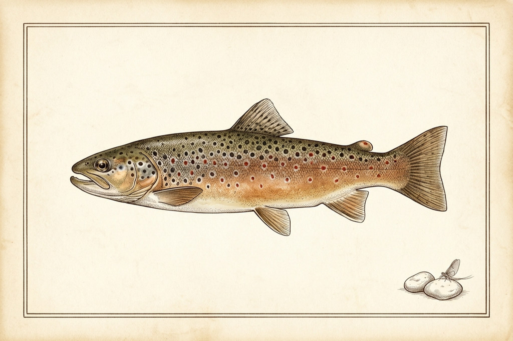

**Classificação:** Novo peixe de água corrente.

**Onde vive:** Afluentes frescos de Ferraur, cursos de montanha e trechos de água corrente nas rotas de Vergod.

**Aspecto:** Peixe médio de dorso pontilhado, flancos acobreados e ventre claro.

**Ciclo e obtenção:** Come insetos e pequenos organismos; requer corrente e água adequadas. A pesca não se estende a qualquer charco do pântano.

**Aproveitamento:** Cozido, assado ou em caldo; aceita raízes alimentares e guarnições de grão.

**Limites:** Barragens, mineração e retirada excessiva alteram sua presença. Não possui resistência mágica a contaminação.

**Vida social:** Sua ausência num trecho antes conhecido pode iniciar investigação sobre uma obra rio acima.

### A13 — Galinha-dourada de Dahrma

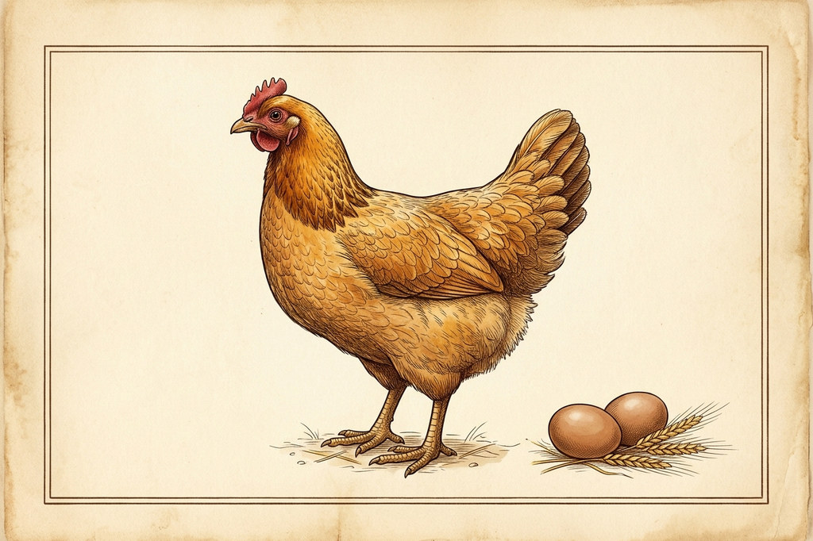

**Classificação:** Nova raça doméstica de ave.

**Onde vive:** Quintais e pequenas propriedades de Dahrma; criada também no vale do Aurélio.

**Aspecto:** Plumagem ocre, crista curta e corpo de tamanho moderado; ovos de casca parda.

**Ciclo e obtenção:** Criação doméstica com grãos e manejo de quintal. Aves de postura têm valor contínuo; abate indiscriminado reduz renda.

**Aproveitamento:** Ovos, carne para panela, caldo e assado; uma ave familiar serve várias pessoas conforme tamanho e acompanhamentos.

**Limites:** Nome de raça não significa penas de ouro. O preço de uma galinha inteira difere do preço de uma porção pronta.

**Vida social:** Vender a última poedeira é uma decisão de necessidade, perceptível aos vizinhos e a cobradores de dívida.

### A14 — Coelho-de-sebe

**Classificação:** Novo mamífero de pequena caça e criação.

**Onde vive:** Bordas de campos de Aurora, clareiras e criadouros próximos a Vergod.

**Aspecto:** Pelagem castanha, orelhas escuras e porte pequeno.

**Ciclo e obtenção:** Herbívoro de borda; populações variam com predadores e colheita. Criação oferece abastecimento previsível sem depender de caça constante.

**Aproveitamento:** Carne para panela e assado, peles para pequenos objetos de ofício.

**Limites:** Laços e caça seguem as regras existentes e os direitos locais. Um animal capturado não rende rações infinitas.

**Vida social:** Cozinheiros de estrada preferem preparos que aproveitam porções pequenas e acompanham bastante pão.

### A15 — Javali-de-lombo negro

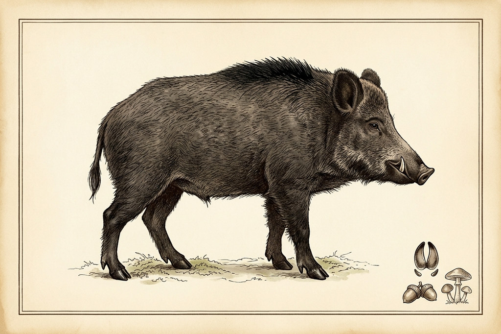

**Classificação:** Novo mamífero de caça, releitura do javali de obsidiana.

**Onde vive:** Bosques e bordas da Floresta Negra, longe das áreas de criação doméstica.

**Aspecto:** Pelagem escura, cerdas rígidas e presas comuns de javali; não possui carapaça mineral.

**Ciclo e obtenção:** Onívoro que revolve solo e danifica campos. Adultos podem ferir caçadores; caça exige organização e autorização local.

**Aproveitamento:** Carne para cozimento demorado e assados; gordura aproveitada por ofício adequado.

**Limites:** Não usar a ficha de uma megafauna sobrenatural para todo javali. Sua caça não é presumida segura ou trivial.

**Vida social:** Uma licença de caça pode ser mais difícil de obter que o próprio animal, sobretudo em terras senhoriais.

### A16 — Cabra-de-escarpa

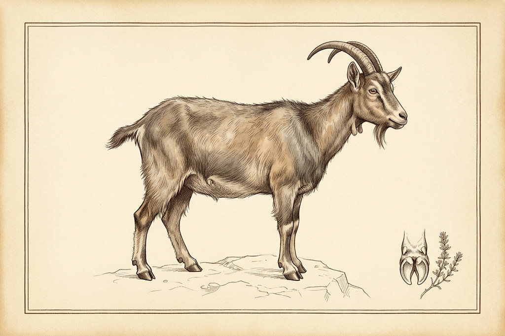

**Classificação:** Nova variedade doméstica de pequeno rebanho.

**Onde vive:** Rubecina, Montes Pedramar e áreas de criação dos planaltos de Gaddra.

**Aspecto:** Pelos curtos ou médios conforme clima, chifres curvos e cascos adaptados a terreno irregular.

**Ciclo e obtenção:** Criação com acesso a pasto e água; manejo evita destruição de jardins e brotos. Leite tem sazonalidade.

**Aproveitamento:** Leite, queijo e carne; versões locais atendem caldos de Stoneforge e refeições de Gaddra.

**Limites:** Resistência ao terreno não elimina sede nem necessidade de alimentação.

**Vida social:** Rebanhos podem ser garantia de empréstimo ou compensação em acordos de hospitalidade.

### A17 — Carneiro-das-rotas

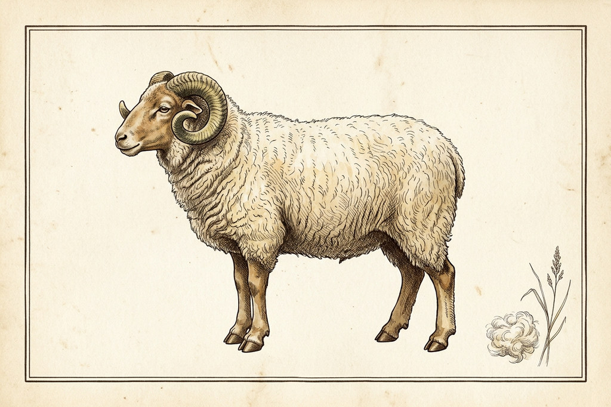

**Classificação:** Novo conjunto de variedades domésticas ovinas.

**Onde vive:** Rebanhos em Aurora e Gaddra; variedade de lã mais densa criada em Lystra.

**Aspecto:** Ovinos de porte moderado; a variedade insular tem lã espessa e as meridionais toleram melhor calor seco.

**Ciclo e obtenção:** Pastoreio manejado, tosquia e seleção local. Transportar animais não cria automaticamente adaptação ao clima de chegada.

**Aproveitamento:** Carne de cordeiro e carneiro, leite em algumas criações e lã. Diferentes cortes dão pratos de festa e panelas de abrigo.

**Limites:** Lystra precisa de pastagens e reservas; não se presume criação livre no gelo de Incognito.

**Vida social:** Uma mesma espécie doméstica pode gerar cozinhas muito diferentes conforme pasto, combustível e acesso a sal.

### A18 — Pombo-de-celeiro

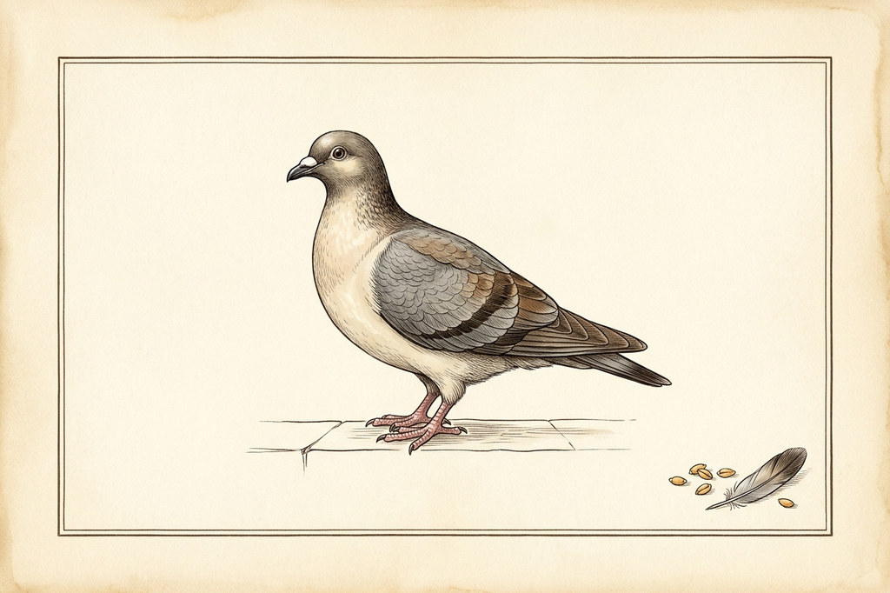

**Classificação:** Nova ave doméstica.

**Onde vive:** Pombais de OX, Naasar e propriedades de Aurora; alimentação complementada por grão.

**Aspecto:** Ave pequena, peito claro e penas cinza ou castanhas.

**Ciclo e obtenção:** Criação em pombais controlados; não se confunde com aves recolhidas de qualquer ruína. Disponibilidade depende de manejo.

**Aproveitamento:** Ave pequena assada e recheios de grãos, servida em refeições de acolhimento com recursos.

**Limites:** Pombo de correio tem função e valor distintos; não é considerado provisão automaticamente.

**Vida social:** Um pombal mostra estabilidade de abastecimento e pode ser alvo de cobrança em anos de fome.

### A19 — Pato-de-canal

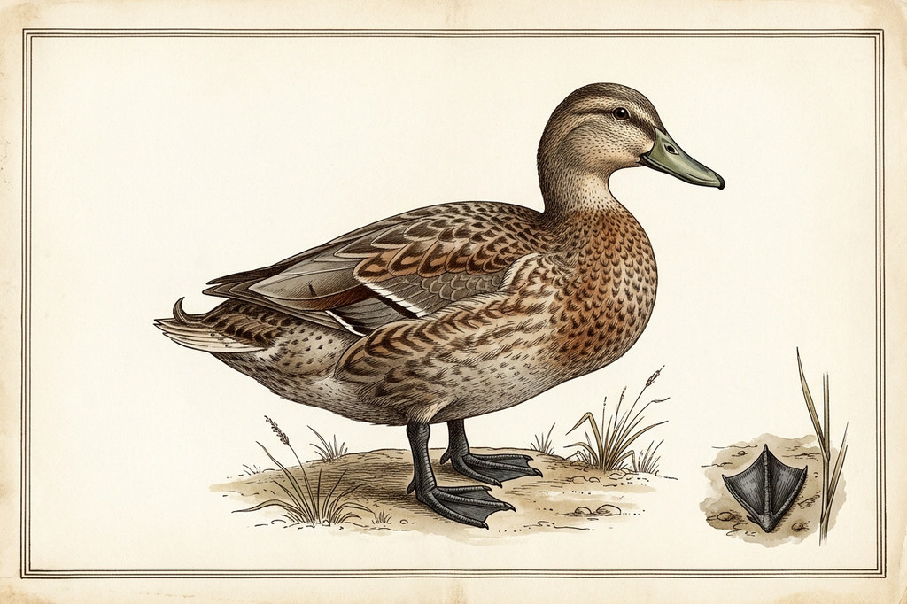

**Classificação:** Nova ave doméstica de água.

**Onde vive:** Áreas manejadas de Aurora, canais apropriados de Kalis e pequenas criações de Yõketsu.

**Aspecto:** Plumagem castanha ou cinza, peito largo e pés escuros.

**Ciclo e obtenção:** Criação requer água adequada e abrigo; não equivale a permitir aves em canais de esgoto.

**Aproveitamento:** Carne, ovos e gordura culinária. Assados e panelas combinam com folhas cultivadas e cereais.

**Limites:** Canais contaminados comprometem a criação. O nome descreve habitat de manejo, não tolerância a qualquer água.

**Vida social:** Regras de criação podem colocar criadores em conflito com autoridades de abastecimento urbano.

### A20 — Abelha-dos-pomares

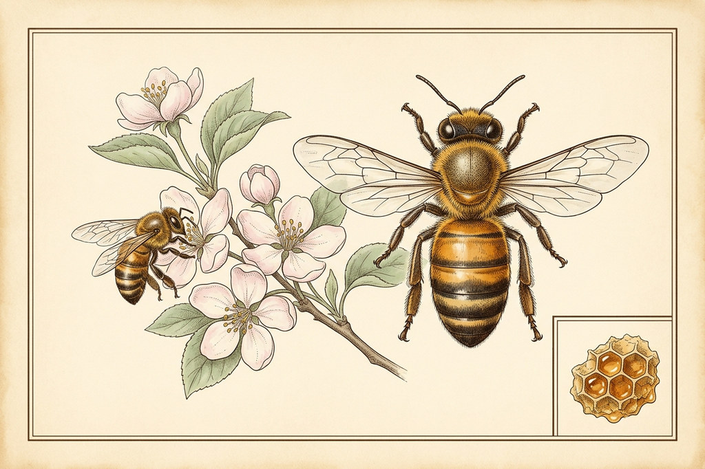

**Classificação:** Nova variedade de abelha manejada.

**Onde vive:** Pomares de Aurora, encostas de Biemont e jardins irrigados de oásis; populações locais distintas.

**Aspecto:** Inseto pequeno de bandas âmbar; o brilho do mel inspirou a expressão antiga abelha-cristal.

**Ciclo e obtenção:** Colônias precisam de floração e manejo. Mel varia por safra e origem; não nasce de cristais ou vulcões.

**Aproveitamento:** Mel e cera, com funções separadas. Mel adoça festas e conserva sabores em preparados de ofício.

**Limites:** Cera de colmeia não deve ser confundida com a matéria cerosa medicinal de H08. Nenhum mel concede poderes por si.

**Vida social:** Apicultores reconhecem safras e disputam acesso a pomares e áreas de floração.

### A21 — Mexilhão-de-corda

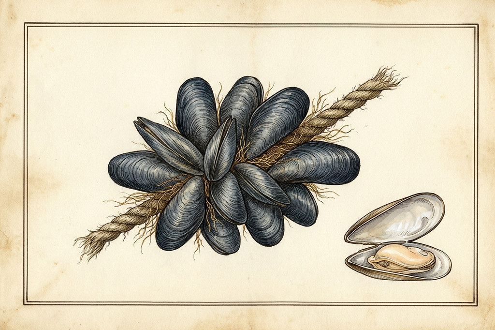

**Classificação:** Novo molusco alimentar.

**Onde vive:** Enseadas adequadas de Corallis e Ravena, com criação em suportes de fibra e madeira.

**Aspecto:** Concha alongada azul-negra e interior claro; exemplares alimentares vêm de áreas monitoradas pelos próprios coletores.

**Ciclo e obtenção:** Filtrador cultivado em locais selecionados. Qualidade da água e períodos locais de interdição condicionam a coleta.

**Aproveitamento:** Marisco cozido em caldo, servido nas conchas apropriadas e acompanhado de pão.

**Limites:** Cozinhar não torna qualquer molusco de água contaminada apropriado. Não colher indiscriminadamente em cascos de naufrágio.

**Vida social:** Uma mancha de água alterada pode fechar a renda de uma enseada inteira e revelar despejo clandestino.

### A22 — Prateiro-de-Syleth

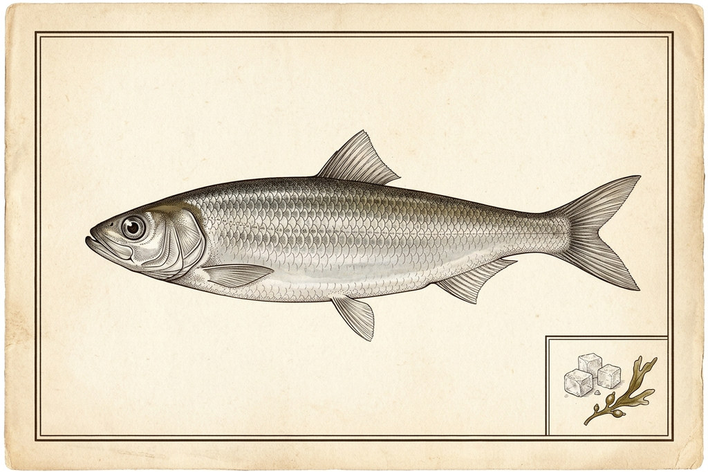

**Classificação:** Novo peixe de água fria.

**Onde vive:** Águas costeiras de Syleth e Lystra; comerciado preservado em outros portos.

**Aspecto:** Peixe alongado de escamas prateadas, dorso cinza e carne firme.

**Ciclo e obtenção:** Cardumes sazonais sustentam períodos intensos de pesca e trabalho coletivo. Mau tempo pode impedir o desembarque mesmo com peixe próximo.

**Aproveitamento:** Pescado fresco, salgado ou seco por ofício; base de panelas de abrigo e provisões.

**Limites:** Métodos de conservação usam regras de jogo e trabalho apropriado; não são instruções domésticas universais.

**Vida social:** As festas de retorno da pesca reconhecem quem trabalha na costa tanto quanto quem sai no barco.

### A23 — Vespa-de-barro dos pomares

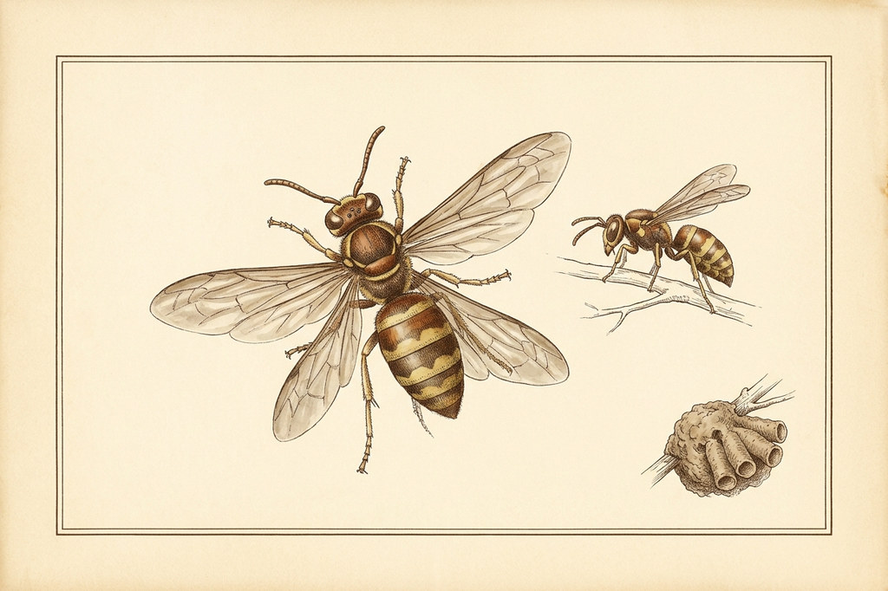

**Classificação:** Inseto social de criação alimentar ficcional.

**Onde vive:** Pomares e encostas abrigadas de Corallis; pequenos criadouros próximos a Portocala. Há populações silvestres nas matas de Aurora.

**Aspecto:** Corpo curto castanho e amarelo-ocre, asas discretamente enfumaçadas e ninhos de barro com câmaras estreitas. O nome não permite identificar uma vespa real comestível.

**Ciclo e obtenção:** Colônias aumentam na estação quente. Criadores mantêm parte da população reprodutora e fornecem lotes preparados para cozinha. A alimentação depende de pequenos invertebrados e recursos do pomar; o criadouro consome trabalho e espaço, sem produzir comida do nada.

**Aproveitamento:** Petisco C33. A espécie não substitui a abelha A20 na produção de mel.

**Limites:** Ninhos silvestres e espécies parecidas não são equivalentes ao fornecimento alimentar. Manejo pertence aos criadores; picadas e reações adversas continuam possíveis no cenário. A ficha não descreve coleta de ninhos nem retirada de estruturas venenosas.

**Vida social:** Agricultores valorizam o papel da espécie no pomar, enquanto compradores querem grandes lotes. A retirada excessiva de colônias cria conflitos entre colheita e mercado.

### A24 — Bojo-de-porcelana

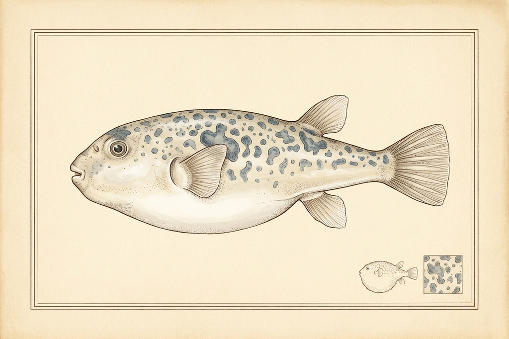

**Classificação:** Peixe marinho tóxico ficcional, equivalente cultural ao baiacu; ingrediente de serviço excepcional.

**Onde vive:** Águas costeiras abrigadas de Yõketsu e recifes quentes do Mar dos Corais. Não vive nos rios frios de Kalis.

**Aspecto:** Corpo arredondado, ventre claro, manchas azul-acinzentadas e capacidade de inflar-se diante de ameaça. A pele lembra cerâmica salpicada. É distinto do predador dentado A02.

**Ciclo e obtenção:** Desova sazonal em áreas rasas; captura limitada por pequenas casas que compram somente de fornecedores identificados. Redes comuns também podem recolhê-lo por acidente. A raridade do serviço resulta sobretudo de responsabilidade, especialização e restrição comercial.

**Aproveitamento:** C34, em porções de degustação. A tradição descrita é própria da ficção, sem procedimento transferível para um animal real.

**Limites:** Pode causar intoxicação grave ou morte. O guia não localiza toxinas, não descreve cortes nem ensina neutralização. Um teste culinário comum, um selo ou uma erva não tornam um exemplar seguro. Na campanha, procedência e sabotagem são investigadas antes do serviço; a refeição não exige uma rolagem secreta e arbitrária de morte.

**Vida social:** Casas de serviço mantêm registros e vínculos de aprendizagem. Essa tradição é uma proposta local, não uma lei de toda Alenia. Falsificadores exploram a distância entre quem conhece o selo e quem conhece o cozinheiro.

### A25 — Polvo-de-corda

**Classificação:** Molusco marinho de pesca artesanal.

**Onde vive:** Fundos rochosos rasos e enseadas de Ravena; populações menores na Ilha das Safiras.

**Aspecto:** Oito braços robustos, pele castanha mosqueada e corpo compacto. O apelido vem de braços enrolados em cabos de armadilhas, não de parentesco com monstros marinhos.

**Ciclo e obtenção:** Ocupa abrigos individuais; pescadores alternam áreas e deixam locais de reprodução sem armadilhas na estação correspondente. Capturas contínuas nos mesmos refúgios empobrecem a enseada.

**Aproveitamento:** C35; carne para panelas e chapas costeiras. O tamanho útil varia e um exemplar pequeno não rende automaticamente quatro refeições.

**Limites:** Alimento perecível, dependente de mercado próximo ou preservação pelo ofício. Não fornece tinta de escriba ou componente mágico por consequência desta ficha.

**Vida social:** Os direitos de instalar armadilhas junto a um rochedo podem pertencer a famílias de pescadores, criando disputas com donos de ancoradouros.

### A26 — Caracol-de-horta de Vergod

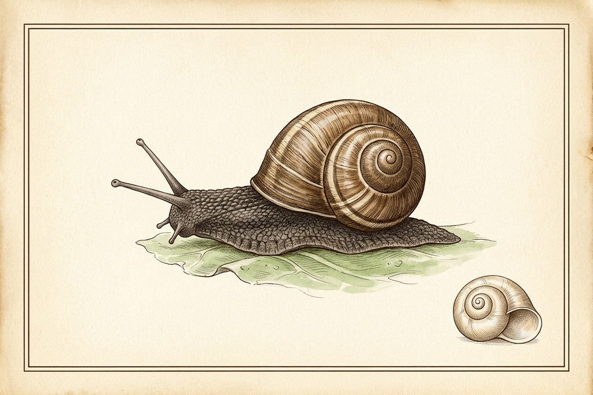

**Classificação:** Molusco terrestre de criação alimentar ficcional.

**Onde vive:** Canteiros úmidos cercados das comunidades silvanas de Vergod; pequenos cultivos autorizados em hortas de Aurora.

**Aspecto:** Concha castanha larga com faixas claras, corpo escuro e crescimento regular em criadouros. Cor e forma não bastam para escolher animais silvestres para alimentação.

**Ciclo e obtenção:** Atividade maior em períodos úmidos. Criadores mantêm matrizes e protegem canteiros do sol e de predadores. O consumo de folhas cultivadas liga a produção ao trabalho da horta.

**Aproveitamento:** Carne preparada para C36 e conchas destinadas à apresentação após tratamento de ofício.

**Limites:** Compra de criação conhecida; nenhum protocolo de coleta, purga ou tratamento de caracóis reais é estabelecido. Introduzir a espécie em uma nova horta depende de controle local, pois pode prejudicar cultivos.

**Vida social:** Conchas grandes são objetos de mesa reutilizados. O comércio de conchas pode valer mais que a carne e estimular falsos relatos de animais gigantes.

## A despensa e o herbário

Os códigos H preservam o significado do Tomo X. A mesma planta pode ter mais de um uso, mas um produto de tinturaria, laboratório ou medicina não vira alimento por compartilhar o nome de um ingrediente culinário.

| Código | Ingrediente alimentar utilizado | Procedência e função |
| :--- | :--- | :--- |
| H06 | Semente-de-celeiro, farinha alimentar | Dahrma e campos de Aurora; parte de massas e espessante de panelas. |
| H07 | Baga-do-barqueiro madura, lote alimentar | Margens do Aurélio; molho e conserva alimentar. Tinta pronta não é ingrediente. |
| H11 | Raiz-de-escarpa processada para alimento | Rubecina e arredores de Vaarsa; raiz de reserva, purês e panelas. |
| H24 | Sementes e rizomas alimentares de flor-da-lama mansa | Águas adequadas de Voernock; bolos, raízes cozidas e acompanhamento. |
| H27 | Brotos e folhas alimentares de flor-de-sal de Portocala | Baixios salgados de Portocala; guarnição e condimento. |
| H34 | Frutos maduros de palma-de-odre | Pomares irrigados de Gaddra; acompanhamento e doce. Não elimina necessidade de água. |
| H35 | Condimento alimentar processado de flor-de-Bayd | Margens adequadas de Bayd; produto selecionado, separado de crostas minerais. |
| H38 | Farinha alimentar de semente-do-vento | Faixas de chuva sazonal de Gaddra; mistura a outros cereais. |
| H47 | Baga-de-Myrkholm madura ou preservada como alimento | Clareiras e pomares comunitários de Kalis; molhos, recheios e provisões. |
| H55 | Erva-de-enseada preparada como condimento | Ravena; sabor costeiro em bolinhos e acompanhamentos. |
| H57 | Alga-de-Syleth de lote alimentar | Águas apropriadas de Syleth e Lystra; caldo, acompanhamento e carga de comércio. |

### Seis complementos agrícolas novos

Estes códigos B pertencem à despensa culinária. Não renumeram nem alteram as 64 espécies do herbário. As variedades são propostas para permitir receitas com origem concreta.

| Código | Variedade | Onde se obtém | Características e emprego |
| :--- | :--- | :--- | :--- |
| B01 | Cogumelo-de-palha de cultivo | Canteiros preparados perto de Altavanne, Vergod e cidades kalitas | Chapéu castanho, carne firme; cultivo controlado para tortas e panelas. Não é identificação de cogumelo selvagem por aparência. |
| B02 | Cítrico-de-encosta | Pomares abrigados de Biemont e áreas favoráveis próximas a Portocala; importado por ilhas | Fruto de casca aromática e suco ácido; molho e acompanhamento. Não corrói ferro nem neutraliza venenos. |
| B03 | Pera-de-Biemont | Pomares de encostas abrigadas e comércio com Aurora | Fruta de polpa firme, usada cozida, em conserva alimentar e bebidas culinárias. |
| B04 | Pimenta-de-jardim | Jardins quentes de Portocala, Qal-Zahar e Porto Esmeralda | Fruto culinário picante de cultivo; mercadoria de pequenas cargas. O ardor varia por lote. |
| B05 | Castanha-de-mata | Áreas manejadas de bosque em Aurora e Kalis | Fruto de árvore de porte médio, colhido na estação própria e preparado como alimento; importante em panelas de outono. |
| B06 | Arroz de várzea de Yõketsu | Áreas irrigadas próximas ao enclave, com trabalho e controle de água | Cereal local proposto, em cultivares próprias para tigelas ou porções modeladas; não cresce espontaneamente em todo pântano. |

Trigo, cevada, leguminosas, cebola, alho-poró, couve, cenoura, ovos e gorduras culinárias comuns completam a despensa. São alimentos de cultivo ou criação, não poderes novos. Açúcar, especiarias importadas e vinho de prestígio encarecem serviço; a maioria das famílias depende mais de grão, legumes, sal e produtos locais.

### O que permanece fora da panela

H03 e H28 fornecem óleo de iluminação ou de ofício, sem autorização alimentar no herbário. H04 e H48 estão ligados a preparos sedativos; H13, H37, H46 e H54 são resinas e seivas de ofício. H22 é fungo luminoso impróprio para alimento; H25 e H32 são algas de curativo ou tinta, sem equivalência automática com H57. H49 conserva seu papel de pesquisa especializada, e H63/H64 não são comida de expedição. Flores de perfumaria, como H21 e H51, não são guarnições culinárias nesta edição.

## Cozinhar, comprar e viajar em jogo

Uma refeição cotidiana, com ingredientes conhecidos e condições adequadas, não precisa de teste. O teste entra quando há prazo, equipamento limitado, serviço numeroso ou uma exigência difícil. Culinária pode ser uma perícia livre conforme o Tomo I; sua criação segue os custos e limites normais. Conhecer o herbário não concede automaticamente domínio de cozinha.

| Situação | Procedimento opcional |
| :--- | :--- |
| Refeição cotidiana em boas condições | Sem rolagem; consome ingredientes e tempo. |
| Cozinhar com equipamento limitado ou pouco tempo | Culinária CD 10 ou 15, conforme dificuldade concreta. |
| Banquete com várias etapas e horário rígido | Culinária CD 20, exigindo pessoal, ingredientes e equipamento compatíveis. |
| Falha comum | Atraso, textura ruim, serviço desigual ou rendimento menor combinado antes do teste; não veneno surgido do nada. |
| Ingrediente sem procedência ou espécie perigosa | A receita não resolve a identificação nem o risco. Procurar fonte adequada ou mudar o cardápio. |
| Pedido social à mesa | A refeição fornece contexto; usar as regras sociais existentes quando houver negociação, sem bônus universal gratuito. |

Comer adequadamente ajuda a cumprir as condições normais de descanso e sustento. Nenhum prato deste guia concede ataques adicionais, cura instantânea, imunidade, Fé Verdadeira ou Status. Um banquete pode demonstrar recursos, mas não compra reconhecimento automaticamente. Uma comida associada a um rito tem significado cultural sem produzir necessariamente um prodígio.

Pesca e caça usam o Tomo IX: resultados em rações dependem de habitat e equipamento. O número de peixes ilustrados não é uma regra de rendimento. Salga e preservação usam os procedimentos ficcionais do ofício e do catálogo; o guia não transforma tempos de jogo em garantia sanitária aplicável ao mundo real.

### Sazonalidade e abastecimento

| Região | Alimentos regulares | O que encarece ou limita a mesa |
| :--- | :--- | :--- |
| Aurora | Grãos, hortas, aves, leite e peixes onde há água adequada | Cheias, guerra, interrupção de Dahrma e fechamento de passos. |
| Matas silvanas | Raízes alimentares, frutos, cultivo local e pesca | Direitos de coleta, estação das castanhas e dependência de trocas por sal e cereal. |
| Corallis | Peixe de desembarque, moluscos de áreas apropriadas e pão | Maré, tempestade, interdições e disputa de pilotagem. |
| Gaddra | Grãos, leguminosas, leite, pequenos rebanhos e jardins irrigados | Água, calor, distância entre pousos e controle dos poços. |
| Kalis | Cereais guardados, criação, caça autorizada e frutos preservados | Inverno, direitos de bosque e transporte entre interior e portos. |
| Ilhas | Pesca e cultivos possíveis em cada ilha | Importação de grão, combustível e qualidade da água de coleta. |
| Yõketsu | Hortas, arroz irrigado, aves e pescado local | Água dos cultivos e custo de ingredientes vindos de rotas longas. |
| Norte habitado e expedições | Pescado, provisões de cereal, criação de ilhas e algas alimentares | Gelo, combustível, estado da carga e janela de navegação. |

## Pratos incomuns em jogo

O espanto pertence ao personagem, não a uma escala universal de civilização. Uma vespa pode ser petisco cotidiano; um creme de pera pode ser o luxo mais estranho que um soldado já viu. Cada comunidade tem comedores entusiasmados, indiferentes e avessos a certas texturas.

Não há bônus automático por coragem à mesa. C33 e C34 são degustações; C40 é refeição leve. C37 e C38 aproveitam recursos já contabilizados. Transformar quatro rações em oito tigelas reduz a quantidade de alimento por pessoa. Os demais custos seguem as regras existentes de provisão e descanso.

Para C34, o mestre apresenta sinais investigáveis de irregularidade e permite recusa ou substituição. Havendo sabotagem estabelecida na ficção, emprega as regras existentes de venenos; não cria uma segunda tabela letal só para este prato. O interesse é decidir em quem confiar e descobrir quem falsificou a encomenda.

## Mesas para cenas de campanha

### A estalagem de Merlinport

Uma tigela de consomê C01 e pão anuncia que a pesca pequena chegou. O dono oferece bolinhos C24 quando há provisão apropriada de peixe. Um prato ausente pode ser informação: a falta de lumeça sugere problema na pesca, preço ou transporte, sem provar contaminação por si só.

### Um banquete de Altavanne

Servir C03 como centro da refeição, C02 em pequenas fatias e C20 como doce demonstra uma rede de fornecedores que alcança Corallis e Kalis. O luxo pode provocar comentários sobre desperdício durante uma crise. A mesa fornece oportunidade para apresentar pedidos, comparar lacres de cargas ou perceber que alguém conhece a cozinha melhor do que sua identidade declarada sugere.

### Uma reconciliação em Gaddra

C13 alimenta a mesa compartilhada; C15 marca uma ocasião mais abastada; C16 encerra a noite. A hospitalidade depende de acolhimento e obrigações reconhecidas, não de ingredientes caros. Um anfitrião pobre pode honrar o mesmo dever oferecendo grão, água e abrigo.

### Uma vigília no norte

C31 e C32 tornam concreta a contagem de provisões. Quem reparte o mel, quem cozinha para os feridos e quem esconde um biscoito revelam vínculos. Não há necessidade de introduzir um monstro em toda refeição: frio, atraso e desconfiança já dão peso à cena.

## O caderno antigo e a adaptação

| Receita antiga e página | Receita desta edição | Elementos preservados e mudanças |
| :--- | :--- | :--- |
| Consomê de Luz, p. 1 | C01 | Lumeça e caldo claro; Rio de Mercúrio, ametista e efeito mágico retirados. Raiz alimentar H24 ocupa o lugar culinário do lótus antigo. |
| Dente-Venenoso, pp. 1–2 | C21 | Festa de bucaneiro e crosta de sal; peixe perigoso preservado como A02, porém a receita usa a espécie alimentar distinta A11. |
| Folhado de Altavanne, p. 2 | C02 | Escama-terrestre, raízes e cogumelos; introduz massa de fato e retira conservação de escamas sujas. |
| Maremestre Grelhado, p. 2 | C09 | Posta robusta e crosta de pão; dispensa gordura de leviatã, centro cru e promessa de sustento extraordinário. |
| Peixe-Meteorito, p. 3 | C11 | Peixes pequenos, vinho e mel; abelha-cristal vira nome poético do mel, sem jasmim medicinal ou divindade antiga importada. |
| Ceviche de Vento, p. 3 | C10 | Cítrico, cebola e porções delicadas; pescado recebe cocção antes do molho. |
| Cavernário, p. 4 | C12 | Peixe pálido, leite de cabra e alho-poró; sem líquen luminoso, cura automática ou referência a anões. |
| Peixe-Corvo, p. 4 | C17 | Guisado escuro e cereal; transferido para águas de Kalis, com cor de bagas e cevada, sem bônus sobrenatural. |
| Jade-Fin, p. 5 | C03 | Peixe delicado, creme e pera; nome traduzido para nadadeira-de-jade, sem inserir a antiga Lady Elara na nobreza atual. |
| Serpentoso de Zalmar, p. 5 | C22 | Espiral, mel, cítrico e pimenta; nova procedência em Ravena, sem adicionar Zalmar ao mapa. |

O documento de origem é preservado sem alterações. Os antigos ingredientes que não foram aproveitados não precisam desaparecer da história literária; apenas não se tornam espécies ou lugares oficiais por força desta adaptação. O estilo das novas imagens é uma interpretação editorial atual, não reprodução das ilustrações do PDF.

## Fontes locais

- Documento de origem: A CULINÁRIA DE ALENIA, Tomo I, Preparo de Peixes, por Valerius Malakor, cinco páginas, arquivo fornecido pelo autor do cenário.
- [Guia de Cenário](../02_Guia_de_Cenario_Alenia.md): geografia, povos, rotas, religião e economia regional.
- [Herbário de Seleni](../10_Herbario_de_Seleni.md): nomes, usos alimentares e restrições das espécies H.
- [Equipamentos e Ofícios](../09_Catalogo_de_Equipamentos_e_Oficios.md): ferramentas, pesca, caça, preços e conservação em jogo.
- [Livro de Regras](../01_Livro_de_Regras.md): perícias livres, descanso e limites gerais.

## Índice rápido dos pratos

| Prato | Região | Fauna | Herbário |
| :--- | :--- | :--- | :--- |
| C01 — Consomê de luz de Merlinport | Aurora e o vale do Aurélio | A01 | H24 |
| C02 — Folhado de escama-terrestre de Altavanne | Aurora e o vale do Aurélio | A03 | H11 |
| C03 — Nadadeira-de-jade ao creme de pera | Aurora e o vale do Aurélio | A09, A16 | Nenhum |
| C04 — Panela de Dahrma com galinha e grãos | Aurora e o vale do Aurélio | A13 | H06 |
| C05 — Truta de Vergod com raízes da água | Matas silvanas e águas de Vergod | A12 | H24 |
| C06 — Coelho de sebes com molho do barqueiro | Matas silvanas e águas de Vergod | A14 | H07 |
| C07 — Bolos das sementes e do mel | Matas silvanas e águas de Vergod | A20 | H24, H06 |
| C08 — Caldeirada de cogumelos e castanhas | Matas silvanas e águas de Vergod | Nenhum | Nenhum |
| C09 — Maremestre em crosta do navegante | Corallis e o Mar dos Corais | A04 | H27 |
| C10 — Fatias de vento ao cítrico de Biemont | Corallis e o Mar dos Corais | A06 | Nenhum |
| C11 — Meteoritos ao vinho e mel | Corallis e o Mar dos Corais | A05, A20 | Nenhum |
| C12 — Cavernário branco de Stoneforge | Corallis e o Mar dos Corais | A07, A16 | Nenhum |
| C13 — Grãos de OX com cabra de escarpa | Gaddra e as mesas de hospitalidade | A16 | H38 |
| C14 — Cordeiro com fruto de palma de Dar-Shams | Gaddra e as mesas de hospitalidade | A17 | H34 |
| C15 — Pombo dos três dias | Gaddra e as mesas de hospitalidade | A18 | H35 |
| C16 — Doce da última tenda | Gaddra e as mesas de hospitalidade | A20 | H38, H34 |
| C17 — Caldo negro de peixe-corvo | Kalis e a Floresta Negra | A08 | H47 |
| C18 — Javali de Myrkholm com cogumelos | Kalis e a Floresta Negra | A15 | H47 |
| C19 — Pato de canal com folhas de inverno | Kalis e a Floresta Negra | A19 | Nenhum |
| C20 — Torta de queijo e bagas de Myrkholm | Kalis e a Floresta Negra | A16 | H47 |
| C21 — Assado do Bucaneiro em crosta de sal | Ravena e a Ilha das Safiras | A11 | H27 |
| C22 — Serpentoso em espiral de Ravena | Ravena e a Ilha das Safiras | A10, A20 | Nenhum |
| C23 — Mexilhões da enseada com folhas salgadas | Ravena e a Ilha das Safiras | A21 | H27 |
| C24 — Bolinhos de bordo à erva-de-enseada | Ravena e a Ilha das Safiras | A04 | H55, H06 |
| C25 — Jade ao vapor com arroz de várzea | Yõketsu e a costa oriental de Aurora | A09 | Nenhum |
| C26 — Pato sobre arroz do cais oriental | Yõketsu e a costa oriental de Aurora | A19 | Nenhum |
| C27 — Bolinhos de arroz com vento-ágil | Yõketsu e a costa oriental de Aurora | A06 | Nenhum |
| C28 — Caldo das duas costas | Yõketsu e a costa oriental de Aurora | A12 | H57 |
| C29 — Prateiro de Syleth com purê de escarpa | Syleth, Lystra e as provisões do norte | A22 | H11 |
| C30 — Panela de Lystra com carneiro e raízes | Syleth, Lystra e as provisões do norte | A17 | H11 |
| C31 — Pão de vigia com caldo de alga | Syleth, Lystra e as provisões do norte | Nenhum | H06, H57 |
| C32 — Mingau da última brasa | Syleth, Lystra e as provisões do norte | A20 | H47 |
| C33 — Vespas fritas de Portocala | Corallis | A23 | H27 |
| C34 — Bojo-de-porcelana da mesa selada | Yõketsu | A24 | Nenhum |
| C35 — Polvo das cordas de Ravena | Ravena | A25 | H55 |
| C36 — Caracóis recheados de Vergod | Matas silvanas | A26 | Nenhum |
| C37 — Rancho da segunda chamada | Aurora | A13 | Nenhum |
| C38 — Discos da retaguarda | Corallis | A04 | H06 |
| C39 — Ensopado das sete cascas | Dahrma | Nenhum | Nenhum |
| C40 — Caldo do fundo de saco | Kalis | Nenhum | Nenhum |
| C41 — Fitas de casca e mel | Corallis | A20 | Nenhum |
| C42 — Creme de pera de Biemont | Aurora | A13, A16 | Nenhum |
| C43 — Pudim do pão e das bagas | Kalis | A13, A16 | H47 |
| C44 — Meias-luas da última caravana | Gaddra | A20 | H38 |
