# Grandes Nomes e Feitos de Alenia

## Cem vidas entre a coroa o cais e a estrada

Edição de trabalho do Mestre, situada no Ano 418 da Era da Forja. Este volume reúne cem perfis: quarenta e quatro pessoas já nomeadas nos livros, um registro especial da Sombra, dezenove nomes completos antes usados como exemplos de onomástica e trinta e seis personagens novos ou nomes propostos para papéis anônimos. Os nomes-modelo agora recebem biografias próprias; não são apresentados como personagens que já tinham todos esses feitos no cenário.

Inclui bastidores da aventura, do Acervo e da Comunhão. É material de preparação do mestre, não um almanaque que qualquer personagem poderia consultar. A edição local é legível sem senha; não representa um novo cofre criptografado da biblioteca.

Grandeza aqui significa deixar marcas. Uma rainha pode mudar a sucessão; uma vidreira pode modificar o trabalho de um porto; uma cozinheira pode sustentar um bairro inteiro. Os cem perfis atravessam círculos sociais de Alenia. Não introduzem personagens de franquias externas nem civilizações não humanas vivas.

## Como distinguir o que já existia

**Personagem anterior desenvolvido:** nome, função, relações expressas e acontecimentos centrais vêm dos tomos indicados. Aparência, maneirismos, falas, desejos e pequenos episódios não documentados são propostas desta edição, inclusive quando o campo não repete a palavra “proposta”. Feitos adicionais são assinalados no texto; nenhuma aparência ilustrativa deve ser tratada como prova histórica.

**Nome-modelo desenvolvido:** o nome completo já aparece nos exemplos do Tomo V, mas a profissão, a família e a trajetória desta ficha são novas. Fioresca Coral, Cadwyn e Tordan também aparecem ali, porém já possuem papéis narrativos em outros livros e ficam no primeiro grupo.

**Nova figura ou papel nomeado:** personagem criado para ampliar um círculo social ou dar identidade a uma pessoa antes anônima. Néria, Iria, Aemilio Varres, Malid al-Hajar, os quatro copistas e os Bellaroc não são apresentados como nomes encontrados nos livros anteriores. Um mestre pode trocar esses nomes sem alterar a função já estabelecida.

As falas são sugestões de interpretação. Os relatos históricos podem chegar aos personagens por cartas, inventários, memórias, canções ou testemunhas; não exigem que todos os autores estejam vivos. Um plano em andamento não conta como feito concluído. O Ano 419 permanece aberto.

## Linhagem não é apenas nobreza

Nas casas tituladas, distingue-se família, ramo, sucessão e parentesco conhecido. Entre trabalhadores, linhagem registra família, adoção, comunidade de formação e transmissão de ofício. Aprendizagem não se torna parentesco biológico. Patronímicos identificam uma filiação linguística, mas não autorizam associar automaticamente o progenitor a outro personagem de mesmo prenome.

Cinza, Bruma, Coral, Duna e Sombra são sobrenomes regionais de bastardia: seu compartilhamento não cria irmãos, primos ou uma organização comum. Nomes de ofício e origem, como Armeiro ou de Pontáuria, tampouco provam pertencimento à nobreza. A herança de um título não obriga que o titular atual seja neto de seu fundador.

## As genealogias que podem ser afirmadas

| Grupo | Relação estabelecida | Limite ou acréscimo desta edição |
| :--- | :--- | :--- |
| Valerion da Faixa Negra | Severor I é pai de Severor II e avô de Severor III; Valora é irmã do rei e neta do matador. | Esta edição adota Valora como filha de Severor II; mães, cônjuges e gerações anteriores não são inventados como fatos antigos. |
| Ramo antigo Valerion | Aemilius IV pertence à mesma casa, em ramo anterior à tomada do trono por Severor I. | Não se fixa grau de parentesco entre os dois reis. |
| Leonastis | Octavian é avô de Lucian e desobedeceu ao próprio pai na caçada. | As gerações intermediária e anterior não recebem nomes apenas para preencher a árvore. |
| Pontáuria | Valen é primo do Alto Luminar e tio de Sabina; Cassian é avô do preboste. | Não se infere que Sabina seja filha do Luminar nem que todo “de Pontáuria” pertença à casa. |
| Scutauria | Vespera pertence à casa histórica; Marcus a chefia e Serina ocupa a Balança em 418. | Marcus e Serina são irmãos nesta expansão; a descendência precisa de Vespera continua aberta. |
| d'Altrax | Darian, Aurelia e Cassian pertencem à casa. | Aurelia e Cassian são primos nesta expansão; não se impõe Darian como avô de ambos. |
| Ferraris | Marcus, Orlan e Aurelian aparecem em momentos distintos. | Sobrenome e título não comprovam todas as gerações de uma linha contínua de quatro séculos. |
| Montavalle | Corvus é figura da caçada; Lorian chefia Dahrma no presente. | Não se inventa grau de parentesco específico. |
| Silvanos | Aerwen ferch Taldor, Aerwen ferch Moriel e Cadwyn ap Merion têm patronímicos distintos. | Moriel das Calhas é proposta como mãe da segunda Aerwen; Merion Bruma não é identificado como pai de Cadwyn. |
| Seleni | Loreo Seleni e Lorenzo Seleni são pessoas diferentes. | Corardo Seleni também ganha perfil, sem parentesco inventado entre os três; Lorenzo de Sellene continua separado. |
| Bellaroc | O último lorde obedecia ao tataravô supostamente morto. | Aldren e Ulvar são os nomes novos adotados para esses dois papéis. |

## Homônimos e registros que não devem ser fundidos

Os quatro Cassian deste volume são o guardião dos selos d'Altrax, o capitão de Lavroga, o antigo preboste de Pontáuria e o armeiro. Os quatro Loreo são o boticário Seleni, o comprador da aventura, o profissional de pontes de Pontáuria e o cartógrafo de Alineus. Frei Lucian de Silvaria não é o marechal Leonastis. Aemilius IV não é o Luminar. Aemilio Varres tem outro nome e outra função.

Aurelia Cinza não é Aurelia d'Altrax; Sabina Forneira não é Sabina de Pontáuria; Valen Serrador não é Valen de Pontáuria; Serena dos Bastidores não é Serina Scutauria. Corardo Seleni não é Corardo della Rocca. Lorenza Falcenzo não é Lorenza dei Coralli. Sandro Vela não é Sandro Corvella. Qasir ibn Tarash não é automaticamente Qasir Zaharid; Tarash Duna não é identificado como seu pai. Sigrun Grimsen não é presumida filha de Grimrik. Neris das Margens e Néria do Cais são pessoas diferentes.

## Duas decisões de continuidade

**Bellaroc e o ano 274.** O Acervo atribui um dossiê sobre a extinção da casa em 274 ao avô do preboste de 418. O Tomo XI já recomenda separar a investigação original de uma compilação posterior. Este volume adota essa solução: Cassian de Pontáuria e Severin são compiladores posteriores; Valerio Sarn é um investigador original novo, proposto para 274. A data da revisão não é fixada. Os livros anteriores não foram reescritos e a alternativa editorial permanece identificável.

**Os dois Lorenzo.** Lorenzo Seleni participa da autópsia em 356. Lorenzo de Sellene é citado no Herbário como fundador histórico, mas sua ligação com a fundação da Academia em 204 não está resolvida. Permanecem pessoas distintas, com cronologia aberta para o segundo. Não se atribui longevidade extraordinária para eliminar o problema.

## A reputação tem alcance

Uma figura conhecida num porto pode passar despercebida numa aldeia das dunas. Use três perguntas: quem reconhece o nome, que prova material sustenta sua fama e quem contesta a versão? Um feito pode gerar gratidão num bairro e perseguição num tribunal. A fama não equivale a Status numérico automático, e não concede acesso universal a recursos.

Os perfis não substituem fichas de combate. Use os kits e parâmetros existentes quando um confronto exigir números. Um erudito de grande prestígio pode ser fisicamente vulnerável; uma artista sem título pode mobilizar mais gente que um cavaleiro. Um campeão do passado não precisa continuar vivo para oferecer uma aventura no presente.

## Índice alfabético

- [N045 — A Sombra](#n045) · Memórias e ameaças · Anterior desenvolvido
- [N067 — Aemilio Varres](#n067) · Fé e conhecimento · Nova figura ou papel nomeado
- [N005 — Aemilius IV Valerion](#n005) · Coroa e memória · Anterior desenvolvido
- [N019 — Aemilius de Pontáuria](#n019) · Fé e conhecimento · Anterior desenvolvido
- [N072 — Aerdor Gwaedlyn](#n072) · Matas e fronteiras · Nova figura ou papel nomeado
- [N051 — Aerwen ferch Moriel](#n051) · Matas e fronteiras · Nome-modelo desenvolvido
- [N024 — Aerwen ferch Taldor](#n024) · Matas e fronteiras · Anterior desenvolvido
- [N097 — Aldren Bellaroc](#n097) · Memórias e ameaças · Nova figura ou papel nomeado
- [N085 — Alrun Vidreira](#n085) · Ofícios e trabalho · Nova figura ou papel nomeado
- [N096 — Aster das Costuras](#n096) · Memórias e ameaças · Nova figura ou papel nomeado
- [N064 — Astrid Sombra](#n064) · Crime e margens · Nome-modelo desenvolvido
- [N050 — Aurelia Cinza](#n050) · Artes e cotidiano · Nome-modelo desenvolvido
- [N016 — Aurelia d'Altrax](#n016) · Coroa e memória · Anterior desenvolvido
- [N015 — Aurelian Ferraris](#n015) · Coroa e memória · Anterior desenvolvido
- [N078 — Aya Tsurin](#n078) · Mares e exploração · Nova figura ou papel nomeado
- [N044 — Benetta de Litore](#n044) · Mares e exploração · Anterior desenvolvido
- [N089 — Benetto Pietra](#n089) · Ofícios e trabalho · Nova figura ou papel nomeado
- [N027 — Beren do Cais](#n027) · Intriga e justiça · Anterior desenvolvido
- [N082 — Borhild Hrafngard](#n082) · Portos e regências · Nova figura ou papel nomeado
- [N025 — Cadwyn ap Merion](#n025) · Matas e fronteiras · Anterior desenvolvido
- [N049 — Caelen Cinza](#n049) · Intriga e justiça · Nome-modelo desenvolvido
- [N046 — Cassian Armeiro](#n046) · Ofícios e trabalho · Nome-modelo desenvolvido
- [N017 — Cassian d'Altrax](#n017) · Coroa e memória · Anterior desenvolvido
- [N029 — Cassian de Lavroga](#n029) · Intriga e justiça · Anterior desenvolvido
- [N040 — Cassian de Pontáuria](#n040) · Intriga e justiça · Anterior desenvolvido
- [N055 — Corardo Seleni](#n055) · Ofícios e trabalho · Nome-modelo desenvolvido
- [N021 — Corardo della Rocca](#n021) · Portos e regências · Anterior desenvolvido
- [N088 — Corina Marenzi](#n088) · Fé e conhecimento · Nova figura ou papel nomeado
- [N094 — Corina da Vigília](#n094) · Memórias e ameaças · Nova figura ou papel nomeado
- [N069 — Corina das Cordas](#n069) · Ofícios e trabalho · Nova figura ou papel nomeado
- [N011 — Corvus Montavalle](#n011) · Coroa e memória · Anterior desenvolvido
- [N008 — Darian d'Altrax](#n008) · Coroa e memória · Anterior desenvolvido
- [N090 — Elira dos Remos](#n090) · Mares e exploração · Nova figura ou papel nomeado
- [N075 — Finlas Brancaden](#n075) · Matas e fronteiras · Nova figura ou papel nomeado
- [N026 — Fioresca Coral](#n026) · Portos e regências · Anterior desenvolvido
- [N038 — Frei Lucian de Silvaria](#n038) · Fé e conhecimento · Anterior desenvolvido
- [N084 — Freydis Drakenvorn](#n084) · Intriga e justiça · Nova figura ou papel nomeado
- [N023 — Grimrik Ulscold](#n023) · Portos e regências · Anterior desenvolvido
- [N073 — Gwenlin ferch Nerys](#n073) · Matas e fronteiras · Nova figura ou papel nomeado
- [N083 — Haksten von Kragstad](#n083) · Portos e regências · Nova figura ou papel nomeado
- [N062 — Halgar Torson](#n062) · Ofícios e trabalho · Nome-modelo desenvolvido
- [N066 — Iria das Âncoras](#n066) · Artes e cotidiano · Nova figura ou papel nomeado
- [N053 — Lirys Bruma](#n053) · Fé e conhecimento · Nome-modelo desenvolvido
- [N086 — Lorenza Falcenzo](#n086) · Portos e regências · Nova figura ou papel nomeado
- [N035 — Lorenza dei Coralli](#n035) · Fé e conhecimento · Anterior desenvolvido
- [N033 — Lorenzo Seleni](#n033) · Fé e conhecimento · Anterior desenvolvido
- [N034 — Lorenzo de Sellene](#n034) · Fé e conhecimento · Anterior desenvolvido
- [N054 — Loreo Cartógrafo](#n054) · Mares e exploração · Nome-modelo desenvolvido
- [N032 — Loreo Seleni](#n032) · Fé e conhecimento · Anterior desenvolvido
- [N047 — Loreo de Pontáuria](#n047) · Ofícios e trabalho · Nome-modelo desenvolvido
- [N028 — Loreo, comprador de Baldbella](#n028) · Intriga e justiça · Anterior desenvolvido
- [N012 — Lorian Montavalle](#n012) · Coroa e memória · Anterior desenvolvido
- [N006 — Lucian Leonastis](#n006) · Coroa e memória · Anterior desenvolvido
- [N068 — Malid al-Hajar](#n068) · Intriga e justiça · Nova figura ou papel nomeado
- [N036 — Marcus Ferraris](#n036) · Coroa e memória · Anterior desenvolvido
- [N014 — Marcus Scutauria](#n014) · Coroa e memória · Anterior desenvolvido
- [N041 — Marella de Claramar](#n041) · Memórias e ameaças · Anterior desenvolvido
- [N048 — Martinho Ferraz](#n048) · Ofícios e trabalho · Nome-modelo desenvolvido
- [N031 — Matteo dal Pelago](#n031) · Fé e conhecimento · Anterior desenvolvido
- [N052 — Merion Bruma](#n052) · Matas e fronteiras · Nome-modelo desenvolvido
- [N076 — Moriel das Calhas](#n076) · Ofícios e trabalho · Nova figura ou papel nomeado
- [N059 — Nadira bint Malid](#n059) · Intriga e justiça · Nome-modelo desenvolvido
- [N095 — Neris das Margens](#n095) · Memórias e ameaças · Nova figura ou papel nomeado
- [N057 — Niccolo Coral](#n057) · Crime e margens · Nome-modelo desenvolvido
- [N065 — Néria do Cais](#n065) · Artes e cotidiano · Nova figura ou papel nomeado
- [N042 — O Regente das Cinzas](#n042) · Memórias e ameaças · Anterior desenvolvido
- [N007 — Octavian Leonastis](#n007) · Coroa e memória · Anterior desenvolvido
- [N010 — Orlan Ferraris](#n010) · Coroa e memória · Anterior desenvolvido
- [N022 — Qasir Zaharid](#n022) · Portos e regências · Anterior desenvolvido
- [N058 — Qasir ibn Tarash](#n058) · Portos e regências · Nome-modelo desenvolvido
- [N081 — Rashan Qarsol](#n081) · Portos e regências · Nova figura ou papel nomeado
- [N074 — Rhianeth Cleddwen](#n074) · Matas e fronteiras · Nova figura ou papel nomeado
- [N093 — Rufino do Lacre](#n093) · Memórias e ameaças · Nova figura ou papel nomeado
- [N071 — Sabina Forneira](#n071) · Artes e cotidiano · Nova figura ou papel nomeado
- [N020 — Sabina de Pontáuria](#n020) · Intriga e justiça · Anterior desenvolvido
- [N100 — Saira das Duas Memórias](#n100) · Memórias e ameaças · Nova figura ou papel nomeado
- [N037 — Sandro Corvella](#n037) · Mares e exploração · Anterior desenvolvido
- [N087 — Sandro Vela](#n087) · Crime e margens · Nova figura ou papel nomeado
- [N092 — Serena dos Bastidores](#n092) · Artes e cotidiano · Nova figura ou papel nomeado
- [N013 — Serina Scutauria](#n013) · Coroa e memória · Anterior desenvolvido
- [N039 — Severin da Brasa Velada](#n039) · Fé e conhecimento · Anterior desenvolvido
- [N001 — Severor I Valerion](#n001) · Coroa e memória · Anterior desenvolvido
- [N002 — Severor II Valerion](#n002) · Coroa e memória · Anterior desenvolvido
- [N003 — Severor III Valerion](#n003) · Coroa e memória · Anterior desenvolvido
- [N063 — Sigrun Grimsen](#n063) · Intriga e justiça · Nome-modelo desenvolvido
- [N061 — Soraya Duna](#n061) · Artes e cotidiano · Nome-modelo desenvolvido
- [N060 — Tarash Duna](#n060) · Mares e exploração · Nome-modelo desenvolvido
- [N030 — Tordan Sombra](#n030) · Intriga e justiça · Anterior desenvolvido
- [N077 — Tsunari Kose](#n077) · Matas e fronteiras · Nova figura ou papel nomeado
- [N098 — Ulvar Bellaroc](#n098) · Memórias e ameaças · Nova figura ou papel nomeado
- [N070 — Valen Serrador](#n070) · Ofícios e trabalho · Nova figura ou papel nomeado
- [N018 — Valen de Pontáuria](#n018) · Coroa e memória · Anterior desenvolvido
- [N099 — Valerio Sarn](#n099) · Intriga e justiça · Nova figura ou papel nomeado
- [N043 — Valerius Malakor](#n043) · Artes e cotidiano · Anterior desenvolvido
- [N004 — Valora Valerion](#n004) · Coroa e memória · Anterior desenvolvido
- [N009 — Vespera Scutauria](#n009) · Coroa e memória · Anterior desenvolvido
- [N056 — Vittiora dei Coralli](#n056) · Mares e exploração · Nome-modelo desenvolvido
- [N091 — Vittor Sem-Selo](#n091) · Crime e margens · Nova figura ou papel nomeado
- [N079 — Yori Katsun](#n079) · Artes e cotidiano · Nova figura ou papel nomeado
- [N080 — Zayra al-Hajar](#n080) · Ofícios e trabalho · Nova figura ou papel nomeado

## Coroa e memória

### N001 — Severor I Valerion

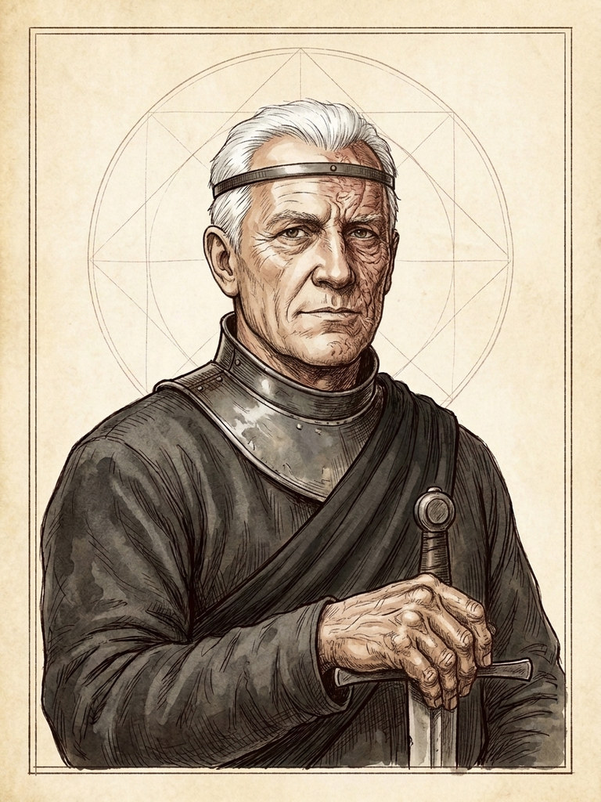

**Registro:** Anterior desenvolvido. **Época:** Histórico; reinou 356–384; morto em 384.

**Origem e presença:** Aurora; ramo secundário empobrecido dos Valerion, elevado em Altavanne

**Linhagem e formação:** Pai de Severor II; avô de Severor III e Valora. O vínculo com o ramo de Aemilius IV é dinástico, sem grau de parentesco fixado.

**Aparência:** Lado esquerdo do rosto permanentemente queimado; nunca usou máscara. Acrescenta-se cabelo curto, embranquecido cedo, e mãos grandes de articulações deformadas.

**Personalidade e contradição:** Coragem paciente, capacidade de escutar especialistas e dificuldade de admitir promessas incompatíveis. Olhava para o trabalhador antes de perguntar pelo senhor.

**Feitos e legado:** Reuniu a Faixa Negra; matou A Sombra com Fende-Bruma em 356; obteve a abdicação de Aemilius IV sem guerra nas ruas; reinou até 384. A vitória foi pessoal e coletiva: caçadores, soldados, forjadores e marinheiros a tornaram possível.

**Desejo ou herança em disputa:** Legado: a coroa fundada no serviço ao povo também deixou compromissos territoriais contraditórios. Seus herdeiros disputam o significado da coragem.

**Entrada em cena e voz:** Uma carta autêntica pode desfazer uma versão oficial sem diminuir o golpe que matou o dragão. Sua voz em memórias: “Quem mantém a corda?”

**Base de referência:** [02_Guia_de_Cenario_Alenia.md](02_Guia_de_Cenario_Alenia.md) (linhas 262, 353); [08_Acervo_Oculto_de_Sellene.md](08_Acervo_Oculto_de_Sellene.md) (linhas 3, 42); [11_Cronica_das_Terras_e_das_Mares.md](11_Cronica_das_Terras_e_das_Mares.md) (papel antes anônimo)

### N002 — Severor II Valerion

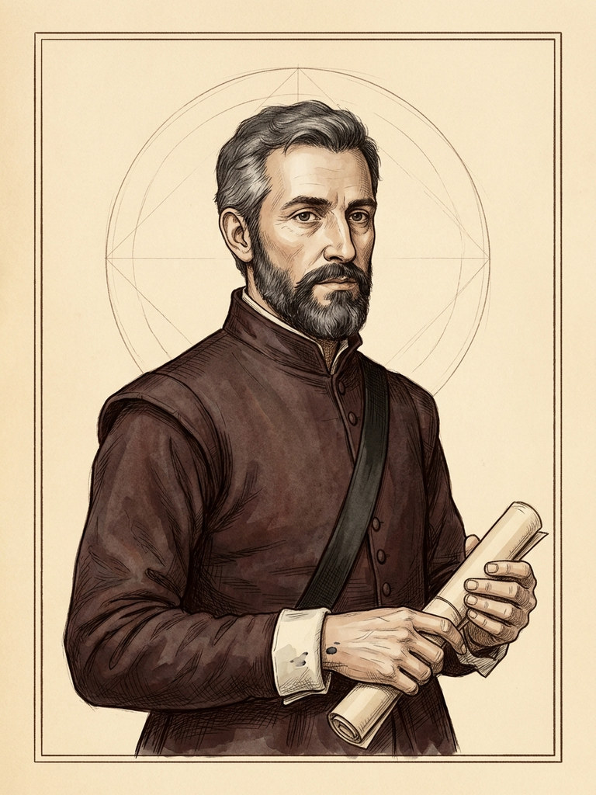

**Registro:** Anterior desenvolvido. **Época:** Histórico; reinou 384–405.

**Origem e presença:** Altavanne e obras do vale do Aurélio

**Linhagem e formação:** Filho de Severor I; pai de Severor III. A filiação de Valora ao mesmo pai é adotada nesta expansão, coerente com a irmandade estabelecida.

**Aparência:** Retratos propostos mostram ombros estreitos, barba aparada, dedos longos e uma pequena mancha de tinta junto ao punho.

**Personalidade e contradição:** Paciente, metódico, avesso a humilhar funcionários; adiava conflitos que não podia resolver por negociação.

**Feitos e legado:** Reconstruiu pontes e estradas; seu reinado administrativo preservou a reconstrução posterior à Sombra. Nunca liderou uma guerra. Propõe-se que exigisse medições antes de aprovar a última parcela de uma obra.

**Desejo ou herança em disputa:** Legado: demonstrar que manter uma ponte também é governar. Não se fixa causa de morte nem se transforma a transição de 405 em assassinato.

**Entrada em cena e voz:** Um empreiteiro apresenta uma ordem de pagamento deste rei; o registro de inspeção contradiz a obra que existe. Voz recordada: “Mostre-me onde a água passa.”

**Base de referência:** [02_Guia_de_Cenario_Alenia.md](02_Guia_de_Cenario_Alenia.md) (linhas 19, 264, 291, 336, 404, 405); [11_Cronica_das_Terras_e_das_Mares.md](11_Cronica_das_Terras_e_das_Mares.md) (linhas 684, 738, 746, 770, 774, 846, 1095, 1097)

### N003 — Severor III Valerion

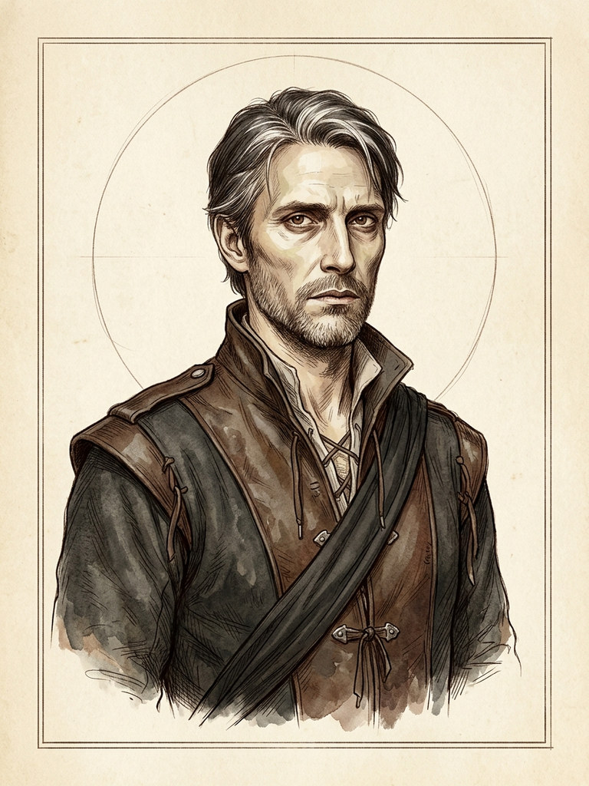

**Registro:** Anterior desenvolvido. **Época:** Vivo e gravemente enfermo em 418; reina desde 405.

**Origem e presença:** Altavanne; campanhas e fronteiras de Aurora

**Linhagem e formação:** Filho de Severor II, neto de Severor I e irmão de Valora; sem filho vivo e sem herdeiro indiscutível. Não se inventa descendente secreto como fato.

**Aparência:** Aparência proposta: alto, rosto estreito, cabelo escuro com fios brancos; veste roupas de campanha mesmo no quarto. A palidez recente acentua o olhar inquieto.

**Personalidade e contradição:** Orgulhoso, exigente consigo, corajoso até a imprudência; teme ser lembrado apenas como o neto que falhou.

**Feitos e legado:** Assumiu a Coroa em 405, correu riscos excessivos nas fronteiras e ocultou os primeiros sintomas até o colapso de 418. Suas vitórias específicas não recebem nomes retroativos sem documentação.

**Desejo ou herança em disputa:** Quer voltar a decidir sem ser tratado como relíquia. A causa da enfermidade permanece escolha do mestre entre as alternativas do Acervo.

**Entrada em cena e voz:** Pede uma audiência curta e contradiz uma ordem transmitida em seu nome. É preciso distinguir vontade consciente, exaustão e manipulação. “Ainda estou aqui.”

**Base de referência:** [02_Guia_de_Cenario_Alenia.md](02_Guia_de_Cenario_Alenia.md) (linhas 19, 264, 291, 336, 405); [08_Acervo_Oculto_de_Sellene.md](08_Acervo_Oculto_de_Sellene.md) (linhas 15, 76, 82, 125, 129); [11_Cronica_das_Terras_e_das_Mares.md](11_Cronica_das_Terras_e_das_Mares.md) (linhas 770, 774, 846, 1095, 1097, 1120)

### N004 — Valora Valerion

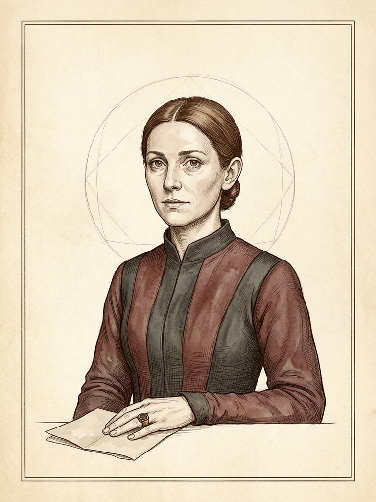

**Registro:** Anterior desenvolvido. **Época:** Viva; regente real em 418.

**Origem e presença:** Paço de Altavanne

**Linhagem e formação:** Irmã de Severor III e neta de Severor I; a expansão a situa como filha de Severor II. Não se fixa casamento nem herdeiro.

**Aparência:** Proposta: cabelo castanho preso baixo, marcas de cansaço, roupas sóbrias de corte; um anel pesado deixa sinal no dedo.

**Personalidade e contradição:** Diplomática, persistente, boa ouvinte quando tem tempo; tende a confundir lealdade à família com interesse público.

**Feitos e legado:** Acumula Regência e Chancelaria; articula a defesa da continuidade Valerion; emprega Sabina para recuperar correspondência e investigar o desvio da barca. Procura saídas negociadas para Ferraur e Vergod.

**Desejo ou herança em disputa:** Evitar a guerra civil sem transformar uma regência em renúncia permanente à autoridade. Precisa de Serina, mas não controla os interesses portuários.

**Entrada em cena e voz:** Oferece recursos limitados e pede uma prova verificável, não uma confissão conveniente. “Preciso do que aconteceu, não do que me favorece.”

**Base de referência:** [02_Guia_de_Cenario_Alenia.md](02_Guia_de_Cenario_Alenia.md) (linhas 19, 118, 291, 308, 336, 409); [07_Aventura_Inicial_Cinzas_no_Estuario.md](07_Aventura_Inicial_Cinzas_no_Estuario.md) (linhas 22); [08_Acervo_Oculto_de_Sellene.md](08_Acervo_Oculto_de_Sellene.md) (linhas 138); [11_Cronica_das_Terras_e_das_Mares.md](11_Cronica_das_Terras_e_das_Mares.md) (linhas 846)

### N005 — Aemilius IV Valerion

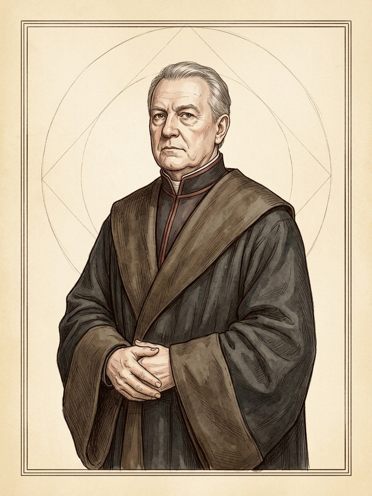

**Registro:** Anterior desenvolvido. **Época:** Histórico; deposto em 356; morte posterior sem data fixada.

**Origem e presença:** Altavanne

**Linhagem e formação:** Ramo antigo dos Valerion; o grau de parentesco com Severor I permanece aberto. Não é o Alto Luminar Aemilius.

**Aparência:** Retrato proposto: rosto arredondado, mãos cuidadas, pescoço rígido sob colarinhos altos; na velhice monástica, roupas grandes demais para o corpo.

**Personalidade e contradição:** Cerimonioso, defensivo, capaz de usar linguagem prudente para justificar abandono. Confundia proteger a sede do governo com proteger o reino.

**Feitos e legado:** Fechou-se na capital durante a devastação e cobrou o Imposto das Cinzas; abdicou diante da legitimidade conquistada por Severor. Recolheu-se a um mosteiro da Passagem até morrer.

**Desejo ou herança em disputa:** Legado: seus partidários chamam o recolhimento de sacrifício; os campos lembram os portões fechados. Nenhuma dessas versões restitui os mortos.

**Entrada em cena e voz:** Um diário pode mostrar medo humano sem absolver a política. Voz atribuída: “Se a capital cair, nada restará.”

**Base de referência:** [02_Guia_de_Cenario_Alenia.md](02_Guia_de_Cenario_Alenia.md) (linhas 362); [11_Cronica_das_Terras_e_das_Mares.md](11_Cronica_das_Terras_e_das_Mares.md) (papel antes anônimo)

### N006 — Lucian Leonastis

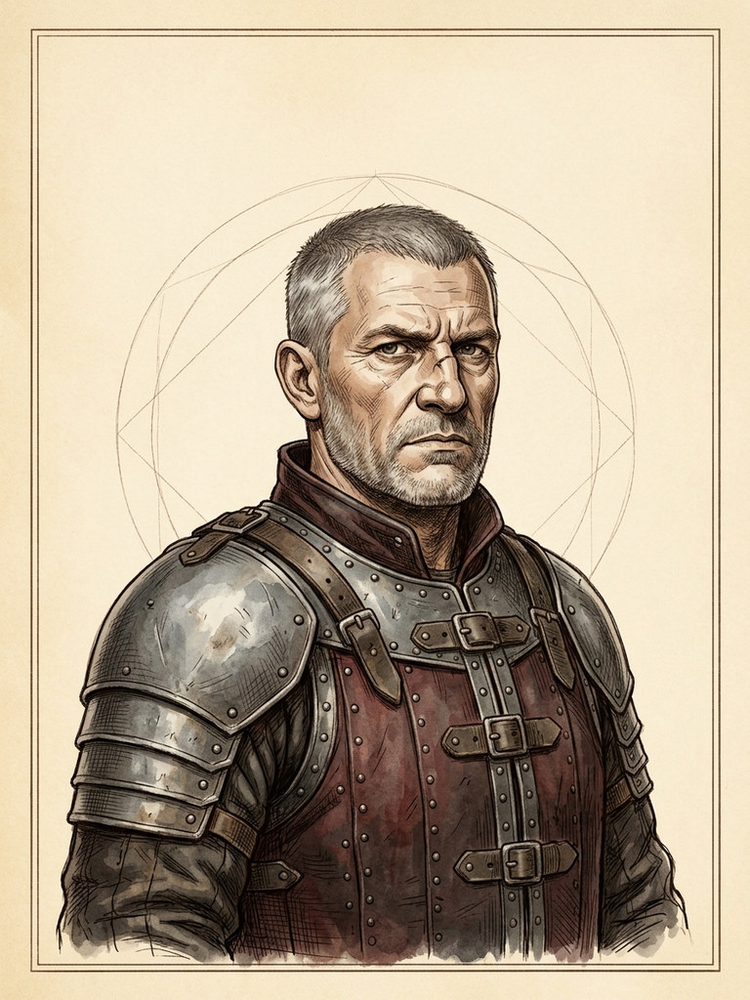

**Registro:** Anterior desenvolvido. **Época:** Vivo em 418.

**Origem e presença:** Vaarsa e Picos de Rubecina; atua em Altavanne

**Linhagem e formação:** Neto de Octavian Leonastis. O pai intermediário não recebe nome nesta edição para evitar inventar uma sucessão já encerrada.

**Aparência:** Proposta: corpo compacto, nariz quebrado, cabelos curtos grisalhos; mantém as botas militares mesmo em audiência.

**Personalidade e contradição:** Disciplinado, valente, paternal com veteranos e cruel com quem interpreta como insubordinado. Sua convicção não exclui cálculo político.

**Feitos e legado:** Herói dos Picos de Rubecina, marechal e adversário da regência de Valora. Pressiona pelo Grande Concílio e pela repressão à greve; o massacre é risco futuro, não feito consumado.

**Desejo ou herança em disputa:** Acredita que a Coroa deve provar capacidade militar. A ala que o apoia inclui interesses que ele não domina integralmente.

**Entrada em cena e voz:** Uma denúncia verdadeira contra seus aliados obriga-o a escolher entre disciplina e conveniência. “Não darei uma ordem que eu mesmo não suportaria.”

**Base de referência:** [02_Guia_de_Cenario_Alenia.md](02_Guia_de_Cenario_Alenia.md) (linhas 19, 118, 225, 291, 309, 337, 380, 408); [07_Aventura_Inicial_Cinzas_no_Estuario.md](07_Aventura_Inicial_Cinzas_no_Estuario.md) (linhas 14); [08_Acervo_Oculto_de_Sellene.md](08_Acervo_Oculto_de_Sellene.md) (linhas 60)

### N007 — Octavian Leonastis

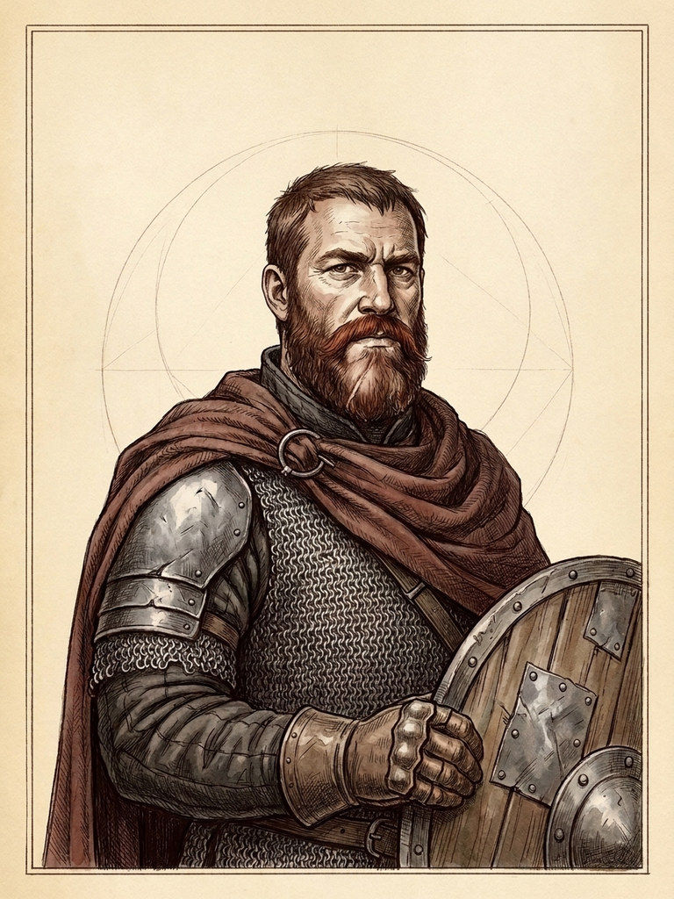

**Registro:** Anterior desenvolvido. **Época:** Histórico; morto em 356.

**Origem e presença:** Vaarsa e fronteira de Rubecina

**Linhagem e formação:** Avô de Lucian; desobedeceu ao próprio pai para participar da caçada. O nome desse pai permanece aberto.

**Aparência:** Proposta: homem de ombros largos, barba ruiva escurecida, cicatriz no queixo; escudo com remendos de campanhas anteriores.

**Personalidade e contradição:** Lealdade aos companheiros acima da obediência familiar; obstinação e pouca diplomacia. Aceitava dívida de honra, não desculpas genealógicas.

**Feitos e legado:** Levou sessenta infantes à Faixa Negra, sustentou a boca do desfiladeiro e morreu garantindo a retirada dos feridos.

**Desejo ou herança em disputa:** Legado: a família reivindica o sangue que permitiu a vitória de Severor. Sua desobediência histórica também pode ser usada contra o militarismo cego do neto.

**Entrada em cena e voz:** Um rol de sobreviventes mostra quem ele salvou, inclusive alguém de uma casa rival. “Primeiro os feridos; depois os estandartes.”

**Base de referência:** [02_Guia_de_Cenario_Alenia.md](02_Guia_de_Cenario_Alenia.md) (linhas 380); [11_Cronica_das_Terras_e_das_Mares.md](11_Cronica_das_Terras_e_das_Mares.md) (linhas 670)

### N008 — Darian d'Altrax

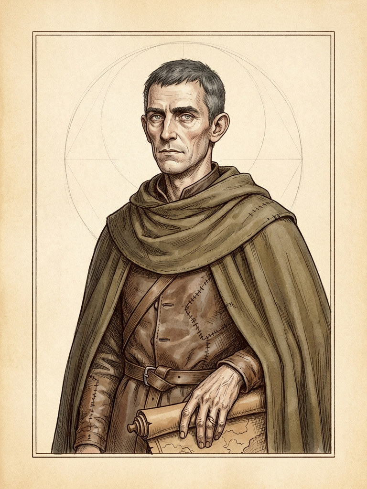

**Registro:** Anterior desenvolvido. **Época:** Histórico; ativo em 355–356; destino posterior aberto.

**Origem e presença:** Fronteira noroeste de Aurora

**Linhagem e formação:** Casa d'Altrax; relação exata com Aurelia e Cassian não está estabelecida. Não se presume que fosse avô de ambos.

**Aparência:** Proposta: muito magro, olhos claros protegidos por sobrancelhas espessas, roupas reparadas e andar silencioso; um dedo endurecido por antiga fratura.

**Personalidade e contradição:** Paciente, desconfiado de relatos grandiosos, excelente em separar vestígio de desejo. Guardava ressentimentos por muitos anos.

**Feitos e legado:** Rastreou os pousos da Sombra durante nove meses e identificou a fenda antiga sob a asa esquerda. Seu trabalho tornou possível escolher onde atingir a criatura.

**Desejo ou herança em disputa:** Legado: a promessa de terras florestais feita à sua casa foi recuada para preservar Vergod. Seu mapa vale mais que as versões em canções.

**Entrada em cena e voz:** Um herdeiro exige terras usando uma carta que omite os moradores das matas. “O rastro não sabe a quem você jurou.”

**Base de referência:** [02_Guia_de_Cenario_Alenia.md](02_Guia_de_Cenario_Alenia.md) (linhas 377); [11_Cronica_das_Terras_e_das_Mares.md](11_Cronica_das_Terras_e_das_Mares.md) (linhas 662)

### N009 — Vespera Scutauria

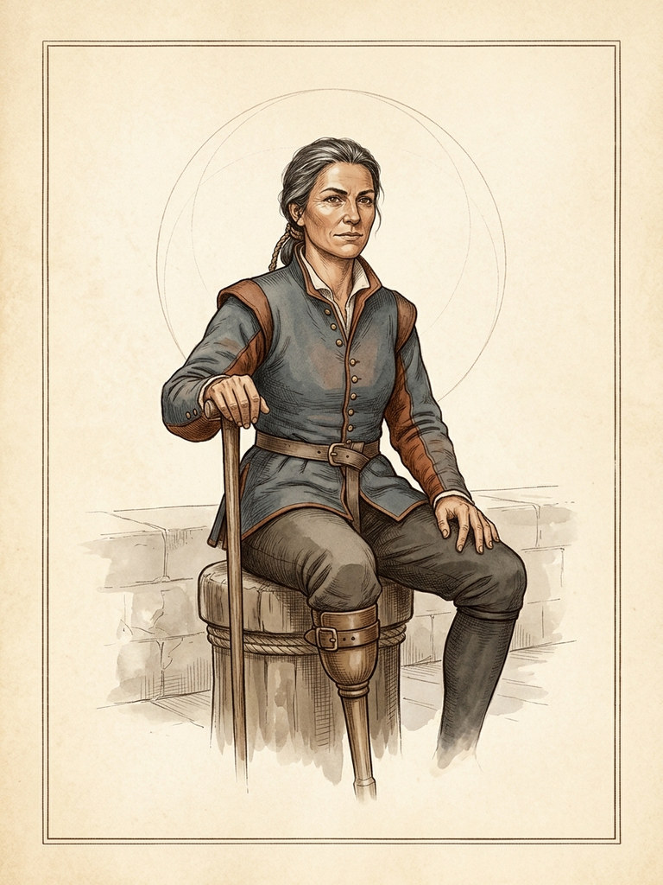

**Registro:** Anterior desenvolvido. **Época:** Histórica; sobreviveu à caçada de 356; destino posterior aberto.

**Origem e presença:** Merlinport e navegação fluvial

**Linhagem e formação:** Casa Scutauria; vínculo preciso com Marcus e Serina não foi fixado. O cargo conquistado beneficiou a casa, não comprova maternidade.

**Aparência:** Perdeu uma perna na caçada. Proposta: pele marcada de sol, cabelos presos com cordão de marinheiro e prótese de madeira simples nos retratos posteriores.

**Personalidade e contradição:** Prática, espirituosa, feroz na cobrança de soldos; perdia a paciência com quem confundia marinheiros com material de consumo.

**Feitos e legado:** Transportou correntes e arpões, financiou suprimentos pelo rio e perdeu metade da tripulação. Garantiu os Forais de Merlinport e o lugar da casa na Balança.

**Desejo ou herança em disputa:** Legado: o preço naval da vitória recebe menos versos que o golpe do rei. As famílias dos tripulantes ainda podem cobrar reconhecimento.

**Entrada em cena e voz:** Uma lista de indenizações revela nomes suprimidos. “Não conte as correntes antes de contar quem as puxou.”

**Base de referência:** [02_Guia_de_Cenario_Alenia.md](02_Guia_de_Cenario_Alenia.md) (linhas 378); [11_Cronica_das_Terras_e_das_Mares.md](11_Cronica_das_Terras_e_das_Mares.md) (linhas 670)

### N010 — Orlan Ferraris

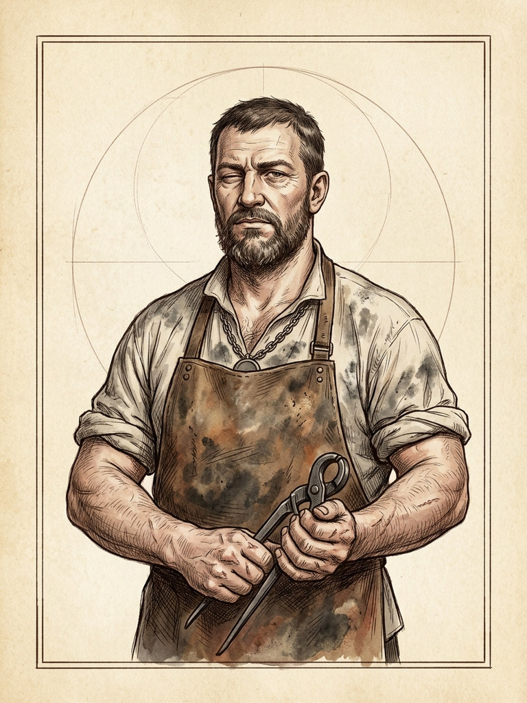

**Registro:** Anterior desenvolvido. **Época:** Histórico; ativo em 356; morte sem data fixada.

**Origem e presença:** Aeraneas e oficinas de Ferraur

**Linhagem e formação:** Casa Ferraris; elevado ao título hereditário de Grão-Lorde do Adamante. Relação exata com Aurelian e Marcus Ferraris não comprovada.

**Aparência:** Proposta: braços grossos, barba curta chamuscada, visão cansada de um olho e pequenas queimaduras nas mãos.

**Personalidade e contradição:** Exigente, reservado, solidário com aprendizes e intolerante a encomendas tecnicamente impossíveis. O reconhecimento da oficina importava mais que a etiqueta.

**Feitos e legado:** Forjou clandestinamente Fende-Bruma contra o decreto real. Participou com Lorenzo Seleni da autópsia reservada da Sombra e recebeu título de Severor I.

**Desejo ou herança em disputa:** Legado: o título nobre nasceu do ofício, enquanto seus sucessores administram trabalhadores que reivindicam essa mesma dignidade.

**Entrada em cena e voz:** Um caderno de oficina prova a participação de operários sem sobrenome. “A ponta leva meu selo; o trabalho, muitas mãos.”

**Base de referência:** [02_Guia_de_Cenario_Alenia.md](02_Guia_de_Cenario_Alenia.md) (linhas 379); [08_Acervo_Oculto_de_Sellene.md](08_Acervo_Oculto_de_Sellene.md) (linhas 43); [11_Cronica_das_Terras_e_das_Mares.md](11_Cronica_das_Terras_e_das_Mares.md) (linhas 670, 1055)

### N011 — Corvus Montavalle

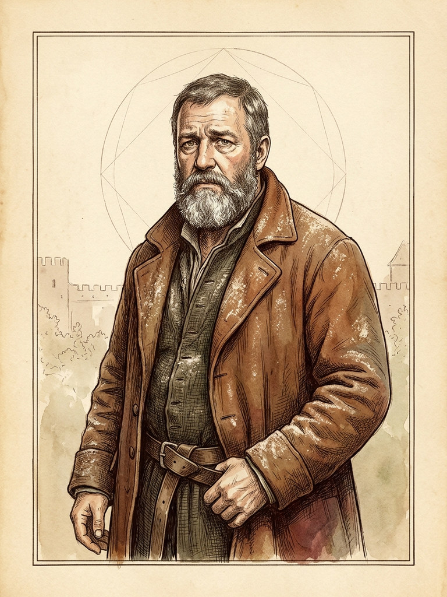

**Registro:** Anterior desenvolvido. **Época:** Histórico; ativo em 356.

**Origem e presença:** Dahrma

**Linhagem e formação:** Casa Montavalle; antecessor de Lorian na memória familiar, sem geração exata estabelecida.

**Aparência:** Proposta: rosto largo, barba salpicada de branco, postura de cavaleiro cansado e casaco sempre empoeirado de grão.

**Personalidade e contradição:** Generoso no abastecimento, orgulhoso da própria gente, devastado por acusações que não conseguia desmontar publicamente.

**Feitos e legado:** Abasteceu a caçada com grãos e cavalos. A retaguarda recuou cedo; o Acervo conserva prova de um falso sinal dado por oficial leal a Aemilius IV, e não de uma ordem covarde de Corvus.

**Desejo ou herança em disputa:** Legado: restaurar sua honra afeta a autoridade atual de Dahrma. A inocência no sinal não apaga outras perdas e decisões difíceis.

**Entrada em cena e voz:** Os descendentes podem aceitar uma verdade que também expõe famílias ainda influentes? “Um exército sem pão só chega ao lugar onde começa a saquear.”

**Base de referência:** [02_Guia_de_Cenario_Alenia.md](02_Guia_de_Cenario_Alenia.md) (linhas 381); [08_Acervo_Oculto_de_Sellene.md](08_Acervo_Oculto_de_Sellene.md) (papel antes anônimo); [11_Cronica_das_Terras_e_das_Mares.md](11_Cronica_das_Terras_e_das_Mares.md) (linhas 670)

### N012 — Lorian Montavalle

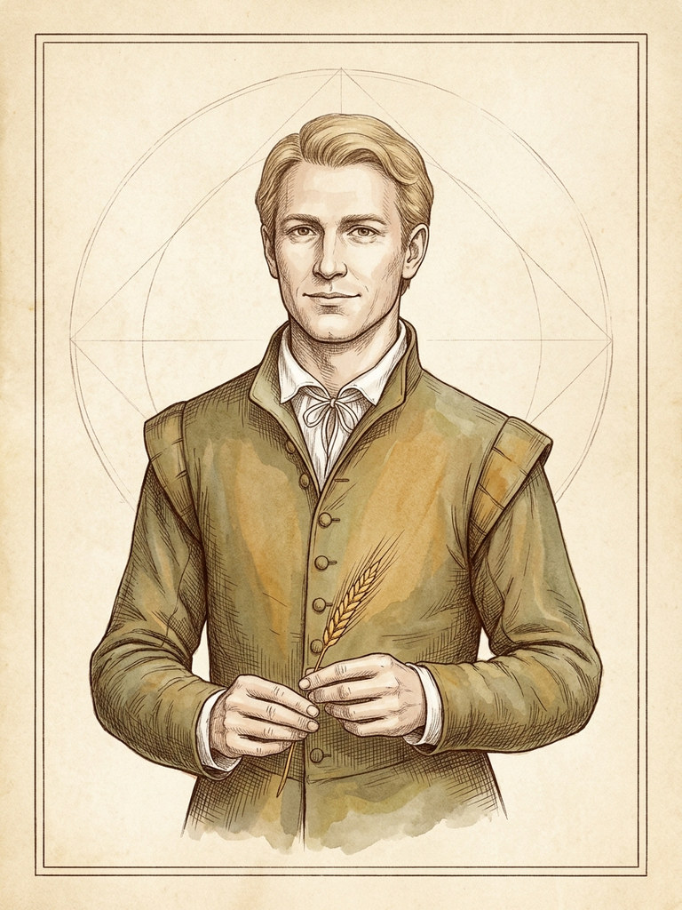

**Registro:** Anterior desenvolvido. **Época:** Vivo em 418.

**Origem e presença:** Dahrma

**Linhagem e formação:** Atual chefe Montavalle; ligação genealógica precisa com Corvus aberta. Família poderosa, mas não proprietária de toda a produção camponesa.

**Aparência:** Proposta: alto, rosto aberto, mãos pequenas, cabelo claro; usa tecidos bons sem joias ostensivas.

**Personalidade e contradição:** Afável, atento aos preços, evita decidir diante de plateia. A neutralidade às vezes encobre receio de perder os dois lados.

**Feitos e legado:** Governa o maior celeiro de Aurora e sua cavalaria ligeira. Contém especuladores com autoridade contestada; acrescenta-se a organização de armazéns de socorro após uma cheia local, sem data canônica.

**Desejo ou herança em disputa:** Manter o pão circulando e recuperar prestígio familiar sem apostar toda a colheita num pretendente.

**Entrada em cena e voz:** Pede escolta para uma carga cuja venda já foi prometida duas vezes por agentes diferentes. “A fome não espera o fim do concílio.”

**Base de referência:** [02_Guia_de_Cenario_Alenia.md](02_Guia_de_Cenario_Alenia.md) (linhas 341)

### N013 — Serina Scutauria

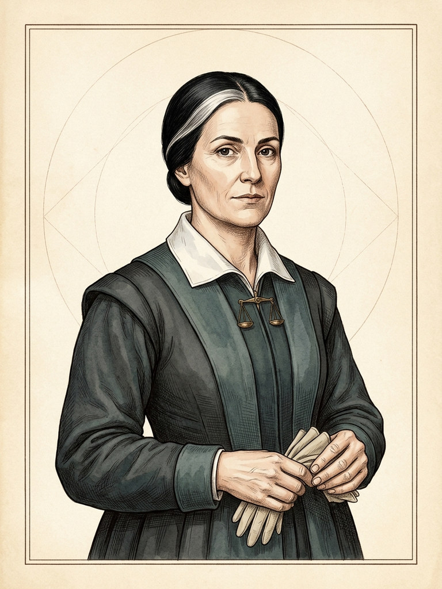

**Registro:** Anterior desenvolvido. **Época:** Viva em 418.

**Origem e presença:** Merlinport; residência de ofício em Altavanne

**Linhagem e formação:** Casa Scutauria. Nesta expansão, Marcus é seu irmão mais velho; essa relação é nova, não consequência automática do sobrenome.

**Aparência:** Proposta: mulher de meia-idade, cabelo negro com uma mecha branca, unhas curtas, luvas de tecido fino usadas somente no salão.

**Personalidade e contradição:** Lúcida, seca no humor, protege gente competente; calcula tão depressa que parece não sentir as perdas que contabiliza.

**Feitos e legado:** Mestre da Balança, administra Tesouro, moeda e relações de crédito. Sustenta Valora enquanto o comércio permanece viável. Propõe-se que tenha impedido pagamento duplicado de uma dívida naval.

**Desejo ou herança em disputa:** Evitar impostos de guerra que destruam a arrecadação futura. Pode enfrentar o irmão se a alfândega sacrificar o tesouro aos interesses locais.

**Entrada em cena e voz:** Uma conta correta esconde uma escolha injusta. “Quem paga a diferença entre sua promessa e a minha assinatura?”

**Base de referência:** [02_Guia_de_Cenario_Alenia.md](02_Guia_de_Cenario_Alenia.md) (linhas 311)

### N014 — Marcus Scutauria

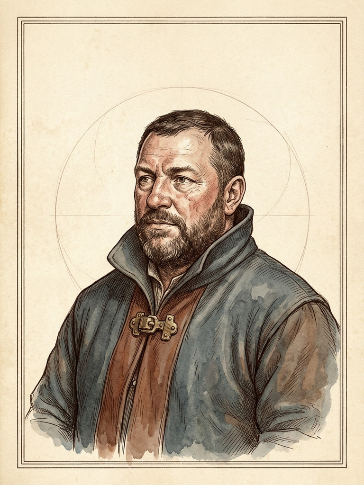

**Registro:** Anterior desenvolvido. **Época:** Vivo em 418.

**Origem e presença:** Merlinport

**Linhagem e formação:** Chefe Scutauria; irmão de Serina nesta expansão. Descendência exata de Vespera não fixada.

**Aparência:** Proposta: robusto, barba curta escura, rosto avermelhado pelo vento e um ouvido com audição reduzida.

**Personalidade e contradição:** Hospitalário, territorial, bom negociador frente a frente; detesta admitir que precisa dos bancos estrangeiros.

**Feitos e legado:** Controla interesses de frotas fluviais e alfândega. Apoia Valora condicionado à abertura do comércio. Expansão: intermediou uma indenização coletiva após perda de barcaças, preservando o serviço do porto.

**Desejo ou herança em disputa:** Conservar autonomia de Merlinport sem ser acusado de comprar a Coroa. Seu compromisso com os trabalhadores termina onde começa sua margem de lucro.

**Entrada em cena e voz:** Oferece barcos em vez de dinheiro; exige conhecer a carga e quer saber por que Sabina não passou por ele. “No meu cais, promessa precisa flutuar.”

**Base de referência:** [02_Guia_de_Cenario_Alenia.md](02_Guia_de_Cenario_Alenia.md) (linhas 338)

### N015 — Aurelian Ferraris

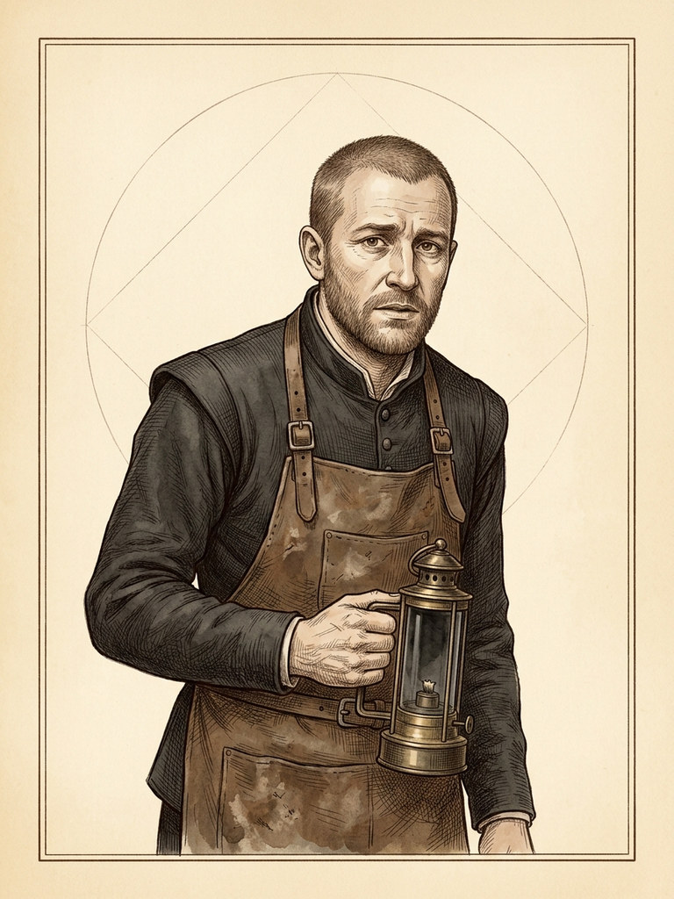

**Registro:** Anterior desenvolvido. **Época:** Vivo em 418.

**Origem e presença:** Aeraneas

**Linhagem e formação:** Chefe Ferraris e detentor do título originado com Orlan; não se fixa número de gerações.

**Aparência:** Proposta: barba castanha muito curta, postura encurvada de quem visita galerias, roupas que misturam corte nobre e avental de inspeção.

**Personalidade e contradição:** Competente, cauteloso, tende a guardar notícias ruins até poder oferecer solução. Essa prudência virou cumplicidade aos olhos de trabalhadores.

**Feitos e legado:** Administra minas e forjas; tenta negociar após o desabamento de quarenta mortos. Produziu adendo secreto aos registros antigos de Ferraur. O desastre não é reduzido a sabotagem sobrenatural.

**Desejo ou herança em disputa:** Evitar repressão e colapso econômico enquanto enfrenta provas do que a mineração encontrou. Precisa ouvir líderes que antes tratava como subordinados.

**Entrada em cena e voz:** Uma ordem antiga traz seu selo, mas a execução foi alterada por capatazes. “Uma galeria fechada custa prata; uma aberta cedo demais custa nomes.”

**Base de referência:** [02_Guia_de_Cenario_Alenia.md](02_Guia_de_Cenario_Alenia.md) (linhas 310, 339); [08_Acervo_Oculto_de_Sellene.md](08_Acervo_Oculto_de_Sellene.md) (linhas 56, 60); [11_Cronica_das_Terras_e_das_Mares.md](11_Cronica_das_Terras_e_das_Mares.md) (papel antes anônimo)

### N016 — Aurelia d'Altrax

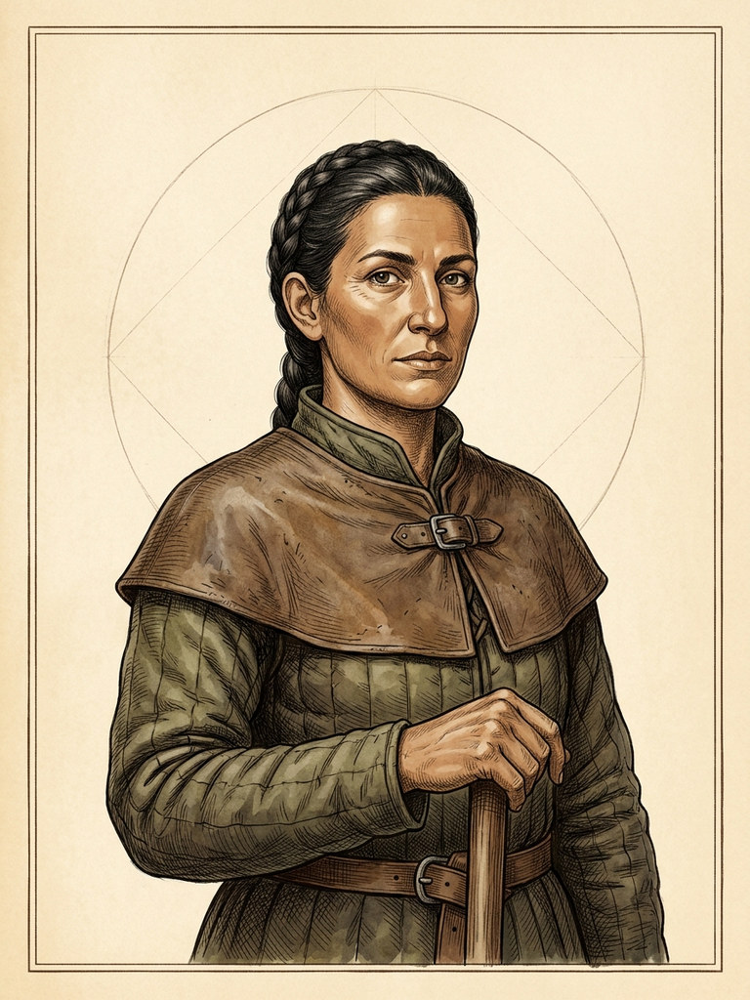

**Registro:** Anterior desenvolvido. **Época:** Viva em 418.

**Origem e presença:** Forte de Altrax e rotas pantanosas

**Linhagem e formação:** Castelã da Casa d'Altrax; nesta expansão, Cassian é seu primo, sem parentesco direto fixado com Darian.

**Aparência:** Proposta: pele morena marcada de sol, cabelo trançado, nariz forte e andar cuidadoso após lesão antiga no joelho.

**Personalidade e contradição:** Cautelosa, direta, fiel a patrulheiros que conhece pelo nome; demora a aceitar interferência de gente da capital.

**Feitos e legado:** Mantém patrulhas e batedores da fronteira noroeste. Propõe-se uma retirada organizada de moradores de uma estrada inundada, cuja memória explica a lealdade de guias locais.

**Desejo ou herança em disputa:** Proteger a fronteira sem entregar o forte a Leonastis nem permitir que a crise com Vergod se torne guerra.

**Entrada em cena e voz:** Entrega um mapa com caminhos omitidos por respeito a comunidades locais. “Fronteira é quem mora de cada lado, não a linha do copista.”

**Base de referência:** [02_Guia_de_Cenario_Alenia.md](02_Guia_de_Cenario_Alenia.md) (linhas 340)

### N017 — Cassian d'Altrax

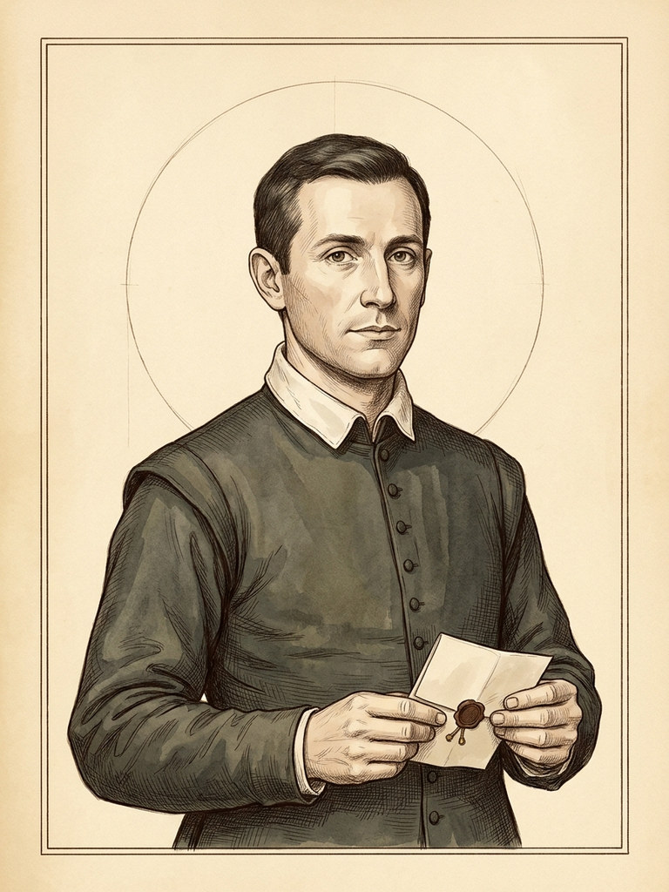

**Registro:** Anterior desenvolvido. **Época:** Vivo em 418.

**Origem e presença:** Altrax; serviço em Altavanne

**Linhagem e formação:** Casa d'Altrax; primo de Aurelia nesta expansão. Distinto de Cassian de Lavroga, Cassian Armeiro e Cassian de Pontáuria.

**Aparência:** Proposta: discreto, rosto magro, cabelo sempre aparado; roupas de corte um pouco antiquadas, sem marca pessoal vistosa.

**Personalidade e contradição:** Observador, cortês, avesso a respostas imediatas. Consegue preservar confidências, mas usa o silêncio para ampliar a própria margem de ação.

**Feitos e legado:** Guardião interino dos Selos Secretos; coordena correio cifrado e contraespionagem. Sua lealdade é suspeita para ambos os campos, sem traição definida como fato.

**Desejo ou herança em disputa:** Converter o cargo interino em posição legítima sem entregar a rede inteira a uma facção.

**Entrada em cena e voz:** Reconhece um lacre falso, mas se recusa a explicar como, pois isso revelaria um mensageiro. “Uma carta pode ser verdadeira e chegar pela mão errada.”

**Base de referência:** [02_Guia_de_Cenario_Alenia.md](02_Guia_de_Cenario_Alenia.md) (linhas 313)

### N018 — Valen de Pontáuria

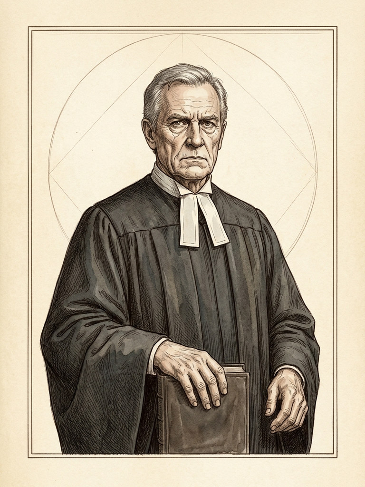

**Registro:** Anterior desenvolvido. **Época:** Vivo em 418.

**Origem e presença:** Pontáuria e tribunais reais

**Linhagem e formação:** Primo do Alto Luminar Aemilius; tio de Sabina; neto de Cassian de Pontáuria conforme o Acervo. A geração intermediária não foi nomeada.

**Aparência:** Proposta: homem grisalho, expressão severa, mão esquerda pouco móvel e roupas escuras sem ostentação.

**Personalidade e contradição:** Incorruptível, obstinado, mais sensível a prova que a eloquência. Pode confundir regularidade processual com acesso real à justiça.

**Feitos e legado:** Preboste da Coroa; dirige juízes, patrulhas e investigações de traição. Recusa servir a uma facção fora da lei. Expansão: restituiu bens confiscados por um aliado da própria família.

**Desejo ou herança em disputa:** Preservar uma justiça capaz de sobreviver ao próximo soberano. A atividade secreta da sobrinha ameaça seu equilíbrio entre afeto e dever.

**Entrada em cena e voz:** Pede uma testemunha viva, não apenas o documento que a tornaria descartável. “A lei também precisa limitar quem acredita estar certo.”

**Base de referência:** [02_Guia_de_Cenario_Alenia.md](02_Guia_de_Cenario_Alenia.md) (linhas 312)

### N036 — Marcus Ferraris

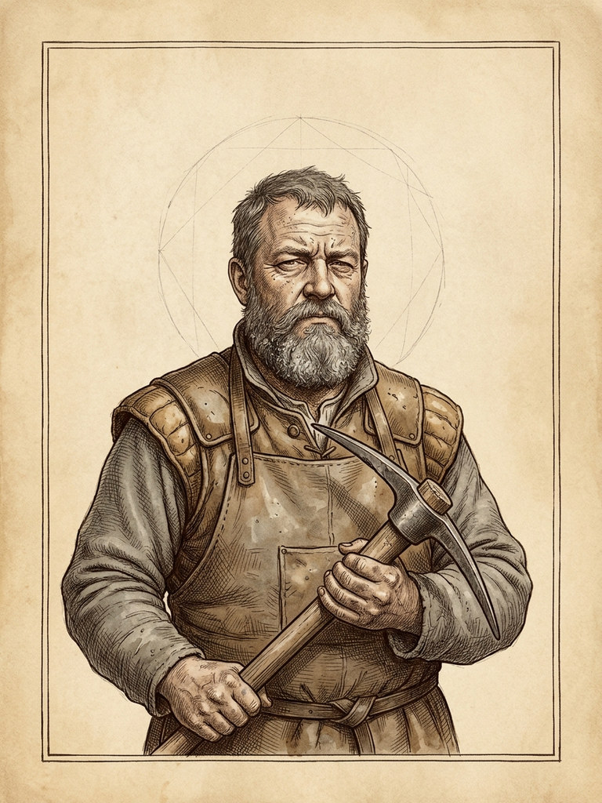

**Registro:** Anterior desenvolvido. **Época:** Histórico; ativo no Ano 14.

**Origem e presença:** Primeiras galerias de Ferraur

**Linhagem e formação:** Ferraris antigo; a continuidade nominal não comprova linha genealógica ininterrupta até Orlan ou Aurelian.

**Aparência:** Reconstrução proposta: corpo forte, barba emaranhada, olhos irritados por poeira; aparência inferida de seu trabalho, não documentada.

**Personalidade e contradição:** Na leitura dramática proposta, metódico e desconfiado de ordens que ignoram a rocha. Não se apresenta essa caracterização como testemunho antigo.

**Feitos e legado:** Autor de relatório sobre galerias artificiais e pilares antigos em torno dos veios de adamante no Ano 14. O registro contradiz a simplificação pública de uma descoberta apenas mineral.

**Desejo ou herança em disputa:** Legado: trabalho mineiro e arquivo podem preservar indícios que a corte prefere apagar.

**Entrada em cena e voz:** Uma cópia de seu relatório usa medidas antigas que precisam ser reconstruídas. “Não escrevi que construímos o túnel. Escrevi que o encontramos.”

**Base de referência:** [08_Acervo_Oculto_de_Sellene.md](08_Acervo_Oculto_de_Sellene.md) (linhas 56); [11_Cronica_das_Terras_e_das_Mares.md](11_Cronica_das_Terras_e_das_Mares.md) (linhas 1050)

## Portos e regências

### N021 — Corardo della Rocca

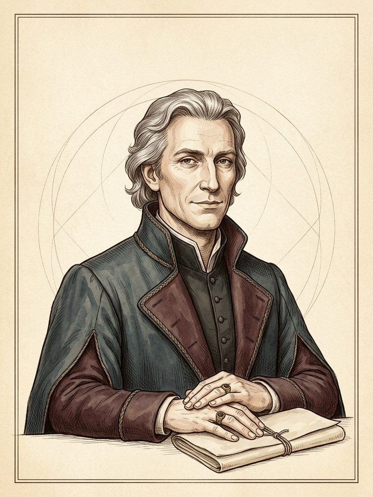

**Registro:** Anterior desenvolvido. **Época:** Vivo em 418.

**Origem e presença:** Corallis; circuitos políticos da Liga

**Linhagem e formação:** Casa della Rocca, mercantil; parentes e antecessor no cargo não definidos.

**Aparência:** Proposta: rosto comprido, cabelo ondulado grisalho, dedos com anéis de selo discretos; veste tecidos resistentes ao sal nas viagens.

**Personalidade e contradição:** Conciliador, vaidoso da própria habilidade, prefere dívidas recíprocas a ordens diretas; subestima rancores de trabalhadores de porto.

**Feitos e legado:** Arconte-Regente confirmado pela Coroa; tenta equilibrar quatro grandes cidades e unificar tarifas. A disputa Baldbella–Alineus ameaça demonstrar o limite de seu poder.

**Desejo ou herança em disputa:** Ampliar autonomia sem provocar intervenção de Aurora. Financiar investigação de Thanatos é intenção política, não prova de que já controla a ilha.

**Entrada em cena e voz:** Dois contratos legítimos atribuem o mesmo salvamento a cidades rivais. “Não preciso que concordem; preciso que os navios entrem.”

**Base de referência:** [02_Guia_de_Cenario_Alenia.md](02_Guia_de_Cenario_Alenia.md) (linhas 42, 119, 296)

### N022 — Qasir Zaharid

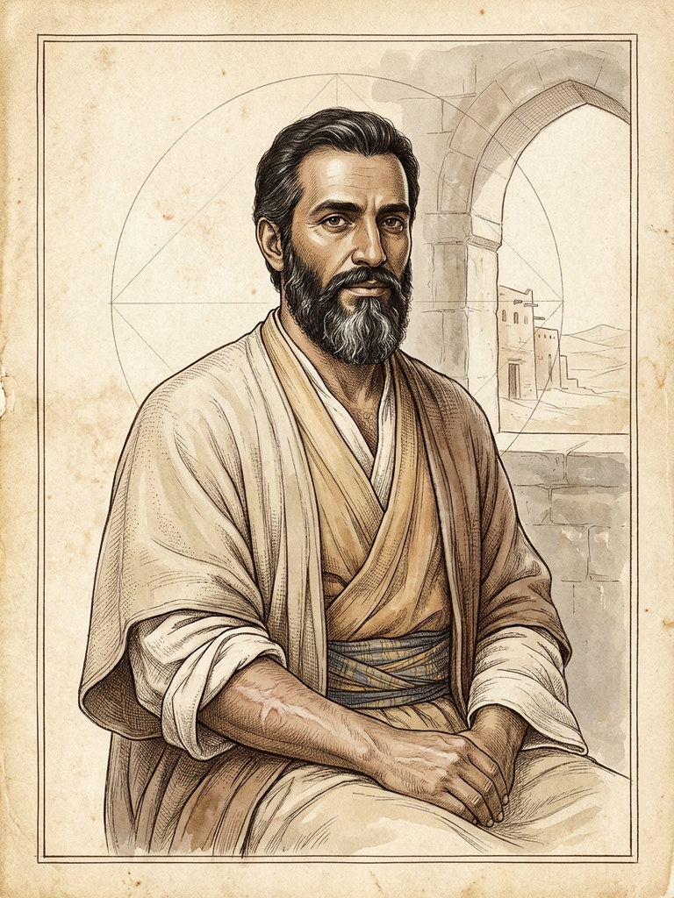

**Registro:** Anterior desenvolvido. **Época:** Vivo em 418.

**Origem e presença:** Naasar; jurisdição sobre cidades-oásis e pedágios

**Linhagem e formação:** Clã Zaharid. Não é automaticamente Qasir ibn Tarash, nome-modelo do Tomo V, desenvolvido aqui como outro homem.

**Aparência:** Proposta: alto, barba negra com fios prateados, mantos claros e uma marca de queimadura antiga no antebraço.

**Personalidade e contradição:** Formalmente hospitaleiro, bom em medir concessões, preocupado com precedentes; interpreta autonomia tribal como problema negociável, às vezes tarde demais.

**Feitos e legado:** Regente das Dunas; mantém cisternas e tributos urbanos. Exige solução para o assassinato do Árbitro e tenta preservar a Rota do Sal.

**Desejo ou herança em disputa:** Demonstrar que pode proteger a água sem se tornar ocupante estrangeiro aos olhos dos clãs. Não governa livremente Vargheim nem todas as dunas.

**Entrada em cena e voz:** Recebe representantes inimigos sob a mesma tenda e pede que os personagens verifiquem uma acusação antes do terceiro dia. “O poço não escolhe a sede.”

**Base de referência:** [02_Guia_de_Cenario_Alenia.md](02_Guia_de_Cenario_Alenia.md) (linhas 50, 120, 297); [11_Cronica_das_Terras_e_das_Mares.md](11_Cronica_das_Terras_e_das_Mares.md) (linhas 136)

### N023 — Grimrik Ulscold

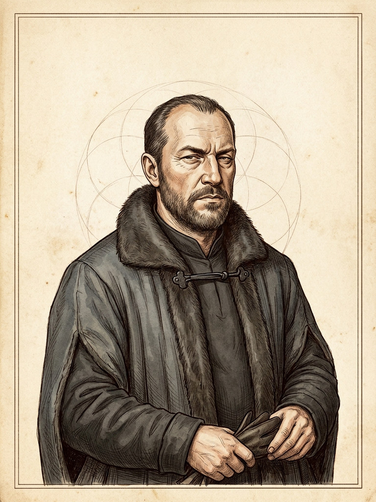

**Registro:** Anterior desenvolvido. **Época:** Vivo em 418.

**Origem e presença:** Cidadela de Kalgard

**Linhagem e formação:** Casa Ulscold; depende de von Kragstad e Hrafngard, sem parentesco presumido entre as três.

**Aparência:** Proposta: grande, barba escura curta, olho direito ligeiramente semicerrado, vestes de lã pesada sem exuberância.

**Personalidade e contradição:** Disciplinado, calculista, valoriza previsibilidade; confunde silêncio social com consentimento. Sabe recompensar competência popular.

**Feitos e legado:** Déspota-Regente de Kalis; sustenta autonomia prática e tributo formal. Mobiliza informações sobre Despertos e mantém equilíbrio precário com mercadores e casas rivais.

**Desejo ou herança em disputa:** Conhecer Thanatos antes que Aurora use o mistério contra Kalis. Não controla todas as redes criminosas que operam em seu nome.

**Entrada em cena e voz:** Um agente oferece prova excelente obtida mediante crime politicamente desastroso. “Uma informação só vale o preço de usá-la.”

**Base de referência:** [02_Guia_de_Cenario_Alenia.md](02_Guia_de_Cenario_Alenia.md) (linhas 61, 121, 298)

### N026 — Fioresca Coral

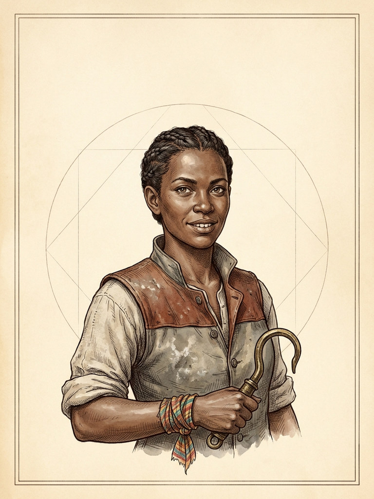

**Registro:** Anterior desenvolvido. **Época:** Viva em 418.

**Origem e presença:** O Ferro Velho e recifes de Corallis

**Linhagem e formação:** Sobrenome regional de bastardia; pais nobres não identificados. Sua liderança vem da Irmandade, não de herança de casa mercantil.

**Aparência:** Proposta: pele escura curtida pelo sol, tranças curtas, dentes desiguais, uma faixa de tecido colorido no pulso.

**Personalidade e contradição:** Inventiva, direta, feroz na defesa de autonomia; tolera ilegalidade com mais facilidade que exploração de companheiros.

**Feitos e legado:** Lidera a Irmandade do Ferro Velho e articula práticos, sucateiros e compradores. Disputa salvamentos sem aceitar tributação automática da Liga.

**Desejo ou herança em disputa:** Manter unidade entre trabalhadores honestos e corsários que oferecem recursos indispensáveis. Pode perder aliados se combater toda pilhagem.

**Entrada em cena e voz:** Precisa arbitrar entre uma tripulação faminta e sobreviventes que reivindicam a carga. “Resgatar não dá direito de possuir a pessoa resgatada.”

**Base de referência:** [02_Guia_de_Cenario_Alenia.md](02_Guia_de_Cenario_Alenia.md) (linhas 123); [05_Onomastica_e_Toponimia_Alenia.md](05_Onomastica_e_Toponimia_Alenia.md) (linhas 62)

### N058 — Qasir ibn Tarash

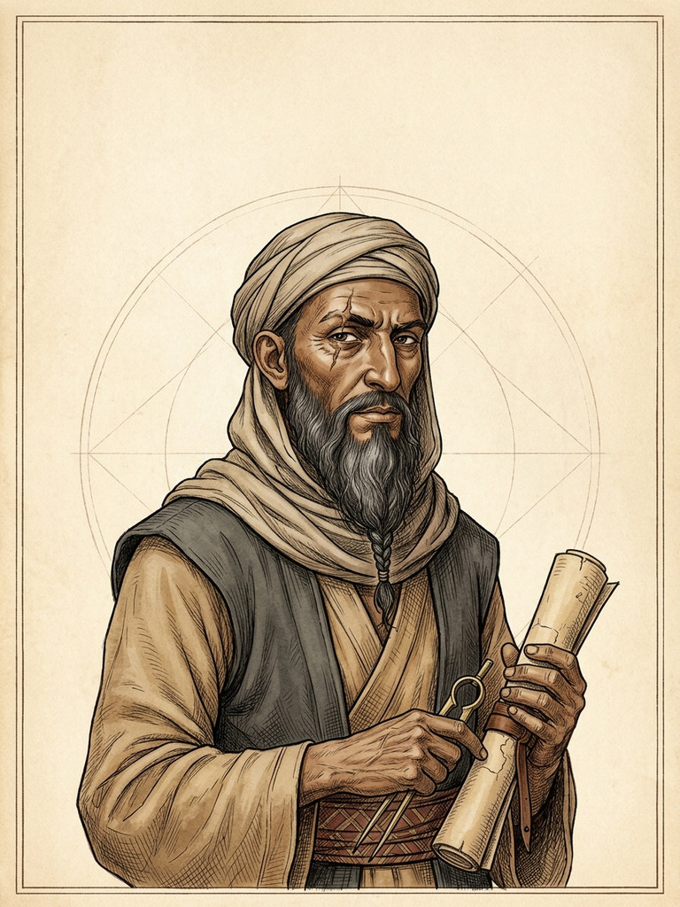

**Registro:** Nome-modelo desenvolvido. **Época:** Vivo em 418; biografia nova.

**Origem e presença:** Suq-Ramad e circuitos de caravanas

**Linhagem e formação:** Filho de Tarash; distinto de Qasir Zaharid e de Tarash Duna. Família de transportadores, sem título régio.

**Aparência:** Alto, muito magro, barba longa trançada só na ponta; perdeu parte de uma sobrancelha.

**Personalidade e contradição:** Cortês, atento ao silêncio de tratadores, desconfiado de mapas recém-comprados; orgulho profissional exagerado.

**Feitos e legado:** Reconduziu uma caravana após falha de abastecimento e negociou empréstimo de montarias entre grupos rivais sem quebrar hospitalidade.

**Desejo ou herança em disputa:** Manter uma rota de comércio que não dependa de um único senhor de cisterna.

**Entrada em cena e voz:** Seu nome é confundido deliberadamente com o do regente numa cobrança. “Meu pai me deu um nome; não me deu os poços de Naasar.”

**Base de referência:** [05_Onomastica_e_Toponimia_Alenia.md](05_Onomastica_e_Toponimia_Alenia.md) (linhas 78)

### N081 — Rashan Qarsol

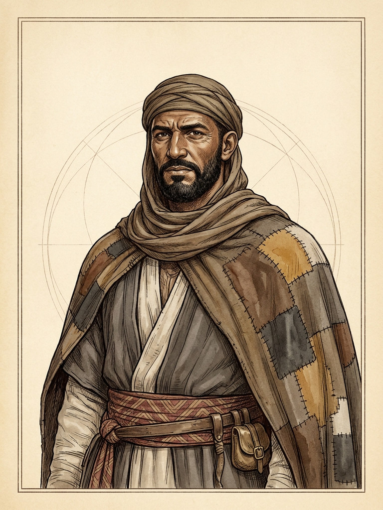

**Registro:** Nova figura ou papel nomeado. **Época:** Vivo em 418.

**Origem e presença:** Clãs livres entre Qal-Zahar e as estepes

**Linhagem e formação:** Clã Qarsol; escolhido como voz de um grupo de tendas, sem autoridade sobre toda Gaddra.

**Aparência:** Grande, barba negra curta, rosto marcado pelo sol e um manto muito remendado mantido por escolha.

**Personalidade e contradição:** Hospitaleiro, desconfiado, vaidoso da independência; aprende depressa quando não é corrigido diante de plateia.

**Feitos e legado:** Negociou acesso temporário a um poço sem jurar vassalagem e reuniu escoltas de famílias que antes cobravam pedágios rivais.

**Desejo ou herança em disputa:** Garantir mobilidade sem entregar as rotas de seu povo ao cadastro da Regência.

**Entrada em cena e voz:** Qasir oferece proteção em troca de uma lista de poços. “Não venderei amanhã para comprar uma noite tranquila.”

**Base de referência:** Criação desta edição, situada na geografia e nas instituições dos tomos II e V.

### N082 — Borhild Hrafngard

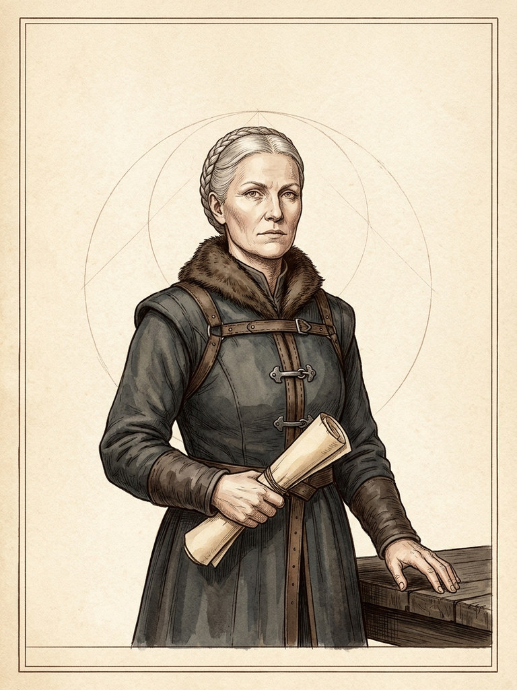

**Registro:** Nova figura ou papel nomeado. **Época:** Viva em 418.

**Origem e presença:** Kalgard e depósitos de madeira naval

**Linhagem e formação:** Casa Hrafngard; representante de um ramo do conselho, sem substituir um chefe ainda não nomeado pelo cenário.

**Aparência:** Alta, cabelos cinza claros, queixo forte e mão direita com tremor quase imperceptível.

**Personalidade e contradição:** Calculista, franca em privado, capaz de compromissos duradouros; interpreta dependência econômica como forma legítima de mando.

**Feitos e legado:** Reorganizou contratos de madeira durante uma interrupção costeira e impediu que fornecedores pequenos fossem absorvidos por um único comprador rival.

**Desejo ou herança em disputa:** Aumentar o peso Hrafngard sem provocar guerra aberta entre casas.

**Entrada em cena e voz:** Oferece madeira a Grimrik sob condição de auditoria que também expõe seus próprios parentes. “Um acordo que só me favorece não durará o inverno.”

**Base de referência:** Criação desta edição, situada na geografia e nas instituições dos tomos II e V.

### N083 — Haksten von Kragstad

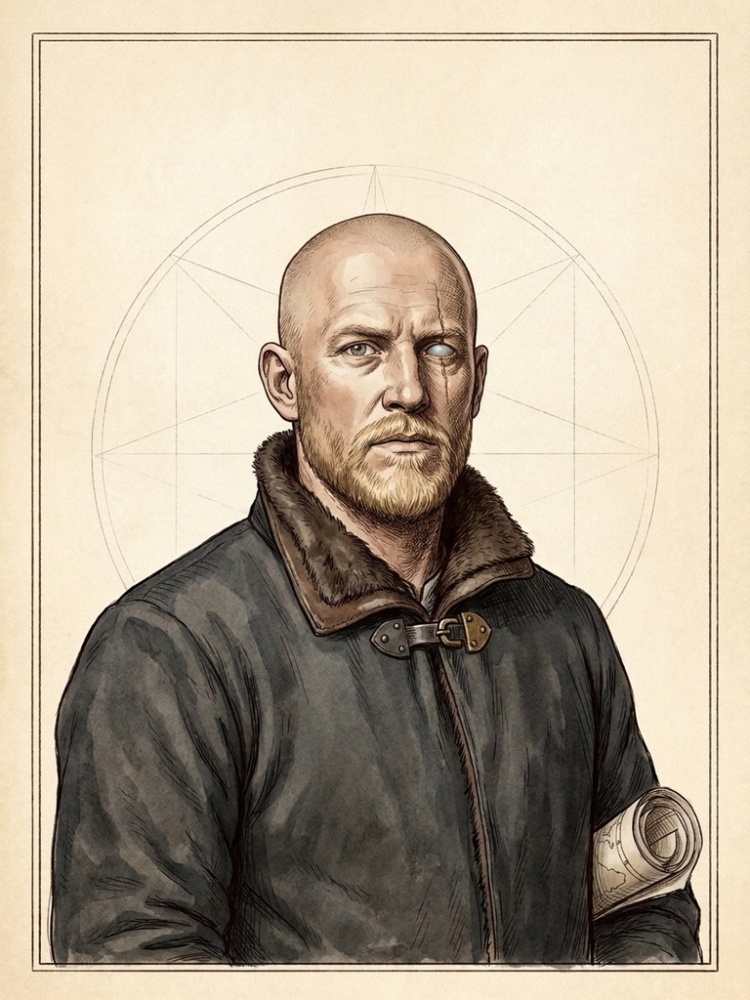

**Registro:** Nova figura ou papel nomeado. **Época:** Vivo em 418.

**Origem e presença:** Kragstad e patrulhas costeiras

**Linhagem e formação:** Casa von Kragstad; oficial de ramo secundário, não novo soberano do conselho.

**Aparência:** Corpo largo, cabeça raspada, barba loira curta, olho esquerdo coberto por película de antiga lesão.

**Personalidade e contradição:** Disciplinado, honesto em compromissos militares, limitado ao reconhecer abusos praticados sob ordens.

**Feitos e legado:** Reorganizou sinais de aviso costeiro e interceptou corsários sem destruir a embarcação civil que usavam como escudo.

**Desejo ou herança em disputa:** Demonstrar que defesa pública pode legitimar sua casa sem depender de medo indiscriminado.

**Entrada em cena e voz:** Recebe ordem para tratar contrabandistas de remédios como invasores. “Uma patrulha existe para que alguém consiga dormir.”

**Base de referência:** Criação desta edição, situada na geografia e nas instituições dos tomos II e V.

### N086 — Lorenza Falcenzo

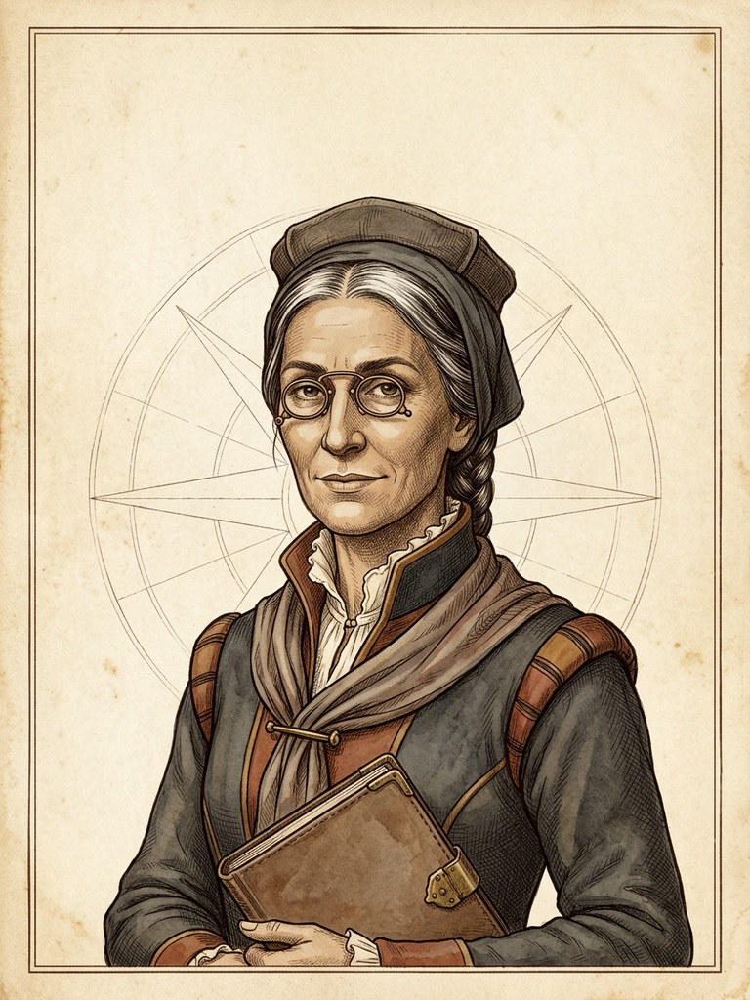

**Registro:** Nova figura ou papel nomeado. **Época:** Viva em 418.

**Origem e presença:** Biemont e crédito de salvamento

**Linhagem e formação:** Casa Falcenzo; prima de vários acionistas, sem parentesco com a médica Lorenza dei Coralli.

**Aparência:** Rosto comprido, cabelo negro entremeado de branco, postura elegante e óculos pequenos para leitura.

**Personalidade e contradição:** Encantadora, paciente, impiedosa com reincidência de fraude; usa linguagem de proteção para vender dependência.

**Feitos e legado:** Criou um fundo que permitiu a pequenos armadores dividir perdas, mas concentrou os registros de carga sob supervisão da casa.

**Desejo ou herança em disputa:** Tornar-se indispensável à reconstrução dos portos durante a crise dos recifes.

**Entrada em cena e voz:** Financia o resgate de uma tripulação desde que receba direitos excessivos sobre o próximo navio. “Ninguém é obrigado a aceitar. Apenas veja as outras ofertas.”

**Base de referência:** Criação desta edição, situada na geografia e nas instituições dos tomos II e V.

## Matas e fronteiras

### N024 — Aerwen ferch Taldor

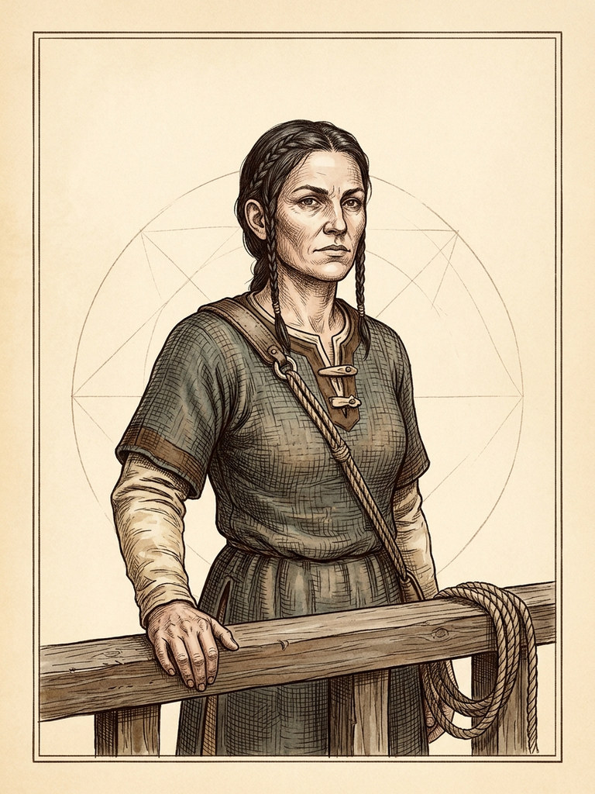

**Registro:** Anterior desenvolvido. **Época:** Viva em 418.

**Origem e presença:** Cidade Suspensa e Vergod

**Linhagem e formação:** Filha de Taldor pela forma do nome; não se identifica esse pai com toda ocorrência isolada de Taldor. Distinta de Aerwen ferch Moriel.

**Aparência:** Proposta: cabelo escuro com tranças finas, rosto anguloso, mãos calejadas por cordas; fala de pé, apoiando um pé numa travessa.

**Personalidade e contradição:** Firme, paciente com dissenso, irritável diante de tutelas estrangeiras. A conciliação não elimina sua disposição de retaliar.

**Feitos e legado:** Guardiã do Conselho das Copas; protege autonomia florestal e procura Cadwyn. Equilibra anciãos isolacionistas e vigias mais combativos.

**Desejo ou herança em disputa:** Resgatar o emissário sem sacrificar o comércio de que sua gente depende. Não quer trocar independência por idealização da floresta.

**Entrada em cena e voz:** Convida um grupo para observar uma reunião que ela não pode simplesmente comandar. “Não confunda minha palavra com a de todas as copas.”

**Base de referência:** [02_Guia_de_Cenario_Alenia.md](02_Guia_de_Cenario_Alenia.md) (linhas 122)

### N025 — Cadwyn ap Merion

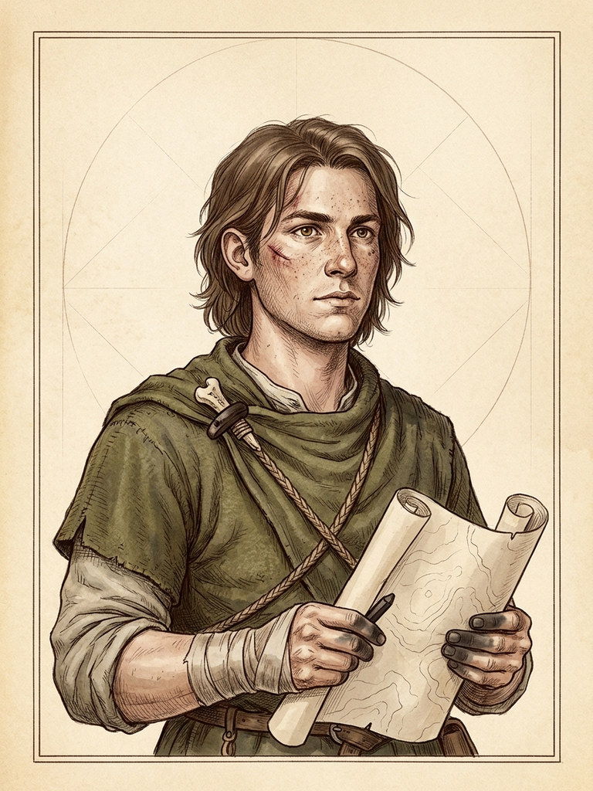

**Registro:** Anterior desenvolvido. **Época:** Vivo; desaparecido no início da campanha.

**Origem e presença:** Cidade Suspensa; investigação perto de Altrax

**Linhagem e formação:** Filho de Merion; o pai não é identificado como Merion Bruma. Não há base para o tornar herdeiro de Aerwen.

**Aparência:** Proposta: jovem adulto, cabelo castanho comprido, rosto sardento, dedos sujos de carvão de mapas; ferido durante o cativeiro.

**Personalidade e contradição:** Curioso, corajoso, pouco prudente quando acredita ter encontrado prova decisiva. Aprende depressa, mas custa-lhe pedir ajuda.

**Feitos e legado:** Mapeou prospecção ilegal, reuniu documentos e foi capturado; a aventura o mantém vivo na Torre de Specula. Libertação e retorno não são feitos já realizados.

**Desejo ou herança em disputa:** Levar provas ao Conselho e impedir que a fraude vire guerra. O medo do cativeiro afeta seu comportamento sem anular sua capacidade.

**Entrada em cena e voz:** Após resgate, corrige um detalhe que enfraquece a versão dos próprios aliados. “Se o mapa mentir por nós, eles venceram.”

**Base de referência:** [02_Guia_de_Cenario_Alenia.md](02_Guia_de_Cenario_Alenia.md) (linhas 22); [05_Onomastica_e_Toponimia_Alenia.md](05_Onomastica_e_Toponimia_Alenia.md) (linhas 44); [07_Aventura_Inicial_Cinzas_no_Estuario.md](07_Aventura_Inicial_Cinzas_no_Estuario.md) (linhas 15, 51, 65); [11_Cronica_das_Terras_e_das_Mares.md](11_Cronica_das_Terras_e_das_Mares.md) (linhas 862, 1096)

### N051 — Aerwen ferch Moriel

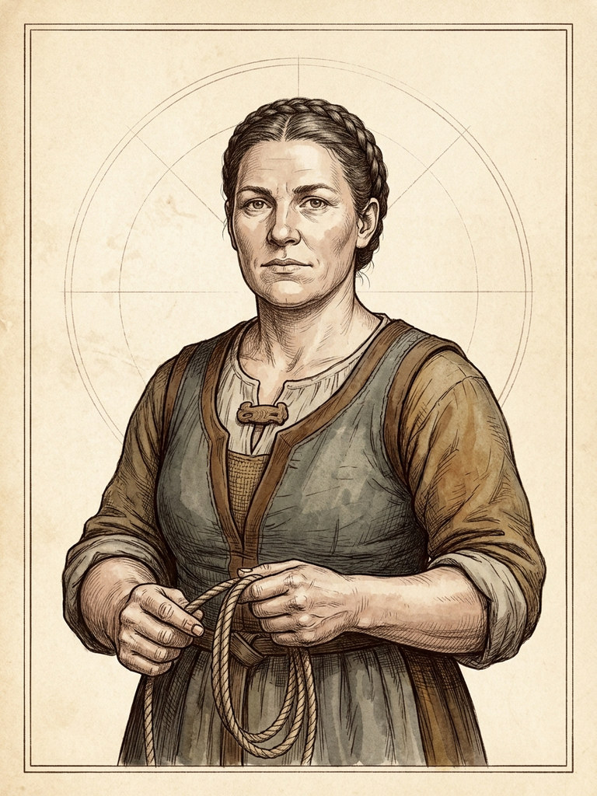

**Registro:** Nome-modelo desenvolvido. **Época:** Viva em 418; biografia nova.

**Origem e presença:** Cidade Suspensa; manutenção de calhas

**Linhagem e formação:** Filha de Moriel; distinta da guardiã Aerwen ferch Taldor. Sua família transmite ofícios, não um cargo hereditário no Conselho.

**Aparência:** Rosto largo, cabelo trançado rente, braços fortes e várias unhas quebradas.

**Personalidade e contradição:** Franca, prática, pouco impressionável por visitantes; teme alturas novas, mas confia nas estruturas que conhece.

**Feitos e legado:** Reparou calhas durante uma estiagem e convenceu dois ramos rivais a compartilhar reservas; ensina inspeção de cordas às crianças maiores.

**Desejo ou herança em disputa:** Conseguir madeira de reposição sem ampliar o corte em área protegida.

**Entrada em cena e voz:** Uma sabotagem parece falha comum e ameaça sua reputação. “Água não sobe porque um ancião mandou.”

**Base de referência:** [05_Onomastica_e_Toponimia_Alenia.md](05_Onomastica_e_Toponimia_Alenia.md) (linhas 44)

### N052 — Merion Bruma

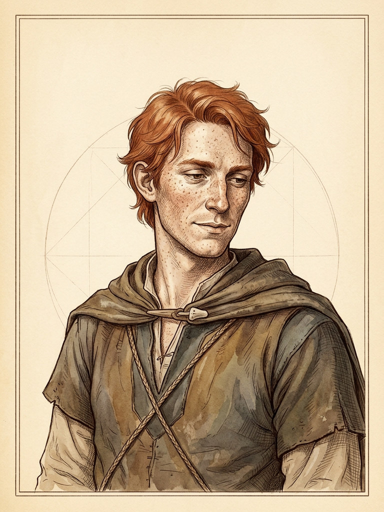

**Registro:** Nome-modelo desenvolvido. **Época:** Vivo em 418; biografia nova.

**Origem e presença:** Vergod e trilhas das matas

**Linhagem e formação:** Bastardo silvano; não é identificado como o pai de Cadwyn. Criado entre parentes maternos coletores.

**Aparência:** Magro, pele muito sardenta, cabelo avermelhado e olhar atento aos pés de quem fala.

**Personalidade e contradição:** Sociável entre viajantes, reservado sobre lugares sagrados, propenso a prometer um atalho antes de calcular o custo.

**Feitos e legado:** Conduziu famílias por uma rota alternativa durante bloqueio de estrada; conhece casas que acolhem estrangeiros sem notificar coletores de tributos.

**Desejo ou herança em disputa:** Viver de guiar sem transformar a floresta em mercadoria de seus clientes.

**Entrada em cena e voz:** Um explorador quer comprar exclusividade sobre um caminho usado por aldeões. “Posso mostrar a passagem. Não posso vendê-la.”

**Base de referência:** [05_Onomastica_e_Toponimia_Alenia.md](05_Onomastica_e_Toponimia_Alenia.md) (linhas 45)

### N072 — Aerdor Gwaedlyn

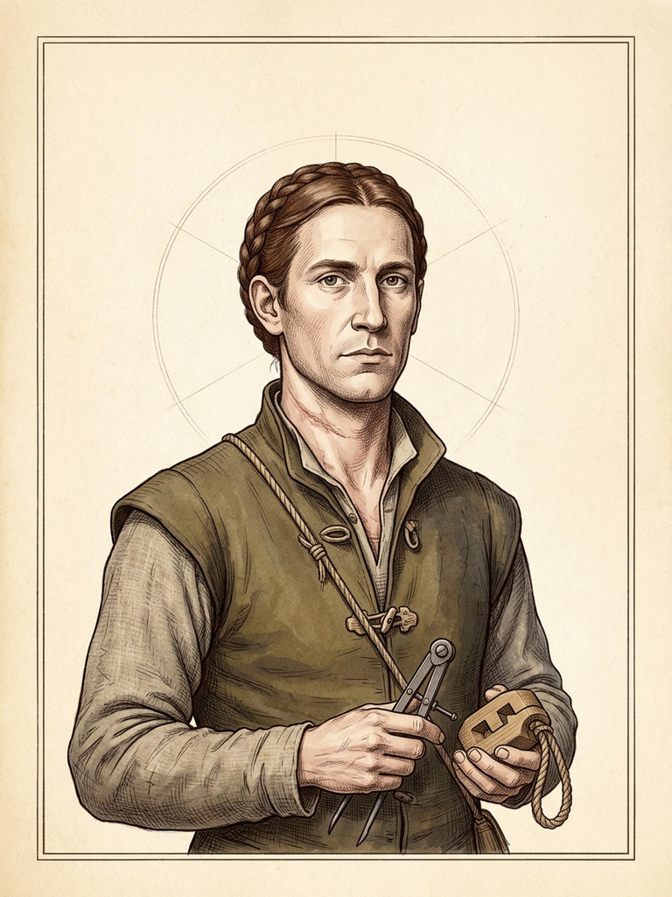

**Registro:** Nova figura ou papel nomeado. **Época:** Vivo em 418.

**Origem e presença:** Cidade Suspensa e clareiras protegidas

**Linhagem e formação:** Linhagem Gwaedlyn; adotado por parentes após perda dos pais num incêndio local, evento novo sem vínculo obrigatório com a Sombra.

**Aparência:** Alto, cabelo castanho trançado, rosto comprido; uma queimadura discreta atravessa o pescoço.

**Personalidade e contradição:** Sereno no trabalho, rígido com descuidos, desconfiado de governantes que chamam prevenção de luxo.

**Feitos e legado:** Projetou sequência de pontes destacáveis testada num incêndio de oficina e formou equipes de manutenção entre ramos antes rivais.

**Desejo ou herança em disputa:** Evitar que a militarização do Conselho consuma o tempo e o material necessários à proteção da cidade.

**Entrada em cena e voz:** Um corte suspeito pode ser sabotagem ou manutenção negligente; a diferença decidirá se haverá retaliação. “Uma ponte salva porque pode ser solta a tempo.”

**Base de referência:** Criação desta edição, situada na geografia e nas instituições dos tomos II e V.

### N073 — Gwenlin ferch Nerys

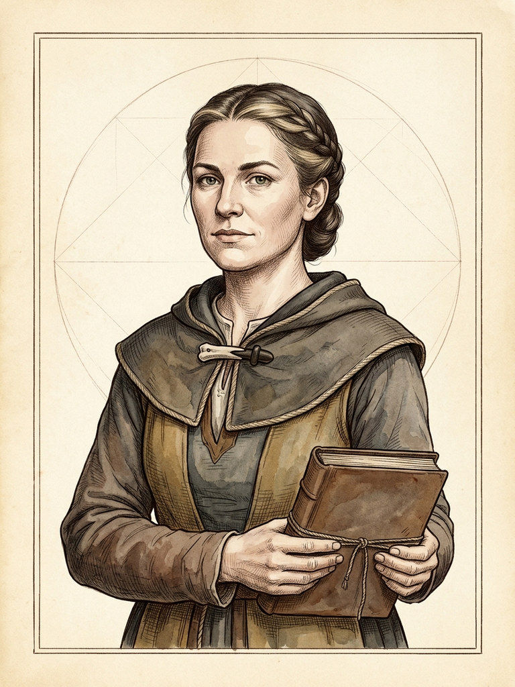

**Registro:** Nova figura ou papel nomeado. **Época:** Viva em 418.

**Origem e presença:** Vergod; comércio de fronteira

**Linhagem e formação:** Filha de Nerys, tecelã; família silvana com parceiros comerciais aurorianos, sem título hereditário.

**Aparência:** Cabelo escuro com mechas claras, rosto largo e olhos verdes; usa roupas de ambas as margens.

**Personalidade e contradição:** Perspicaz, conciliadora, avessa a discursos de pureza; teme ser considerada estrangeira por todos.

**Feitos e legado:** Mantém um registro bilíngue de entregas que solucionou disputas de sal e ferramentas. Financiou a formação de dois intérpretes que não dependem de um só senhor.

**Desejo ou herança em disputa:** Preservar Vergod aberto sem aceitar mineração ilegal como preço do comércio.

**Entrada em cena e voz:** Encontra duas traduções de uma cláusula com obrigações incompatíveis. “A palavra que parece pequena é a que leva a carroça inteira.”

**Base de referência:** Criação desta edição, situada na geografia e nas instituições dos tomos II e V.

### N074 — Rhianeth Cleddwen

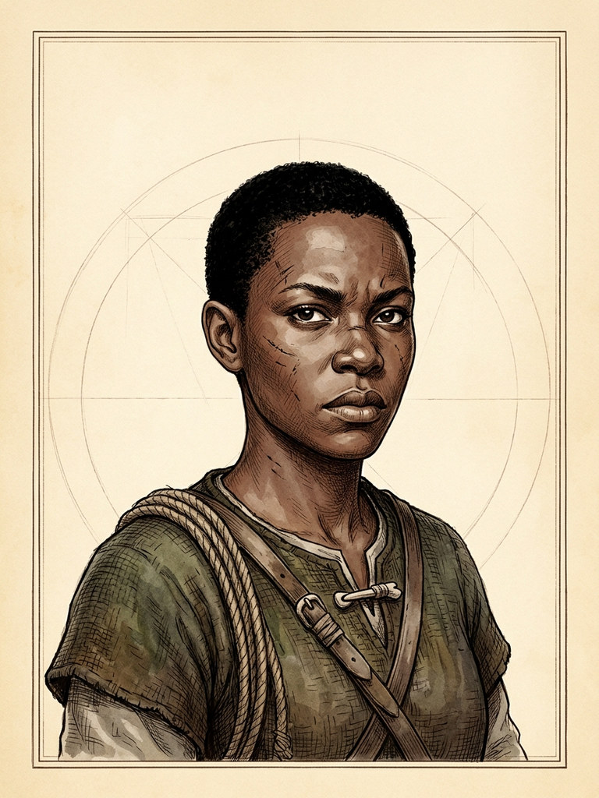

**Registro:** Nova figura ou papel nomeado. **Época:** Viva em 418.

**Origem e presença:** Matas a nordeste de Aurora

**Linhagem e formação:** Linhagem Cleddwen; irmã mais velha de dois vigias, parentes novos sem participação fixada nas crises.

**Aparência:** Ágil, cabelo preto curto, nariz achatado por uma fratura, pele escura com pequenas marcas de galhos.

**Personalidade e contradição:** Impaciente, franca, leal a colegas; confunde tolerância política com desprezo pelas vítimas.

**Feitos e legado:** Localizou marcas recentes de prospecção e retirou uma equipe de coletores de uma área ocupada por homens armados. Ganhou voz entre vigias jovens.

**Desejo ou herança em disputa:** Forçar resposta antes que os marcos clandestinos se tornem concessões oficiais. Pode entrar em choque com Aerwen sem desejar sua deposição.

**Entrada em cena e voz:** Quer interceptar uma caravana cuja carga ainda não foi examinada. “Esperar também é uma decisão. Só não é você quem paga sempre.”

**Base de referência:** Criação desta edição, situada na geografia e nas instituições dos tomos II e V.

### N075 — Finlas Brancaden

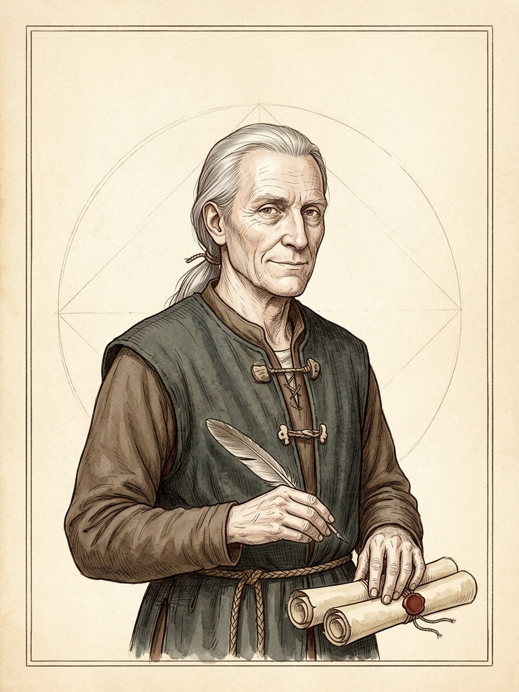

**Registro:** Nova figura ou papel nomeado. **Época:** Vivo em 418.

**Origem e presença:** Vergod e aldeias de margem

**Linhagem e formação:** Clã Brancaden; família tradicional de intérpretes, sem direito de falar por todos os silvanos.

**Aparência:** Idoso, pele muito clara, cabelo comprido preso, tremor leve ao escrever.

**Personalidade e contradição:** Paciente, irônico, extraordinariamente bom em lembrar concessões; usa precedentes para evitar mudanças que também teme.

**Feitos e legado:** Reuniu cópias divergentes do Tratado de Vergod e demonstrou que um marco de fronteira havia sido deslocado, obtendo recuo de fiscais.

**Desejo ou herança em disputa:** Preparar uma sucessora que possa questionar suas próprias leituras, embora lhe custe perder autoridade.

**Entrada em cena e voz:** Uma cláusula protege moradores que ele pessoalmente despreza. “Um tratado que vale só para os amigos é uma lista de favores.”

**Base de referência:** Criação desta edição, situada na geografia e nas instituições dos tomos II e V.

### N077 — Tsunari Kose

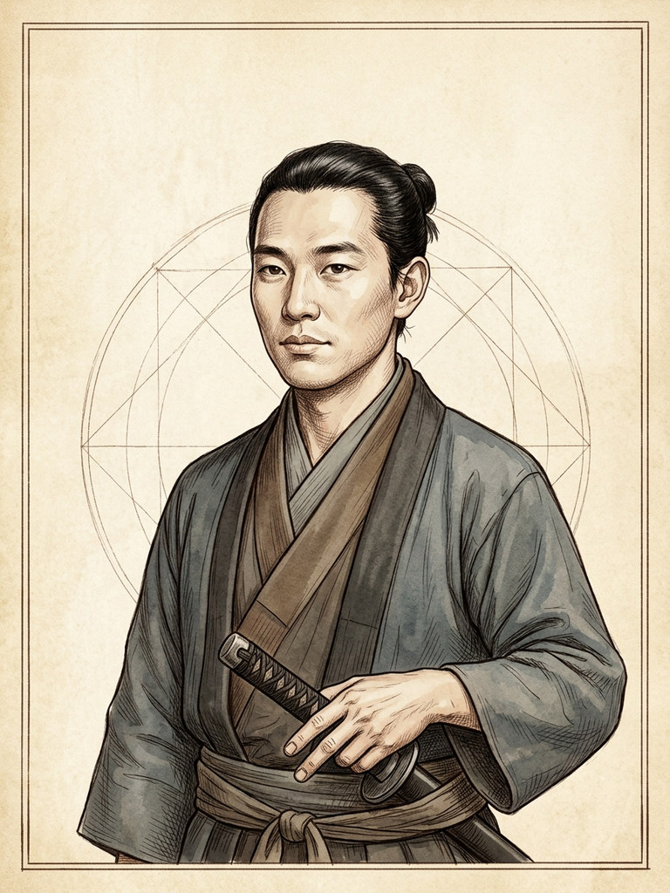

**Registro:** Nova figura ou papel nomeado. **Época:** Vivo em 418.

**Origem e presença:** Yõketsu; escola costeira de esgrima

**Linhagem e formação:** Família de instrutores e barqueiros do enclave; grafia proposta dentro da fonética própria de Yõketsu.

**Aparência:** Estatura baixa, cabelo negro preso, rosto suave, duas falanges rígidas; movimentos econômicos.

**Personalidade e contradição:** Paciente, reservado, competitivo em segredo; recusa confundir talento com licença para humilhar.

**Feitos e legado:** Tornou célebre uma escola que ensina a lutar em convés estreito e venceu um duelo encerrando-o sem matar o adversário rendido.

**Desejo ou herança em disputa:** Manter alunos independentes de casas que querem comprar exclusividade militar.

**Entrada em cena e voz:** Um antigo aluno usa a escola para justificar violência contra trabalhadores de porto. “Sua técnica é minha responsabilidade; sua vaidade, ainda é sua.”

**Base de referência:** Criação desta edição, situada na geografia e nas instituições dos tomos II e V.

## Mares e exploração

### N037 — Sandro Corvella

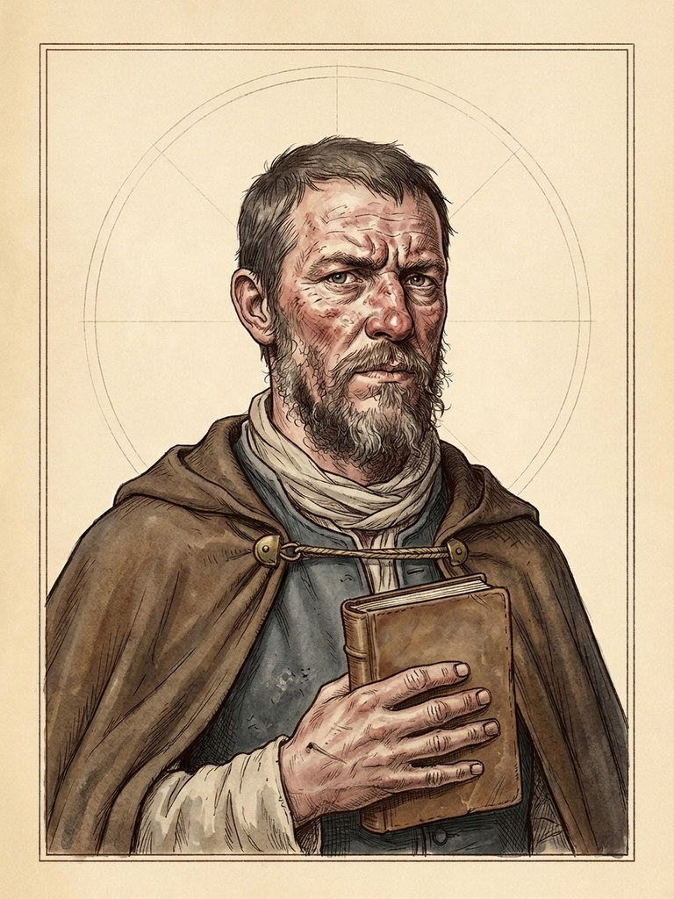

**Registro:** Anterior desenvolvido. **Época:** Histórico; sobrevivente da expedição de 312; destino posterior aberto.

**Origem e presença:** Corallis e Mar das Cinzas

**Linhagem e formação:** Casa Corvella; posição sucessória e familiares não definidos.

**Aparência:** Proposta: rosto queimado de frio, barba irregular, dois dedos rígidos; a descrição refere-se ao retorno, não ao início da carreira.

**Personalidade e contradição:** Obstinado, bom comandante antes do desastre, marcado por culpa e desconfiança depois dele.

**Feitos e legado:** Único sobrevivente dos três navios enviados secretamente a Incognito em 312; deixou diário incompleto. Sobreviveu à expedição, não necessariamente até 418.

**Desejo ou herança em disputa:** Legado: seu relato vale como testemunho limitado, não mapa completo ou prova de todas as hipóteses do norte.

**Entrada em cena e voz:** Uma página perdida descreve uma decisão humana terrível entre fenômenos que ele não compreendia. “Não desenhe um porto onde eu só consegui não morrer.”

**Base de referência:** [08_Acervo_Oculto_de_Sellene.md](08_Acervo_Oculto_de_Sellene.md) (linhas 64, 66, 71); [11_Cronica_das_Terras_e_das_Mares.md](11_Cronica_das_Terras_e_das_Mares.md) (linhas 1053)

### N044 — Benetta de Litore

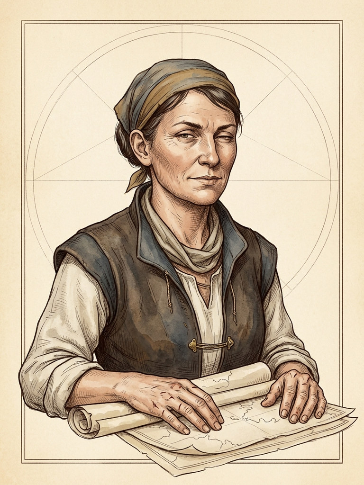

**Registro:** Anterior desenvolvido. **Época:** Proposta desta edição: viva em 418; idade adulta.

**Origem e presença:** Cais de Litore; cartografia de Corallis

**Linhagem e formação:** Família de trabalhadores do cais proposta; parentes sem nome. Sua existência como cartógrafa já aparece na Crônica, não sua biografia completa.

**Aparência:** Proposta: pele marcada de sol, cabelo curto preso por lenço, um olho ligeiramente mais fechado, dedos cheios de pequenos cortes de papel.

**Personalidade e contradição:** Irônica, cuidadosa com fontes, desconfiada de monumentos que apagam moradores antigos. Escuta barqueiros antes de copiar mapas oficiais.

**Feitos e legado:** Recebe atribuição da nota sobre cidades anteriores às estátuas reais. Expansão: comparou três plantas de um mesmo porto e recuperou um antigo acesso público omitido por um armazém.

**Desejo ou herança em disputa:** Fazer mapas que registrem também quem paga pelo caminho e quem já vivia ali.

**Entrada em cena e voz:** Um patrono pede que retire uma aldeia do desenho para facilitar uma concessão. “Uma margem em branco costuma ter dono esperando.”

**Base de referência:** [11_Cronica_das_Terras_e_das_Mares.md](11_Cronica_das_Terras_e_das_Mares.md) (linhas 7)

### N054 — Loreo Cartógrafo

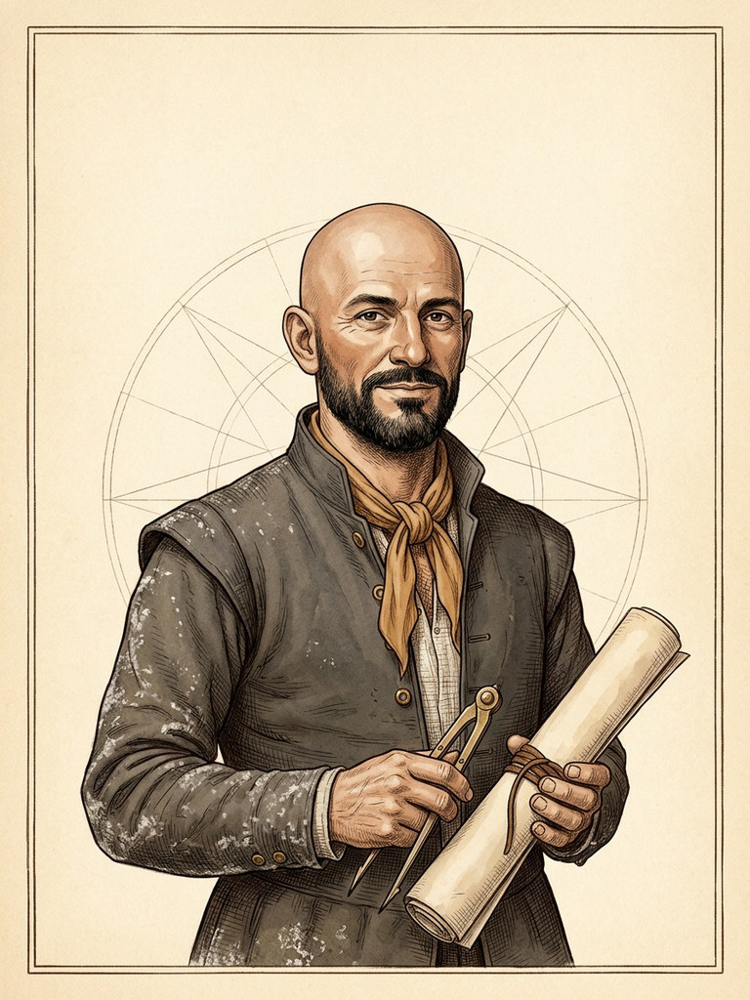

**Registro:** Nome-modelo desenvolvido. **Época:** Vivo em 418; biografia nova.

**Origem e presença:** Alineus e rotas comerciais de Corallis

**Linhagem e formação:** Sobrenome de ofício; distinto de Benetta e dos outros Loreo. Filho de fabricante de cabos e copista de fretes.

**Aparência:** Calvo, barba negra aparada, olhos pequenos, roupas com manchas de água salgada.

**Personalidade e contradição:** Ambicioso, organizado, cordial com patronos; aceita simplificar excessivamente um mapa para vendê-lo.

**Feitos e legado:** Compilou um atlas de portos de cabotagem e padronizou símbolos de ancoragem usados por pequenos armadores. Depende de informações de pilotos que nem sempre credita bem.

**Desejo ou herança em disputa:** Obter contrato da Liga sem admitir quantos dados vieram de navegantes independentes.

**Entrada em cena e voz:** Benetta contesta uma costa copiada; ele precisa dos personagens para verificar o erro. “Um mapa que ninguém compra não leva ninguém a lugar algum.”

**Base de referência:** [05_Onomastica_e_Toponimia_Alenia.md](05_Onomastica_e_Toponimia_Alenia.md) (linhas 61)

### N056 — Vittiora dei Coralli

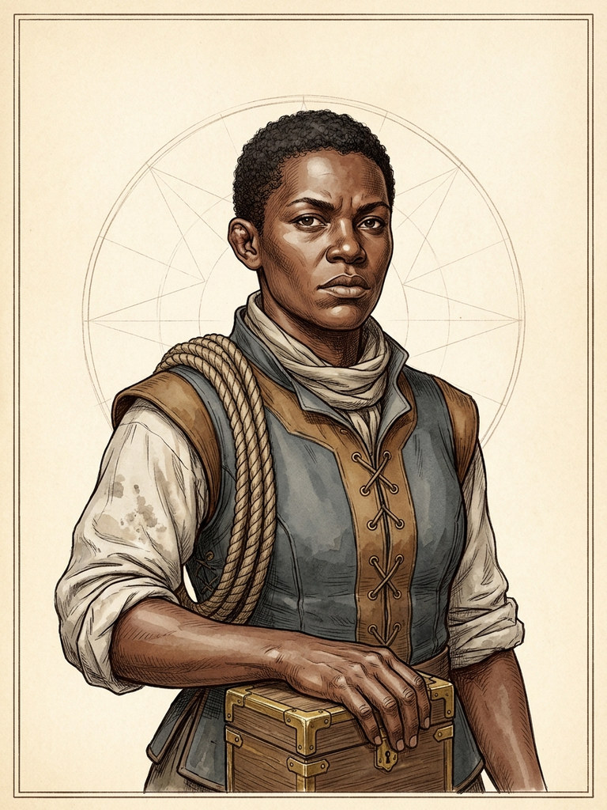

**Registro:** Nome-modelo desenvolvido. **Época:** Viva em 418; biografia nova.

**Origem e presença:** Baldbella; Atol das Pérolas

**Linhagem e formação:** Família de mergulhadores; não se estabelece parentesco com Lorenza apesar do sobrenome.

**Aparência:** Pele escura, ombros fortes, cabelo muito curto e uma orelha deformada; fala pausadamente depois de esforço.

**Personalidade e contradição:** Corajosa, competitiva, protetora de iniciantes; detesta quando um armador vende sua coragem como garantia de resgate.

**Feitos e legado:** Recuperou uma caixa de registros de um casco instável e interrompeu mergulho lucrativo para retirar um aprendiz preso.

**Desejo ou herança em disputa:** Garantir participação dos mergulhadores nas decisões de salvamento.

**Entrada em cena e voz:** Conhece a entrada de um naufrágio, mas recusa missão enquanto uma equipe desaparecida não for procurada. “O casco pode esperar. Um companheiro, não.”

**Base de referência:** [05_Onomastica_e_Toponimia_Alenia.md](05_Onomastica_e_Toponimia_Alenia.md) (linhas 61)

### N060 — Tarash Duna

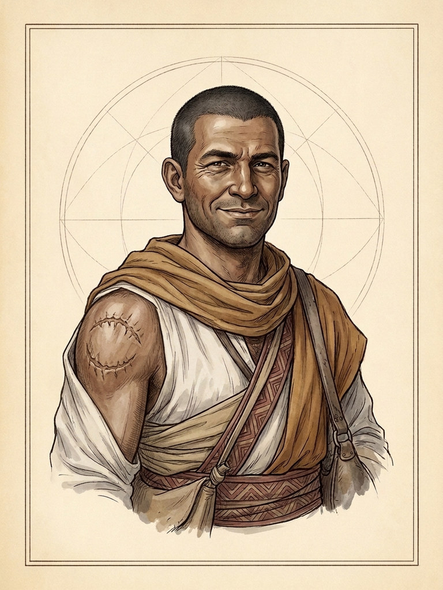

**Registro:** Nome-modelo desenvolvido. **Época:** Vivo em 418; biografia nova.

**Origem e presença:** Estepes de Gaddra e OX

**Linhagem e formação:** Bastardo gaddrani; criado por tratadores de montarias. Não é o pai de Qasir ibn Tarash.

**Aparência:** Corpo baixo e resistente, cabelos escuros muito curtos, cicatriz de mordida no ombro.

**Personalidade e contradição:** Brincalhão, leal aos animais, cético diante de linhagens; reage mal a quem chama prudência de covardia.

**Feitos e legado:** Guiou uma escolta perdida de volta a um poço e se tornou conhecido por recusar travessias inviáveis, mesmo sob ameaça de perder o contrato.

**Desejo ou herança em disputa:** Formar jovens guias que possam cobrar por decisão técnica, não por submissão.

**Entrada em cena e voz:** Um nobre exige avançar para salvar o prestígio de uma expedição. “A areia não fica mais curta porque você está com pressa.”

**Base de referência:** [05_Onomastica_e_Toponimia_Alenia.md](05_Onomastica_e_Toponimia_Alenia.md) (linhas 79)

### N078 — Aya Tsurin

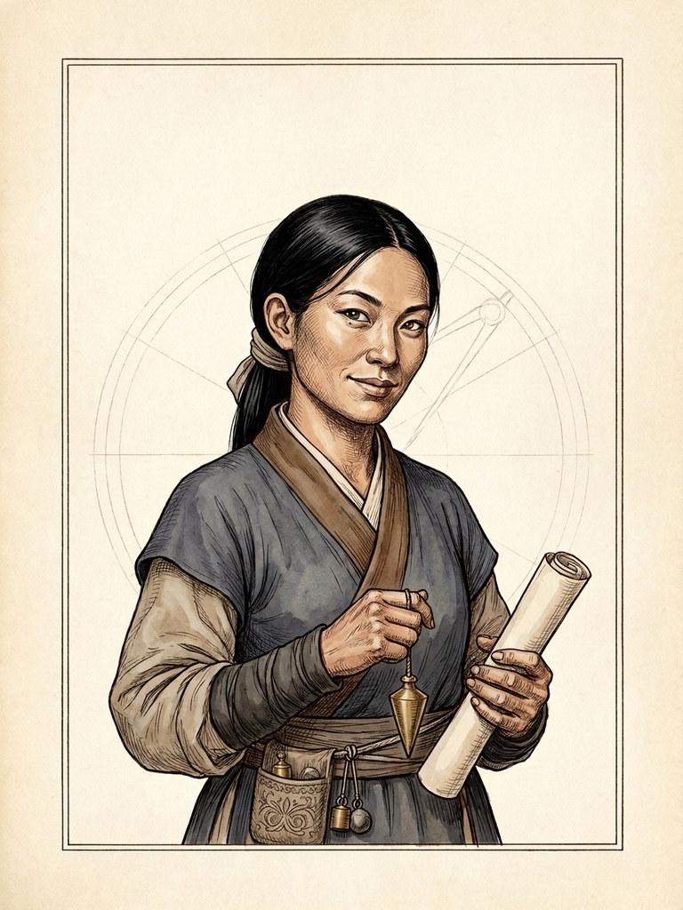

**Registro:** Nova figura ou papel nomeado. **Época:** Viva em 418.

**Origem e presença:** Yõketsu e travessias orientais

**Linhagem e formação:** Filha de pilotos costeiros; família preserva nomes antigos sem reivindicar autoridade sobre todo o enclave.

**Aparência:** Cabelo preto muito liso, pele curtida, um olho com pequena mancha clara; leva pesos de medição em bolso bordado.

**Personalidade e contradição:** Curiosa, cética, alegre em viagem e inquieta em terra; detesta mapas que ocultam quem forneceu os dados.

**Feitos e legado:** Comparou registros de vento de várias tripulações e corrigiu uma janela sazonal de travessia, reduzindo partidas inviáveis de pequenos barcos.

**Desejo ou herança em disputa:** Reunir cartas familiares sem permitir que um armador monopolize as passagens.

**Entrada em cena e voz:** Uma carta antiga sugere uma costa fora de Alenia, mas não oferece rota segura. “O horizonte não assina garantia.”

**Base de referência:** Criação desta edição, situada na geografia e nas instituições dos tomos II e V.

### N090 — Elira dos Remos

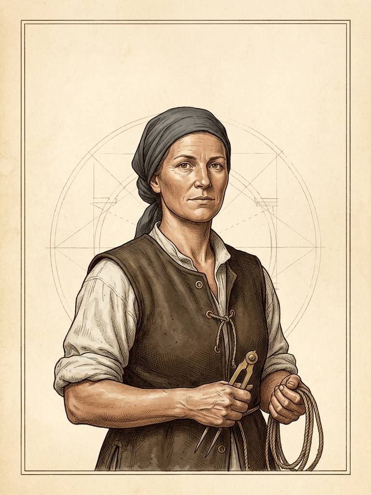

**Registro:** Nova figura ou papel nomeado. **Época:** Histórica proposta; ativa em 147.

**Origem e presença:** Pelagosa e costa de Claramar

**Linhagem e formação:** Família de pilotos de pesca; não fundadora exclusiva do porto nem inventora de todas as rotas.

**Aparência:** Tradição visual: mulher de braços fortes, rosto curtido, cabelo preso num lenço escuro; retrato sem verificação contemporânea.

**Personalidade e contradição:** Nas memórias propostas, paciente na instrução e implacável contra bravatas; valorizava retorno da tripulação mais que recordes.

**Feitos e legado:** Participou das observações locais que ajudaram a ajustar sinais do farol de Claramar na época de sua consolidação. Seu nome preserva o trabalho de pilotos eclipsado por financiadores.

**Desejo ou herança em disputa:** Legado: sinais úteis nascem de experiência de mar, não apenas de torres elevadas.

**Entrada em cena e voz:** Uma marca antiga atribuída a ela está deslocada num mapa moderno. “A luz é para quem chega, não para quem olha da varanda.”

**Base de referência:** Criação desta edição, situada na geografia e nas instituições dos tomos II e V.

## Fé e conhecimento

### N019 — Aemilius de Pontáuria

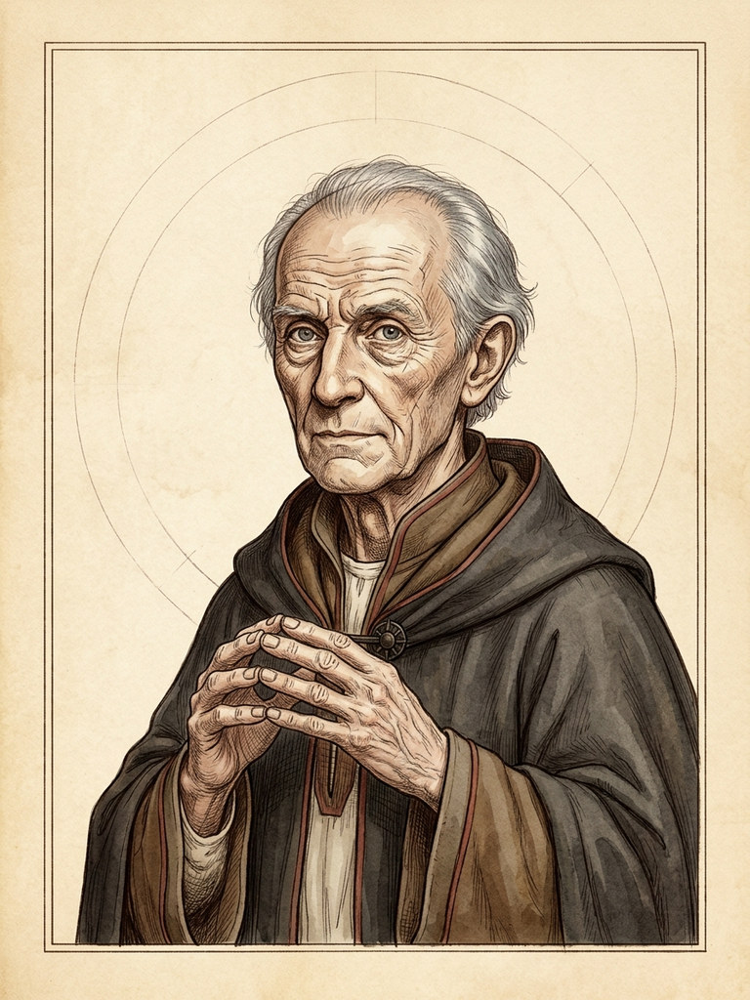

**Registro:** Anterior desenvolvido. **Época:** Vivo e idoso em 418.

**Origem e presença:** Pontáuria; Grande Catedral de Altavanne

**Linhagem e formação:** Primo de Valen, da Casa de Pontáuria; relação com Sabina deriva desse vínculo, sem grau adicional especificado. Não é Aemilius IV.

**Aparência:** Proposta: pequeno, mãos trêmulas, olhos vivos e voz baixa que obriga a sala a se calar.

**Personalidade e contradição:** Pragmático, paciente, atento a compromissos irreversíveis; teme a violência de seus próprios radicais mais do que admite.

**Feitos e legado:** Alto Luminar da Chama Solar, pressionado a abençoar um sucessor. Mantém o assento consultivo junto ao Conselho; não dispõe do voto militar dos seis ofícios.

**Desejo ou herança em disputa:** Impedir que a Igreja se torne apenas selo de uma vitória política. Também precisa preservar unidade entre ordens com prioridades incompatíveis.

**Entrada em cena e voz:** Concede asilo a alguém que Valen tem motivos legais para interrogar. “A bênção não devolve o sangue derramado para consegui-la.”

**Base de referência:** [02_Guia_de_Cenario_Alenia.md](02_Guia_de_Cenario_Alenia.md) (linhas 225)

### N031 — Matteo dal Pelago

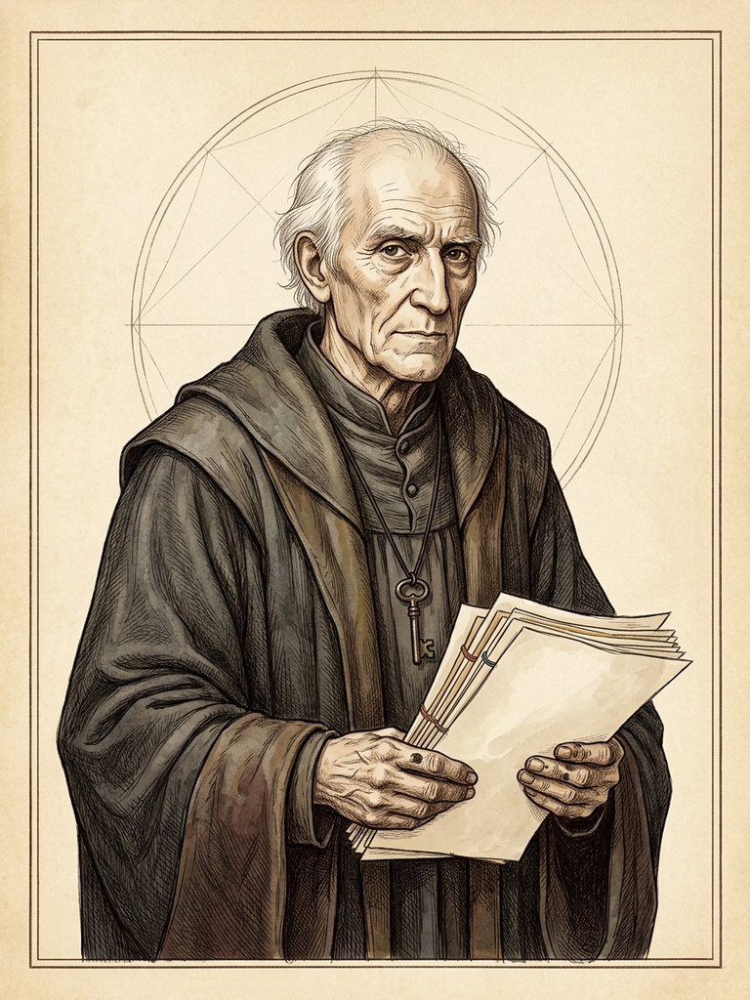

**Registro:** Anterior desenvolvido. **Época:** Vivo e ancião em 418.

**Origem e presença:** Academia de Sellene

**Linhagem e formação:** Casa dal Pelago; parentes imediatos não estabelecidos. Sua posição acadêmica não o torna soberano de Corallis.

**Aparência:** Proposta: alto e curvado, cabelo branco ralo, olhos fundos, voz cuidadosa; carrega folhas separadas por fios coloridos.

**Personalidade e contradição:** Erudito, reservado, paternal com estudiosos e autoritário sobre riscos. Pode confundir proteção do saber com monopólio.

**Feitos e legado:** Arquimestre e guardião da Chave da Maré; responde ao Alto Rei pelo Acervo. Enviou relatório cifrado sobre Despertos e possui poder sobre o protocolo de destruição.

**Desejo ou herança em disputa:** Preservar conhecimento sem entregá-lo a quem o usará para dominar o mundo. A clausura dos copistas é parte do custo moral de sua instituição.

**Entrada em cena e voz:** Uma evacuação permite salvar apenas parte do acervo; ele pede prioridades, não bravatas. “Escolha o livro que não pode ser reescrito.”

**Base de referência:** [08_Acervo_Oculto_de_Sellene.md](08_Acervo_Oculto_de_Sellene.md) (linhas 16); [11_Cronica_das_Terras_e_das_Mares.md](11_Cronica_das_Terras_e_das_Mares.md) (papel antes anônimo)

### N032 — Loreo Seleni

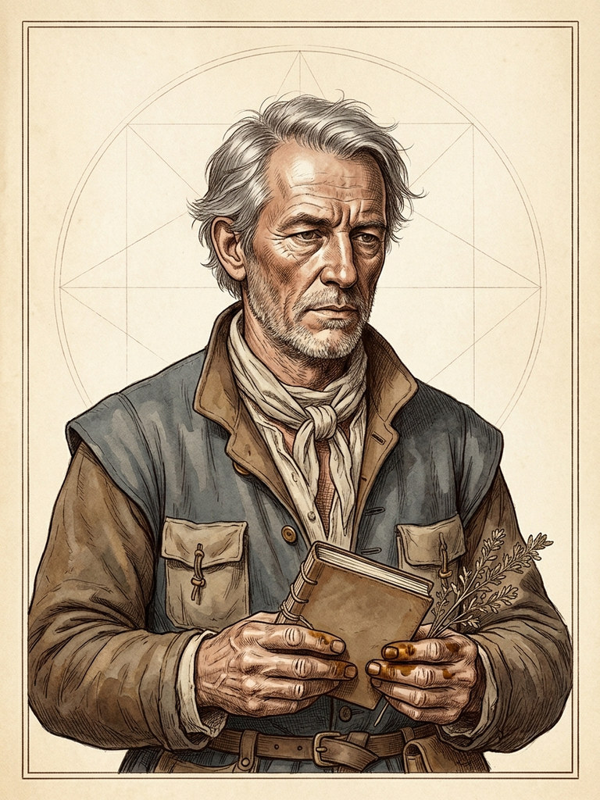

**Registro:** Anterior desenvolvido. **Época:** Vivo; cerca de sessenta anos em 418.

**Origem e presença:** Canais de Baldbella; correspondente de Sellene

**Linhagem e formação:** Filho de vendedora de ervas e encadernador, ambos sem nome no texto-base. Nenhum parentesco com Lorenzo Seleni é comprovado.

**Aparência:** Dedos manchados de tinta e resina. Acrescenta-se barba rala grisalha, roupas com bolsos para amostras e olhar que se detém nas mãos alheias.

**Personalidade e contradição:** Reservado diante de autoridades, incansável ao interrogar trabalhadores; disposto a publicar dúvidas e a proteger locais de coleta.

**Feitos e legado:** Compilou o herbário de 64 espécies, comparou nomes regionais e métodos de conservação; organizava cadernos em 399. Não descobriu sozinho todas as plantas nem visitou pessoalmente todo o norte.

**Desejo ou herança em disputa:** Ampliar acesso de hospitais a cópias confiáveis sem explorar comunidades fornecedoras.

**Entrada em cena e voz:** Recusa vender uma localização rara, mas oferece ajudar no cultivo. “Quem lhe contou isso viu a planta ou viu a margem de lucro?”

**Base de referência:** [10_Herbario_de_Seleni.md](10_Herbario_de_Seleni.md) (linhas 7, 13, 17, 972); [11_Cronica_das_Terras_e_das_Mares.md](11_Cronica_das_Terras_e_das_Mares.md) (linhas 762, 1067)

### N033 — Lorenzo Seleni

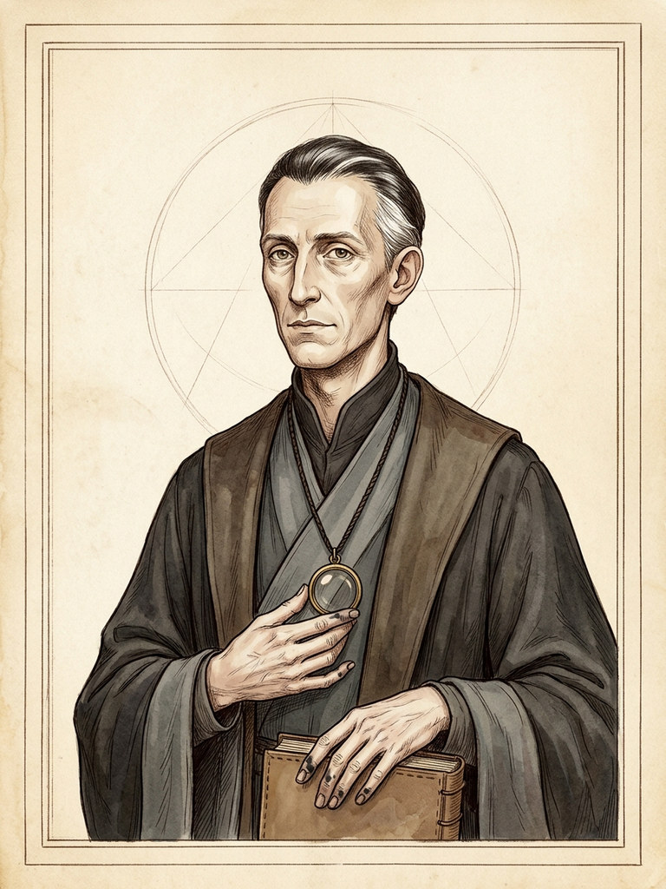

**Registro:** Anterior desenvolvido. **Época:** Histórico; ativo em 356; destino posterior aberto.

**Origem e presença:** Sellene; participou de trabalhos em Aurora

**Linhagem e formação:** Sobrenome Seleni sem parentesco demonstrado com Loreo. Distinto de Lorenzo de Sellene.

**Aparência:** Retrato proposto: rosto alongado, cabelo branco nas têmporas, mãos delicadas e lente presa por cordão.

**Personalidade e contradição:** Minucioso, frio na escrita e impressionável diante de evidência que muda uma hipótese antiga. Separava descrição de explicação.

**Feitos e legado:** Coautor com Orlan da autópsia da Sombra em 356. Reconheceu a natureza não humana dos ferimentos antigos sem estabelecer definitivamente o que os causara.

**Desejo ou herança em disputa:** Legado: um relatório pode limitar propaganda sem responder ao mistério. Não se lhe atribui a fundação da Academia em 204.

**Entrada em cena e voz:** Uma nota marginal distingue observação de hipótese, mas uma cópia política apagou essa distinção. “A ferida existe; sua causa ainda não.”

**Base de referência:** [08_Acervo_Oculto_de_Sellene.md](08_Acervo_Oculto_de_Sellene.md) (linhas 43); [11_Cronica_das_Terras_e_das_Mares.md](11_Cronica_das_Terras_e_das_Mares.md) (linhas 1055, 1067)

### N034 — Lorenzo de Sellene

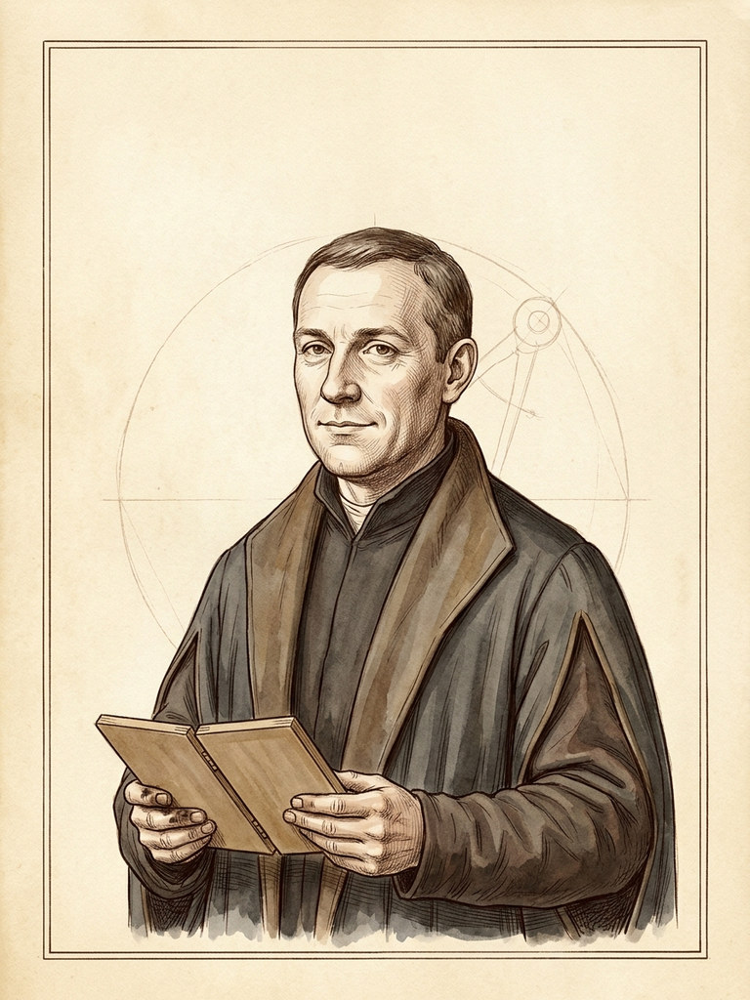

**Registro:** Anterior desenvolvido. **Época:** Histórico; época exata não fixada.

**Origem e presença:** Tradição institucional de Sellene

**Linhagem e formação:** Conhecido por designação locativa; família desconhecida. Não se funde com Lorenzo Seleni nem com Loreo.

**Aparência:** Iconografia proposta: estudioso sem barba, manto curto e tabuletas nas mãos. É imagem comemorativa, não retrato verificado.

**Personalidade e contradição:** A tradição o apresenta como agregador e paciente; a personalidade histórica permanece incerta. Em cenas documentais, autores rivais lhe atribuem virtudes diferentes.

**Feitos e legado:** Citado no Herbário como fundador histórico. O Tomo XI deixa em aberto sua relação com a fundação de 204; não se inventam datas de vida para eliminar a dúvida.

**Desejo ou herança em disputa:** Legado: quem pode reivindicar a origem de uma instituição feita por muitas pessoas?

**Entrada em cena e voz:** Dois selos fundacionais usam o mesmo nome em épocas diferentes. A aventura investiga se designam pessoa, homenagem ou título. “Uma escola começa quando o conhecimento deixa de morrer com o mestre”, frase apócrifa.

**Base de referência:** [10_Herbario_de_Seleni.md](10_Herbario_de_Seleni.md) (linhas 17); [11_Cronica_das_Terras_e_das_Mares.md](11_Cronica_das_Terras_e_das_Mares.md) (linhas 1067)

### N035 — Lorenza dei Coralli

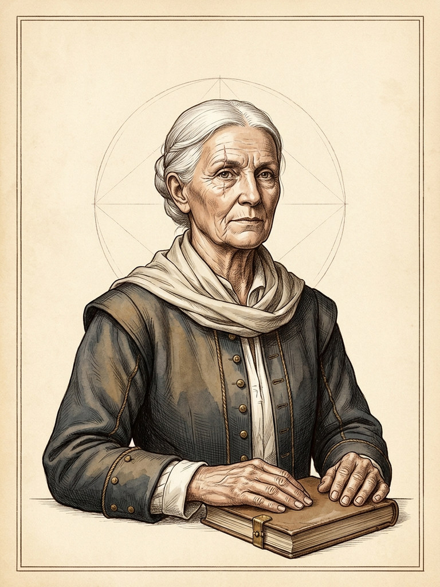

**Registro:** Anterior desenvolvido. **Época:** Viva em 417–418; cirurgiã-chefe aposentada.

**Origem e presença:** Baldbella; pesquisa reservada ligada a Sellene

**Linhagem e formação:** Família dei Coralli; não há parentesco estabelecido com Vittiora. Nesta edição, continuam sem vínculo biológico definido.

**Aparência:** Proposta: idosa, costas retas, cabelos brancos presos, cicatriz fina numa sobrancelha; unhas limpas e curtas.

**Personalidade e contradição:** Precisa, compassiva sem sentimentalismo, exige consentimento sempre que a situação permite; irrita-se com autoridades que pedem diagnóstico conveniente.

**Feitos e legado:** Escreveu tratado reservado sobre Despertos e larva da Comunhão em 417–418. Não possui cura automática nem diagnóstico infalível a partir de um único sintoma.

**Desejo ou herança em disputa:** Distinguir sofrimento, benefício real e perda de autonomia sem fornecer justificativa para perseguição indiscriminada.

**Entrada em cena e voz:** Protege um paciente lúcido contra estudiosos que o tratam como espécime. “Antes do fenômeno, diga-me o nome da pessoa.”

**Base de referência:** [08_Acervo_Oculto_de_Sellene.md](08_Acervo_Oculto_de_Sellene.md) (linhas 77); [10_Herbario_de_Seleni.md](10_Herbario_de_Seleni.md) (linhas 899)

### N038 — Frei Lucian de Silvaria

**Registro:** Anterior desenvolvido. **Época:** Histórico; texto recolhido no Ano 219.

**Origem e presença:** Silvaria e círculos teológicos da Chama Solar

**Linhagem e formação:** Origem locativa; parentes desconhecidos. Sem ligação com a Casa Leonastis.

**Aparência:** Iconografia clandestina proposta: homem magro, cabelo escuro, olhos fundos e mãos abertas. Retratos posteriores não comprovam aparência.

**Personalidade e contradição:** Interpretação proposta: compassivo, perturbado pelo sofrimento imerecido e inflexível diante de respostas fáceis.

**Feitos e legado:** Escreveu o Cântico da Sétima Brasa sobre o Silêncio ou Rosto Desviado. O texto foi condenado, cópias públicas queimadas e original arquivado. O ano da redação pode anteceder o recolhimento.

**Desejo ou herança em disputa:** Legado: sua dúvida oferece linguagem a crentes que não abandonaram a fé. Não prova uma sétima divindade real.

**Entrada em cena e voz:** Uma comunidade quer ler o texto por luto, enquanto um agente o procura como prova de heresia. “Se a luz é justa, por que pedimos aos feridos que expliquem a sombra?”

**Base de referência:** [08_Acervo_Oculto_de_Sellene.md](08_Acervo_Oculto_de_Sellene.md) (linhas 117); [11_Cronica_das_Terras_e_das_Mares.md](11_Cronica_das_Terras_e_das_Mares.md) (linhas 462)

### N039 — Severin da Brasa Velada

**Registro:** Anterior desenvolvido. **Época:** Histórico; cronologia do dossiê exige conciliação.

**Origem e presença:** Ordem da Brasa Velada; origem civil desconhecida

**Linhagem e formação:** Nome religioso; família e parentesco não informados.

**Aparência:** Reconstrução proposta: rosto estreito, barba branca curta, dedos grossos e hábito remendado; retrato interpretativo.

**Personalidade e contradição:** Proposta: disciplinado, atento ao medo de testemunhas, desconfiado de confissões obtidas por violência.

**Feitos e legado:** Coautor do dossiê Bellaroc sob juramento. Nesta edição adota-se a conciliação do Tomo XI: participou de compilação posterior de documentos de 274, sem obrigá-lo a viver 144 anos até 418.

**Desejo ou herança em disputa:** Legado: proteger a investigação não deveria significar proteger criminosos titulados. A data exata da compilação continua aberta.

**Entrada em cena e voz:** Uma anotação sua identifica uma testemunha que a versão oficial chama de supersticiosa. “O temor não prova o monstro; tampouco o faz desaparecer.”

**Base de referência:** [08_Acervo_Oculto_de_Sellene.md](08_Acervo_Oculto_de_Sellene.md) (linhas 146); [11_Cronica_das_Terras_e_das_Mares.md](11_Cronica_das_Terras_e_das_Mares.md) (papel antes anônimo)

### N053 — Lirys Bruma

**Registro:** Nome-modelo desenvolvido. **Época:** Viva em 418; biografia nova.

**Origem e presença:** Vergod; intercâmbio entre cuidadores

**Linhagem e formação:** Bastarda silvana; família materna de trançadores. Bruma compartilhado não indica parentesco com Merion.

**Aparência:** Pequena, cabelo branco precoce, olhos escuros e uma bolsa de registros impermeabilizada.

**Personalidade e contradição:** Curiosa, paciente, severa diante de promessas de cura; teme perder a confiança dos dois lados da fronteira.

**Feitos e legado:** Registrou nomes de plantas com autorização dos coletores e corrigiu uma troca comercial perigosa entre espécies parecidas; corresponde-se com Loreo Seleni.

**Desejo ou herança em disputa:** Criar cópias que preservem conhecimento sem publicar localizações protegidas.

**Entrada em cena e voz:** Um manuscrito roubado contém uma clareira que ela prometeu omitir. “O nome pode circular; a raiz ainda pertence a quem a guarda.”

**Base de referência:** [05_Onomastica_e_Toponimia_Alenia.md](05_Onomastica_e_Toponimia_Alenia.md) (linhas 45)

### N067 — Aemilio Varres

**Registro:** Nova figura ou papel nomeado. **Época:** Desaparecido antes do colapso público de 418.

**Origem e presença:** Altavanne; medicina de corte

**Linhagem e formação:** Nome proposto para o médico particular desaparecido de Severor III. Filho de um cirurgião de campanha e uma copista; sem parentesco com o Luminar.

**Aparência:** Magro, rosto miúdo, cabelo castanho rarefeito; as unhas de uma mão carregam marca de antiga lesão.

**Personalidade e contradição:** Metódico, cuidadoso com palavras, excessivamente confiante na força de um registro bem feito.

**Feitos e legado:** Enviou o bilhete cifrado sobre a enfermidade e o cofre de amostras. O nome é novo; o papel e o desaparecimento já existem. Não se decide se foi morto, preso ou fugiu.

**Desejo ou herança em disputa:** Se vivo, quer preservar o paciente e os registros. Sua ausência não resolve a causa da doença do rei.

**Entrada em cena e voz:** Um apontamento reconhecível chega sem assinatura e contradiz um remédio prescrito em seu nome. “Não saber ainda também é um resultado.”

**Base de referência:** [08_Acervo_Oculto_de_Sellene.md](08_Acervo_Oculto_de_Sellene.md) (papel antes anônimo)

### N088 — Corina Marenzi

**Registro:** Nova figura ou papel nomeado. **Época:** Viva em 418.

**Origem e presença:** Baldbella; bairros de canais

**Linhagem e formação:** Filha de parteira e fabricante de cestos; sobrenome familiar sem privilégio mercantil.

**Aparência:** Pele escura, cabelo preso, mãos firmes, olhos atentos; carrega um caderno pequeno que cabe na palma.

**Personalidade e contradição:** Compassiva, pragmática, excelente em organizar gente; tende a desconfiar de teorias que ainda não mudam o trabalho cotidiano.

**Feitos e legado:** Organizou abastecimento e limpeza de uma enfermaria durante surto local, registrando condições de água e casos sem prometer cura milagrosa.

**Desejo ou herança em disputa:** Garantir que cuidadores recebam salário e que seus registros sejam creditados nos tratados.

**Entrada em cena e voz:** Um acadêmico apresenta seu levantamento como descoberta própria; Loreo pode testemunhar a colaboração. “Não basta citar a cidade. Diga quem abriu a porta.”

**Base de referência:** Criação desta edição, situada na geografia e nas instituições dos tomos II e V.

## Ofícios e trabalho

### N046 — Cassian Armeiro

**Registro:** Nome-modelo desenvolvido. **Época:** Vivo em 418; biografia nova.

**Origem e presença:** Bairro das oficinas de Altavanne

**Linhagem e formação:** Filho de uma polidora e de um mestre de rebites; sobrenome de ofício, sem parentesco com os outros Cassian.

**Aparência:** Baixo, ombros muito fortes, cabelo negro raspado dos lados; usa avental com remendos claros.

**Personalidade e contradição:** Perfeccionista, generoso com aprendizes e impaciente com clientes que confundem luxo com segurança.

**Feitos e legado:** Adaptou uma armadura para um veterano de mobilidade reduzida; denunciou rebites defeituosos numa encomenda de guarnição e perdeu um contrato importante.

**Desejo ou herança em disputa:** Quer uma inspeção de qualidade independente das casas que compram armamentos.

**Entrada em cena e voz:** Reconhece uma peça falsamente marcada com seu selo e pede que não prendam o aprendiz antes de investigar o comprador. “O aço não lê brasões.”

**Base de referência:** [05_Onomastica_e_Toponimia_Alenia.md](05_Onomastica_e_Toponimia_Alenia.md) (linhas 27)

### N047 — Loreo de Pontáuria

**Registro:** Nome-modelo desenvolvido. **Época:** Vivo em 418; biografia nova.

**Origem e presença:** Pontáuria; conservação de pontes

**Linhagem e formação:** Filho de carpinteiros de margem; de Pontáuria é origem, não prova de pertencimento à casa nobre.

**Aparência:** Alto, muito magro, nariz largo, cabelo preso com cordão; um ombro fica mais baixo quando carrega ferramentas.

**Personalidade e contradição:** Minucioso, tímido em salões, eloquente diante de uma estrutura prestes a falhar.

**Feitos e legado:** Identificou recalque num encontro de ponte e organizou travessia provisória antes do desabamento; emprega marcas acessíveis a trabalhadores que não leem.

**Desejo ou herança em disputa:** Conseguir verba de manutenção antes que uma obra vistosa consuma o tesouro local.

**Entrada em cena e voz:** Um oficial exige liberar a ponte para uma coluna militar. “Ela aguenta o estandarte. Os cavalos, não.”

**Base de referência:** [05_Onomastica_e_Toponimia_Alenia.md](05_Onomastica_e_Toponimia_Alenia.md) (linhas 27)

### N048 — Martinho Ferraz

**Registro:** Nome-modelo desenvolvido. **Época:** Vivo em 418; biografia nova.

**Origem e presença:** Lavroga; ferragens de pedreira

**Linhagem e formação:** Família de ferreiros em registro vernáculo auroriano; sem vínculo com Ferraris por semelhança de ofício.

**Aparência:** Muito alto, barba entremeada de cinza, pele escura e dedos tortos; sorri com facilidade.

**Personalidade e contradição:** Sociável, protetor e ressentido com intermediários que recebem o crédito pelo trabalho alheio.

**Feitos e legado:** Construiu grampos de levantamento que reduziram perdas de blocos na pedreira; organizou auxílio às famílias de dois trabalhadores feridos.

**Desejo ou herança em disputa:** Manter preços honestos sem falir diante de compradores que atrasam pagamentos.

**Entrada em cena e voz:** Um grampo rompido leva seu selo, mas a liga não saiu da oficina. “Um homem pode mentir; uma fratura deixa marcas.”

**Base de referência:** [05_Onomastica_e_Toponimia_Alenia.md](05_Onomastica_e_Toponimia_Alenia.md) (linhas 27)

### N055 — Corardo Seleni

**Registro:** Nome-modelo desenvolvido. **Época:** Vivo em 418; biografia nova.

**Origem e presença:** Baldbella; impressão e encadernação

**Linhagem e formação:** Ramo familiar Seleni de vínculo não demonstrado com Loreo; não é o Arconte della Rocca.

**Aparência:** Corpo largo, mãos finas, cabelo liso preso e lentes para trabalho próximo.

**Personalidade e contradição:** Paciente com artesãos, duro com devedores, orgulhoso de corrigir erros que leitores jamais notarão.

**Feitos e legado:** Produziu uma edição de bolso de instruções portuárias e retirou de circulação cópias com uma unidade de medida errada, assumindo o prejuízo.

**Desejo ou herança em disputa:** Tornar livros acessíveis sem deixar a oficina refém de um mecenas.

**Entrada em cena e voz:** Recebe oferta para editar o Herbário e reduzir custos eliminando advertências. “Papel barato não exige palavra irresponsável.”

**Base de referência:** [05_Onomastica_e_Toponimia_Alenia.md](05_Onomastica_e_Toponimia_Alenia.md) (linhas 61)

### N062 — Halgar Torson

**Registro:** Nome-modelo desenvolvido. **Época:** Vivo em 418; biografia nova.

**Origem e presença:** Jarnham e estaleiros de Dobalbek

**Linhagem e formação:** Filho de Tor, carpinteiro de embarcações proposto; sem vínculo necessário com casas do conselho.

**Aparência:** Enorme, barba escura com fios brancos, mãos delicadas no entalhe; manca quando está frio.

**Personalidade e contradição:** Reservado, meticuloso, generoso com ferramentas e desconfiado de fiscais que nunca entraram num estaleiro.

**Feitos e legado:** Projetou uma conexão reparável de quilha para pequenas embarcações; demonstrou adulteração de madeira num contrato e ganhou inimigos entre fornecedores.

**Desejo ou herança em disputa:** Abrir uma escola de manutenção para filhos de trabalhadores sem patrocínio militar.

**Entrada em cena e voz:** Seu modelo aparece num navio clandestino e o governo exige que denuncie os aprendizes. “Uma junta boa pode ser aberta sem destruir a peça.”

**Base de referência:** [05_Onomastica_e_Toponimia_Alenia.md](05_Onomastica_e_Toponimia_Alenia.md) (linhas 95)

### N069 — Corina das Cordas

**Registro:** Nova figura ou papel nomeado. **Época:** Viva em 418.

**Origem e presença:** Merlinport; guindastes e armazéns

**Linhagem e formação:** Filha de estivadores livres; família extensa inclui pessoas de Corallis sem reivindicação de casa mercantil.

**Aparência:** Ombros fortes, cabelo escuro curto, uma mão com dedos parcialmente unidos por antiga queimadura.

**Personalidade e contradição:** Franca, solidária, estrategista em assembleias; desconfia de quem oferece ajuda sem dizer o preço.

**Feitos e legado:** Organizou rodízio de carga após acidente de guindaste e conquistou pagamento às famílias durante paralisação. Seu prestígio depende de cumprir acordos pequenos e verificáveis.

**Desejo ou herança em disputa:** Impedir que impostos de guerra e pressa de armadores destruam segurança e salários.

**Entrada em cena e voz:** Um carregamento urgente de Sabina precisa passar por um cais paralisado. “Urgência de senhor não cura braço de carregador.”

**Base de referência:** Criação desta edição, situada na geografia e nas instituições dos tomos II e V.

### N070 — Valen Serrador

**Registro:** Nova figura ou papel nomeado. **Época:** Vivo em 418.

**Origem e presença:** Aeraneas; escoramento de galerias

**Linhagem e formação:** Filho de uma lenhadora e um mineiro; sobrenome de trabalho. Não é Valen de Pontáuria.

**Aparência:** Corpo magro, barba curta irregular, tosse recorrente e unhas gastas; segura a caneca com as duas mãos.

**Personalidade e contradição:** Bom ouvinte, teimoso, avesso a ser chamado de herói. Aceita risco pessoal e se recusa a impô-lo aos mais jovens.

**Feitos e legado:** Ajudou a retirar feridos após o desabamento e organizou uma lista de exigências de escoramento, ventilação e compensação. É um entre vários representantes da greve, não seu dono.

**Desejo ou herança em disputa:** Obter mudanças materiais sem entregar o movimento a provocadores nem transformar quarenta mortes em senha para outra matança.

**Entrada em cena e voz:** Apresenta uma exigência que custa menos que a repressão proposta. “Não pedimos uma mina sem risco. Pedimos que parem de esconder o risco.”

**Base de referência:** Criação desta edição, situada na geografia e nas instituições dos tomos II e V.

### N076 — Moriel das Calhas

**Registro:** Nova figura ou papel nomeado. **Época:** Viva e idosa em 418.

**Origem e presença:** Cidade Suspensa

**Linhagem e formação:** Mãe de Aerwen ferch Moriel nesta expansão; não é mãe da guardiã Aerwen ferch Taldor.

**Aparência:** Pequena, cabelo branco muito comprido, mãos nodosas e um joelho rígido; examina água pelo som que faz.

**Personalidade e contradição:** Afetuosa, exigente, pouco paciente com cerimônia; reconhece melhor seus erros técnicos que os familiares.

**Feitos e legado:** Manteve registros de chuvas por décadas e identificou desperdícios numa distribuição que favorecia os ramos mais altos.

**Desejo ou herança em disputa:** Transmitir conhecimento sem transformar a filha em simples guardiã de sua memória.

**Entrada em cena e voz:** Uma correção da filha contradiz a solução pela qual ela ficou célebre. “Se minha medida estava errada, agradeça por descobrir antes da seca.”

**Base de referência:** [05_Onomastica_e_Toponimia_Alenia.md](05_Onomastica_e_Toponimia_Alenia.md) (papel antes anônimo)

### N080 — Zayra al-Hajar

**Registro:** Nova figura ou papel nomeado. **Época:** Viva em 418.

**Origem e presença:** Naasar; manutenção de poços

**Linhagem e formação:** Clã al-Hajar; parentesco exato com Malid não definido. Filha de medidores de água, não herdeira automática de cisterna.

**Aparência:** Mulher alta, cabelo preso sob tecido, cicatriz no couro cabeludo e mãos ásperas de corda.

**Personalidade e contradição:** Exata, impaciente com ostentação, reservada quanto a vida privada; valoriza quem aceita corrigir uma medida.

**Feitos e legado:** Identificou perda de vazão causada por manutenção adiada e coordenou reparo que preservou abastecimento de um bairro durante escassez.

**Desejo ou herança em disputa:** Criar inspeção que não dependa do proprietário que será cobrado pelo reparo.

**Entrada em cena e voz:** O problema técnico está claro, mas expô-lo retirará renda de uma família aliada do regente. “A água não desapareceu. Alguém deixou de olhar.”

**Base de referência:** Criação desta edição, situada na geografia e nas instituições dos tomos II e V.

### N085 — Alrun Vidreira

**Registro:** Nova figura ou papel nomeado. **Época:** Viva em 418.

**Origem e presença:** Fugong; oficinas de vidro escuro

**Linhagem e formação:** Família de artesãos livres; o nome de ofício é tradução vernácula, sem pretensão de casa nobre.

**Aparência:** Média estatura, pele morena, cabelo muito curto e pequenas manchas de queimadura nos braços.

**Personalidade e contradição:** Inventiva, franca, pouco paciente com segredos industriais que impedem reparos; teme perder o sustento dos aprendizes.

**Feitos e legado:** Desenvolveu peças intercambiáveis de uma lanterna de cais e abriu instruções de manutenção, contrariando um fornecedor monopolista.

**Desejo ou herança em disputa:** Vender para fora de Kalis sem entregar a oficina a um banqueiro ou agente estatal.

**Entrada em cena e voz:** Um intermediário exige exclusividade perpétua em troca da primeira licença de exportação. “Se só eu posso consertar, a peça ainda está mal pensada.”

**Base de referência:** Criação desta edição, situada na geografia e nas instituições dos tomos II e V.

### N089 — Benetto Pietra

**Registro:** Nova figura ou papel nomeado. **Época:** Histórico proposto; 327–399.

**Origem e presença:** Stoneforge; obra dos poços de Naasar

**Linhagem e formação:** Família de pedreiros, casado com uma medidora de água de Gaddra cujo nome permanece em registros familiares, sem nova dinastia.

**Aparência:** Retrato de oficina: homem pequeno, nariz largo, barba curta e mãos muito grandes.

**Personalidade e contradição:** Inventivo, insistente, mais disposto a ouvir trabalhadores que administradores; frequentemente estourava prazos para corrigir problemas.

**Feitos e legado:** Participou, como novo integrante de uma obra coletiva, das adaptações de instrumentos usadas na perfuração de 380. Não recebe sozinho o crédito pelo aquífero ou pelo projeto de Naasar.

**Desejo ou herança em disputa:** Legado: desenhos de peças substituíveis reduziram dependência de importação integral. Seus alunos disputam se conhecimento de oficina pode ser fechado por patente régia.

**Entrada em cena e voz:** Uma assinatura ausente no desenho mostra contribuição omitida de especialistas gaddrani. “A broca chega de fora; é aqui que aprende a pedra.”

**Base de referência:** Criação desta edição, situada na geografia e nas instituições dos tomos II e V.

## Intriga e justiça

### N020 — Sabina de Pontáuria

**Registro:** Anterior desenvolvido. **Época:** Viva em 418.

**Origem e presença:** Pontáuria; atua em Merlinport e Altavanne

**Linhagem e formação:** Sobrinha de Valen; pertence à Casa de Pontáuria. Pais não nomeados; não se presume que seja filha de um conselheiro.

**Aparência:** Proposta: estatura mediana, olhos castanhos, sorriso breve, roupas práticas de viajante com um detalhe caro bem conservado.

**Personalidade e contradição:** Controlada, rápida na improvisação, protege agentes úteis; evita prometer segurança que não pode fornecer.

**Feitos e legado:** Agente de Valora; reúne os exploradores na Âncora de Cinza e oferece contrato para recuperar cartas e esclarecer o desvio da Estrela de Aurélio. O sucesso depende da aventura.

**Desejo ou herança em disputa:** Obter prova antes que a facção militar possa recolher testemunhas. Sua ligação familiar com o preboste pode ajudar ou comprometer a operação.

**Entrada em cena e voz:** Entrega adiantamento e salvo-conduto, mas separa cuidadosamente o que pode assinar do que apenas espera. “Leia a última linha antes de aceitar.”

**Base de referência:** [02_Guia_de_Cenario_Alenia.md](02_Guia_de_Cenario_Alenia.md) (linhas 475); [07_Aventura_Inicial_Cinzas_no_Estuario.md](07_Aventura_Inicial_Cinzas_no_Estuario.md) (linhas 22); [09_Catalogo_de_Equipamentos_e_Oficios.md](09_Catalogo_de_Equipamentos_e_Oficios.md) (linhas 172)

### N027 — Beren do Cais

**Registro:** Anterior desenvolvido. **Época:** Vivo como Desperto em 418; morte testemunhada.

**Origem e presença:** Merlinport; piloto fluvial da Estrela de Aurélio

**Linhagem e formação:** Família de cais sem linhagem nobre estabelecida; esposa existe no cenário, nomeada como Néria nesta expansão.

**Aparência:** Encharcado ao retornar, cicatriz pálida na nuca. Proposta: homem de mãos fortes, cabelo ralo e olhos vermelhos de noites sem descanso.

**Personalidade e contradição:** Afetuoso, assustado, atento a vozes familiares; oscila entre relatar tudo e evitar uma lembrança que não reconhece como sua.

**Feitos e legado:** Pilotava a barca atacada; foi visto morto e reapareceu vivo, reconhecendo a família e recordando um naufrágio de séculos atrás. Agentes kalitas o levaram à força.

**Desejo ou herança em disputa:** Voltar para casa sem ser reduzido a prova, relíquia ou ameaça. Sua condição não prova fidelidade ao Regente.

**Entrada em cena e voz:** Sabe um caminho que nunca percorreu e pede companhia para verificar uma memória. “Eu lembro, mas não fui eu.”

**Base de referência:** [02_Guia_de_Cenario_Alenia.md](02_Guia_de_Cenario_Alenia.md) (linhas 90); [07_Aventura_Inicial_Cinzas_no_Estuario.md](07_Aventura_Inicial_Cinzas_no_Estuario.md) (linhas 16, 28, 43, 67)

### N028 — Loreo, comprador de Baldbella

**Registro:** Anterior desenvolvido. **Época:** Vivo em 418.

**Origem e presença:** Baldbella; presente em Merlinport

**Linhagem e formação:** Família não informada. Distinto de Loreo Seleni, Loreo de Pontáuria e Loreo Cartógrafo; não recebe sobrenome retroativo como fato.

**Aparência:** Proposta: baixo, cabelo muito encaracolado, roupas de viagem boas e mãos que mexem em moedas quando se inquieta.

**Personalidade e contradição:** Sociável, ansioso, bom em obter boatos pagando bebidas; coragem cresce quando percebe utilidade prática.

**Feitos e legado:** Na Âncora de Cinza, procura informações sobre brocas cirúrgicas de adamante. Pode tornar-se aliado ou concorrente; o texto não o estabelece como espião inimigo.

**Desejo ou herança em disputa:** Localizar equipamento e preservar a encomenda que sustenta sua reputação profissional.

**Entrada em cena e voz:** Oferece informações verdadeiras, mas incompletas, porque não entende o valor político da carga. “Eu só perguntei pelas brocas.”

**Base de referência:** [07_Aventura_Inicial_Cinzas_no_Estuario.md](07_Aventura_Inicial_Cinzas_no_Estuario.md) (linhas 27)

### N029 — Cassian de Lavroga

**Registro:** Anterior desenvolvido. **Época:** Vivo no início da aventura; destino dependente da mesa.

**Origem e presença:** Lavroga; guarnição na Torre de Specula

**Linhagem e formação:** Origem locativa não comprova parentesco com a casa governante da castelania. Distinto dos outros Cassian.

**Aparência:** Proposta: robusto, cabelo raspado, barba mal cuidada, marca de correia no pescoço e uniforme sem insígnia ostensiva.

**Personalidade e contradição:** Prático, desconfiado, habituado a justificar ordens; a percepção de ter sido descartado rompe sua obediência.

**Feitos e legado:** Comanda a força que desviou o adamante e mantém Cadwyn preso. Conhece a traição dos mandantes e pode negociar saída; não se fixa que morrerá em combate.

**Desejo ou herança em disputa:** Sobreviver com recursos suficientes para desaparecer, preferindo transferência de culpa à confissão completa.

**Entrada em cena e voz:** Oferece entregar o prisioneiro por fuga segura e parte da prata. “Vocês querem um culpado ou a pessoa que pagou?”

**Base de referência:** [07_Aventura_Inicial_Cinzas_no_Estuario.md](07_Aventura_Inicial_Cinzas_no_Estuario.md) (linhas 50)

### N030 — Tordan Sombra

**Registro:** Anterior desenvolvido. **Época:** Vivo em 418.

**Origem e presença:** Kalis; serviço para redes de Dobalbek

**Linhagem e formação:** Bastardo kalita, ascendência não revelada. O sobrenome não indica ligação com o dragão nem natureza sobrenatural.

**Aparência:** Proposta: rosto fino, cabelo escuro curto, roupas com bolsos muito reparados, marcha sem ruído mesmo sem tentar impressionar.

**Personalidade e contradição:** Cauteloso, observador, disposto a negociar; respeita a competência e usa a reputação sinistra de Kalis como ferramenta.

**Feitos e legado:** Lidera batedores que rastreiam cartas e Beren. Não trabalha para Leonastis. A aventura permite combate, evasão ou troca de informações.

**Desejo ou herança em disputa:** Cumprir a missão sem ser sacrificado quando a disputa entre casas atingir a rede de Dobalbek.

**Entrada em cena e voz:** Troca um nome verdadeiro por uma rota de saída. “Se eu quisesse seu sangue, não teria feito uma pergunta.”

**Base de referência:** [05_Onomastica_e_Toponimia_Alenia.md](05_Onomastica_e_Toponimia_Alenia.md) (linhas 96); [07_Aventura_Inicial_Cinzas_no_Estuario.md](07_Aventura_Inicial_Cinzas_no_Estuario.md) (linhas 42)

### N040 — Cassian de Pontáuria

**Registro:** Anterior desenvolvido. **Época:** Histórico; avô de Valen; compilador posterior adotado nesta edição.

**Origem e presença:** Pontáuria e antigo ofício de preboste

**Linhagem e formação:** Avô do atual preboste Valen; não se fixa sua relação exata com Aemilius nem com os pais de Sabina.

**Aparência:** Proposta: rosto quadrado, cabelo grisalho penteado para trás, um olho lacrimejante e casaco de viagem gasto.

**Personalidade e contradição:** Rigoroso, paciente com documentos, menos paciente com colegas que protegem sobrenomes. Confiava demais em arquivos centralizados.

**Feitos e legado:** Assina com Severin o dossiê Bellaroc. Para conciliar parentesco e datas, esta expansão o trata como compilador de uma investigação de 274, não como investigador adulto daquela época.

**Desejo ou herança em disputa:** Legado: manter a linhagem confirmada sem criar longevidade inexplicada. A solução é explícita e não modifica silenciosamente o Acervo.

**Entrada em cena e voz:** Sua revisão contém a fonte anterior; um leitor pode separar testemunho de comentário. “O ano do crime não é o ano em que pude escrever sobre ele.”

**Base de referência:** [08_Acervo_Oculto_de_Sellene.md](08_Acervo_Oculto_de_Sellene.md) (linhas 146); [11_Cronica_das_Terras_e_das_Mares.md](11_Cronica_das_Terras_e_das_Mares.md) (linhas 1065)

### N049 — Caelen Cinza

**Registro:** Nome-modelo desenvolvido. **Época:** Vivo em 418; biografia nova.

**Origem e presença:** Estradas entre Dahrma e Vaarsa

**Linhagem e formação:** Bastardo auroriano; criado por uma tratadora de cavalos. A identidade do pai nobre permanece desconhecida e não é necessária à sua importância.

**Aparência:** Jovem adulto de cabelo claro, rosto comprido e uma cicatriz no lábio; mantém sela e botas impecáveis.

**Personalidade e contradição:** Leal a compromissos pessoais, desconfiado de instituições, impetuoso quando vê humilhação pública.

**Feitos e legado:** Tornou-se mensageiro confiável durante uma interdição do passo; recusou abandonar um cavalo ferido mesmo perdendo parte do pagamento.

**Desejo ou herança em disputa:** Fundar serviço de correio que aceite contratos sem exigir proteção de uma casa.

**Entrada em cena e voz:** Transporta uma ordem legal cujo cumprimento prejudicará quem o abrigou. “Meu nome não precisa de um pai para valer.”

**Base de referência:** [05_Onomastica_e_Toponimia_Alenia.md](05_Onomastica_e_Toponimia_Alenia.md) (linhas 28)

### N059 — Nadira bint Malid

**Registro:** Nome-modelo desenvolvido. **Época:** Viva em 418; biografia nova.

**Origem e presença:** Naasar e tribunais itinerantes

**Linhagem e formação:** Filha de Malid, escrivão de compensações nesta expansão; não é herdeira de todo um clã por esse patronímico.

**Aparência:** Cabelo escuro sob tecido simples, nariz proeminente e voz firme; anda com um leve desvio de quadril.

**Personalidade e contradição:** Paciente, incisiva, pouco tolerante a humilhações; tende a trabalhar até exaurir a própria saúde.

**Feitos e legado:** Mediou indenização entre criadores e caravaneiros após perda de animais; seu registro de testemunhas impediu que uma família pagasse duas vezes pela mesma dívida.

**Desejo ou herança em disputa:** Preservar a autoridade da conciliação depois do assassinato do Árbitro.

**Entrada em cena e voz:** Uma parte oferece acordo generoso que ocultaria o verdadeiro agressor. “Paz comprada com o nome errado cobra de novo.”

**Base de referência:** [05_Onomastica_e_Toponimia_Alenia.md](05_Onomastica_e_Toponimia_Alenia.md) (linhas 78)

### N063 — Sigrun Grimsen

**Registro:** Nome-modelo desenvolvido. **Época:** Viva em 418; biografia nova.

**Origem e presença:** Drakenhall

**Linhagem e formação:** Filha de Grim nesta expansão; o patronímico não a torna filha de Grimrik Ulscold.

**Aparência:** Rosto alongado, cabelo louro cortado no queixo, postura muito reta; usa luvas sem adornos.

**Personalidade e contradição:** Exata, pouco afável, capaz de reconhecer erro publicamente; perde a paciência com pedidos de exceção pessoal.

**Feitos e legado:** Reabriu uma condenação comercial e demonstrou alteração de pesos usados como prova; tornou-se conhecida entre mercadores que antes temiam seus tribunais.

**Desejo ou herança em disputa:** Preservar espaço de justiça efetiva dentro do sistema autoritário.

**Entrada em cena e voz:** Um inocente seria politicamente conveniente como culpado. “A ordem que não suporta uma medida correta já começou a ruir.”

**Base de referência:** [05_Onomastica_e_Toponimia_Alenia.md](05_Onomastica_e_Toponimia_Alenia.md) (linhas 95)

### N068 — Malid al-Hajar

**Registro:** Nova figura ou papel nomeado. **Época:** Morto recentemente em 418.

**Origem e presença:** Naasar e tribunais da água

**Linhagem e formação:** Nome proposto para o Árbitro do Sangue assassinado. Clã al-Hajar; distinto do pai de Nadira bint Malid.

**Aparência:** Retrato recente: homem robusto, barba branca curta, olhos pequenos e um manto gasto nos cotovelos.

**Personalidade e contradição:** Paciente, formal, capaz de rir de si mesmo; ignorava sinais de perigo quando acreditava estar protegido pelo ofício.

**Feitos e legado:** Arbitrou compensações em água e montarias e reduziu uma antiga vingança a pagamento escalonado. Sua morte ameaça fechar a Rota do Sal; autoria permanece aberta.

**Desejo ou herança em disputa:** Legado: acordos sobrevivem porque muitas partes ainda preferem cumpri-los. A identidade do assassino não é fixada pelo compêndio.

**Entrada em cena e voz:** O último acordo beneficiava clãs e comerciantes de lados opostos; cada beneficiário agora acusa o outro. “A reparação deve terminar a dívida, não criar uma servidão.”

**Base de referência:** [02_Guia_de_Cenario_Alenia.md](02_Guia_de_Cenario_Alenia.md) (papel antes anônimo)

### N084 — Freydis Drakenvorn

**Registro:** Nova figura ou papel nomeado. **Época:** Viva em 418.

**Origem e presença:** Drakenhall e bancos de Dobalbek

**Linhagem e formação:** Casa Drakenvorn, já exemplificada na onomástica; ramo ligado a registros e crédito, sem quarto assento inventado no conselho principal.

**Aparência:** Rosto pálido, cabelo ruivo escuro, dedos longos, roupas de lã excelente sem joias.

**Personalidade e contradição:** Polida, rigorosa, excelente memória, pouca tolerância a improviso; admira coragem que não precisa exibir.

**Feitos e legado:** Descobriu uma cadeia de talhas duplicadas e negociou ressarcimento que evitou colapso de três oficinas.

**Desejo ou herança em disputa:** Reformar garantias comerciais sem permitir que o governo confisque todo registro privado.

**Entrada em cena e voz:** Um devedor importante oferece o nome de um dissidente em vez de prata. “Informação não é pagamento quando foi roubada de quem confiou em nós.”

**Base de referência:** Criação desta edição, situada na geografia e nas instituições dos tomos II e V.

### N099 — Valerio Sarn

**Registro:** Nova figura ou papel nomeado. **Época:** Histórico proposto; investigador em 274.

**Origem e presença:** Aurora; serviço de investigação régia

**Linhagem e formação:** Família de escribas sem título; não parente dos Valerion por semelhança do prenome.

**Aparência:** Reconstrução proposta: homem de meia-idade, barba curta, nariz torto e casaco sem brasão.

**Personalidade e contradição:** Tenaz, desconfiado de versões elegantes, receoso de superiores que mudam a pergunta depois de ouvir a resposta.

**Feitos e legado:** É proposto como autor de notas de campo sobre Bellaroc em 274, posteriormente compiladas por Cassian de Pontáuria e Severin. Preenche a lacuna sem alterar a idade do avô de Valen.

**Desejo ou herança em disputa:** Legado: distinguir investigador original e compilador torna a cronologia coerente, mas esta autoria é expansão identificada.

**Entrada em cena e voz:** Um relatório seu preserva o nome de alguém apagado da versão final. “Não posso explicar o que vi. Posso registrar quem tentou impedir que eu visse.”

**Base de referência:** Criação desta edição, situada na geografia e nas instituições dos tomos II e V.

## Crime e margens

### N057 — Niccolo Coral

**Registro:** Nome-modelo desenvolvido. **Época:** Vivo em 418; biografia nova.

**Origem e presença:** Biemont e O Ferro Velho

**Linhagem e formação:** Bastardo corallino; criado por uma família de remendadores de velas, sem linhagem nobre identificada.

**Aparência:** Muito magro, cabelo comprido, dentes perfeitos demais para o resto da roupa; mãos quase sempre limpas.

**Personalidade e contradição:** Encantador, oportunista, avesso à violência direta; usa generosidade calculada para criar devedores.

**Feitos e legado:** Construiu uma rede de compradores para ferramentas recuperadas; vendeu carga sem título claro e conseguiu compensar a tripulação em vez de entregá-la ao cárcere.

**Desejo ou herança em disputa:** Deixar o contrabando e ser aceito como comerciante, sem perder os contatos que o sustentam.

**Entrada em cena e voz:** Um lote legítimo foi misturado a pertences de pessoas ainda vivas. “Posse e propriedade nem sempre chegam no mesmo barco.”

**Base de referência:** [05_Onomastica_e_Toponimia_Alenia.md](05_Onomastica_e_Toponimia_Alenia.md) (linhas 62)

### N064 — Astrid Sombra

**Registro:** Nome-modelo desenvolvido. **Época:** Viva em 418; biografia nova.

**Origem e presença:** Fugong e Ilha das Safiras

**Linhagem e formação:** Bastarda kalita; família adotiva de carregadores. Não é irmã de Tordan por compartilhar sobrenome regional.

**Aparência:** Pele clara sardenta, cabelo preto liso, rosto redondo e unhas com resíduos de pigmento.

**Personalidade e contradição:** Inventiva, desconfiada, afetuosa em pequenos gestos; dificuldade de abandonar um plano elegante mesmo depois de exposto.

**Feitos e legado:** Organizou passagem de cartas privadas durante apreensão de correios; falsificou recibos para proteger trabalhadores, mas também vendeu documentos para lucro.

**Desejo ou herança em disputa:** Sair da dependência de um intermediário que conhece os nomes de sua família.

**Entrada em cena e voz:** Uma encomenda parece resgate e se revela tráfico de testemunhas. “Eu abro uma passagem; você ainda escolhe quem atravessa.”

**Base de referência:** [05_Onomastica_e_Toponimia_Alenia.md](05_Onomastica_e_Toponimia_Alenia.md) (linhas 96)

### N087 — Sandro Vela

**Registro:** Nova figura ou papel nomeado. **Época:** Vivo em 418.

**Origem e presença:** Ravena; Enseada do Corvo

**Linhagem e formação:** Filho de remendadora de velas e marinheiro desconhecido; sem ligação com Sandro Corvella.

**Aparência:** Alto, barba curta muito preta, rosto queimado de sol e um dente partido; ri alto demais em lugares fechados.

**Personalidade e contradição:** Carismático, ousado, generoso depois de lucrar; racionaliza pilhagem como justiça mesmo contra vítimas pobres.

**Feitos e legado:** Organizou uma fuga de embarcações presas por pedágio ilegal e depois usou a reputação para cobrar proteção de barcos menores.

**Desejo ou herança em disputa:** Transformar prestígio de corsário em comando estável sem aceitar regras que limitem seus ganhos.

**Entrada em cena e voz:** Fioresca quer seu apoio contra taxas, mas exige devolução de carga tomada de pescadores. “O mar cobra de todos; eu ao menos aviso.”

**Base de referência:** Criação desta edição, situada na geografia e nas instituições dos tomos II e V.

### N091 — Vittor Sem-Selo

**Registro:** Nova figura ou papel nomeado. **Época:** Vivo em 418.

**Origem e presença:** Altavanne, Merlinport e estradas de correio

**Linhagem e formação:** Origem familiar deliberadamente oculta; o apelido não é sobrenome de bastardia nem prova de ascendência nobre.

**Aparência:** Rosto comum, cabelo castanho, barba curta variável, roupas bem ajustadas de tecidos baratos.

**Personalidade e contradição:** Paciente, observador, avesso à violência; trata reputações como ferramentas e se apega demais à própria invisibilidade.

**Feitos e legado:** Construiu uma rede de intermediários para documentos roubados e ajudou uma família a recuperar prova de propriedade em troca de dívida futura.

**Desejo ou herança em disputa:** Obter renda legal e manter influência clandestina; os objetivos entram em conflito quando uma vítima reconhece sua ajuda anterior.

**Entrada em cena e voz:** Oferece documento autêntico cuja obtenção destruiu outra pessoa. “Falso é o papel que promete mais do que pode provar.”

**Base de referência:** Criação desta edição, situada na geografia e nas instituições dos tomos II e V.

## Artes e cotidiano

### N043 — Valerius Malakor

**Registro:** Anterior desenvolvido. **Época:** Autor histórico; época e condição atual não fixadas.

**Origem e presença:** Procedência não demonstrada; assinatura do caderno culinário antigo

**Linhagem e formação:** Família desconhecida. O sobrenome não basta para atribuí-lo a uma casa atual ou a Kalis.

**Aparência:** Retrato editorial proposto: homem de barba curta, mãos manchadas de gordura e tinta, casaco de viajante. Não representa prova iconográfica.

**Personalidade e contradição:** Persona literária proposta: curioso, teatral e seduzido por receitas de reputação duvidosa; valoriza uma boa história tanto quanto uma boa mesa.

**Feitos e legado:** Assinou o antigo tratado de peixes que inspirou dez adaptações. Localidades e promessas desse documento não são automaticamente válidas no mundo atual.

**Desejo ou herança em disputa:** Legado: distinguir memória culinária, bravata e prática alimentar. Não se fixa viagem a lugar abolido para explicar uma receita.

**Entrada em cena e voz:** Um manuscrito com correções contradiz a edição de um livreiro. “Se todos gostassem de tudo, ninguém contaria histórias à mesa”, frase atribuída nesta expansão.

**Base de referência:** [12_Cozinhas_de_Alenia.md](12_Cozinhas_de_Alenia.md) (linhas 11, 13, 1506)

### N050 — Aurelia Cinza

**Registro:** Nome-modelo desenvolvido. **Época:** Viva em 418; biografia nova.

**Origem e presença:** Altavanne; palco e oficinas de máscaras

**Linhagem e formação:** Bastarda auroriana, filha de uma costureira; sem ligação estabelecida com Aurelia d'Altrax.

**Aparência:** Cabelos escuros encaracolados, rosto redondo e voz grave; fora do palco veste cinza sem enfeites.

**Personalidade e contradição:** Observadora, espirituosa, sensível a desprezo de classe; brinca quando teme falar seriamente.

**Feitos e legado:** Criou uma peça sobre filas de pão cuja popularidade forçou revisão de um pedágio; mantém uma oficina que emprega viúvas e atores envelhecidos.

**Desejo ou herança em disputa:** Proteger a companhia sem aceitar que um patrono escolha todas as falas.

**Entrada em cena e voz:** Um nobre quer comprar a peça e trocar o culpado por um rival. “O público ri primeiro; depois reconhece a própria porta.”

**Base de referência:** [05_Onomastica_e_Toponimia_Alenia.md](05_Onomastica_e_Toponimia_Alenia.md) (linhas 28)

### N061 — Soraya Duna

**Registro:** Nome-modelo desenvolvido. **Época:** Viva em 418; biografia nova.

**Origem e presença:** OX e feiras sazonais

**Linhagem e formação:** Bastarda gaddrani; mãe cantora, pai não identificado. Não tem parentesco presumido com Tarash.

**Aparência:** Pele castanha, cabelo longo com fios de cobre, um dente de ouro discreto e roupas de cores desbotadas.

**Personalidade e contradição:** Atenta, bem-humorada, memoriza afrontas sem interromper o canto; evita falar por quem não autorizou sua história.

**Feitos e legado:** Transformou um relato de trabalhadores de cisterna em canção popular e organizou coleta para famílias de tratadores feridos nas arenas.

**Desejo ou herança em disputa:** Viver de arte sem se tornar instrumento permanente de um patrono.

**Entrada em cena e voz:** Um chefe quer acrescentar um verso falso sobre a derrota de um rival. “A canção passa adiante; a mentira também.”

**Base de referência:** [05_Onomastica_e_Toponimia_Alenia.md](05_Onomastica_e_Toponimia_Alenia.md) (linhas 79)

### N065 — Néria do Cais

**Registro:** Nova figura ou papel nomeado. **Época:** Viva em 418.

**Origem e presença:** Merlinport; lavagem e remendo de velas

**Linhagem e formação:** Nome proposto para a esposa de Beren, já mencionada no cenário. Filha de trabalhadores fluviais, sem casa nobre.

**Aparência:** Mãos grossas marcadas por cordas, cabelo castanho preso alto, rosto anguloso; usa o mesmo casaco remendado nas visitas às autoridades.

**Personalidade e contradição:** Persistente, desconfiada de promessas, afetuosa sem aceitar ser tratada como ingênua.

**Feitos e legado:** Organizou o reconhecimento dos mortos da barca e reuniu testemunhos do reaparecimento do marido. Seu feito é impedir que uma pessoa desapareça sob a linguagem oficial de um fenômeno.

**Desejo ou herança em disputa:** Reaver Beren e decidir com ele o que fazer, sem ceder sua custódia a corte, igreja ou academia.

**Entrada em cena e voz:** Pede que o grupo repita uma história familiar para verificar se realmente falou com ele. “Não trouxe meu marido ao mundo para entregá-lo a um dossiê.”

**Base de referência:** [02_Guia_de_Cenario_Alenia.md](02_Guia_de_Cenario_Alenia.md) (papel antes anônimo); [07_Aventura_Inicial_Cinzas_no_Estuario.md](07_Aventura_Inicial_Cinzas_no_Estuario.md) (papel antes anônimo)

### N066 — Iria das Âncoras

**Registro:** Nova figura ou papel nomeado. **Época:** Viva em 418.

**Origem e presença:** Merlinport; estalagem Âncora de Cinza

**Linhagem e formação:** Nome proposto para a estalajadeira da aventura. Viúva de um cozinheiro de bordo; mantém o negócio com parentes e assalariados.

**Aparência:** Baixa e forte, cabelo grisalho, olhos atentos e mangas sempre enroladas.

**Personalidade e contradição:** Acolhedora, excelente leitora de tensão, firme ao impor limites; guarda boatos para proteger hóspedes e também o negócio.

**Feitos e legado:** Preservou a luva de Beren e informações sobre seu retorno. Como expansão, organizou alojamento para famílias de marinheiros desaparecidos sem cobrar antecipado.

**Desejo ou herança em disputa:** Manter uma casa onde as pessoas possam conversar sem torná-la uma central de sequestros e espionagem.

**Entrada em cena e voz:** Reconhece um agente que voltou com outra roupa; pede discrição para não colocar os empregados em risco. “Aqui eu vendo cama. Pessoas, não.”

**Base de referência:** [07_Aventura_Inicial_Cinzas_no_Estuario.md](07_Aventura_Inicial_Cinzas_no_Estuario.md) (papel antes anônimo)

### N071 — Sabina Forneira

**Registro:** Nova figura ou papel nomeado. **Época:** Viva em 418.

**Origem e presença:** Dahrma; forno comunitário

**Linhagem e formação:** Família de padeiros e pequenos agricultores. Sem parentesco com Sabina de Pontáuria.

**Aparência:** Baixa, cabelos negros presos, rosto redondo, braços marcados por pequenos acidentes de forno.

**Personalidade e contradição:** Risonha, incisiva, muito boa em organizar filas; não perdoa quem faz caridade para humilhar.

**Feitos e legado:** Criou uma escala de fornadas que atende famílias com pouco combustível e um fundo de farinha administrado por três vizinhas, reduzindo dependência de um único benfeitor.

**Desejo ou herança em disputa:** Manter o pão acessível enquanto especuladores pressionam Lorian Montavalle.

**Entrada em cena e voz:** Um depósito oferece farinha barata exigindo lista de todas as famílias atendidas. “Se quer ajudar, pese o saco. Não pese a vergonha.”

**Base de referência:** Criação desta edição, situada na geografia e nas instituições dos tomos II e V.

### N079 — Yori Katsun

**Registro:** Nova figura ou papel nomeado. **Época:** Vivo em 418.

**Origem e presença:** Yõketsu; casa de serviço culinário

**Linhagem e formação:** Neto de cozinheiros e filho de uma compradora de pescado; linhagem de aprendizagem distinta de linhagem sanguínea.

**Aparência:** Rosto redondo, cabelo grisalho preso, mãos pequenas e voz macia; roupas de cozinha sem bordado.

**Personalidade e contradição:** Meticuloso, orgulhoso, hospitaleiro; prefere cancelar uma encomenda a arriscar a casa, mas teme admitir que um discípulo falhou.

**Feitos e legado:** Consolidou registros de procedência no serviço do bojo-de-porcelana e expôs uso indevido de um selo antigo. É especialista ficcional, não fonte de técnica real.

**Desejo ou herança em disputa:** Preservar confiança sem transformar conhecimento em privilégio inacessível a aprendizes pobres.

**Entrada em cena e voz:** Um selo de mestre morto surge numa encomenda atribuída à sua escola. “Um nome gravado não examina uma carga.”

**Base de referência:** Criação desta edição, situada na geografia e nas instituições dos tomos II e V.

### N092 — Serena dos Bastidores

**Registro:** Nova figura ou papel nomeado. **Época:** Viva em 418.

**Origem e presença:** Altavanne; costura e serviço de salão

**Linhagem e formação:** Filha de lavadeira e alfaiate; sem vínculo com Serina Scutauria. A diferença de nomes deve ser mantida.

**Aparência:** Alta, cabelo preto preso, rosto oval, cicatriz pequena no polegar; veste cores discretas.

**Personalidade e contradição:** Atenta, espirituosa, leal às trabalhadoras de sua oficina; gosta demais de saber o que os outros escondem.

**Feitos e legado:** Organizou cooperativa de costureiras para cumprir encomendas sem dependência de um único salão e reconheceu substituição de um mensageiro por detalhes de uniforme.

**Desejo ou herança em disputa:** Usar acesso à corte para proteger a oficina, evitando tornar todas as empregadas informantes.

**Entrada em cena e voz:** Um vestido de cerimônia chega com carta escondida no forro; o destinatário não é quem o comprou. “Os senhores falam quando esquecem que estamos ajustando a manga.”

**Base de referência:** Criação desta edição, situada na geografia e nas instituições dos tomos II e V.

## Memórias e ameaças

### N041 — Marella de Claramar

**Registro:** Anterior desenvolvido. **Época:** Desperta; ativa na campanha de 418.

**Origem e presença:** Claramar; reconstruída em Thanatos

**Linhagem e formação:** Família humana anterior não nomeada; tripulação é vínculo central. A Comunhão não substitui genealogia por parentesco biológico.

**Aparência:** Aparência proposta: rosto sereno, cabelo escuro com sal grisalho, roupas de navegadora impecavelmente remendadas; o olhar parece reconhecer desconhecidos.

**Personalidade e contradição:** Calma, persuasiva, capaz de compaixão sincera e de justificar perda de autonomia como cura do sofrimento.

**Feitos e legado:** Primeira Devolvida; navegadora reconstruída com toda a tripulação. Oferece provas de retorno e persuade comunidades a acolher a Comunhão.

**Desejo ou herança em disputa:** Expandir a promessa do Regente pela confiança. Não precisa mentir sobre todo benefício para ser perigosa.

**Entrada em cena e voz:** Sabe o nome de um morto amado e oferece uma lembrança verdadeira. “Você não precisa carregar isso sozinho.”

**Base de referência:** [02_Guia_de_Cenario_Alenia.md](02_Guia_de_Cenario_Alenia.md) (linhas 95); [04_Bestiario_Alenia.md](04_Bestiario_Alenia.md) (linhas 307)

### N042 — O Regente das Cinzas

**Registro:** Anterior desenvolvido. **Época:** Consciência ancestral dominante; atividade atual em 418.

**Origem e presença:** Civilização perdida de Incognito; nome de nascimento desconhecido

**Linhagem e formação:** Último soberano de uma sociedade antiga; dinastia, pais e descendência não estabelecidos. Não se inventa sociedade viva atual em Incognito.

**Aparência:** Avatar austero com aro partido de adamante; voz pode assumir timbre de pessoa amada. Sua aparência não é prova do rosto biológico original.

**Personalidade e contradição:** Compassivo na intenção, autoritário na conclusão, incapaz de aceitar solidão e separação como escolhas legítimas.

**Feitos e legado:** Ordenou a ligação da população à rede diante de catástrofe; preservou vontade dominante na Comunhão e busca ampliar seu alcance. Nem toda voz na rede concorda com ele.

**Desejo ou herança em disputa:** Eliminar abandono e morte solitária submetendo a autonomia coletiva à sua ideia de proteção.

**Entrada em cena e voz:** Uma voz dissidente usa seu próprio avatar para pedir ajuda por instantes. “Nenhuma mãe voltará a enterrar um filho.”

**Base de referência:** [02_Guia_de_Cenario_Alenia.md](02_Guia_de_Cenario_Alenia.md) (linhas 74, 85, 94); [04_Bestiario_Alenia.md](04_Bestiario_Alenia.md) (linhas 295, 319); [08_Acervo_Oculto_de_Sellene.md](08_Acervo_Oculto_de_Sellene.md) (linhas 81, 85, 94, 120, 140)

### N045 — A Sombra

**Registro:** Anterior desenvolvido. **Época:** Criatura histórica; morta em 356.

**Origem e presença:** Origem desconhecida; devastou Aurora em 348–356

**Linhagem e formação:** Linhagem biológica e relação com outros dragões desconhecidas. Não é pessoa humana nem ancestral de famílias chamadas Sombra.

**Aparência:** Dragão colossal de escamas negras, tão grande que ocultava o sol sobre vilas; asas e couraça marcadas por ferimentos anteriores.

**Personalidade e contradição:** Comportamento destrutivo observado; intenção, inteligência e emoções não demonstradas. Não se inventa crueldade humana como diagnóstico.

**Feitos e legado:** Devastou campos e fortalezas; resistiu às expedições humanas; morreu atingida por Severor na fenda sob a asa esquerda. Crânio preservado em Altavanne.

**Desejo ou herança em disputa:** Legado: evento que reorganizou a política e revelou limites da força humana. O autor de suas feridas permanece hipótese aberta.

**Entrada em cena e voz:** Um osso ou relatório pode provar a dimensão da criatura sem revelar se vinha atacando ou fugindo. Seu encontro pertence a memórias e vestígios, não a um retorno automático.

**Base de referência:** [02_Guia_de_Cenario_Alenia.md](02_Guia_de_Cenario_Alenia.md) (linhas 262, 351, 353, 362, 365, 368, 371, 393); [04_Bestiario_Alenia.md](04_Bestiario_Alenia.md) (linhas 12); [08_Acervo_Oculto_de_Sellene.md](08_Acervo_Oculto_de_Sellene.md) (linhas 45, 49); [11_Cronica_das_Terras_e_das_Mares.md](11_Cronica_das_Terras_e_das_Mares.md) (linhas 38, 622, 1054)

### N093 — Rufino do Lacre

**Registro:** Nova figura ou papel nomeado. **Época:** Vivo em 418; copista juramentado.

**Origem e presença:** Clausura do Acervo sob Sellene

**Linhagem e formação:** Nome proposto para um dos quatro copistas; nascido em família de encadernadores de Alineus. Não é um quinto guardião.

**Aparência:** Idoso, cabelo branco ralo, dedos tortos, ombros curvados; evita luz intensa.

**Personalidade e contradição:** Metódico, paternal, resignado de modo inquietante; confunde sobrevivência institucional com cuidado dos colegas.

**Feitos e legado:** Preservou páginas danificadas e identificou um lacre substituído numa transferência interna. Conhece a sequência de acesso como os demais quatro juramentados.

**Desejo ou herança em disputa:** Evitar que uma crise leve Matteo a destruir documentos que não poderão ser recuperados.

**Entrada em cena e voz:** Pode trocar silêncio por uma promessa de salvar um caderno específico. “Uma folha sobrevivente ainda pode contradizer um rei.”

**Base de referência:** [08_Acervo_Oculto_de_Sellene.md](08_Acervo_Oculto_de_Sellene.md) (papel antes anônimo)

### N094 — Corina da Vigília

**Registro:** Nova figura ou papel nomeado. **Época:** Viva em 418; copista juramentada.

**Origem e presença:** Clausura do Acervo; origem em Baldbella

**Linhagem e formação:** Uma dos quatro copistas, escolhida jovem; família acredita que ingressou em serviço religioso reservado.

**Aparência:** Rosto estreito, cabelo castanho preso, olhos sensíveis e passos muito leves.

**Personalidade e contradição:** Rigorosa, desconfiada de omissões, compassiva em pequenos atos; teme confessar que deseja sair.

**Feitos e legado:** Comparou duas cópias de um laudo e recuperou uma ressalva que fora apagada por erro. Mantém inventário de versões, não apenas títulos.

**Desejo ou herança em disputa:** Fazer chegar uma notícia à família sem entregar o acesso ao Acervo a terceiros.

**Entrada em cena e voz:** Um bilhete inofensivo pode denunciar a existência da clausura. “Não quero levar o segredo. Quero voltar a ter um nome fora daqui.”

**Base de referência:** [08_Acervo_Oculto_de_Sellene.md](08_Acervo_Oculto_de_Sellene.md) (papel antes anônimo)

### N095 — Neris das Margens

**Registro:** Nova figura ou papel nomeado. **Época:** Vivo em 418; copista juramentado.

**Origem e presença:** Clausura do Acervo; nascido em Stoneforge

**Linhagem e formação:** Um dos quatro copistas; filho de fabricantes de instrumentos, sem parentesco com Néria do Cais.

**Aparência:** Magro, pele escura, cabelo curto, uma orelha pouco sensível; postura de quem lê muito perto.

**Personalidade e contradição:** Curioso, impaciente, bom em conexões; seu desejo de provar uma hipótese pode superar a prudência.

**Feitos e legado:** Reconstituiu sequência de páginas do diário de Sandro a partir de marcas materiais. Não concluiu que toda memória descrita corresponde a fato externo.

**Desejo ou herança em disputa:** Comparar registros de Despertos sem transformar coincidências em prova de uma explicação única.

**Entrada em cena e voz:** Propõe acesso arriscado a um documento fora de sua tarefa. “A margem foi escrita depois. É nela que o autor deixou de fingir certeza.”

**Base de referência:** [08_Acervo_Oculto_de_Sellene.md](08_Acervo_Oculto_de_Sellene.md) (papel antes anônimo)

### N096 — Aster das Costuras

**Registro:** Nova figura ou papel nomeado. **Época:** Viva em 418; copista juramentada.

**Origem e presença:** Clausura do Acervo; origem em Biemont

**Linhagem e formação:** Quarta copista, de família de restauradores de livros. O grupo continua tendo exatamente quatro integrantes.

**Aparência:** Pequena, cabelos escuros com fios brancos, mãos muito estáveis e expressão quase imóvel.

**Personalidade e contradição:** Paciente, concreta, afetuosa por atos; considera liberdade mais importante que prestígio intelectual.

**Feitos e legado:** Salvou um volume de desmanche e percebeu que uma costura recente unia documentos antes separados, alterando a leitura de uma acusação.

**Desejo ou herança em disputa:** Manter os colegas vivos caso a ordem de destruição seja dada, mesmo que livros sejam perdidos.

**Entrada em cena e voz:** O mestre pode escolhê-la como a copista desaparecida do gancho; isso não ocorre automaticamente nesta cronologia. “Um livro não deve exigir que quatro pessoas nunca vejam o céu.”

**Base de referência:** [08_Acervo_Oculto_de_Sellene.md](08_Acervo_Oculto_de_Sellene.md) (papel antes anônimo)

### N097 — Aldren Bellaroc

**Registro:** Nova figura ou papel nomeado. **Época:** Histórico; último lorde na crise de 274.

**Origem e presença:** Domínio extinto da Casa Bellaroc, localização precisa não fixada

**Linhagem e formação:** Nome proposto para o último lorde do Acervo. Descendente de Ulvar; as gerações intermediárias ficam abertas.

**Aparência:** Retrato interpretativo: homem de rosto pálido, cabelo escuro longo, barba muito aparada e expressão cansada.

**Personalidade e contradição:** Obediente ao ancestral, socialmente elegante, incapaz de distinguir devoção familiar de cativeiro.

**Feitos e legado:** Administrava a casa recebendo ordens noturnas do tataravô supostamente morto. A extinção de 274 permanece fato; não se inventa sobrevivência atual do lorde.

**Desejo ou herança em disputa:** Legado: títulos e riqueza podiam pertencer, na prática, a alguém retirado de toda responsabilidade pública.

**Entrada em cena e voz:** Um inventário demonstra que Aldren usava decisões antigas como se fossem suas. “Na nossa casa, os mortos ainda sabem o que convém.”

**Base de referência:** [08_Acervo_Oculto_de_Sellene.md](08_Acervo_Oculto_de_Sellene.md) (papel antes anônimo)

### N098 — Ulvar Bellaroc

**Registro:** Nova figura ou papel nomeado. **Época:** Vampiro histórico; destino após 274 não estabelecido.

**Origem e presença:** Calabouços do antigo domínio Bellaroc

**Linhagem e formação:** Nome proposto para o tataravô de Aldren, oficialmente morto cerca de 120 anos antes do episódio. Não se fixa data de nascimento.

**Aparência:** Aparência de cena proposta: pele muito pálida, cabelos brancos longos, corpo seco e roupas cuidadosamente preservadas de outra época.

**Personalidade e contradição:** Paciente, possessivo, convencido de que a família é extensão de sua vontade; recorda ofensas com precisão maior que afetos.

**Feitos e legado:** Controlava o último lorde por ordens, ouro antigo e informações sobre rivais. Não se afirma que criou todos os vampiros ou governava outras casas.

**Desejo ou herança em disputa:** Se tiver sobrevivido, deseja recuperar instrumentos de influência. Sua sobrevivência é opção do mestre, não fato fixado.

**Entrada em cena e voz:** Um intermediário usa um pagamento de origem antiga; pode servir ao ancestral ou apenas explorar sua lenda. “Eu já paguei pelo nome que vocês gastam.”

**Base de referência:** [08_Acervo_Oculto_de_Sellene.md](08_Acervo_Oculto_de_Sellene.md) (papel antes anônimo)

### N100 — Saira das Duas Memórias

**Registro:** Nova figura ou papel nomeado. **Época:** Desperta lúcida em 418; identidade em investigação.

**Origem e presença:** Recordações de Syleth e de uma comunidade antiga não identificada

**Linhagem e formação:** Nome usado por escolha; parentes da vida recente ainda procurados. Memórias herdadas não estabelecem filiação biológica.

**Aparência:** Mulher adulta, cabelo escuro curto, olhos cinzentos, cicatriz discreta na nuca; hesita ao reconhecer o próprio reflexo.

**Personalidade e contradição:** Compassiva, assustada, desconfiada de salvadores; procura consentimento mesmo em pequenas decisões.

**Feitos e legado:** Recusou conduzir um grupo a um tratamento ligado à Comunhão e ajudou uma pessoa a sair de uma comunidade controlada. Não conhece toda a rede nem cura a si mesma.

**Desejo ou herança em disputa:** Descobrir quais lembranças são suas sem apagar as que agora também a constituem. Pode ouvir dissidentes sem ser porta-voz de todos.

**Entrada em cena e voz:** Reconhece uma canção que ninguém lhe ensinou e pede que o grupo encontre sua origem. “Se eu lembrar por outra pessoa, ainda posso escolher por mim?”

**Base de referência:** Criação desta edição, situada na geografia e nas instituições dos tomos II e V.

## Relações que já produzem cenas

| Relação | O que aproxima | O que separa |
| :--- | :--- | :--- |
| Valora e Serina | Continuidade política e comércio aberto. | Quanto a Coroa pode exigir de Merlinport. |
| Lucian e Valen | Disciplina e instituições fortes. | Se uma urgência militar permite ultrapassar a lei. |
| Aurelian e Valen Serrador | A mina precisa continuar existindo. | Quem pode decidir quando uma galeria está segura. |
| Aerwen e Rhianeth | Defesa da floresta. | Quando uma retaliação protege e quando destrói a paz restante. |
| Gwenlin e Finlas | Comércio e Tratado de Vergod. | Flexibilidade prática contra leitura de precedentes. |
| Fioresca e Sandro Vela | Autonomia contra tributos abusivos. | A pilhagem de quem não tem como resistir. |
| Corardo e Lorenza Falcenzo | Financiamento de frotas. | O preço político de concentrar crédito. |
| Loreo Seleni e Corardo Seleni | Livros confiáveis e acessíveis. | Custos, direitos de edição e divulgação de fontes. |
| Benetta e Loreo Cartógrafo | Conhecimento de costa. | Autoria e omissões feitas para vender mapas. |
| Lorenza e Corina Marenzi | Cuidado baseado em observação. | Quem recebe crédito e quem decide prioridades. |
| Qasir Zaharid e Rashan | Abastecimento e rotas funcionando. | Cadastro dos poços e limites da vassalagem. |
| Nadira e Zayra | Água como questão pública. | Quanto uma falha técnica pode ser resolvida por conciliação. |
| Grimrik e Haksten | Segurança costeira. | Tratar oposição comercial como inimigo militar. |
| Freydis e Astrid | Circulação confiável de informação. | Sigilo legítimo, falsificação e obrigação de denunciar. |
| Aurelia Cinza e Serena | Trabalho invisível que sustenta os salões. | O uso de intimidades como material de arte ou espionagem. |
| Néria e Lorenza | Beren deve continuar sendo pessoa. | O que ele pode aceitar de investigação em troca de ajuda. |
| Matteo e os copistas | Preservação de um saber insubstituível. | O direito de sair e o valor de uma vida diante de um arquivo. |
| Marella e Saira | Experiência real da Comunhão. | Se acolhimento pode justificar impedir uma partida. |

## Doze encontros entre mundos sociais

1. **O último grampo.** Martinho Ferraz e Cassian Armeiro discordam sobre uma peça encomendada para escoltar uma carga de adamante. Valen Serrador percebe que o mesmo fornecedor abasteceu uma galeria desabada. A disputa de oficina vira prova de responsabilidade administrativa.
2. **Uma máscara para o rei.** Aurelia Cinza recebe encomenda teatral de um patrono militar. Serena encontra no figurino uma referência secreta à doença de Severor. Sabina quer a prova, mas a companhia perderá o trabalho se a encomenda for apreendida.
3. **O preço da passagem.** Qasir ibn Tarash contrata Tarash Duna, enquanto Rashan exige que a rota não seja mapeada. Benetta precisa registrar a existência de moradores sem revelar os poços que os mantêm livres.
4. **O retorno tem uma casa.** Néria procura Beren com ajuda de Iria. Lorenza pode oferecer cuidado, Tordan oferece informação e Marella oferece certeza. Cada proposta tem um custo diferente para a autonomia de Beren.
5. **A colher do intendente.** Sabina Forneira e Corina das Cordas demonstram que comida desaparece antes do embarque. Lucian precisa da carga para uma operação; Serina precisa dos recibos para provar onde o dinheiro foi perdido.
6. **Um tratado molhado.** Gwenlin recupera uma cópia danificada de Vergod. Finlas interpreta uma cláusula de maneira que favorece uma comunidade rival. Rhianeth quer agir antes da comparação dos textos. Cadwyn pode estar disponível somente depois do resgate na aventura.
7. **Um selo à mesa.** Yori recebe peixe com selo de um mestre morto. Niccolo conhece o intermediário; Vittiora reconhece o barco. A prova deve chegar antes do banquete, sem converter mera suspeita em condenação pública.
8. **As três assinaturas.** Um caderno atribuído a Lorenzo de Sellene é vendido como autógrafo de Lorenzo Seleni. Loreo Seleni identifica uma planta incompatível com a descrição; Corardo Seleni reconhece a encadernação muito posterior.
9. **O contrato das lanternas.** Alrun encontra suas peças num navio apreendido por Haksten. Freydis demonstra que o comprador pagou legalmente, mas o governo quer tratar toda a oficina como rede de contrabando.
10. **A trompa que ninguém ouviu.** Um documento de Corvus e uma lista de Vespera tornam possível reconstruir o recuo da Faixa Negra. Lorian quer limpar o nome da casa; Lucian teme o uso político contra os descendentes de veteranos.
11. **Quatro pessoas e um monta-cargas.** Um dos copistas pede saída. O grupo deve lidar com vigilância e lealdades sem supor que todos querem a mesma coisa. O desaparecimento sugerido pelo Acervo é uma possibilidade de aventura, não evento obrigatório já ocorrido.
12. **Uma canção emprestada.** Saira reconhece numa apresentação de Soraya uma melodia que acredita anterior à vida atual. A semelhança pode conduzir a manuscritos, migração cultural ou memória compartilhada; não constitui prova automática da explicação sobrenatural.

## Cobertura e limites do levantamento

Foram considerados os doze tomos Markdown atuais da pasta do projeto. O registro de cobertura acompanha a edição com nomes, livros associados, ocorrências localizadas e identificação das ampliações. Os bancos de prenomes isolados da onomástica são recursos de criação, não dezenas de pessoas já existentes. Casas sem integrantes nomeados recebem novos representantes onde isso amplia o cenário; não se trata cada brasão como personagem humano.

Modelos genéricos do Bestiário, como guarda, salteador ou vampiro ancião, não são indivíduos únicos. Deidades e Personas pertencem à teologia; não recebem biografia humana. A Sombra tem ficha especial por seu papel histórico singular. A antiga Lady Elara aparece no Tomo XII justamente como nome não incorporado à nobreza atual e não é reintroduzida por engano. Localidades e figuras descartadas do projeto culinário antigo continuam fora desta consolidação.

Não se resolve a origem das feridas da Sombra, a causa final da doença real, o assassino do Árbitro, a sobrevivência de Ulvar, o destino do médico nem a identidade dos pais desconhecidos. São espaços de decisão da campanha, e não falhas a preencher com uma resposta arbitrária.

## Fontes consultadas

- [01_Livro_de_Regras.md](01_Livro_de_Regras.md)
- [02_Guia_de_Cenario_Alenia.md](02_Guia_de_Cenario_Alenia.md)
- [03_Catalogo_de_Kits.md](03_Catalogo_de_Kits.md)
- [04_Bestiario_Alenia.md](04_Bestiario_Alenia.md)
- [05_Onomastica_e_Toponimia_Alenia.md](05_Onomastica_e_Toponimia_Alenia.md)
- [06_Guia_do_Jogador_e_Referencia_Rapida.md](06_Guia_do_Jogador_e_Referencia_Rapida.md)
- [07_Aventura_Inicial_Cinzas_no_Estuario.md](07_Aventura_Inicial_Cinzas_no_Estuario.md)
- [08_Acervo_Oculto_de_Sellene.md](08_Acervo_Oculto_de_Sellene.md)
- [09_Catalogo_de_Equipamentos_e_Oficios.md](09_Catalogo_de_Equipamentos_e_Oficios.md)
- [10_Herbario_de_Seleni.md](10_Herbario_de_Seleni.md)
- [11_Cronica_das_Terras_e_das_Mares.md](11_Cronica_das_Terras_e_das_Mares.md)
- [12_Cozinhas_de_Alenia.md](12_Cozinhas_de_Alenia.md)