# Mares, Frotas e Navegação de Alenia

> *“Em terra firme, um senhor mede seu poder pelos muros que ergue; no mar, mede-se pela madeira que não apodrece, pelo cabo que não parte na tempestade e pela mão que sabe largar o ferro antes de rasgar a quilha.”*
> — **Benetta de Litore**, *Caderno de Sondagens e Costas do Mar dos Corais*

## Como ler este manual náutico

Este **Tomo XIV** reúne as regras oficiais de **construção naval, preços de embarcações, melhorias de estaleiro, arpões, redes de combate, armas de abordagem, artilharia mecânica sem pólvora, combate por postos de convés, comércio marítimo e perigos oceânicos** de Alenia no **Ano 418 da Era da Forja**.

Todo o suplemento obedece rigorosamente aos pilares do **[Tomo I — Livro de Regras](01_Livro_de_Regras.md)** e do **[Tomo IX — Empório e Ofícios](09_Catalogo_de_Equipamentos_e_Oficios.md)**:

- ** Mundo Sem Pólvora:** não existem canhões, colubrinas, arcabuzes nem paióis explosivos em Alenia. A guerra no mar é decidida por **engenharia de torção e catraca de Stoneforge** (*balistas, escorpiões giratórios e lança-arpões pesados*), **abalroamento por esporão**, **fogo alquímico de alcatrão**, **redes de convés** e **abordagem corpo a corpo**. Um navio jamais explode de repente num único tiro: ele lasca, faz água, incendeia, perde o leme ou é tomado a ferro frio.
- **Padrão Prata Integral (`1 PO = 10 PP = 100 PC`):** todos os preços de cascos, reparos, soldos, fretes e armas seguem exatamente a economia de prata do cenário — preservando sem alteração os valores de referência do Tomo I (*Bote Costeiro `80 PP`*, *Escuna `1.500 PP`*, *Caravela e Galé de Recife `4.500 PP`*, *Casco em Madeira Negra de Kalis `×2`*).
- **Três Escalas de Jogo sem Microgestão:**
  1. **Escala de Travessia (`dias` e `km/dia`):** usada em viagens entre portos, consumo de água/biscoito naval, janelas de maré e testes diários de *Navegação & Náutica* (referência mercante: **`120 km/dia`**).
  2. **Escala de Manobra Naval (`rodadas de 1 minuto`):** usada em perseguições, duelos de artilharia e aproximação sob tempestade ou recifes. As distâncias são medidas em **quatro Faixas Navais** (*Longa `90–180m`*, *Média `30–90m`*, *Curta `9–30m`* e *Costado/Abordagem `0–9m`*), e cada personagem jogador atua num **Posto de Convés**.
  3. **Escala de Abordagem (`rodadas de 6 segundos`):** assim que arpéus, cabos de arpão ou uma *Ponte Corvo de Ferro* travam duas embarcações, o jogo passa imediatamente para o combate tático pessoal do Tomo I sobre os conveses.

### Anatomia das Fichas de Embarcação

Cada uma das doze classes navais (**E01** a **E12**) utiliza seis indicadores práticos de mesa:

| Indicador | Significado Mecânico em Jogo |
| :--- | :--- |
| **Preço & Manutenção** | Custo de compra num estaleiro regular e despesa mensal completa (*calafetagem de rotina, cordame, breu, taxas básicas de atracação e soldo da tripulação mínima/ideal*). |
| **Tripulação (`Mín. / Ideal / Máx.`)** | **Mínima:** menor número de pessoas capazes de manobrar sem penalidade (`abaixo do mínimo`: `-4` em *Navegação* e metade da velocidade). **Ideal:** operação plena de todos os postos e turnos de vigia. **Máxima:** limite seguro somando marinheiros, passageiros e escolta antes de superlotação (`Exaustão` e consumo dobrado). |
| **Carga Útil (`toneladas`)** | Capacidade líquida do porão em toneladas métricas (`1 t = 1.000 kg`), já descontados mastros, amarras e equipamento básico de bordo. |
| **Defesa de Manobra** | Dificuldade para atingir a embarcação com artilharia naval, arpões de catraca ou abalroamento. Em movimento com timoneiro consciente, soma **`+2`** se o piloto for *Especialista* em *Navegação & Náutica* (`+4` se *Mestre*). |
| **PV de Casco & Limiar Estrutural (`LE`)** | Enquanto armaduras pessoais **jamais** concedem RD passiva, cascos de madeira espessa possuem **Limiar Estrutural (`LE`)**: qualquer ataque singular cujo dano seja **estritamente menor ou igual ao `LE`** apenas farpa a amurada sem reduzir o **PV de Casco**. Ataques que superem o `LE` subtraem o `LE` e aplicam o excedente ao casco *(fogo contínuo, ácido concentrado, recifes e esporões navais aplicam regras próprias descritas adiante)*. |
| **Slots de Convés** | Quantidade e porte (*Leve, Médio ou Pesado*) de engenhos fixos (**M13** a **M18**) que a estrutura suporta sem comprometer a estabilidade. |

## A economia dos estaleiros, fretes e contratos do mar

Comprar um navio em Alenia raramente consiste em despejar sacos de prata sobre o balcão de um carpinteiro. Um casco representa madeira curada por anos, linho tecido, ferro forjado e crédito político.

### Grandes Estaleiros do Ano 418

| Estaleiro / Porto | Especialidade Naval | Vantagem Local & Tensão em 418 |
| :--- | :--- | :--- |
| **Alineus *(Corallis)*** | Escunas (**E05**), Caravelas (**E09**) e Galés (**E10**) | Maior complexo naval do continente; aceita **Letras em Cera Azul** da Casa Falcenzo sem ágio. Disputa tarifas de pilotagem com Baldbella. |
| **Merlinport *(Aurora)*** | Barcaças (**E03**), Botes (**E02**) e Escunas (**E05**) | Acesso direto ao carvalho do Aurélio e ao ferro de Ferraur sob supervisão da Casa Scutauria. Greve nas minas encareceu cravos e âncoras em `+10%`. |
| **Kragstad & Dobalbek *(Kalis)*** | Drakkares (**E11**) e cascos em **Madeira Negra** | Monopólio da madeira negra naval; venda a estrangeiros exige licença do Conselho de Kalgard ou intermediários discretos de Fugong (`Submundo 2+`). |
| **Enseada de Yõketsu *(Leste)*** | Corta-Vagas (**E06**) e lemes compensados | Carpintaria de encaixes flexíveis sem cravos expostos à ferrugem; mestres vendem apenas a capitães sem histórico de pirataria contra o enclave. |
| **Syleth & Aeraneas *(Norte)*** | Baleeiras Quebra-Gelo (**E07**) | Cascos duplos chapeados para mares gelados; alta procura desde que surgiram rumores sobre avistamentos perto de Thanatos. |
| **O Ferro Velho *(Recifes Sul)*** | Reparos baratos, enxertos e Cúteres (**E04**) | Sucateiros da Capitã Fioresca Coral reformam cascos avariados por **`-25%` do preço**, mas toda embarcação saída dali carrega peças de dois ou três naufrágios anteriores. |

### Financiamento, Soldos, Fretes e Direito de Salvamento

- **Hipoteca Naval (*Letra de Quilha*):** na **Casa Falcenzo** ou no **Banco dos Recifes**, um grupo com **`Status 2+`** (ou Talento *Crédito de Porto*) pode adquirir uma embarcação dando **`30%` de entrada** e pagando o saldo em `12 a 24 meses` com juros de **`8% ao mês`** sobre o saldo devedor — deixando o próprio navio como garantia e aceitando transportar malas postais ou fiscais da Liga quando requisitado.
- **Soldos Individuais da Tripulação *(Quando Contratada Avulsa)***:
  - *Marinheiro ou Remador Livre (Corallis / Aurora)*: `4 PP / mês` + ração de bordo (`Biscoito Naval`, `6 PP` a cada 14 dias por grupo ou `~3 PP/mês` por pessoa no atacado).
  - *Artilheiro de Balista / Arpoador Veterano*: `10 PP / mês` + meia cota de presa.
  - *Carpinteiro de Bordo / Calafate*: `15 PP / mês` *(habilita reparos contínuos em viagem)*.
  - *Piloto / Timoneiro Certificado*: `25 PP / mês` *(ou `20–25 PP` por travessia curta em recifes)*.
  - *Cirurgião de Bordo (formado em Baldbella)*: `30 PP / mês`.
- **Fretes Comerciais Honrados:** transportar carga lícita entre portos principais (*grãos de Dahrma, vinho de Biemont, lã, sal, vidro ou ferramentas*) rende bruto médio de **`6 a 10 PP por tonelada`** numa rota segura de `4 dias` (*ex.: Merlinport ↔ Alineus*), ou **`18 a 35 PP por tonelada`** em rotas de alto risco (*Syleth, Ravena ou janela sazonal de Kalis*), antes de descontar pedágios portuários (`5%`), prático e manutenção.
- **Partilha de Corso e Salvamento (*Lei dos Recifes*):**
  - Sob *Carta de Corso* válida, a Coroa ou a Liga retém **`20%` (*o Quinto do Porto*)** do valor apurado; do restante, **`40%`** paga o armador/reparos do casco e **`60%`** divide-se em cotas entre a tripulação (`Capitão: 4 cotas`, `Oficiais/PJs especialistas: 2 cotas`, `Marinheiros: 1 cota`).
  - Em **O Ferro Velho** e nas águas da Liga, carga recuperada de naufrágio sem vigia vivo a bordo dá ao salvador direito legal a **`50%` do valor** perante um juiz marítimo — motivo pelo qual disputas sobre se havia ou não sobreviventes frequentemente terminam em sangue antes de chegar ao cais.

## Embarcações fluviais e costeiras

Barcos de pequeno calado que sustentam a vida diária nos rios, pântanos, estuários e canais de recife. Podem ser manobrados por grupos pequenos sem exigir fortuna aristocrática.

### E01 — Piroga e Canoa Silvana de Vergod

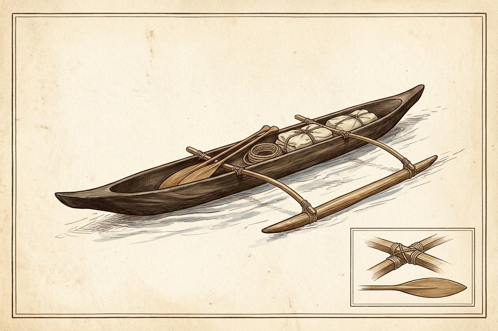

**Porte:** Fluvial e costeira. **Origem:** Vergod, Cidade Suspensa e Voernock. **Preço:** 35 PP (3,5 PO). **Manutenção:** 2 PP/mês.
**Tripulação:** 1 mín. / 2 ideal / 4 máx. **Carga útil:** 0,4 t (400 kg). **Velocidade:** 45 km/dia · Manobra +3.
**Casco:** 25 PV · **Defesa de Manobra:** 14 · **Limiar Estrutural:** 2 · **Slots de Convés:** Nenhum.

Esculpida em tronco único curado ao fumo e estabilizada por flutuador lateral de madeira flexível amarrado com fibras vegetais impermeabilizadas com **H19** (*erva-de-rede*), a piroga silvana desliza onde qualquer quilha pesada encalharia. Não usa pregos de ferro — o que impede ferrugem nos igarapés ácidos do Pântano de Voernock e permite reparos rápidos apenas com talha e corda.

**Uso em mesa e propriedades:** concede **`+2` em Furtividade aquática** sob neblina ou copa fechada e pode ser erguida e carregada por terra por dois exploradores (`38 kg` vazia) para contornar cachoeiras, represas ou postos de pedágio. Não suporta mar aberto sob vento forte (`-4` em *Navegação* fora de rios, lagoas e baías abrigadas).

### E02 — Bote Costeiro e Barco a Remo

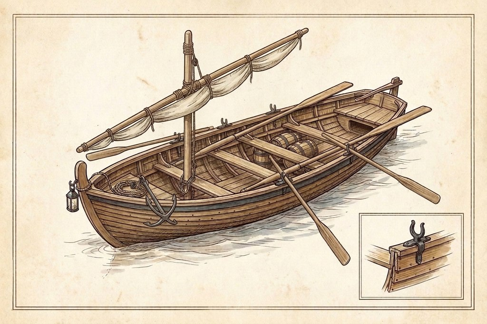

**Porte:** Fluvial e costeira. **Origem:** Todos os portos de Alenia. **Preço:** 80 PP (8 PO). **Manutenção:** 5 PP/mês.
**Tripulação:** 1 mín. / 2 ideal / 6 máx. **Carga útil:** 0,8 t (800 kg). **Velocidade:** 50 km/dia (65 km/dia com vela de pendão) · Manobra +2.
**Casco:** 35 PV · **Defesa de Manobra:** 13 · **Limiar Estrutural:** 3 · **Slots de Convés:** 1 suporte leve opcional na proa.

O barco de trabalho universal do continente, exatamente como tabelado no Tomo I: costado trincado de carvalho pregado sobre cavernas curvas, quatro remos longos em forquetas de ferro e um pequeno mastro desmontável para aproveitar a brisa de estuário. Serve como lancha de desembarque das grandes naus, barco de pesca de **A01** (*lumeça*) e transporte discreto no estuário de Merlinport.

**Uso em mesa e propriedades:** pode ser içado nos turcos de qualquer embarcação de porte **E05** ou superior como bote salva-vidas. Aceita a instalação de um único suporte leve na proa para farol de óleo ou lança-arpão manual reforçado, mas vira se atingido de través por mar grosso sem sucesso em *Navegação CD 15*.

### E03 — Barcaça Fluvial do Rio Aurélio

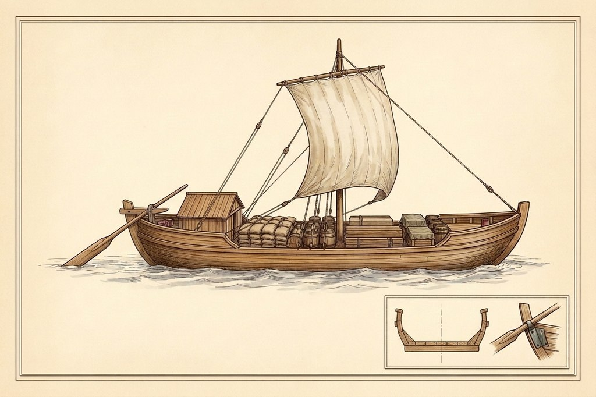

**Porte:** Fluvial e costeira. **Origem:** Merlinport, Pontáuria e Dahrma. **Preço:** 420 PP (42 PO). **Manutenção:** 35 PP/mês.
**Tripulação:** 3 mín. / 5 ideal / 10 máx. **Carga útil:** 18 t. **Velocidade:** 60 km/dia (85 km/dia descendo o rio; 35 km/dia subindo) · Manobra -1.
**Casco:** 85 PV · **Defesa de Manobra:** 10 · **Limiar Estrutural:** 5 · **Slots de Convés:** 1 leve.

Fundo chato reforçado, boca larga e mastro rebatível com dobradiça de ferro para passar sob os arcos monumentais da ponte de Pontáuria. Sem essas barcaças, Altavanne ficaria sem o trigo de Dahrma em duas semanas e o minério de Aeraneas jamais chegaria aos estaleiros do estuário.

**Uso em mesa e propriedades:** estabilidade excepcional em águas internas (`ignora penalidade de convés instável` para besteiros e combatentes a bordo), excelente esconderijo para cargas volumosas ou companhias inteiras viajando disfarçadas de mercadores de grãos. Em mar aberto fora de estuários calmos, sofre **`-4` em Navegação** e corre risco imediato de alagamento sob ondas altas.

### E04 — Cúter e Falua de Prático

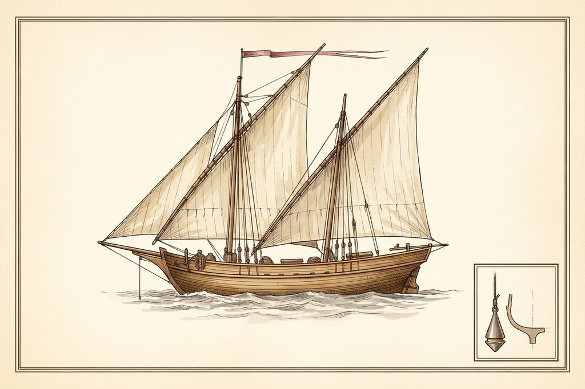

**Porte:** Fluvial e costeira. **Origem:** Cais de Litore, Alineus e Ilha das Safiras. **Preço:** 850 PP (85 PO). **Manutenção:** 65 PP/mês.
**Tripulação:** 4 mín. / 7 ideal / 12 máx. **Carga útil:** 8 t. **Velocidade:** 135 km/dia · Manobra +3.
**Casco:** 95 PV · **Defesa de Manobra:** 15 · **Limiar Estrutural:** 5 · **Slots de Convés:** 1 leve.

Proa fina como lâmina, calado inferior a um metro e meio e duas vergas latinas inclinadas que permitem orçar quase contra o vento. Desenvolvida pelos pilotos de Corallis para guiar mercantes pelos labirintos de pedra submersa do Mar dos Corais, tornou-se também a embarcação predileta de correios diplomáticos e contrabandistas de ervas de Porto Esmeralda.

**Uso em mesa e propriedades:** concede **`+2` de bônus de embarcação em Navegação & Náutica** para cruzar recifes, bancos de areia e canais estreitos, além de `+1` em testes opostos de perseguição costeira onde navios maiores precisam reduzir pano para não rasgar a quilha.

## Embarcações médias de travessia e corso

Cascos oceânicos capazes de sustentar semanas longe da costa, enfrentar temporais de outono e operar artilharia naval de convés — a escala mais versátil para campanhas marítimas protagonizadas pelos jogadores.

### E05 — Escuna Costeira Rápida

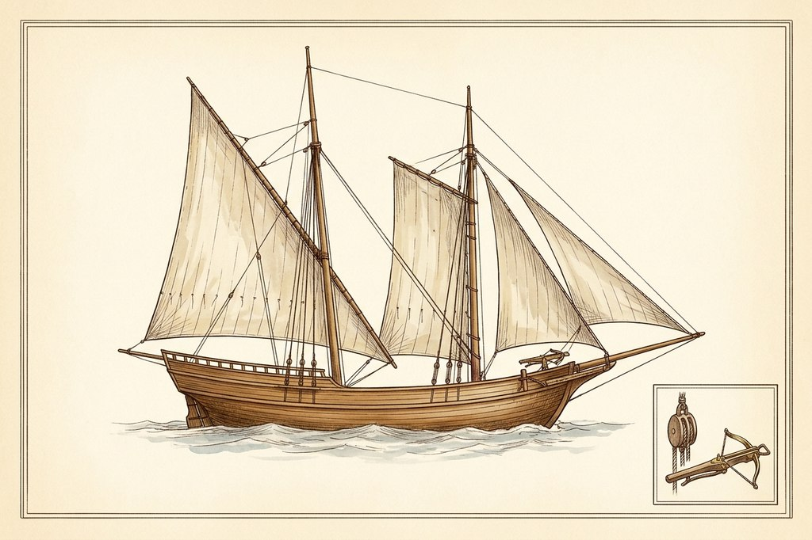

**Porte:** Média oceânica. **Origem:** Alineus, Merlinport e Biemont. **Preço:** 1.500 PP (150 PO). **Manutenção:** 120 PP/mês.
**Tripulação:** 6 mín. / 12 ideal / 18 máx. **Carga útil:** 25 t. **Velocidade:** 150 km/dia · Manobra +2.
**Casco:** 140 PV · **Defesa de Manobra:** 14 · **Limiar Estrutural:** 6 · **Slots de Convés:** 2 (até 1 médio + 1 leve).

A rainha das rotas rápidas de Alenia, fiel à referência do Tomo I (`1.500 PP` e `120 PP/mês`). Seus dois mastros de velas longitudinais exigem menos braços nas vergas do que o pano redondo tradicional, permitindo que uma companhia enxuta de exploradores mantenha velocidade superior à da maioria dos navios mercantes e patrulhas pesadas.

**Uso em mesa e propriedades:** em perseguições em mar aberto com vento lateral ou oblíquo, recebe **`+2` nos testes de Navegação** para abrir ou fechar distância. Possui camarote de popa para mapas e cirurgia, porão enxuto para 25 toneladas e espaço limpo na proa para um *Escorpião Giratório* (**M13**) ou *Lança-Arpão de Catraca* (**M14**).

### E06 — Corta-Vagas de Yõketsu

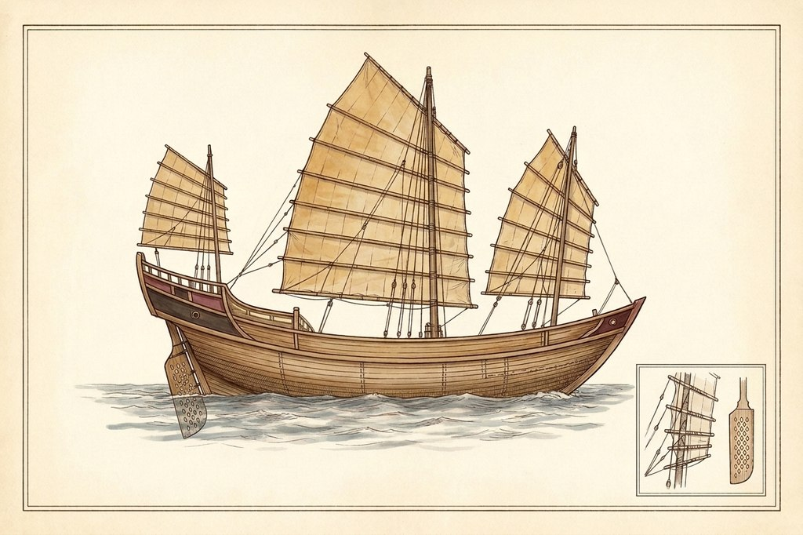

**Porte:** Média oceânica. **Origem:** Enclave marítimo de Yõketsu e costa leste. **Preço:** 2.200 PP (220 PO). **Manutenção:** 160 PP/mês.
**Tripulação:** 8 mín. / 15 ideal / 24 máx. **Carga útil:** 30 t. **Velocidade:** 145 km/dia · Manobra +3.
**Casco:** 155 PV · **Defesa de Manobra:** 15 · **Limiar Estrutural:** 6 · **Slots de Convés:** 2 médios.

Herdeiro dos antigos navegadores orientais celebrados na Crônica (**T017**), o Corta-Vagas combina três mastros de velas esteiradas com ripas horizontais — que podem ser rizadas em segundos por uma única corda quando uma rajada súbita desaba sobre o Mar Intransponível — e um casco subdividido internamente por **anteparas estanques** de cedro oleado.

**Uso em mesa e propriedades:** graças às anteparas estanques, o Corta-Vagas **ignora os efeitos de alagamento do primeiro *Rombo na Linha d'Água*** sofrido em cena, isolando a água num único compartimento. Além disso, seu leme fenestrado reduz em **`2`** a dificuldade de manobras bruscas sob tempestade.

### E07 — Baleeira Quebra-Gelo Boreal

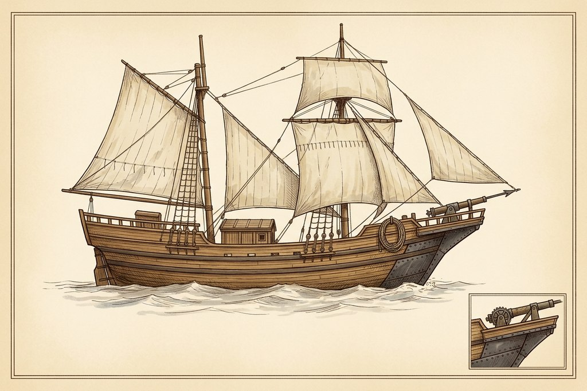

**Porte:** Média oceânica. **Origem:** Syleth, Lystra e estaleiros frios de Aeraneas. **Preço:** 2.800 PP (280 PO). **Manutenção:** 210 PP/mês.
**Tripulação:** 10 mín. / 18 ideal / 26 máx. **Carga útil:** 35 t. **Velocidade:** 110 km/dia · Manobra +0.
**Casco:** 210 PV · **Defesa de Manobra:** 12 · **Limiar Estrutural:** 8 (10 contra gelo e rocha frontal) · **Slots de Convés:** 2 médios (plataforma de proa reforçada).

Construída com cavername dobrado e roda de proa revestida em chapas de ferro batido, a baleeira boreal foi desenhada para abrir caminho por banquisas flutuantes sem esmagar o próprio costado e para suportar o tranco descomunal de uma fera marinha fisgada na linha. Seu abrigo de convés fechado com fogão a carvão mineral protege a tripulação da geada letal do norte.

**Uso em mesa e propriedades:** tripulantes em descanso a bordo recebem **`+2` contra Exaustão por frio extremo**; a plataforma de proa concede **`+1` no acerto de Lança-Arpões de Catraca (M14)** e impede que uma criatura Enorme ou Colossal fisgada arranque a amurada ao mergulhar.

### E08 — Bergantim Corsário de Ravena

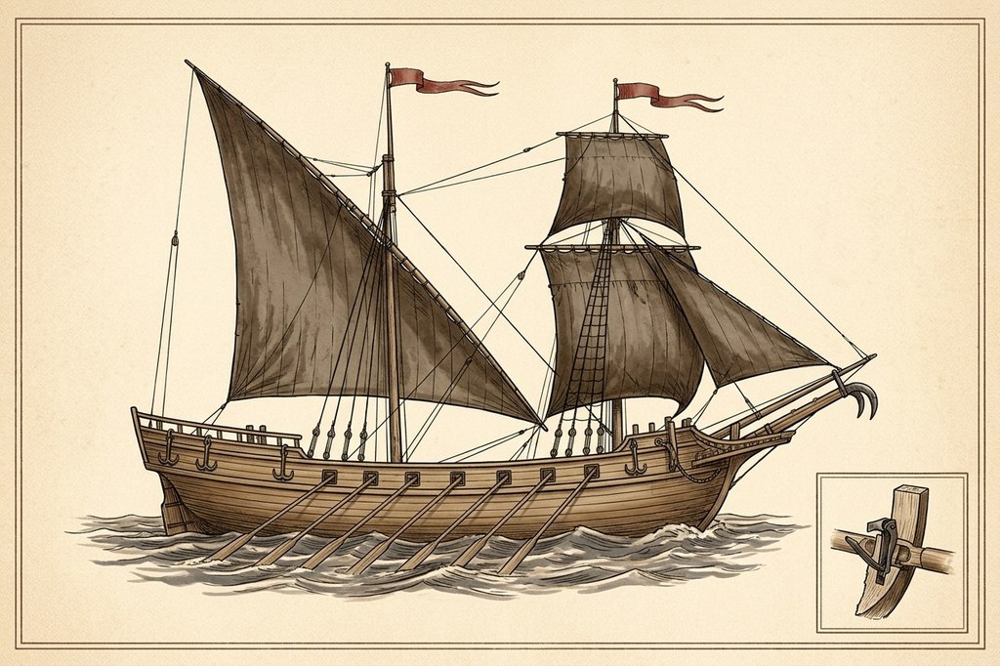

**Porte:** Média oceânica. **Origem:** Arquipélago Ravena e O Ferro Velho. **Preço:** 3.400 PP (340 PO). **Manutenção:** 260 PP/mês.
**Tripulação:** 14 mín. / 24 ideal / 36 máx. **Carga útil:** 40 t. **Velocidade:** 140 km/dia (mantém 70 km/dia a remo em calmaria) · Manobra +2.
**Casco:** 190 PV · **Defesa de Manobra:** 14 · **Limiar Estrutural:** 7 · **Slots de Convés:** 3 (até 2 médios + 1 engenho de abordagem).

Baixo na linha d'água para demorar a ser avistado no horizonte brumoso, o bergantim de Ravena une velame misto a oito pares de remos auxiliares desmontáveis. Quando o vento morre e uma caravela carregada fica imóvel como presa atada, o bergantim recolhe as velas e avança em silêncio pela popa cega do alvo.

**Uso em mesa e propriedades:** não fica imobilizado em *Calmaria*; amuradas preparadas para ganchos e *Corvo de Ferro* concedem **`+2` nos testes de aproximação para Abordagem**, e seu convés corrido acomoda uma companhia inteira de assalto pronta para saltar.

## Grandes cascos mercantes e de guerra

Embarcações de alto investimento movidas por guildas mercantis, frotas de Estado, casas bancárias e expedições reais de longo alcance.

### E09 — Caravela Mercante Oceânica

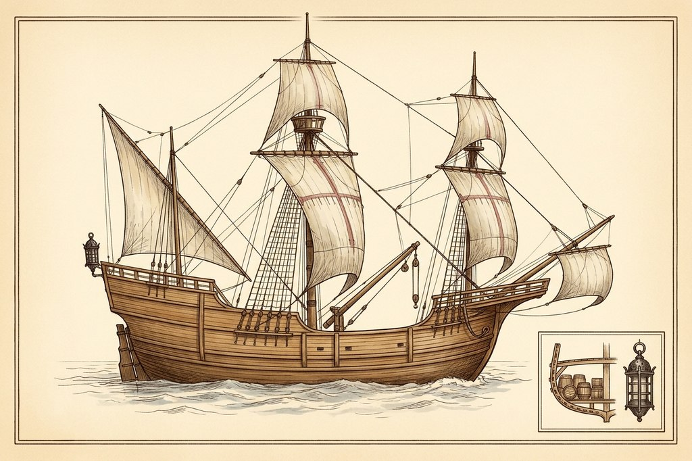

**Porte:** Pesada e capitânia. **Origem:** Corallis e Aurora. **Preço:** 4.500 PP (450 PO). **Manutenção:** 310 PP/mês.
**Tripulação:** 12 mín. / 20 ideal / 32 máx. **Carga útil:** 90 t. **Velocidade:** 120 km/dia · Manobra +0.
**Casco:** 240 PV · **Defesa de Manobra:** 12 · **Limiar Estrutural:** 8 · **Slots de Convés:** 3 médios.

O navio-padrão do comércio transmarino de Alenia (`4.500 PP` e `120 km/dia` conforme Tomos I e II). Com bojo largo, porão profundo em dois pavimentos, guindaste central de carga e castelo de popa elevado, uma única viagem bem-sucedida carregada de especiarias de Gaddra, vinhos de Biemont ou vidro de Kalis pode pagar um terço do seu próprio casco.

**Uso em mesa e propriedades:** autonomia de provisões e água doce para **até 45 dias** em mar aberto sem reabastecer; o castelo de popa funciona como reduto defensável (`meia cobertura +2 na Defesa` contra invasores que subam pelo convés central).

### E10 — Galé de Recife de Corallis

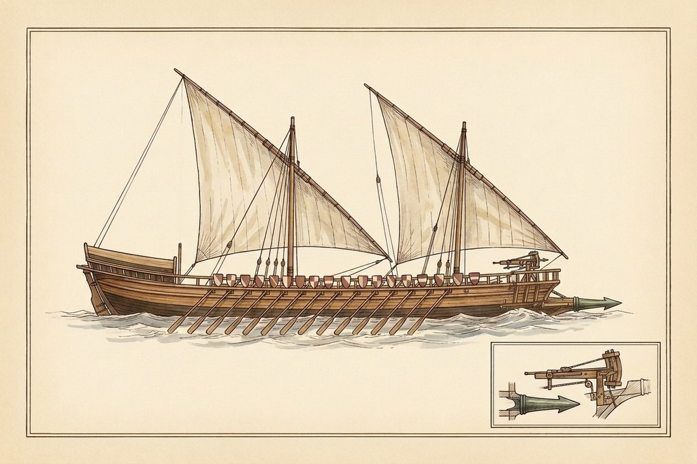

**Porte:** Pesada e capitânia. **Origem:** Estaleiros da Liga em Alineus e Baldbella. **Preço:** 4.500 PP (450 PO). **Manutenção:** 380 PP/mês.
**Tripulação:** 24 mín. / 38 ideal / 55 máx. **Carga útil:** 35 t. **Velocidade:** 130 km/dia (arrancada tática a remo equivalente a 160 km/dia) · Manobra +2.
**Casco:** 230 PV · **Defesa de Manobra:** 14 · **Limiar Estrutural:** 8 · **Slots de Convés:** 3 (Esporão de Bronze **M17** integrado + 2 médios/pesados).

Comprida, esguia e movida por bancadas de **remadores livres juramentados** da Liga (Corallis proíbe galés de escravos em suas frotas oficiais, pois homens livres defendem o convés quando soa a abordagem), a Galé de Recife domina estreitos, canais e batalhas costeiras. Já sai do estaleiro com **Esporão de Proa em Bronze (M17)** fundido à quilha e plataforma dianteira para *Balista de Torção* (**M15**).

**Uso em mesa e propriedades:** independe da direção do vento durante rodadas de combate naval (`1 minuto`), podendo girar no próprio eixo e realizar **Arrancada de Abalroamento** (`+2` no ataque de esporão). Em contrapartida, seu casco longo e baixo sofre **`-2` em testes de Navegação sob tempestades oceânicas severas**.

### E11 — Drakkar de Madeira Negra de Kalis

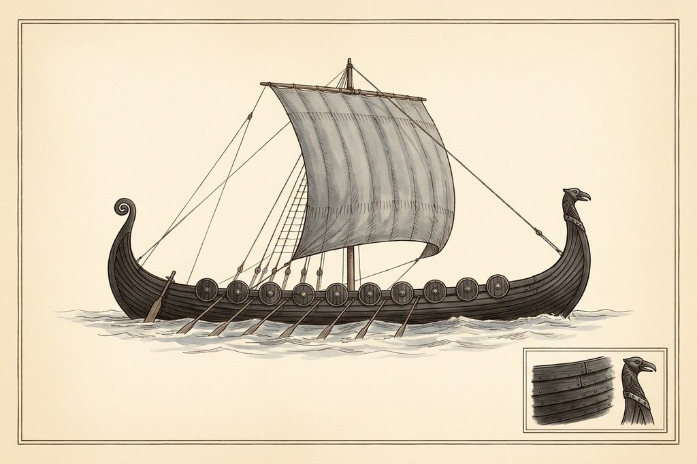

**Porte:** Pesada e capitânia. **Origem:** Kragstad, Drakenhall e Dobalbek (Kalis). **Preço:** 6.800 PP (680 PO, já em madeira negra nativa). **Manutenção:** 340 PP/mês.
**Tripulação:** 20 mín. / 34 ideal / 50 máx. **Carga útil:** 45 t. **Velocidade:** 135 km/dia · Manobra +2.
**Casco:** 275 PV · **Defesa de Manobra:** 14 · **Limiar Estrutural:** 10 · **Slots de Convés:** 3 médios.

Construído inteiramente com o cerne escuro e oleoso das árvores ancestrais da Floresta Negra, o navio-longo kalita une flexibilidade para cavalgar as vagas brutais do Mar Intransponível a um calado capaz de subir estuários rasos de surpresa. Escudos redondos encaixados ao longo da amurada protegem os remadores contra chuvas de flechas e virotes.

**Uso em mesa e propriedades:** por já ser nativamente de **Madeira Negra**, é **imune ao muco corrosivo do Verme-de-Maré**, à podridão marinha e ao teredo, possui **Limiar Estrutural `10`** e concede meia cobertura (`+2` Defesa) aos tripulantes posicionados nas bancadas laterais.

### E12 — Grande Nau e Galeão Real de Escolta

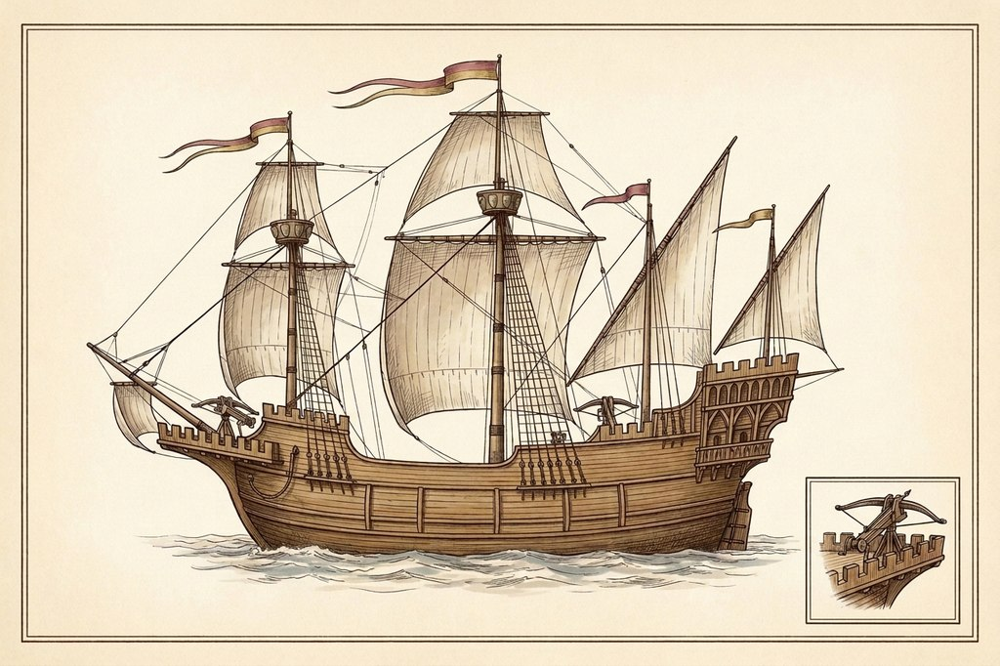

**Porte:** Pesada e capitânia. **Origem:** Altavanne/Merlinport e Alta Frota da Liga. **Preço:** 12.000 PP (1.200 PO). **Manutenção:** 850 PP/mês.
**Tripulação:** 40 mín. / 65 ideal / 110 máx. **Carga útil:** 180 t. **Velocidade:** 110 km/dia · Manobra -2.
**Casco:** 420 PV · **Defesa de Manobra:** 10 · **Limiar Estrutural:** 12 · **Slots de Convés:** 6 (até 4 pesados nos castelos + 2 médios).

O maior navio construído pelos reinos humanos sem recorrer a magia ou pólvora: quatro mastros, castelos ameados de proa e popa erguidos como torres de madeira sobre as ondas, gáveas fechadas para besteiros e baterias de *Balistas Pesadas de Torção* (**M15**). Pouquíssimos exemplares navegam em 418 — reservados ao transporte real de adamante, embaixadas solenes e capitânias de guerra.

**Uso em mesa e propriedades:** seus castelos altos impõem **`-3` nos testes de Escalada/Abordagem** de embarcações menores tentando subir pelo costado, enquanto atiradores nos castelos recebem **`+2` no acerto** por vantagem de altura e cobertura de ameias. Exige águas profundas e rebocadores/botes em portos rasos.

### Resumo Comparativo das Doze Embarcações

| Cód. | Embarcação | Preço Base | Manut./Mês | Trip. (Mín/Ideal/Máx) | Carga | Vel. (`km/dia`) | Defesa | Casco / LE | Slots |
| :---: | :--- | :---: | :---: | :---: | :---: | :---: | :---: | :---: | :---: |
| **E01** | Piroga Silvana | `35 PP` | `2 PP` | `1 / 2 / 4` | `0,4 t` | `45` | `14` | `25 / 2` | `0` |
| **E02** | Bote Costeiro | `80 PP` | `5 PP` | `1 / 2 / 6` | `0,8 t` | `50–65` | `13` | `35 / 3` | `0–1 L` |
| **E03** | Barcaça do Aurélio | `420 PP` | `35 PP` | `3 / 5 / 10` | `18 t` | `60` | `10` | `85 / 5` | `1 L` |
| **E04** | Cúter de Prático | `850 PP` | `65 PP` | `4 / 7 / 12` | `8 t` | `135` | `15` | `95 / 5` | `1 L` |
| **E05** | Escuna Rápida | `1.500 PP` | `120 PP` | `6 / 12 / 18` | `25 t` | `150` | `14` | `140 / 6` | `2 (1M, 1L)` |
| **E06** | Corta-Vagas (Yõketsu) | `2.200 PP` | `160 PP` | `8 / 15 / 24` | `30 t` | `145` | `15` | `155 / 6` | `2 M` |
| **E07** | Baleeira Boreal | `2.800 PP` | `210 PP` | `10 / 18 / 26` | `35 t` | `110` | `12` | `210 / 8` | `2 M` |
| **E08** | Bergantim de Ravena | `3.400 PP` | `260 PP` | `14 / 24 / 36` | `40 t` | `140` | `14` | `190 / 7` | `3 (2M, 1Ab)` |
| **E09** | Caravela Mercante | `4.500 PP` | `310 PP` | `12 / 20 / 32` | `90 t` | `120` | `12` | `240 / 8` | `3 M` |
| **E10** | Galé de Recife | `4.500 PP` | `380 PP` | `24 / 38 / 55` | `35 t` | `130 (160)` | `14` | `230 / 8` | `Esp. + 2 P` |
| **E11** | Drakkar de Kalis | `6.800 PP` | `340 PP` | `20 / 34 / 50` | `45 t` | `135` | `14` | `275 / 10` | `3 M` |
| **E12** | Grande Nau Real | `12.000 PP` | `850 PP` | `40 / 65 / 110` | `180 t` | `110` | `10` | `420 / 12` | `6 (4P, 2M)` |

### Melhorias de Estaleiro e Modificações de Casco

Qualquer embarcação pode receber até **3 melhorias estruturais** num estaleiro equipado (`1 a 3 semanas` de doca seca):

| Melhoria Estrutural | Custo | Requisitos | Efeito em Jogo |
| :--- | :---: | :--- | :--- |
| **Casco em Madeira Negra de Kalis** *(Tomo I)* | **`×2` preço base** | Na construção *(exceto **E11**, que já possui)* | **`+25%` PV de Casco**, **`+2` no Limiar Estrutural**, imune a podridão e ao ácido do *Verme-de-Maré*; reduz manutenção estrutural em `-15%`. |
| **Quilha e Proa Chapeadas em Bronze/Ferro** | `+15%` do casco *(mín. `60 PP`)* | Porte **E02+** *(já incluso em **E07**)* | Reduz à **metade** avarias por raspagem em recifes de coral ou gelo flutuante. |
| **Velame de Linho Duplo de Alineus** | `+12%` do casco *(mín. `40 PP`)* | Embarcações a vela | Aumenta a velocidade de viagem em **`+15 km/dia`** e concede **`+1`** em testes de perseguição a vela. |
| **Anteparas Estanques de Yõketsu** | `+20%` do casco | Porte **E04+** *(já incluso em **E06**)* | Isola inundações: ignora a penalidade do primeiro *Rombo na Linha d'Água* sofrido. |
| **Porão Falso de Contrabando** | `90 PP` a `350 PP` | Qualquer barco com porão | Oculta `10%` da carga útil atrás de antepara móvel; exige *Investigação* ou *Percepção CD 20* em inspeção alfandegária. |
| **Banho de Alcatrão Amargo e Cal (`H19`)** | `45 PP` *(dura 3 meses)* | Qualquer casco | Repele cracas, *Verme-de-Maré* (dobra o tempo para roer cabos/madeira) e dificulta que um *Polvo-de-Quilha* se fixe ao costado (`-2` na escalada da criatura). |
| **Gávea Blindada de Arqueiros** | `140 PP` | Mastros de **E05+** | Cesto de mastro reforçado em carvalho; concede **cobertura superior (`+4` Defesa)** a até `2` vigias/atiradores posicionados no topo. |
| **Câmara Cirúrgica / Laboratório Fixo** | `220 PP` | Porte **E05+** | Bancadas presas em cardãs contra o balanço do mar; anula redutores de mar agitado em *Medicina & Cirurgia* e *Alquimia*. |

## Regras de arpões, redes e combate na água

No convés escorregadio ou debaixo d'água, espadas longas pesadas e armaduras de placas cobram um preço mortal. Os marinheiros de Alenia desenvolveram técnicas específicas em torno de duas famílias de armas táticas: os **arpões com cabo** e as **redes de malha lastrada**.

### 1. Propriedade Tática: *Fisgada* *(Arpões com Cabo)*

Sempre que uma arma com a propriedade **Fisgada** (**M01**, **M02**, **M03** ou o engenho **M14**) acertar um alvo e causar ao menos **`1` ponto de dano real**, suas farpas laterais abrem-se dentro da carne, couro ou prancha de madeira:

- **Alvo Fisgado:** enquanto o atacante mantiver o cabo firme nas mãos (ou amarrado a um cabeço/catraca de convés), o alvo **não pode se afastar além do comprimento do cabo** sem vencer um teste oposto de **Atletismo** contra o arpoador *(criaturas Grandes recebem `+4` nesse teste e Enormes `+8`, a menos que o cabo esteja atado diretamente à estrutura de uma embarcação!)*.
- **Tracionar ou Derrubar *(Ação Principal)*:** em seu turno, quem segura o cabo pode fazer um teste oposto de **Atletismo** contra o alvo Fisgado. Em sucesso, **puxa o alvo até `3m` na sua direção** ou o deixa **Caído** *(excelente para arrastar inimigos para fora da amurada ou impedir que um predador marinho submerja com um aliado)*.
- **Remover a Farpa ou Cortar o Cabo:**
  - *Extração cuidadosa (`Ação Principal`):* exige teste de *Medicina* ou *Destreza CD 13* (do próprio alvo ou de um aliado adjacente), soltando o arpão sem dano extra.
  - *Arrancar à força (`Movimento`):* liberta imediatamente sem rolagem, mas rasga o ferimento causando **`1d4` de dano direto** (`1d6` no **M03**) e impondo **Sangramento** (`1d4` PV/turno até Medicina CD 15).
  - *Cortar o cabo:* um cabo de cânhamo naval tem **Defesa `12` e `6 PV` contra dano cortante** *(cabos com ponteira de corrente em **M03** e **M14** possuem **Defesa `14`, Limiar `4` e `15 PV`** nos dois metros finais próximos à farpa)*.

### 2. Propriedade Tática: *Enredar* *(Redes de Captura e Abordagem)*

Redes são armas de controle tático formidáveis para capturar alvos vivos, neutralizar duelistas ágeis ou deter monstros anfíbios:

- **Ataque contra a Defesa Esquiva:** lançar uma rede utiliza **Armas à Distância** *(ou **Atletismo** a até `4,5m`)* mirando exclusivamente a **Defesa Esquiva** do alvo (`10 + Mod. DES + Esquiva + Armadura/Escudo`, **sem** somar perícia *Aparar*, já que a malha envolve a lâmina!). Redes pessoais exigem distância máxima de **`4,5m`** (`6m` se lançadas de posição mais alta, como castelo ou gávea).
- **Condição *Enredado*:** um alvo atingido por **M06**, **M07** ou **M08** sofre imediatamente:
  1. **Deslocamento reduzido a `0`** *(se estiver nadando sem apoio, as chumbadas o puxam **`3m` para o fundo por rodada**!)*;
  2. **`-3` em todos os ataques** e **`-3` na Defesa Esquiva**;
  3. **Impedido de usar armas de duas mãos**, investir, correr ou escalar *(só pode atacar com armas leves de uma mão, como adagas, facas ou machadinhas)*.
- **Escapar, Rasgar e Redobrar:**
  - *Desvencilhar-se (`Ação Principal`):* teste de **Acrobacia** ou **Atletismo** contra a **CD da Rede** (`CD 13` na Tarrafa **M05**, `CD 15` na Rede Chumbada **M06**, `CD 17` na Rede Farpada **M07**).
  - *Cortar a malha:* ataques **cortantes** causam dano diretamente aos **PV da Rede** *(armas contundentes não rasgam malha, e armas perfurantes causam apenas metade)*.
  - *Preparo:* uma rede aberta após o arremesso precisa ser **redobrada** antes de ser lançada outra vez (`2 Ações Principais` em combate ou `1 minuto` fora dele).

### 3. Combate Submerso, Queda ao Mar e Armaduras na Água

| Situação Marítima | Regra Prática na Mesa |
| :--- | :--- |
| **Ataques Debaixo d'Água** | Armas **perfurantes** (*adagas, estoques, lanças, arpões **M01–M03** e faca de mergulhador **M11***) atacam **sem nenhuma penalidade**. Armas cortantes ou contundentes sofrem **`-2` no acerto e causam metade do dano**. Bestas navais (**M12**) funcionam submersas apenas a até **`4,5m`**; arcos comuns e fogo comum são inutilizados. |
| **Nadar de Armadura** | *Gibão / Couro Batido*: sem penalidade (`0`). *Cota de Malha*: **`-3`** em *Natação*. *Brigantina / Meia-Placa*: **`-5`** em *Natação* e exige `Atletismo/Natação CD 14` por turno em mar agitado. *Placas Completas*: **impossível nadar** — afunda `4,5m`/rodada até cortar correias (`2 Ações Principais` com faca) ou ser içado por cabo. |
| **Fôlego e Afogamento** | Em calma/mergulho controlado: **`1 + Mod. CON` minutos** (mín. `30s` / `5 rodadas`). Em combate violento ou se cair na água desprevenido sem inspirar: **`3 + Mod. CON` rodadas** (mín. `2`). Esgotado o ar, o personagem cai a **`0 PV` (*Moribundo*)** no turno seguinte e não pode estabilizar enquanto continuar submerso. |
| **Convés Sob Tempestade** | Sem o Talento *Lobo do Mar* ou habilidade *Abordagem Selvagem*, lutar em convés varrido por ondas impõe **`-2` em ataques à distância e Acrobacia**; falhar por `5+` num movimento corrido exige `Acrobacia CD 13` para não cair. |

## Arpões, lanças navais e hastes de convés

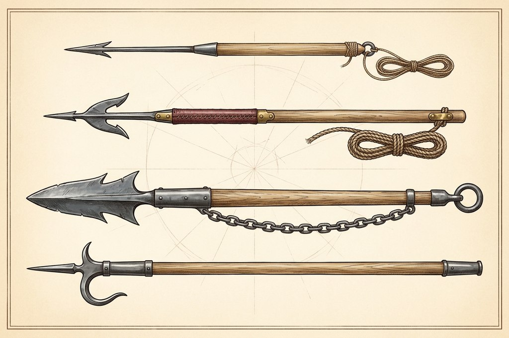

*(Lembrete do Tomo I: todas as armas corpo a corpo e de arremesso abaixo somam **`Mod(FOR)`** ao dano.)*

### M01 — Arpão de Pesca Manual

**Categoria:** Arpão e haste. **Preço:** 2 PP. **Peso:** 1,8 kg. **Dano:** `1d6` perfurante (`20 / ×2`). **Alcance:** corpo a corpo ou arremesso `6m` *(cabo leve `9m`)*.

Haste leve de freixo com ponta farpada simples e linha fina de cânhamo, idêntica ao item básico do Tomo IX. Projetado para peixes grandes de estuário e caça anfíbia nos baixios.

**Efeito tático:** possui **Fisgada leve** contra alvos Pequenos ou Médios (`cabo de 4 PV`; criaturas Médias recebem `+2` no teste oposto de *Atletismo* para arrancar ou partir a linha fina). Sem penalidade debaixo d'água.

### M02 — Arpão Farpado de Caça e Abordagem

**Categoria:** Arpão e haste. **Preço:** 14 PP. **Peso:** 2,5 kg. **Dano:** `1d8` perfurante (`20 / ×3`). **Alcance:** corpo a corpo ou arremesso `9m` *(cabo trançado `15m`)*.

O arpão padrão de combate dos marinheiros de Corallis, caçadores de Ravena e guardas portuários de Merlinport. Sua cabeça de ferro temperado possui barbela articulada em pino (*cabeça basculante*): entra fechada pela fresta do couro e gira transversalmente lá dentro ao primeiro puxão da corda.

**Efeito tático:** aplica **Fisgada plena** (`cabo de 6 PV`, `Defesa 12`). Pode ser cravado também em madeira ou amurada inimiga (`CA 10`) para criar cabo de subida ou puxar um bote leve. Sem penalidade debaixo d'água.

### M03 — Lança-Arpão Pesada de Recife e Baleeiro

**Categoria:** Arpão e haste. **Preço:** 32 PP. **Peso:** 4,0 kg. **Dano:** `1d10` perfurante (`20 / ×3`). **Alcance:** duas mãos (`alcance 3m` em estocada; arremesso curto `6m` exigindo `FOR 13+`, cabo grosso `18m` com guia de corrente).

Arma brutal consagrada na história de Aurora pelas companhias fluviais e marítimas da **Capitã Vespera Scutauria** na caçada de 356 EF (**Tomo II**). Os dois últimos metros junto ao ferro são formados por elos de corrente batida, impedindo que mandíbulas serrilhadas — como as da *Cantora-de-Recife* ou de tubarões de recife — cortem a linha na mordida.

**Efeito tático:** **Fisgada pesada** (`guia de corrente: Defesa 14, LE 4, 15 PV`); concede **`+2` nos testes de Atletismo para segurar ou tracionar** criaturas Grandes ou maiores quando o anel traseiro está passado num cunho do navio. Arrancar sua farpa à força como Movimento causa **`1d6` de dano + Sangramento**. Sem penalidade subaquática.

### M04 — Croque e Vara de Abordagem

**Categoria:** Arpão e haste. **Preço:** 8 PP. **Peso:** 2,2 kg. **Dano:** `1d6` perfurante/contundente (`20 / ×2`). **Alcance:** duas mãos, alcance `3m`.

Haste longa de carvalho naval terminada numa ponteira reta de ferro ladeada por um gancho curvo reverso. Presente em todos os conveses do Rio Aurélio ao Mar dos Corais tanto para puxar amarras e afastar destroços quanto para derrubar invasores na água antes que pisem a bordo.

**Efeito tático:** concede **`+2` em manobras de Empurrar, Derrubar, Puxar `1,5m` ou Desarmar** em alcance de `3m`, além de **`+2`** para resgatar aliados caídos no mar sem precisar saltar na água.

## Redes de captura, abordagem e armas de marinheiro

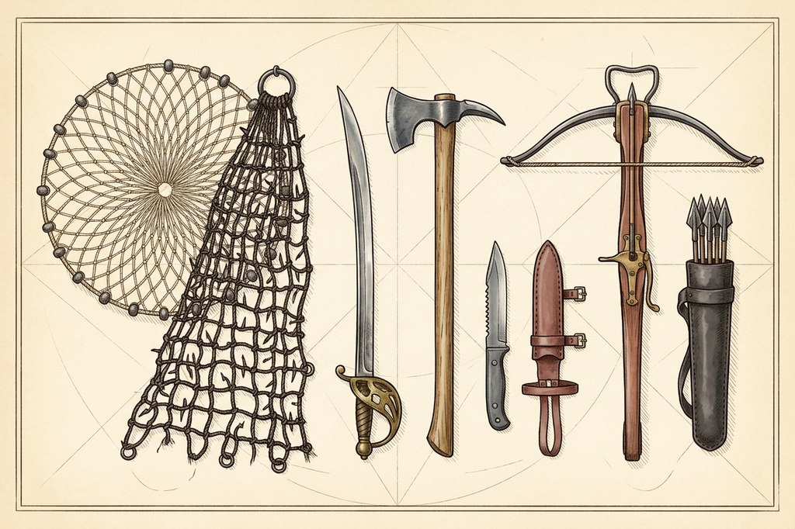

### M05 — Tarrafa e Rede Costeira de Pesca

**Categoria:** Rede tática. **Preço:** 3 PP. **Peso:** 2,5 kg. **Dano:** — *(controle)*. **Alcance:** arremesso `4,5m` contra *Defesa Esquiva*.

Malha circular leve com pequenos pesos de chumbo na borda (Tomo IX). Embora feita para capturar cardumes rasos (`2d4` rações em *Sobrevivência CD 13*), nas docas de Merlinport e Baldbella já salvou mais de um pescador cercado em briga de cais.

**Efeito tático:** em acerto contra criatura Pequena ou Média, impõe **Enredado parcial** (*deslocamento reduzido à metade*, `-2` em ataques e Esquiva; escapar exige **`Acrobacia/Atletismo CD 13`** ou causar **`4 PV`** de dano cortante à malha, Defesa `10`).

### M06 — Rede de Captura Chumbada

**Categoria:** Rede tática. **Preço:** 12 PP. **Peso:** 3,5 kg. **Dano:** — *(controle)*. **Alcance:** arremesso `4,5m` (`6m` de altura superior) contra *Defesa Esquiva*.

Tecida em cânhamo grosso curtido em salmoura com chumbadas pesadas e cabo guia de retenção preso ao pulso do lançador — o equipamento oficial do Kit **Caçador de Recompensas** (Tomo III), de patrulhas portuárias e de gladiadores das arenas de **OX**.

**Efeito tático:** impõe **Enredado pleno** (`deslocamento 0`, `-3` em ataques e Esquiva, bloqueia armas de duas mãos). Escapar exige Ação Principal com **`Acrobacia ou Atletismo CD 15`** ou rasgar a malha causando **`8 PV`** cortantes (`Defesa 11`). Se o lançador segurar o cabo guia, pode impedir que o alvo role para fora ou arrastá-lo como se estivesse *Fisgado*.

### M07 — Rede Naval com Farpas de Ferro

**Categoria:** Rede tática. **Preço:** 28 PP. **Peso:** 5,5 kg. **Dano:** `1d4` perfurante ao debater-se. **Alcance:** arremesso `4,5m` *(exige `FOR 12+`)* contra *Defesa Esquiva*.

Empregada por corsários de Ravena, caçadores de monstros de *O Ferro Velho* e escoltas prisionais de Kalis. A corda leva anéis de ferro entrelaçados nos nós principais e pequenos anzóis cegos voltados para dentro, impedindo que uma simples facada abra passagem de imediato.

**Efeito tático:** impõe **Enredado pleno**; escapar exige **`Acrobacia ou Atletismo CD 17`**, e a malha possui **`15 PV` com Limiar `3` contra cortes** (`Defesa 12`). Sempre que o alvo tentar escapar pela força e **falhar por `5` ou mais** (ou realizar ataque brusco preso nela), sofre **`1d4` de dano perfurante** das farpas internas.

### M08 — Rede Pesada de Verga e Convés (`3m × 3m`)

**Categoria:** Rede tática. **Preço:** 45 PP. **Peso:** 14,0 kg. **Dano:** — *(área `3m × 3m`)*. **Alcance:** solta de vergas/guindaste ou lançada por `2` marinheiros a até `4,5m`.

Grande malha quadrada de carga e defesa antiabordagem, mantida suspensa nos cabos da verga principal ou esticada sobre escotilhas. Quando piratas saltam no convés ou um *Polvo-de-Quilha* escala o costado, um único golpe na corda mestra faz a rede inteira desabar sobre o grupo.

**Efeito tático:** cobre uma área de **`3m × 3m`** (ou **1 criatura Grande/Enorme**). Todos na área fazem teste de **`Esquiva / Acrobacia CD 15`**; quem falhar fica **Enredado** sob o peso coletivo (`CD 16` para sair; **`20 PV`** cortantes para abrir brecha de `1,5m`).

### M09 — Cutelo Naval de Guarda em Concha

**Categoria:** Arma de convés e mergulho. **Preço:** 25 PP. **Peso:** 1,3 kg. **Dano:** `1d6` cortante (`18–20 / ×2`). **Alcance:** corpo a corpo, Ágil (`FOR/DES`).

Variante marítima do sabre curto, de lâmina ligeiramente mais larga na ponta para golpear entre cordames sem prender nas enxárcias e guarda fechada em latão batido que protege os dedos contra estilhaços e maresia.

**Efeito tático:** concede **`+2` na Defesa contra manobras de Desarmar** e permite golpear normalmente em escadarias estreitas de escotilha onde armas longas ou de duas mãos sofrem `-2`.

### M10 — Machadinha de Abordagem (*Ponta-de-Corvo*)

**Categoria:** Arma de convés e mergulho. **Preço:** 18 PP. **Peso:** 1,4 kg. **Dano:** `1d6` cortante ou perfurante (`20 / ×3`). **Alcance:** corpo a corpo, Leve, arremesso `6m`.

De um lado, gume curvo temperado para partir amarras num único golpe; do outro, um bico traseiro recurvado capaz de cravar na madeira molhada do costado como piolet de escalada.

**Efeito tático:** causa **dano dobrado contra cordas, cabos de arpão, velas e redes** (`corta um cabo comum automaticamente sem rolagem de dano ao acertar`) e concede **`+1` em testes de Escalada** em cascos de madeira ou árvores; empunhar um par concede `+2`.

### M11 — Faca de Mergulhador de Baldbella

**Categoria:** Arma de convés e mergulho. **Preço:** 10 PP. **Peso:** 0,4 kg. **Dano:** `1d4` perfurante/cortante (`19–20 / ×2`). **Alcance:** corpo a corpo, Leve, Ágil (`FOR/DES`), arremesso `6m`.

Forjada em liga escura tratada com óleo mineral para não oxidar em água salgada, presa em bainha de couro rígido na panturrilha ou antebraço dos coletores de pérolas do Atol e sucateiros submersos de *O Ferro Velho*. Possui ponta perfurante espessa e dorso serrilhado.

**Efeito tático:** **zero penalidade debaixo d'água**; o dorso serrilhado soma **`+2` de dano extra ao cortar redes ou tentáculos/cipós que mantenham um personagem Agarrado** e funciona como alavanca leve para abrir ostras gigantes ou frestas de caixas submersas.

### M12 — Besta Naval de Coronha Selada

**Categoria:** Arma de convés e mergulho. **Preço:** 50 PP. **Peso:** 3,2 kg. **Dano:** `1d8` perfurante (`19–20 / ×2`). **Alcance:** `24m` *(Recarga: Movimento)*.

Enquanto arcos comuns perdem tensão sob chuva torrencial e borrifos salgados, os armeiros de Stoneforge desenvolveram esta besta de arco laminado revestido em couro cozido, corda encerada e gatilho interno de bronze imune à ferrugem.

**Efeito tático:** **ignora penalidades climáticas de chuva, neblina úmida e borrifos de tempestade** que afetam arcos tradicionais, e pode disparar mesmo recém-saída da água (ou submersa a até `4,5m`). Aceita *Virotes com Linha Leve* (`5 PP` por 5 unidades, alcance `12m`, úteis para passar cabos entre barcos ou muralhas).

### Resumo Rápido das Armas Pessoais Marítimas (`M01`–`M12`)

| Cód. | Arma Marítima | Preço | Peso | Dano & Crítico | Alcance | Propriedade Chave |
| :---: | :--- | :---: | :---: | :---: | :---: | :--- |
| **M01** | Arpão de Pesca Manual | `2 PP` | `1,8 kg` | `1d6` (`20/×2`) | `6m` *(cabo 9m)* | Fisgada leve, subaquática |
| **M02** | Arpão Farpado de Abordagem | `14 PP` | `2,5 kg` | `1d8` (`20/×3`) | `9m` *(cabo 15m)* | Fisgada plena, arrancar causa `1d4` + Sangr. |
| **M03** | Lança-Arpão Pesada de Recife | `32 PP` | `4,0 kg` | `1d10` (`20/×3`) | `3m` / arrem. `6m` | 2 mãos, guia de corrente (`LE 4`), `+2` tração |
| **M04** | Croque / Vara de Abordagem | `8 PP` | `2,2 kg` | `1d6` (`20/×2`) | `3m` | 2 mãos, `+2` Empurrar/Derrubar/Resgatar |
| **M05** | Tarrafa Costeira | `3 PP` | `2,5 kg` | Controle | `4,5m` *(vs Esquiva)* | Enredado parcial (`CD 13` / `4 PV`) |
| **M06** | Rede de Captura Chumbada | `12 PP` | `3,5 kg` | Controle | `4,5m` *(vs Esquiva)* | Enredado pleno (`CD 15` / `8 PV`) |
| **M07** | Rede Naval com Farpas | `28 PP` | `5,5 kg` | Controle + `1d4` | `4,5m` *(vs Esquiva)* | Enredado (`CD 17` / `15 PV`, `LE 3`) |
| **M08** | Rede de Verga (`3m × 3m`) | `45 PP` | `14,0 kg` | Área `3m × 3m` | Queda / `4,5m` | Esquiva `CD 15` em área (`20 PV`) |
| **M09** | Cutelo Guarda em Concha | `25 PP` | `1,3 kg` | `1d6` (`18–20/×2`) | Corpo a corpo | Ágil, `+2` contra Desarmar, espaços estreitos |
| **M10** | Machadinha Ponta-de-Corvo | `18 PP` | `1,4 kg` | `1d6` (`20/×3`) | Corpo / `6m` | Dano `×2` em cabos/redes, `+1` Escalada |
| **M11** | Faca de Mergulhador | `10 PP` | `0,4 kg` | `1d4` (`19–20/×2`) | Corpo / `6m` | Subaquática, `+2` dano cortando redes/agarrões |
| **M12** | Besta Naval Selada | `50 PP` | `3,2 kg` | `1d8` (`19–20/×2`) | `24m` | Imune a chuva/maresia, Recarga: Movimento |

## Artilharia de convés e engenhos sem pólvora

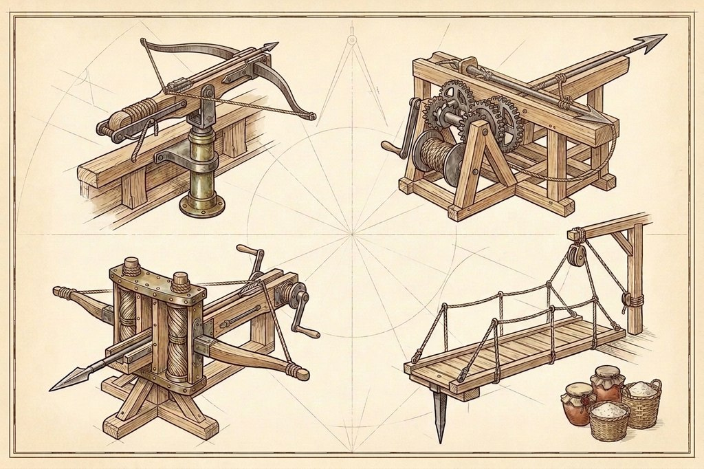

As armas abaixo ocupam **Slots de Convés** das embarcações e operam nas **rodadas navais (`1 minuto`)** ou, quando carregadas previamente, para `1` disparo devastador em escala pessoal antes de exigir múltiplos turnos de recarga. Ataques de artilharia naval usam **`1d20 + Mod(DES ou INT) + Grau em Armas à Distância ou Engenharia & Mecânica`**.

### M13 — Escorpião Giratório de Amurada

**Slot:** Leve. **Preço:** 180 PP *(munição: `1 PP` por virote pesado)*. **Guarnição:** 1 artilheiro. **Dano:** `2d8` perfurante (`19–20 / ×2`). **Alcance Naval:** Curta e Média (`até 90m`).

Besta mecânica de arco de aço temperado montada num pino giratório de bronze na amurada ou no castelo de popa, armada por alavanca de cremalheira. Não foi feita para afundar grandes naus, mas para varrer timoneiros inimigos, cortar adriças e abater predadores alados ou anfíbios antes que toquem o convés.

**Uso em mesa:** opera a cada rodada naval (`1 minuto`; em escala pessoal de `6s`, exige `2 Ações Principais` para rearmar). Ignora até `4` pontos do *Limiar Estrutural* quando mira especificamente velame, leme exposto ou botes leves.

### M14 — Lança-Arpão Naval de Catraca (*Modelo Stoneforge*)

**Slot:** Médio. **Preço:** 320 PP *(arpão pesado com cabo: `12 PP`)*. **Guarnição:** 2 operadores *(1 pode operar em metade da cadência)*. **Dano:** `3d8` perfurante (`20 / ×3`). **Alcance Naval:** Curta (`até 45m`, cabo de cânhamo e corrente de `45m`).

Engenho célebre das baleeiras do norte e das escoltas fluviais dos Scutauria: um trilho reforçado dispara uma haste farpada de dois metros ligada a um tambor com freio de catraca.

**Uso em mesa:** ao atingir uma embarcação inimiga (superando a Defesa de Manobra) ou uma megafauna marinha como o *Leviatã-dos-Recifes*, **trava o alvo na faixa Curta**! Em cada rodada naval seguinte, a guarnição pode acionar o guincho para **puxar os dois navios para Costado/Abordagem** (*Engenharia ou Navegação oposta*) ou impedir que o navio inimigo fuja até cortar o cabo ferrado (`Defesa 14, LE 5, 25 PV`).

### M15 — Balista Pesada de Torção

**Slot:** Pesado *(ou Médio reforçado em proa de **E10**)*. **Preço:** 550 PP *(dardos navais: `3 PP` comum / `8 PP` incendiário / `10 PP` corta-velame)*. **Guarnição:** 2 a 3 operadores. **Dano:** `4d8` estrutural (`20 / ×3`). **Alcance Naval:** Curta, Média e Longa (`até 180m`; `-2` na faixa Longa).

A rainha da artilharia sem pólvora de Alenia: dois braços maciços impulsionados por meadas retorcidas de tendão tratado e cabelo encerado em buchas de bronze seladas contra a maresia. Seus dardos revestidos de ferro perfuram tábuas de carvalho de lado a lado.

**Três munições táticas:**
- **Dardo Perfurante de Casco (`3 PP`):** `4d8` estrutural direto contra o casco; ignora **`4` pontos do Limiar Estrutural** do alvo.
- **Dardo Corta-Velame em Meia-Lua (`10 PP`):** `3d8` direcionado a mastros e pano; em acerto, reduz a velocidade do alvo em **`-25%`** (cumulativo até imobilizar as velas).
- **Dardo de Estopa e Alcatrão Aceso (`8 PP`, alcance até `90m`):** `2d8` no impacto + inicia **Incêndio no Convés** (`2d6` fogo por rodada naval, ignorando `LE`, até a tripulação gastar ação de controle de danos!).

### M16 — Ponte de Abordagem com Garra (*“Corvo de Ferro”*)

**Slot:** Médio / Abordagem. **Preço:** 220 PP. **Guarnição:** 2 marinheiros para soltar/içar. **Dano:** `2d6` estrutural ao cravar *(ignora LE)*. **Alcance Naval:** Costado (`0–9m`).

Passarela articulada de `5 metros` erguida por roldanas junto ao mastro de proa, trazendo sob a extremidade um pesado aguilhão cônico de ferro. Quando o navio encosta no alvo, solta-se o cabo: o aguilhão atravessa o convés inimigo como uma presa de aço.

**Uso em mesa:** uma vez cravado (teste de *Navegação* ou *Engenharia CD 13* na faixa Costado), **trava ambos os navios juntos** (`exige FOR/Engenharia CD 20 ou quebrar a ponte — 40 PV, LE 6 — para soltar`) e cria passagem larga de `1,5m` pela qual **até 4 combatentes por rodada de 6s atravessam correndo sem precisar rolar Acrobacia ou Escalada**.

### M17 — Esporão de Proa em Bronze Fundido

**Slot:** Proa dedicada *(integrado em **E10**; instalável em **E07, E08, E11**)*. **Preço:** 450 PP. **Guarnição:** Timoneiro. **Dano:** `4d8` a `6d8` estrutural na linha d'água. **Alcance Naval:** Abalroamento em Costado.

Peça maciça de bronze ou ferro forjado projetada logo **abaixo da linha d'água**, onde um furo inunda imediatamente o porão adversário.

**Uso em mesa:** quando o piloto vence o teste oposto de **Abalroamento** (*Navegação & Náutica*), o navio aplica **`4d8`** de dano estrutural (`6d8` se vier em *Arrancada a Remo* de uma Galé **E10**), **ignorando metade do Limiar Estrutural** do alvo, sem sofrer dano de recuo na própria proa *(navios sem esporão que abalroem causam metade do dano e sofrem `2d8` no próprio bico de proa!)*.

### M18 — Sifão e Potes de Alcatrão & Cestas de Cal Virgem

**Slot:** Leve *(bateria de convés ou gávea)*. **Preço:** 140 PP o lançador/sifão; cargas avulsas `8 PP` *(pote de alcatrão)* ou `5 PP` *(cesta de cal virgem)*. **Guarnição:** 1 a 2 operadores. **Alcance Naval:** Curta e Costado (`até 24m`).

Armas químicas e térmicas perfeitamente mundanas dos mares de Corallis e Kalis, usadas com cautela redobrada porque o vento errado pune o imprudente:

- **Pote / Jato de Alcatrão Ardente (`8 PP`):** atinge uma seção de `3m × 3m` do convés inimigo; causa **`2d6` de fogo imediato** aos ocupantes (`Esquiva CD 14` reduz à metade) e inicia **Incêndio no Convés** (`2d6` estrutural/minuto ignorando `LE`!).
- **Cesta de Cal Virgem Moída (`5 PP`):** estoura ao impacto erguendo nuvem cáustica branca de `4,5m` de raio em contato com o suor e a maresia. Criaturas na área testam **`CON CD 15`** ou ficam **Ofuscadas/Sufocadas** (`-3` em ataques, Percepção e Navegação por `2 rodadas`; `1 rodada` na escala naval) — além de obrigar um *Polvo-de-Quilha* ou *Verme-de-Maré* a largar imediatamente o casco!

### Resumo da Artilharia e Engenhos Navais (`M13`–`M18`)

| Cód. | Engenho Naval | Slot | Preço | Guarn. | Dano / Efeito | Alcance |
| :---: | :--- | :---: | :---: | :---: | :--- | :---: |
| **M13** | Escorpião de Amurada | Leve | `180 PP` | `1` | `2d8` perf. (`19–20/×2`) | Média (`90m`) |
| **M14** | Lança-Arpão de Catraca | Médio | `320 PP` | `2` | `3d8` (`20/×3`) + Fisga navio/monstro | Curta (`45m`) |
| **M15** | Balista Pesada de Torção | Pesado | `550 PP` | `2–3` | `4d8` estrutural (`ignora 4 LE`) | Longa (`180m`) |
| **M16** | Ponte *Corvo de Ferro* | Médio | `220 PP` | `2` | `2d6` + trava navios para abordagem | Costado (`0–9m`) |
| **M17** | Esporão de Bronze | Proa | `450 PP` | Timão | `4d8–6d8` na linha d'água (`½ LE`) | Costado |
| **M18** | Alcatrão & Cal Virgem | Leve | `140 PP` | `1–2` | Incêndio (`2d6`/rod.) ou Cegueira (`CD 15`) | Curta (`24m`) |

## Combate naval por postos de convés

Quando velas suspeitas surgem na bruma ou um monstro abissal rodeia a quilha, o combate entre embarcações ocorre em **Rodadas Navais de `1 minuto`**. Esse formato garante que **todo personagem do grupo tenha uma decisão relevante por rodada**, mesmo que não seja marinheiro de ofício.

### Passo a Passo da Rodada Naval (`1 Minuto`)

1. **Iniciativa dos Navios:** no começo do encontro, cada piloto rola **`1d20 + Navegação & Náutica + Modificador de Manobra do Navio`** *(um PJ com `Estrategista de Batalha` no comando soma `+2`)*.
2. **Faixas de Distância:** todo confronto começa numa das quatro faixas:
   - **Longa (`90–180m`):** alcance apenas de *Balistas Pesadas* (**M15**, com `-2`) e sinais de bandeira/luneta.
   - **Média (`30–90m`):** alcance pleno de *Balistas* (**M15**) e *Escorpiões* (**M13**); manobras de fuga ainda são fáceis.
   - **Curta (`9–30m`):** alcance de *Lança-Arpões de Catraca* (**M14**), *Besta Naval* (**M12**), arcos longos da gávea e *Alcatrão/Cal* (**M18**).
   - **Costado / Abordagem (`0–9m`):** arpéus, *Corvo de Ferro* (**M16**), *Esporão* (**M17**), redes e transição para o combate pessoal de `6 segundos`!
3. **Um Posto por Personagem:** em cada rodada naval, cada PJ escolhe **1 dos 5 Postos de Convés** abaixo e realiza sua ação *(respeitando sempre o teto externo `+6` do Tomo IX)*.

### Os Cinco Postos de Convés para os Jogadores

| Posto de Convés | Perícias Principais | Ações Disponíveis na Rodada Naval (`1 Minuto`) |
| :--- | :--- | :--- |
| **1. Comando *(Castelo de Popa)*** | *Persuasão*, *Intimidação*, *Intuição* ou *Tática (INT)* | **Ordem de Convés (`CD 14`):** concede **`+2`** aos testes de até `2` outros postos nesta rodada. **Intimidar Pavilhão (*Intimidação oposta*):** se o navio inimigo estiver abaixo de `50%` do Casco, força tripulação mercante/pirata comum a considerar rendição. **Ler Manobra (*Intuição CD 15*):** prevê a intenção do capitão rival (`+2` na Defesa de Manobra ou no ataque do Timão). |
| **2. Timão *(Piloto)*** | *Navegação & Náutica* | **Ganhar Barlavento *(teste oposto de Navegação)*:** avança ou abre `1 Faixa` de distância (`2 Faixas` se vencer por `5+` com navio mais rápido; se abrir além da faixa Longa, escapa!). **Manobra Evasiva (`CD 15`):** mantém a faixa atual e soma **`+3` na Defesa de Manobra** até a próxima rodada. **Abalroar *(em Curta/Costado, teste oposto)*:** golpeia com a proa/**M17**. |
| **3. Artilharia & Arpão** | *Armas à Distância* ou *Engenharia & Mecânica* | **Disparar Engenho (`M13–M15, M18`):** ataca a *Defesa de Manobra* do navio alvo (ou mira tripulantes/monstro). **Tracionar Guincho (`M14`):** puxa navio ou criatura fisgada em `1 Faixa` para Costado. |
| **4. Gávea & Vigia** | *Percepção*, *Armas à Distância*, *Sobrevivência* | **Olhos na Bruma (`CD 14`):** revela recifes submersos, cardumes cáusticos ou botes furtivos antes do impacto (anulando surpresa e dando `+2` ao Timão). **Fogo de Topo *(faixa Curta/Costado)*:** dispara arco longo ou besta naval com `+2` de altura contra o timoneiro ou artilheiro inimigo. **Soltar Rede de Verga (`M08`).** |
| **5. Convés, Reparos & Abordagem** | *Engenharia*, *Atletismo*, *Medicina* | **Controle de Avarias (`Engenharia ou Navegação CD 14` + `Kit de Calafetagem`):** apaga `1` incêndio ativo **ou** restaura **`2d6 + Mod. INT` PV de Casco** (`máx. 3×` por combate no mesmo rombo). **Lançar Arpéus / Baixar o Corvo (`Atletismo ou Engenharia CD 13` em Costado):** inicia a **Abordagem**! **Socorro de Convés:** estabiliza tripulantes feridos preservando a tripulação mínima. |

### Avarias Críticas e Destino de um Casco

Um navio sofre uma **Avaria Crítica** sempre que: **(a)** um único impacto causar **`25 ou mais` pontos de dano real** após descontar o *Limiar Estrutural*, **(b)** seu Casco cair **abaixo de `50%` do PV Máximo** pela primeira vez, ou **(c)** chegar a **`0 PV`**.

| Gatilho / `1d6` | Avaria Crítica | Efeito Imediato & Como Conter |
| :---: | :--- | :--- |
| **`1–2`** | **Velame ou Bancada Atingida** | Velocidade reduzida em **`-25%`** e `-2` nos testes de perseguição até `1 hora` de reparo de lonas/remos. |
| **`3`** | **Leme Travado ou Partido** | Navio perde bônus de manobra (`-4` na Defesa de Manobra) e não muda de faixa voluntariamente até conserto no Posto 5 (`Engenharia CD 16`). |
| **`4`** | **Incêndio no Convés** | Chamas consomem cordame e piche: **`2d6` de dano direto por rodada naval** *(ignora `LE`)* e fumaça (`-2` em ataques) até ser apagado no Posto 5 (`CD 14`). |
| **`5`** | **Rombo na Linha d'Água** | Porão faz água rapidamente: **`-2` em Manobra** e perde **`1d8` PV/minuto** até calafetagem de emergência (`CD 15`; *Anteparas de Yõketsu* anulam o 1º rombo!). |
| **`6`** | **Queda de Verga ou Mastro** | Estilhaços varrem o convés (`2d6` em quem falhar em *Esquiva CD 14*); velocidade cai pela **metade**. |
| **`0 PV`** | **Casco Condenado *(Naufrágio)*** | O navio **não desaparece instantaneamente**: fica imobilizado, aderna e afunda em **`1d6 + 1` minutos**, dando tempo dramático para arriar botes (**E02**), salvar cofres/feridos ou saltar para o convés inimigo! |

### Abordagem Rápida *(Sem Rolar Dezenas de Figurantes)*

Quando duas embarcações são atracadas a ferro e os PJs saltam para o convés inimigo (rodadas de `6 segundos`), **não role ataques individuais para 30 marinheiros figurantes**. Use a regra de **Choque de Guarnições**:

- Os **PJs enfrentam diretamente os comandantes, especialistas e campeões inimigos** numa cena tática normal (convés principal, escadaria do castelo de popa e amuradas).
- Ao final de cada rodada, se as duas tripulações estiverem lutando ao redor, faça **1 único teste oposto de Vantagem de Tripulação** (`1d20 + Mod. CAR do Capitão`, com `+2` para o lado em clara superioridade numérica ou moral):
  - **Vitória dos aliados:** um marinheiro amigo abre brecha, joga um cabo ou distrai um adversário — **um PJ à escolha recebe `+2` no próximo ataque ou Defesa**.
  - **Vitória dos inimigos:** um figurante hostil pressiona no tumulto — **um PJ exposto precisa defender-se de `1` golpe secundário (`1d6 + 2`) ou ceder `1,5m` de espaço**.
  - Se o capitão inimigo cair ou se render e os PJs vencerem duas disputas de guarnição, a tripulação comum larga as armas!

## Os quatro mares, o Rio Aurélio e perigos das águas

Navegar em Alenia exige ler a cor da água, o cheiro do vento e a política de quem controla os faróis. Cada bacia marítima apresenta regras ambientais concretas:

### 1. O Rio Aurélio e o Estuário de Merlinport

- **Navegação Base:** `CD 10` em tempo limpo (`CD 15` na neblina cerrada do estuário ou nas cheias de primavera).
- **Perigos e Regras:** bancos de lodo móveis na foz, correntes de vazante, falsas luzes de **Lanterna-de-Turfa** (**Tomo IV**) atraindo botes para os atoleiros do norte e inspeções alfandegárias da Casa Scutauria em Pontáuria e Merlinport. Embarcações de calado profundo (**E09, E12**) não sobem além da bacia de Merlinport, baldeando cargas para **Barcaças Fluviais (E03)**.

### 2. O Mar dos Corais, Corallis e O Ferro Velho

- **Navegação Base:** `CD 15` nas rotas balizadas pelos faróis da Liga (*Claramar, Alineus, Baldbella*); **`CD 20` nos canais de recife sem Prático local** *(contratar um prático por `20–25 PP` concede **`+4`**; possuir Cartas Náuticas Seladas dá `+2`, respeitando a regra de não empilhar dois instrumentos iguais)*.
- **Perigos e Regras:** lâminas calcárias submersas que abrem o ventre de navios apressados (`3d6` de avaria em falha por `5+`), emboscadas noturnas do **Polvo-de-Quilha** em ancoradouros calmos, piratas ligados a Ravena e o lendário **Leviatã-dos-Recifes** nas fossas próximas a *O Ferro Velho*. Em dias de disputa política entre Baldbella e Alineus (Crise 3 de 418), patrulhas rivais cobram pedágio dobrado sob pretexto de vistoria sanitária.

### 3. O Mar Intransponível, Ravena e a Costa de Yõketsu

- **Navegação Base:** **`CD 25` fora das janelas sazonais!** Nas **duas semanas de maré calma a cada troca de estação** — ou seguindo as cartas secretas dos pilotos do Arquipélago Ravena e de Yõketsu — a dificuldade cai para **`CD 18`**.
- **Perigos e Regras:** correntes cruzadas sobre canhões submarinos (**T002**), nevoeiros acústicos onde a **Cantora-de-Recife** imita sinos de socorro (`Percepção/Intuição CD 16`), marés sem lua infestadas pelo enxame ácido do **Verme-de-Maré** (que rói amarras comuns em `2 rodadas` e ataca cascos sem madeira negra ou banho de cal) e galés/drakkares de vigilância de Kalis que afundam intrusos sem aviso.

### 4. O Mar das Cinzas e as Costas Boreais de Syleth

- **Navegação Base:** `CD 18` até Syleth/Lystra; **`CD 22 a 26` rumo ao norte aberto e à Ilha de Thanatos**.
- **Perigos e Regras:**
  - **Frio Húmido Cortante:** vigias no convés sem *Capa Impermeável Oleada* ou *Manto de Pele* (ou abrigo de **Baleeira E07**) testam `CON CD 14` por turno prolongado ou sofrem `+1` nível de *Exaustão*.
  - **Banquisas e Gelo Negro:** blocos de gelo escurecidos por cinza vulcânica antiga quase invisíveis à noite (`Percepção da Gávea CD 17`; impacto causa `4d6` estrutural, reduzido à metade por proa chapeada).
  - **Desvio Magnético:** próximo a grandes afloramentos submarinos de adamante ao norte de Ferraur e nos arredores de Thanatos, **bússolas magnéticas oscilam e perdem seu bônus `+2`**, exigindo navegação astronômica por *Astrolábio* (**Tomo IX**) ou conhecimento costeiro direto.
  - **Enjoo e Escorbuto de Longa Travessia:** preparos de **H26** (*folha-de-quilha*) concedem `+2` contra náusea severa de tempestade; viagens acima de `30 dias` sem cítricos de Biemont (**C10**, **C41**) ou conservas frescas impõem risco gradual de debilidade ocupacional.

### Tabela de Eventos e Condições no Mar (`1d12`)

| `1d12` | Fenômeno ou Encontro Marítimo | Impacto Mecânico e Decisão da Tripulação |
| :---: | :--- | :--- |
| **`1`** | **Calmaria de Espelho** | Zero vento por `1d3` dias. Veleiros puros ficam parados (consumindo água/rações); barcos a remo (**E01, E02, E08, E10, E11**) movem-se com vantagem tática total. |
| **`2`** | **Cerração Branca de Estuário** | Visibilidade cai para `15m` (faixa Costado/Curta). `-3` em Percepção visual; ideal para fuga furtiva — ou emboscada de *Cantora-de-Recife*. |
| **`3`** | **Cardume Brilhante ou Destroços** | Caixas à deriva, barris selados ou sinal de pesca farta (`Sobrevivência CD 12` rende `3d6` rações frescas ou espólio modesto; `1 em 6` chance de atrair predador). |
| **`4`** | **Vento de Feição Limpo** | Brisa constante pelas alhetas: **`+25%` na distância percorrida** neste dia e moral elevado a bordo. |
| **`5`** | **Inspeção de Patrulha / Pedágio** | Galé da Liga (**E10**) ou patrulha fluvial aborda exigindo manifesto de carga, patente e quarentena (*Persuasão, Enganação ou Porão Falso*). |
| **`6`** | **Maré de Verme-de-Maré *(Noite)*** | Brilho esverdeado ácido cerca o casco fundeado; exige levantar ferro às pressas, lançar óleo aceso ou **Cal Virgem (M18)** antes que os cabos partam. |
| **`7`** | **Vela Sem Pavilhão no Horizonte** | Embarcação desconhecida (**E04** ou **E08**) acompanha o rastro fora de alcance aguardando o anoitecer; inicia cena de *Perseguição* ou armadilha. |
| **`8`** | **Sinal de Socorro nos Escolhos** | Fumaça ou sino partido num ilhéu de coral: pode ser naufrágio legítimo com sobreviventes e carga valiosa — ou isca corsária/anfíbia. |
| **`9`** | **Rajada Traversa Súbita** | Exige reação imediata do Timão (`Navegação CD 16`); falha rasga uma vela menor (`-15%` velocidade até costura) ou joga carga mal peada ao mar. |
| **`10`** | **Água Contaminada / Barril Azedo** | Metade da reserva de água doce apodreceu no porão; exige racionamento, fervura com ervas ou escala forçada numa costa não planejada. |
| **`11`** | **Tempestade de Outono** | `1d3` rodadas de navegação crítica (`CD 20–25`); cada falha causa **`3d6`** de avaria estrutural (metade com *Leme de Tempestade*) e exige `Acrobacia CD 13` de quem correr no convés aberto. |
| **`12`** | **Sombra Sob a Quilha** | Algo imenso passa silenciosamente debaixo do casco — um *Leviatã-dos-Recifes*, destroço submerso antigo ou embarcação à deriva vinda do Mar das Cinzas. |

## Caderno reservado ao mestre

As informações a seguir destinam-se exclusivamente ao **Mestre de Jogo** e conectam as regras navais deste volume aos segredos centrais do Ano 418 EF (**[Tomo II](02_Guia_de_Cenario_Alenia.md)**, **[Tomo VII](07_Aventura_Inicial_Cinzas_no_Estuario.md)**, **[Tomo VIII](08_Acervo_Oculto_de_Sellene.md)** e Círculo 10 do **[Tomo XIII](13_Grandes_Nomes_e_Feitos_de_Alenia.md)**).

### 1. A Nau Silenciosa de Marella de Claramar: *A Vigília Cinzenta*

Quando **Marella de Claramar (N041, *A Primeira Devolvida*)** cruza o Mar dos Corais ou aporta discretamente numa vila costeira para oferecer a "paz sem luto" do **Regente das Cinzas (N042)**, ela viaja a bordo d'*A Vigília Cinzenta* — uma antiga caravela hidrográfica reconstruída com tabuado cinza-claro sem brasão.

- **Estatísticas Navais (*Caravela Modificada em Madeira Curada e Veios de Adamante*):**
  - **Defesa de Manobra:** `16` *(coordenação coletiva perfeita)* | **Velocidade:** `135 km/dia`
  - **Casco:** `260 PV` | **Limiar Estrutural:** `9` | **Tripulação:** `22 Despertos em Confluência`
  - **Armamento de Convés:** `2` *Lança-Arpões de Catraca* (**M14**, usados apenas para **imobilizar** perseguidores sem matá-los) e cestas de neblina alquímica; Marella evita massacres sempre que pode, preferindo inutilizar o leme adversário, resgatar os náufragos da água fria e devolvê-los vivos à praia com uma mensagem serena.
- **O Detalhe Perturbador em Cena:** durante uma manobra inteira sob tempestade, **ninguém grita uma única ordem no convés d'*A Vigília Cinzenta***. Vinte e dois marinheiros caçam cabos, viram vergas e giram o timão em silêncio absoluto e sincronia instantânea (`+4` em todos os testes de *Navegação* e reparo pela *Comunhão* em Estágio III). No porão repousa uma **âncora ritual entalhada com filamentos de adamante antigo** que funciona como repetidor móvel da rede num raio de `3 km` — razão pela qual bússolas próximas giram devagar apontando para o navio dela em vez do norte.

### 2. O Naufrágio de Adamante em *O Ferro Velho*: Galeão *Estrela de Ferraur*

O estopim marítimo imediato citado na tabela de facções do Tomo II é o encalhe recente do transporte blindado ***Estrela de Ferraur*** num anel de recifes ao sul de *O Ferro Velho*:

- **A Verdade do Naufrágio:** o navio não afundou apenas por mau tempo. Ele transportava em segredo — sob ordens cruzadas e adulteradas entre Altavanne e Sellene — **três caixas forradas de chumbo contendo hastes ressonantes de adamante antigo** retiradas da galeria profunda que desabou em Aeraneas (**Crise 2**). Sabotadores furaram o fundo falso durante uma tempestade, mas a correnteza arrastou o casco partido para cima de uma bancada de coral a `12 metros` de profundidade, onde metade da popa ainda emerge na maré baixa.
- **Quem Disputa o Casco Agora:**
  1. **Capitã Fioresca Coral (N026):** reivindica direito legítimo de salvamento, mas proibiu seus mergulhadores de abrir as caixas de chumbo depois que o primeiro sucateiro que tocou o metal bruto começou a chorar lembrando o nome de uma filha que nunca teve.
  2. **Arconte Corardo della Rocca (N021):** enviou uma **Galé de Recife (E10)** sob pretexto de recuperar propriedade real, desejando na verdade usar a carga como moeda de barganha perante a Regente Valora (**N004**).
  3. **Corsários de Ravena e Agentes de Kalis (N082):** rondam fora do anel de corais num **Bergantim (E08)** aguardando neblina para tomar as caixas a golpe de arpão e rede.
  4. **Um Ninho de Polvo-de-Quilha:** instalou-se exatamente no porão alagado (`combate submerso` onde apenas arpões **M01–M03**, facas **M11** e *Cal Virgem* **M18** funcionam plenamente!).

### 3. Navegar Rumo a *Thanatos* e *Incognito*

Quando a campanha atingir o patamar em que os próprios PJs decidem armar uma expedição ao norte (*preferencialmente numa **Baleeira Quebra-Gelo E07** ou **Drakkar de Madeira Negra E11***), utilize três marcos progressivos em vez de rolagens punitivas cegas:

1. **A Cortina de Cinza Flutuante (`Dia 2 a partir de Aeraneas/Syleth`):** a água torna-se plúmbea e silenciosa; aves marinhas deixam de seguir o mastro. Testes de *Navegação* sem *Astrolábio* sofrem **`-3`** devido ao desvio magnético submarino.
2. **A Luz Falsa do Farol Apagado (`Noite da Aproximação`):** embora o farol de pedra no alto de Thanatos esteja comprovadamente frio e sem lenha há séculos, vigias com cansaço acumulado ou feridos por perdas recentes juram ver um lampejo pálido no topo (`SAB CD 15`, soma `Fé Verdadeira`; não é magia de luz física, mas ressonância psíquica da colônia subterrânea guiando embarcações para a enseada de areia negra onde não há recifes).
3. **O Ancoradouro Sem Cracas:** nas praias vulcânicas de Thanatos, nenhuma alga comum ou craca cresce nos cascos encalhados — e qualquer tripulante que beba água de degelo não fervida das ravinas internas ou durma diretamente sobre a pedra úmida da câmara baixa arrisca exposição ao **Estágio I do Simbionte** (**Tomo I, Seção 10**), devendo sempre haver sinais prévios claros para que os jogadores possam escolher precauções reais.

## Referência rápida de navegação para escudo do mestre

| Situação na Mesa | Rolagem / Regra Rápida |
| :--- | :--- |
| **Travessia diária normal / recifes / tempestade** | *Navegação & Náutica* **CD `12` / `20` / `25`** *(Prático `+4`; Leme de Tempestade `-3` na CD e metade da avaria)* |
| **Reparo de casco (`1h` calmo ou `1 min` emergência)** | *Engenharia* ou *Navegação* **CD `14`** + `Kit de Calafetagem (10 PP)` → recupera **`2d6` PV** *(+`Mod. INT` no Posto 5)* |
| **Alvo atingido por Arpão (`M02 / M03`)** | **Fisgado**: não abre distância sem *Atletismo oposto*; arrancar no improviso (Movimento) causa **`1d4`/`1d6` + Sangramento** |
| **Alvo atingido por Rede (`M06 / M07`)** | Ataca **Defesa Esquiva**; **Enredado** (`desl. 0`, `-3` atq/Esquiva, sem 2 mãos; afunda `3m`/rod. na água) |
| **Dano abaixo ou igual ao Limiar Estrutural (`LE`)** | Ricocheteia na madeira grossa (`0` PV no casco); apenas o excedente acima do `LE` reduz o PV do navio |
| **Casco reduzido a `0 PV`** | Navio aderna e afunda em **`1d6 + 1` minutos** *(tempo para arriar botes, pegar cofres ou concluir abordagem)* |
