# Casas Nobres, Feudos e Fortificações de Alenia

> *“Qualquer aventureiro com sorte junta um saco de prata; mas erguer uma parede que continue de pé quando você estiver morto, alimentar trinta bocas no inverno e fazer dois vizinhos armados respeitarem o seu selo — isso é fundar uma Casa.”*
> — **Carta de Sor Corvus Montavalle ao filho Lorian**, *Arquivo de Dahrma*

## Como criar e governar uma casa nobre

Este **Tomo XV** oferece aos jogadores e ao Mestre todas as ferramentas para **fundar uma Casa Nobre, Dinastia Mercante ou Clã Senhorial**, erguer ou reconstruir **fortificações**, contratar **soldados, especialistas e trabalhadores**, instalar **defesas e obras produtivas** e resolver **cercos militares sem pólvora** no **Ano 418 da Era da Forja**.

Todas as regras e valores foram calibrados diretamente sobre o **Padrão Prata (`1 PO = 10 PP = 100 PC`)** do **[Tomo I — Livro de Regras](01_Livro_de_Regras.md)** (*trabalhador `3 PC/dia = 9 PP/mês`*, *oficina/armazém `1.200–3.000 PP` rendendo `40–120 PP/mês`*, *torre/solar fortificado `8.000–20.000 PP` exigindo `Status 3+`*), os degraus jurídicos do **[Tomo II — Guia de Cenário](02_Guia_de_Cenario_Alenia.md)** e as matrizes culturais do **[Tomo V — Onomástica e Toponímia](05_Onomastica_e_Toponimia_Alenia.md)**.

### Os Seis Passos para Fundar a Casa do Grupo

Quer um personagem já comece a campanha como herdeiro de um nome antigo, quer o grupo conquiste terras por seus próprios feitos, preencha os seis pontos abaixo:

1. **Escolher a Matriz Cultural e Jurídica *(5 Tradições)*:** define como o título funciona, como o nome da família é formado e qual é o sobrenome tradicional de filhos naturais não legitimados.
2. **Definir a Via de Origem:**
   - **Linhagem Antiga em Declínio:** o PJ (ou grupo) herda nome reconhecido (`Status 2+`), arquivo familiar e direitos antigos, mas começa com sede desgastada, terras hipotecadas à *Casa Falcenzo* (**N086**) ou disputa sucessória.
   - **Casa Nova Erguida por Feitos (*Ascensão em Campanha*):** exploradores plebeus ou bastardos que conquistam *Carta de Patente* (`Status 1`), **Consagração de Cavalaria** (`Status 2`) e finalmente uma **Carta de Concessão Feudal ou Mercantil** (`Status 3`), frequentemente recebendo o direito de **reerguer uma fortaleza arruinada** na fronteira (*pela metade do tempo e `45%` do preço novo!*).
3. **Criar Nome, Brasão e Lema:** escolha esmaltes, figura central e uma frase curta que expresse a memória ou o dever da família.
4. **Sortear ou Escolher 1 Virtude Histórica e 1 Dívida/Sombra:** todo domínio vivo possui uma vantagem herdada e uma cobrança política.
5. **Assentar a Sede (`F01`–`F10`) e suas Obras (`D01`–`D16`):** defina o prédio central, quantos *Slots de Defesa* e *Slots de Obra* estão ocupados e se há aldeias ou oficinas sustentando o cofre.
6. **Escalar a Guarnição e a Corte Doméstica (`G01`–`G14`):** contrate vigias, besteiros, artesãos e um *Senescal* para que o feudo não colapse quando os personagens saírem em expedição!

## As cinco tradições senhoriais e heráldica de Alenia

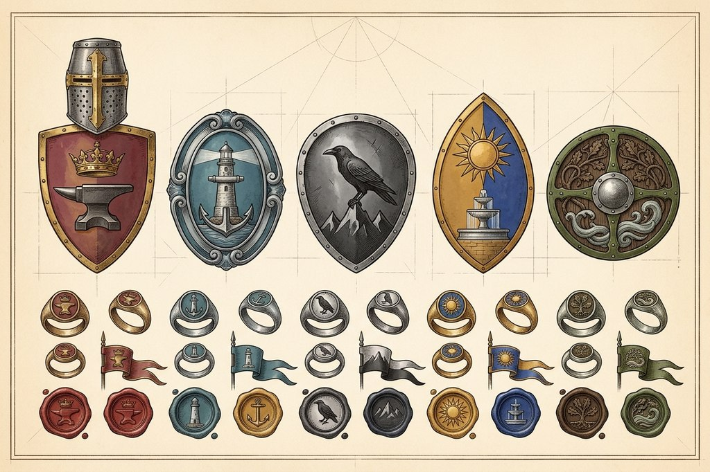

Em Alenia, "nobreza" não tem o mesmo formato em todas as terras. Um barão de Aurora governa pela terra e pelo juramento militar; um patrício de Corallis governa pelo cais, pelo livro-caixa e pelo assento no Conselho; um chefe de oásis em Gaddra governa guardando a água e a hospitalidade:

| Cultura / Domínio | Modelo de Casa & Fórmula do Nome *(Tomo V)* | Sede Típica Inicial | Bastardos | O Que Confere Legitimidade Real |
| :--- | :--- | :--- | :---: | :--- |
| **1. Reino de Aurora** *(Feudal / Clássico)* | **Casa `de / d'` [Terra]** ou **Dinástico (`-ion, -aris, -is`)** *(ex.: Casa d'Altrax, Casa Valerion, Casa Ferraris)* | Torre de Vigia (**F04**) ou Solar Rural (**F05**) | **Cinza** | Carta régia selada em Altavanne (ou subfeudo jurado a um dos **7 Grandes Feudos** `L02–L08` do **[Tomo XVII](17_Feudos_Regencias_e_Intrigas_de_Alenia.md)**) e proteção armada das vilas. |
| **2. Liga de Corallis** *(Patrício / Talassocrático)* | **Família `dal / della` [Marco]** ou **Plural `-i`** *(ex.: Casa della Rocca, Casa Falcenzo, dei Coralli)* | Solar Urbano Patrício (**F02**) ou Forte Costeiro (**F07**) | **Coral** | Assento em guilda/câmara municipal, solvência bancária, posse de navios (**Tomo XIV**) e patrocínio cívico. |
| **3. Despotado de Kalis** *(Setentrional / Ferro)* | **Casa `von` [Rocha/Forte]** ou **Composto Duro** *(ex.: Casa von Kragstad, Casa Ulscold, Hrafngard)* | Mota de Madeira Negra (**F03**) ou Escarpa (**F09**) | **Sombra** | Disciplina da guarnição, cota de madeira negra/minério entregue sem atraso e vigilância implacável das costas. |
| **4. Confederação de Gaddra** *(Solar / Clânico)* | **Clã `al-` [Marco]** ou **Dinástico `-id`** *(ex.: Clã Zaharid, Clã al-Hajar, Qarsol)* | Cácer de Oásis e Cisterna (**F06**) | **Duna** | Manutenção de poços acessíveis, respeito inviolável à *Lei da Hospitalidade* (3 dias) e mediação dos Árbitros. |
| **5. Fronteiras Silvanas** *(Pacto / Matas)* | **Linhagem / Ramo `ab / ferch`** ou **Composto Antigo** *(ex.: Ramo Brancaden, Gwaedlyn)* | Entreposto de Pacto (**F01**) ou Salão (**F03**) | **Bruma** | Custódia sustentável da mata/rio sem incêndio nem corte predatório, validada pelo Círculo de Anciãos. |

### Guia Prático de Brasões, Cores e Lemas

A heráldica de Alenia é sóbria, física e reconhecível à distância através da chuva ou da poeira de batalha — sem criaturas mágicas inexistentes no cenário:

- **Esmaltes e Metais Clássicos:** *Carmesim* (soberania, sangue pago, Chama Solar), *Ouro/Âmbar* (trigo, sol, fidelidade), *Prata/Branco* (verdade, sal, gelo limpo), *Negro/Ferro* (luto da Faixa Negra, minas, vigília noturna), *Azul-Marinho/Verde-Escuro* (rotas de Corallis, matas de Vergod).
- **Peças e Figuras Autênticas:** bigorna, ponte de pedra, torre sobre bruma, chave e tigela (*Anfitriã*), balança (*Vigia*), remo ou ampulheta (*Barqueiro*), feixe de trigo (*Semeadora*), corvo, leão de montanha, âncora, farol, cervo-férreo ou faixa negra diagonal (*memória de 356 EF*).
- **Sinal de Bastardia e Legitimação:** um bastardo reconhecido pode portar as cores paternas atravessadas por uma **cotica (faixa estreita) cinza-pedra**; caso receba *Decreto Real de Legitimação* (**Tomo II**), a faixa é substituída por uma bordadura dentada de prata ou ouro, fundando legalmente um **ramo cadete próprio**.

### Tabelas Rápidas de Raízes da Casa (`1d8`)

| `1d8` | Virtude Histórica da Casa *(Vantagem Inicial)* | Dívida, Mancha ou Ameaça Herdada *(Gancho de Campanha)* |
| :---: | :--- | :--- |
| **`1`** | **Veteranos de 356:** um ancestral lutou na *Faixa Negra*; `+1` em reações com soldados reais e veteranos. | **Hipoteca em Cera Azul:** a sede deve `2.000 PP` à *Casa Falcenzo* (**N086**), vencendo em seis meses. |
| **`2`** | ** Canteiros Antigos:** fundações de pedra pré-forja no terreno reduzem em **`-10%`** o custo da 1ª muralha/torre. | **Disputa de Divisa:** o senhor vizinho reivindica o moinho ou o bosque limítrofe com um foral contraditório. |
| **`3`** | **Mesa da Anfitriã:** fama de jamais negar abrigo honesto; moradores locais concedem **`+2`** contra espionagem externa. | **Parente Exilado ou Perjuro:** um tio ou irmão banido cavalga com corsários de Ravena ou mercenários rivais. |
| **`4`** | **Veio de Água Limpa:** nascente interna puríssima; imune a seca sazonal e `+2` contra surtos hídricos. | **Suspeita da Chama Branca:** um inquisidor investiga boatos de relíquias ou ritos antigos sob os alicerces. |
| **`5`** | **Carta de Pedágio Antiga:** direito legal de cobrar `1 PC` a `5 PC` por carroça/barcaça sem contestação do Preboste. | ** Sangue Devido:** um clã livre ou família mercante jura que a Casa lhe deve reparação por uma emboscada passada. |
| **`6`** | **Armaria Preservada:** suportes de carvalho guardam armas e cotas suficientes para equipar os primeiros `10` guardas de graça. | **Galeria Selada:** sob o porão há um túnel murado às pressas há um século que ninguém ousa reabrir. |
| **`7`** | **Vínculo Acadêmico:** correspondência regular com *Sellene* ou *Baldbella*; físico ou escriba cobra `-25%` de soldo. | **Vassalos Desconfiados:** os aldeões serviam ao antigo senhor deposto e testam cada decisão dos novos donos. |
| **`8`** | **Foral Fluvial / Costeiro:** isenção de `5%` de tarifa num porto vizinho e prioridade de atracação para `1` barco (**E01–E05**). | **Olhos de Kalgard:** a posição estratégica do feudo atraiu um informante dormente dos *Cofres de Kalis*. |

## Fortificações e sedes senhoriais

Toda sede senhorial (**F01** a **F10**) possui dois caminhos de aquisição:

- **Construção Nova (*do Zero*):** exige terreno concedido/comprado, acesso a pedra/madeira, contratação de mestre-de-obras e o **Preço Novo** pago ao longo do tempo de construção (`50%` no início, `50%` na metade).
- **Reerguer uma Ruína (*Concessão de Fronteira — `45%` do Preço Novo*):** a forma mais clássica de ascensão para personagens jogadores em Alenia (*como receber da Coroa a guarda da arruinada **Torre de Specula** após um grande feito!*). Como os alicerces, poço e muralhas brutas já existem, a reforma custa apenas **`45%` do Preço Novo** e leva **metade do tempo** — mas exige antes **expulsar ocupantes hostis** (bandidos, feras do **Tomo IV** ou perigos subterrâneos) e garantir escolta para os trabalhadores!

## Sedes iniciais de exploradores e cavaleiros

Acessíveis a partir de **`Status 1` ou `Status 2`**, permitem transformar o ouro de aventuras num ponto seguro de comando, armazenagem e renda modesta.

### F01 — Entreposto e Feitoria Fortificada de Estrada

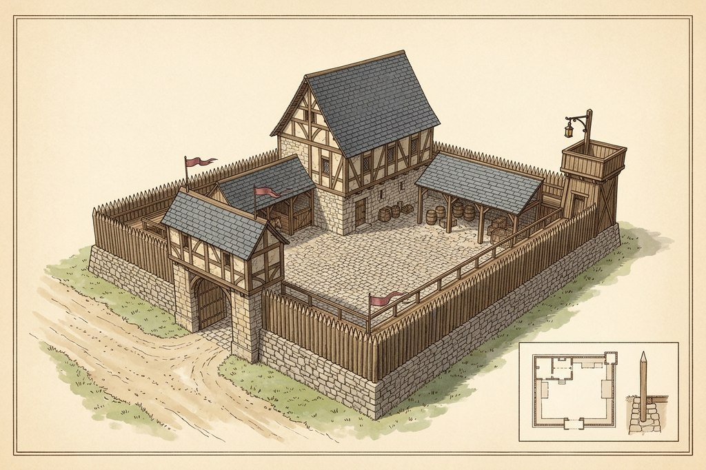

**Porte:** Sede inicial. **Status mín.:** 1 (Carta de Patente ou licença mercantil). **Preço novo:** 1.800 PP (180 PO). **Reforma de ruína:** 810 PP.
**Tempo de obra:** 2 meses (1 mês reforma). **Manutenção:** 25 PP/mês. **Guarnição:** 6 ideal / 15 máx.
**Integridade:** 180 PV · **Limiar Estrutural:** 6 · **Slots:** 1 Defesa · 2 Obras.

Pátio calçado cercado por muro baixo de pedra seca encimado por estacada grossa de madeira, portão ferrado para carroças (**Tomo IX**), galpão coberto de mercadorias, estrebaria e casa central de dois pavimentos com guarita de lanterna. Comum nas rotas entre Merlinport, Dahrma e Vergod.

**Uso em mesa e benefícios:** sustenta até **`Status 2`** no local; abriga caravanas e mulas com segurança contra lobos e bandos pequenos de salteadores, funcionando perfeitamente como base de uma companhia mercenária, entreposto fluvial ou feitoria de fronteira.

### F02 — Casa-Forte e Solar Urbano Patrício

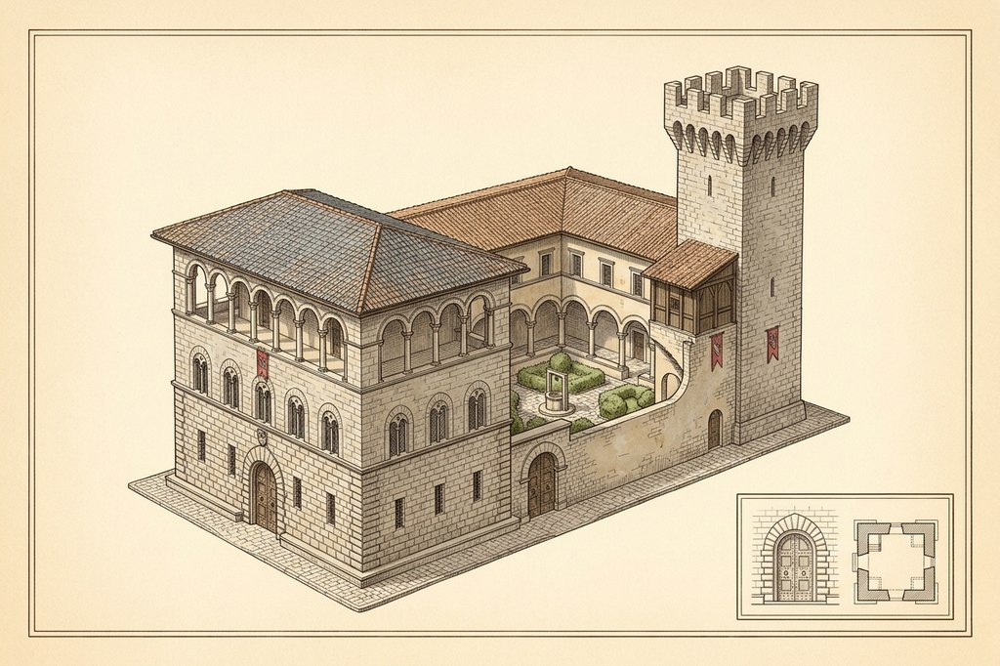

**Porte:** Sede inicial. **Status mín.:** 2. **Preço novo:** 3.500 PP (350 PO). **Reforma de ruína:** 1.575 PP.
**Tempo de obra:** 4 meses (2 meses reforma). **Manutenção:** 45 PP/mês. **Guarnição:** 10 ideal / 25 máx.
**Integridade:** 260 PV · **Limiar Estrutural:** 8 · **Slots:** 2 Defesas · 2 Obras.

Palacete urbano de cantaria rústica ao estilo das famílias mercantis de *Baldbella*, *Alineus* e da Cidade Alta de *Altavanne*: térreo sem janelas baixas externas, portal em arco cravejado de ferro, pátio interno ajardinado, salão nobre de audiências no andar superior e uma torre quadrada de refúgio contra motins de rua ou assassinos noturnos.

**Uso em mesa e benefícios:** reduz em **`-50%`** o gasto mensal do *Padrão de Vida Confortável/Abastado* do proprietário quando estiver na cidade e concede **`+2` em testes de Etiqueta & Corte e Barganha** em recepções realizadas sob o próprio teto.

### F03 — Mota com Paliçada e Salão Senhorial de Madeira

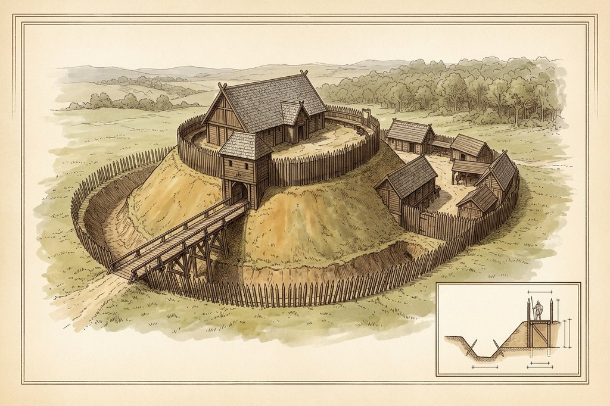

**Porte:** Sede inicial. **Status mín.:** 2. **Preço novo:** 4.800 PP (480 PO). **Reforma de ruína:** 2.160 PP.
**Tempo de obra:** 4 meses (2 meses reforma). **Manutenção:** 55 PP/mês. **Guarnição:** 18 ideal / 45 máx.
**Integridade:** 320 PV · **Limiar Estrutural:** 7 (10 se erguida em Madeira Negra em Kalis, custando `×1,5`) · **Slots:** 2 Defesas · 3 Obras.

Colina artificial ou natural de terra batida rodeada por vala seca, coroada por paliçada de troncos apontados com passadiço de ronda e um amplo salão comunal de vigas maciças ao centro. É a fortificação rápida por excelência nas clareiras de Kalis, nas margens frias de Syleth e na colonização de terras ermas.

**Uso em mesa e benefícios:** rápida de erguer onde há floresta abundante; a elevação da mota concede **`+2` na Defesa contra investidas terrestres**. Contudo, madeira comum é vulnerável a **alcatrão incendiário** (*sofre dano de fogo normal ignorando metade do `LE`, salvo se tratada com banho de cal e argila*).

## Praças-fortes menores e castelanias

Exigem normalmente **`Status 3`** (*Castelão, Barão de Terra, Síndico ou Chefe de Clã reconhecido*) e consolidam o domínio militar sobre uma estrada, passo, costa ou oásis.

### F04 — Torre de Vigia de Cantaria (*Modelo Specula*)

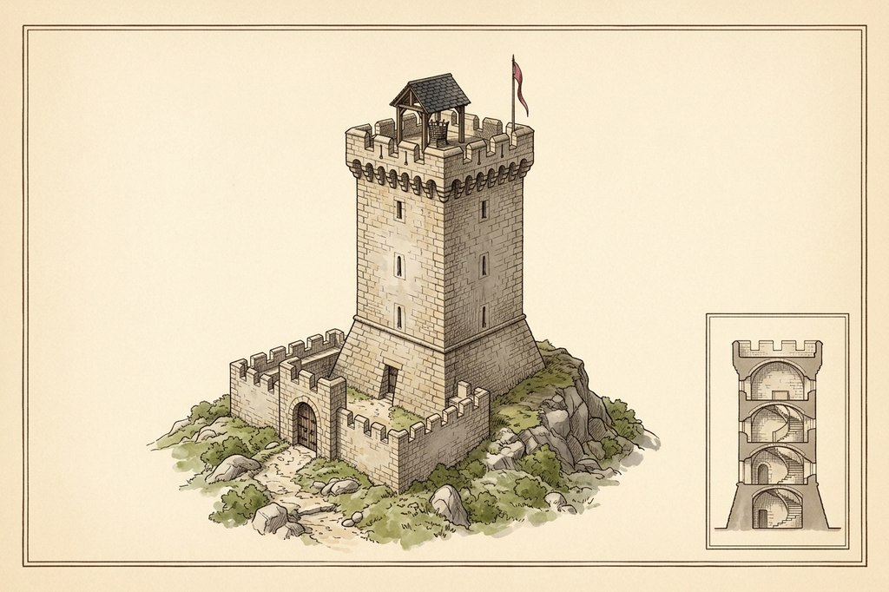

**Porte:** Praça menor. **Status mín.:** 2 (por concessão militar) ou 3. **Preço novo:** 8.000 PP (800 PO). **Reforma de ruína:** 3.600 PP (360 PO).
**Tempo de obra:** 6 meses (3 meses reforma). **Manutenção:** 75 PP/mês. **Guarnição:** 15 ideal / 35 máx.
**Integridade:** 450 PV · **Limiar Estrutural:** 10 · **Slots:** 3 Defesas · 2 Obras.

Torre maciça de pedra aparelhada com quatro pavimentos abobadados, escada em caracol no sentido horário (para dar vantagem ao braço direito de quem defende de cima!), seteiras estreitas, parapeito saliente com braseiro de sinalização no topo e pequeno pátio murado (*barmkin*) na base. Corresponde ao piso exato da tabela de propriedades do Tomo I (`8.000 PP`).

**Uso em mesa e benefícios:** enxerga movimentos de tropas ou fumaça a **`20 km` em tempo limpo** (`+4` em Percepção regional contra surpresa); imune a incêndio externo comum e defensável até por meia dúzia de besteiros determinados.

### F05 — Solar Rural Fortificado e Quinta Murada

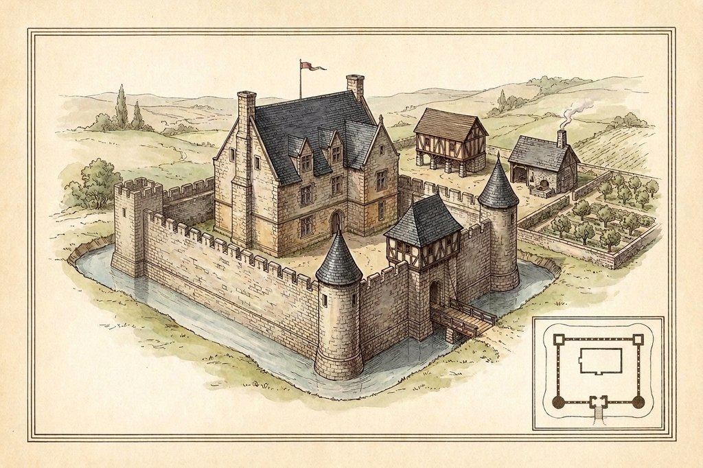

**Porte:** Praça menor. **Status mín.:** 3. **Preço novo:** 14.000 PP (1.400 PO). **Reforma de ruína:** 6.300 PP.
**Tempo de obra:** 9 meses (4,5 meses reforma). **Manutenção:** 120 PP/mês. **Guarnição:** 25 ideal / 60 máx.
**Integridade:** 580 PV · **Limiar Estrutural:** 10 · **Slots:** 3 Defesas · 5 Obras.

A sede clássica dos barões agrícolas do Vale de Dahrma, das colinas vinícolas de Biemont e dos cavaleiros de terra: uma casa senhorial de pedra de dois andares protegida por muralha retangular ameada, duas torretas circulares de flanqueamento, portaria sobre pequeno fosso e amplo espaço produtivo para celeiros, forja e pomares.

**Uso em mesa e benefícios:** equilibra defesa sólida com **5 Slots de Obra**, sendo a melhor sede de porte médio para gerar superávit econômico mensal em prata e sustentar o *Padrão de Vida Abastado* da família.

### F06 — Cácer de Oásis e Cisterna Fortificada (*Gaddra*)

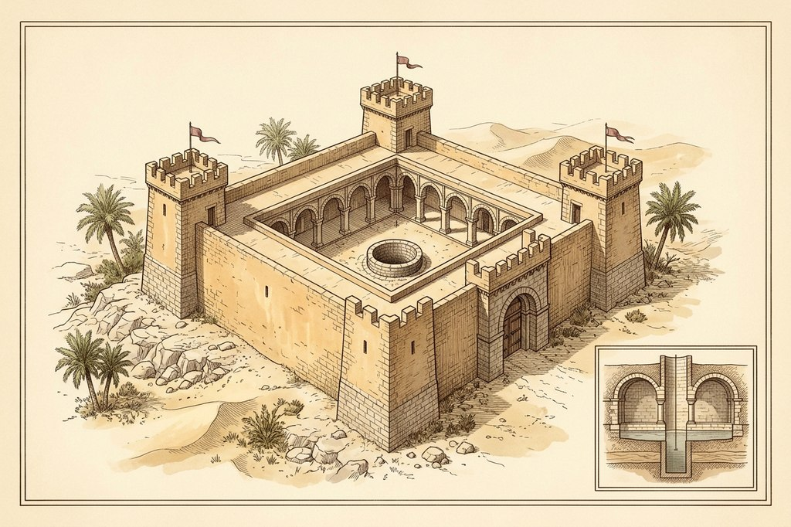

**Porte:** Praça menor. **Status mín.:** 3. **Preço novo:** 16.000 PP (1.600 PO). **Reforma de ruína:** 7.200 PP.
**Tempo de obra:** 10 meses (5 meses reforma). **Manutenção:** 130 PP/mês. **Guarnição:** 30 ideal / 75 máx.
**Integridade:** 640 PV · **Limiar Estrutural:** 11 · **Slots:** 4 Defesas · 4 Obras.

Fortaleza árida (*Qal- / Ksar*) erguida em blocos espessos de arenito ocre e calcário talhado ao redor de um poço profundo ou braço de aquífero: paredes externas inclinadas e cegas contra o calor e tempestades de areia, quatro torres quadradas de vigia e galerias internas frescas sombreando a água — o verdadeiro ouro do deserto.

**Uso em mesa e benefícios:** já inclui **reserva hídrica inviolável** equivalente a meia *Cisterna Abobadada* (`+30 dias` de água em cerco no deserto, onde sitiantes externos sofrem testes diários de sede!) e atrai automaticamente caravanas da Rota do Sal dispostas a pagar pedágio justo por pouso seguro.

### F07 — Forte Costeiro e Torre de Corrente Portuária

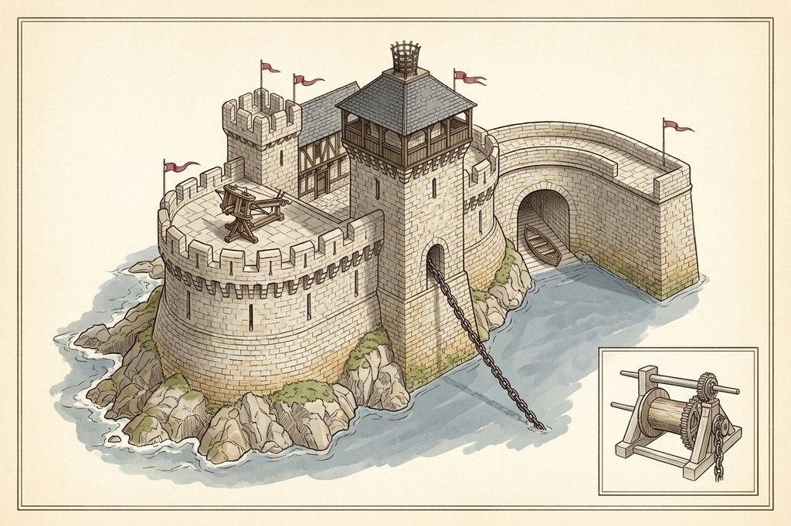

**Porte:** Praça menor. **Status mín.:** 3. **Preço novo:** 18.500 PP (1.850 PO). **Reforma de ruína:** 8.325 PP.
**Tempo de obra:** 12 meses (6 meses reforma). **Manutenção:** 155 PP/mês. **Guarnição:** 35 ideal / 85 máx.
**Integridade:** 720 PV · **Limiar Estrutural:** 12 · **Slots:** 4 Defesas · 4 Obras.

Bastião marítimo plantado sobre promontório rochoso na boca de uma enseada ou canal fluvial (*no teto de `8.000–20.000 PP` do Tomo I*): muralha curva quebra-mar, embarcadouro abrigado na rocha, plataforma superior para *Balistas Navais* (**M15**) e casa do cabrestante capaz de esticar uma **corrente pesada de ferro** fechando o porto a navios invasores.

**Uso em mesa e benefícios:** abriga até **2 embarcações médias (`E01`–`E08`)** livres de taxas portuárias; quando a corrente está erguida, nenhum navio entra ou sai da enseada sem arrebentá-la (`LE 12, 120 PV`) ou tomar a torre de assalto.

## Castelos, fortalezas de escarpa e cidadelas

Grandes obras de cantaria militar reservadas a senhores consolidados (**`Status 3` alto a `Status 5`**), alianças mercantis ou projetos de longo prazo financiados ao longo de várias campanhas.

### F08 — Castelo Feudal de Cantaria com Barbacã

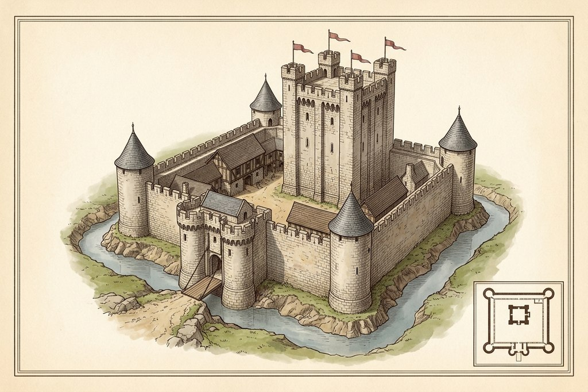

**Porte:** Grande fortaleza. **Status mín.:** 3 (com foral real) ou 4. **Preço novo:** 36.000 PP (3.600 PO). **Reforma de ruína:** 16.200 PP.
**Tempo de obra:** 24 meses (12 meses reforma). **Manutenção:** 280 PP/mês. **Guarnição:** 70 ideal / 180 máx.
**Integridade:** 1.200 PV · **Limiar Estrutural:** 14 · **Slots:** 6 Defesas · 6 Obras.

O castelo concêntrico clássico de Alenia: alta **Torre de Menagem** central (*último reduto independente mesmo que o pátio caia*), pano de muralha de pedra com quatro tambores redondos que eliminam pontos cegos contra sapa, ponte levadiça e pátio interno amplo para quartéis, estábulos e oficinas.

**Uso em mesa e benefícios:** sustenta plenamente **`Status 4`**; caso a muralha externa seja rompida num cerco, a Torre de Menagem conserva **`400 PV` próprios** e exige um segundo assalto separado para ser tomada.

### F09 — Fortaleza de Escarpa e Rocha Escavada (*Rubecina / Kragstad*)

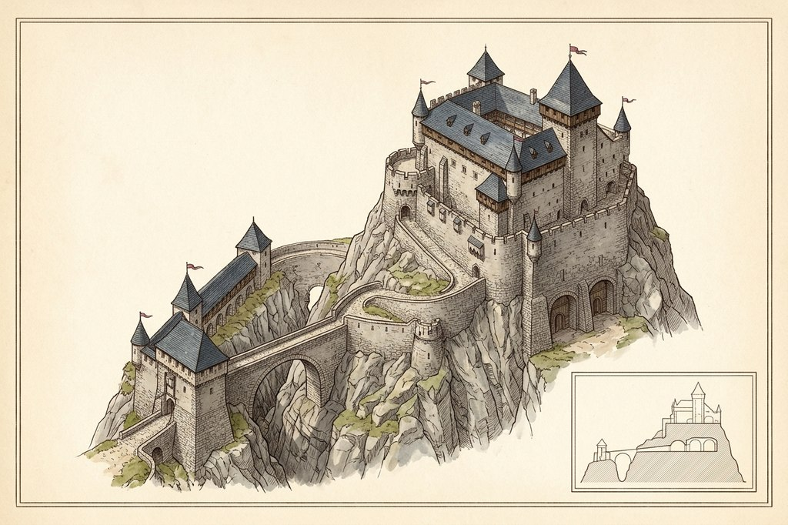

**Porte:** Grande fortaleza. **Status mín.:** 4. **Preço novo:** 65.000 PP (6.500 PO). **Reforma de ruína:** 29.250 PP.
**Tempo de obra:** 36 meses (18 meses reforma). **Manutenção:** 420 PP/mês. **Guarnição:** 110 ideal / 280 máx.
**Integridade:** 1.650 PV · **Limiar Estrutural:** 16 · **Slots:** 7 Defesas · 5 Obras.

Inspirada nos baluartes de *Vaarsa* nos Picos de Rubecina e *Kragstad* em Kalis: erguida sobre esporão granítico vertical acessível apenas por rampa estreita em ziguezague varrida por seteiras e ponte sobre abismo, com paióis de mantimentos e salões escavados diretamente na rocha viva.

**Uso em mesa e benefícios:** **imune a Torres de Cerco com rodas e a túneis de sapa comuns** (devido à rocha maciça); exércitos invasores só conseguem atacar pela frente estreita, anulando qualquer vantagem numérica superior a `2 para 1` nas muralhas.

### F10 — Cidadela e Paço Senhorial de Grande Casa

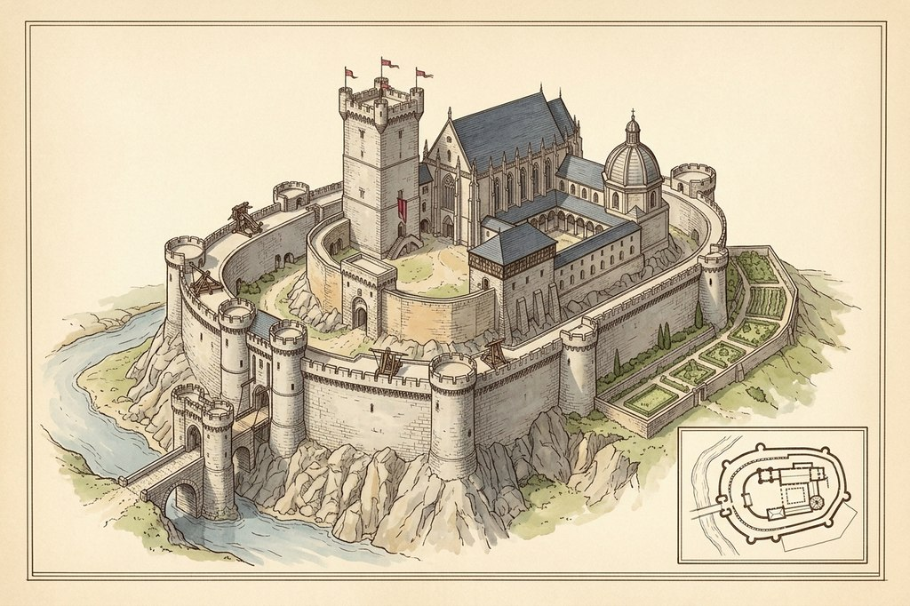

**Porte:** Grande fortaleza. **Status mín.:** 4 ou 5. **Preço novo:** 110.000 PP (11.000 PO). **Reforma de ruína:** 49.500 PP.
**Tempo de obra:** 48 meses (24 meses reforma). **Manutenção:** 750 PP/mês. **Guarnição:** 200 ideal / 500 máx.
**Integridade:** 2.400 PV · **Limiar Estrutural:** 18 · **Slots:** 9 Defesas · 9 Obras.

Complexo monumental de dupla cinta murada digno das capitais provinciais das Grandes Casas (*como Altrax, Aeraneas ou Drakenhall*): muralha externa guarnecida por engenhos de torção, pátio militar separado da corte interna, Grande Salão abobadado para cem convivas, capela consagrada, arquivo selado, tesouraria blindada e jardins em terraço.

**Uso em mesa e benefícios:** sede definitiva de fim de campanha (*Patamar Lenda/Épico*); concede **`+3` em diplomacia, recepção de embaixadores e convocação de vassalos**, podendo abrigar centenas de refugiados das vilas vizinhas durante uma guerra continental.

### Resumo Comparativo das Fortificações (`F01`–`F10`)

| Cód. | Fortificação / Sede | Status | Preço Novo | Reforma (`45%`) | Obra | Manut./Mês | Guarn. (Ideal/Máx) | Integridade / LE | Slots (Def/Obra) |
| :---: | :--- | :---: | :---: | :---: | :---: | :---: | :---: | :---: | :---: |
| **F01** | Entreposto de Estrada | `1+` | `1.800 PP` | `810 PP` | `2 m` | `25 PP` | `6 / 15` | `180 / 6` | `1D · 2O` |
| **F02** | Solar Urbano Patrício | `2+` | `3.500 PP` | `1.575 PP` | `4 m` | `45 PP` | `10 / 25` | `260 / 8` | `2D · 2O` |
| **F03** | Mota e Paliçada | `2+` | `4.800 PP` | `2.160 PP` | `4 m` | `55 PP` | `18 / 45` | `320 / 7` | `2D · 3O` |
| **F04** | Torre de Cantaria | `2–3` | `8.000 PP` | `3.600 PP` | `6 m` | `75 PP` | `15 / 35` | `450 / 10` | `3D · 2O` |
| **F05** | Solar Rural Fortificado | `3+` | `14.000 PP` | `6.300 PP` | `9 m` | `120 PP` | `25 / 60` | `580 / 10` | `3D · 5O` |
| **F06** | Cácer de Oásis (Gaddra) | `3+` | `16.000 PP` | `7.200 PP` | `10 m` | `130 PP` | `30 / 75` | `640 / 11` | `4D · 4O` |
| **F07** | Forte Costeiro / Corrente | `3+` | `18.500 PP` | `8.325 PP` | `12 m` | `155 PP` | `35 / 85` | `720 / 12` | `4D · 4O` |
| **F08** | Castelo de Cantaria | `3–4` | `36.000 PP` | `16.200 PP` | `24 m` | `280 PP` | `70 / 180` | `1.200 / 14` | `6D · 6O` |
| **F09** | Fortaleza de Escarpa | `4+` | `65.000 PP` | `29.250 PP` | `36 m` | `420 PP` | `110 / 280` | `1.650 / 16` | `7D · 5O` |
| **F10** | Cidadela de Grande Casa | `4–5` | `110.000 PP` | `49.500 PP` | `48 m` | `750 PP` | `200 / 500` | `2.400 / 18` | `9D · 9O` |

## Defesas militares e engenhos de muralha sem pólvora

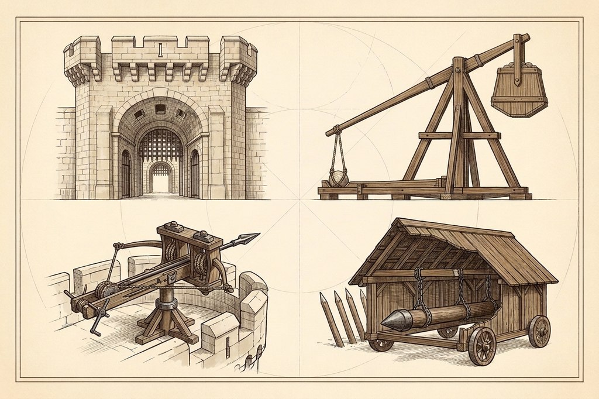

Cada melhoria defensiva abaixo (**D01** a **D08**) ocupa **1 Slot de Defesa** da fortificação. Como não existe pólvora em Alenia, muralhas bem desenhadas multiplicam enormemente a força de uma pequena guarnição contra exércitos maiores.

### D01 — Fosso Perimetral (*Seco com Estacas ou Alagado*)

**Tipo:** Defesa estrutural. **Custo:** 600 PP *(900 PP alagado com comporta)*. **Manutenção:** 5 PP/mês. **Bônus:** `+80 PV` de Integridade.

Vala de seis metros de largura por quatro de profundidade escavada ao pé da cortina externa, forrada de estacas aguçadas endurecidas ao fogo ou alimentada por desvio de córrego.

**Efeito em cerco:** **impede a aproximação de Torres de Cerco, Aríetes e Escadas** até que os sitiantes gastem pelo menos **`2 dias` sob tiro direto** aterrando uma passagem de fascinas e terra.

### D02 — Portão Duplo com Rastrilho de Ferro e *Mata-Cães*

**Tipo:** Defesa estrutural. **Custo:** 950 PP. **Manutenção:** 8 PP/mês. **Bônus:** `+100 PV` de Integridade e `+2` no `LE` do portão.

Passagem abobadada fechada nas duas pontas por grades levadiças de ferro forjado (*rastrilhos*) acionadas por guincho superior, com aberturas verticais no teto da abóbada (*mata-cães*).

**Efeito em cerco:** se invasores romperem a folha externa ou encostarem um aríete, ficam presos no túnel interno sofrendo **`3d6` por rodada/assalto** de pedras, água fervente, óleo de alcatrão ou **Cal Virgem (M18)** lançados do andar de cima sem que os defensores fiquem expostos!

### D03 — Barbacã Avançada de Flanqueamento

**Tipo:** Defesa estrutural. **Custo:** 1.800 PP *(exige **F04+**)*. **Manutenção:** 15 PP/mês. **Bônus:** `+180 PV` de Integridade e `+2` na Defesa de Cerco.

Fortim avançado erguido diante da ponte de entrada em ângulo quebrado, impedindo que tropas inimigas ganhem embalo em linha reta contra o portão principal.

**Efeito em cerco:** absorve o primeiro assalto inteiro antes que a muralha principal possa ser tocada e concede fogo cruzado pelas costas contra qualquer tropa que tente forçar a entrada.

### D04 — Caminho de Ronda Coberto e Galerias de Madeira (*Cadafalso*)

**Tipo:** Defesa estrutural. **Custo:** 1.200 PP. **Manutenção:** 10 PP/mês. **Bônus:** `+90 PV` de Integridade.

Galeria saliente de carvalho tratado com argila e vinagre contra fogo (ou merlões de pedra fechados com portinholas basculantes) ao longo do topo das muralhas.

**Efeito em cerco:** besteiros e arqueiros da guarnição (**G03**) recebem **cobertura superior (`+4` na Defesa)** contra disparos vindos do solo e podem atirar verticalmente no pé do muro sem se inclinar para fora.

### D05 — Bateria de Torre (*2 Escorpiões + 1 Balista de Muralha*)

**Tipo:** Engenho de defesa. **Custo:** 850 PP. **Manutenção:** 12 PP/mês. **Requisito:** 1 equipe de **G07** *(ou PJs treinados)*.

Conjunto fixo de artilharia de precisão de *Stoneforge* instalado nos terraços das torres, protegido da chuva por toldos encerados e suprido com `40` virotes pesados de ferro.

**Efeito em cerco:** permite alvejar comandantes inimigos, manteletes e aríetes a até **`180m`** (`2d8` nos escorpiões; `4d8` estrutural ignorando `4 LE` na balista — mesmas regras de **M13** e **M15** do **Tomo XIV**!).

### D06 — Trabuco de Contrapeso Fixo (*Trebuchet Senhorial*)

**Tipo:** Engenho pesado. **Custo:** 1.400 PP *(exige **F04+** e **G07**)*. **Manutenção:** 18 PP/mês. **Alcance:** `60m` a `250m` *(não dispara colado ao muro)*.

A mais devastadora máquina de guerra sem pólvora do continente: uma haste longa de freixo laminado articulada num cavalete pesado, movida por uma caixa oscilante carregada com cinco toneladas de pedra e sucata de ferro.

**Efeito em cerco:** arremessa blocos de `80 kg` (`6d8` estrutural, ignorando **`8` pontos de `LE`**, capaz de esmagar trabucos e torres de cerco inimigas antes que alcancem o fosso!) ou tonéis de alcatrão ardente (`3d6` fogo em área de `6m × 6m`).

### D07 — Cisterna Abobadada e Celeiro Selado

**Tipo:** Logística de cerco. **Custo:** 1.100 PP. **Manutenção:** 6 PP/mês. **Bônus:** Autonomia de cerco dobrada (`60+ dias`).

Reservatório subterrâneo revestido em argamassa hidráulica impermeável para coletar água da chuva dos telhados, ladeado por silos secos vedados com cal contra ratos e umidade.

**Efeito em cerco:** **dobra o tempo que a fortaleza suporta sitiada sem fome nem sede** (`de 30 para 60 dias` com guarnição máxima, ou `120 dias` com guarnição ideal) e aumenta em **`+4` a CD** contra qualquer tentativa de envenenar a água ou incendiar os víveres.

### D08 — Poterna Secreta e Galeria de Sortida

**Tipo:** Tática e evasão. **Custo:** 1.300 PP. **Manutenção:** 5 PP/mês. **Descoberta externa:** *Percepção / Investigação CD 21*.

Túnel estreito escavado sob o alicerce saindo atrás de um afloramento rochoso, bosque ou margem de rio a duzentos metros da muralha, trancado por dentro com duas grades de ferro.

**Efeito em cerco:** permite que os **PJs lancem Sortidas Noturnas com surpresa** para incendiar máquinas de cerco inimigas, enviar mensageiros pedindo socorro a aliados ou evacuar civis e tesouros se a praça estiver condenada!

## Obras produtivas e infraestrutura do feudo

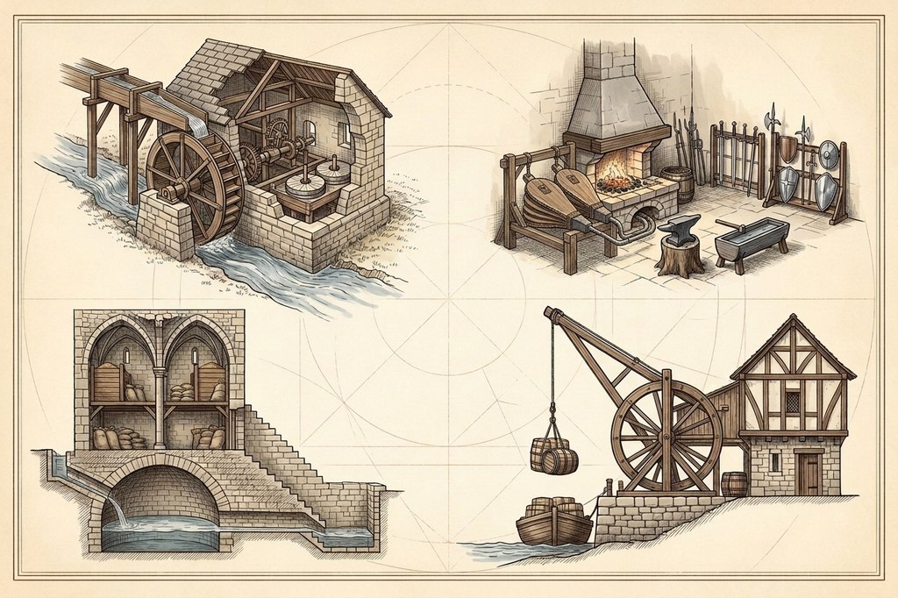

Um castelo sem terras nem ofícios é um ralo interminável de prata. As obras abaixo (**D09** a **D16**) ocupam **1 Slot de Obra** *(exceto **D09**, que fica nas terras ao redor da sede, limitado a `1` por porte Inicial, `3` em Praça Menor e `6` em Grande Fortaleza)* e geram **Receita Líquida Mensal** já descontados insumos básicos:

### D09 — Aldeia Arrendada e Terras de Lavoura

**Tipo:** Renda rural *(fora dos muros)*. **Custo de fomento/demarcação:** 2.200 PP *(muitas vezes `1` aldeia já vem incluída numa Concessão Real de `Status 3+`)*. **Receita líquida:** `+85 PP/mês`.

Vinte a quarenta famílias camponesas livres cultivando centeio, trigo, cevada e hortas sob proteção da Casa, pagando foro justo em grão e prata sem extorsão.

**Benefício adicional:** reduz em **`-15%` o custo mensal da guarnição** (até `25` soldados por aldeia) graças ao fornecimento direto de pão, aveia e lenha, além de disponibilizar até `10` milicianos (**G01**) em caso de invasão direta das terras.

### D10 — Moinho Hidráulico ou de Vento

**Tipo:** Obra produtiva (`1 Slot`). **Custo:** 1.600 PP. **Receita líquida:** `+65 PP/mês`.

Roda d'água de carvalho e mós de pedra de *Lavroga* movidas por ribeirão ou vento de colina, cobrando taxa de moagem de todas as quintas vizinhas.

**Benefício adicional:** combinado a pelo menos uma *Aldeia Arrendada* (**D09**), gera **`+15 PP/mês` extras de sinergia agrícola** (`total +80 PP/mês`) e garante farinha fresca constante no inverno.

### D11 — Estalagem Murada e Posto de Pedágio Licenciado

**Tipo:** Obra comercial (`1 Slot`). **Custo:** 1.800 PP *(fiel ao Tomo I: `1.200–3.000 PP`)*. **Receita líquida:** `+75 PP/mês`.

Pouso seguro de estrada com cocheira, taverna limpa e cancela oficial para manutenção do caminho ou ponte local *(exige licença ou Carta de Pedágio para não atrair intervenção do Preboste!)*.

**Benefício adicional:** viajantes, mercadores e batedores passam diariamente pelo balcão — concede **`+2` em testes para colher rumores regionais** sem sair do feudo.

### D12 — Forja Senhorial e Armaria

**Tipo:** Obra artesanal (`1 Slot`). **Custo:** 1.500 PP *(exige contratar **G10** Mestre Ferreiro)*. **Receita líquida:** `+50 PP/mês` *(venda de ferraduras, arados e cravos locais)*.

Oficina completa com fole duplo, bigorna fixa, têmpera e suportes de armas.

**Benefício adicional:** reduz em **`-20%` o custo de equipamento inicial de novos soldados (`G01–G06`)**, permite fabricar virotes de balista pela metade do preço e habilita reparos completos em armas e armaduras do grupo entre aventuras.

### D13 — Pedreira de Cantaria ou Serraria Hidráulica

**Tipo:** Obra extrativa (`1 Slot`). **Custo:** 2.000 PP *(exige ao menos `2` trabalhadores **G08/G09**)*. **Receita líquida:** `+80 PP/mês`.

Extração organizada de blocos de pedra aparelhada ou tábuas estruturais curadas.

**Benefício adicional:** reduz em **`-15%` o custo em prata de todas as futuras obras, muralhas, reformas ou ampliações** realizadas no próprio domínio!

### D14 — Armazém Mercantil ou Cais Fluvial/Costeiro

**Tipo:** Obra comercial (`1 Slot`, exige rio navegável ou costa). **Custo:** 2.400 PP *(fiel ao Tomo I: `40–120 PP/mês`)*. **Receita líquida:** `+110 PP/mês`.

Trapiche de pedra e madeira com guindaste de carga, balança aferida e galpão seco à prova de enchentes.

**Benefício adicional:** permite atracar embarcações de até porte **E05** (*Escuna*) sem custo de doca e aumenta em **`+15%`** o lucro de cargas comerciais trazidas pelos próprios PJs.

### D15 — Ervanário Murado, Enfermaria e Capela

**Tipo:** Obra de suporte (`1 Slot`). **Custo:** 1.300 PP *(ideal com **G13** Físico/Herbalista)*. **Receita líquida:** `+20 PP/mês` *(botica e ofertas voluntárias)*.

Jardim medicinal protegido do vento cultivando espécies úteis do **[Tomo X — Herbário de Seleni](10_Herbario_de_Seleni.md)** (*como **H01** folha-de-lareira e **H03** flor-do-vigia*), enfermaria arejada de seis leitos e oratório consagrado.

**Benefício adicional:** reduz **pela metade as mortes de soldados feridos** após batalhas/cercos, reduz o tempo de cura de *Ferimentos Graves* dos PJs no feudo e concede o bônus oficial de **`+2` (*Local Consagrado*)** para vigílias de *Fé Verdadeira*.

### D16 — Coudelaria e Pátio de Montarias

**Tipo:** Obra militar/comercial (`1 Slot`). **Custo:** 1.900 PP. **Receita líquida:** `+60 PP/mês` *(venda de potros e mulas)*.

Piquetes cercados, ferradoria e pista de adestramento para cavalos de estrada, cavalos de guerra ou montarias do deserto (*OX*).

**Benefício adicional:** reduz em **`-10 PP/mês`** a manutenção de cada *Patrulheiro Montado* (**G05**) e *Cavaleiro Retido* (**G06**) da Casa, e mantém montarias descansadas de reserva para os PJs.

## Tropas de guarnição e patrulha

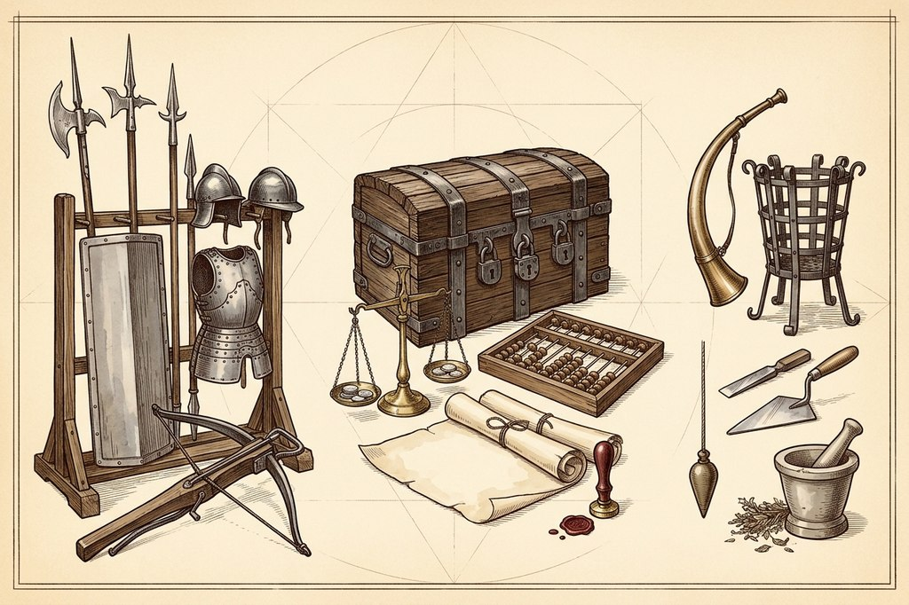

A tabela e as fichas abaixo (**G01** a **G14**) fixam os custos reais de manter gente leal a serviço permanente da Casa. Note a diferença fundamental em relação aos mercenários avulsos de estrada do Tomo I (`2 a 5 PP/dia` por risco curto sem teto): **num feudo estável, com alojamento, panela do quartel (`C37`–`C40` do Tomo XII) e contrato contínuo**, o pagamento mensal é muito mais econômico — exigindo em troca que o senhor não atrase o soldo nem abandone seus homens.

### G01 — Miliciano e Vigia de Portão

**Categoria:** Tropa de guarnição. **Equip. inicial:** 15 PP *(lança, gibão, apito/lanterna)*. **Mensalidade:** 12 PP/mês. **Índice de Defesa:** +1.

Moradores jovens treinados aos domingos para guardar cancelas, tocar o sino de alarme e manter rondas contra ladrões. Em combate pessoal usam base de guarda iniciante (`14 PV, Defesa 13, Lança +3, 1d8+1`).

### G02 — Soldado Regular (*Lanceiro e Escudeiro*)

**Categoria:** Tropa de guarnição. **Equip. inicial:** 35 PP *(couro batido, escudo médio, lança/espada curta)*. **Mensalidade:** 22 PP/mês. **Índice de Defesa:** +2.

A espinha dorsal profissional de qualquer castelo — utiliza exatamente a ficha auditada do **Guarda de Cidade / Soldado de Aurora** do **[Tomo IV — Bestiário](04_Bestiario_Alenia.md)** (`24 PV, Defesa 16, Proteger Aliado`).

### G03 — Besteiro ou Arqueiro de Muralha

**Categoria:** Tropa de guarnição. **Equip. inicial:** 45 PP *(besta leve/arco longo, couro batido, 40 virotes/flechas)*. **Mensalidade:** 24 PP/mês. **Índice de Defesa:** +2,5 *(em fortificação)*.

Essenciais para manter sitiantes longe do fosso; quando posicionados sobre *Caminho de Ronda Coberto* (**D04**), dizimam carregadores de escadas com risco mínimo.

### G04 — Infante Pesado e Sargento Veterano

**Categoria:** Tropa de guarnição. **Equip. inicial:** 90 PP *(brigantina/cota de malha, escudo pesado, arma marcial)*. **Mensalidade:** 40 PP/mês. **Índice de Defesa:** +4.

Veterano calejado capaz de segurar uma brecha de portão ou comandar `10` soldados regulares impedindo debandada sob fogo ou pavor.

### G05 — Patrulheiro e Batedor Montado

**Categoria:** Tropa montada. **Equip. inicial:** 140 PP *(inclui cavalo de estrada, sela, lança leve/arco curto)*. **Mensalidade:** 48 PP/mês *(38 PP com Coudelaria **D16**)*. **Índice de Defesa:** +3.

Mantém as estradas do feudo livres de salteadores (protegendo a receita de **D09** e **D11**) e garante aviso antecipado de `2 dias` sobre qualquer coluna hostil marchando na região.

### G06 — Cavaleiro Juramentado Retido (*Homem-de-Armas*)

**Categoria:** Tropa montada de elite. **Equip. inicial:** 220 PP *(0 PP se já vier com cavalo de guerra e arnês próprio)*. **Mensalidade:** 75 PP/mês *(65 PP com **D16**)*. **Índice de Defesa:** +6.

Combatente de elite consagrado (`Sor / Dama`) vinculado por homenagem à Casa dos PJs: lidera sortidas devastadoras, comanda a praça na ausência do grupo e representa o brasão em concílios.

### G07 — Artilheiro e Engenheiro de Muralha

**Categoria:** Especialista militar. **Equip. inicial:** 50 PP. **Mensalidade:** 35 PP/mês. **Índice de Defesa:** +3 *(habilita **D05** e **D06**)*.

Especialista treinado nas oficinas de *Stoneforge* ou *Lavroga* para operar balistas de torção, calibrar trabucos de contrapeso e escorar muros atingidos por aríetes.

## Trabalhadores, artífices e corte doméstica

### G08 — Trabalhador Braçal e Servo Livre Assalariado

**Categoria:** Mão de obra civil. **Contratação:** 0 PP. **Mensalidade:** 9 PP/mês *(3 PC/dia exatos do Tomo I)*.

Lavradores avulsos, carregadores de pedra, cavalariços, cozinheiros de caldeirão e cavadores de fosso. Cada grupo de `5` trabalhadores extras numa construção reduz o tempo de obra em `-10%` (até `-20%`).

### G09 — Pedreiro ou Carpinteiro de Obra

**Categoria:** Artífice qualificado. **Contratação:** 10 PP. **Mensalidade:** 18 PP/mês.

Artífice qualificado que mantém telhados, pontes e empenas intactos (reduzindo a manutenção estrutural de **F04–F10** em `-5 PP/mês` cada, até `3` artífices) e opera pedreiras/serrarias (**D13**).

### G10 — Mestre Ferreiro e Armeiro Residente

**Categoria:** Artífice qualificado. **Contratação:** 25 PP. **Mensalidade:** 30 PP/mês.

Requisito para operar a *Forja Senhorial* (**D12**); mantém todo o arsenal da guarnição afiado e fabrica ferragens de portão sem depender da cidade.

### G11 — Senescal e Meirinho Administrador

**Categoria:** Oficial da corte. **Contratação:** 30 PP. **Mensalidade:** 45 PP/mês.

O cargo civil mais valioso para aventureiros que viajam: guarda as chaves do celeiro, julga pequenas rixas rurais, escritura contas e **aumenta em `+10%` toda a Receita Bruta das obras do feudo**, impedindo desvios na ausência do Senhor!

### G12 — Mestre de Armas da Casa

**Categoria:** Oficial da corte. **Contratação:** 30 PP. **Mensalidade:** 40 PP/mês.

Veterano instrutor que eleva a prontidão da tropa (**`+10%` no Índice de Defesa total da guarnição** e `+1` nos testes de moral em cerco).

### G13 — Físico Cirurgião ou Herbalista Residente

**Categoria:** Oficial da corte. **Contratação:** 35 PP. **Mensalidade:** 35 PP/mês.

Formado em *Baldbella* ou nas trilhas do Herbário: previne epidemias no feudo, potencializa o *Ervanário* (**D15**) e entrega gratuitamente aos PJs `2 doses` mensais de *Cataplasma de Ervas* ou `1` *Antídoto Comum* quando retornam à sede.

### G14 — Mestre de Sussurros e Olheiro da Casa

**Categoria:** Oficial da corte. **Contratação:** 40 PP *(exige confiança ou `Submundo 1+`)*. **Mensalidade:** 50 PP/mês.

Coordena estalajadeiros, porqueiros e mensageiros discretos: concede **`+3` em testes de contraespionagem** para descobrir traidores comprados no portão, tentativas de envenenamento ou planos de ataque antes que aconteçam.

### Tabela Resumo da Folha Mensal (`G01`–`G14`)

| Cód. | Função na Casa | Custo Inicial | Mensalidade | Papel Principal |
| :---: | :--- | :---: | :---: | :--- |
| **G01** | Miliciano / Vigia | `15 PP` | `12 PP` | Ronda básica, alarme (`Defesa +1`) |
| **G02** | Soldado Regular | `35 PP` | `22 PP` | Linha de escudo e muralha (`Defesa +2`) |
| **G03** | Besteiro / Arqueiro | `45 PP` | `24 PP` | Tiro de muralha (`Defesa +2,5`) |
| **G04** | Infante Pesado / Sargento | `90 PP` | `40 PP` | Segura brechas e moral (`Defesa +4`) |
| **G05** | Patrulheiro Montado | `140 PP` | `48 PP` | Limpa estradas, alerta `2 dias` antes (`Defesa +3`) |
| **G06** | Cavaleiro Retido | `220 PP` | `75 PP` | Comando e choque pesado (`Defesa +6`) |
| **G07** | Artilheiro / Engenheiro | `50 PP` | `35 PP` | Opera **D05/D06** e repara muros (`Defesa +3`) |
| **G08** | Trabalhador Braçal | `0 PP` | `9 PP` | Lavoura, carga e escavação (`3 PC/dia`) |
| **G09** | Pedreiro / Carpinteiro | `10 PP` | `18 PP` | Opera **D13** e reduz manutenção (`-5 PP`) |
| **G10** | Mestre Ferreiro | `25 PP` | `30 PP` | Opera **D12** (`-20%` equip. militar) |
| **G11** | Senescal Administrador | `30 PP` | `45 PP` | Governa na ausência e dá **`+10%` Receita** |
| **G12** | Mestre de Armas | `30 PP` | `40 PP` | Treina tropa (**`+10%` Índice de Defesa**) |
| **G13** | Físico / Herbalista | `35 PP` | `35 PP` | Saúde do feudo + `2` cataplasmas/mês |
| **G14** | Mestre de Sussurros | `40 PP` | `50 PP` | Contraespionagem (`+3` contra traição/sabotagem) |

## Gestão mensal do feudo e regras de cerco

O domínio dos jogadores nunca deve transformar a sessão numa planilha interminável. Toda a contabilidade resolve-se em **dois minutos ao virar o mês de campanha**:

### 1. O Balanço Mensal em Três Passos

1. **Somar a Receita Bruta (`PP/mês`):** some a renda de todas as obras ativas (**D09** a **D16**). Se a Casa tiver um **Senescal (`G11`)** *(ou se um PJ com `Barganha/Administração` passar o mês inteiro gerindo pessoalmente o feudo e vencer `CD 14`)*, acrescente **`+10%`**.
2. **Descontar Manutenção e Folha Salarial:** subtraia a manutenção estrutural da sede (**F01**–**F10**, aplicando reduções de **G09**), das defesas (**D01**–**D08**) e os salários de toda a gente contratada (**G01**–**G14**, aplicando descontos de **D09** e **D16**). *(Se o feudo for vassalo tributário direto, reserve `10%` da receita líquida anual para o dízimo/imposto real.)*
3. **Atualizar o Cofre da Casa:**
   - **Saldo Positivo:** acumula-se em prata na tesouraria da fortaleza para financiar novas obras, campanhas ou empréstimos.
   - **Cofre Vazio / Atraso de Soldo:** `1 mês` de atraso impõe `-2` na moral da guarnição; `2 meses` provocam deserção de metade das tropas pagas e paralisação das oficinas!

### 2. Eventos Sazonais de Domínio (`1d12` — 1× por Estação)

| `1d12` | Acontecimento nas Terras da Casa | Efeito e Escolha do Senhor |
| :---: | :--- | :--- |
| **`1`** | **Inverno / Seca Severa** | Receita rural (**D09, D10**) cai pela metade neste mês; abrir os celeiros gratuitamente evita perda de população e eleva a lealdade (`+2` moral). |
| **`2`** | **Bando de Salteadores ou Fera** | Ameaça corta a estrada: se não houver *Patrulheiros* (**G05**) nem intervenção dos PJs, **D11/D14** não rendem neste mês. |
| **`3`** | **Intimação ou Fiscal da Coroa** | Um magistrado ou arauto chega verificando pesos, licenças de pedágio ou convocando `10` lanças para escolta real. |
| **`4`** | **Rixa de Fronteira / Água** | Pastores da Casa e homens de um senhor vizinho trocam golpes na divisa; exige arbitragem diplomática, duelo jurídico ou força. |
| **`5`** | **Refugiados na Porta** | Trinta pessoas fogem de fome, greve ou guerra pedindo abrigo: acolhê-las custa `40 PP` imediatos, mas fornece mão de obra leal para uma nova obra! |
| **`6–7`** | **Estação Próspera e Calma** | Estradas limpas e feiras cheias: **`+20%` na Receita Bruta** deste mês. |
| **`8`** | **Mestre Artesão Itinerante** | Um engenheiro de *Stoneforge* ou armeiro oferece construir uma melhoria (**D01–D16**) com **`-20%` de desconto** e na metade do tempo. |
| **`9`** | **Tentativa de Suborno / Infiltração** | Espião tenta copiar cartas ou comprar um guarda do portão *(teste do Mestre de Sussurros **G14** ou Intuição dos PJs contra CD 15)*. |
| **`10`** | **Descoberta no Terreno** | Escavação de poço ou pedreira revela veio menor de minério, alicerce antigo ou túmulo selado com relíquia e perigo. |
| **`11`** | **Embaixada e Proposta de Aliança** | Uma Casa vizinha propõe casamento, contrato comercial exclusivo ou pacto de defesa mútua — desagradando o rival dela. |
| **`12`** | **Sinal de Fumaça no Horizonte** | Os braseiros da fronteira acendem: uma força hostil marcha na direção do feudo, iniciando preparativos de **Cerco**! |

### 3. Regras Táticas de Cerco Sem Pólvora

Quando uma força inimiga cerca a fortificação dos jogadores, o cerco é resolvido em **Turnos de Cerco** (`cada turno representa 1 dia de bombardeio/bloqueio ou 1 Assalto Direto às muralhas`), mantendo os PJs no centro da cena:

- **Fome, Água e Bloqueio:** uma sede padrão tem mantimentos para **`30 dias`** (`60+ dias` com *Cisterna e Celeiro* **D07**). Esgotados os víveres, toda a guarnição sofre `+1` nível de *Exaustão* a cada `3 dias`.
- **Bombardeio Mecânico e Sapa (*Sem Canhões*):**
  - *Aríete Coberto ("Tartaruga", `80 PV, LE 6`):* precisa chegar ao portão (impedido por *Fosso* **D01**); golpeia causando **`4d8`** contra o portão.
  - *Torre de Cerco Móvel (`120 PV, LE 6`, vulnerável a alcatrão ardente):* anula o bônus de altura da muralha num setor se encostar intacta.
  - *Trabucos Sitiantes:* causam **`6d8` por dia de bombardeio** descontando o **Limiar Estrutural (`LE`)** da fortaleza; se tirarem `150+ PV` num mesmo setor, abrem uma **Brecha Praticável**.
- **Os Quatro Postos de Defesa dos PJs num Assalto:**
  1. **Comando do Adarve *(Muralha/Portão)*:** *Persuasão, Intimidação ou Voz de Comando (`CD 14`)* — soma **`+2`** na defesa da guarnição e impede pânico na brecha.
  2. **Contrabateria & Mata-Cães:** opera **D05/D06** ou despeja alcatrão/cal virgem (**D02**) para incendiar torres de cerco e esmagar aríetes antes que toquem a pedra!
  3. **Reserva Móvel na Brecha *(Combate Pessoal de `6s`)*:** quando escadas encostam ou o portão cede, os **PJs enfrentam pessoalmente o comandante de assalto, campeões ou monstros inimigos** no ponto crítico, enquanto o restante da tropa resolve-se por 1 teste oposto de *Índice de Defesa vs. Força do Assalto*!
  4. **Sortida Noturna pela Poterna (`D08`):** cena furtiva de alto risco em que os PJs saem de madrugada para incendiar os trabucos inimigos, capturar o general rival ou furar o bloqueio!

## Caderno reservado ao mestre

As orientações a seguir são exclusivas do **Mestre** para transformar a Casa Nobre dos jogadores num motor vivo da campanha de 418 EF (**[Tomo II](02_Guia_de_Cenario_Alenia.md)** e **[Tomo XIII](13_Grandes_Nomes_e_Feitos_de_Alenia.md)**).

### 1. Conceder Terras Não Aposenta os Personagens — Multiplica os Conflitos!

Em Alenia, dar um castelo aos jogadores no meio da campanha (`Nível 5 a 10`) nunca "encerra" a vida de aventuras; pelo contrário, dá rosto humano a tudo o que eles podem perder:

- **O Preço Político do Foral em 418:** se o foral da Casa dos PJs foi assinado pela **Regente Valora Valerion (N004)**, os partidários do **Marechal Lucian Leonastis (N006)** tratarão os PJs como "barões de papel da Regência", testando suas fronteiras; se o apoio veio de Leonastis em Rubecina, o Preboste **Valen de Pontáuria (N018)** fiscalizará cada moeda de pedágio cobrada.
- **Reerguendo a *Torre de Specula* (*Exemplo Pronto de Campanha*):** destruída pela **Sombra (N045)** nos Anos do Eclipse, a Torre de Specula na Estrada da Bruma é uma **F04 (`Torre de Cantaria`)** que custa apenas **`3.600 PP` para reconstruir**. Mas ao limpar seus porões queimados, os PJs podem descobrir que sob a cantaria de Aurora há uma fundação mais antiga vigiando os Pântanos Nebulosos — motivo pelo qual tanto **Aurelia d'Altrax (N016)** quanto **Cassian d'Altrax (N017)** observam de perto quem acende novamente o seu braseiro.

### 2. A Sedução Silenciosa da Comunhão num Feudo Sitiado ou Faminto

Se a campanha envolver o **Regente das Cinzas (N042)** e **Marella de Claramar (N041)**:

- Uma fortaleza não cai apenas por trabucos. Durante o inverno rigoroso ou após uma batalha sangrenta que encha a enfermaria (**D15**) de órfãos e mutilados, um boticário itinerante gentil ou grupo de refugiados serenos pode pedir abrigo trazendo um "tratamento que apaga a dor e o desespero".
- Jamais infecte toda a vila dos jogadores fora de cena sem aviso: dê sinais concretos através do **Físico Residente (`G13`)** (*feridos que param de gemer da noite para o dia*), do **Senescal (`G11`)** (*aldeões trabalhando em harmonia silenciosa demais*) e dos **Vigilantes da Brasa Velada**, permitindo que os PJs protejam seu povo sem cair na crueldade cega da *Chama Branca*.

### 3. Parâmetros de Praças Lendárias do Cenário *(Referência de Escala)*

Caso os jogadores visitem, defendam ou sitiem fortalezas canônicas de Alenia:

- **Forte de Altrax *(Casa d'Altrax)*:** equivale a um **Castelo F08** (`1.380 PV, LE 14`) com *Fosso Alagado de Pântano* (**D01**), *Barbacã* (**D03**), *Cisterna* (**D07**), *Poterna na Bruma* (**D08**) e `120` patrulheiros e besteiros veteranos.
- **Praça-Forte de Vaarsa *(Casa Leonastis — Passo de Rubecina)*:** equivale a uma **Fortaleza de Escarpa F09** (`1.850 PV, LE 16`) armada com `3` *Trabucos Fixos* (**D06**) varrendo a garganta da montanha e `250` infantes pesados.
- **Cidadela de Kalgard *(Grimrik Ulscold — Kalis)*:** **Cidadela F10** em granito negro e madeira negra (`2.600 PV, LE 18`), ligada ao porto militar por muralhas duplas.

## Referência rápida de feudos e cercos

| Situação na Mesa | Regra / Valor Rápido |
| :--- | :--- |
| **Reerguer fortaleza arruinada concedida** | **`45%` do Preço Novo** e **metade do tempo** *(após limpar a ruína)* |
| **Bônus do Senescal (`G11`, `45 PP/mês`)** | **`+10%` na Receita Bruta** mensal de todas as obras produtivas e proteção contra desvios |
| **Bônus da Aldeia (`D09`) / Coudelaria (`D16`)** | `-15%` no custo da guarnição *(até 25 soldados)* / `-10 PP/mês` por tropa montada |
| **Autonomia de suprimentos sob cerco** | **`30 dias`** padrão · **`60+ dias`** com *Cisterna e Celeiro Selado* (**D07**) |
| **Dano estrutural contra muralha (`LE`)** | Apenas o dano de máquinas/impactos **acima do `LE`** reduz a Integridade da fortificação |
| **Atraso de pagamento da guarnição** | `1 mês`: `-2` moral · `2 meses`: metade da tropa paga deserta e obras param |
