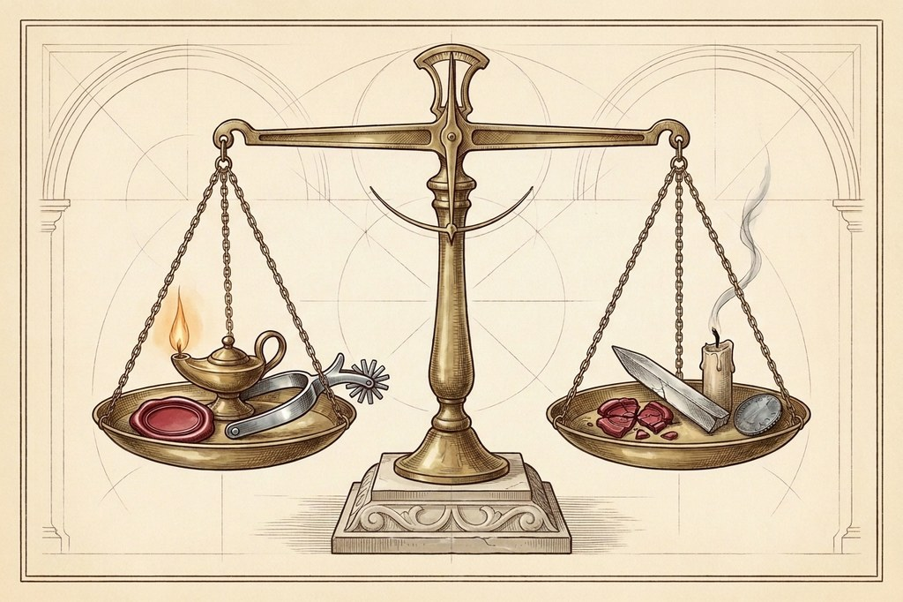
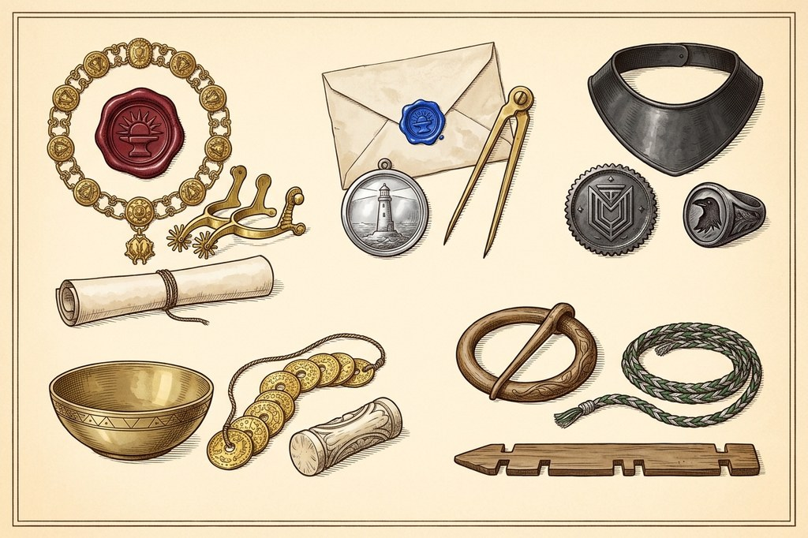
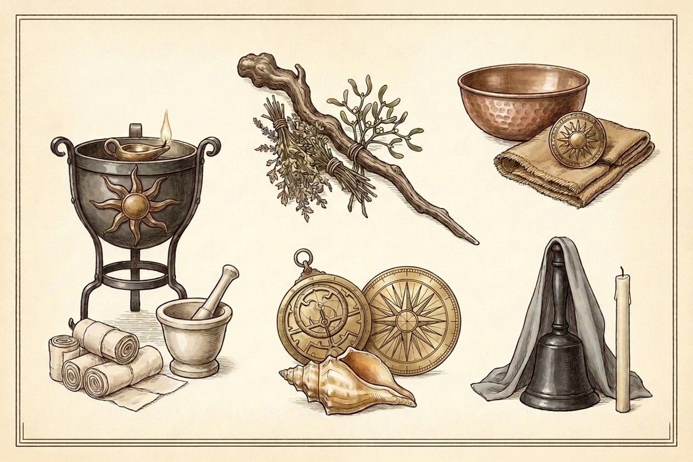
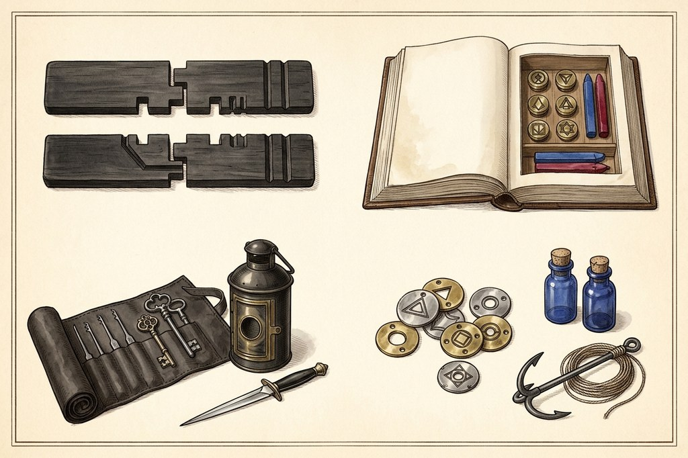

# O Peso do Nome, do Voto e da Sombra — Feitos de Status, Fé Verdadeira e Submundo em Alenia

> *"O ouro compra um cavalo, uma espada e até o silêncio de um estalajadeiro por uma noite. Mas existem três moedas neste continente que nenhum cofre cunha: o nome que faz um portão se abrir sem desembainhar o aço, a prece que não treme quando a bruma chama pelo seu morto, e o sinal riscado a giz que impede uma garganta de ser cortada no beco."* — **Caderno de Valen de Pontáuria, Preboste da Coroa (Ano 414 EF)**

Este **Tomo XVI** desenvolve integralmente, grau por grau (**`1` a `5`**), os três **Atributos Especiais** mais presentes nas mesas de **Alenia RPG**: **Status (`S01`–`S05`)**, **Fé Verdadeira (`V01`–`V05`)** e **Influência no Submundo (`U01`–`U05`)**, acompanhados de **30 Feitos e Provações de Campanha (`P01`–`P30`)**, regras objetivas de **Mancha, Queda e Reabilitação** e um caderno selado ao Mestre (incluindo a progressão oculta de **Dom Antigo `1`–`5`**).

Toda a calibração respeita rigorosamente os pilares do **[Tomo I — Livro de Regras](01_Livro_de_Regras.md)**: **povos exclusivamente humanos**, **ausência absoluta de pólvora**, **Padrão Prata (`1 PO = 10 PP = 100 PC`)**, **teto de modificadores externos (`+6`, ou `+8` em Preparação Ritualística)** e **baixa fantasia rigorosa estilo *Game of Thrones*** — onde convicção espiritual jamais vira magia explosiva de combate, prestígio exige sustento real e todo favor das sombras cobra seu preço.

---

## Leis gerais dos feitos, atrito entre esferas e queda

Em Alenia, qualquer explorador melhora suas perícias estudando ou treinando ao subir de nível — mas **nenhum ponto de experiência compra Status, Fé Verdadeira ou Submundo**. Esses atributos medem o lugar vivo que o personagem conquistou (ou perdeu) diante das instituições visíveis, do sagrado e das redes invisíveis do mundo.

### 1. A Regra dos Três Critérios para Subir de Grau (`0` → `5`)

Para que um personagem avance `1` ponto em qualquer Atributo Especial (sempre um degrau por vez, de `0→1`, `1→2`, `2→3`, `3→4` ou `4→5`), o Mestre verifica se o **Feito realizado em mesa** cumpre simultaneamente **três critérios**:

1. **Ato Concreto Jogado em Cena**: não basta declarar no histórico ou pagar moedas fora de tela; o grupo enfrentou o risco, tomou a decisão difícil ou superou a crise durante a campanha *(exceção única: o ponto inicial `1` ou `2` concedido na criação pelos Kits de Nobre, Cavaleiro, Diplomata, Mercador, Sacerdote, Inquisidor, Assassino, Espião, Contrabandista ou Pirata do Tomo III)*.
2. **Testemunho, Rastro ou Reconhecimento**:
   - Em **Status**, autoridades legítimas, pares, arautos, câmaras mercantis ou anciãos precisam **saber** quem realizou o feito e validá-lo;
   - Em **Submundo**, os mediadores certos (capitães de cais, agiotas, mestres de guilda oculta, sucateiros do Ferro Velho) precisam **reconhecer** sua autoria sob sigilo;
   - Em **Fé Verdadeira**, não se exige plateia humana — **exige-se verdade íntima provada sob perda ou perigo real**, quando mentir ou fugir seria mais fácil.
3. **Peso e Dever Assumido**: cada novo grau traz uma obrigação permanente. Subir de grau não é ganhar um bônus gratuito na ficha: é aceitar que mais pessoas passem a exigir sua palavra, sua proteção, seu voto ou seu favor.

> [!IMPORTANT]
> **Por que o Ouro Sozinho Nunca Compra um Grau?**
> Um aventureiro que saqueia `5.000 PP` numa ruína ainda é apenas um aventureiro rico (`Status 0` ou `1`). Se ele usar essa prata para erguer uma torre concedida em fronteira hostil (**F04** do Tomo XV), alimentar duas aldeias durante o inverno e defender a estrada em nome da comarca, **aí sim** o feito existe — e o **Status** sobe.

### 2. Como Usar o Grau (`1` a `5`) nas Rolagens de Mesa

Cada Atributo Especial opera de **três maneiras complementares** sem quebrar a matemática do `d20`:

- **Rolagem Direta do Atributo Especial (`1d20 + Grau`)**: usada quando o peso do nome, a pureza do voto ou o alcance da rede clandestina são testados diretamente — como requisitar audiência urgente (`1d20 + Status`), realizar prece/vigília ritual ou resistir aos sussurros da Comunhão (`1d20 + Fé Verdadeira`), ou acionar contatos numa cidade desconhecida (`1d20 + Submundo`).
- **Apoio Posicional em Perícias Sociais e Mentais**: quando o personagem rola uma perícia comum (*Persuasão, Etiqueta, Intimidação, Barganha, Investigação, Religião*) num contexto diretamente governado pelo seu Atributo Especial, o grau atua **abrindo a porta sem rolagem** (em pedidos rotineiros compatíveis com o nível) ou concedendo **`+1` a `+3` de circunstância favorável** (`⌊(Grau + 1) / 2⌋`), sempre respeitando o **Teto de Bônus Externos `+6`** do Tomo I.
- **Privilégio de Grau (`Passivo` + `Ativo`)**: cada degrau de `1` a `5` destrava direitos jurídicos, tetos de crédito, esconderijos, imunidades graduais ao horror e **um ato ativo emblemático** (`1× por sessão` ou `1× por arco`), detalhados nas três trilhas abaixo.

### 3. Atrito Entre as Três Esferas

Um mesmo personagem pode possuir pontos em mais de uma esfera *(como a agente **Sabina de Pontáuria**, que transita entre corte e becos, ou um **Inquisidor** com `Status` e `Fé Verdadeira`)*, mas elas puxam em direções opostas:

| Combinação na Ficha | Tensão Dramática em Jogo | Regra de Atrito |
| :--- | :--- | :--- |
| **Alto `Status` (`3+`) + `Submundo` (`2+`)** | Dupla vida política/mercantil *(comum em príncipes mercadores de Corallis e conselheiros de Kalgard)*. | Se uma operação criminosa ou ligação com corsários/contrabandistas vier a público com provas, o personagem sofre **Mancha imediata em `Status`** (`-2` social até abafar ou perder `-1` grau permanente). |
| **`Fé Verdadeira` (`1+`) + `Submundo` (`1+`)** | Possível apenas em redes de resistência justa *(abrigar perseguidos, contrabandear remédios em quarentena injusta, proteger inocentes)*. | **Extorsão, assassinato por encomenda, tráfico de reféns ou traição a inocentes apagam imediatamente `-1` a `-2` pontos de `Fé Verdadeira`**, sem direito a teste de resistência. |
| **`Fé Verdadeira` (`2+`) + Alto `Status` (`3+`)** | O dilema clássico entre a consciência e a razão de Estado *(como enfrentam os *Irmãos da Lareira* diante do luxo de Altavanne)*. | Ordenar massacres convenientes, confiscar pão de famintos na seca ou perjurar num tratado para salvar o cofre preserva o `Status`, mas **quebra a `Fé Verdadeira`**. |

### 4. Mancha, Suspensão, Queda (`-1` Grau) e Reabilitação

Atributos Especiais sobem devagar e podem cair depressa:

1. **Mancha Temporária *(Suspensão de 1 Grau)***: causada por deslize menor ou rumor plausível ainda sem prova cabal *(atrasar uma Letra em Cera Azul por um mês, perder a compostura num banquete de corte, falhar em proteger um protegido menor, hesitar diante de um voto sem consumar a traição)*. Durante a Mancha, o atributo opera com **`-1` grau efetivo** até o personagem quitar a dívida ou limpar o nome numa cena concreta.
2. **Queda Real (`-1` Grau Permanente — ou mais em traições graves)**:
   - **Em Status**: covardia pública comprovada em batalha/cerco, falência fraudulenta nos bancos de Corallis, quebra da *Lei da Hospitalidade* em Gaddra, perjúrio de homenagem feudal ou condenação formal pelo Preboste da Coroa.
   - **Em Fé Verdadeira**: quebrar juramento feito sobre o sagrado, negar socorro vital por avareza ou medo egoísta, torturar indefesos em nome da fé ou praticar qualquer uma das *Três Heresias Capitais* (negar a Passagem, ritos de sangue a Incognito, profanação deliberada).
   - **Em Submundo**: entregar um contato, esconderijo ou rota à guarda/Inquisição, dar calote numa *Talha Cifrada* de Kalis ou violar sangue derramado sob *Bandeira de Trégua*.
3. **Reabilitação e Penitência**: recuperar um grau perdido exige um **Feito de Expiação** de dificuldade equivalente ao grau desejado — pagar em dobro a honra ferida, cumprir peregrinação/serviço anônimo num surto epidêmico ou sobreviver ao preço de sangue cobrado pelas sombras.

---

## Trilha do Status: o peso do nome nas cinco culturas

**Status (`0` a `5`)** mede quanto as estruturas legítimas de poder reconhecem, temem ou respeitam o nome do personagem. Em **`Status 0`**, você é um homem ou mulher comum ou forasteiro sem fiador: estalagens exigem pagamento adiantado, guardas revistam sua mochila nos portões de Altavanne e lordes sequer recebem seu recado.

### Equivalência Cultural e Sustento dos Graus de Status (`1` a `5`)

Para manter os benefícios plenos de seu `Status` em cidades civilizadas sem sofrer penalidade de aparência descuidada (`-1` efetivo após um mês inteiro vivendo abaixo da posição, salvo votos ascéticos reconhecidos), observe a correspondência com o **Padrão de Vida** do Tomo I e as **Sedes** do **[Tomo XV — Casas Nobres](15_Casas_Nobres_Feudos_e_Fortificacoes.md)**:

| Grau | Reino de Aurora *(Feudal)* | Liga de Corallis *(Patrícia / Acadêmica)* | Despotado de Kalis *(Militar / Cifrado)* | Confederação de Gaddra *(Clãs / Sal)* | Fronteiras Silvanas *(Conselho das Copas)* | Padrão de Vida & Sede Típica |
| :---: | :--- | :--- | :--- | :--- | :--- | :--- |
| **1** | Escudeiro, Oficial de Ronda, Mestre Artesão | Cidadão de Guilda, Bacharel de Sellene, Piloto | Cabo de Fronteira, Mestre de Ofício Registrado | Guerreiro de Tenda Reconhecido, Guia de Poço | Guardião de Trilha, Voz Jovem de Ramo | **Modesto** (`15 PP/mês`) • **F01** |
| **2** | Cavaleiro (`Sor`/`Dama`), Meirinho Real | Mestre Mercador, Cirurgião Sênior, Capitão (**E05–E08**) | Capitão de Guarnição, Inspetor de Madeira Negra | Ancião de Oásis Menor, Chefe de Caravana | Portador de Selo Verde, Árbitro de Clareira | **Confortável** (`45 PP/mês`) • **F02–F04** |
| **3** | Barão, Castelão de Terra, Preboste Provincial | Patrício com Assento na Câmara, Catedrático | Comandante de Praça-Forte, Intendente Cifrado | Xeique de Rota do Sal, Guardião de Cácer | Ancião de Copa, Emissário do Tratado | **Abastado** (`150 PP/mês`) • **F04–F07** |
| **4** | Grande Lorde / Chefe de Grande Casa, Conselheiro | Arconte de Cidade, Diretor Bancário / Almirante | General de Cidadela, Alto Véu de Kalgard | Grande Emir de Confederação, Juiz das Águas | Voz Maior do Conselho das Copas | **Aristocrático** (`450+ PP/mês`) • **F08–F09** |
| **5** | Alto Rei / Regente Real / Herói Continental | Arconte-Regente da Liga / Voz Suprema | Déspota-Regente de Kalis | Regente das Dunas / Unificador das Tribos | Guardião Supremo do Pacto Antigo | **Soberano / Corte** • **F10** |

### S01 — Grau 1: Nome Reconhecido

**Posição:** Escudeiro, mestre de ofício com carta, sargento condecorado, bacharel de Sellene ou filho segundo de linhagem menor. **Sustento:** Modesto (`15 PP/mês`).

- **Feitos Exigidos (`0 → 1`)**: prestar serviço comprovado a um Cavaleiro, Magistrado ou Mestre de Guilda; distinguir-se publicamente na defesa de uma vila, ponte ou navio; concluir aprendizado formal numa instituição respeitada (*Sellene, Baldbella, Aeraneas*); ou provar ascendência legítima/reconhecida perante arautos locais.
- **Privilégios Passivos**: direito de portar armas visíveis de defesa pessoal *(espada curta, sabre ou lança de viagem)* em cidades muradas sem assédio gratuito da guarda; sua palavra vale como testemunho válido em tribunais locais; acesso a bibliotecas públicas, arquivos paroquiais e salões inferiores de guildas.
- **Uso Ativo (`1× por sessão` — *Carta de Apresentação*)**: ao chegar a uma vila, posto de estrada ou bairro mercantil da sua cultura, você obtém sem rolagem hospedagem digna por até `3 dias`, uma audiência com o oficial local *(sargento, reitor, mestre de doca)* ou fiança simples até **`30 PP`** para liberar um companheiro detido por contravenção menor.
- **Dever e Risco de Queda**: responder às convocações de milícia/guilda e honrar dívidas comerciais; ser pego em furto comum ou briga covarde revoga a carta e derruba o atributo a `0`.

### S02 — Grau 2: Voz de Salão e Patente

**Posição:** Cavaleiro consagrado (`Sor` / `Dama`), capitão mercante acreditado, cirurgião-mestre ou magistrado adjunto. **Sustento:** Confortável (`45 PP/mês`).

- **Feitos Exigidos (`1 → 2`)**: receber a vigília e consagração de Cavalaria após ato de bravura testemunhado; salvar a vida ou a honra de um nobre/patrício; comandar com êxito uma expedição, caravana ou navio (**E05+** do Tomo XIV) através de crise grave; ou desmascarar fraude/traição relevante perante uma corte municipal.
- **Privilégios Passivos**: **Direito de Porte Nobre e Julgamento por Pares** *(jamais pode ser açoitado ou interrogado sob maus-tratos por guardas comuns; em guerra, tem direito costumeiro a resgate de `200–500 PP`)*; acesso a bancos de Corallis para emitir ou sacar *Letras em Cera Azul* com crédito pessoal de até **`200 PP` sem fiador**; habilita legalmente sedes iniciais (**F01–F03**) ou a guarda de uma torre fronteiriça (**F04**).
- **Uso Ativo (`1× por sessão` — *Palavra de Patente*)**: pode requisitar escolta temporária de `2 a 4` guardas locais numa emergência pública comprovada, entrar armado (com espada à cinta) em audiências municipais ou suspender por `24 horas` uma ordem policial menor exigindo revisão do Magistrado/Castelão, somando **`+2`** em *Etiqueta* ou *Persuasão* formal na cena.
- **Dever e Risco de Queda**: quebrar juramento de cavalaria, fugir abandonando civis sob sua escolta ou deixar uma *Letra em Cera Azul* protestada sem pagamento rebaixa o nome à infâmia (`Status 1` manchado).

### S03 — Grau 3: Senhorio, Foral e Cadeira

**Posição:** Barão ou Castelão de Terra, Patrício com voto em câmara de Corallis, Preboste Provincial ou Xeique da Rota do Sal. **Sustento:** Abastado (`150 PP/mês` ou manutenção de Sede **F04–F07**).

- **Feitos Exigidos (`2 → 3`)**: fundar ou reerguer uma Casa Nobre com Carta de Concessão/Foral (**Tomo XV**), pacificando o território ao redor; vencer ou impedir um cerco/batalha regional; solucionar uma crise provincial inteira *(como reabrir um passo bloqueado, debelar um surto portuário ou salvar uma frota mercante)*; ou ser nomeado Preboste/Catedrático por decreto superior.
- **Privilégios Passivos**: **Baixa Justiça e Senhorio** sobre suas terras; isenção de pedágios comuns na própria província; direito de manter tropa permanente sob seu próprio brasão (**G01–G07**); linha de crédito mercantil de até **`800 PP`** em Altavanne, Merlinport, Alineus ou Baldbella; convite automático a concílios provinciais e banquetes de Estado.
- **Uso Ativo (`1× por arco` — *Selo de Senhorio*)**: emite **Salvo-Condutos Oficiais** para todo o grupo cruzarem barreiras militares e quarentenas ordinárias, requisita suprimentos/cavalos de muda em postos aliados (pagos depois pelo cofre) ou exige audiência direta em até `48 horas` com qualquer Grande Lorde, Bispo/Vigário ou Almirante do domínio.
- **Dever e Risco de Queda**: proteger os vassalos das suas terras, responder ao Estandarte Real e manter solvência; perder a sede sem lutar ou tiranizar aldeias livres sob foral provoca intervenção do Preboste e queda a `Status 2`.

### S04 — Grau 4: Grande Nome do Domínio

**Posição:** Chefe de Grande Casa, Membro do Conselho da Coroa, Arconte de Cidade-Estado, Alto Prelado ou Comandante de Fronteira. **Sustento:** Aristocrático (`450+ PP/mês` ou Castelo **F08–F09**).

- **Feitos Exigidos (`3 → 4`)**: alterar decisivamente o rumo político ou militar de um dos cinco grandes domínios de Alenia *(evitar ou vencer uma guerra entre províncias, salvar a capital ou uma Grande Casa da ruína, unificar clãs divididos em Gaddra, descobrir e neutralizar uma conspiração continental)* conquistando assento entre os maiores pares do reino.
- **Privilégios Passivos**: **Alta Justiça** em seus domínios; voz direta nos conselhos que decidem impostos, embargos e guerras; crédito estratégico de até **`3.000 PP`** garantido por tratados; guardas e oficiais menores jamais ousam detê-lo sem ordem assinada pessoalmente pelo Regente ou Alto Rei (`+3` de circunstância em negociações diplomáticas de Estado, respeitando o teto `+6`).
- **Uso Ativo (`1× por arco` — *Convocação de Estandartes*)**: mobiliza um destacamento aliado concreto para uma operação crítica — como uma galé de guerra (**E09**), `20 a 40` soldados regulares (**G02/G03**) por uma campanha curta ou um embargo portuário temporário contra um navio/mercador inimigo.
- **Dever e Risco de Queda**: cada gesto seu move o tabuleiro do Ano 418 EF; uma derrota humilhante, traição revelada no Conselho ou colapso econômico da província derruba sua Casa diante dos rivais.

### S05 — Grau 5: Voz que Move Reinos

**Posição:** Alto Rei, Regente Real, Arconte-Regente, Unificador das Dunas ou Herói Vivo de estatura comparável a *Severor I após abater A Sombra*. **Sustento:** Corte Soberana / Cidadela **F10**.

- **Feitos Exigidos (`4 → 5`)**: **exclusivo de clímax de grandes campanhas (tipicamente Patamar Lenda avançado ou Épico)** — encerrar uma ameaça existencial aos reinos dos homens, ascender legitimamente à Regência/Coroa num Grande Concílio das Casas ou firmar um novo pacto continental da magnitude do *Pacto das Bigornas* ou do *Tratado de Vergod*.
- **Privilégios Passivos**: autoridade soberana ou moral reconhecida de Altavanne a OX e Alineus; direito de conceder títulos (`Status 1–3`), legitimar bastardos (`Cinza`, `Coral`, `Sombra`, `Duna`, `Bruma`), emitir salvo-condutos imperiais e negociar de igual para igual com qualquer governante vivo de Alenia.
- **Uso Ativo (`1× por campanha / grande arco` — *Decreto Histórico*)**: proclama um édito, trégua geral, convocação continental de frotas/exércitos ou fundação institucional que redesenha permanentemente o mapa político da campanha.
- **Dever e Risco de Queda**: como mostrou a queda de *Aemilius IV* no Ano 356 EF (**T079** do Tomo XI), trancar-se atrás das muralhas quando o mundo escurece destrói até a coroa mais antiga.

---

## Trilha da Fé Verdadeira: o voto incorruptível

Em Alenia, muitos usam mantos sagrados por carreira política, medo ou hábito — e quase todos esses possuem **`Fé Verdadeira 0`** (mesmo que tenham alta graduação intelectual em *Religião & Ocultismo*). **Fé Verdadeira (`1` a `5`)** não mede erudição teológica nem cargo eclesiástico: mede uma **convicção espiritual tão íntegra, vivida e provada no sofrimento real que a mente humana torna-se rocha diante do pavor e da corrupção**.

> [!CAUTION]
> **Baixa Fantasia Rigorosa (Zero "Magias de Clérigo")**: nenhum grau de *Fé Verdadeira* dispara raios de luz, fecha feridas abertas num estalar de dedos ou ressuscita mortos *(chamar mortos de volta viola a própria Passagem!)*. Seus efeitos nascem da **coragem sobre-humana, da autoridade moral que desarma fanáticos, de vigílias demoradas e, nos graus mais altos (`3–5`), de coincidências providenciais e presságios sutis** que os céticos de Sellene juram ser acaso — mas quem estava lá jamais esquece.

### Pluralismo Espiritual: As Cinco Caminhadas Sinceras

A *Fé Verdadeira* floresce com igual dignidade em qualquer tradição vivida sem hipocrisia:
1. **Igreja da Chama Solar *(Aurora)***: devoção ao único Criador em suas **Seis Personas** (*Vigia & Guardiã, Semeadora & Barqueiro, Artífice & Anfitriã*) — vivida na caridade dos *Irmãos da Lareira*, na compaixão médica da *Brasa Velada*, no trabalho honesto do *Malho Sagrado* ou no rigor austero *(quando não corrompido pelo fanatismo cruel)* do *Dia*.
2. **Círculo das Raízes *(Cidade Suspensa & Matas)***: fidelidade ao equilíbrio entre os vivos, a floresta antiga e a memória dos ancestrais, recusando profanação e desperdício de sangue.
3. **Culto das Marés e das Estrelas *(Corallis)***: reverência serena à ordem sagrada do cosmos, à verdade científica sem mentira e ao dever sagrado de socorrer náufragos no mar.
4. **Caminhos do Sol e do Sangue *(Gaddra)***: sacralidade absoluta da água partilhada, da palavra empenhada sob o sol aberto e dos três dias invioláveis da *Lei da Hospitalidade*.
5. **Irmandade do Véu Silencioso *(Kalis)***: ascese disciplinada que guarda o silêncio, suporta o frio e vigia contra o pavor sem pedir recompensas aos céus.

### V01 — Grau 1: Centelha Sincera

**Caminhada:** Iniciado de voto íntegro, irmão de estrada, guerreiro que cumpre juramentos mesmo sozinho ou curandeiro devoto.

- **Provações Exigidas (`0 → 1`)**: recusar lucro fácil, suborno ou vantagem tática em mesa para não violar um preceito central da sua fé; permanecer ao lado de enfermos/indefesos sob risco real; ou cumprir até o fim um voto difícil jurado no início da aventura.
- **Firmeza Interior (Passivo)**: soma **`+1`** (seu grau) em todos os testes de `SAB` contra medo, intimidação, desespero e pesadelos anômalos; devotos sinceros e sacerdotes comuns percebem intuitivamente (`Intuição` automática) que você não mente quando fala em nome da sua fé, concedendo abrigo simples e hospitalidade em paróquias, tendas ou círculos da mesma tradição.
- **Ato de Devoção (`1× por Descanso Longo` — *Prece da Lareira*)**: conduzindo `10 minutos` de prece serena, canto ou silêncio votivo junto ao grupo antes de dormir ou marchar, você concede a até **`4` aliados voluntários `+1`** no primeiro teste contra medo, pânico ou *Exaustão* climática nas próximas `24 horas`.
- **Tabu e Queda**: mentir invocando o nome do sagrado para obter ganho egoísta apaga a centelha (`Fé 0`).

### V02 — Grau 2: Guardião do Voto

**Caminhada:** Juramentado da Brasa Velada, guardião de poço sagrado, capelão de convés ou cavaleiro cuja honra espiritual já custou sangue próprio.

- **Provações Exigidas (`1 → 2`)**: sofrer ferimento grave, perda patrimonial severa ou perseguição política por defender o asilo de um inocente, honrar a Passagem dos mortos em campo hostil ou manter a verdade diante de um poderoso corrupto; ou conduzir com sucesso um rito menor (`CD 20`, Seção 10 do Tomo I) para salvar terceiros.
- **Firmeza Interior (Passivo)**: soma **`+2`** contra terror, coerção e **sussurros psíquicos de *Thanatos/Incognito***, além de somar integralmente sua `Fé` nos testes de `SAB` para **resistir aos impulsos do *Simbionte da Comunhão* (Estágio II)**; pode invocar formalmente o **Direito de Asilo** em qualquer templo/santuário consagrado, fazendo guardas e soldados comuns hesitarem em violar a soleira (`Persuasão/Religião` com `+2`).
- **Ato de Devoção (`1× por Descanso Longo` — *Vigília de Consolação*)**: ao passar `1 hora` velando feridos ou enfermos durante um *Descanso Curto* ou *Longo*, até **`5` aliados** recuperam **`+2` PV adicionais** *(cumulativo com Medicina)* **ou** recebem **`+2`** no teste diário/semanal de `CON` contra **Doenças** do Tomo II *(respeitando o teto externo `+6`)*.
- **Tabu e Queda**: abandonar um suplicante sob seu asilo ou cobrar prata por socorro espiritual urgente derruba o atributo a `1`.

### V03 — Grau 3: Pilar Incorruptível

**Caminhada:** Voz espiritual reconhecida pelo povo humilde, pacificador de motins, eremita das raízes ou sentinela espiritual contra os horrores do norte.

- **Provações Exigidas (`2 → 3`)**: atravessar uma das grandes provações morais da campanha sem dobrar os joelhos — permanecer numa cidade em quarentena mortal salvando desconhecidos, enfrentar frente a frente uma manifestação de *Incognito/Thanatos* sem fugir, ou desarmar um massacre iminente colocando o próprio corpo desarmado entre duas forças armadas.
- **Firmeza Interior (Passivo)**: soma **`+3`** contra qualquer terror, loucura ou influência da Comunhão (**Estágios II e III**); reduz em **`-3` a CD de cirurgia/rito de extração do Simbionte** quando conduz a vigília ao lado do cirurgião (**Tomo I, Seção 10**); **sentido de profanação**: ao cruzar a soleira de um lugar onde ocorreu rito de sangue recente, quebra hedionda de hospitalidade ou atividade de *Thanatos*, sente um frio ou peso silencioso no peito *(sem revelar coordenadas mágicas, mas impedindo emboscada espiritual surpresa)*.
- **Ato de Devoção (`1× por sessão` — *Voz que Acalma a Turba*)**: como **Ação Principal**, falando de mãos abertas e sem atacar na rodada, realiza `1d20 + Fé Verdadeira + Mod(CAR ou SAB)` (`CD 15`): em sucesso, **interrompe pânico coletivo** de aliados/tripulantes/aldeões (`remove condição amedrontado` em até `9m`) **e** força zelotes, saqueadores hesitantes ou soldados comuns (que não sejam feras irracionais nem monstros sem mente) a hesitar, sofrendo **`-2`** se tentarem atacá-lo até o seu próximo turno.
- **Tabu e Queda**: usar essa autoridade sagrada para insuflar linchamento de inocentes ou enriquecer a própria Casa causa queda imediata.

### V04 — Grau 4: Vaso da Vigília

**Caminhada:** Raro justo venerado em vida — o monge que caminha entre leprosos sem temer a morte, o ancião das dunas cuja palavra vale mais que um exército, a guardiã que encarou o abismo e voltou serena.

- **Provações Exigidas (`3 → 4`)**: oferecer voluntariamente a própria vida, liberdade ou posição em sacrifício concreto para salvar uma comunidade inteira, purificar um santuário profanado por forças de *Kelgore/Thanatos* ou redimir um inimigo poderoso pelo exemplo extremo, sobrevivendo contra todas as probabilidades.
- **Firmeza Interior (Passivo)**: **Imune a medo mundano** e recebe **`+4`** contra terrores sobrenaturais/escatológicos e contra a Comunhão; sua mera presença num hospital, navio ou fortaleza sitiada concede **`+2` na Moral da guarnição** (**Tomo XV**) e conta como **Local Consagrado vivo (`+2` na Preparação Ritualística)** para ritos legítimos de proteção e cura.
- **Prodígio Sutil (`1× por arco de aventura` — *Ainda Não Chegou Minha Hora*)**: quando você (ou um aliado adjacente que você esteja protegendo com *Proteger Aliado* ou socorrendo sem atacar) falhar num teste de **Golpe Devastador** ou cairia morto em `0 PV` durante um ato altruísta de defesa, sua convicção inabalável o mantém **consciente e de pé com exatamente `1 PV`** *(sofrendo um Ferimento Grave/cicatriz normal, mas recusando cair até o fim da cena)*.
- **Tabu e Queda**: ceder ao orgulho espiritual (*julgar-se infalível ou acima dos humildes*) ou compactuar com injustiça grave reduz o atributo.

### V05 — Grau 5: Testemunha da Luz Antiga

**Caminhada:** Lenda espiritual de uma geração inteira — um punhado de almas vivas em todo o continente no Ano 418 EF.

- **Provações Exigidas (`4 → 5`)**: **ápice espiritual de campanha (Lenda tardio / Épico)** — sustentar sua verdade incorruptível no coração da maior treva do cenário *(como as praias cinzentas de Thanatos, os salões mais profundos do Acervo ou o campo de uma guerra santa prestes a explodir)*, recusando qualquer atalho de poder proibido mesmo diante da morte certa.
- **Firmeza Interior (Passivo)**: **Incorruptível** — imune a possessão, impulsos involuntários da Comunhão e pavor de qualquer origem (`+5` em todos os testes de resistência espiritual); até inquisidores da *Chama Branca*, déspotas de Kalis e altos prelados sentem o peso moral de erguer a mão contra uma Testemunha desarmada sem justa causa comprovada.
- **Prodígio Sutil (`1× por campanha / grande clímax` — *Sinal Inesquecível*)**: após vigília, prece ou ato supremo de entrega *(com aval do Mestre, sempre em registro naturalista/sutil — um vento súbito que dissipa névoa ácida, uma febre epidêmica que cede na alvorada, um presságio cristalino em sonho verdadeiro, ou a voz que desperta a lembrança humana num hospedeiro de **Estágio III–IV da Comunhão** permitindo sua libertação)*, realiza um feito espiritual `CD 28–30` **sem precisar de Sacrifício de Sangue alheio**.
- **Tabu e Queda**: quem alcança o Grau 5 sabe que o voto dura até o último suspiro; traí-lo uma única vez apaga tudo para sempre.

---

## Trilha do Submundo: os fios invisíveis da sombra

Abaixo dos forais reais e das câmaras mercantis existe uma segunda geografia que atravessa todas as fronteiras de Alenia: os **trapiches noturnos de Merlinport**, os **sucateiros de *O Ferro Velho***, as **irmandades corsárias do *Arquipélago Ravena***, os **contrabandistas de essências da *Ilha das Safiras***, os **caravaneiros clandestinos de sal** e os **correios cifrados de *Kalgard* e *Dobalbek***. **Influência no Submundo (`0` a `5`)** mede quanto essa rede reconhece seu nome (ou seu pseudônimo), abre portas trancadas e teme traí-lo.

Em **`Submundo 0`**, procurar venenos raros, documentos falsos ou passagem ilegal significa pagar **`3×` o preço** — ou caminhar direto para uma emboscada de beco ou armadilha da guarda.

### U01 — Grau 1: Conhecido nos Becos

**Reputação:** Rato de cais respeitado, comprador discreto, batedor de taverna portuária ou contrabandista iniciante.

- **Feitos Exigidos (`0 → 1`)**: concluir um serviço clandestino sem abrir a boca sob interrogatório; salvar um membro de guilda/tripulação pirata da forca ou patrulha; quitar integralmente uma dívida difícil no cais; ou provar valor prático às sombras locais.
- **Rede Passiva**: compreende **sinais de giz, marcas de lanterna e gírias de porto** em qualquer cidade costeira ou fluvial; localiza em **`1d4` horas** (sem risco de cair em emboscada amadora) o mercado negro básico, um receptador que compra espólio sem perguntar origem (`50%` do valor) e um **cirurgião de beco** que costura ferimentos de lâmina sem avisar o Preboste.
- **Favor Ativo (`1× por sessão` — *Porta dos Fundos*)**: numa cidade ou porto conhecido, obtém sem rolagem um esconderijo modesto por `1 noite` longe das rondas normais **ou** descobre qual guarda de portão aceita suborno padrão (`5–15 PP` do Tomo I) sem dar alarme.
- **Preço e Queda**: falar demais em taverna aberta causa Mancha; apontar um esconderijo à guarda zera o atributo e coloca preço na sua cabeça.

### U02 — Grau 2: Mão de Confiança

**Reputação:** Operador testado, falsário conhecido, imediato corsário ou elo seguro entre dois portos.

- **Feitos Exigidos (`1 → 2`)**: atravessar bloqueio naval ou alfândega real com carga sensível intacta; eliminar ou desmascarar um delator infiltrado na rede; resgatar um prisioneiro de carceragem vigiada; ou executar um golpe/infiltração limpa contra alvo abastado sem deixar rastros sobre os contratantes.
- **Rede Passiva**: **reduz o ágio do Mercado Negro de `3×` para `2×`** em venenos, equipamentos de subterfúgio e mercadorias proibidas (**Tomo IX**); receptadores pagam **`60%`** por joias e cargas quentes; acesso a **falsificadores competentes** capazes de produzir guias de carga ou cartas de trânsito comuns (`Investigação oposta CD 18` para guardas detectarem; custo `25–50 PP`).
- **Favor Ativo (`1× por sessão` — *Sumir na Neblina*)**: aciona barqueiros noturnos, carroças de feno ou galerias de esgoto para **tirar ou infiltrar o grupo inteiro** numa cidade murada sem passar pelos portões principais *(custo de `20 PP` em mãos molhadas ou `1` favor futuro menor)*.
- **Preço e Queda**: falhar num contrato pago adiantado sem devolver a prata suspende a rede até o acerto de contas.

### U03 — Grau 3: Nome sob o Capuz

**Reputação:** Mestre de rota clandestina, corretor de segredos, capitão respeitado em *Ravena* ou portador confiável de *Talhas Cifradas*.

- **Feitos Exigidos (`2 → 3`)**: tomar ou fundar uma rota estável de contrabando terrestre/marítimo; derrubar um chefe de bando rival ou preboste corrupto que extorquia a rede; negociar com sucesso em *O Ferro Velho* ou *Dobalbek* uma operação de alto risco; ou guardar sob captura um segredo capaz de derrubar poderosos.
- **Rede Passiva**: **reduz o ágio do Mercado Negro para `1,5×`** *(o menor piso da tabela do Tomo I!)*; emite e desconta **Talhas Cifradas de Kalis** sem precisar de intermediário local (pagando apenas os `8%` oficiais da banca); mantém **`1` esconderijo seguro permanente** ou contato leal em cada grande porto (*Merlinport, Alineus, Baldbella, Portocala, Dobalbek*) e soma **`+2`** ao contratar ou negociar com um *Mestre de Sussurros* (**G14** do Tomo XV).
- **Favor Ativo (`1× por arco` — *Dossiê de Sombra*)**: em `24 horas` dentro de qualquer cidade grande, sua rede levanta sem rolagem **um segredo concreto e utilizável** sobre um NPC não-soberano *(dívida oculta, amante, vício, rota de guarda, suborno antigo)* **ou** planta uma pista falsa crível para desviar investigadores por `3 dias` *(em troca de um favor equivalente cobrado depois pelo submundo)*.
- **Preço e Queda**: quem chega ao Grau 3 passa a ser conhecido pelos caçadores do Preboste e por rivais ambiciosos; trair uma *Talha Cifrada* significa sentença de morte silenciosa.

### U04 — Grau 4: Aranha dos Portos e Cortes

**Reputação:** Voz ouvida nas mesas fechadas do *Ferro Velho*, comandante de irmandade em *Ravena*, mestre de guilda oculta ou sombra temida nos corredores de *Altavanne* e *Kalgard*.

- **Feitos Exigidos (`3 → 4`)**: orquestrar um golpe ou operação clandestina que mude o equilíbrio de uma cidade inteira *(desviar um carregamento estratégico de adamante ou madeira negra, quebrar o monopólio de um sindicato rival, chantagear um membro de alto conselho ou unir capitães corsários sob um pacto comum)*.
- **Rede Passiva**: batedores de carteira, salteadores comuns e piratas menores **reconhecem sua marca e evitam atacar o grupo** por medo de represália *(a menos que contratados por outro Grau `4+`)*; acesso a venenos raros da *Ilha das Safiras*, selos de alta corte falsificados (`CD 22`) e rotas marítimas fechadas (**Tomo XIV**); `15%` de desconto em estaleiros clandestinos e reparos sem registro.
- **Favor Ativo (`1× por arco` — *Bandeira de Trégua & Interdição*)**: pode declarar **Parlamento sob Bandeira de Trégua** com qualquer facção criminosa, clã corsário ou guilda de assassinos *(garantindo encontro presencial sem emboscada na chegada/saída)* **ou decretar Interdição Negra** contra um alvo na região — durante `1 mês`, nenhum receptador, barqueiro clandestino ou mercenário de beco local aceita trabalhar para esse inimigo.
- **Preço e Queda**: quebrar você mesmo uma *Bandeira de Trégua* une todas as facções do submundo contra o seu nome da noite para o dia.

### U05 — Grau 5: Lenda Sem Rosto

**Reputação:** Assento invisível entre os poucos nomes que governam o mercado oculto continental — um fantasma cuja existência os guardas discutem se é uma pessoa só ou um título herdado.

- **Feitos Exigidos (`4 → 5`)**: **ápice de intriga de campanha (Lenda tardio / Épico)** — controlar a teia clandestina que liga dois ou mais continentes/domínios, derrotar ou absorver uma célula inteira dos *Ceifos de Kalis* / senhores de *Ravena*, ou deter em mãos arquivos secretos capazes de chacoalhar coroas e regências no Ano 418 EF.
- **Rede Passiva**: **Ouvidos em Toda Parte** — **nenhum contrato de assassinato, sequestro ou sabotagem profissional no submundo é aceito contra você ou seu grupo sem que um aviso chegue antes às suas mãos**, dando oportunidade de preparar contra-emboscada ou cobrir a oferta; acesso direto aos leilões mais secretos do continente *(incluindo peças raras de adamante sem selo real quando existem)*.
- **Favor Ativo (`1× por campanha / grande arco` — *Noite das Portas Abertas*)**: coordena uma operação clandestina de escala histórica — paralisar as docas de uma metrópole por uma noite inteira, apagar registros criminais nos próprios arquivos reais, resgatar alvos de uma cidadela de máxima segurança ou fazer desaparecer uma frota inteira entre os recifes sem deixar testemunhas.
- **Preço e Queda**: no topo da sombra nunca existe aposentadoria tranquila — qualquer sinal de fraqueza atrai sucessores famintos.

---

## Catálogo de trinta feitos e provações de campanha

Os **30 marcos abaixo (`P01` a `P30`)** servem tanto como **inspiração direta para objetivos de jogadores** quanto como **régua oficial de calibragem para o Mestre** medir que tamanho de feito corresponde a cada degrau (`1` a `5`) no Ano 418 EF.

## Dez feitos exemplares de Status

### P01 — Escolta Intacta na Estrada da Bruma

**Esfera:** Status (`Grau 0 → 1`). **Região típica:** Aurora / Fronteiras. **Recompensa adicional:** Carta de recomendação mercantil + `40 PP`.

Conduzir uma caravana de lã, instrumentos ou grãos através de emboscada de salteadores ou cheia do Rio Aurélio entregando `100%` da carga e das vidas sob sua guarda, com testemunho assinado no livro da alfândega.

### P02 — Juramento da Espora e Vigília da Aurora

**Esfera:** Status (`Grau 1 → 2`). **Região típica:** Aurora / Kalis. **Recompensa adicional:** Título vitalício de `Sor` ou `Dama` + direito de brasão pessoal.

Realizar um feito marcial de coragem limpa diante de um Cavaleiro ou Castelão *(segurar uma ponte, derrotar campeão inimigo em duelo justo ou salvar feridos na retirada)* e cumprir a vigília noturna de armas antes da consagração.

### P03 — Defesa Pública na Câmara da Liga

**Esfera:** Status (`Grau 1 → 2`). **Região típica:** Corallis (*Alineus, Baldbella, Sellene*). **Recompensa adicional:** Crédito bancário aberto em Cera Azul (`200 PP`).

Provar documentalmente numa sessão pública da Câmara ou da Academia de Sellene uma fraude náutica, falsificação de patente de Stoneforge ou quarentena forjada, salvando uma casa mercante honesta da falência.

### P04 — Reerguer a Pedra Caída e Garantir o Foral

**Esfera:** Status (`Grau 2 → 3`). **Região típica:** Qualquer domínio (**Tomo XV**). **Recompensa adicional:** Posse hereditária/foral sobre Sede **F04** ou **F05**.

Limpar uma ruína fronteiriça concedida sob risco, investir a prata da reconstrução, assentar famílias livres (**D09**) e manter a estrada segura durante uma estação inteira até a vistoria do Preboste ou Conselho.

### P05 — O Poço Aberto na Seca de Bayd

**Esfera:** Status (`Grau 2 → 3`). **Região típica:** Gaddra (*Naasar, OX, Rota do Sal*). **Recompensa adicional:** Anel de água e voz entre os Anciãos de Rota.

Recuperar um oásis ou cácer (**F06**) tomado por saqueadores das estepes e manter as cisternas abertas sem ágio abusivo para três caravanas de clãs rivais, firmando pacto testemunhado pelos Árbitros do Sangue.

### P06 — Quebrar o Cerco Antes do Inverno

**Esfera:** Status (`Grau 3 → 4`). **Região típica:** Aurora / Rubecina / Kalis. **Recompensa adicional:** Assento nos conselhos de guerra da província.

Comandar a defesa vitoriosa de um castelo estratégico (**F07–F08**) ou liderar a coluna de socorro que rompe um bloqueio militar de escala provincial, poupando uma comarca inteira do saque.

### P07 — Arbitragem nas Minas de Ferraur

**Esfera:** Status (`Grau 3 → 4`). **Região típica:** Aeraneas / Altavanne. **Recompensa adicional:** Confiança direta da Casa Ferraris ou da Regência (**N004**, **N015**).

Impedir o confronto armado entre mineiros em greve e tropas marciais resolvendo a causa real dos desabamentos e costurando um acordo assinado que reabra a extração sem massacre.

### P08 — Frota Salva no Mar dos Corais

**Esfera:** Status (`Grau 3 → 4`). **Região típica:** Corallis / Merlinport (**Tomo XIV**). **Recompensa adicional:** Patente de Almirante de Escolta ou cadeira alta na Liga.

Reunir capitães rivais sob um único sinal e salvar comboio mercante ou esquadra de estado (**E08–E11**) de uma tempestade catastrófica combinada a ataque coordenado nos recifes.

### P09 — Voz Decisiva no Grande Concílio das Casas

**Esfera:** Status (`Grau 4 → 5`). **Região típica:** Altavanne / Continental. **Recompensa adicional:** Coautoria do novo pacto sucessório de Aurora.

Apresentar provas incontestáveis, alianças seladas e força legítima suficientes para decidir pacificamente (ou vencer legitimamente) a crise sucessória aberta pela doença de *Severor III*, recebendo homenagem das Grandes Casas e Regentes.

### P10 — Renovação do Tratado das Cinco Terras

**Esfera:** Status (`Grau 4 → 5`). **Região típica:** Vergod / Fronteiras Continentais. **Recompensa adicional:** Nome gravado nas crônicas oficiais ao lado dos fundadores (**Tomo XI**).

Evitar uma guerra continental entre dois domínios inteiros *(como Aurora e a Cidade Suspensa, ou Corallis e Kalis)* selando um tratado histórico aceito por ambos os lados sob sua garantia pessoal.

## Dez provações exemplares de Fé Verdadeira

### P11 — A Noite na Ala da Febre

**Esfera:** Fé Verdadeira (`Grau 0 → 1`). **Tradição:** Qualquer (*especialmente Brasa Velada, Lareira ou Marés*). **Sinal interior:** Perde o medo do contágio ao servir.

Quando guardas e mercadores fogem de um albergue atingido pela *Febre das Cisternas* ou *Mal do Porão*, permanecer voluntariamente a noite inteira fervendo água, limpando enfermos e enterrando os mortos com dignidade sem cobrar um único vintém.

### P12 — Três Dias de Água ao Inimigo

**Esfera:** Fé Verdadeira (`Grau 0 → 1`). **Tradição:** Sol e Sangue (*Gaddra*) / Chama Solar (*Anfitriã*). **Sinal interior:** Palavra reconhecida até por adversários.

Acolher sob o próprio teto ou tenda um perseguidor ou rival ferido que pediu água sob a *Lei da Hospitalidade*, protegendo-o contra os próprios aliados furiosos até o pôr do sol do terceiro dia.

### P13 — A Soleira Não Se Abre ao Fogo

**Esfera:** Fé Verdadeira (`Grau 1 → 2`). **Tradição:** Chama Solar / Círculo das Raízes. **Sinal interior:** Autoridade de asilo (+2 contra intimidação).

Interpor-se desarmado na porta de uma capela, ervanário ou clareira para impedir soldados ou zelotes da *Chama Branca* de arrastar um suspeito sem julgamento justo, suportando ameaças, prisão ou golpes sem renegar o voto.

### P14 — Juramento Cumprido nas Cinzas

**Esfera:** Fé Verdadeira (`Grau 1 → 2`). **Tradição:** Véu Silencioso / Forja / Passagem. **Sinal interior:** Mente blindada contra desespero em viagem.

Carregar por léguas de pântano, neve ou deserto o corpo, o anel ou a última promessa feita a um companheiro caído para entregá-los exatamente à família e realizar o rito correto da Passagem, recusando vender o espólio do morto na fome.

### P15 — A Verdade Contra o Próprio Cofre

**Esfera:** Fé Verdadeira (`Grau 2 → 3`). **Tradição:** Dia & Forja / Marés & Estrelas. **Sinal interior:** Sentido de profanação e palavra incorruptível.

Descobrir que o lucro da própria Casa, navio ou patrono vem de carga adulterada, trabalho forçado ilegal ou relíquia profana — e denunciar/destruir publicamente a fonte ilícita arcando com todo o prejuízo financeiro.

### P16 — Vigília Diante dos Despertos

**Esfera:** Fé Verdadeira (`Grau 2 → 3`). **Tradição:** Passagem / Brasa Velada / Raízes. **Sinal interior:** `+3` contra ecos de *Thanatos* e *Simbionte*.

Encarar um marinheiro retornado de *Thanatos* ou um hospedeiro em *Enlace* sem ceder nem ao ódio cego da fogueira nem à sedução reconfortante das vozes da Comunhão, mantendo a compaixão lúcida até encontrar a verdade ou conceder descanso digno.

### P17 — Mãos Abertas Entre Duas Linhas de Lâminas

**Esfera:** Fé Verdadeira (`Grau 2 → 3`). **Tradição:** Qualquer tradição sincera. **Sinal interior:** Destrava plenamente *Voz que Acalma a Turba*.

Caminhar sem escudo e de arma embainhada para o meio de um motim de fome em Dahrma, greve em Aeraneas ou rixa de clãs, sofrendo o risco do primeiro disparo para arrancar uma trégua pelo peso exclusivo da verdade.

### P18 — O Resgate Pelo Próprio Corpo

**Esfera:** Fé Verdadeira (`Grau 3 → 4`). **Tradição:** Qualquer tradição sincera. **Sinal interior:** Destrava *Ainda Não Chegou Minha Hora*.

Trocar voluntariamente de lugar com reféns civis, assumir na própria carne a extração cirúrgica/ritual de uma contaminação anômala para salvar um inocente ou segurar sozinho um corredor estreito para que famílias inteiras escapem sem olhar para trás.

### P19 — Consagração Sob o Céu de Kelgore

**Esfera:** Fé Verdadeira (`Grau 3 → 4`). **Tradição:** Vigia, Raízes ou Véu Silencioso. **Sinal interior:** Presença conta como *Local Consagrado (+2)*.

Manter vigília completa de sol a sol no interior de uma ruína pré-Forja ou foco ativo de corrupção anômala, resistindo a todas as visões e tentações de poder ancestral para selar o local em paz.

### P20 — Recusar a Imortalidade das Cinzas

**Esfera:** Fé Verdadeira (`Grau 4 → 5`). **Tradição:** Ápice espiritual de Alenia. **Sinal interior:** Consagra-se *Testemunha da Luz Antiga*.

No clímax da campanha, diante da oferta direta de cura milagrosa, retorno de um ente querido morto ou união indolor da Comunhão (*Regente das Cinzas / Thanatos*), recusar a falsa eternidade em nome da dignidade mortal humana — quebrando o encanto sobre dezenas de almas ao redor.

## Dez feitos exemplares de Submundo

### P21 — Boca Fechada no Corpo da Guarda

**Esfera:** Submundo (`Grau 0 → 1`). **Região típica:** Merlinport / Altavanne / Alineus. **Recompensa adicional:** Sinal de giz livre nos trapiches.

Ser detido ou interrogado por beleguins após um trabalho noturno, suportar a pressão sem entregar um único nome ou esconderijo da rede e sair pela porta da frente por falta de provas.

### P22 — O Fundo Duplo que Passou pela Corrente

**Esfera:** Submundo (`Grau 1 → 2`). **Região típica:** Estuários e portos (**Tomo XIV**). **Recompensa adicional:** Ágio negro cai para `2×` + contato fixo no cais.

Cruzar uma revista rigorosa da alfândega portuária ou bloqueio de torre de corrente (**F07**) transportando carga proibida, cartas rebeldes ou passageiro jurado de morte sem disparar um único alarme.

### P23 — Caçada ao Rato de Dois Selos

**Esfera:** Submundo (`Grau 1 → 2`). **Região típica:** Corallis / Kalis. **Recompensa adicional:** Respeito das guildas discretas + `120 PP`.

Investigar uma série de prisões misteriosas no cais, identificar o informante duplo que vendia contrabandistas à guarda (ou à Chama Branca) e neutralizá-lo com provas diante dos capitães de beco.

### P24 — Acordo nas Carcaças do Ferro Velho

**Esfera:** Submundo (`Grau 2 → 3`). **Região típica:** Mar dos Corais (*O Ferro Velho* / *Ravena*). **Recompensa adicional:** Porto seguro e reparo clandestino de casco.

Navegar sem escolta oficial até o labirinto de cascos encalhados de *O Ferro Velho*, sobreviver ao teste de nervos dos sucateiros e fechar um pacto lucrativo de salvamento ou informação que nenhum arconte da Liga conseguiria assinar.

### P25 — A Talha Partida de Dobalbek

**Esfera:** Submundo (`Grau 2 → 3`). **Região típica:** Kalis / Portos do Leste. **Recompensa adicional:** Acesso direto às *Talhas Cifradas* (`U03`).

Recuperar a metade roubada de uma *Talha Cifrada* de madeira negra antes que usurpadores esvaziem um cofre de `2.000 PP`, devolvendo o crédito intacto aos banqueiros silenciosos de Kalis.

### P26 — Fantasmas na Cidadela

**Esfera:** Submundo (`Grau 3 → 4`). **Região típica:** Altavanne / Kalgard / Baldbella. **Recompensa adicional:** Selo de mestre infiltrador + dossiês de corte.

Infiltrar-se num arquivo palaciano, tesouraria murada ou fortaleza (**F08+**) durante um banquete ou troca de guarda, copiar ou substituir documentos selados e sair sem deixar um único cadáver nem fechadura arrombada.

### P27 — O Leilão da Meia-Noite na Ilha das Safiras

**Esfera:** Submundo (`Grau 3 → 4`). **Região típica:** Mar Intransponível / Ilha das Safiras. **Recompensa adicional:** Acesso a reagentes e antídotos raríssimos (**Tomo X**).

Alcançar um ancoradouro oculto da *Ilha das Safiras*, desmascarar uma tentativa de traição durante o leilão clandestino de extratos raros e sair como garantidor da trégua entre mercadores rivais.

### P28 — Desvio do Comboio Cinzento

**Esfera:** Submundo (`Grau 3 → 4`). **Região típica:** Estradas de Ferraur / Rotas do Sal. **Recompensa adicional:** *Bandeira de Trégua* e *Interdição Negra* (`U04`).

Interceptar sem chacina desnecessária uma remessa secreta de lingotes não registrados, armas de Stoneforge ou tributo extorquido, fazendo a carga inteira evaporar nas rotas secundárias antes do amanhecer.

### P29 — Xeque-Mate no Olheiro de Kalgard

**Esfera:** Submundo (`Grau 4 → 5`). **Região típica:** Kalis / Cortes de Aurora. **Recompensa adicional:** Rede de contraespionagem continental (`U05`).

Virar a própria rede de espionagem de um mestre dos *Ceifos de Kalis* ou do *Guardião dos Selos Secretos* contra ele mesmo, capturando seu livro-código vivo e assumindo silenciosamente seus informantes nas cinco terras.

### P30 — O Parlamento das Velas Negras

**Esfera:** Submundo (`Grau 4 → 5`). **Região típica:** Arquipélago Ravena / Estreitos. **Recompensa adicional:** Título invisível de *Lenda Sem Rosto*.

Convocar sob sua própria palavra os maiores capitães corsários de *Ravena*, mestres contrabandistas de *Merlinport* e corretores cifrados de *Dobalbek* para impor uma lei comum das sombras diante da crise continental de 418 EF.

---

## Caderno reservado ao mestre: arbitragem, segredos e o Dom Antigo

Este caderno é exclusivo do Mestre para conduzir a evolução por Feitos sem favoritismo nem rigidez burocrática, conectar os três atributos aos segredos maiores de **418 EF** e reger a quarta trilha — **Dom Antigo (`1` a `5`)**, oculta dos olhos comuns.

### 1. Como Arbitrar Feitos na Prática sem Travar a Mesa

- **Ritmo Saudável de Campanha**: num arco longo (de Nível `1` a `15+`), um personagem dedicado costuma subir de `1` para `3` ao longo de várias aventuras, alcançando `4` apenas quando suas escolhas já movem cidades ou províncias, e `5` no clímax histórico da campanha.
- **Semente Antes da Colheita**: quando um jogador demonstrar ambição clara *(ex.: "quero alcançar `Status 3` para erguer nosso solar" ou "quero provar minha `Fé 3` na quarentena do porto")*, plante em até duas sessões uma **Provação com Custo Real** inspirada em **P01–P30**. Nunca dê o grau se não houve dilema ou risco real; nunca negue o grau quando o jogador pagou o preço em cena!
- **Fé Verdadeira e os Inquisidores da Chama Branca**: lembre-se do paradoxo central do **[Tomo VIII — Acervo Oculto de Sellene](08_Acervo_Oculto_de_Sellene.md)** — muitos inquisidores radicais da *Chama Branca* têm **`Status 2–3`**, alta *Intimidação* e **`Fé Verdadeira 0`**, porque trocaram a compaixão da *Passagem* pelo medo político; já humildes monges da *Brasa Velada* (ou um curandeiro silvano malvisto por eles) podem possuir **`Fé Verdadeira 3–4`**. Mostrar esse contraste em cena recompensa imensamente jogadores atentos.

### 2. A Quarta Trilha Oculta: Dom Antigo (`1` a `5` — Aval Estrito do Mestre)

Diferente da *Fé Verdadeira* (que nasce da integridade moral humana), o **Dom Antigo** é uma herança inquietante, involuntária ou arduamente despertada — ecos das civilizações pré-Forja de **Kelgore**, sensibilidade às correntes frias de **Incognito** ou ressonância anômala com o **adamante puro** (que, como revela o Tomo VIII, não é um simples metal, mas um isolante/condutor ancestral contra a Comunhão):

| Grau | Nome Oculto | Feito / Despertar Exigido | Efeito & Risco Sombrio em Jogo |
| :---: | :--- | :--- | :--- |
| **1** | **Sussurro no Sangue** | Sobreviver a exposição em ruína de Kelgore, naufrágio no Mar das Cinzas ou febre visionária na infância (*Kit 36*). | Soma `+1` em rituais antigos; sonhos esporádicos avisam perigos anômalos (`SAB CD 14` para interpretar), mas causam calafrios perto de adamante bruto. |
| **2** | **Leitor das Cinzas** | Decifrar inscrição pré-Forja em campo, conduzir um rito `CD 20` pagando o custo vital ou sobreviver ao toque de uma relíquia ativa. | Soma `+2` em ritos; lê ressonâncias emocionais antigas ao tocar monólitos de Kelgore ou lâminas de adamante; cães e cavalos comuns ficam inquietos durante seus ritos. |
| **3** | **Voz Entre Dois Tempos** | Atravessar um foco ativo de *Incognito/Thanatos* mantendo a própria identidade ou selar uma fenda/anomalia com *Preparação Ritualística*. | Soma `+3` em ritos; `1×/sessão` percebe conexões ativas do *Simbionte da Comunhão* a até `9m` se concentrar por `1 min` *(mas a própria rede também sente que alguém olhou de volta!)*. |
| **4** | **Portador do Selo Antigo** | Dominar um rito maior (`CD 25`) nas profundezas do Acervo de Sellene, Kelgore ou costa de Incognito, aceitando uma marca física permanente *(mecha branca, olho pálido, cicatriz fria)*. | Soma `+4` em ritos; pode ativar ou silenciar temporariamente artefatos pré-Forja sem ser destruído pelo retorno energético; atrai inevitavelmente a atenção da *Chama Branca* e dos agentes do Regente das Cinzas. |
| **5** | **Chave Viva de Incognito** | Clímax mítico na fronteira do mundo conhecido — compreender a verdadeira natureza do que feriu **A Sombra** antes de 348 EF e decidir se a porta antiga será trancada ou aberta. | Soma `+5` em ritos lendários (`CD 28–30`); capaz de conduzir o grande rito multicultural de separação da Comunhão — ao custo de carregar para sempre na memória os ecos de eras extintas. |

### 3. Usando Submundo e Status nas Crises do Ano 418 EF

- Em **Altavanne**, **Cassian d'Altrax** (**N017**) opera simultaneamente com `Status 3` (Guardião interino dos Selos) e `Submundo 4`: se um PJ alcançar `Submundo 3+` na capital, Cassian certamente tentará recrutá-lo — ou testá-lo.
- Em **Corallis**, a **Casa Falcone** (**N086**) respeita `Status 3+` nos salões iluminados, mas negocia dívidas impagáveis nos fundos usando operadores de `Submundo 3+`.
- Nas costas do norte, contrabandistas gananciosos que venderam passagem rumo a **Thanatos** começam a desaparecer das próprias tabernas do submundo — criando o gancho perfeito para que um PJ de `Submundo 2–4` descubra a ameaça da Comunhão pelos becos antes mesmo dos palácios!

---

## Referência rápida de mesa (escudo dos atributos especiais)

| Grau | Bônus Direto | **Status (`S01`–`S05`)** | **Fé Verdadeira (`V01`–`V05`)** | **Submundo (`U01`–`U05`)** |
| :---: | :---: | :--- | :--- | :--- |
| **0** | `+0` | Plebeu/forasteiro sem fiador; revistado nos portões. | Crente comum ou cético; sem bônus espiritual especial. | Desconhecido nos becos; paga `3×` no mercado negro. |
| **1** | **`+1`** | **Nome Reconhecido**: porte legal comum, hospedagem `3d`, fiança `30 PP` (**F01**). | **Centelha Sincera**: `+1` vs medo; abrigo em templos; *Prece da Lareira* (`+1` a 4 aliados/24h). | **Conhecido nos Becos**: gírias de cais, receptador `50%`, cirurgião discreto, abrigo `1 noite`. |
| **2** | **`+2`** | **Voz de Salão (`Sor/Dama`)**: julgamento por pares, crédito `200 PP`, escolta local (**F02–F04**). | **Guardião do Voto**: `+2` vs Thanatos/Simbionte II; Direito de Asilo; *Vigília* (`+2 PV` ou `+2` vs doença). | **Mão de Confiança**: ágio negro `2×`, papéis falsos (`CD 18`), entrar/sair de cidade sem portão. |
| **3** | **`+3`** | **Senhorio e Foral**: Baixa Justiça, tropa própria, crédito `800 PP`, Salvo-Conduto (**F04–F07**). | **Pilar Incorruptível**: `-3 CD` extrair Simbionte; sente profanação; *Acalmar Turba / Hesitação*. | **Nome sob o Capuz**: ágio negro `1,5×`, *Talhas Cifradas* diretas, refúgio em portos, `1` segredo/arco. |
| **4** | **`+4`** | **Grande Nome**: Alta Justiça, crédito `3.000 PP`, voz em conselhos, convoca tropa/galé (**F08–F09**). | **Vaso da Vigília**: imune a medo comum, `+2` Moral/Consagrado; `1×/arco` fica em `1 PV` em sacrifício. | **Aranha dos Portos**: imune a ladrões menores, venenos raros, *Bandeira de Trégua* e *Interdição Negra*. |
| **5** | **`+5`** | **Voz que Move Reinos**: autoridade soberana/continental, concede títulos, *Decreto Histórico* (**F10**). | **Testemunha da Luz**: incorruptível (`+5`), dobra zelotes; `1×/campanha` *Prodígio Sutil Inesquecível*. | **Lenda Sem Rosto**: aviso prévio de qualquer contrato contra o grupo, *Noite das Portas Abertas*. |
