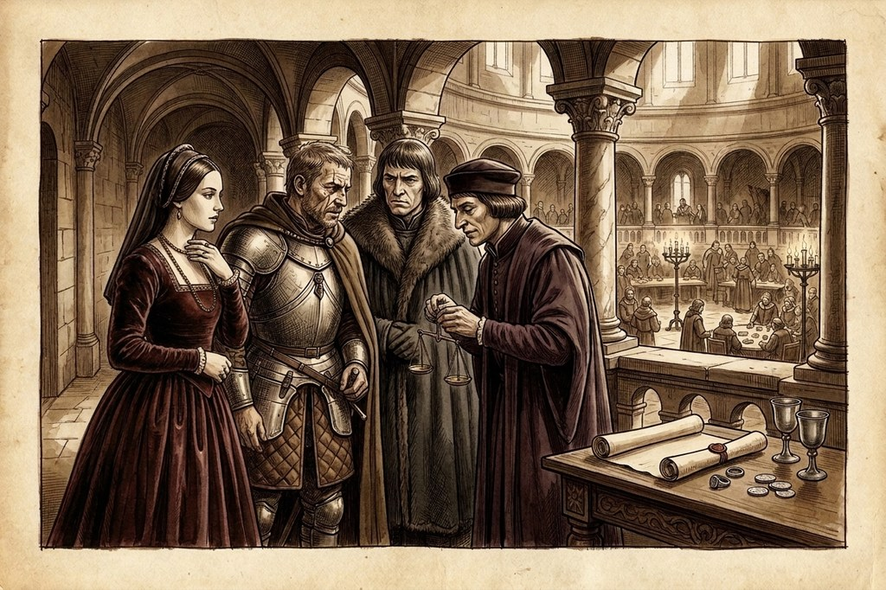
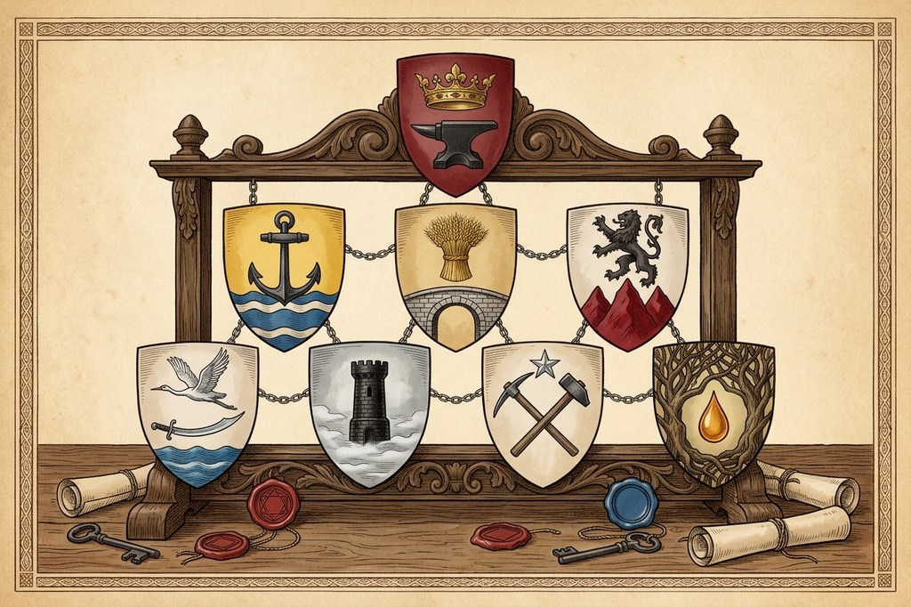
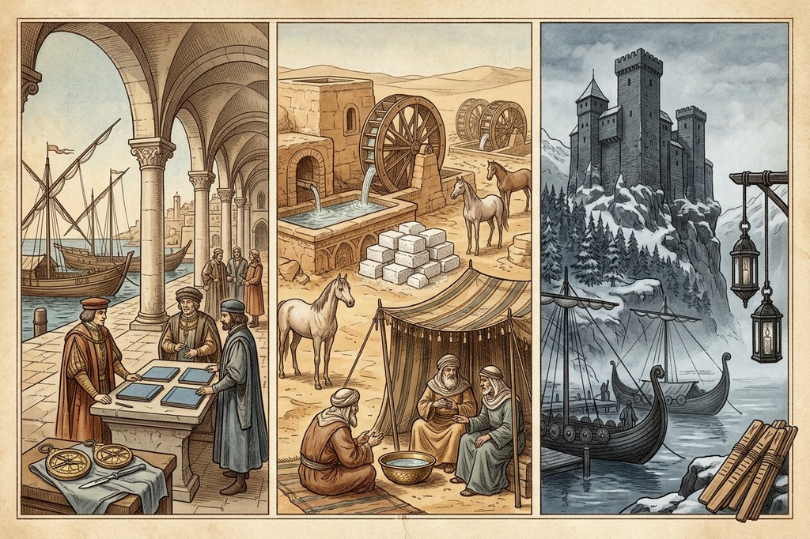
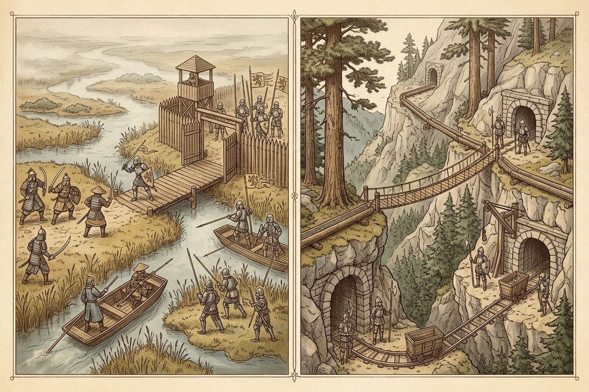

# Atlas Feudal, Regências e Intrigas de Alenia — Os Vinte e Dois Domínios da Coroa

> *"Em Altavanne juram que o reino é uma pirâmide de pedra; na minha mesa da Balança, ele se parece muito mais com uma ponte de arcos tensos. Tire a cunha de Lavroga, represa a água das Cidades Suspensas ou deixe Vaarsa estrangular os canais de Voernock, e você descobrirá depressa que até o trono do Matador da Sombra precisa de quem carregue o grão, o sal e o remo."* — **Memorial Reservado de Lady Serina Scutauria, Mestre da Balança (Ano 418 EF)**

Este **Tomo XVII** estabelece o mapa político, jurídico e territorial completo dos **22 Domínios e Feudos de Alenia (`L01`–`L22`)** e das **8 Frentes Quentes de Litígio e Politicagem (`Z01`–`Z08`)**, projetado para multiplicar oportunidades de **intriga palaciana, espionagem, disputas de divisa, casamentos políticos, embargos e subinfeudação** nas campanhas de **Alenia RPG**.

Toda a arquitetura obedece a **duas leis constitucionais claras** sob a soberania nominal de **Altavanne (`L01`)**:
1. **No Reino Capital de Aurora (`L02`–`L08`)**: existem **sete grandes feudos** — **Merlinport**, **Dahrma** *(que controla a castelania vassala de **Lavroga**)*, **Vaarsa**, **Yõketsu**, **Altrax**, **Aeraneas** e o **Feudo das Cidades Suspensas** —, cada qual governado por seu **Senhor Feudal**, **respondendo todos diretamente a Altavanne**. Enquanto **Yõketsu e Vaarsa disputam o Pântano de Voernock (`Z01`)**, **Dahrma governa Lavroga (`Z02`)** e o **Feudo das Cidades Suspensas disputa os Montes Ferraur com Aeraneas (`Z03`)**.
2. **Nos Outros Três Reinos Civilizados (*Corallis `L09`–`L13`, Gaddra `L14`–`L17` e Kalis `L18`–`L22`*)**: cada feudo local possui seu próprio senhor feudal *(Síndico-Patrício, Emir de Oásis ou Jarl/Senhor de Praça)*, que **responde ao Regente do seu reino** (**Corardo della Rocca `N021`**, **Qasir Zaharid `N022`** e **Grimrik Ulscold `N023`**), e **cada Regente responde diretamente a Altavanne**.

---

## A pirâmide imperial de vassalagem, forais e politicagem

A doença sem herdeiro do **Alto Rei Severor III Valerion (`N003`)** transformou cada foral antigo, cada marco de pedra e cada rota de abastecimento numa peça viva de negociação no **Ano 418 EF**. Abaixo da retórica solene dos arautos, o poder corre por contratos concretos de prata (**Padrão Prata: `1 PO = 10 PP = 100 PC`**), lanças juramentadas e acesso a recursos estratégicos — sem pólvora, sem impérios mágicos e sem lealdade garantida de graça.

### 1. A Dupla Cadeia de Suserania: Vassalos Diretos vs. Vassalos de Regência

| Escalão Político | Em Aurora *(Reino Capital)* | Nos Reinos Vassalos *(Corallis, Gaddra e Kalis)* | Tributo & Dever Principal |
| :--- | :--- | :--- | :--- |
| **1º Escalão — Ápice Imperial** | **Coroa Solar em Altavanne (`L01`)** — *Alto Rei Severor III (`N003`)* / *Regente Valora Valerion (`N004`)* | **Coroa Solar em Altavanne (`L01`)** *(confirma ou depõe Regentes, emite Salvo-Condutos Imperiais e preside a Alta Corte do Dia)* | Monopólio legal do adamante, Casa da Moeda Real e última instância de apelação nobre (**S05**). |
| **2º Escalão — Governo de Reino** | *(Exercido diretamente pelo Trono e pelo Conselho dos Seis Ofícios em Altavanne)* | **Os Três Regentes Vassalos (`S04`)**: *Corardo della Rocca (`N021`)*, *Qasir Zaharid (`N022`)* e *Grimrik Ulscold (`N023`)* | Remetem o **Tributo Anual da Regência** a Altavanne (prata/escoltas, sal/montarias ou madeira negra/vidro) e mantêm a paz marítima e de fronteira. |
| **3º Escalão — Os Grandes Feudos** | **Os 7 Feudos de Aurora (`L02`–`L08`, `S04`)** — respondem **diretamente a Altavanne** | **Os 14 Feudos Regionais (`L09`–`L22`, `S03`–`S04`)** — respondem **ao Regente do seu reino** | **Chamado do Estandarte** em até `15 dias`, **Tributo de Escudo (`10%`)**, guarda das estradas/portos/poços e baixa/alta justiça local. |
| **4º Escalão — Sub-feudos & Casas de PJs** | **Castelanias Vassalas** *(como **Lavroga** sob Dahrma, ou **Pontáuria** sob Altavanne)* e **Casas criadas pelos jogadores** (**Tomo XV**) | **Solares, Cáceres, Feitorias e Torres (`F01`–`F07`)** concedidos pelo senhor do feudo local ou pelo Regente | Pagam cota ou serviço militar ao seu Senhor Feudal imediato — mas podem apelar ao escalão acima quando sofrem abuso comprovado! |

> [!IMPORTANT]
> **Por que a Dupla Camada nos Outros Reinos Gera Tanta Intriga?**
> Quando um senhor de *Baldbella (`L10`)*, *OX (`L15`)* ou *Dobalbek (`L21`)* discorda de seu Regente, ele tenta enviar emissários secretos direto a **Altavanne (`L01`)** prometendo fidelidade maior à Coroa em troca de privilégios tarifários. Inversamente, quando **Altavanne** aperta os impostos, o Regente fecha os olhos para a autonomia dos seus feudos locais a fim de fazer frente comum contra a capital!

### 2. As Cinco Armas da Politicagem Feudal *(Regras Práticas de Mesa)*

Em campanhas políticas ou senhoriais (combinando o **[Tomo XV — Casas Nobres](15_Casas_Nobres_Feudos_e_Fortificacoes.md)** e o **[Tomo XVI — Status, Fé e Submundo](16_Feitos_de_Fe_Status_e_Submundo.md)**), os senhores raramente começam por uma guerra aberta cara e sangrenta; antes disso, usam cinco instrumentos clássicos:

1. **Subinfeudação Estratégica (*Onde os PJs Entram no Tabuleiro*)**: quando os personagens erguem ou reformam uma fortificação (**F01–F08**), eles escolhem (ou negociam) **em qual dos 22 domínios (`L01`–`L22`) sua terra se situa**. Cada feudo suserano concede um **Bônus Regional de Carta** concreto *(detalhado em cada ficha abaixo e automatizado no plugin `Alenia_Casa_Nobre.rpk v1.1`)*, mas arrasta imediatamente a Casa dos jogadores para as **rivalidades e deveres daquele senhor**.
2. **Guerra de Pedágio, Embargo e Retenção Sazonal**: um Senhor Feudal (`Status 3–4`) pode sobretaxar ou reter temporariamente a passagem de grãos (*Dahrma*), pedra de mó (*Lavroga*), sal (*Naasar*), madeira naval (*Kalis*) ou barcaças (*Merlinport*) destinadas a um vizinho rival. Na mecânica do Tomo XV, um feudo sob embargo vizinho sofre **`-25%` na Receita Bruta** de comércio (`D11`, `D14`) e **`+20%` no custo de obras** até romper o bloqueio por acordo diplomático (`Persuasão` ou `Barganha` + apoio de `Status`, `CD 16–20`), rota alternativa ou contrabando (`Submundo U02–U04`).
3. **Forais Sobrepostos e Guerra de Pergaminhos**: três reinados seguidos — o corrupto *Aemilius IV (`N005`)* vendendo cartas por prata, o heroico *Severor I (`N001`)* recompensando veteranos da Faixa Negra e o metódico *Severor II (`N002`)* redesenhando pontes e canais — deixaram **cartas régias autênticas com linhas de divisa contraditórias** (*como ocorre hoje em Voernock `Z01` e Ferraur `Z03`*). Provar precedência jurídica perante o **Preboste Valen de Pontáuria (`N018`)** exige *Investigação* + *História* (`CD 18`) nos arquivos locais ou em Sellene — e quem falsifica selo real arrisca acusação de Alta Traição!
4. **Pupilos de Honra (*Hóspedes-Garantia*) e Alianças de Sangue**: para selar paz entre dois feudos desconfiados sem humilhação pública, entrega-se um filho segundo ou sobrinho como escudeiro/dama de companhia na corte vizinha (`7 a 16 anos`). Ferir um pupilo sob o próprio teto destrói a honra da Casa (*quebra da Lei da Anfitriã*, queda imediata de `-2 Status` do **Tomo XVI**), mas a simples presença dele impede o pai de marchar sem hesitar — e transforma resgates discretos ou escoltas nupciais em aventuras memoráveis.
5. **Mercadejo de Votos no Grande Concílio**: caso a saúde de *Severor III* force a abertura de um **Grande Concílio em Altavanne (`Z05`)**, cada um dos **7 Feudos de Aurora** detém voto pleno de estandarte, enquanto os **3 Regentes** falam em nome dos tributos continentais. Hoje o placar está no fio da navalha:
   - **Bloco da Regente Valora Valerion (`N004`)**: *Altavanne (`L01`)*, *Merlinport (`L02`, condicional ao comércio aberto)* e simpatia cautelosa de *Aeraneas (`L07`, se evitar massacre)*.
   - **Bloco Marcial de Lucian Leonastis (`N006`)**: *Vaarsa (`L04`)* e simpatizantes armados nas castelanias pressionadas da fronteira sul.
   - **Pêndulos Cobrando Preço Alto**: *Dahrma (`L03`)*, *Yõketsu (`L05`)*, *Altrax (`L06`)* e *Cidades Suspensas (`L08`)* — exatamente onde cada missão cumprida pelos jogadores pode virar um feudo inteiro de lado!

---

## Coroa imperial e os sete grandes feudos de Aurora

No **Reino Capital de Aurora**, não há intermediário entre os sete grandes senhores territoriais e o Paço Real: **Merlinport, Dahrma, Vaarsa, Yõketsu, Altrax, Aeraneas e as Cidades Suspensas respondem todos diretamente a Altavanne (`L01`)**. Abaixo está o quadro sinótico do reino em `418 EF`, seguido das fichas completas de cada domínio:

| Código & Domínio | Senhor Feudal *(Ano 418)* | Casa / Instituição | Sub-feudos & Disputas Diretas | Inclinacão em Altavanne |
| :--- | :--- | :--- | :--- | :--- |
| **`L01` Altavanne *(Coroa)*** | Alto Rei *Severor III* (`N003`) / Regente *Valora* (`N004`) | **Casa Valerion** | Controla **Pontáuria** (*Casa de Pontáuria*); recebe homenagem de `L02–L08` e dos 3 Regentes | Trono / Regência Solar |
| **`L02` Feudo de Merlinport** | Lorde *Marcus Scutauria* (`N014`) | **Casa Scutauria** | Atrito alfandegário no estuário e rotas dos Pântanos (`Z04`) | Lealista condicional a Valora |
| **`L03` Feudo de Dahrma** | Lorde *Lorian Montavalle* (`N012`) | **Casa Montavalle** | **Controla a Castelania de Lavroga (`Z02`)** | Neutro / Pêndulo do Pão |
| **`L04` Feudo de Vaarsa** | Marechal *Lucian Leonastis* (`N006`) | **Casa Leonastis** | **Disputa Voernock com Yõketsu (`Z01`)**; vigia Rubecina (`Z07`) | Líder da Oposição Marcial |
| **`L05` Feudo de Yõketsu** | Senhor *Kenshin Tsurumaru* | **Casa Tsurumaru** | **Disputa Voernock com Vaarsa (`Z01`)** | Autonomista / Voto em aberto |
| **`L06` Feudo de Altrax** | Castelã *Aurelia d'Altrax* (`N016`) | **Casa d'Altrax** | Vigia Pântanos Nebulosos, Specula e crise de Cadwyn (`Z04`) | Independente / Desconfiada |
| **`L07` Feudo de Aeraneas** | Grão-Lorde *Aurelian Ferraris* (`N015`) | **Casa Ferraris** | **Disputa os Montes Ferraur com as Cidades Suspensas (`Z03`)** + Greve interna | Tende a Valora contra intervenção militar |
| **`L08` Feudo das Cidades Suspensas** | Senhora-Guardiã *Aerwen ferch Taldor* (`N024`) | **Conselho das Copas** | **Disputa os Montes Ferraur com Aeraneas (`Z03`)**; controla o entreposto de **Vergod** | Tensa / Exige respeito ao Foral |

### L01 — Domínio Régio de Altavanne e Castelania de Pontáuria

**Reino e Suserania:** Reino Capital de Aurora (`Ápice Soberano — Coroa Imperial de todos os reinos civilizados`).

**Senhor Feudal (Ano 418):** Alto Rei **Severor III Valerion** (`N003`, enfermo) representado pela Regente Real **Valora Valerion** (`N004`) | **Casa / Linhagem:** Casa Valerion (*"Do Fogo, a Ordem"* — coroa dourada sobre bigorna negra em carmesim).

**Sede, Escala & Força:** Paço Real de Altavanne (**F10**, `2.800 PV, LE 18`), Grande Catedral do Sol de Seis Raios (`N019`) e a ponte fortificada de **Pontáuria** (**F08**, guardada pela vassala *Casa de Pontáuria* de `N018` e `N020`); `3.000+` soldados da Guarda Real e da Faixa Negra, mais barcaças armadas no Rio Aurélio (**E04–E06**).

**Economia, Recursos & Sub-feudos:** Casa da Moeda Real (*Áureos, Escudos e Vinténs*), pedágios centrais da bacia do Aurélio, arquivos da Chancelaria, tribunais do Preboste e hortas nobres onde floresce a *Rosa-de-cera* (`H08`) e se servem banquetes de *Folhado de escama-terrestre* (`C02`). Mantém suserania direta sobre a **Castelania de Pontáuria**.

**Concessão a Vassalos (Bônus para Casa de PJs):** Casas menores com terra concedida nas terras régias centrais recebem **`+1` em testes formais de *Etiqueta* e *Persuasão* perante magistrados reais** e desconto de **`-10%` na contratação de Senescais (`G11`) e Mestres de Armas (`G12`)**, mas ficam sob olho imediato do Preboste (`N018`) e são as primeiras convocadas em crise na capital.

**Alianças, Intrigas & Ganchos em Mesa:** A agonia de *Severor III* transformou cada corredor de Altavanne num campo minado entre os emissários de *Valora (`N004`)*, os oficiais de *Leonastis (`N006`)*, os auditores de *Serina Scutauria (`N013`)* e os despachos opacos de *Cassian d'Altrax (`N017`)* (`Z05`).

### L02 — Feudo de Merlinport

**Reino e Suserania:** Reino Capital de Aurora (`Responde diretamente a Altavanne — L01`).

**Senhor Feudal (Ano 418):** Lorde **Marcus Scutauria** (`N014`) | **Casa / Linhagem:** Casa Scutauria (*"O Rio Alimenta a Coroa"* — escudo de ouro sobre ondas azuis e âncora de ferro).

**Sede, Escala & Força:** Cidadela Portuária e Torre da Corrente de Merlinport (**F09 + F07**, bloqueando a boca do estuário), apoiada por `950` marinheiros-soldados, besteiros de cais (`G03`) e a maior frota mercante e fluvial de Aurora (`18` navios entre **E04, E06, E08 e E09**).

**Economia, Recursos & Sub-feudos:** Alfândegas de importação e exportação entre o Rio Aurélio e o Mar dos Corais, armazéns de grãos e lã, guindastes pesados liderados por guildas livres (`N069`), estaleiros fluviais e intenso intercâmbio de *Letras em Cera Azul* com Corallis.

**Concessão a Vassalos (Bônus para Casa de PJs):** Um feudo costeiro ou fluvial vassalo de Merlinport constrói **Armazéns e Cais (`D14`) com `-20%` de custo em prata** e soma **`+15 PP/mês` extras por cada `D14` ativo**, devendo em troca ceder barcos ou escolta contra piratas e contrabandistas no estuário.

**Alianças, Intrigas & Ganchos em Mesa:** *Marcus (`N014`)* sustenta *Valora* por intermédio da irmã *Serina (`N013`)*, mas ameaça reter receitas alfandegárias se Altavanne decretar tarifas de guerra. Nos trapiches enevoados da *Âncora de Cinza*, espiões kalitas (`N030`), compradores de Baldbella (`N028`) e boatos sobre o piloto desperto *Beren do Cais (`N027`)* cruzam-se todas as noites (`Z04`).

### L03 — Feudo de Dahrma *(Suserano de Lavroga)*

**Reino e Suserania:** Reino Capital de Aurora (`Responde diretamente a Altavanne — L01`; **exerce suserania direta sobre a Castelania de Lavroga**).

**Senhor Feudal (Ano 418):** Lorde **Lorian Montavalle** (`N012`) | **Casa / Linhagem:** Casa Montavalle (*"Quem Guarda o Pão, Guarda a Paz"* — feixe de trigo dourado sobre ponte de pedra).

**Sede, Escala & Força:** Paço Murado dos Celeiros de Dahrma (**F08** cercado pelas férteis várzeas do afluente *Várzea-Clara*) **mais** a subordinada **Fortaleza das Pedreiras de Lavroga** (**F07/F08** na garganta sudoeste, administrada pelo vassalo **Castelão Galeran de Lavroga**); `1.100` homens somados, destacando-se a célebre cavalaria ligeira de estrada (`G05/G06`) e engenheiros canteiros de Lavroga (`G07/G09`).

**Economia, Recursos & Sub-feudos:** O maior celeiro de trigo, cevada e criação de *Galinha-dourada* (`A13`, base da *Panela de Dahrma* `C04`) de toda Aurora — combinado ao **controle direto sobre Lavroga**, de onde saem as melhores mós de moinho, blocos de cantaria aparelhada e a rara *Flor-de-pedra* (`H16`).

**Concessão a Vassalos (Bônus para Casa de PJs):** Casas vassalas de Dahrma/Lavroga recebem **`+15 PP/mês` adicionais na primeira Aldeia Arrendada (`D09`)** e pagam **`-15%` na construção de Moinhos (`D10`)**, mas são obrigadas a entregar cota de grãos ou escoltar comboios de pedra entre Lavroga e o vale.

**Alianças, Intrigas & Ganchos em Mesa:** *Lorian (`N012`)* sorri para ambos os lados em Altavanne enquanto tenta limpar a velha mancha militar atribuída ao antepassado *Corvus (`N011`)*. Porém, dentro de seu próprio domínio ferve o ressentimento de **Lavroga (`Z02`)**: o *Castelão Galeran* acusa Dahrma de confiscar a renda das pedreiras e negligenciar as patrulhas contra saqueadores das Estepes — fresta explorada tanto por emissários de *Leonastis (`N006`)* quanto por veteranos desertores como *Cassian de Lavroga (`N029`)*.

### L04 — Feudo de Vaarsa

**Reino e Suserania:** Reino Capital de Aurora (`Responde diretamente a Altavanne — L01`).

**Senhor Feudal (Ano 418):** Marechal **Lucian Leonastis** (`N006`) | **Casa / Linhagem:** Casa Leonastis (*"Ferro Não Recua"* — leão de ferro erguido sobre três picos rubros).

**Sede, Escala & Força:** Praça-Forte de Escarpa de Vaarsa (**F09**, `1.850 PV, LE 16`, cravada na garganta dos *Picos de Rubecina* com `3` trabucos fixos `D06`), apoiada por `1.450` soldados — a mais disciplinada infantaria pesada (`G04`) e engenharia de montanha de Aurora.

**Economia, Recursos & Sub-feudos:** Pedágios das caravanas meridionais que cruzam o *Passo de Rubecina* trazendo sal e cavalos de Gaddra, minas secundárias de ferro comum, rebanhos alpinos e forjas militares de campanha.

**Concessão a Vassalos (Bônus para Casa de PJs):** Vassalos juramentados a Vaarsa contratam **Soldados Regulares (`G02`) e Infantes Pesados (`G04`) com `-15%` no custo inicial** e recebem **`+1` permanente nos testes de Moral em cerco**, mas devem responder imediatamente às marchas convocadas pelo Marechal.

**Alianças, Intrigas & Ganchos em Mesa:** Enquanto *Lucian (`N006`)* pressiona Altavanne pelo Grande Concílio e ameaça marchar sobre Aeraneas, seus capitães no leste avançam estacas e postos fiscais para dentro do **Pântano de Voernock, em choque aberto contra o Feudo de Yõketsu (`Z01`)**, ao mesmo tempo em que o ameaçado fechamento do Passo de Rubecina por clãs de Gaddra (`Z07`) estrangula o cofre de Vaarsa!

### L05 — Feudo de Yõketsu

**Reino e Suserania:** Reino Capital de Aurora (`Responde diretamente a Altavanne — L01`).

**Senhor Feudal (Ano 418):** Senhor Feudal (*Kenshu*) **Kenshin Tsurumaru** | **Casa / Linhagem:** Casa Tsurumaru (*"A Garça Pousa Sobre a Lâmina Calma"* — garça prateada em voo sobre sabre curvo e ondas azul-ferrete).

**Sede, Escala & Força:** Castelo Lacustre-Costeiro de Yõketsu (**F08 + F07** erguido sobre terraços de pedra encaixada sem argamassa rígida e canais de maré na costa leste), guarnecido por `850` espadachins de armadura lamelar lacada, arqueiros navais de convés estreito (`N077`) e embarcações costeiras velozes (**E03, E05, E07**) guiadas pelos pilotos da família Tsurin (`N078`).

**Economia, Recursos & Sub-feudos:** Comércio costeiro oriental (olhando de vigia tensa para o Mar Intransponível e Kalis), pesca curada, porcelana de alta queima e caldos nobres (`N079`), cutelaria dobrada sem adamante, arrozais alagados da baixada leste e coleta de turfa e ervas na borda sul de **Voernock**.

**Concessão a Vassalos (Bônus para Casa de PJs):** Vassalos do Feudo de Yõketsu recebem **`+1` no Índice de Defesa de tropas leves/arqueiros (`G02`, `G03`)**, **redução de `-15%` na manutenção de embarcações costeiras (`E01`–`E06`)** e acesso às escolas de lâmina ágil de Yõketsu, assumindo o dever de patrulhar os canais de Voernock e vigiar velas vindas de Kalis.

**Alianças, Intrigas & Ganchos em Mesa:** Fundado por navegadores ancestrais e integrado à Coroa mediante o *Foral das Garças* (que preserva língua, etiqueta e escolas marciais próprias em troca de tributo direto a Altavanne), **Yõketsu enfrenta hoje sua maior ameaça terrestre**: as colunas da Casa Leonastis de **Vaarsa** tentam anexar as pontes, canais de turfa e pesqueiros do **Pântano de Voernock (`Z01`)**. *Kenshin Tsurumaru* — um estrategista frio de cinquenta anos que jamais levanta a voz — deixou claro em Altavanne que seu voto no Concílio pertence a quem reconhecer, com selo irrevogável, a fronteira histórica de Yõketsu sobre Voernock.

### L06 — Feudo de Altrax

**Reino e Suserania:** Reino Capital de Aurora (`Responde diretamente a Altavanne — L01`).

**Senhor Feudal (Ano 418):** Castelã **Aurelia d'Altrax** (`N016`) | **Casa / Linhagem:** Casa d'Altrax (*"Vigiamos Onde a Estrada Termina"* — torre negra erguida sobre névoa prateada).

**Sede, Escala & Força:** Forte de Altrax (**F08**, `1.380 PV, LE 14`, protegido por fosso alagado `D01`, barbacã `D03` e poterna na bruma `D08`), apoiado por `750` patrulheiros de pântano, besteiros, cães de rastro e batedores que conhecem cada trilha seca entre os *Pântanos Nebulosos* e o litoral frio do *Mar das Cinzas*.

**Economia, Recursos & Sub-feudos:** Diques e canais de drenagem da *Sangria de Altrax* (`T092`), peles impermeáveis, breu vegetal, pesca fria, pedágios de escolta na *Estrada da Bruma* e jurisdição nominal sobre postos arruinados como a **Torre de Specula** (**F04**).

**Concessão a Vassalos (Bônus para Casa de PJs):** Reerguer uma ruína ou manter feudo sob Altrax reduz em **`-5%` adicionais o custo de reforma de ruínas (`40%` em vez de `45%`)** e concede **`+2` em alertas antecipados de patrulha e *Sobrevivência* regional**, exigindo vigília constante contra salteadores e criaturas da bruma.

**Alianças, Intrigas & Ganchos em Mesa:** A Casa d'Altrax nunca esqueceu que *Severor I* recuou na promessa de terras florestais feita ao ancestral *Darian (`N008`)* após a caçada de `356 EF`. *Aurelia (`N016`)* recusa submeter seu forte ao Marechal Leonastis, mas também desconfia da capital — enquanto seu primo *Cassian d'Altrax (`N017`)* manobra nos Selos Secretos e o desaparecimento do emissário silvano *Cadwyn (`N025`)* perto de suas terras ameaça incendiar toda a fronteira norte (`Z04`).

### L07 — Feudo de Aeraneas

**Reino e Suserania:** Reino Capital de Aurora (`Responde diretamente a Altavanne — L01`).

**Senhor Feudal (Ano 418):** Grão-Lorde **Aurelian Ferraris** (`N015`) | **Casa / Linhagem:** Casa Ferraris (*"Paciência Corta a Rocha"* — picareta e malho cruzados sob estrela prateada).

**Sede, Escala & Força:** Cidadela-Forja de Aeraneas (**F09**, encravada nos contrafortes dos *Montes Ferraur* sobre fornalhas de tiragem natural e galerias blindadas), defendida por `900` guardas da Bigorna, besteiros pesados e a guilda dos *Mestres do Malho Sagrado*.

**Economia, Recursos & Sub-feudos:** O coração estratégico de Alenia — extração e refino de **adamante**, fabricação de brocas cirúrgicas e mecânicas para Corallis, ligas temperadas e carvão mineral de alta queima.

**Concessão a Vassalos (Bônus para Casa de PJs):** Casas vassalas de Aeraneas erguem **Forjas Senhoriais (`D12`) pela metade do preço (`750 PP`)** e somam **`+20 PP/mês` extras de renda metalúrgica** quando mantêm Mestre Ferreiro (`G10`), sob proibição absoluta (pena de morte por Alta Traição) de desviar uma única lasca de adamante sem selo.

**Alianças, Intrigas & Ganchos em Mesa:** *Aurelian (`N015`)* vive o pior inverno de sua vida: quarenta mortos num desabamento paralisaram as galerias em greve liderada por veteranos como *Valen Serrador (`N070`)*; *Leonastis (`N006`)* exige intervir a ferro; e a necessidade desesperada de abrir novos veios rasos e cortar lenha pesada a leste colocou Aeraneas em **disputa territorial direta contra o Feudo das Cidades Suspensas pelos Montes Ferraur (`Z03`)**.

### L08 — Feudo das Cidades Suspensas *(e Entreposto de Vergod)*

**Reino e Suserania:** Reino Capital de Aurora (`Feudo Florestal de Regime Especial — responde diretamente a Altavanne — L01` nos termos do *Foral e Tratado de Vergod*).

**Senhor Feudal (Ano 418):** Senhora-Guardiã **Aerwen ferch Taldor** (`N024`, investida perante a Coroa como *Guardiã Feudal das Copas e de Vergod*) | **Casa / Linhagem:** Conselho das Copas / Linhagens Silvestres (*ramos entrelaçados sustentando gota de âmbar*).

**Sede, Escala & Força:** Plataformas das Árvores-Mestras das Cidades Suspensas (**equivalente defensivo a F09** nas copas milenares, protegida por pontes destacáveis `N072`, seiva retardante de fogo e calhas pluviais `N076`) somada à estacada mercantil de **Vergod** (**F03/F05** na borda da mata); `1.000` vigias das folhas, arqueiros de dossel (`G03` de elite) e batedores invisíveis sob a copa.

**Economia, Recursos & Sub-feudos:** Resinas impermeáveis, madeiras nobres de arco, mel silvestre, peles de inverno, ervas medicinais raríssimas (**Tomo X**) e controle do comércio fronteiriço em **Vergod** (onde trocam produção florestal por sal, ferramentas de ferro e prata cortada).

**Concessão a Vassalos (Bônus para Casa de PJs):** Casas ou guardiões investidos sob o feudo de Vergod/Cidades Suspensas erguem **Motas de Madeira (`F03`) e Ervanários (`D15`) com `-25%` de custo**, e seu Físico/Herbalista (`G13`) dobra a produção mensal de cataplasmas, desde que jamais pratiquem corte raso ou mineração predatória.

**Alianças, Intrigas & Ganchos em Mesa:** Reconhecidas pela Chancelaria de Altavanne como o **sétimo grande feudo de Aurora** *(fórmula jurídica que impede lordes vizinhos de declarar a floresta "terra sem dono", em troca do compromisso de Vergod responder diretamente ao Alto Rei)*, as Cidades Suspensas enfrentam hoje **choque frontal com Aeraneas pelos Montes Ferraur (`Z03`)**: escavações e carvoarias avançaram sobre as encostas orientais que alimentam as nascentes da mata, e o emissário *Cadwyn ap Merion (`N025`)* desapareceu justamente quando reunia provas de prospecção ilegal de adamante dentro dos limites do foral!

---

## Feudos dos três reinos vassalos e seus regentes

Fora de Aurora, a Coroa governa através de **pirâmide em dois degraus**: os feudos regionais de **Corallis (`L09`–`L13`)**, **Gaddra (`L14`–`L17`)** e **Kalis (`L18`–`L22`)** prestam juramento, impostos e tropas ao **Regente** do seu respectivo reino, e **o Regente responde pessoalmente a Altavanne (`L01`)**. *(Lembrando sempre o limite vivo do cenário: fora dessas praças civilizadas, corsários de Ravena, sucateiros do Ferro Velho, tribos livres das dunas e clãs isolados da Floresta Negra não curvam o joelho nem ao Regente nem ao Alto Rei.)*

### Liga Talassocrática de Corallis *(Respondem ao Arconte-Regente Corardo della Rocca `N021` → Altavanne `L01`)*

### L09 — Feudo-Sede de Alineus

**Reino e Suserania:** Liga de Corallis (`Sede da Regência — responde diretamente a Altavanne — L01`).

**Senhor Feudal (Ano 418):** Arconte-Regente **Corardo della Rocca** (`N021`) | **Casa / Linhagem:** Casa della Rocca (*galé dourada sobre rochedo azul*).

**Sede, Escala & Força:** Palácio do Arsenal e Molhe Fortificado de Alineus (**F09 + F07**), `1.100` infantes marinhos e `14` galés de escolta e recife (**E09, E10**).

**Economia, Recursos & Sub-feudos:** Estaleiros maiores da Liga, rota principal com Merlinport, seguros navais e taxas de salvamento disputadas com Baldbella (`Z06`).

**Concessão a Vassalos (Bônus para Casa de PJs):** `-15%` na compra/reparo de navios (**Tomo XIV**) e isenção de ancoragem em Alineus; exige escolta naval à Regência.

**Alianças, Intrigas & Ganchos em Mesa:** *Corardo (`N021`)* equilibra quatro cidades orgulhosas enquanto tenta investigar *Thanatos* antes que Altavanne ou Kalis monopolizem o segredo.

### L10 — Feudo Mercantil de Baldbella

**Reino e Suserania:** Liga de Corallis (`Responde ao Arconte-Regente Corardo della Rocca — L09 → Altavanne — L01`).

**Senhor Feudal (Ano 418):** Síndico-Patrício **Valerio Corvella** | **Casa / Linhagem:** Casa Corvella (*três conchas de prata e bisturi cruzado sobre púrpura*).

**Sede, Escala & Força:** Paço dos Canais e Forte da Laguna de Baldbella (**F08 + F07**), `800` guardas de canal e esquadrilha de galés rápidas (**E10**).

**Economia, Recursos & Sub-feudos:** Bancos emissores de *Cera Azul*, colégios de cirurgia (`N035`), oficinas tipográficas (`N055`), herbários (`N032`) e pesca de pérolas.

**Concessão a Vassalos (Bônus para Casa de PJs):** Linha de crédito em *Cera Azul* ampliada em **`+50%`** e contratação de **Físico Cirurgião (`G13`) com `-30%` de salário**; cobra participação nas tarifas dos recifes.

**Alianças, Intrigas & Ganchos em Mesa:** *Valerio Corvella* lidera o boicote tarifário contra Alineus (`Z06`), ameaçando apelar direto a Altavanne se *della Rocca* tocar nos privilégios de pilotagem de Baldbella.

### L11 — Feudo Forjador de Stoneforge

**Reino e Suserania:** Liga de Corallis (`Responde ao Arconte-Regente Corardo della Rocca — L09 → Altavanne — L01`).

**Senhor Feudal (Ano 418):** Mestre-Barão **Orso Rupefori** | **Casa / Linhagem:** Casa Rupefori (*roda dentada de bronze sobre pico cinzento*).

**Sede, Escala & Força:** Fortaleza Industrial de Stoneforge nos *Montes Pedramar* (**F09**), `750` besteiros de precisão e mestres artilheiros (`G07`).

**Economia, Recursos & Sub-feudos:** Engenhos de torção e contrapeso (**D05, D06, M08–M12**), relojoaria naval, bombas hidráulicas (`N089`) e metalurgia fina dependente de lascas de adamante vindas de Aeraneas.

**Concessão a Vassalos (Bônus para Casa de PJs):** **`-20%` no custo de Balistas (`D05`) e Trabucos (`D06`)** e `+1` nos disparos de engenhos de muralha; exige defender comboios técnicos nos Montes Pedramar.

**Alianças, Intrigas & Ganchos em Mesa:** A greve em *Aeraneas (`L07`)* deixou as oficinas de Stoneforge sem pontas de adamante — levando guildas impacientes a comprar lotes suspeitos vindos de *O Ferro Velho*!

### L12 — Feudo Bancário e Agrícola de Biemont e Portocala

**Reino e Suserania:** Liga de Corallis (`Responde ao Arconte-Regente Corardo della Rocca — L09 → Altavanne — L01`).

**Senhor Feudal (Ano 418):** Dama **Lorenza Falcenzo** (`N086`) | **Casa / Linhagem:** Casa Falcenzo (*falcão dourado segurando chave azul em campo verde*).

**Sede, Escala & Força:** Solar-Cidadela das Colinas de Biemont (**F08**) e Torre Pesqueira de **Portocala** (**F07** ao sul, de frente para *O Ferro Velho*), com `650` mercenários contratados e navios-correio (**E05**).

**Economia, Recursos & Sub-feudos:** Vinhedos, olivais, salinas costeiras, seguros marítimos da *Casa Falcenzo* e comércio discreto (oficialmente negado!) com sucateiros do sul (`N057`).

**Concessão a Vassalos (Bônus para Casa de PJs):** Empréstimos para construção senhorial com **juros reduzidos pela metade** e **`+20 PP/mês`** em rotas comerciais (`D11`/`D14`); exige abrir os livros contábeis do feudo aos auditores Falcenzo.

**Alianças, Intrigas & Ganchos em Mesa:** *Lorenza (`N086`)* financia metade dos armadores endividados da Liga, transformando naufrágios nos recifes em cadeiras políticas sob seu controle (`Z06`).

### L13 — Claustro-Feudo de Sellene e Farol de Claramar

**Reino e Suserania:** Liga de Corallis (`Responde ao Arconte-Regente Corardo della Rocca — L09` nos assuntos civis/portuários, mas **presta juramento reservado direto a Altavanne — L01** pela guarda do *Acervo Oculto*).

**Senhor Feudal (Ano 418):** Arquimestre **Matteo dal Pelago** (`N031`) | **Casa / Linhagem:** Academia de Sellene / Casa dal Pelago (*lâmpada de bronze sobre livro fechado e estrela náutica*).

**Sede, Escala & Força:** Complexo Murado da Academia de Sellene (**F08** sobre abóbadas subterrâneas seladas) e o estratégico **Farol de Claramar** (**F04/F07**), com `400` guardas juramentados da Chave da Maré.

**Economia, Recursos & Sub-feudos:** Cartografia náutica, lentes do *Observatório Helmer*, ensino superior, perícias documentais e taxas de sinalização marítima.

**Concessão a Vassalos (Bônus para Casa de PJs):** **`+2` em *História*, *Investigação* e *Contraespionagem* documental** da Casa e acesso prioritário a mestres escribas; exige proteger expedições científicas da Academia.

**Alianças, Intrigas & Ganchos em Mesa:** Preso entre a cobrança prática de Stoneforge, a curiosidade perigosa sobre *Thanatos* e o segredo régio sob seus pés (`N093`–`N096`), *Matteo (`N031`)* teme infiltrações de Kalis mais do que tempestades.

---

### Confederação Tribal de Gaddra *(Respondem ao Regente das Dunas Qasir Zaharid `N022` → Altavanne `L01`)*

### L14 — Emirado-Sede de Naasar e Lago Bayd

**Reino e Suserania:** Confederação de Gaddra (`Sede da Regência das Dunas — responde diretamente a Altavanne — L01`).

**Senhor Feudal (Ano 418):** Regente das Dunas **Qasir Zaharid** (`N022`) | **Casa / Linhagem:** Clã Zaharid (*sol dourado sobre poço de pedra e balança branca*).

**Sede, Escala & Força:** Alcáçova das Cisternas de Naasar (**F09 + F06** sobre o grande aquífero artesiano perfurado em `380 EF`), com `1.200` lanceiros das águas e ginetes do deserto (`G05`).

**Economia, Recursos & Sub-feudos:** Poços profundos de água doce (`N080`), extração de blocos de **Sal de Bayd** (`1 kg = 1 PP`), tribunais de conciliação (`N059`) e pedágios da *Rota do Sal*.

**Concessão a Vassalos (Bônus para Casa de PJs):** Cáceres e sedes vassalas recebem **Cisterna Abobadada (`D07`) com `-30%` de custo** e imunidade a embargos hídricos em Naasar; exige guardar a *Lei da Hospitalidade* e escoltar caravanas de sal.

**Alianças, Intrigas & Ganchos em Mesa:** O assassinato recente do Árbitro *Malid al-Hajar (`N068`)* pôs *Qasir (`N022`)* contra a parede: se não entregar um culpado verdadeiro logo, Vargheim e os clãs livres incendiarão a fronteira (`Z07`).

### L15 — Feudo das Arenas e Coudelarias de OX

**Reino e Suserania:** Confederação de Gaddra (`Responde ao Regente Qasir Zaharid — L14 → Altavanne — L01`).

**Senhor Feudal (Ano 418):** Emir **Khalur al-Shams** | **Casa / Linhagem:** Clã al-Shams (*corcel rubro saltando sobre dois sabres cruzados*).

**Sede, Escala & Força:** Cidadela-Arena de Rocha Vermelha de OX (**F08**), `900` cavaleiros das dunas e guardas de caravana.

**Economia, Recursos & Sub-feudos:** Criação das melhores montarias resistentes ao calor de Alenia (`N060`), mercados de couro/arreios, grandes jogos de arena e entreposto oeste-leste.

**Concessão a Vassalos (Bônus para Casa de PJs):** Constrói **Coudelarias (`D16`) com `-25%` de custo** e reduz em mais **`-5 PP/mês`** o soldo de unidades montadas (`G05`/`G06`); exige fornecer cavalos de remonta à Regência.

**Alianças, Intrigas & Ganchos em Mesa:** *Khalur* obedece a *Qasir* em público, mas lucra vendendo montarias tanto a compradores de Vaarsa quanto a chefes nômades insubmissos (`N081`), jogando com a sede de ambos os lados.

### L16 — Feudo Costeiro de Qal-Zahar e Feira de Suq-Ramad

**Reino e Suserania:** Confederação de Gaddra (`Responde ao Regente Qasir Zaharid — L14 → Altavanne — L01`).

**Senhor Feudal (Ano 418):** Senhor **Tarik ibn Sahir** | **Casa / Linhagem:** Clã Sahirid (*vela triangular branca e estrela do sul sobre ocre*).

**Sede, Escala & Força:** Forte Marítimo de Qal-Zahar (**F07/F08**) e jurisdição sazonal sobre os pavilhões murados de **Suq-Ramad** (**F05**), com `600` guardas costeiros e sambucos ligeiros no *Mar de Zahar*.

**Economia, Recursos & Sub-feudos:** Especiarias meridionais, tâmaras, incensos, tapetes e a grande feira de inverno/primavera de *Suq-Ramad* (`N058`) — rota marítima alternativa quando o Passo de Rubecina trava!

**Concessão a Vassalos (Bônus para Casa de PJs):** **`+20 PP/mês`** em Estalagens/Feitorias (`D11`) ou Cais (`D14`) pelo fluxo do Mar de Zahar; exige combater contrabandistas costeiros e piratas do sul.

**Alianças, Intrigas & Ganchos em Mesa:** Se o *Passo de Rubecina* fechar (`Z07`), todo o comércio entre Aurora, Corallis e Gaddra precisará passar pelos cais de *Tarik ibn Sahir* — motivo pelo qual certos mercadores em Qal-Zahar torcem secretamente pelo conflito!

### L17 — Marca Montanhesa de Vargheim

**Reino e Suserania:** Confederação de Gaddra (`Vassalagem de Pacto Precário — responde formalmente ao Regente Qasir Zaharid — L14 → Altavanne — L01`, embora metade dos clãs altos das escarpas desafie ambos!).

**Senhor Feudal (Ano 418):** Chefe-Vigia **Halvor Sangue-Seco** | **Casa / Linhagem:** Clã Sangue-Seco (*machado de ferro e chifre de montanha sobre negro e areia*).

**Sede, Escala & Força:** Baluarte das Escarpas de Vargheim (**F09**), `1.000` guerreiros montanheses ferozes (substrato setentrional assimilado ao deserto).

**Economia, Recursos & Sub-feudos:** Pastoreio de escarpa, cobre/ferro áspero, escoltas armadas de desfiladeiro e controle do flanco oriental do Lago Bayd e das rotas que sobem rumo a Rubecina.

**Concessão a Vassalos (Bônus para Casa de PJs):** Guarnições locais recebem **`+2` em *Intimidação* e combate em terreno montanhoso/árido** e milícias (`G01`) lutam sem penalidade de moral até metade das baixas; exige arbitrar rixas de sangue constantes.

**Alianças, Intrigas & Ganchos em Mesa:** *Halvor* assinou o pacto com *Qasir Zaharid* para evitar fome no inverno, mas seus próprios sobrinhos juram que lâminas aurorianas mataram o Árbitro em Naasar e exigem fechar o Passo de Rubecina contra Vaarsa (`Z07`).

---

### Despotado Velado de Kalis *(Respondem ao Déspota-Regente Grimrik Ulscold `N023` → Altavanne `L01`)*

### L18 — Feudo-Sede da Cidadela de Kalgard

**Reino e Suserania:** Despotado Velado de Kalis (`Sede da Regência Velada — responde formalmente a Altavanne — L01`).

**Senhor Feudal (Ano 418):** Déspota-Regente **Grimrik Ulscold** (`N023`) | **Casa / Linhagem:** Casa Ulscold (*lobo cinzento vigiando chave negra sobre gelo*).

**Sede, Escala & Força:** Cidadela Dupla de Basalto de Kalgard (**F10**, `2.600 PV, LE 18`), `1.500` soldados de ferro, agentes do Véu e drakkares reais (**E11**).

**Economia, Recursos & Sub-feudos:** Banca central das *Talhas Cifradas*, tributos de madeira negra naval enviados a Altavanne, peles frias e arquivos de informação continental.

**Concessão a Vassalos (Bônus para Casa de PJs):** **`+2` adicional em *Contraespionagem* da Casa** (cumulativo com `G14`) e desconto de `-25%` na contratação de Mestres de Sussurros (`G14`); exige relatórios trimestrais à Cidadela.

**Alianças, Intrigas & Ganchos em Mesa:** *Grimrik (`N023`)* paga em dia o tributo a Altavanne para ninguém ter pretexto de cruzar o Mar Intransponível, enquanto disputa na surdina com Aurora e Corallis os segredos dos *Despertos de Thanatos*.

### L19 — Feudo Naval de Kragstad

**Reino e Suserania:** Despotado Velado de Kalis (`Responde ao Déspota-Regente Grimrik Ulscold — L18 → Altavanne — L01`).

**Senhor Feudal (Ano 418):** Lorde-Vigia **Torvald von Kragstad** *(chefe sênior da casa à qual pertence o capitão patrulheiro Haksten `N083`)* | **Casa / Linhagem:** Casa von Kragstad (*penhasco negro partido por arpão de prata*).

**Sede, Escala & Força:** Fortaleza Costeira de Kragstad (**F09 + F07**), `950` marinheiros couraçados e a principal esquadra de patrulha de drakkares (**E11**) do norte kalita.

**Economia, Recursos & Sub-feudos:** Faróis de óleo de baleia, pesca de mar gelado, ferro de *Jarnham* e proteção naval contra os corsários do *Arquipélago Ravena*.

**Concessão a Vassalos (Bônus para Casa de PJs):** Constrói **Fortes Costeiros (`F07`) e Defesas de Muralha (`D02`–`D05`) com `-15%` de custo**; exige manter farol aceso e fornecer patrulha costeira.

**Alianças, Intrigas & Ganchos em Mesa:** Uma das três grandes Casas do Conselho de Kalgard — *Torvald* cobra de *Grimrik* mais recursos para a frota e vê com desconfiança operações clandestinas sujas que desonram a marinha (`N083`).

### L20 — Feudo Judicial e Florestal de Drakenhall

**Reino e Suserania:** Despotado Velado de Kalis (`Responde ao Déspota-Regente Grimrik Ulscold — L18 → Altavanne — L01`).

**Senhor Feudal (Ano 418):** Jarl **Borhild Hrafngard** (`N082`) | **Casa / Linhagem:** Casa Hrafngard (*corvo negro pousado sobre cepo de carvalho e machado*).

**Sede, Escala & Força:** Paço-Fortaleza de Drakenhall (**F08** na borda domesticada da *Floresta Negra*), `850` alabardeiros e patrulheiros florestais.

**Economia, Recursos & Sub-feudos:** Corte controlado e secagem da preciosa **madeira negra naval**, resinas impermeáveis, peles e os rigorosos tribunais comerciais onde atua *Sigrun Grimsen (`N063`)*.

**Concessão a Vassalos (Bônus para Casa de PJs):** Constrói **Serrarias (`D13`) com `-25%` de custo** e soma **`+20 PP/mês`** na exportação de madeira curada; exige conter incursões de feras (`Tronco-de-Sangue` do Tomo IV) e bandos livres de *Myrkholm*.

**Alianças, Intrigas & Ganchos em Mesa:** *Borhild (`N082`)* controla os depósitos sem os quais nem Kalgard cumpre o tributo a Altavanne nem Dobalbek constrói um casco sequer — usando cada viga como alavanca política no Conselho.

### L21 — Feudo Portuário e Bancário de Dobalbek

**Reino e Suserania:** Despotado Velado de Kalis (`Responde ao Déspota-Regente Grimrik Ulscold — L18 → Altavanne — L01`).

**Senhor Feudal (Ano 418):** Dama-Chanceler **Freydis Drakenvorn** (`N084`, administrando a carta senhorial da praça em concerto com as câmaras de crédito e estaleiros) | **Casa / Linhagem:** Casa Drakenvorn (*dois talhos de prata cruzados sobre escudo cinza-escuro*).

**Sede, Escala & Força:** Porto Murado Ocidental de Dobalbek (**F08 + F07**, voltado diretamente para a costa leste de Aurora), `700` guardas portuários e navios mercantes reforçados (**E06, E08, E11**).

**Economia, Recursos & Sub-feudos:** Grandes estaleiros civis (`N062`), correio cifrado transmarino e casas de compensação de *Talhas Cifradas*.

**Concessão a Vassalos (Bônus para Casa de PJs):** Taxa de emissão de *Talhas Cifradas* reduzida pela metade (`4%`) e **`+15%` de velocidade em obras navais/portuárias (`D14`)**; exige sigilo comercial absoluto.

**Alianças, Intrigas & Ganchos em Mesa:** Porta de entrada e saída entre Kalis e Aurora — onde mercadores moderados querem comércio limpo com *Yõketsu (`L05`)* e *Merlinport (`L02`)*, enquanto redes de sombra como a de *Tordan (`N030`)* usam os mesmos navios (`Z08`).

### L22 — Feudo Vidreiro e Alquímico de Fugong e Kalima

**Reino e Suserania:** Despotado Velado de Kalis (`Responde ao Déspota-Regente Grimrik Ulscold — L18 → Altavanne — L01`).

**Senhor Feudal (Ano 418):** Intendente-Senhor **Ragnar Skoldhavn** | **Casa / Linhagem:** Casa Skoldhavn (*lanterna de vidro negro acesa sobre âncora dupla*).

**Sede, Escala & Força:** Cidadela Portuária Meridional de Fugong (**F08**) e Forte Avançado de **Kalima** (**F07**, vigiando o canal da *Ilha das Safiras*), com `750` soldados costeiros.

**Economia, Recursos & Sub-feudos:** Fornos de **vidro escuro temperado** (`N085`), reagentes alquímicos, tintas raras e comércio tenso com boticários da *Ilha das Safiras*.

**Concessão a Vassalos (Bônus para Casa de PJs):** **`+25 PP/mês`** em oficinas/ervanários alquímicos (`D12`/`D15`) e acesso legal a vidraria resistente a ácido; exige reprimir contrabando sem selo vindo de *Porto Esmeralda*.

**Alianças, Intrigas & Ganchos em Mesa:** Em *Fugong* pulsa a oposição mercantil mais viva contra o fechamento militar de Kalgard (`Z08`): guildas locais querem vender diretamente para Corallis e Aurora sem passar pelos pedágios de *Grimrik (`N023`)*.

---

## Oito frentes quentes de disputa territorial e intriga

Abaixo estão os **oito focos ativos de conflito entre feudos (`Z01`–`Z08`)**, prontos para uso imediato como pano de fundo de campanhas ou contratos diretos para o grupo:

### Z01 — A Disputa pelo Pântano de Voernock *(Yõketsu `L05` × Vaarsa `L04`)*

**Feudos em Choque:** **Feudo de Yõketsu (`L05`, Kenshin Tsurumaru)** contra **Feudo de Vaarsa (`L04`, Marechal Lucian Leonastis)** — ambos vassalos diretos de **Altavanne (`L01`)**.

**O Que Está em Jogo:** Estendido ao norte de Yõketsu e a nordeste do eixo de Vaarsa, o **Pântano de Voernock** parece inóspito apenas para quem nunca olhou um livro-razão. Ele guarda **três ativos vitais**: (1) **as pontes e canais interiores** que ligam Yõketsu ao vale do Rio Aurélio sem passar pelas gargantas controladas pelos Leonastis; (2) **bancos imensos de turfa combustível, ciprestes imputrescíveis e *Casca-amarga* (`H17`)**, indispensáveis contra febres de campanha; e (3) **uma posição de flanco militar** — se Vaarsa fortificar a borda sul de Voernock, Leonastis poderá isolar Yõketsu pelo continente e ameaçar Altavanne pelo leste!

**A Guerra de Forais e Incidentes:** Vaarsa exibe uma patente militar de *Severor III* autorizando *"erguer estacadas de segurança contra feras e salteadores nos charcos orientais"*; Yõketsu apresenta o *Foral das Garças* ratificado por *Severor I*, que garante às barcas rasas de Yõketsu os direitos perpétuos de pesca, coleta e passagem até os marcos de pedra antigos. Na última lua, patrulhas de Vaarsa cobraram pedágio de barqueiros orientais na *Ponte do Junco Negro*, e espadachins de Tsurumaru desarmaram seis lanceiros de Leonastis sem matá-los, devolvendo-os amarrados sobre uma chata — humilhação que deixou os capitães de Vaarsa furiosos.

**Como os PJs Entram na Intriga:** Arbitrar a demarcação em nome do Preboste (`N018`) enfrentando na névoa tanto sabotadores humanos quanto perigos reais do charco (*Serpente-do-Pântano*, *Lanterna-de-Turfa* e *O Repetidor* do **Tomo IV**); escoltar uma carga secreta de *Casca-amarga* (`H17`); ou receber de *Tsurumaru* ou *Leonastis* uma **Carta de Concessão (`F03`/`F04`)** exatamente na divisa contestada!

### Z02 — O Jugo do Grão Sobre a Pedra: Dahrma Controlando Lavroga *(Sub-vassalagem em `L03`)*

**Feudos em Choque:** **Feudo de Dahrma (`L03`, Lorde Lorian Montavalle)** como suserano direto sobre a **Castelania Vassala de Lavroga (*Castelão Galeran de Lavroga*)**.

**O Que Está em Jogo:** Após o *Inverno da Fome de 352* e a reconstrução pós-Sombra, a Coroa subordinou as pedreiras e o passo sudoeste de **Lavroga** ao **Feudo de Dahrma**, unificando num só domínio o trigo dos vales e as **mós de pedra de Lavroga** que moem a farinha de metade de Aurora. Para *Lorian Montavalle (`N012`)*, manter Lavroga sob rédea curta garante cantaria barata para pontes e celeiros e protege o flanco sudoeste de Dahrma contra incursões vindas das *Estepes Amaldiçoadas*.

**A Ferida Política:** Em Lavroga, canteiros, engenheiros e soldados sentem-se tratados como servos de segunda classe: Dahrma recolhe **um terço dos pedágios da pedra**, atrasa o envio de cavalaria quando bandos das estepes atacam rebanhos de Lavroga e veta vendas diretas de blocos aparelhados para Vaarsa. Agentes discretos de *Lucian Leonastis (`N006`)* já sussurraram ao orgulhoso *Castelão Galeran* que, num Grande Concílio vitorioso, **Lavroga seria emancipada de Dahrma e elevada a oitavo feudo direto de Altavanne**! Não por acaso, militares ressentidos saídos de lá — como *Cassian de Lavroga (`N029`)* na Torre de Specula — tornaram-se presas fáceis para contratos clandestinos.

**Como os PJs Entram na Intriga:** Investigar um bloqueio "acidental" de mós de moinho que ameaça parar a moagem de outono em Dahrma; descobrir quem está comprando oficiais da guarnição de Lavroga; ou governar uma casa menor entre Dahrma e Lavroga tendo de decidir a quem obedecer quando ordens opostas chegam no mesmo dia.

### Z03 — A Guerra Fria dos Montes Ferraur *(Cidades Suspensas `L08` × Aeraneas `L07`)*

**Feudos em Choque:** **Feudo das Cidades Suspensas (`L08`, Senhora-Guardiã Aerwen ferch Taldor `N024`)** contra **Feudo de Aeraneas (`L07`, Grão-Lorde Aurelian Ferraris `N015`)** — ambos respondendo diretamente a **Altavanne (`L01`)**.

**O Que Está em Jogo:** Os **Montes Ferraur** não são uma parede vazia entre os dois feudos: suas vertentes ocidentais e centrais abrigam os poços profundos de **adamante** de Aeraneas, enquanto suas **vertentes orientais cobertas de mata antiga** formam a bacia hidrográfica que abastece as calhas suspensas das árvores-mestras (`N076`) e marca o limite sagrado do *Foral de Vergod*. Com o esgotamento das galerias seguras e o desabamento que matou `40` mineiros, capatazes e financiadores clandestinos tentaram contornar a rocha dura abrindo **prospecções e fornos de carvão nas encostas orientais arborizadas**, turvando córregos com escória metálica e derrubando pinheiros-reis.

**O Estopim no Ano 418:** *Cadwyn ap Merion (`N025`)* foi enviado por *Aerwen (`N024`)* para documentar os marcos violados nos contrafortes de Ferraur e desapareceu antes de chegar a Altavanne. Enquanto vigias jovens das copas exigem cortar as cordas de comércio em **Vergod** e flechar qualquer picareta vista a leste da crista, os mineiros em greve em Aeraneas (`N070`) temem passar fome se o reino fechar novas frentes de trabalho, e *Aurelian Ferraris (`N015`)* jura que as escavações ilegais na mata **não** levaram sua assinatura!

**Como os PJs Entram na Intriga:** Rastrear os verdadeiros financiadores das galerias clandestinas nos Montes Ferraur; resgatar *Cadwyn* antes que comece uma guerra de emboscadas na floresta; ou escoltar uma comissão mista de *Mestres do Malho Sagrado* e *Anciãos do Ramo* até as cristas nevadas de Ferraur.

### Z04 — A Estrada da Bruma e os Canais dos Pântanos Nebulosos *(Altrax `L06` × Merlinport `L02`)*

**Feudos em Choque:** **Feudo de Altrax (`L06`, Aurelia d'Altrax `N016`)** e **Feudo de Merlinport (`L02`, Marcus Scutauria `N014`)**, permeados por redes de contrabando (`U02–U04`).

**O Que Está em Jogo:** O desvio da barca *Estrela de Aurélio* e o uso das ruínas da **Torre de Specula** revelaram um ponto cego jurisdicional: Merlinport controla o baixo rio, Altrax patrulha o norte dos Pântanos Nebulosos, e entre os dois estende-se um labirinto de igarapés por onde escoam cargas desviadas de adamante e desembarcam agentes de Kalis (`N030`). Reerguer *Specula* (**F04**) dá aos PJs a chave exata desse corredor — e faz tanto *Marcus Scutauria* quanto *Aurelia d'Altrax* disputarem sua homenagem!

### Z05 — O Grande Concílio Sussurrado em Altavanne *(A Disputa pelo Ápice `L01`)*

**Feudos em Choque:** **Regente Valora Valerion (`N004`)** contra **Marechal Lucian Leonastis (`N006`)**, disputando a adesão formal dos **7 Feudos de Aurora (`L02`–`L08`)** e a obediência dos **3 Regentes (`L09`, `L14`, `L18`)**.

**O Que Está em Jogo:** Se *Valora* provar que governa sem guerra civil (resolvendo a greve de Aeraneas, mantendo Vergod em paz e garantindo os tributos das Regências), o trono Valerion estabiliza-se; se duas frentes explodirem ao mesmo tempo, *Leonastis* terá votos suficientes para impor uma **Regência Marcial do Escudo**, redesenhando concessões feudais em todo o continente.

### Z06 — A Guerra das Boias e dos Salvamentos nos Recifes *(Alineus `L09` × Baldbella `L10` × Biemont `L12`)*

**Feudos em Choque:** Os feudos de **Corallis** sob arbitragem tensa do **Arconte-Regente Corardo della Rocca (`N021`)**, com a **Irmandade do Ferro Velho (`N026`)** desafiando todos de fora.

**O Que Está em Jogo:** *Baldbella (`L10`)* reivindica o direito histórico de taxar os práticos dos recifes; *Alineus (`L09`)* cobra escolta armada sobre os mesmos cascos; *Lorenza Falcenzo (`L12`, `N086`)* compra os créditos dos navios retidos; e *Fioresca Coral (`N026`)* resgata cargas antes que os fiscais do Regente cheguem. Baldbella já ameaçou enviar petição direta a **Altavanne (`L01`)** pedindo a substituição de *della Rocca*!

### Z07 — Sangue no Poço e a Garganta de Rubecina *(Naasar `L14` × Vargheim `L17` × Vaarsa `L04`)*

**Feudos em Choque:** **Regente Qasir Zaharid (`L14`, `N022`)** tentando conter a **Marca de Vargheim (`L17`)** e os clãs livres antes de um choque militar com **Vaarsa (`L04`, `N006`)** no *Passo de Rubecina*.

**O Que Está em Jogo:** O assassinato do Árbitro *Malid al-Hajar (`N068`)* com punhais de feitio auroriano ameaça cortar o sal do sul de Aurora e o grão das cidades-oásis de Gaddra — enquanto **Qal-Zahar (`L16`)** lucra desviando mercadores para o mar.

### Z08 — As Talhas Duplas e a Abertura do Sul Kalita *(Kalgard `L18` × Dobalbek `L21` & Fugong `L22`)*

**Feudos em Choque:** **Déspota-Regente Grimrik Ulscold (`L18`, `N023`)** vigiando a aliança comercial silenciosa entre **Dobalbek (`L21`, `N084`)** e **Fugong (`L22`)**.

**O Que Está em Jogo:** Guildas vidreiras (`N085`) e estaleiros civis querem abrir trato direto com Corallis e Yõketsu, furando o monopólio político da Cidadela de Kalgard — enquanto contrabandistas da *Ilha das Safiras* (`N064`) vendem ervas cirúrgicas para todos os lados sem perguntar bandeira.

---

## Gerador rápido de intrigas feudais e missões diplomáticas

Role **`1d12`** sempre que os personagens chegarem à corte de um dos 22 feudos, abrirem correspondência diplomática ou virarem uma estação governando sua própria Casa Nobre:

| `1d12` | Intriga Feudal ou Crise Política em Curso | Feudos Mais Prováveis & Teste-Chave |
| :---: | :--- | :--- |
| **`1`** | **Marco de Pedra Arrancado na Calada da Noite**: peões ou soldados mudaram de lugar um marco secular de divisa para engolir um bosque, turfeira ou moinho. | `Z01` (*Voernock*) ou `Z03` (*Ferraur*) • *Investigação / História CD 16* |
| **`2`** | **Comboio Retido por "Vistoria Sanitária"**: um senhor vizinho prendeu barcaças de grão, mós de pedra ou sal sob pretexto legal impecável para forçar concessão política. | `L02`, `L03` (*Lavroga*) ou `L10` • *Etiqueta / Barganha + Status CD 17* |
| **`3`** | **Pupilo Nobre Desaparecido na Estrada**: o jovem herdeiro enviado como hóspede-garantia entre duas Casas sumiu numa estalagem chuvosa — sequestro ou fuga amorosa? | Qualquer feudo de Aurora ou Kalis • *Sobrevivência / Intuição CD 15* |
| **`4`** | **Dois Forais com Selos Verdadeiros**: ambos os litigantes exibem pergaminhos legítimos assinados por reis diferentes concedendo a mesma ponte ou mina. | `L04 × L05` ou `L07 × L08` • *História CD 18* ou apelação a `N018` |
| **`5`** | **Emissário do Regente Pede Segredo contra Altavanne** *(ou vice-versa)*: um enviado oferece isenção de tributo por um ano se a Casa dos PJs informar movimentos do escalão superior. | Corallis (`L09–L13`), Gaddra (`L14–L17`) ou Kalis (`L18–L22`) • Dilema de lealdade |
| **`6`** | **Duelo de Campeões no Juízo do Dia**: um barão acusa outro de sabotagem sem prova escrita; ambos procuram um campeão de fora para lutar ao primeiro sangue ou rendição. | Aurora (`L01–L07`) • *Armas Brancas / Aparar* + `Status S02+` |
| **`7`** | **Casamento Político Sabotado**: às vésperas de uma união que pacificaria duas comarcas, surge uma carta caluniosa (ou verdadeira!) ameaçando romper a *Paz do Teto*. | `L01`, `L03`, `L12` ou `L15` • *Persuasão / Disfarce / Submundo CD 16* |
| **`8`** | **Sublevação Fiscal na Sub-castelania**: canteiros ou aldeões recusam entregar a cota ao suserano até que a estrada local receba escolta real contra saqueadores. | **Lavroga (`Z02`)** ou **Vargheim (`Z07`)** • *Persuasão CD 16* ou combate |
| **`9`** | **Leilão Silencioso de Dívida Nobre**: um banqueiro de Biemont (`N086`) ou Dobalbek (`N084`) põe à venda a hipoteca vencida de um solar estratégico na fronteira. | `L12`, `L21` ou `L02` • `500–1.500 PP` + *Barganha CD 15* |
| **`10`** | **Inspeção Surpresa do Preboste ou da Chama Branca**: juízes reais ou inquisidores chegam exigindo abrir paióis, masmorras e livros de pedágio em busca de contrabando ou heresia. | `L01–L08` • *Etiqueta / Enganação / Fé Verdadeira CD 16* |
| **`11`** | **Sinal Naval Estrangeiro na Costa Fechada**: pescadores juram ter visto lanternas escuras ancorando numa enseada sem cais entre dois feudos rivais. | `L05` (*Yõketsu*), `L06` (*Altrax*) ou `L22` (*Fugong*) • *Navegação / Furtividade CD 15* |
| **`12`** | **Convocação Urgente de Voto ou Estandarte**: arautos chegam ao mesmo tempo de Altavanne e de um Grande Lorde rival exigindo resposta formal em `72 horas`! | Todos os 22 domínios (`Z05`) • Define alianças do próximo arco inteiro! |

---

## Caderno reservado ao mestre

Este caderno selado reúne as verdades de bastidor *(sempre moduláveis à sua campanha!)* por trás das disputas feudais do **Ano 418 EF**, conectando a politicagem mundana dos **22 feudos** aos segredos maiores do **[Tomo VIII — Acervo Oculto](08_Acervo_Oculto_de_Sellene.md)** e do **Regente das Cinzas (`N042`)**.

### 1. O Que Realmente Está Escondido nas Três Disputas Principais de Aurora

1. **Sob a Turfa de Voernock (`Z01` — Yõketsu × Vaarsa)**:
   - Nem *Kenshin Tsurumaru* nem *Lucian Leonastis* lutam por capricho: os pilotos antigos de Yõketsu sabem que, sob o lodo central de Voernock, restam **comportas submersas anteriores à Era da Forja** que regulavam o nível das águas entre o interior e o mar leste.
   - Mais grave: um coronel ambicioso de Vaarsa (*sem ordem explícita de Leonastis, mas desejoso de lhe entregar fato consumado*) contratou mercenários para forjar um ataque "oriental" a uma patrulha de Rubecina e justificar ocupação militar imediata da *Ponte do Junco Negro*. Se os PJs desmascararem a farsa antes do sangue correr, ganham gratidão rara de **ambos** os comandantes!
2. **A Conspiração da Pedra em Lavroga (`Z02` — Dahrma sobre Lavroga)**:
   - O *Castelão Galeran de Lavroga* **não** é um traidor vil, mas está financeiramente sufocado. Quem comprou secretamente os títulos atrasados das pedreiras de Lavroga através de testas-de-ferro em Merlinport foi uma célula ligada a **Kalgard (`L18`)**, interessada em forçar Dahrma e Vaarsa a brigarem pela jurisdição do sudoeste no exato mês em que o Concílio se reunir.
   - Se *Lorian Montavalle (`N012`)* aceitar renegociar o foral reduzindo a taxa da pedra de `33%` para `15%` em troca de homenagem renovada (algo que PJs diplomatas podem costurar!), Lavroga torna-se o baluarte mais fiel do sul; se Lorian humilhar Galeran, Lavroga declara adesão a Leonastis e parte o sudoeste de Aurora ao meio.
3. **Quem Financiou as Picaretas Clandestinas nos Montes Ferraur (`Z03` — Cidades Suspensas × Aeraneas)**:
   - *Aurelian Ferraris (`N015`)* fala a verdade quando jura não ter assinado a invasão da vertente florestal de Ferraur. Os documentos que *Cadwyn ap Merion (`N025`)* carregava provam que a expedição ilegal foi paga por um **consórcio oculto de especuladores da corte e simpatizantes da Comunhão** em busca de um **veio ressonante intacto** na encosta leste — longe dos fiscais do Malho Sagrado!
   - Jogadores atentos perceberão que uma guerra entre os arqueiros de *Aerwen (`N024`)* e os guardas de *Aeraneas (`L07`)* deixaria justamente aquela encosta sem vigilância conjunta.

### 2. Os Três Regentes Diante da Doença de Severor III

- **Corardo della Rocca (`L09`, Corallis)**: não quer independência sangrenta (que arruinaria o comércio com Merlinport), mas redigiu uma *Minuta das Quatro Cidades* exigindo que o próximo soberano de Altavanne reduza em metade o tributo em prata da Liga em troca do reconhecimento imediato da sucessão.
- **Qasir Zaharid (`L14`, Gaddra)**: descobriu que as lâminas aurorianas deixadas junto ao corpo do Árbitro *Malid al-Hajar (`N068`)* vieram de um lote militar antigo extraviado na fronteira — indício de provocação deliberada para incendiar Vargheim (`L17`) e prender as tropas de Leonastis em Vaarsa (`L04`).
- **Grimrik Ulscold (`L18`, Kalis)**: mantém os tributos de madeira negra pontualmente em dia no cais de Merlinport enquanto usa navios civis de *Dobalbek (`L21`)* para mapear *Thanatos*. Seu maior temor interno é que *Borhild Hrafngard (`L20`)* e os mercadores de *Fugong (`L22`)* negociem garantias comerciais diretamente com *Valora Valerion (`N004`)* pelas suas costas!

### 3. Como Ameaçar ou Premiar a Casa dos PJs Usando a Suserania

- Se os jogadores governam um solar ou torre em qualquer feudo (`L01`–`L22`), **nunca trate o Senhor Feudal apenas como cobrador de impostos**: faça-o convidar os PJs para ceias reservadas, pedir que guardem um pupilo ameaçado por três meses, oferecer-lhes metade das terras de um barão perjuro vizinho ou exigir que escolham lado quando um emissário de Altavanne bate ao portão na mesma noite que o meirinho local.

---

## Escudo de referência rápida da cadeia feudal

| Pergunta Rápida na Mesa | Regra Canônica (`Tomo XVII`) |
| :--- | :--- |
| **Quem responde diretamente a Altavanne (`L01`)?** | Os **7 Grandes Feudos de Aurora (`L02`–`L08`)** + os **3 Regentes Vassalos** (*Corallis `L09`, Gaddra `L14`, Kalis `L18`*). |
| **A quem respondem os feudos fora de Aurora?** | Ao **Regente do seu próprio reino** (`L10–L13 → L09`; `L15–L17 → L14`; `L19–L22 → L18`), que responde a **Altavanne (`L01`)**. |
| **Quem controla Lavroga?** | O **Feudo de Dahrma (`L03`, Casa Montavalle)** exerce suserania direta sobre a Castelania de Lavroga (`Z02`). |
| **Quais são as duas grandes disputas de divisa em Aurora?** | **Yõketsu (`L05`) × Vaarsa (`L04`)** disputam **Voernock (`Z01`)**; **Cidades Suspensas (`L08`) × Aeraneas (`L07`)** disputam os **Montes Ferraur (`Z03`)**. |
| **Efeito mecânico de Embargo Vizinho (`Tomo XV`)** | `-25%` na receita comercial (`D11`/`D14`) e `+20%` no custo de obras até romper por diplomacia (`CD 16–20`), força ou rota de `Submundo`. |
| **Tributo padrão de subinfeudação** | `10%` da receita líquida positiva ao Senhor Feudal imediato + atendimento ao *Chamado do Estandarte* em até `15 dias`. |
