# Colossos, Presságios e Caças Lendárias de Alenia — Os Doze Soberanos Solitários

> *"Não confunda um cervo da mata com O Cervo-de-Escória, nem um urso faminto de Rubecina com o Velho Kragh. Os bichos comuns correm da tocha e caem na primeira cova; estes doze sobreviveram aos reis que puseram preço nas suas cabeças porque aprenderam o cheiro do ferro, o alcance de uma besta e a pressa tola dos homens."* — **Caderno de Campo de Darian d'Altrax (`N008`), Arquivo do Forte de Altrax**

Este **Tomo XVIII** cataloga os **12 Animais Lendários de Alenia (`X01`–`X12`)** — **doze indivíduos absolutamente únicos no mundo no Ano 418 EF**, envoltos em folclore regional, cicatrizes de expedições fracassadas e cobiça política.

Diferentemente das espécies comuns do **[Tomo IV — Bestiário](04_Bestiario_Alenia.md)** ou da fauna cinegética do **[Tomo XII — Cozinhas de Alenia](12_Cozinhas_de_Alenia.md)**, **não existe um segundo exemplar igual a nenhum dos doze**: eles são os velhos senhores isolados de seus territórios, dotados de memória prática e astúcia feroz. Se um grupo conseguir abater o *Javali-de-Muralha (`X04`)*, extrair sem furos o couro da *Serpente-de-Âmbar (`X12`)* ou escoltar em segurança a sagrada *Manta-Fantasma (`X10`)*, **a história do cenário muda para sempre** — rendendo matérias-primas irrepetíveis (**[Tomo IX](09_Catalogo_de_Equipamentos_e_Oficios.md)**), alianças entre Senhores Feudais e Regentes (**[Tomo XVII](17_Feudos_Regencias_e_Intrigas_de_Alenia.md)**) e Feitos maiores de **`Status` ou `Fé Verdadeira`** (**[Tomo XVI](16_Feitos_de_Fe_Status_e_Submundo.md)**).

---

## A arte da grande caçada: rastreio, iscas, contenção e troféus

Em um mundo humano de baixa fantasia sem bolas de fogo nem armas mágicas banais, marchar de peito aberto para dentro do território de um colosso de meia tonelada (ou de um cachalote de vinte metros) é pedir para virar estrofe triste em taverna. Toda expedição contra um exemplar **`X01`–`X12`** funciona como **uma aventura investigativa e tática em três fases**:

### 1. Fase I — Estudo de Hábitos, Batedores e Rastreamento (`Pré-Confronto`)

Antes de cruzar espadas ou disparar arpões, o grupo realiza até **três ações preparatórias** na comarca:

| Etapa de Preparação | Perícias Principais & Apoios | Efeito Prático no Confronto |
| :--- | :--- | :--- |
| **1. Separar Boato de Verdade** | *Investigação*, *História* ou *Persuasão* (`CD 14–16`) junto a pastores, pescadores (`N090`), caçadores de Altrax (`L06`) ou herbários (`N032`). | Revela **1 Hábito de Astúcia** real da criatura *(evitando cair na emboscada favorita dela na 1ª rodada!)* e aponta o território correto. |
| **2. Ler o Rastro Vivo** | *Sobrevivência* ou *Navegação* (`CD específica de cada ficha`, de `16` a `20`), somando `+2` com cães treinados, luneta (`Tomo IX`) ou guia nativo. | Permite **escolher a hora e a distância inicial** do encontro. Falhar por `5+` significa que **o Soberano notou os caçadores primeiro** e ataca com surpresa ou vantagem de terreno! |
| **3. Preparar Isca & Camuflagem de Cheiro** | *Herbalismo*, *Alquimia* ou *Culinária/Sobrevivência* (`CD 15–18`), combinando carnes (`A01–A26`), sal de Bayd e ervas (`H01–H64`). | Atrai o animal exatamente para o ponto preparado *(fosso, canal raso, clareira sem rota de carga)* **ou** impõe `-2` na *Percepção* dele contra a emboscada. |

### 2. Fase II — O Armamento Certo e a Regra do Terreno Preparado

Nenhum dos Soberanos cai apenas na força bruta; cada um possui **uma contramedida física realista** sem a qual o grupo luta em desvantagem severa:

- **Lança de Contenção com Travessa (*Lança de Javali / Boar Spear — `12 PP`, `2,8 kg`*)**: haste grossa de freixo reforçada com tiras de couro e uma **barra transversal de ferro forjado** logo abaixo da lâmina larga (`1d8 + FOR`, `20/×3`, Duas Mãos, Alcance `3m`). Quando firmada no chão com *Preparar Ação* contra uma criatura em investida, causa **dano dobrado**, **ignora até `4` pontos de `RD Natural` frontal** da fera investindo e **impede que um animal empalado avance pela haste** até alcançar o caçador!
- **Rede Lastrada de Caça Pesada (`18 PP`, `6,0 kg`)**: malha grossa de cânhamo encerado com pesos de chumbo/ferro nas bordas (lançada por `2` pessoas ou engenho leve até `6m`). Prende membros ou asas de criaturas Grandes (`Atletismo CD 18` para rasgar; cordas de seda trançada elevam para `CD 20`), reduzindo seu deslocamento à metade e anulando Voo ou Investida!
- **Fosso Estacado, Abatis e Estreito de Pedra (`Engenharia` ou `Sobrevivência CD 15`, `4 horas` com pás/machadinhas)**: reduz a `Esquiva` de quadrúpedes pesados em **`-4`** por `2 rodadas`, causa `3d6` perfurante na queda e suspende sua habilidade de *Investida*.
- **Artilharia Naval Sem Pólvora (`Tomo XIV`)**: no mar, enfrentar `X07` ou `X08` sem **Balista Naval de Fisgada (`M09`)**, barris-boia estanques (que impedem o colosso de submergir livremente!) e machados prontos no cabrestante condena o casco ao fundo.

> [!CAUTION]
> **Por que Estes Doze Não Lutam Até a Morte à Toa?**
> Criaturas lendárias chegaram à velhice porque **sabem quando uma emboscada virou contra elas**. A menos que esteja encurralado no covil, preso por arpões/redes ou cego de fúria (*como no Último Arranco de `X04`*), um Soberano reduzido abaixo da condição de fuga **usa o terreno para escapar**, lembrando o cheiro e a tática do grupo caso haja uma segunda caçada!

### 3. Fase III — Desmanche, Ofícios Obra-Prima e Peso Político

Abater (ou proteger/capturar) um exemplar único gera **três recompensas concretas** que respeitam rigorosamente a matemática do **[Tomo I](01_Livro_de_Regras.md)**:

1. **Extração Delicada (`Hora de Ouro`)**: couros inteiriços, glândulas neurotóxicas e óleo craniano exigem teste de *Sobrevivência*, *Medicina* ou *Alquimia* na primeira hora após o abate (`Faca de Esfolar` concede `+2`; *Instrumentos de Baldbella* concedem `+2` em glândulas). Falhar por `5+` reduz o valor material pela metade, mas **jamais apaga a glória política** do feito.
2. **Ofícios Únicos Sem Quebrar a "Zero RD Pessoal"**: conforme a regra áurea de Alenia, **armaduras pessoais vestidas por humanos concedem Defesa e nunca RD passiva**; assim, couros lendários rendem **armaduras Obra-Prima sem penalidade de DES, imunidades situacionais (a sangramento, ácido ou agarrão) e bônus de prestígio social**, enquanto placas calcificadas ou galhadas minerais aplicadas em **escudos pavêses, proas navais (`Tomo XIV`) ou portões de castelo (`Tomo XV`)** elevam o **Limiar Estrutural (`LE`)**!
3. **Moeda Diplomática entre Feudos e Regências (`Tomo XVI & XVII`)**: cada troféu possui compradores e pretendentes políticos específicos nos **22 Feudos (`L01`–`L22`)** — entregar a cabeça, o óleo ou o presente vivo ao Senhor Feudal certo vale mais do que sacos de ouro: paga dívidas de sangue, garante uma **Carta de Concessão (`F04–F07`)** e cumpre o critério de **Ato Concreto + Testemunho** para subir de grau em **`Status` (`S02` a `S04`)**!

---

## Terras interiores, matas e montanhas

### X01 — O Cervo-de-Escória *(Galhada-de-Ferro)*

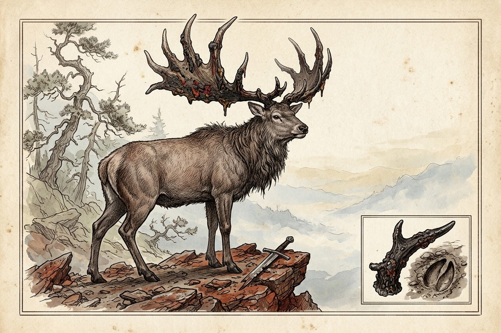

**Território Único:** Vales minerais oxidados e gargantas de pinheiros entre **Lavroga (`L03`)**, **Vaarsa (`L04`)** e a borda norte de **Gaddra (`L14–L17`)** | **Classificação:** Exemplar Único (`Megafauna Ancestral Solitária — Patamar Lenda`).

**Rastreamento:** `Sobrevivência CD 18` *(marcas de cascos fundos em xisto vermelho e pinheiros descascados com lascas metálicas presas na resina a `2,8m` do chão)*.

Um alce macho descomunal, último patriarca gigante de uma linhagem anterior à Era da Forja, com quase dois metros e quarenta na cernelha e uma galhada espalmada de quase três metros de largura. Ao esfregar os chifres durante quarenta invernos contra afloramentos de hematita oxidada, escória de forjas abandonadas e resina grossa de pinheiro-bravo, sua armação ganhou uma **crosta mineral escura e vítrea** onde espadas comuns resvalam soltando faíscas. Diferente dos cervos menores reverenciados nas matas do nordeste, o *Cervo-de-Escória* vaga absolutamente só pelas cristas ventosas do sul; já virou uma carroça de pedágio inteira de *Vaarsa* e matou três cavaleiros impetuosos que tentaram laçá-lo a galope.

- **PV**: `118` *(Golpe Devastador: `79+` dano; `+4` em CON)* | **Iniciativa**: `+5` | **Deslocamento**: `15m` *(ignora terreno pedregoso e encostas íngremes)*
- **Atributos**: `FOR 20 (+5)`, `DES 16 (+3)`, `CON 19 (+4)`, `INT 5 (-3)`, `SAB 17 (+3)`, `CAR 14 (+2)`
- **Defesa**: Aparar `25` *(bloqueando pela frente com a galhada mineral)* / Esquiva `20` / Desprevenido `14` *(Couro e Crosta Ferruginosa `+4`, Especialista `+8` Aparar frontal, Treinado `+3` Esquiva)* | **RD Especial**: `3` na cabeça e espáduas *(ignorada por armas contundentes pesadas de duas mãos, **Lança de Contenção com Travessa** preparada, **Adamante** ou ataques nos flancos quando enredado/caído)*.
- **Ataques**:
  - *Galhada de Escória (Alcance 3m)*: `+13` (`2d10 + 5`, `19–20 / ×3`, Especialista `+8` + FOR `+5`; **Múltiplas Ações**: até **2 varridas com `+5` cada**). **Lâminas em Risco**: qualquer arma cortante comum que role `1` natural ao atacar sua frente lasca na crosta mineral (`-1` no dano até ser amolada).
  - *Investida Vira-Carroças (`9m+` em linha reta)*: `+15` (`2d10 + 2d6 + 5` contundente/perfurante; arremessa alvos Médios ou Grandes a `4,5m`, exigindo *Atletismo CD 19* para não cair **Derrubado** e perder a reação; causa **dano triplo** a carroças, paliçadas leves e escudos de madeira comum).
  - *Cascos Oxidados*: `+10` (`2d6 + 5`, `20 / ×2`, contra alvos caídos ou adjacentes aos flancos).
- **Astúcia de Soberano**: jamais pasta a favor do vento (`Percepção +11` contra cheiro de óleo de armadura, cavalos suados e fumaça); quando percebe batedores montados, **finge mancar de uma pata traseira** para atrair os ginetes até encostas de xisto solto onde cavalos escorregam (`Cavalgar CD 17`), dando meia-volta morro abaixo com força total!
- **Preparação, Isca & Ponto Fraco**: atraído por blocos de **Sal Grosso de Bayd (`Tomo IX`)** umedecidos com mosto fermentado e brotos amargos de *Flor-de-pedra (`H16`)*; conduzi-lo a um desfiladeiro estreito com menos de `3m` de largura ou prendê-lo com **Rede Lastrada** impede que gire a galhada (`perde o bônus Especialista de Aparar, caindo para Defesa 17`).
- **Troféu Único, Ofícios & Peso Político**:
  - *Extração (`Sobrevivência + Forja CD 16`)*: **A Grande Galhada de Escória** (`38 kg`, valor base `1.800 PP`) + couro invernal (`300 PP`).
  - *Ofício Único*: um mestre armeiro (`G10`) pode seccionar as pás minerais para forjar **dois Escudos Pavêses de Escória** (`Defesa +3`, imunes a estilhaçamento crítico e concedendo `+2` extra ao usar *Proteger Aliado* contra investidas) **ou** cravar a armação inteira sobre o portão de uma fortaleza (`F04–F08`), somando **`+1` permanente ao Limiar Estrutural (`LE`) do portão e `+1` na Moral da guarnição**!
  - *Política & Status*: caçá-lo vivo ou morto é considerado em **Altavanne (`L01`)**, **Dahrma/Lavroga (`L03`)** e **Vaarsa (`L04`)** um **Feito Supremo de Cavalaria e Nobreza** (qualifica diretamente para progressão até **`Status S03`**).

### X02 — O Urso-das-Cinzas *(Velho Kragh)*

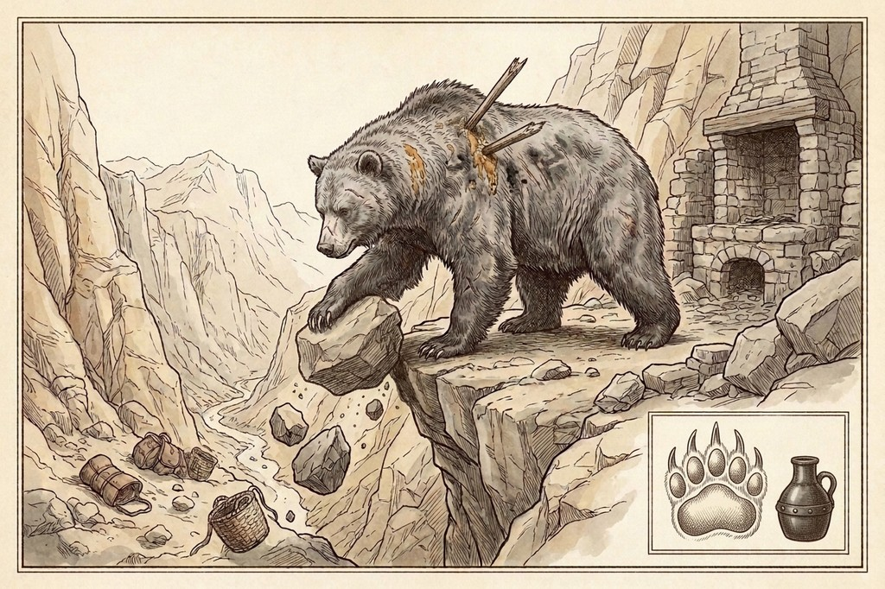

**Território Único:** Gargantas altas e forjas pré-históricas abandonadas nas cordilheiras entre **Vargheim (`L17`)** e os **Picos de Rubecina (`Z07`)** | **Classificação:** Exemplar Único (`Urso-das-Cavernas Ancestral — Patamar Lenda`).

**Rastreamento:** `Sobrevivência CD 17` *(pegadas de `45 cm` impressas em cinza seca, carcaças de mulas esmagadas por matacões sem mordida inicial e troncos cobertos de piche e pelos grisalhos duros como arame)*.

Mais que o dobro da massa de um urso pardo comum de Rubecina, o **Velho Kragh** carrega nos ombros pontas enferrujadas de lanças gaddrani e virotes aurorianos de trinta anos atrás, soldados uns aos outros por uma couraça natural de resina de cedro, seiva seca e fuligem negra das antigas fornalhas de montanha onde hiberna. Nenhum caravaneiro veterano da Rota do Sal o chama de besta irracional: Kragh aprendeu há décadas que descer ao encontro de escoltas armadas dói — por isso **espera no alto dos paredões e rola blocos de rocha sobre as mulas de carga**, aguardando pacientemente que os guardas fujam em pânico para descer e se banquetear em paz.

- **PV**: `148` *(Golpe Devastador: `99+` dano; `+5` em CON)* | **Iniciativa**: `+3` | **Deslocamento**: `10,5m` *(Escalada em rocha `7,5m`)*
- **Atributos**: `FOR 22 (+6)`, `DES 12 (+1)`, `CON 20 (+5)`, `INT 6 (-2)`, `SAB 16 (+3)`, `CAR 10 (0)`
- **Defesa**: Aparar `16` / Esquiva `19` / Desprevenido `15` *(Pelagem Endurecida de Seiva e Fuligem `+5`, Treinado `+3` Esquiva)* | **RD Especial**: `3` *(crosta de fuligem e gordura densa; **sofre apenas metade do dano de fogo comum**, pois o pelo empastado de cinza mineral não pega chama fácil — mas **Lanças de Contenção com Travessa** e disparos perfurantes pesados contra o peito quando se ergue nas patas traseiras ignoram a RD!)*.
- **Ataques**:
  - *Patada Demolidora*: `+14` (`2d10 + 6`, `20 / ×3`, Especialista `+8` + FOR `+6`; **Múltiplas Ações**: até **2 patadas com `+6` cada**; alvo atingido faz *Atletismo CD 20* ou cai **Derrubado**).
  - *Abraço Quebra-Espinha (contra alvo Derrubado ou atingido pelas 2 patadas no mesmo turno)*: `+14` (`2d12 + 6` contundente, esmagando costelas).
  - *Desmoronamento Deliberado (Ação Principal no alto de escarpa, alcance `24m`, área `6m × 6m`, até `2×` por cena)*: alavanca pedras soltas sobre o desfiladeiro — criaturas na área fazem *DES/Acrobacia CD 17* para sofrer metade de **`4d8` contundente**, transformando o trecho em terreno difícil.
- **Astúcia de Soberano**: fareja venenos alquímicos e carne podre (`Percepção +11`), contorna fossos cavados em trilha batida e **sempre bloqueia com pedras a entrada secundária de sua caverna** antes de dormir. Se perder mais de `90 PV` fora do covil, derruba uma parede de cascalho para cegar perseguidores e recua pelas escarpas.
- **Preparação, Isca & Ponto Fraco**: tomar silenciosamente a crista **acima** dele antes da alvorada (`Escalada CD 16`) anula seu *Desmoronamento*; a única isca à qual o Velho Kragh não resiste no outono é gordura quente assada com mel silvestre e *Cordeiro das Escarpas* temperado sem ferro (`Tomo XII`, `CD 15`).
- **Troféu Único, Ofícios & Peso Político**:
  - *Extração (`Sobrevivência + Alquimia/Forja CD 16`)*: **Seis Cântaros de Banha Cinzenta de Kragh** + Manto Craniano Cravejado de Pontas Antigas (`valor total 2.200 PP`).
  - *Ofício Único — A Têmpera de Kragh*: os mestres armeiros de Gaddra e Aeraneas têm razão — temperar aço rubro na banha filtrada de Kragh (`Forja CD 18`) produz até **`6` Armas de Têmpera Cinzenta** (`+1` permanente nas rolagens de dano, imunes a quebra por frio extremo e capazes de **ignorar `1` ponto de `RD` ou `LE`** sem precisar de adamante!).
  - *Política & Status*: apresentar o crânio de Kragh em **Vargheim (`L17`)** ou **Naasar (`L14`)** reabre negociações travadas no *Passo de Rubecina (`Z07`)* e concede feito válido para **`Status S03`**.

### X03 — A Sombra-Salobra *(Leão-da-Restinga Albino)*

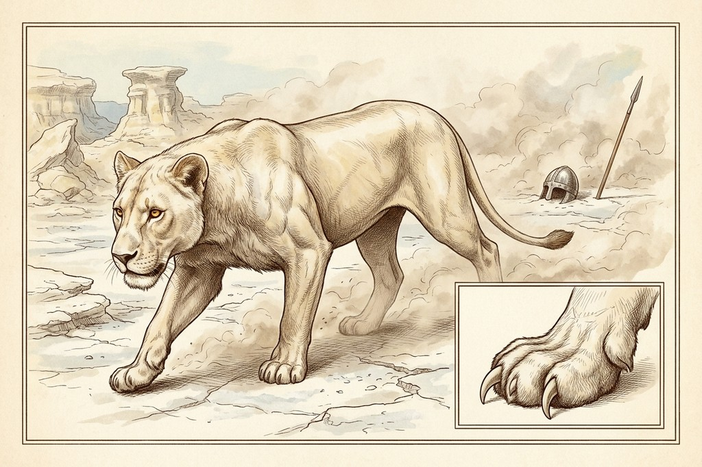

**Território Único:** Salares brancos varridos pelo vento, dunas secas de concha calcária e cânions costeiros áridos do **Despotado de Kalis** *(faixa desolada entre **Kalima `L22`**, **Dobalbek `L21`** e os quartéis externos)* | **Classificação:** Exemplar Único (`Grande Felino Endêmico Leucístico — Patamar Lenda`).

**Rastreamento:** `Sobrevivência CD 20` *(as almofadas largas das patas quase não afundam na crosta dura de sal e o vento apaga o rastro em minutos; exige procurar ossos roídos escondidos em fendas calcárias secas)*.

Esguio, comprido, inteiramente desprovido de juba e revestido por uma pelagem curta cor de osso calcinado, com olhos de âmbar pálido que não refletem tochas distantes. Enquanto o norte de Kalis é tomado por pinheiros escuros e neve, os baixios calcários e desertos de sal marinho da costa oeste-sul criaram este predador fantasma. **A Sombra-Salobra jamais ruge**: espera o vento erguer cortinas brancas de pó salino ao meio-dia (quando o reflexo cega os vigias e o peso da cota de malha exaure patrulhas humanas) para surgir rente ao chão, cravar os caninos nos tornozelos do último sentinela da fila e arrastá-lo para um cânion estreito antes que o homem à frente perceba que está falando sozinho. Nos quartéis de *Kalgard* e *Kalima*, recrutas juram tratar-se do espírito faminto de desertores executados pelo Véu.

- **PV**: `96` *(Golpe Devastador: `65+` dano)* | **Iniciativa**: `+8` | **Deslocamento**: `15m` *(Salto horizontal `9m` sem embalo)*
- **Atributos**: `FOR 18 (+4)`, `DES 20 (+5)`, `CON 16 (+3)`, `INT 6 (-2)`, `SAB 17 (+3)`, `CAR 12 (+1)`
- **Defesa**: Aparar `17` / Esquiva `25` / Desprevenido `12` *(Couro Esguio `+2`, Especialista `+8` Esquiva)* | **RD Especial**: `0`
- **Ataques**:
  - *Bote Muda-Grito nos Tendões*: `+13` (`2d8 + 4`, `18–20 / ×2`, Especialista `+8` + DES `+5` Ágil; **Múltiplas Ações**: até **2 ataques com `+5` cada**). **Arrasto na Poeira Branca**: contra alvo **surpreso, ofuscado pelo reflexo/poeira ou isolado a mais de `4,5m` de aliados**, soma **`+2d6` de dano**, corta o equilíbrio (*Atletismo/CON CD 18* ou cai **Derrubado** com deslocamento reduzido a `1,5m` até receber sutura `Medicina CD 14`) e **arrasta a presa `6m` consigo** sem provocar reação!
- **Astúcia de Soberano**: possui **`Furtividade +15`** em salares, calcário claro, neblina seca e tempestades de poeira; **entende o funcionamento de rondas militares** (observa por dois dias o horário exato de troca das sentinelas antes de atacar), enterra suas carcaças sob cascalho salgado para que abutres não entreguem seu covil e abandona imediatamente o ataque se notar besteiros amarrados em dupla!
- **Preparação, Isca & Ponto Fraco**: espelhos de aço polido ou óculos escuros de vidro temperado de *Fugong (`L22`, `N085`)* anulam o ofuscamento do salar; amarrar um manequim de armadura com sino oculto e **pó colorido de tinturaria** marca a pelagem branca da fera, reduzindo sua *Furtividade* em **`-8`** pelo resto da caçada!
- **Troféu Único, Ofícios & Peso Político**:
  - *Extração (`Sobrevivência CD 17` com `Faca de Esfolar`)*: **Pele Intacta da Sombra-Salobra** + caninos silenciosos (`1.600 PP`).
  - *Ofício Único*: curtida por mestre artesão, confecciona o **Gibão-Manto Cor-de-Osso** (`Defesa +2`, Penalidade `0`, peso `2,0 kg`, concede **`+2` em *Furtividade*** em terrenos claros/neve/pedra/neblina e `+2` contra Exaustão por vento seco e reflexo solar).
  - *Política & Status*: pôr fim ao terror dos quartéis costeiros rende recompensa oficial do **Déspota Grimrik Ulscold (`L18`)** ou de **Torvald von Kragstad (`L19`)**, destravando salvo-conduto em Kalis e feito para **`Status S02→S03`**.

### X04 — Javali-de-Muralha *(Quebra-Piques)*

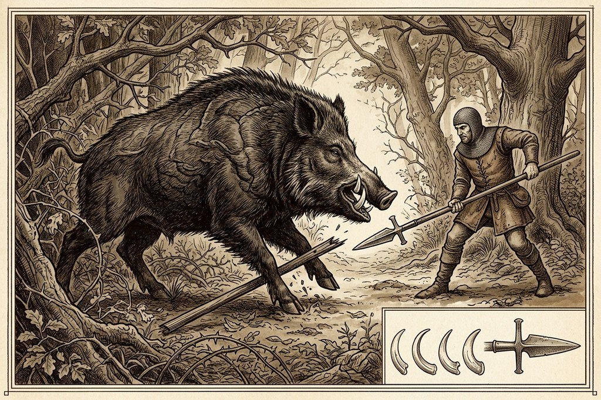

**Território Único:** Bosques fechados de carvalhos e espinheiros entre o norte de **Dahrma (`L03`)**, **Pontáuria (`L01`)** e as matas baixas a sul de **Vergod (`L08`)** | **Classificação:** Exemplar Único (`Varrão Colossal de Meia Tonelada — Patamar Lenda`).

**Rastreamento:** `Sobrevivência CD 16` *(sulcos revirados na terra como se um arado de ferro tivesse passado, carvalhos jovens partidos ao meio e lama seca misturada a cerdas grossas como pregos)*.

Um varrão monstruoso de quase quinhentos quilos, dorso negro eriçado e **quatro presas inferiores recurvadas** do tamanho de foices curtas. Décadas de brigas territoriais e velhice calcificaram sobre seus ombros e pescoço uma **placa cartilaginosa natural de quatro dedos de espessura**, onde flechas comuns ricocheteiam como gravetos. Ganhou o apelido de *Quebra-Piques* há seis anos, quando uma batida senhorial de doze batedores tentou cercá-lo com lanças de infantaria sem travessa: empalado por duas hastes, o monstro simplesmente **correu para a frente empurrando a madeira pelo próprio corpo** até estripar três cavalos de guerra e dispersar toda a comitiva.

- **PV**: `132` *(Golpe Devastador: `89+` dano; `+5` em CON)* | **Iniciativa**: `+3` | **Deslocamento**: `12m` *(ignora mata densa e espinheiros)*
- **Atributos**: `FOR 21 (+5)`, `DES 13 (+1)`, `CON 20 (+5)`, `INT 5 (-3)`, `SAB 15 (+2)`, `CAR 8 (-1)`
- **Defesa**: Aparar `16` / Esquiva `19` / Desprevenido `15` *(Placa Cartilaginosa de Ombro `+5`, Treinado `+3` Esquiva)* | **RD Especial**: `4` contra ataques frontais e projéteis comuns *(completamente ignorada por **Lanças de Contenção com Travessa [Boar Spears]**, quedas em **Fosso Estacado** ou lâminas de **Adamante**)*.
- **Ataques**:
  - *Quatro Presas Estripadoras*: `+13` (`2d10 + 5`, `19–20 / ×3`, Especialista `+8` + FOR `+5` + **Sangramento Profundo `1d6/rodada`** até estancar com *Medicina CD 15*).
  - *Aríete Vivo (`6m+` de corrida)*: avança em linha reta sobre até `3` quadrados ocupados — cada alvo na linha testa *Atletismo* ou *Aparar CD 19*; quem falhar sofre `3d8 + 5` perfurante/contundente e cai **Derrubado** (**montarias sofrem `+2d8` extra** e jogam o cavaleiro ao chão!). *Regra da Haste Sem Travessa*: quem preparou lança comum **sem barra transversal** acerta o golpe, mas o varrão avança pela haste e desfere `1` ataque gratuito de presas contra o lanceiro!
- **Habilidade — Último Arranco Implacável**: ao ser reduzido a `0 PV` (salvo se estiver caído num fosso fundo ou preso em rede pesada), o *Quebra-Piques* **não cai imediatamente** — avança até `6m` e executa **1 último ataque de presas** antes de morrer!
- **Astúcia de Soberano ("O Gancho do Varrão")**: quando perseguido por cães e caçadores numa trilha fechada, corre em linha reta fazendo barulho, depois **descreve um semicírculo mudo pelo mato fechado e fica imóvel atrás da linha de perseguidores**, estripando pelas costas os arqueiros e nobres da retaguarda!
- **Preparação, Isca & Ponto Fraco**: cavar **Fosso Pesado Camuflado** num corredor de carvalhos com bolotas fermentadas e raízes doces (`B01–B06` do Tomo XII) + dupla fila de **Lanças de Contenção com Travessa** apoiadas em troncos corta pela raiz sua investida.
- **Troféu Único, Ofícios & Peso Político**:
  - *Extração (`Sobrevivência CD 15`)*: **Placa Dorsal de Muralha**, as **Quatro Presas Reais** e carne nobre para um banquete histórico de `50` convivas (`valor total 1.500 PP`).
  - *Ofício Único*: a placa cartilaginosa curtida em alúmen rende a **Couraça do Quebra-Piques** (`Defesa +3`, reduz a penalidade de armadura para apenas `-1`, concede `+3` contra ser Derrubado/Empurrado e anula *Sangramento* causado por acertos críticos inimigos).
  - *Política & Status*: oferecer o Banquete do Javali-de-Muralha num solar de **Dahrma (`L03`)** ou **Altavanne (`L01`)** concede `+3` em negociações diplomáticas naquela ocasião e consagra o caçador com **`Status S02→S03`**.

### X05 — O Cão-Rei de Carniça *(Soberano Pachycrocuta)*

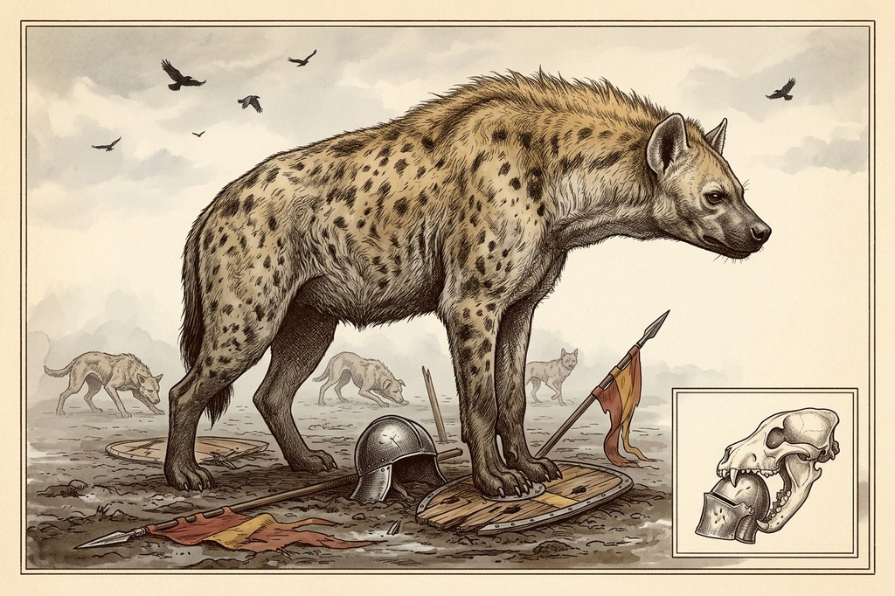

**Território Único:** Nômade calculista através dos campos de escaramuça e das **8 Frentes Quentes de Disputa Feudal (`Z01`–`Z08`)**, sobretudo entre **Lavroga (`Z02`)**, **Voernock (`Z01`)** e as estepes ao pé de **Rubecina (`Z07`)** | **Classificação:** Exemplar Único (`Hiena-Gigante Ancestral — Patamar Lenda`).

**Rastreamento:** `Sobrevivência CD 17` *(fêmures de cavalo e até bacinetes de ferro amassados a dente junto a cinzas de acampamentos militares, cercados por pegadas menores de matilha subordinada)*.

Maior que um cavalo pônei de montanha, de quartos dianteiros altíssimos, pescoço grosso como tronco de oliveira e pelagem malhada cor de barro seco coberta de cicatrizes antigas. Último remanescente vivo das hienas-gigantes ancestrais (*Pachycrocuta*), **O Cão-Rei de Carniça** domina pelo terror matilhas mistas de *Hienas-de-Sal* e cães de guerra asselvajados. Suas mandíbulas possuem alavanca óssea suficiente para **estilhaçar fêmures de boi e dobrar elmos de ferro batido** numa única mordida. Na crendice dos soldados de Aurora e Gaddra, ouvir sua "risada" grave e cadenciada na véspera de uma batalha anuncia qual estandarte será pisoteado na lama no dia seguinte.

- **PV**: `108` *(Golpe Devastador: `73+` dano)* | **Iniciativa**: `+5` | **Deslocamento**: `13,5m`
- **Atributos**: `FOR 19 (+4)`, `DES 16 (+3)`, `CON 18 (+4)`, `INT 6 (-2)`, `SAB 17 (+3)`, `CAR 13 (+1)`
- **Defesa**: Aparar `15` / Esquiva `23` / Desprevenido `12` *(Couro Grosso Cicatrizado `+2`, Especialista `+8` Esquiva)* | **RD Especial**: `1` *(couro calejado)*
- **Ataques**:
  - *Mandíbula Quebra-Elmos*: `+12` (`2d10 + 4`, `19–20 / ×3`, Especialista `+8` + FOR `+4`; **Múltiplas Ações**: até **2 mordidas com `+4` cada**; soma `+2` no acerto contra alvos caídos ou com *Exaustão*). **Estilhaçar Ferro**: sempre que acertar por `5+` acima da Defesa ou obtiver crítico, amassa a proteção da vítima, reduzindo em **`-1` o bônus da armadura ou escudo comum** (até reparo de forja) e exigindo *Atletismo CD 18* para não cair **Derrubado**!
  - *Risada do Mau Agouro (Ação de Movimento, 1× por cena, alcance `36m`)*: todos os inimigos humanos que ouvirem testam `SAB CD 16` *(soma `Fé Verdadeira`)* ou sofrem `-2` em Iniciativa e testes contra medo por `3 rodadas`; simultaneamente, até **`4` carniceiros menores da matilha** movem `6m` como reação livre para cercar o alvo mais ferido!
- **Astúcia de Soberano**: reconhece toques de corneta, bandeiras de hospital de campanha e o cheiro de febre; **manda sempre cães menores na frente** para disparar laços, fossos ou bestas armadas antes de mostrar o focinho, e foge sem orgulho no instante em que sua matilha perde metade dos membros!
- **Preparação, Isca & Ponto Fraco**: isolá-lo da matilha com barreiras de **Óleo Incendiário (`Tomo IX`)** (cães comuns recuam diante do fogo alto) após atraí-lo com ossadas de tutano aquecidas e sangue salgado numa paliçada de uma só entrada.
- **Troféu Único, Ofícios & Peso Político**:
  - *Extração (`Sobrevivência CD 15`)*: **Crânio Inteiro da Mandíbula Real** + manto malhado (`1.400 PP`).
  - *Ofício & Moral Militar*: erguer o crânio do Cão-Rei sobre o estandarte ou portão de uma companhia/fortaleza quebra superstições de campanha, concedendo **`+2` permanente nos testes de Moral da guarnição (`Tomo XV`)** e **`+2` em *Intimidação* marcial** contra tropas mercenárias ou bandos de saqueadores!
  - *Política & Status*: caçado a peso de prata tanto pelo **Marechal Leonastis (`L04`)** quanto pelo **Preboste Valen (`N018`)** e chefes de fronteira; abatê-lo vale **`Status S02→S03`**.

### X06 — Águia-Quebra-Ossos *(Soberana dos Picos)*

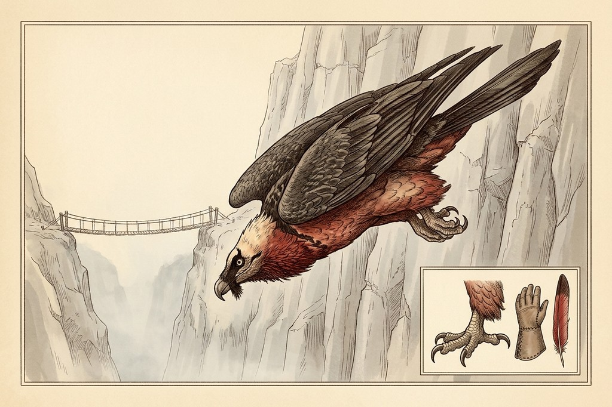

**Território Único:** Agulhas inacessíveis de granito nos **Montes Ferraur (`Z03`)**, entre os penhascos de **Aeraneas (`L07`)** e o dossel superior das **Cidades Suspensas (`L08`)** | **Classificação:** Exemplar Único (`Ave de Rapina Colossal — Patamar Lenda`).

**Rastreamento:** `Sobrevivência CD 18` com **Luneta (`Tomo IX`)** *(pilhas brancas de ossos de cabra-montesa e mulas espatifados na base de um mesmo paredão vertical, e penas longas manchadas de argila vermelha oxigenada)*.

Uma fêmea gigantesca que combina a musculatura compacta de uma águia florestal pré-histórica ao hábito ritual do abutre-barbudo: com quase três metros e oitenta de envergadura e garras do tamanho de punhais curvos, ela **esfrega deliberadamente as penas claras do peito e do pescoço em poças de barro ferruginoso vermelho-sangue** das encostas altas de Ferraur. Sábia demais para tentar erguer presas pesadas pelo ar, sua caçada é pura física letal: **mergulha em silêncio absoluto com o sol às costas** contra mulas de minério, batedores em trilhas de cornija e vigias desatentos em pontes de corda, usando o impacto brutal das garras para arremessá-los abismo abaixo e descer devagar para comer nos rochedos.

- **PV**: `92` *(Golpe Devastador: `62+` dano)* | **Iniciativa**: `+7` | **Deslocamento**: `4,5m` *(Voo e Mergulho `24m`)*
- **Atributos**: `FOR 18 (+4)`, `DES 20 (+5)`, `CON 16 (+3)`, `INT 6 (-2)`, `SAB 18 (+4)`, `CAR 14 (+2)`
- **Defesa**: Aparar `17` / Esquiva `25` / Desprevenido `12` *(Plumagem Densa de Barro Seco `+2`, Especialista `+8` Esquiva aérea)* | **RD Especial**: `0` *(rajadas cruzadas de desfiladeiro impõem `-2` em disparos comuns além de `18m` sem talento/luneta)*.
- **Ataques**:
  - *Mergulho Despenhador (`12m+` de queda livre silenciosa)*: `+13` (`2d8 + 4`, `19–20 / ×3`, Especialista `+8` + DES `+5`). Em acerto, executa **Empurrar gratuito com `+12`** contra *Atletismo* ou *Acrobacia* do alvo para **jogá-lo penhasco ou ponte abaixo** *(queda mortal sem corda presa a **Pítons `Tomo IX`**!)* e segue voando `9m` sem provocar ataque de reação!
  - *Garras Talha-Crânio & Bico Curvo*: `+13` (`2d6 + 4`, `19–20 / ×2`; **Múltiplas Ações**: `2` rasantes com `+5` cada, ou `1` golpe focado em **cortar corda não-metálica** de ponte/escalada!).
- **Astúcia de Soberano**: ataca exclusivamente **contra a claridade solar da manhã ou do poente** (`Percepção CD 20` para notar o mergulho sem *Espelho de Aço* ou sombra de rocha), reconhece bestas engatilhadas de longe (abortando o rasante a `30m` de altura!) e nunca pousa enquanto houver mais de um humano de pé e desamarrado na cornija.
- **Preparação, Isca & Ponto Fraco**: cravar **Pítons de Escalada com Corrente de Ferro (`Tomo IX`)** para ancorar toda a equipe à rocha, usar chamariz/carcaça presa ao chão e disparar **Boleadeiras / Rede Lastrada ou Arpéu com Corda de Seda** no exato segundo do impacto rasante (forçando-a ao chão, onde sua Esquiva cai de `25` para `19`!).
- **Troféu Único, Ofícios & Peso Político**:
  - *Extração (`Sobrevivência CD 16` — ou Captura Viva / Proteção de Ninho `CD 20`)*: **Doze Rêmiges Primárias Rubras** + Garras da Soberana (`1.900 PP`).
  - *Ofício Único*: as doze penas primárias emplumam exatamente **`24` Flechas ou Virotes da Soberana** (ignoram penalidades de vento forte/altitude, aumentam o alcance efetivo em `+9m` e concedem **`+1` no acerto à longa distância**).
  - *Política & Status*: em **Altavanne (`L01`)** suas penas são a mais alta insígnia heráldica real; já no conflito dos **Montes Ferraur (`Z03`)**, poupar a ave expulsando caçadores ilegais de seu ninho conquista a aliança pessoal de **Aerwen ferch Taldor (`L08`, `N024`)**, valendo **`Status S03`**!

---

## Os mares, recifes e abismos

### X07 — O Velho Quilha-Branca *(Cachalote Cicatrizado)*

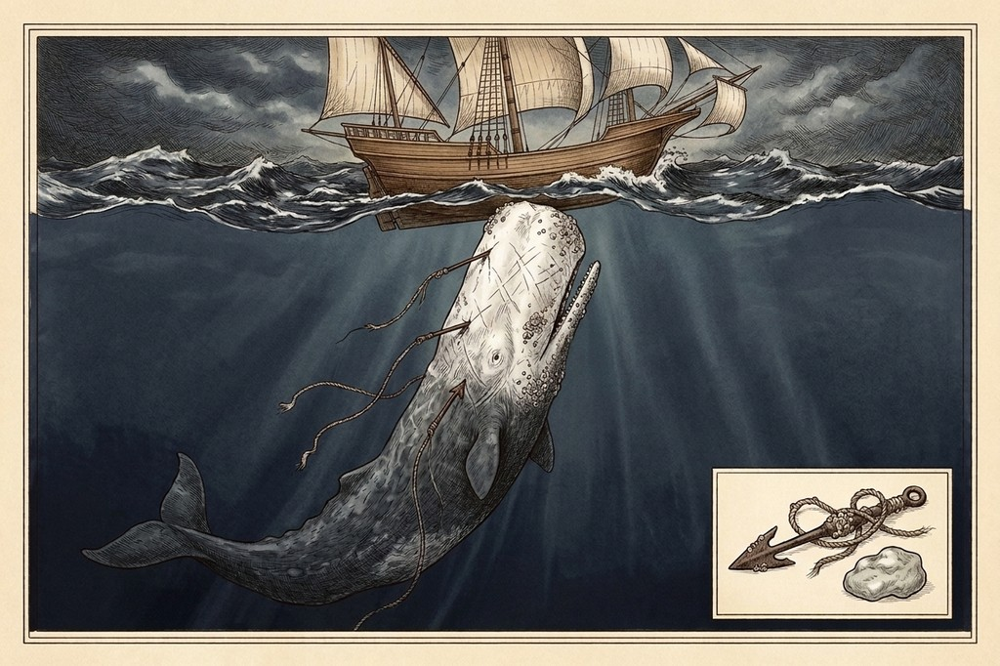

**Território Único:** Rotas oceânicas fundas entre **Corallis (`L09–L13`)**, a boca externa de **Merlinport (`L02`)** e as águas frias ao sul do **Mar das Cinzas** | **Classificação:** Exemplar Único (`Cachalote Macho Ancestral — Patamar Lenda Avançado / Épico Naval`).

**Rastreamento:** `Navegação + Percepção CD 18` *(borrifo inclinado inconfundível a estibordo, lulas despedaçadas boiando e silêncio súbito das baleias comuns na rota)*.

Um cachalote macho colossal de dezoito metros, fronte e mandíbula de um branco fantasmagórico cortado por sulcos negros de cordas antigas. Cravadas no osso espesso e na gordura fibrosa de sua cabeça repousam **nove pontas de arpões enferrujados de três gerações diferentes de baleeiros** — duas delas com punções de forjas costeiras destruídas ainda nos Anos do Eclipse (`348–356 EF`). O **Velho Quilha-Branca** não foge quando escuta tambores de voga de uma galé ou o clique de catraca de uma balista naval: ele **mergulha a prumo no escuro absoluto e sobe na vertical em velocidade máxima direto contra a quilha da embarcação**, partindo vigas de carvalho como casca de noz.

- **PV**: `210` *(Colosso Oceânico: Golpe Devastador `141+` apenas por artilharia naval `M08–M12` ou armas de Adamante)* | **Iniciativa**: `+2` | **Deslocamento**: `18m` *(Natação e Mergulho Abissal)*
- **Atributos**: `FOR 26 (+8)`, `DES 11 (0)`, `CON 24 (+7)`, `INT 6 (-2)`, `SAB 17 (+3)`, `CAR 15 (+2)`
- **Defesa**: Aparar `16` / Esquiva `16` / Desprevenido `16` *(Couro Cicatrizado de `30 cm` e Ferro Antigo Incrustado `+6`)* | **RD Especial**: `4` *(ignorada por **Balista Naval de Arpão/Fisgada `M09`**, **Esporão Naval** ou **Adamante**; armas leves de mão causam metade do dano)*.
- **Ataques**:
  - *Abalroamento Vertical de Quilha (exige `1 rodada` submerso sem barris-boia presos)*: `+16` contra a Defesa da Embarcação (**[Tomo XIV](14_Mares_Frotas_e_Navegacao_de_Alenia.md)**), causando **`4d12 + 8` de dano estrutural direto no fundo do casco e ignorando `6` pontos do Limiar Estrutural (`LE`)** do navio! Todos a bordo testam *Acrobacia* ou *Atletismo CD 18* para não cair no convés (ou ao mar, se estiverem na amurada!).
  - *Varredura de Cauda*: `+14` (`3d10 + 8` contundente numa faixa de `6m` na superfície; destrói botes baleeiros `E01–E02` de um só golpe).
  - *Estalo Sônico de Caça (Submerso, cone `15m`)*: nadadores/mergulhadores na água testam `CON CD 19` ou ficam **Atordoados por `1 rodada`** e surdos por `1 hora`.
- **Astúcia de Soberano**: posiciona-se exatamente no **ponto cego abaixo da quilha** onde besteiros e balistas de convés não têm linha de tiro; se for arpoado por cabo único preso ao navio, **nada a toda força rumo aos recifes mais próximos ou contra o vento** para alagar a proa até os próprios marinheiros cortarem a corda a machado!
- **Preparação, Isca & Ponto Fraco**: exige navio robusto (**E06 a E11**) equipado com **Balista de Fisgada (`M09`)** e pelo menos **`4` tonéis vazios calafetados presos aos cabos de arpão** — os tonéis flutuantes esgotam o fôlego do cachalote (`impedem o mergulho a prumo do Abalroamento Vertical!`) e revelam sua posição exata sob as ondas.
- **Troféu Único, Ofícios & Peso Político**:
  - *Extração Naval (`Navegação + Alquimia/Ofício CD 17` com guindaste de bordo)*: `12` barris de **Espermacete Craniano Puríssimo** + um bloco raro de **Âmbar-Cinza** de `9 kg` nas entranhas + as `9` pontas históricas de arpão (`valor combinado colossal de 4.200 PP / 420 PO` — **suficiente para pagar inteira a reconstrução de uma Torre `F04` de `3.600 PP` e ainda encher o cofre!**).
  - *Ofício Único*: o espermacete puro lubrifica astrolábios/engenhos de *Stoneforge (`L11`)* e alimenta faróis reais com chama branca duas vezes mais forte; o âmbar-cinza fixa elixires médicos Obra-Prima em *Baldbella (`L10`)*.
  - *Política & Status*: entrar rebocando os despojos do Quilha-Branca em **Merlinport (`L02`)** ou **Alineus (`L09`)** para o cais inteiro e consagra o capitão até **`Status S03→S04`**.

### X08 — A Imperatriz Vermelha *(Lula-Colossal Abissal)*

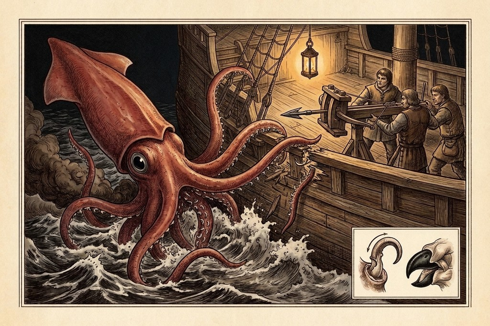

**Território Único:** A Grande Fossa Fria entre o norte de **Corallis (`Claramar / Sellene L13`)** e a entrada ocidental do **Mar das Cinzas** | **Classificação:** Exemplar Único (`Lula-Colossal Abissal — Patamar Lenda Avançado`).

**Rastreamento:** `Navegação + Herbalismo/Natureza CD 19` *(queda brusca de temperatura da água à noite, cheiro forte de amônia trazido pela maré ascendente e toras flutuantes marcadas por sulcos circulares com rasgos em meia-lua)*.

Quase nunca avistada à luz do sol, a **Imperatriz Vermelha** sobe das fossas abissais apenas quando correntes geladas empurram cardumes fundos para a superfície em noites sem lua. Seu manto carmesim-escuro passa de seis metros, mas seus dois tentáculos longos alcançam outros nove — armados não de simples ventosas, e sim de **anéis quitinosos com ganchos curvos que giram `360°`** (*exatamente como nos cefalópodes colossais abissais*), capazes de arrancar tábuas de amurada e puxar vigias inteiros do convés sem deixar nada além de muco frio e cheiro acre de amônia. Os engenheiros de **Stoneforge (`L11`)** projetaram suas primeiras balistas navais de fisgada justamente após sobreviverem a um ataque dela há vinte anos.

- **PV**: `168` *(Golpe Devastador no manto: `113+` dano; **Golpe Localizado**: causar `28+` de dano cortante acumulado num tentáculo decepa aquele braço de caça!)* | **Iniciativa**: `+5` | **Deslocamento**: `15m` *(Propulsão a jato)*
- **Atributos**: `FOR 23 (+6)`, `DES 16 (+3)`, `CON 20 (+5)`, `INT 6 (-2)`, `SAB 16 (+3)`, `CAR 8 (-1)`
- **Defesa**: Aparar `16` / Esquiva `21` *(ou `24` quando o manto permanece submerso)* / Desprevenido `13` *(Manto Elástico `+3`, Treinado `+3` na tona / Especialista `+8` submersa)* | **RD Especial**: `2` contra ataques contundentes e virotes comuns *(zero contra machados e lâminas cortantes nos tentáculos!)*.
- **Ataques**:
  - *Tentáculos de Ganchos Giratórios (Alcance `9m`)*: `+14` num único alvo (`2d8 + 6` cortante/perfurante, `19–20 / ×2`) **ou Múltiplas Ações atacando até `3` tripulantes diferentes com `+6` cada**! Todo alvo atingido sofre **Agarrar imediato (`Atletismo CD 19`)** e é puxado `6m` rumo à água no fim do turno da criatura!
  - *Bico de Quitina Negra (apenas contra alvo Agarrado trazido junto ao manto)*: `+14` (`3d10 + 6`, `19–20 / ×3`, perfura malha e couro).
  - *Jato Abissal de Tinta e Amônia (1× por cena, raio `12m`)*: escurece completamente a água e o convés baixo, exigindo `CON CD 16` para não ficar **Enjoado (`-2` em todos os testes)** por `2 rodadas`.
- **Astúcia de Soberano**: **trava primeiro o leme da embarcação** por baixo d'água (`impedindo manobras evasivas do timoneiro até cortar o tentáculo!`), apaga lanternas de popa e puxa o vigia solitário antes de envolver o casco. Se perder **três tentáculos** ou sofrer fogo intenso de alcatrão na superfície, solta a nuvem de amônia e afunda a prumo.
- **Preparação, Isca & Ponto Fraco**: manter **Redes de Abordagem Anti-Tentáculo** erguidas nos bordos, caldeirões de salmoura/alcatrão quente e guerreiros com machados pesados (`20/×3`) prontos com *Preparar Ação* para decepar os braços assim que tocarem a madeira!
- **Troféu Único, Ofícios & Peso Político**:
  - *Extração (`Medicina/Alquimia CD 17`)*: **O Bico Imperial de Quitina**, **`24` Ganchos Giratórios** e a **Bolsa Real de Tinta Abissal** (`2.800 PP`).
  - *Ofício Único*: os ganchos forjam `3` **Arpéus/Arpões de Quitina Imperial** (`+2` em testes de *Escalada*, abordagem e fisgada naval, sem enferrujar jamais no sal); a tinta abissal produz o pigmento jurídico indestrutível usado pela **Academia de Sellene (`L13`)** para tratados perpétuos.
  - *Política & Status*: celebrado por **Stoneforge (`L11`)** e **Corardo della Rocca (`L09`, `N021`)**, garantindo reparo gratuito vitalício nos estaleiros de Alineus e **`Status S03→S04`**.

### X09 — O Encouraçado do Recife *(Crocodilo-Estuarino Ancestral)*

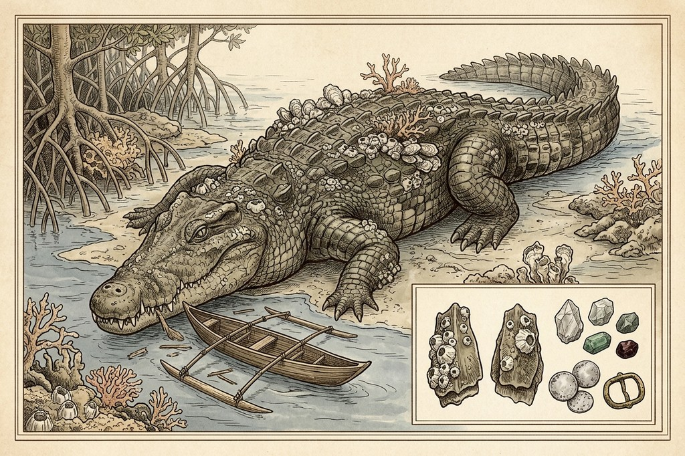

**Território Único:** Labirinto salobro de manguezais, baixios de maré e cascos podres entre **Portocala (`L12`)** e **O Ferro Velho (`N026`)**, no sul de Corallis | **Classificação:** Exemplar Único (`Crocodilo Marinho Pré-Histórico — Patamar Lenda`).

**Rastreamento:** `Sobrevivência` ou `Navegação CD 19` *(rastro largo de cauda varrendo bancos de lodo na maré vazante e cascos de tartarugas-marinhas partidas ao meio)*.

Com quase oito metros e meio do focinho rombudo à ponta da cauda serrilhada, este réptil marinho centenário move-se com igual facilidade entre manguezais escuros e canais abertos de água salgada. Ao longo de mais de um século imóvel nas marés rasas, **colônias reais de cracas, ostras-pedra e corais calcificados cresceram fundidas às suas placas dorsais** — tornando-o visualmente idêntico a um recife submerso até o instante em que o "recife" abre os olhos amarelos e parte uma canoa ao meio. Como crocodilianos gigantes engolem pedras e metal pesado (*gastrólitos*) para triturar ossos no estômago e regular o lastro de mergulho, seu bucho guarda uma fortuna literal engolida de náufragos de cinco gerações.

- **PV**: `156` *(Golpe Devastador: `105+` dano)* | **Iniciativa**: `+4` *(sobe para **`+8`** quando embosca imóvel na maré baixa!)* | **Deslocamento**: `7,5m` *(Natação `15m`)*
- **Atributos**: `FOR 23 (+6)`, `DES 12 (+1)`, `CON 21 (+5)`, `INT 5 (-3)`, `SAB 16 (+3)`, `CAR 7 (-2)`
- **Defesa**: Aparar `18` / Esquiva `18` / Desprevenido `17` *(Placas Dorsais Calcificadas com Corais `+7`)* | **RD Especial**: `4` no dorso e cabeça *(cai para **`1`** no ventre pálido se for virado por cabos/alavancas, içado em estacas ou golpeado por baixo!)*.
- **Ataques**:
  - *Bote da Pedra Viva & Giro da Morte*: `+14` (`3d8 + 6`, `19–20 / ×3`, Especialista `+8` + FOR `+6`). Em acerto contra criatura Média ou menor, **trava a mandíbula (`Atletismo CD 20`)** e entra no **Giro da Morte** na água rasa: no início de cada turno do Encouraçado, o alvo preso sofre **`2d8 + 6` automáticos** e começa a afogar (`CON` conforme Tomo I)!
  - *Chicotada de Cauda Coralina (Arco `4,5m`)*: `+12` (`2d10 + 6` contundente/cortante; **vira canoas e botes `E01–E02` automaticamente** e derruba alvos em terra/convés baixo com *Acrobacia CD 18*).
- **Astúcia de Soberano**: permanece **até `4 horas` submerso sem respirar** (`Percepção CD 21` para distingui-lo de um banco de coral antes de encostar o remo!); aprendeu a **deixar o bote batedor da frente passar em segurança**, atacando sempre a barcaça central carregada de suprimentos ou mergulhadores de sucata!
- **Preparação, Isca & Ponto Fraco**: sondar cada banco suspeito à distância com varas ferradas compridas, atraí-lo para fora d'água sobre toras rolantes com carcaça de porco salgada e usar **polias com corda (`Tomo IX`, `4×` força)** presas a árvores de mangue para expor seu ventre sem armadura coralina.
- **Troféu Único, Gastrólitos & Peso Político**:
  - *Extração (`Sobrevivência CD 16`)*: **Placas Dorsais Coralinas** (`1.400 PP`) **+** o lendário **Tesouro de Gastrólitos do Bucho**: `1.100 PP` em safiras brutas polidas pelo ácido gástrico, florins antigos de ouro, fivelas navais **e um Anel de Sinete intacto de um almirante desaparecido há oitenta anos** (prova documental explosiva nas disputas de salvamento de **Corallis `Z06`**!).
  - *Ofício Único*: as placas dorsais constroem **2 Escudos Torre de Recife** (`Defesa +3`, imunes à maresia e somando `+1 LE` a postos de amurada naval) ou reforçam a proa de um barco (`+15 PV` estruturais).
  - *Política & Status*: herói imediato entre os sucateiros de **Fioresca Coral (`N026`)** e armadores de **Portocala/Biemont (`L12`)**, valendo **`Status S02→S03`** (ou `U02→U03` no `Submundo` se negociar o sinete em segredo!).

### X10 — A Manta-Fantasma *(Arraia-Jamanta Albina Gigante — Presságio Vivo)*

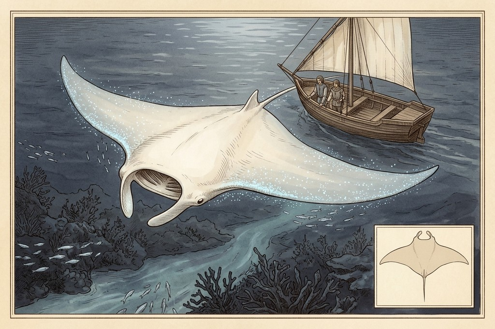

**Território Único:** Canais profundos e atóis externos do **Mar dos Corais** *(vista em noites calmas entre **Pelagosa**, **Claramar `L13`** e o **Atol das Pérolas**)* | **Classificação:** Exemplar Único (**Presságio Vivo Não-Hostil & Santuário Bioluminescente**).

**Avistamento Respeitoso:** `Navegação` ou `Religião/Fé Verdadeira CD 14` em noite sem tempestade *(apagando luzes fortes de bordo e mantendo silêncio no convés)*.

Diferente de todos os outros colossos deste tomo, **A Manta-Fantasma jamais atacou um náufrago sem provocação**. Com nove metros de envergadura de ponta a ponta das nadadeiras peitorais alvas e cicatrizes antigas de redes das quais escapou décadas atrás, seu muco dérmico abriga uma colônia única de plâncton simbiótico que faz sua silhueta **brilhar suavemente em azul-prateado sob a água noturna**. Tanto para os devotos do *Culto das Marés e das Estrelas* quanto para os botânicos e naturalistas da *Academia de Sellene (`N031`, `N032`)*, ela é o mais sagrado presságio vivo dos oceanos: onde a Manta-Fantasma desliza, há águas limpas, cardumes fartos e passagem segura entre os corais cortantes que afundam galeões inteiros.

- **PV**: `135` *(Golpe Devastador: `91+` — relevante apenas se o grupo protegê-la de arpoadores clandestinos ou violar o tabu!)* | **Iniciativa**: `+5` | **Deslocamento**: `18m` *(Planagem oceânica; salto fora d'água `6m`)*
- **Atributos**: `FOR 19 (+4)`, `DES 18 (+4)`, `CON 18 (+4)`, `INT 6 (-2)`, `SAB 18 (+4)`, `CAR 17 (+3)`
- **Defesa**: Aparar `16` / Esquiva `24` / Desprevenido `12` *(Muco Escorregadio `+2`, Especialista `+8` Esquiva; recebe `+6` para escapar de redes e cabos)* | **RD Especial**: `0`
- **Reação Defensiva *(Apenas se Ferida)***: *Onda de Asa Branca*: `+12` (`2d8 + 4` contundente contra botes agressores, erguendo marola que exige *Navegação CD 16* enquanto ela mergulha a toda velocidade para longe do agressor).
- **Astúcia & Memória Gentil**: reconhece cascos específicos pelo som da madeira na água! Aproxima-se de barcos que socorrem náufragos ou apagam arpéus, mas afunda instantaneamente diante de baleeiros armados ou cheiro de sangue de cetáceo no convés.
- **Regras de Bênção Marítima, Colheita Simbiótica & O Grande Tabu**:
  1. **Rota da Luz Calma *(Encontro Benéfico)***: seguir pacientemente sua esteira luminosa durante uma travessia noturna concede **`+4` em todos os testes de *Navegação*** até o amanhecer (revelando canais ocultos nos recifes!), rende pesca farta no cardume que a acompanha (`3d6` rações frescas) e restaura a serenidade da tripulação (`+2` contra medo/motim pela semana seguinte).
  2. **Colheita Sem Sangue (*Muco de Estrela-Fria*)**: um nadador sem armas metálicas que entre na água calma (`Natação` + `Herbalismo` ou `Medicina CD 16`) consegue raspar suavemente com espátula de osso até **`1d3` frascos de Muco Bioluminescente Vivo** sem ferir a Manta — cada frasco (`valor 600 PP` em Sellene/Baldbella) mantém **luz fria subaquática de `6m` por `30 dias` sem oxigênio, fumaça nem calor**, perfeita para explorar ruínas inundadas ou galerias com gases inflamáveis *(e sem acionar a Salamandra-de-Furna `X11`!)*!
  3. **O Maior Tabu do Mar dos Corais *(E o Dilema do Sangue Sujo)***: matar deliberadamente a *Manta-Fantasma* causa **motim imediato** de qualquer tripulação corallina/auroriana honesta, **perda permanente de `-1` grau em `Fé Verdadeira` (`Tomo XVI`)**, fechamento de todos os portos da Liga (`L09–L13`) e caçada vingativa liderada por **Fioresca Coral (`N026`)**. *O gancho sombrio*: laboratórios clandestinos oferecem **`2.500 PP`** no mercado negro por seu fígado luminescente — de modo que **defender a Manta-Fantasma contra um navio baleeiro clandestino** constitui uma das mais belas aventuras navais de Alenia (cumprindo provação direta de **`Fé Verdadeira V02–V03` ou `Status S02–S03`**!).

---

## Pântanos, ruínas e subterrâneos úmidos

### X11 — Salamandra-de-Furna *(Engolidora-de-Tochas)*

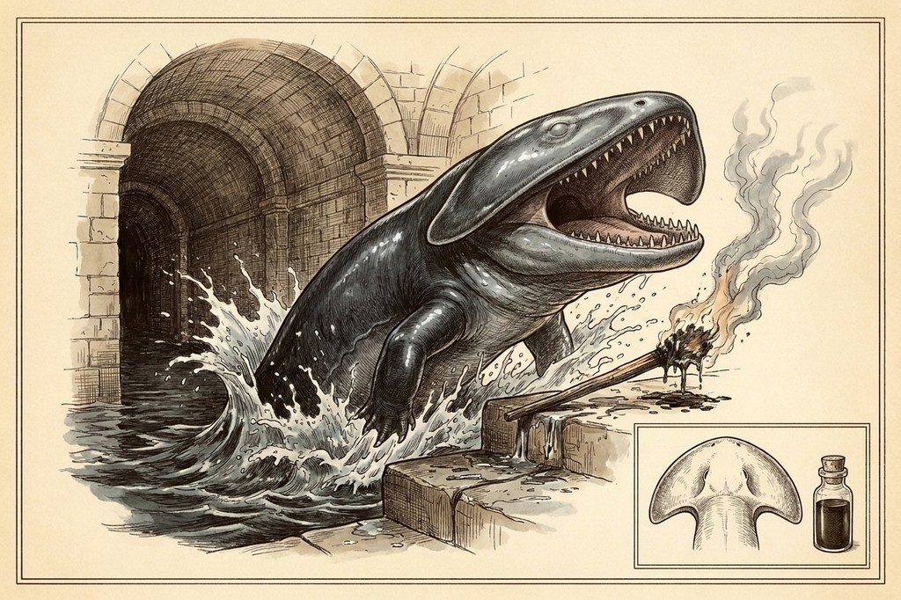

**Território Único:** Rede interligada de rios cársticos subterrâneos, cisternas pré-Forja e galerias alagadas sob as **Ruínas de Vetarx** e os contrafortes fundos sul de **Ferraur** | **Classificação:** Exemplar Único (`Anfíbio Cego Ancestral tipo Koolasuchus — Patamar Lenda`).

**Rastreamento:** `Investigação` ou `Sobrevivência CD 18` *(tochas apagadas intactas boiando em câmaras inundadas sem corpos, marcas de cauda chata em degraus submersos e rãs/peixes mortos flutuando ao menor corte na pele)*.

Um anfíbio pré-histórico achatado de três metros e meio, cabeça larga em meia-lua como uma pá de forja, olhos atrofiados cobertos por pele lisa negro-azulada e temperatura corporal tão baixa quanto a rocha subterrânea — invisível a qualquer percepção baseada em calor ou movimento. Sem precisar comer durante meses seguidos, a **Engolidora-de-Tochas** repousa imóvel no lodo de cisternas antigas sentindo cada vibração na água através de poros sensoriais ao longo do crânio. No instante em que um explorador entra na água até o joelho segurando uma tocha, ela abre a bocarra descomunal criando **um vácuo de sucção súbito que apaga a chama num estalo de água e puxa o portador da luz direto para o escuro profundo**.

- **PV**: `114` *(Golpe Devastador: `77+` dano)* | **Iniciativa**: `+6` *(em câmaras escuras/alagadas)* | **Deslocamento**: `6m` *(Natação `13,5m`)*
- **Atributos**: `FOR 19 (+4)`, `DES 15 (+2)`, `CON 19 (+4)`, `INT 5 (-3)`, `SAB 17 (+3)`, `CAR 5 (-3)`
- **Defesa**: Aparar `15` / Esquiva `23` / Desprevenido `13` *(Pele Viscosa Gelada `+3`, Especialista `+8` Esquiva aquática)* | **RD Especial**: `2` contra fogo e concussão *(muco encharcado; zero contra armas perfurantes e vulnerável a **Cal Virgem Seca**, que lhe causa `2d6` ácido e remove o muco por `2 rodadas`!)*.
- **Ataques**:
  - *Bote de Sucção Engole-Luz (Alcance `4,5m` a partir da água)*: `+12` (`2d8 + 4` perfurante/contundente, `20 / ×2`, Especialista `+8` + FOR `+4`). **Escuridão Súbita**: o jato e o vácuo **apagam instantaneamente todas as tochas e chamas abertas num raio de `3m`**, enquanto a mordida **Agarra o alvo (`Atletismo CD 19`)** e o arrasta `4,5m` para a água funda!
  - *Muco Cutâneo Neurotóxico (Passivo & Contato)*: qualquer criatura que seja **Agarrada**, golpeie a Salamandra desarmada **ou tenha qualquer ferimento aberto** (esteja abaixo do PV máximo) e receba respingos a até `1,5m` faz **`CON CD 18`**; em falha, sofre **`2d6` de dano venenoso** e fica **Entorpecida (`-3` em ataques e DES, sem Reações)** por `2 rodadas` (`Antídoto Comum` do Tomo IX concede `+4` no teste!).
- **Astúcia de Soberano**: completamente cega (**imune a ofuscamento**; percebe qualquer vibração na água a `30m`), **não morde pedras nem varas batidas na borda** — distingue perfeitamente a cadência de dois pés humanos caminhando na água! Ataca sempre quem carrega a única luz do grupo e recua por sifões submersos se a água for contaminada com cal ou óleo.
- **Preparação, Isca & Ponto Fraco**: substituir tochas abertas por **Lanterna Blindada Vedada (`Tomo IX`)** ou pelo *Muco Frio da Manta-Fantasma (`X10`)*, vestir luvas grossas de couro encerado, pendurar na água rasa uma bexiga cheia de sangue morno batendo com cordel (imitando pulso vivo!) e drenar ou cercar o sifão com grade de ferro antes do golpe.
- **Troféu Único, Ofícios & Peso Político**:
  - *Extração (`Alquimia` ou `Medicina CD 18` com luvas e frascos de vidro escuro de `Fugong`)*: **`4` Doses Únicas da Secreção da Furna** + couro anfíbio impermeável (`1.800 PP`).
  - *Ofício Duplo (Cura ou Sombra)*: nas mãos de um cirurgião sênior de **Baldbella (`L10`, `N035`)** ou **Loreo Seleni (`N032`)**, refina-se em `4` doses do **Bálsamo Sem-Dor** (permite realizar cirurgias extremas — inclusive extração do Simbionte! — concedendo **`+4` em *Medicina***); nas mãos de um mestre do **`Submundo (U03+)`**, vira o temido veneno de ferida *Água-Muda* (`CON CD 18`, `3d6` veneno + paralisia vocal por `10 min`).
  - *Política & Status*: disputadíssima entre o **Herbário/Academia de Sellene (`L13`)** e corretores ocultos de **Dobalbek (`L21`)**, valendo **`Status S02→S03`** (ou **`Submundo U02→U03`**).

### X12 — Serpente-de-Âmbar *(Sucuri-Real Ancestral)*

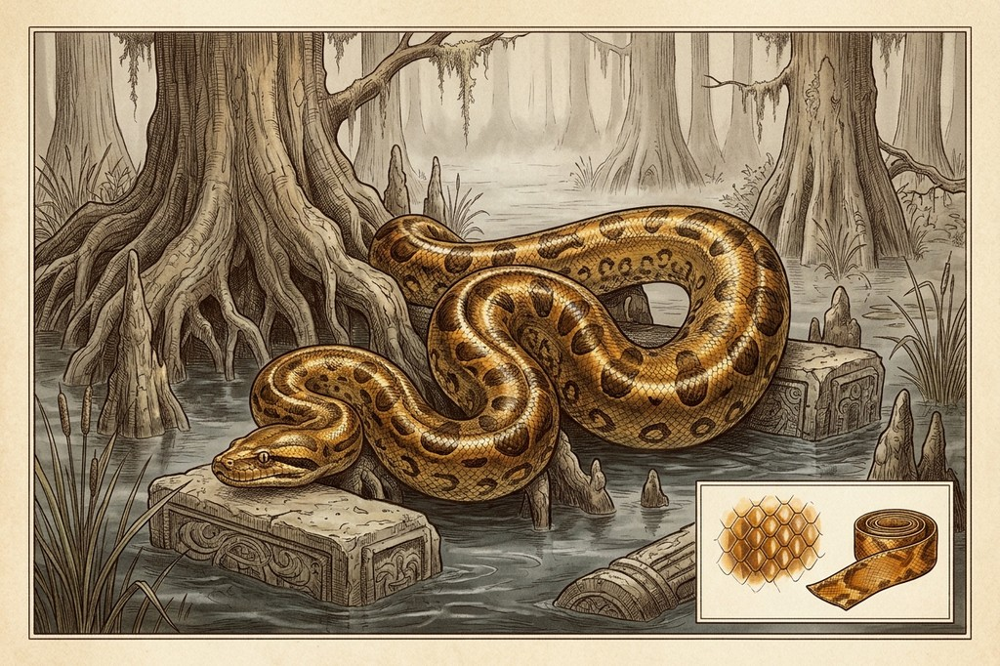

**Território Único:** Águas escuras e raízes submersas de ciprestes milenares no coração disputado do **Pântano de Voernock (`Z01`, entre Yõketsu `L05` e Vaarsa `L04`)** | **Classificação:** Exemplar Único (`Constritora Ancestral Gigante — Patamar Lenda`).

**Rastreamento:** `Sobrevivência CD 18` *(mudas translúcidas de pele com um metro de circunferência presas em raízes aquáticas, jacarés menores esmagados inteiros e galhos grossos polidos pelo peso de seu corpo acima dos canais)*.

Grossa como um tonel de vinho de Biemont e comprida o bastante para atravessar um canal inteiro de margem a margem (`quase onze metros`), a **Serpente-de-Âmbar** reveste-se de escamas hexagonais amarelo-escuras com reflexo iridescente de resina antiga sob a lanterna. Não possui uma única gota de veneno — nem precisa: sua musculatura hidráulica **dobra cotas de malha para dentro das costelas da vítima** em segundos, abafando o grito antes que o companheiro na proa da chata se vire. Mercadores patrícios e lordes pagam fortunas incalculáveis por seu couro — **desde que não tenha sido furado por lanças, virotes ou espadas**, exigência que já matou dezenas de caçadores gananciosos que tentaram capturá-la sem cortar suas escamas!

- **PV**: `138` *(Golpe Devastador: `93+` dano)* | **Iniciativa**: `+5` | **Deslocamento**: `9m` *(Natação `13,5m`, Escalada em árvores/ruínas `9m`)*
- **Atributos**: `FOR 23 (+6)`, `DES 16 (+3)`, `CON 19 (+4)`, `INT 5 (-3)`, `SAB 17 (+3)`, `CAR 9 (-1)`
- **Defesa**: Aparar `17` / Esquiva `20` / Desprevenido `14` *(Escamas Iridescentes Imbricadas `+4`, Treinado `+3` Esquiva)* | **RD Especial**: `2` contra cortes rasos *(lâminas escorregam no verniz natural das escamas)*.
- **Ataques**:
  - *Bote Silencioso das Raízes (Alcance `4,5m` da água ou copa baixa)*: `+14` (`2d8 + 6`, `19–20 / ×2`, Especialista `+8` + FOR `+6`), seguido de **Enlaçar Gratuito (`Atletismo CD 20`)**.
  - *Constrição Quebra-Malha (Automático no início de cada turno da Serpente contra `1` alvo Enlaçado)*: causa **`3d8 + 6` contundente**, **impede gritar, conjurar preces em voz alta ou sacar armas Médias/Pesadas** *(somente armas Leves já acessíveis em Cinto/Bandoleira `Tomo IX` podem atacar, com `-2`)*; `2` rodadas seguidas sofrendo Constrição iniciam asfixia (`CON CD 16` ou cai inconsciente em `0 PV`)!
- **Astúcia de Soberano**: **nunca ataca da água quando os caçadores estão olhando para a água** — sobe horas antes para os galhos horizontais acima do canal e deixa cair meia tonelada de músculos sobre o homem do leme! Se sofrer dano perfurante/cortante pesado (`40+ PV`), desenrola-se num chicote d'água turva e desaparece por galerias submersas sob o tronco oco da árvore-mãe.
- **O Desafio do Couro Sem Furos *(Preparação & Captura Limpa)***: para abater ou render a *Serpente-de-Âmbar* **sem rasgar o couro com lâminas, flechas ou arpões**, o grupo precisa combinar **Isca Viva/Quente recheada com doses triplas de *Sonífero Herbal* (`Tomo IX`) + *Casca-amarga de Voernock* (`H17`)** (`CON CD 17` impõe lentidão `-3` à serpente!), laços de **Corda de Seda Trançada (`CD 20`)** com polias e armas puramente **contundentes** (maças, bastões ferrados, redes lastradas)!
- **Troféu Único, Ofícios & Peso Político**:
  - *Extração (`Sobrevivência CD 17`)*:
    - *Couro Perfurado em Combate Comum*: rende `700 PP` em peças menores de selaria e bainhas nobres.
    - *Couro Inteiriço Imaculado (Zero dano cortante/perfurante no abate/captura)*: vale **`3.000 PP` (`300 PO`)** e permite a um mestre curtidor confeccionar a lendária **Couraça de Escamas de Âmbar** — armadura leve única no mundo (`Defesa +3`, **Penalidade `0`**, peso `2,5 kg`, zero RD passiva conforme o Tomo I; concede **`+2` contra Agarrar/Enlaçar**, impermeabilidade total nos pântanos e **`+1` de circunstância em *Etiqueta* e *Persuasão* em qualquer corte nobre ou câmara mercantil** de Alenia!).
  - *Política & Status*: como vive exatamente na fronteira disputada de **Voernock (`Z01`)**, tanto **Kenshin Tsurumaru (`L05`, Yõketsu)** quanto **Marechal Leonastis (`L04`, Vaarsa)** reivindicam direito senhorial sobre a caça — decidir a quem entregar o tributo (ou vestir a couraça diante de ambos!) define alianças em Aurora e vale **`Status S03`**.

---

## Resumo comparativo de caça, armamento e troféus (`X01`–`X12`)

| Código & Soberano Único | Região / Feudo (`Tomo XVII`) | `PV` / `Defesa` (`Esq.`) | Contramedida / Preparo Chave | Valor & Destino Político Principal |
| :--- | :--- | :---: | :--- | :--- |
| **`X01` Cervo-de-Escória** | Divisa Aurora–Gaddra (`L03/L04`) | `118` / `25 Ap` (`20`) | Sal + `H16`, estreito `<3m`, lança c/ travessa ou maça | `1.800 PP` • `2` Pavêses `Def +3` ou `+1 LE` portão • `Status S03` |
| **`X02` Urso-das-Cinzas (*Kragh*)** | Escarpas de Gaddra (`L17/Z07`) | `148` / `19` | Tomar a crista alta, isca de cordeiro e mel, lança firmada | `2.200 PP` • Têmpera de Kragh (`6` armas `+1 dano`) • Paz em `Z07` |
| **`X03` Sombra-Salobra** | Salares de Kalis (`L21/L22`) | `96` / `25` | Lentes de vidro escuro (`N085`), isca c/ pó de tinturaria | `1.600 PP` • Gibão Cor-de-Osso (`Def +2, +2 Furtiv.`) • `Status S03` |
| **`X04` Javali-de-Muralha** | Matas de Aurora (`L01/L03`) | `132` / `19` (`RD 4`) | **Lança c/ Travessa** + **Fosso Estacado** (cuidado c/ `0 PV`!) | `1.500 PP` • Couraça `Def +3` anti-sangramento + Banquete diplomático |
| **`X05` Cão-Rei de Carniça** | Frentes de Guerra (`Z01–Z08`) | `108` / `23` | Fogo/óleo p/ separar matilha, paliçada de uma entrada | `1.400 PP` • Estandarte `+2 Moral` permanente na guarnição (`Tomo XV`) |
| **`X06` Águia-Quebra-Ossos** | Ferraur & Copas (`L07/L08/Z03`) | `92` / `25` | Ancorar equipe c/ **Pítons**, rede/arpéu no rasante contra o sol | `1.900 PP` • `24` Flechas Soberanas `+1` • Trégua entre `L07` e `L08` |
| **`X07` Velho Quilha-Branca** | Alto-Mar (`Corallis / Norte`) | `210` / `16` (`RD 4`) | Navio `E06+`, **Balista `M09`** + `4` barris-boia nos cabos | `4.200 PP` • Espermacete + Âmbar-Cinza (paga uma Torre `F04`!) • `S04` |
| **`X08` Imperatriz Vermelha** | Fossa Fria (`L13 / Cinzas`) | `168` / `21–24` | Proteger o leme, machados preparados p/ decepar tentáculos (`28 PV`) | `2.800 PP` • `3` Arpéus `+2` + Tinta de Tratados em Sellene • `S04` |
| **`X09` Encouraçado do Recife** | Mangues & Ferro Velho (`L12`) | `156` / `18` (`RD 4`) | Sondar bancos c/ vara, polias p/ virar e expor o ventre (`RD 1`) | `2.500+ PP` • Couraça + Gastrólitos + **Sinete Perdido (`Z06`)** |
| **`X10` Manta-Fantasma** | Mar dos Corais (`Santuário`) | `135` / `24` | **Não matar!** Apagar luzes, nadar desarmado (`CD 16`) p/ muco frio | **Rota `+4` Navegação** + `1d3` Lâmpadas Frias (`600 PP/un`) • **Tabu** |
| **`X11` Salamandra-de-Furna** | Ruínas Alagadas (`Vetarx`) | `114` / `23` (`RD 2`) | **Lanterna vedada / Luz fria**, luvas, cal virgem e antídoto | `1.800 PP` • `4` Bálsamos Cirúrgicos `+4` **ou** veneno *Água-Muda* |
| **`X12` Serpente-de-Âmbar** | Pântano de Voernock (`Z01`) | `138` / `20` (`RD 2`) | Vigiar as copas! Sonífero + `H17` + maças/redes p/ **zero furos** | **`3.000 PP` sem furos** • Couraça de Âmbar (`Def +3, +1 Corte`) |

---

## Caderno reservado ao mestre

Este caderno selado traz os segredos de campanha por trás dos **12 Soberanos Solitários**, garantindo que cada caçada gere consequências duradouras e reviravoltas memoráveis no **Ano 418 EF**.

### 1. Por Que Cada Soberano É Realmente Único *(E o Que Eles Guardam)*

1. **A Ponta Cravada no Velho Quilha-Branca (`X07`) e a Primeira Devolvida (`N041`)**:
   - Uma das nove pontas de arpão antigas cravadas no crânio branco de `X07` traz a marca pessoal do navio original de **Marella de Claramar (`N041`)**, afundado gerações atrás perto de *Thanatos*! Recuperar esse ferro dá aos eruditos de *Sellene (`N031`)* a prova física da data real em que Marella morreu pela primeira vez.
2. **O Anel de Sinete no Bucho do Encouraçado (`X09`)**:
   - O anel engolido pelo crocodilo pertenceu ao avô de *Corardo della Rocca (`N021`)*, trazendo gravada uma cláusula marítima que prova que o salvamento dos recifes sul pertencia por acordo original aos práticos livres — motivo pelo qual tanto **Baldbella (`L10`)** quanto **Alineus (`L09`)** pagarão caro para comprar (ou esconder!) a joia das mãos de **Fioresca Coral (`N026`)**.
3. **O Segredo Sob a Toca da Salamandra-de-Furna (`X11`)**:
   - A Engolidora-de-Tochas escolheu justamente aquela cisterna sob *Vetarx* porque um ralo submerso de pedra antiga exala água fria puríssima sem parasitas — guardando, atrás de seu ninho lodoso, uma **arca lacrada em chumbo da Era Pré-Forja** intacta há séculos.
4. **Caçadores Rivais na Mesma Trilha *(Complicação Viva)***:
   - Nunca deixe o grupo caçar sozinho no mato por semanas sem tensão humana:
     - Na trilha da **Serpente-de-Âmbar (`X12`)** em Voernock (`Z01`), batedores de *Vaarsa* e espadachins de *Yõketsu* seguem a mesma muda de escamas — e cada lado exige que os PJs entreguem o couro em nome do seu senhor!
     - No encalço da **Manta-Fantasma (`X10`)**, um brigue sem bandeira financiado por contrabandistas de *Kalima (`L22`)* prepara arpões farpados na calada da noite — cabendo aos PJs interceptar os caçadores ilegais antes que o sangue manche o Mar dos Corais.

### 2. Consequência Permanente de Mundo (*Sem "Respawn"*)

- Anote no calendário da campanha cada Soberano abatido, capturado ou salvo. Quando `X04` (*Quebra-Piques*) tomba, as estradas florestais de Dahrma ficam mais seguras (`+10 PP/mês` nas aldeias vizinhas), mas lobos menores multiplicam-se sem o varrão dominante; quando `X06` (*Águia-Quebra-Ossos*) é morta em vez de poupada, o **Conselho das Copas (`L08`)** fecha o comércio de arcos em Vergod por um trimestre inteiro!

---

## Escudo de referência rápida de caçadas lendárias

| Situação em Mesa | Regra Rápida (`Tomo XVIII`) |
| :--- | :--- |
| **Entrar no território sem estudar hábitos nem rastrear** | O Soberano escolhe o terreno e recebe **`+4` em Furtividade/Iniciativa** na 1ª rodada. |
| **Lança de Contenção c/ Travessa (*Preparar Ação* vs Investida)** | **Dano dobrado**, **ignora até `4` de `RD Natural` frontal** e impede a fera de avançar pela haste. |
| **Fosso Pesado ou Rede Lastrada (`CD 18–20`)** | Reduz deslocamento à metade, **suspende Voo/Investida** e reduz Esquiva de quadrúpedes em `-4`. |
| **Extração da "Hora de Ouro" pós-abate** | `Faca de Esfolar (+2)` ou `Instrumentos de Baldbella (+2)`; falha por `5+` reduz valor venal em `50%`. |
| **Couro da Serpente-de-Âmbar (`X12`) sem furos** | Vale **`3.000 PP`** e forja a *Couraça de Âmbar* (`Def +3, Pen 0, +1 Etiqueta/Persuasão`) — exige zero dano cortante/perfurante! |
| **Violar o Tabu da Manta-Fantasma (`X10`)** | Motim imediato da tripulação, **`-1` grau em `Fé Verdadeira`** e interdição nos portos de Corallis (`L09–L13`). |
